# AutoFDO 反馈导向优化与 Android 验证

编译器无法预先知道线上设备最常执行哪些代码，只能先用静态启发式规则决定函数内联、基本块顺序和热点/冷点布局。函数内联是把被调用函数展开到调用位置，基本块则是一段没有中途分支的连续指令。AutoFDO（Automatic Feedback-Directed Optimization，自动反馈导向优化）把真实工作负载中的执行样本转换成 LLVM 采样 Profile，再用这份记录热点与分支分布的 Profile 重新构建二进制，让编译器根据运行数据调整这些决策。

它不会在手机运行时“自动优化”某个应用，也不同于 ART 的 Baseline Profile。AutoFDO 的反馈流程发生在构建系统中：

```text
运行代表性工作负载
  → 采集指令/分支历史
  → 地址与符号还原
  → 生成 LLVM sample profile
  → 将 Profile 接入目标源码与工具链重新编译
  → A/B 性能与稳定性验证
  → 发布 profile 或二进制
```

<!-- gracker-diagram: ch18-04-01-feedback-loop -->
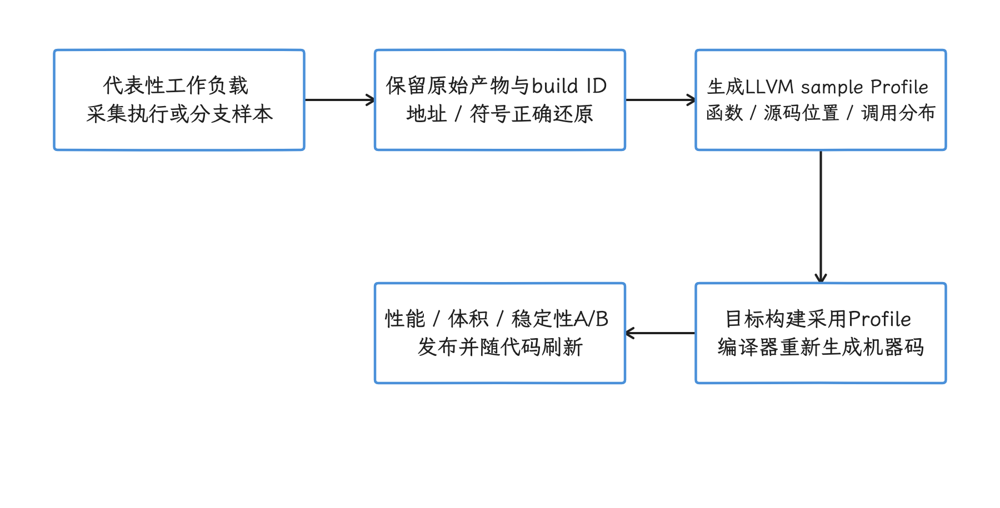

图：AutoFDO 将运行样本转换为编译输入，再生成、验证和发布新的原生二进制。 用户设备运行已构建的产物；采样、转换和编译各有版本及工具依赖，收益还需 A/B 证明。

Android 17 提供两类接入方式：

- 平台用户空间（userspace）的原生库和可执行文件由 Android 平台构建系统 Soong 的 `afdo` 能力接入；
- Android 通用内核（ACK）`android17-6.18-2026-06_r6` 携带通用内核镜像（GKI）的 `kernel.afdo`，Android 内核的 Bazel 构建系统 Kleaf 在构建内核二进制 `vmlinux` 时引用它。

当前基线为 AOSP `android-17.0.0_r1` 和 ACK `android17-6.18-2026-06_r6`。Android 15/16 分支只用于说明内核 AutoFDO 的推广过程。

---

## Sample PGO 与 AutoFDO

PGO（Profile-Guided Optimization，Profile 引导优化）按 Profile 的产生方式大致分为两类：

| 类型 | 数据来源 | 优点 | 主要代价 |
|---|---|---|---|
| 插桩 PGO（Instrumentation PGO） | 编译器插入计数器，运行后产生精确计数 | 基本块和分支边信息完整 | 需要插桩构建，运行开销与代码布局都会变化 |
| 采样 PGO（Sample PGO）/ AutoFDO | 硬件性能监控单元（PMU）、分支轨迹或采样分析器记录运行位置 | 不必改源代码或插入计数器，适合接近生产环境的工作负载 | 样本可能丢失或偏斜，地址还原和工作负载代表性更难保证 |

名称中的 “Automatic” 指 Profile 可以从采样数据自动转换并进入反馈构建，不表示系统可以省略代表性工作负载、符号、工具链和验证。

<!-- gracker-diagram: ch18-04-02-pgo-types -->
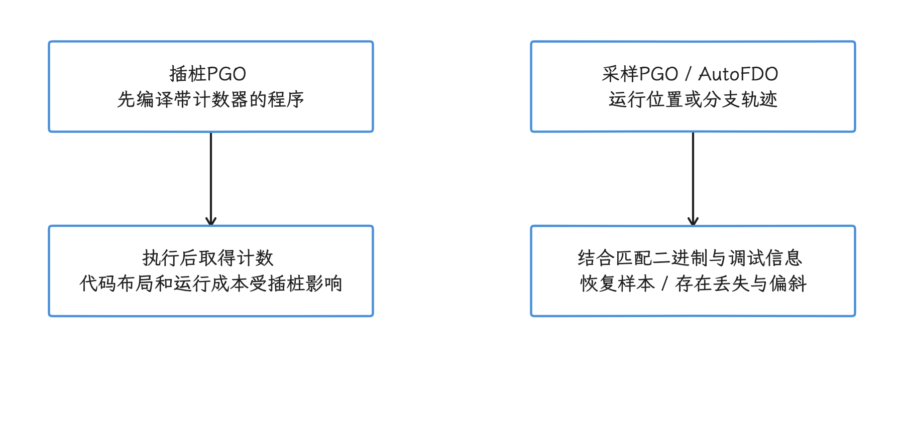

图：插桩 PGO 从计数器取得运行信息，AutoFDO 从样本与二进制还原热点。 采样无需计数器插桩，仍有硬件缓冲、带宽、后处理和丢失成本；Automatic 不消除质量控制。

采样同样有开销。CoreSight 轨迹会产生存放硬件跟踪数据的 AUX 数据流，需要缓冲、压缩和后处理；数据量过大时还可能溢出（overflow），或被 simpleperf 限制采样速率。它不需要在程序中插入计数器，但采集过程仍会影响设备运行。

### 编译器如何使用 Profile

LLVM 采样 Profile 可以影响：

- 热点调用的内联决策；
- 基本块与函数的布局；
- 分支权重；
- 热/冷代码拆分；
- 优化预算在不同函数上的分配。

最终改变的是机器码，不会改变 C/C++ 源码定义的程序语义。Profile 偏差可能造成代码体积膨胀或性能回退，编译器和链接器本身也可能存在缺陷。Android 的发布流程仍要比较 Profile、二进制的代码段（text section）、基准性能和稳定性。

<!-- gracker-diagram: ch18-04-03-compiler-decisions -->
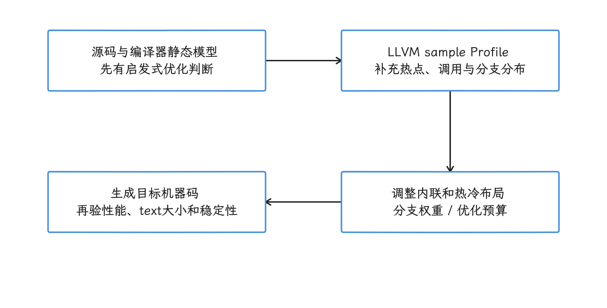

图：函数、调用与分支分布影响内联、布局和优化预算，最终变化落在机器码中。 这是优化决策链；定义良好的程序语义应保持，样本偏差、体积增长和工具缺陷仍需回归。

---

## Android 17 的用户空间接入

Soong 的 `build/soong/cc/afdo.go` 负责处理 C/C++ 目标的 AFDO 属性、Profile 查找和编译参数。模块使用下面的属性声明希望接入采样 Profile：

```bp
afdo: true,
```

Android 17 的固定源码标签（tag）中，以下模块开启了 `afdo: true`：

- `frameworks/base/libs/hwui/Android.bp` 的 `libhwui`；
- `art/libartbase/Android.bp` 的 `libartbase`；
- `art/runtime/Android.bp` 的 `libart`。

`afdo: true` 只声明构建接入。固定 r1 的 afdo.go 会在 eng 与 native coverage 构建中关闭 AFDO，并跳过 host；实际应用还依赖按架构解析的 fdo_profile、目标变体与有效 Profile 路径。启用目标还会把 AFDO 变体沿部分静态依赖传播，不能据根模块属性认定全部动态依赖都已优化。核验详细构建日志中的 `-fprofile-sample-use=` 及其路径，同时检查编译与链接参数。

采集用初始构建也要保持 AFDO 准备条件：r1 为相关目标加入 `-fdebug-info-for-profiling`、`-funique-internal-linkage-names` 和 flow-sensitive discriminator 参数，甚至在尚无 Profile 时也生成唯一内部链接名。先用没有这些命名条件的旧二进制采样，再给目标开启新命名，会削弱样本匹配。`fdo_profile.incomplete_coverage` 则决定是否声明 sample-accurate，不能把它与内核转换器的 symbol-list 开关混为一项。

<!-- gracker-diagram: ch18-04-04-soong -->
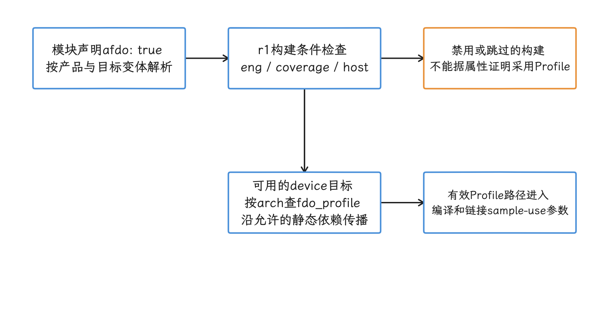

图：r1 Soong 按构建类型、架构 Profile 和依赖变体决定是否应用 AFDO。 初始采集构建也需保持内部符号命名与 discriminator 条件；动态依赖不随根目标全部传播。

### 与 ART Baseline Profile 的区别

| 维度 | AutoFDO | Baseline / Runtime Profile |
|---|---|---|
| 主要代码 | C/C++ 原生二进制、库和内核 | 应用 DEX 中的 Java/Kotlin 方法 |
| 编译器 | Clang/LLVM | ART / dex2oat |
| Profile 记录单位 | 地址、源码位置、调用与分支样本 | DEX 类和方法热点 |
| 生效时机 | 系统或内核构建 | 安装、更新或后台 dexopt |
| 谁负责 | Android 平台、内核、OEM 构建团队 | 应用开发者、分发渠道和 ART |

Baseline Profile 标记应用中哪些 DEX 路径值得提前编译。AutoFDO 让 `libhwui`、`libart`、Bionic 或内核等原生目标按照真实系统热点重新生成机器码。两者可以同时改善启动，但不能互换。

<!-- gracker-diagram: ch18-04-05-native-art -->
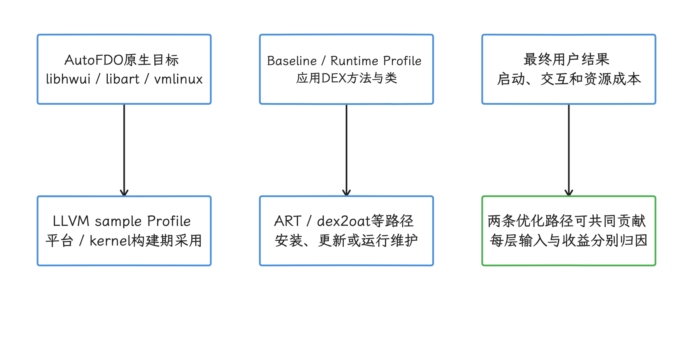

图：AutoFDO 优化 libhwui、libart 与内核等原生构建，Baseline/Runtime Profile 引导 ART 处理应用 DEX。 libart 自身的机器码优化和 libart 编译应用方法是不同层次，Profile 不能互换。

---

## Android 17 GKI 已接入 `kernel.afdo`

ACK `android17-6.18-2026-06_r6` 中有三条直接证据：

1. `gki/aarch64/afdo/kernel.afdo` 存在；
2. 同目录 README 记录 Profile 来源、工作负载、转换命令和基准；
3. 根 `BUILD.bazel` 的 GKI 目标设置：

```python
clang_autofdo_profile = ":gki/aarch64/afdo/kernel.afdo"
```

r6 的 BUILD.bazel 将 AArch64 GKI 目标绑定到 tag 内的 kernel.afdo；`scripts/Makefile.autofdo` 再把 CLANG_AUTOFDO_PROFILE 接入 C/Clang 和 Rust 参数，ThinLTO 还接收 linker sample profile。README 标明采集内核为 6.18.21、SHA 3ad9926a5d177675fe818af93dcb3451532c3165、build server ID 15434288。固定 tag 只冻结这一快照；复现须保存源码、Profile 内容摘要和工具链，设备实际 release 是否采用还要查最终构建记录。

<!-- gracker-diagram: ch18-04-06-gki-build -->
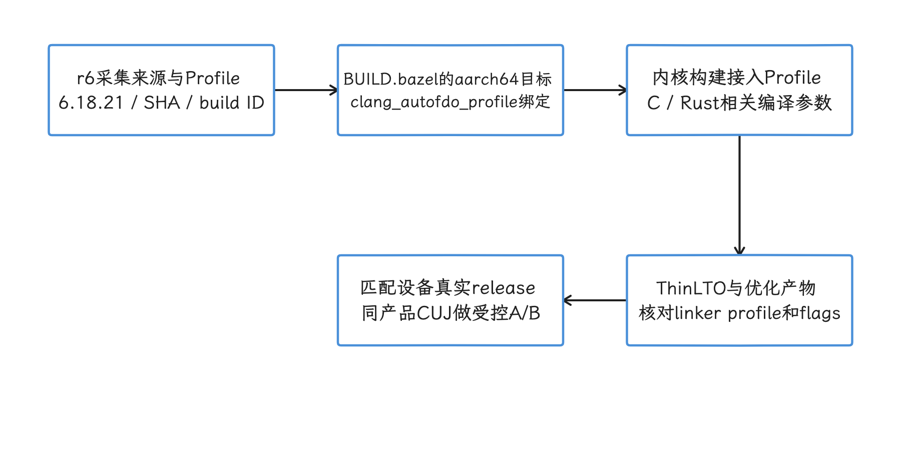

图：r6 的 BUILD.bazel 绑定 kernel.afdo，内核 Makefile 将它带入对应编译与 ThinLTO 流程。 固定 Profile 记录采集 SHA/build ID；README 的 Pixel 8 初步结果和 Binder 最佳轮次不能替代目标产品实测。

### Android 17 README 中的性能数据

固定标签的 README 给出以下 Pixel 8 测试结果。表中保留原始基准名称，便于与 README 对照：

| 基准项目 | 改善幅度 |
|---|---:|
| Boot time | 1.1% |
| Cold App launch time | 6.6% |
| Binder-rpc | 15% |
| Binder-addints | 23% |
| Hwbinder | 23% |

这些数字不能直接当成所有 Android 17 设备的收益。README 同时注明：

- 结果仍处于初步阶段（preliminary）；
- 当时 Pixel 针对 6.18 内核的功耗、CPU 动态调频和调度尚未完全调优；
- Binder 三项采用多轮测试中的最佳结果，以应对各轮测试之间的波动。

这些结果只说明该 Profile 在特定 Pixel 8 实验中观察到正向变化。OEM 仍要在自己的 SoC、调度配置、厂商模块（vendor modules）和关键用户流程（Critical User Journey，CUJ）上重新进行受控 A/B 测试，也就是只改变是否使用 Profile，其余条件保持一致。

---

## 分支 trace 从哪里来

### PMU、ETM/ETE 与 TRBE 的分工

PMU 是 ARM CPU 提供硬件性能事件的基础设施，simpleperf 通过 Linux perf 接口访问它。要生成高质量 AutoFDO Profile，仅有周期采样未必足够；Android 内核流程还会使用 CoreSight 分支轨迹，还原实际执行过的指令流（instruction stream）。

硬件实现随 SoC 变化：

- ETM（嵌入式跟踪宏单元，Embedded Trace Macrocell）是常见的 CoreSight 指令轨迹源；
- ARMv9 平台可以使用 ETE（Embedded Trace Extension）；
- CoreSight ETR 把轨迹数据写入系统内存；
- TRBE（跟踪缓冲扩展，Trace Buffer Extension）也能把轨迹数据写入内存缓冲区，是另一种硬件实现。

simpleperf 对用户暴露的事件名仍是 `cs-etm`。命令中的 `cs-etm:k` 是软件接口名，不代表每台设备底层都只使用传统 ETM。ACK 当前标签中既有 `coresight-etm4x-core.c`，也有 `coresight-trbe.c`；具体设备是否提供这些能力、调用方是否有权访问，取决于 SoC、内核配置和权限。

固定 r1 的 simpleperf 文档说明，ARMv8 的 ETM 等 CoreSight 组件通常属于外部调试接口，量产设备往往关闭；root 或可调试镜像不会自动开放硬件。该文档的 Pixel 8 示例使用 ETE + ETR，并因核心 TRBE 勘误避免使用 TRBE；2026 年 AutoFDO 博客则描述 Pixel 设备上的 ETE/TRBE 采集流程。两者描述的构建与设备范围不同，不能据其中一个例子概括所有 Pixel。实际选择按目标芯片勘误、固件、设备树、内核驱动和可用 sink 核实。

<!-- gracker-diagram: ch18-04-07-trace-hardware -->
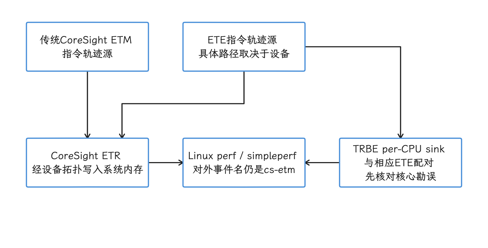

图：区分 ETM/ETE 轨迹源、ETR/TRBE sink 和 simpleperf 的 cs-etm 接口。 连接图表示文档允许的候选路径；固件授权、设备树、驱动和 CPU 勘误决定目标设备实际可用组合。

### 为什么工作负载比采样时长更重要

Profile 只描述采集期间实际执行的代码。如果只跑一次开机流程，样本会过度偏向启动；如果只启动一个应用，又会遗漏 Binder、文件系统、网络、内存回收和后台任务。

Android 内核 README 使用的代表性流程包括：

- 对前 100 个应用执行自动遍历界面的 App Crawler；
- 对单个应用运行 crawler 3 分钟，共执行两次；
- 单应用启动 3 秒、执行 15 次；
- 每次启动后终止进程并清理缓存，以覆盖冷启动。

README 的“终止进程并清理缓存”未细分缓存层次，复现时还须记录进程、页缓存与应用数据各自处理方式，不能仅凭 cold 标签认定条件相同。官方博客报告实验室负载与内部 fleet 执行模式约 85% 相似，但未在该文给出完整相似度算法；这不是 85% 代码覆盖率或 OEM 工作负载质量证明。

<!-- gracker-diagram: ch18-04-08-workload -->
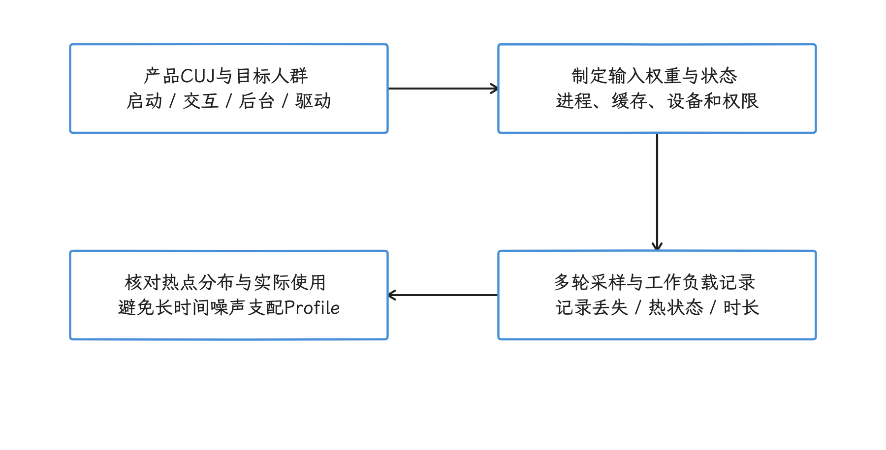

图：先按产品 CUJ 规划输入与权重，再记录进程和缓存状态及实际采样覆盖。 r6 的 top100/crawler/launch 是既定采集方案；博客 85% 相似度不是代码覆盖率，也不替 OEM 验证代表性。

---

## 从 `perf.data` 生成 `kernel.afdo`

Android 17 的 simpleperf 文档和当前 ACK README 给出的内核流程可以整理成四步。

### 1. 准备可还原的构建

至少保留：

- 与测试镜像匹配的未剥离 `vmlinux`；
- 内核模块的未剥离 ELF（Linux 原生二进制格式）文件，即仍保留调试符号的二进制；
- 用于确认二进制版本的 build ID；
- 当前源码、工具链和构建配置；
- 足够的 DWARF 行号、内联与 discriminator 信息；`-fdebug-info-for-profiling` 有助于归因，但不是单独替代调试信息的开关。r6 的 AFDO Makefile 在未启用 CONFIG_DEBUG_INFO 时补入 `-gmlt`。

地址还原必须使用采集镜像配套的 vmlinux 与模块，先核对 build ID、构建记录和代码布局；未剥离 ELF 不自动证明有可用 DWARF。`--allow-mismatched-build-id` 在 r1 的分支列表路径会清空匹配键里的 build ID，允许不同来源混入，所以下面的默认转换保留严格匹配。源码更新后的 Profile 重应用是后续阶段，不能用它为错误的采集二进制地址还原辩护。

<!-- gracker-diagram: ch18-04-09-binary-binding -->
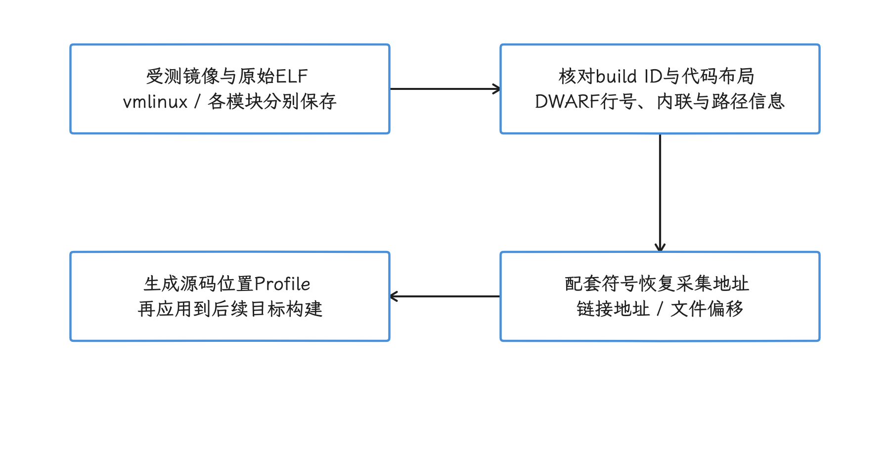

图：地址还原先绑定采集镜像的原始 ELF、build ID 和调试信息，生成 Profile 后再谈源码漂移。 未剥离不保证有 DWARF；放宽 build ID 会削弱来源约束，不能用目标源码相近解释错误地址还原。

### 2. 在设备上录制并转换为分支列表

采集前先确认调试权限、CoreSight 源与 sink、内核配置和配套符号产物。以下命令全部从主机发起，在另一路会话运行预定 CUJ；record 只在给定窗口采集，不会自动触发业务。每轮保存独立文件名和工作负载记录，后续 branch02 等文件必须实际生成，不能把示例列表当作已有输入。

```bash
adb root &&
adb shell 'cd /data/local/tmp &&
  mkdir -p branch_data &&
  simpleperf record -e cs-etm:k -a --duration 60 -z -o perf.data &&
  simpleperf inject -i perf.data -o branch_data/branch01.data \
    --output branch-list --binary "^\[kernel\.kallsyms\]$" &&
  test -s branch_data/branch01.data'
```

`perf.data` 是原始采集容器，branch01.data 是中间分支列表。`--binary` 接受名称正则，上例精确匹配 `[kernel.kallsyms]`，不会读取同名符号文件。分支列表可能仍保存内核运行地址和 kernel_start_addr；主机转换结合配套 vmlinux 还原链接地址，再输出文件偏移，不能把 branch-list、AutoFDO 文本与 LLVM Profile 当作同一种地址格式。

前面的 `record -z` 只压缩 `perf.data`；如需压缩分支列表，应为 `inject --output branch-list` 另加 `-z`。文档建议多次录制，因为 ETM 指令流在高负载下可能因缓冲区溢出或采样限速而丢失。多份 Profile 能增加覆盖范围，但也可能放大异常工作负载产生的噪声。

<!-- gracker-diagram: ch18-04-10-device-capture -->
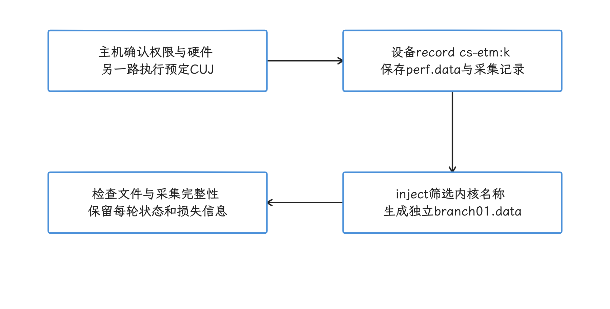

图：record 在业务窗口采集 perf.data，inject 再生成目标内核的 branch-list。 record 不触发 CUJ；-z 对 record 容器和 branch-list 输出分别配置，失败或空输出不能直接进入下一阶段。

### 3. 在主机上生成 AutoFDO 文本 Profile

先把匹配的未剥离 vmlinux 放在主机当前工作目录，并核对其 build ID。下例只使用前一步确实生成的 branch01；已有多轮输入时，先逐份拉回再将 -i 改成逗号分隔列表。不要把不同 build ID 或不同目标的样本无条件合并。

```bash
mkdir -p branch_data &&
adb pull /data/local/tmp/branch_data/branch01.data branch_data/branch01.data &&
test -s branch_data/branch01.data &&
test -r vmlinux &&
simpleperf inject \
  -i branch_data/branch01.data \
  --binary '^\[kernel\.kallsyms\]$' \
  --symdir . \
  -o kernel.autofdo \
  -j 20 &&
test -s kernel.autofdo
```

kernel.autofdo 保存按目标 ELF 文件偏移表示的执行区间、地址和分支计数，还不是按源码位置归因的 LLVM Profile。r1 的转换流程可能跳过找不到匹配符号的 binary，仍成功写出空文本；退出码为零不代表有目标样本。除检查非空，还要核对目标注释、build ID 与有效计数；多 binary 输出需先拆分。下一步再用对应 ELF 的 DWARF 还原源码位置。

<!-- gracker-diagram: ch18-04-11-host-addresses -->
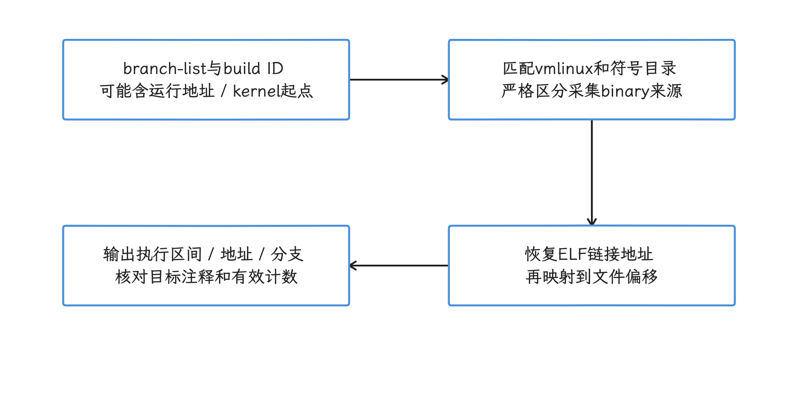

图：主机使用匹配的 vmlinux，将多轮分支数据还原为目标二进制的 AutoFDO 文本计数。 branch-list 可能仍含内核运行地址；转换可跳过失配 binary 并返回成功，必须检查目标与非零计数。

### 4. 转换为 LLVM 采样 Profile

当前 Android 17 ACK README 使用下面的命令，把文本 Profile 转换成 `kernel.afdo`：

```bash
create_llvm_prof \
  --profiler=text \
  --binary=./vmlinux \
  --profile=kernel.autofdo \
  --format=extbinary \
  --use_fs_discriminator \
  --out=kernel.afdo \
  --prof_sym_list=false &&
test -s kernel.afdo &&
llvm-profdata show --sample --all-functions kernel.afdo
```

几个参数不能随意省略：

- `--binary` 必须指向匹配的未剥离 `vmlinux`；
- `--use_fs_discriminator` 按 r6 README 处理 flow-sensitive discriminator；它需要采集构建已有相应信息，不能在转换阶段补造缺失的路径信息；
- `--prof_sym_list=false` 避免 Clang 把未列入 Profile 的内核函数都视为冷代码。

内核 Profile 不可能覆盖所有错误处理、中断和低频管理路径。让未采样函数继续使用标准优化策略，可以降低覆盖不足导致这些函数被错误降级优化的风险，也能避免某些热/冷代码段与初始化代码段不匹配。

<!-- gracker-diagram: ch18-04-13-conversion-switches -->
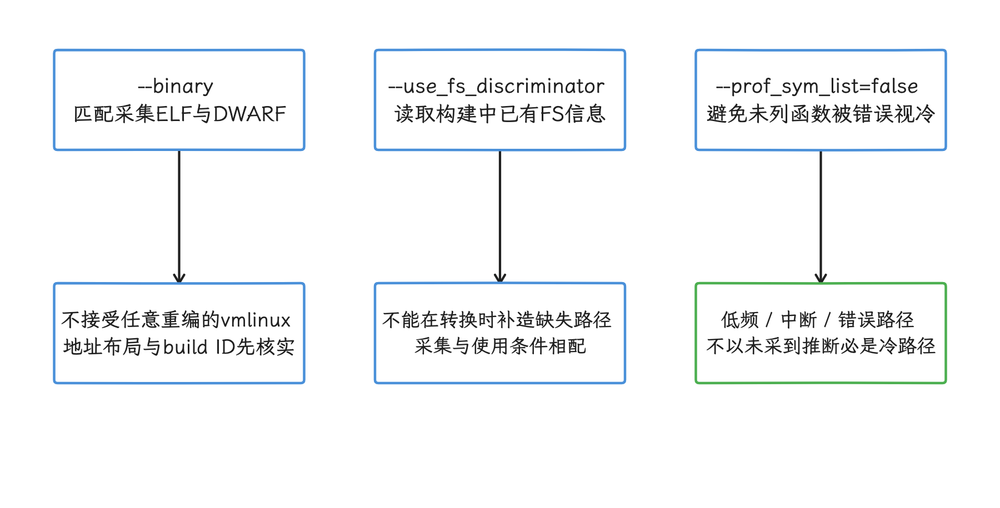

图：配套二进制保证地址归因，FS discriminator 使用已有路径信息，symbol list 影响未覆盖函数的处理。 r6 README 显式要求 prof_sym_list=false；所用工具版本的默认值和 Soong incomplete_coverage 都需分别核对。

---

转换后检查 llvm-profdata 输出中的目标函数、行号与非零样本，并保存工具版本；没有目标样本时退回符号、build ID、地址转换和工作负载排查。文件非空也可能只有格式头。r6 README 要求显式关闭 symbol list；本次核对的 AutoFDO 提交 f95d1a17 已默认 prof_sym_list=false，仍保留显式参数，不能把某版默认值推成永久契约。

<!-- gracker-diagram: ch18-04-12-llvm-convert -->
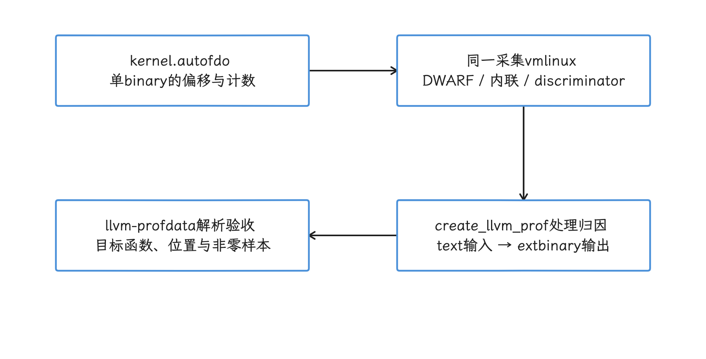

图：create_llvm_prof 将文件偏移计数与配套 ELF 的 DWARF 结合，输出 LLVM extbinary Profile。 test -s 只检查文件非空；还要用 llvm-profdata 解析并核对目标函数、行号及非零样本。

## Profile 的质量控制

AutoFDO 还有一种不容易发现的失败：Profile 已成功接入构建，但真实场景的性能反而回退。

### Profile 必须与二进制版本接近

采样地址还原要求匹配原二进制；生成的源码位置 Profile 则通过函数名、相对行号和 discriminator 应用于后续构建，允许一定源码漂移。r1 Soong 还有 stale-profile salvage，但不保证任意重命名、内联或控制流变化都能恢复。记录覆盖、缺失与失配并重测，不把“文件可读”当作“样本仍代表当前代码”。应记录：

- 内核和平台的代码提交；
- Clang 版本；
- build ID；
- Profile 生成时间和输入工作负载；
- Profile 覆盖的二进制；
- 转换工具版本与完整命令。

固定源码标签能划定复现范围。分支最新提交（HEAD）中的 `kernel.afdo` 会持续更新；如果不保存所用 Profile 文件的确切内容，就无法解释两次构建之间的差异。

<!-- gracker-diagram: ch18-04-14-profile-drift -->
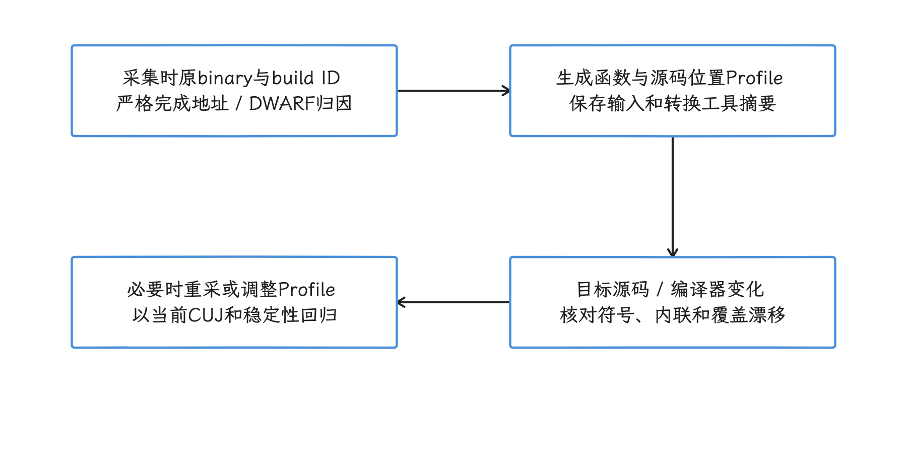

图：采集阶段使用匹配二进制还原地址，后续编译按源码位置匹配 Profile 并验证漂移影响。 relative line 和 stale-profile salvage 只提供一定容忍；Profile 可读不代表仍适合当前代码与产品负载。

### 覆盖率不等于代表性

Profile 覆盖更多函数并不一定更好。如果后台压力测试、开机和交互启动的权重与真实产品不一致，编译器可能把有限的指令缓存（I-cache）空间和内联优化预算用在次要路径上。

可以按 CUJ 分类收集样本，再决定各类样本的权重：

- 系统启动；
- 应用冷启动与温启动；
- Binder/HWBinder；
- 相机、音频、显示；
- 文件系统与存储；
- 网络；
- 内存压力和进程回收；
- OEM 自有硬件路径。

### 不能只看几何平均值

一个聚合分数可能掩盖关键回退。至少分别检查：

- P50/P90/P95/P99 启动延迟，即不同百分位上的耗时分布；
- 系统启动各阶段耗时；
- Binder 事务延迟；
- CPU 周期数、指令数、分支预测未命中和指令缓存未命中；
- 功耗和温升；
- 二进制代码段大小；
- 崩溃、任务长时间无响应（hung task）和看门狗超时。

<!-- gracker-diagram: ch18-04-15-quality-gates -->
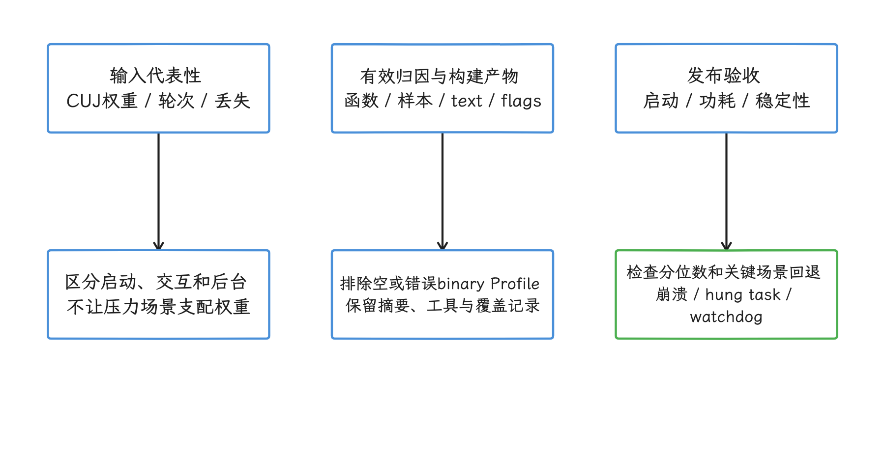

图：Profile 质量同时检查代表性、有效样本和构建后的业务分布与稳定性。 几何平均或单个最佳值会掩盖关键回退；代码覆盖更多也不保证 CUJ 权重更接近真实产品。

---

## 正确的 A/B 验证

AutoFDO 不会在 Perfetto 中生成名为 `AutoFDO` 的轨迹区段（slice）。它改变的是同一源码路径的执行成本。

### 构建变量只保留 Profile

两组镜像应保持：

- 同一源码标签或提交；
- 同一 Clang、Kleaf/Soong 版本；
- 同一内核默认配置（`defconfig`）、链接时优化（LTO）和链接参数；
- 同一设备和固件；
- 同一温度、电量与调频条件；
- 唯一变量为是否应用目标 Profile。

A 组保留与采样阶段一致的 AFDO 准备、符号命名和调试条件；B 组应用目标 Profile。不要简单把 A 的 afdo/CONFIG_AUTOFDO_CLANG 整项关闭而同时改变其他准备条件。r6 Makefile 在使用 Profile 时还引入 function sections、machine-function splitting，ThinLTO 也有相应参数：应保存完整 flags 差异，把这种组合效果按实际配置报告；若要单独归因样本，则额外对齐这些优化开关。构建日志证明输入被读取，反汇编证明代码变化，两者仍不能替代性能验证。

<!-- gracker-diagram: ch18-04-16-ab-flags -->
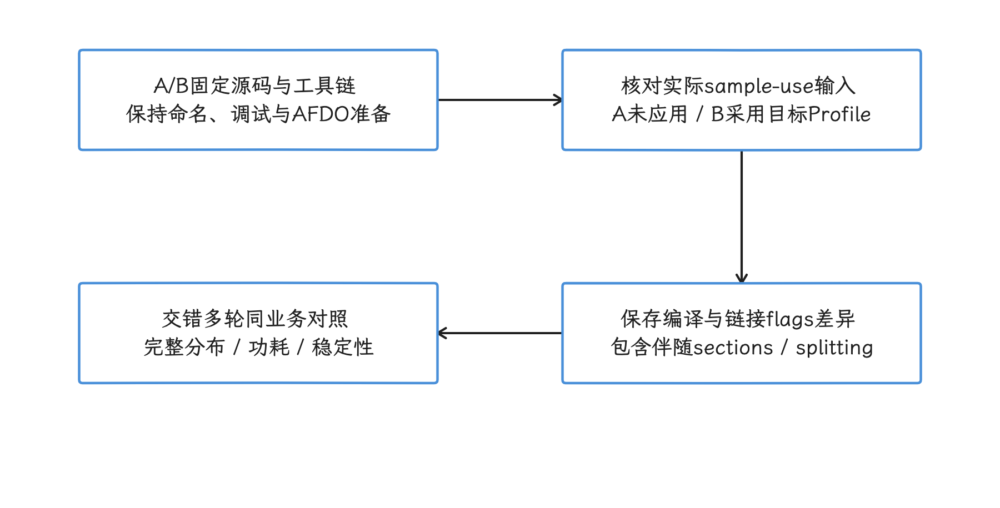

图：A/B 固定源码、工具链和采样准备条件，再验证 Profile 应用及完整 flags 差异。 r6 的 Profile 使用还带动 sections、splitting 和 ThinLTO 参数；组合效果与单独样本效果按实际实验分别报告。

### Perfetto 看系统结果

Perfetto 适合比较：

- 冷启动中 `system_server`、Zygote、应用进程和首帧的分段耗时；
- Binder 请求的调用方等待与服务端执行；
- 可运行（runnable）状态、CPU 频率、空闲状态和线程在 CPU 之间的调度迁移；
- 文件系统 I/O 和缺页异常（page fault）；
- 系统启动时间线。

同一 CUJ 要运行足够多的轮次，并保持相同的缓存和进程状态。只比较一次运行的截图没有统计意义。

<!-- gracker-diagram: ch18-04-17-perfetto -->
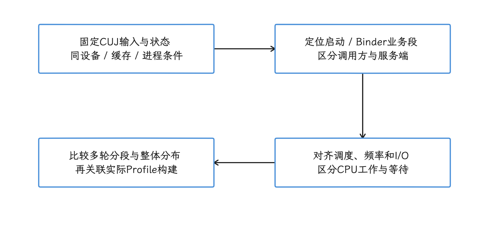

图：Perfetto 比较同一 CUJ 的启动、Binder、调度、缺页和 I/O 阶段。 AutoFDO 没有专属 slice；trace 关联执行路径与等待，多轮且缓存、进程状态相同才可解释变化。

### simpleperf 看函数和硬件事件

在 A/B 两组上分别手动或用自动化工具运行相同工作负载。下面的命令只统计目标应用进程的硬件事件，不会启动应用或执行测试流程：

```bash
adb shell simpleperf list
adb shell simpleperf stat \
  -e cycles,instructions,branch-misses,cache-misses \
  --app com.example.app \
  --duration 10
```

--app 等待找到目标包的进程后设置监测，再进入计数窗口；--duration 10 不包含前面可能的等待，也不会启动应用。stat 输出事件计数，不输出函数采样 Profile。权限允许时，这些计数可包含目标线程在内核态执行的部分，但不覆盖其他 Binder 服务或独立内核线程的全部工作；GKI 系统效果需在受控权限下另用 -a，并借 Perfetto 区分服务端和后台活动。

非 root 目标须满足 debuggable/profileable 与设备策略。r1 在 Android 16+ 优先走设备自带 simpleperf 的 simpleperf_app_runner；侧载新 binary 不自动取得同样权限。cache-misses 不自动等于指令缓存未命中，按 SoC 查询事件语义，并检查 PMU 复用与运行时间覆盖。函数变化用 record/report 另采；内核主体、GKI 模块和厂商模块分别归因。

<!-- gracker-diagram: ch18-04-18-stat-scope -->
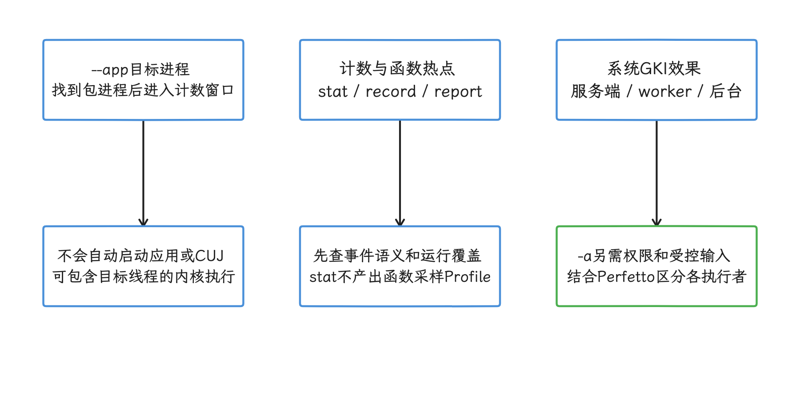

图：simpleperf stat 在找到应用进程后计数，函数热点另用 record/report，系统结果还要看其他执行上下文。 duration 不含前置等待且 --app 不启动业务；cache-misses 不自动等于 I-cache，事件权限和 PMU 复用影响解释。

冷启动更快但 CPU 周期更多，可能涉及频率、并行度、I/O 或工作量变化；微基准变快而 CUJ 未变，也可能是该路径不主导关键耗时、差异低于噪声或被其他回退抵消。沿关键路径和多轮分布继续检验，不把单一现象当作唯一根因，也不只挑正向指标。

<!-- gracker-diagram: ch18-04-19-interpretation -->
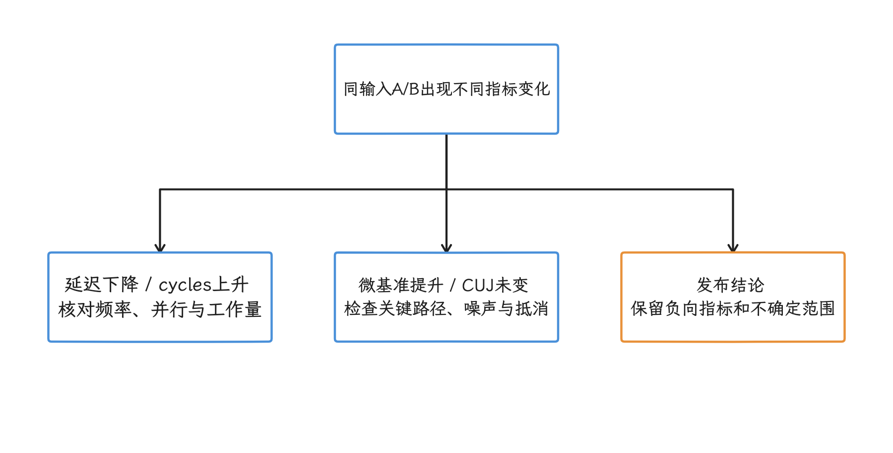

图：用关键路径与多轮数据解释延迟、周期数和整机 CUJ 的不同变化。 微基准变快而 CUJ 未变并不唯一证明不是瓶颈；噪声、并行、I/O 与其他回退都可能影响结果。

---

## OEM 与应用开发者分别做什么

### OEM / 平台团队

直接使用 Android 17 GKI Profile 只是起点。OEM 还应：

1. 确认实际 GKI 构建引用了固定标签中的 `kernel.afdo`；
2. 针对自研内核差异和产品 CUJ 采集有代表性的 Profile；
3. 分别为 GKI 模块和厂商模块保留未剥离 ELF 与 Profile；
4. 使用同版本工具链为每个构建目标生成采样 Profile；
5. 在发布前设置性能、体积、功耗和稳定性检查标准；
6. 随代码变化定期刷新，避免长期复用旧 Profile。

当前 ACK README 聚焦 `vmlinux`。模块需要单独采集、完成符号解析并接入构建；不能因为内核主体使用了 `kernel.afdo`，就认定厂商驱动已经得到相同优化。

固定 r1 文档要求未剥离模块具备 .debug_line、匹配 build ID，并给出旧 create_llvm_prof 的 ET_REL 补丁；本次核对的 AutoFDO f95d1a17 已有模块 .text 段映射与 section-index 行号查找。按实际工具提交检查支持，已有实现不重复打旧补丁；该实现侧重 .text，不能默认完整覆盖 .init.text/.exit.text 等其他段。DDK 的实际版本、debug_info_for_profiling 和模块独立 autofdo_profile 也要核实，不能照搬 vmlinux 的转换与构建规则。

<!-- gracker-diagram: ch18-04-20-modules -->
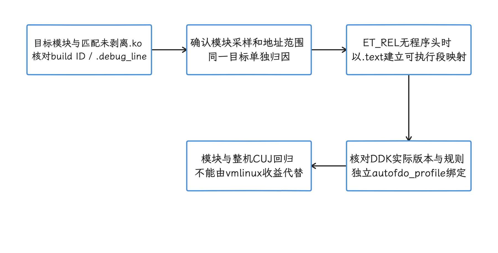

图：模块以自己的 build ID、DWARF 与采样输入生成 Profile，再接入对应 DDK 目标。 r1 文档的旧补丁需按工具版本判断；f95d1a17 已支持模块 .text，不能默认覆盖 init/exit 等所有可执行段。

### 应用开发者

应用开发者通常不控制系统 `libart`、`libhwui` 或 GKI 的构建。日常工作应放在：

- Baseline Profile 和 Startup Profile；
- 原生库自身的 PGO/LTO（前提是能控制构建并取得有代表性的工作负载）；
- 用 Perfetto 和 simpleperf 确认瓶颈位于应用、系统还是内核；
- 不把 OEM 或 Pixel 的内核 AutoFDO 数据当作应用自身的收益承诺。

应用包含大型 C/C++ 库时，也可以建立自己的采样 PGO 流程，但那是针对该原生构建目标的优化，不等同于 Android GKI AutoFDO。

<!-- gracker-diagram: ch18-04-21-roles -->
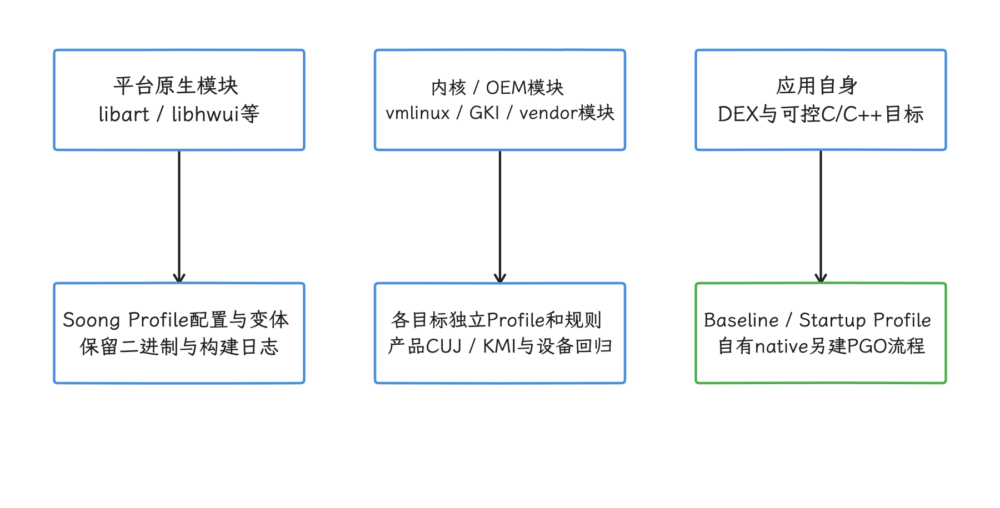

图：平台与 OEM 管理系统原生目标和内核，应用团队管理 DEX Profile 及自有原生库。 应用不控制系统 libart/libhwui/GKI 的发布；Pixel 内核收益不构成某 App 自身收益承诺。

---

## 版本演进

| 时间点 | 已确认变化 | 当前阅读方式 |
|---|---|---|
| Android 13 固定标签 | `libhwui` 已可见 `afdo: true` | 用户空间原生 AFDO 已进入代表性平台模块 |
| Android 15 / 16 GKI | 2026 年官方博客说明先向 6.6、6.12 分支持续发布内核 Profile | 只作为内核推广历史，不能把分支最新提交的数据当作 Android 17 的固定结果 |
| Android 17 / `android17-6.18-2026-06_r6` | 固定标签包含 Profile、README，并在 `BUILD.bazel` 中接入 | 当前内核基线；性能数字按 README 标明的初步实验条件解释 |

官方博客发布时，把 Android 17 对应的 6.18 GKI 写作后续扩展方向；当前固定标签已经包含对应 Profile。版本判断应以所选标签中的文件和构建规则为准，不能只依据更早的路线图（roadmap）。

---

## 常见误区

### “AutoFDO 会在用户手机上边运行边改内核”

不会。采集、转换、重新编译和验证发生在研发与构建流程中，用户设备运行的是已经使用 Profile 编译好的产物。

### “`afdo: true` 证明本地二进制已经优化”

它只打开模块的构建接入。还要通过构建日志、Profile 路径和编译参数确认是否真正使用。

### “ETM 采集没有性能开销”

它不需要插桩计数器，但轨迹数据仍会占用硬件缓冲区、带宽、存储和后处理时间，也可能发生丢失。

### “Pixel 8 的 6.6% 冷启动收益会复制到所有设备”

该数字来自 Android 17 README 中的特定初步实验，且平台当时尚未完全调优。不同 SoC、内核配置、厂商模块和工作负载都会改变收益。

### “同一个 `kernel.afdo` 能优化所有模块”

采样 Profile 必须对应具体二进制和源码位置。`vmlinux`、GKI 模块、厂商模块与用户空间库要分别处理。

### “AutoFDO 替代 Baseline Profile”

前者优化原生代码和内核构建，后者指导 ART 编译应用 DEX；两者作用层不同。

---

## 源码阅读顺序

1. `system/extras/simpleperf/doc/collect_etm_data_for_autofdo.md`：采集、分支列表、符号解析和转换；
2. ACK `gki/aarch64/afdo/README.md`：Android 17 Profile 来源、命令与基准条件；
3. ACK `BUILD.bazel`：`clang_autofdo_profile` 怎样进入 GKI 构建；
4. `build/soong/cc/afdo.go`：用户空间 C/C++ 模块怎样查找和应用 Profile；
5. `libhwui`、`libartbase`、`libart` 的 `Android.bp`：真实模块怎样声明 `afdo: true`；
6. CoreSight ETM/TRBE 驱动：设备侧指令轨迹能力从哪里来。

完整证据需要回答四个问题：Profile 采集了什么工作负载、对应哪个二进制、由哪条构建规则读取、收益通过哪些 A/B 结果确认。缺少任何一项，都只能说明 AutoFDO 选项已经开启，不能证明目标产物获得了收益。

<!-- gracker-diagram: ch18-04-22-release-evidence -->
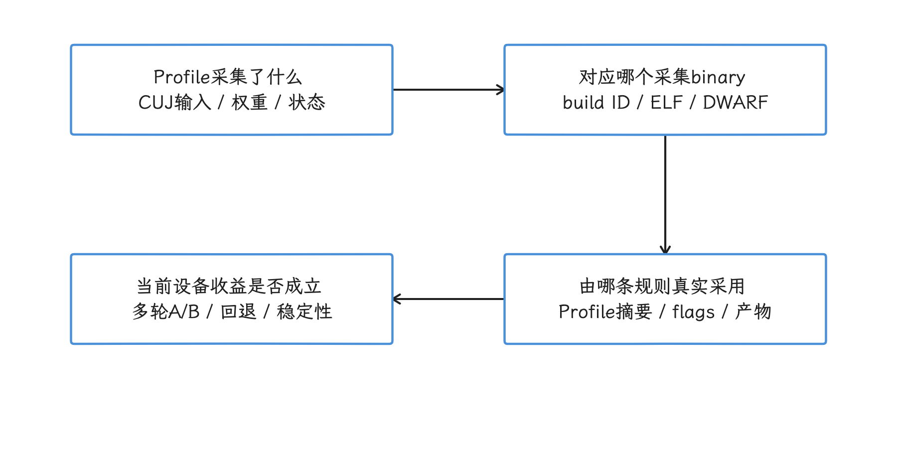

图：将工作负载、原始二进制、实际构建采用和当前产品 A/B 结果对应，形成可复核记录。 选项打开、文件存在或构建成功只覆盖其中一环；代码、负载和 Profile 更新后要重新核实适用范围。


## 本次核对的一手入口

- [r1 simpleperf 采集与转换文档](https://android.googlesource.com/platform/system/extras/+/android-17.0.0_r1/simpleperf/doc/collect_etm_data_for_autofdo.md)
- [r1 inject：地址转换、build ID 与输出](https://android.googlesource.com/platform/system/extras/+/android-17.0.0_r1/simpleperf/cmd_inject.cpp)
- [r1 Soong AFDO 变体和参数](https://android.googlesource.com/platform/build/soong/+/android-17.0.0_r1/cc/afdo.go)
- [r6 GKI Profile 与初步实验条件](https://android.googlesource.com/kernel/common/+/android17-6.18-2026-06_r6/gki/aarch64/afdo/README.md)
- [r6 Profile 编译与 ThinLTO 参数](https://android.googlesource.com/kernel/common/+/android17-6.18-2026-06_r6/scripts/Makefile.autofdo)
- [AutoFDO f95d1a17 模块行号查找](https://github.com/google/autofdo/blob/f95d1a170dfe24ec5ce4117aa4b0f6d836841703/addr2line.cc)
- [AutoFDO f95d1a17 模块段映射](https://github.com/google/autofdo/blob/f95d1a170dfe24ec5ce4117aa4b0f6d836841703/symbol_map.cc)
- [Clang 采样 Profile 使用方法](https://clang.llvm.org/docs/UsersManual.html#using-sampling-profilers)
