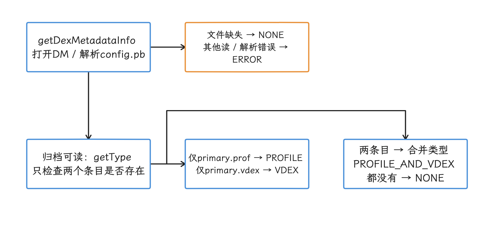
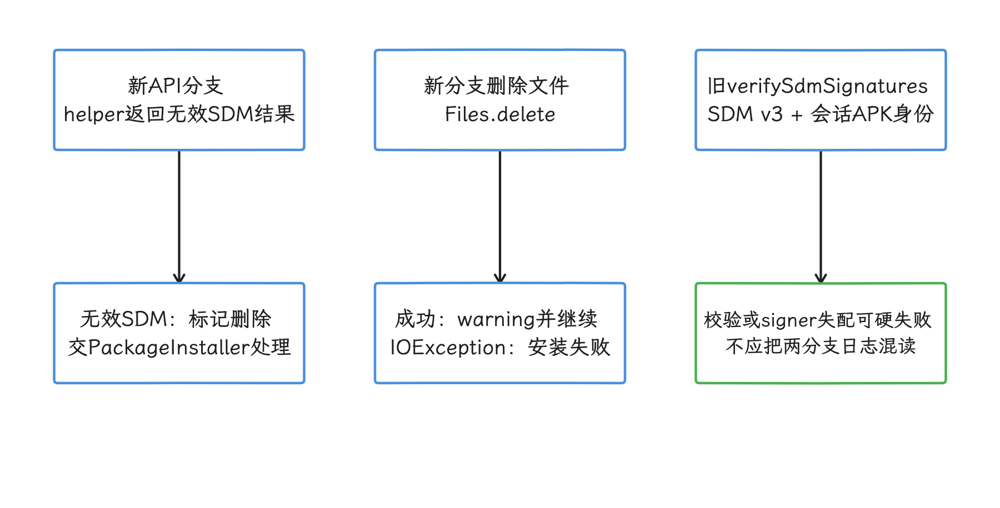
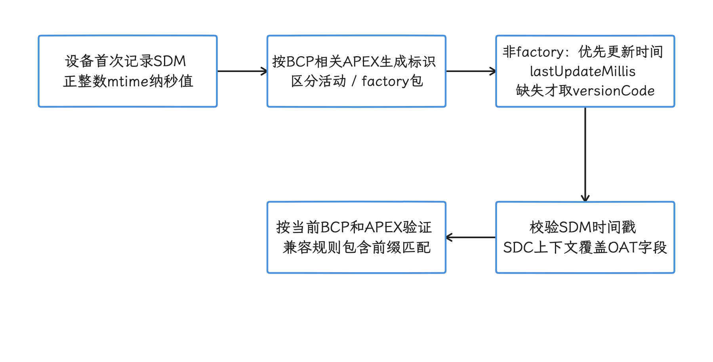
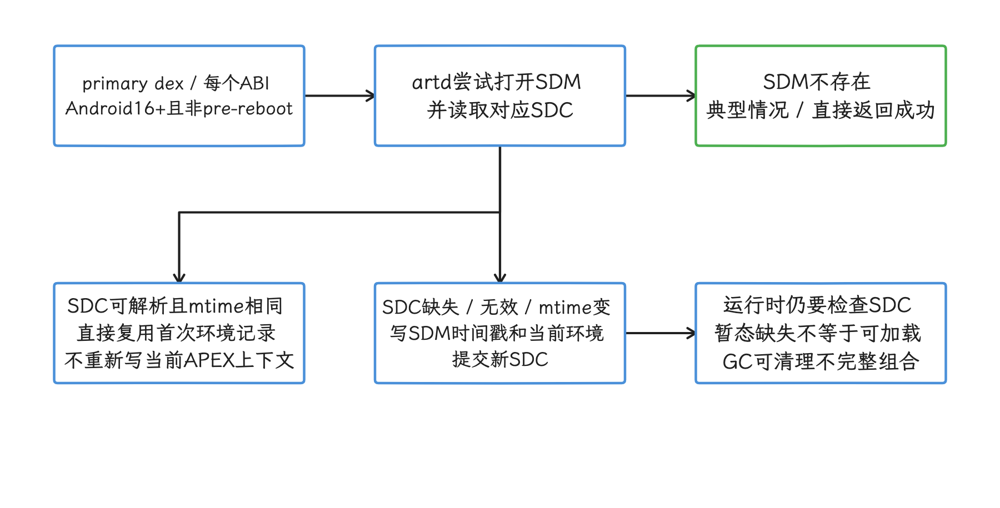
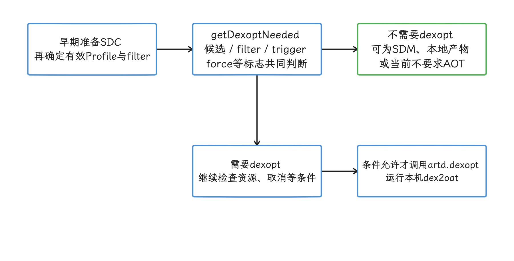
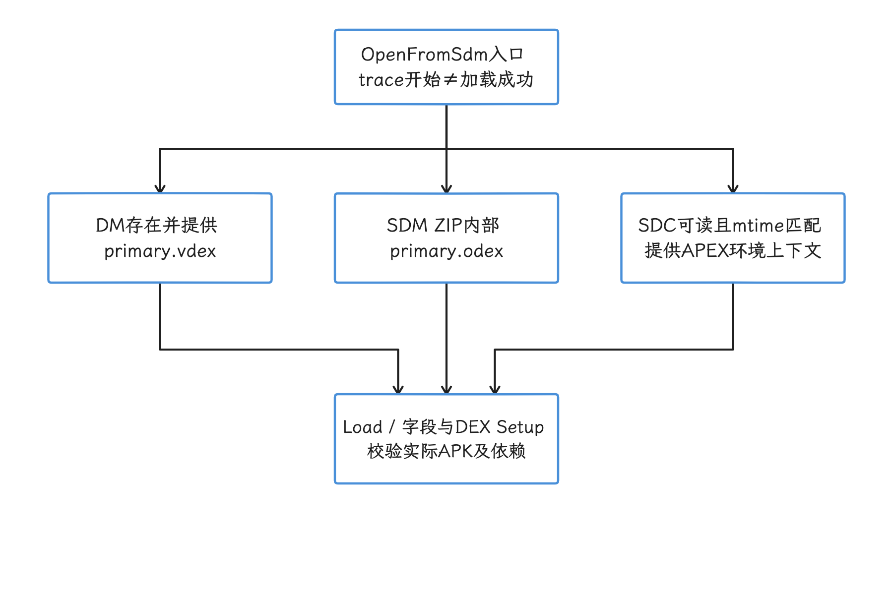

# Profile、DM 与 Secure Dex Metadata 安装编译

Profile、Dex Metadata 与 Secure Dex Metadata 三样东西名称接近，交付与校验的阶段却各不相同。要判断安装编译的收益，我们要沿安装会话、ART Service 和运行时消费路径走一遍，弄清元数据在什么条件下被接受、验证并实际用上；云端如何选择设备配置并生成 SDM 属于分发侧实现，不在本文核对的设备端源码之内。

> 源码基线：AOSP `android-17.0.0_r1`。

## SDM 的定义与收益边界

先看 SDM 本身。它的全名是 **Secure Dex Metadata**，Android 16 引入了这种文件，用它携带面向特定 ISA 的云端 AOT（ahead-of-time）产物，ISA（instruction set architecture）指 `arm64` 这类 CPU 指令集。它的来源约束很硬：必须由与 APK 相同的 signer（签名证书身份）签名。另外，AOSP `android-17.0.0_r1` 中没有名为 “Staged Dalvik Compilation” 的架构，安装流程里也没有把 SDM 解包到应用 `oat` 目录这一步——运行时是直接从 ZIP 内部打开它的。

一组可供 ART 使用的云端产物由三个文件配合：

| 文件 | 典型内容 | 生成方 | 在流程中的职责 |
|---|---|---|---|
| `.dm` | `primary.prof`、`primary.vdex`，可带 `config.pb` | 分发侧 | 提供云端 Profile 或与 SDM 配套的 VDEX |
| `.sdm` | 至少包含供运行时打开的 `primary.odex` | 云端编译服务 | 提供指定 ISA 的 AOT 代码 |
| `.sdc` | SDM 时间戳与 boot classpath 相关 APEX 环境标识 | 设备端 `artd` | 记录 SDM 文件代际与设备 ART 环境 |

SDM 的作用对象是已安装 base/split APK 的 primary dex 容器：primary 按容器界定，同一 APK 内的 classes.dex、classes2.dex 等条目都在其列。一个 dex 算 primary 还是 secondary，依据是代码容器与包的对应关系，与 ClassLoader 的类型无关。APK 之外另外生成或加载的 secondary dex 就落在这套机制之外，r1 ArtFileManager 也明确限定 SDM 只用于 primary dex files。


收益的成立条件同样明确：当 SDM、DM、SDC 与当前 APK、ISA、boot classpath 和编译目标都兼容时，安装期可以直接复用云端产物，省掉为同一目标在设备上再跑一次 `dex2oat`。`dex2oat` 是 ART 把 DEX 编译为本地产物的工具；boot classpath 则是应用运行时依赖的框架核心类集合。

省掉的只有安装期编译这一段：安装会话写盘、APK 与 SDM 签名校验、包扫描、原生库处理、`fsync`、SELinux 检查以及首次启动的其余工作照常发生，`fsync` 负责把文件数据及相关元数据同步到稳定存储。AOSP 也没有承诺过固定的安装或启动提升百分比。

## 1. 先分清 Profile、DM、SDM 与 SDC

这一节先把四个名字的职责拆开：Profile 是编译输入，DM 与 SDM 是两类交付文件，SDC 是设备端生成的记录文件。后面的安装与运行时行为，我们都以这组区分为前提。

### 1.1 三类 Profile 解决不同问题

Profile 为 ART 提供热点方法、类使用与布局等信息。speed-profile 根据有效 Profile 和编译策略挑选 AOT 工作，记录在案的方法未必各自得到一段独立机器码，类记录也不等于“把类整体编译成一个函数”；verify 主要验证 DEX。SDM 则携带已经生成好的指定 ISA AOT 产物。所以我们说 Profile 是输入、SDM 是交付产物，两者的生成方、校验和采用证据要分别追踪。

| 类型 | 生产者与位置 | 主要作用 | 开发者控制度 |
| --- | --- | --- | --- |
| [Baseline Profile](https://developer.android.com/topic/performance/baselineprofiles/overview) | 应用或库团队生成，随 APK/AAB 发布 | 让关键路径在新安装或更新后更早进入 profile-guided AOT | 高，可在 CI 生成和检查 |
| [Startup Profile](https://developer.android.com/topic/performance/startupprofiles/dex-layout-optimizations) | 由构建流程交给 R8/AGP 使用 | 调整 DEX layout，即类和方法在 DEX 文件内的排列，减少启动期跨页和跨 DEX 读取 | 中，结果体现在 DEX 布局而非运行时独立 Profile |
| Cloud Profile | 分发侧依据用户样本生成，经 DM 等安装输入交付 | 为新设备提供更接近真实热路径的 profile | 低，取决于渠道、样本与设备 ART 策略 |

Baseline Profile 面向 Day-0，也就是新安装或更新后、设备还没有积累本地运行样本的阶段；Startup Profile 只负责构建期布局；Cloud Profile 提供 Profile 输入，设备仍可能需要运行 `dex2oat`。Cloud Compilation/SDM 分发的才是预生成编译产物。这几种机制可以同时存在，但职责各管一段，谁也顶替不了谁。


按照 [Baseline Profile 调试文档](https://developer.android.com/topic/performance/baselineprofiles/debug-baseline-profiles)，APK 中的稳定检查点是 `assets/dexopt/baseline.prof`，AAB 中则是 `BUNDLE-METADATA/com.android.tools.build.profiles/baseline.prof`。Startup Profile 的源规则通常是 `startup-prof.txt`；[现行验证文档](https://developer.android.com/topic/performance/baselineprofiles/confirm-startup-profiles)建议检查最终 DEX 布局，或在 AGP 8.8 及以上检查 AAB 中的 `BUNDLE-METADATA/com.android.tools/r8.json`。另外，安装后的文件系统里没有一个叫 `startup.prof` 的文件可供查找。

### 1.2 `.dm`：Dex Metadata

`.dm` 是 ZIP 文件，文件名与对应 APK 同基名：

| APK | 对应 DM |
|---|---|
| `base.apk` | `base.dm` |
| `split_feature.apk` | `split_feature.dm` |

r1 的 getType() 只看 ZIP 里有没有 primary.prof 与 primary.vdex 条目，据此返回 PROFILE、VDEX、PROFILE_AND_VDEX 或 NONE，条目里的二进制内容它并不检查。getDexMetadataInfo() 负责打开归档与解析可选 config.pb：缺配置用默认值，文件不存在按 NONE，其他读取或解析错误按 ERROR。所以类型分类、Profile/VDEX 语义校验和最终采用是三件独立的事。

<!-- gracker-diagram: ch18-05-03-dm-classification -->


图：DM 读取与 config 解析先处理错误，getType 再按两个 ZIP 条目的存在性分类。 PROFILE/VDEX 类型不证明条目内容可用；缺 config 用默认值，缺文件与读取失败也不能混成一种状态。

这两部分内容分工不同：

- `primary.prof` 列出适合 `speed-profile` 的方法和类，可作为本机 dexopt 输入；
- `primary.vdex` 保存验证相关数据。SDM 路径打开 AOT 代码时，运行时会从配套 DM 读取它。

平台层的 `android.content.pm.dex.DexMetadataHelper.validateDexMetadataFile()` 在 r1 中通过 `StrictJarFile` 打开归档，确认文件结构可读。这个方法的 JavaDoc 仍提到 manifest，但 r1 的方法体没有读取 `manifest.json`，r1 里也找不到 `pm.dexopt.dm.require_manifest` 与 `pm.dexopt.dm.require_fsverity` 属性，`pm install` 同样没有受支持的 `--dm` 参数。判断 DM 状态时，这三项都要排除在依据之外。

AOSP 的 [Configure ART](https://source.android.com/docs/core/runtime/configure) 文档描述了常见的 Pixel 策略：Play 分发的 DM 可携带 cloud profile，ART 对其中列出的方法做 AOT 编译；没有 DM 时，该策略可能在安装期不做 AOT。这描述的是一种产品配置，OEM 仍可以通过 ART Service 配置选择不同的安装 compiler filter。

### 1.3 `.sdm`：Secure Dex Metadata

SDM 的文件名多一段指令集名称，`artd/path_utils.cc` 的构造规则可概括为：

| APK | ISA | 对应 SDM |
|---|---|---|
| `base.apk` | `arm64` | `base.arm64.sdm` |
| `split_feature.apk` | `arm64` | `split_feature.arm64.sdm` |

同一个 APK 若要覆盖两种 ISA，需要两个不同的 SDM；`arm64` 产物也供不了 `arm` 进程使用。


在 artManagedInstallFilesValidationApi 新分支，ArtManagedInstallFileHelper.validateSdmFile() 以 APK v3 及以上签名验证身份，并要求 signer 集合与当前 APK 精确相等，历史签名轮换链在这里替代不了这层匹配。下列条件会使 SDM 被标为无效：

- 文件名没有受支持的 ISA 后缀；
- 找不到同基名 APK；
- APK 的 v3 签名校验失败；
- SDM 的 v3 签名校验失败；
- APK 与 SDM 的 signer 集合不完全相同。


新 API 把上述 SDM 错误返回为 RESULT_SHOULD_DELETE_AND_CONTINUE：PackageInstallerSession 删除成功后保存 warning 并继续安装，若删除抛 IOException，安装仍会失败。旧分支走的是另一套逻辑，verifySdmSignatures() 对 SDM 要求至少 v3，再与安装会话已获得的 APK SigningDetails 比较，新 helper 对 APK 做的那套 v3 最低方案检查并不重复执行。无效 SDM 在旧分支可能直接拒绝安装，所以我们先核对设备实际 flag 与分支，再解释日志。

<!-- gracker-diagram: ch18-05-06-installer-branches -->


图：PackageInstaller 的 flag 决定验证分支，新分支无效文件删除成功才继续安装。 删除失败仍会拒绝安装；旧分支对 SDM 验 v3 并与会话 APK 身份比较，不重复新 helper 的全部检查。

SDM 的签名约束让安装会话能验证它的来源，调用方也不限于 Play：`adb install-multiple` 就可以把 `.apk`、`.dm` 与 `.sdm` 作为独立文件写入同一会话，随后由安装会话和 ART helper 按名称与后缀分类。这只是通用的多文件提交方式，难点在产物本身——名称要正确、signer 要与 APK 完全一致、ISA 要适配目标设备，普通开发构建通常拿不到这样的 SDM。

### 1.4 `.sdc`：Secure Dex Metadata Companion

SDC 由设备自己生成，应用商店不下发它。`PrimaryDexopter.onDexoptStart()` 会在 Android 16 及以上、非 pre-reboot 流程中，按 primary dex 的每个 ABI 请求 `artd.maybeCreateSdc()`。ABI（application binary interface）定义二进制调用约定等接口，ART 再把 ABI 映射到对应 ISA；pre-reboot 指系统更新生效前、为下次重启预先准备编译产物的流程。

下面这一行展示 ART Service 到 `artd` 的调用位置：

```java
mInjector.getArtd().maybeCreateSdc(outputSdc);
```

调用发生在 dexopt 决策之前。设备上没有 SDM 时，`artd` 照样返回成功，源码注释把这种情况称为常态——缺 SDM 本身不算安装错误。

SDC 是两行文本，内容形式如下：

```text
sdm-timestamp-ns=<SDM 的 mtime，纳秒>
apex-versions=<当前设备 ART 看到的 APEX 版本串>
```

运行时把 SDC 保存的正整数纳秒时间戳与 SDM 的 st_mtim 比较，失配就拒绝这份伴随记录。apex-versions 来自 SDM 首次被设备看到时的 Runtime::GetApexVersions：按 boot classpath 涉及的活动 APEX 组织标识，非 factory APEX 优先用 lastUpdateMillis，缺少时才用 versionCode，factory 等情况用空标记。版本号不变但更新时间改变的 samegrade placebo 正是靠这层细节识别的，所以单个 ART APEX versionCode 概括不了它。

<!-- gracker-diagram: ch18-05-08-apex-context -->


图：SDC 绑定 SDM 修改时间与首次接收时的 BCP APEX 环境，运行时再与当前环境检查。 APEX 标识优先用更新时间而非仅 versionCode；允许子集 BCP 的前缀兼容，不是永远整串相等。

已有可解析 SDC 且 SDM mtime 相同时，maybeCreateSdc() 会直接复用，本次调用不会重写其中的 APEX 上下文；缺失、格式错误或时间戳改变时才新建。运行时用 SDC 的上下文覆盖 SDM 内 OAT 的 APEX 字段，再按 ImageSpace 的兼容规则核对当前环境：这套规则允许子集 boot classpath 的前缀匹配，整串逐字相等并非硬性要求。

<!-- gracker-diagram: ch18-05-07-sdc-lifecycle -->


图：PrimaryDexopter 提前触发 SDC 准备，artd 按 SDM 与已有 SDC 的状态决定返回、复用或重建。 SDM 缺失是常态；已有相同 mtime 的 SDC 保留首次上下文，不能通过再次调用把它刷新成任意当前环境。

SDC 的位置由目标 OAT 位置决定：常见情况是应用旁 `oat/<isa>/` 下的 `.sdc`，需要 dalvik-cache 时则使用共享的 ART 编译产物缓存目录。它解决的是设备环境与文件代际的匹配；签名验证在安装阶段就已完成。

## 2. 从安装会话到 ART Service

从安装会话到 ART Service，中间有一段职责交接。我们沿一次安装把这段路走完：安装器怎么接收伴随文件，dexopt 交给谁执行，什么时候可以跳过本机编译。

### 2.1 安装器接收伴随文件

`PackageInstallerSession` 把 `.dm`、`.sdm` 等识别为 ART-managed install files，并在提交前校验文件名映射与 SDM 签名。它处理的一直是会话中的独立文件，并不会从 APK 内部“提取 SDM”。

文件名映射与安装过程中的重命名要配套。验证器从 base.arm64.sdm 反推同目录 base.apk；getTargetPathForApk() 还负责把伴随文件重写为目标 APK 的对应名称。安装器正常协调的重命名并不自动出错，出错的是映射、目录或伴随命名没有一起更新。

在具备合法测试产物时，可用下面的命令验证安装器是否接受三类文件：

```bash
adb install-multiple base.apk base.dm base.arm64.sdm
```

这条命令只演示文件提交方式。`base.arm64.sdm` 必须使用与 `base.apk` 完全相同的 signer 集合，并且设备要运行对应 ISA；随手创建同名 ZIP 进不了可用路径。

### 2.2 dexopt 由谁执行

Android 14 起，应用 dexopt 的调度入口已经迁到 ART Service。r1 中的职责分配是：

| 组件 | 职责 |
|---|---|
| Package Manager | 完成安装事务，在需要时发起安装 dexopt |
| ART Service Java 层 | 选择 primary dex、ABI、compiler filter、Profile 与优先级 |
| `artd` | 作为 ART Service 的特权辅助进程，校验路径、检查现有产物、准备文件并启动编译器 |
| `dex2oat` | 需要本机编译时生成 VDEX、ODEX 与可选 ART image |
| ART runtime | 应用启动或加载 dex 时选择并映射兼容产物 |

入口迁走之后，`installd` 仍处理安装系统中的其他受特权文件操作；应用 dexopt 的主线要看 ART Service——DM Profile 处理和 SDM 调度的入口都在那里，具体受保护操作交给 `artd`，`frameworks/native/cmds/installd/dexopt.cpp` 只适合当作旧流程的对照。


### 2.3 ART 如何决定跳过本机编译

安装触发 `DexOptHelper.performDexoptIfNeededAsync()` 后，ART Service 为每个 primary dex 与 ABI 构造目标，`Dexopter` 大体经历以下阶段：

1. PrimaryDexopter.onDexoptStart() 在相应条件下尝试建立或复用 SDC。
2. 按 reason、DM、有效 Profile 与产品回调调整目标 filter；缺 Profile 时可降到 verify。
3. artd.getDexoptNeeded() 按候选兼容性、filter 和 dexopt trigger 判断，force 等标志也会影响重编决定。
4. isDexoptNeeded 为 false 时跳过本机 dexopt；这可能复用 SDM，也可能是其他已有产物或无需 AOT。
5. 需要重编且后续资源、取消等条件允许时，artd.dexopt() 才启动本机编译。

<!-- gracker-diagram: ch18-05-10-dexopt-decision -->


图：ART Service 先准备 SDC 与目标输入，再结合 trigger 判断是否需要本机编译。 存在 SDM 不保证跳过；force、Profile 缺失降级、取消和存储条件都要按目标分别解释。

OatFileAssistant 组织多个编译产物候选，SDM 是其中一种。AIDL 的 SDM_DALVIK_CACHE 与 SDM_NEXT_TO_DEX 区分的是 SDC 位于全局缓存还是 APK 旁——这两个常量说的只是 SDC 的位置，SDM 与 DM 本身两种情况下都留在对应 APK 旁，并没有随之搬进 dalvik-cache。调度器再继续判断这些候选能否满足当前目标。

若本机编译已执行，`PrimaryDexopter` 会尽早删除对应 SDM 与 SDC，释放空间。相关源码条件可缩写为：

```java
if (status == DexoptResult.DEXOPT_PERFORMED && !mInjector.isPreReboot()) {
    mInjector.getArtd().deleteSdmSdcFiles(...);
}
```

删除的范围只覆盖本次 dexopt target 的 primary dex、ISA 和对应 SDC，某一个 ABI 成功，推不出整个包的 SDM 都已清掉；它表示云端产物可被本机结果替代，后续 ART 文件 GC 也会再检查失效产物。另外，SDC 缺失在安装准备阶段可能只是暂态，到了运行时却会把该 SDM 视为不完整，这两个观察时点要分开。


### 2.4 安装编译与后台 dexopt 是两个时点

Android 14 之后，ART Service 负责应用设备端 AOT 编译的调度与策略。首次开机或 OTA 后第一次启动会优先保证系统可用，后续后台任务再按 Profile 编译；产品可以覆盖这些 compiler filter，Pixel 的默认策略只是其中一种，其他 OEM 未必相同。

[ART Service 配置文档](https://source.android.com/docs/core/runtime/configure/art-service)写明，默认后台 dexopt 每日运行一次，条件是设备空闲且充电；设备退出空闲状态时，任务会立即取消。新安装后立即启动时，后台 dexopt 可能还未发生；多次启动后的编译状态也可能已经被本地 JIT（just-in-time） Profile 和后台编译改变。所以比较 Profile 或 SDM 收益时，应固定安装来源和编译状态，把“安装结束”“首次启动”“后台 dexopt 后启动”分成三组。


speed-profile 自己分辨不出 Baseline、Cloud 还是本地 Profile 来源；install-dm 只在安装 reason 下标记传给 dex2oat 的 DM，甚至可能是内容未使用的空 DM。请求 speed-profile 而有效 Profile 缺位时，r1 Dexopter 会显式降到 verify；-f 强制重编同样说明不了 Baseline 被消费。所以我们要同时记录请求与最终 filter、Profile 来源、reason、产物和 trace。

## 3. 运行时怎样使用 SDM

安装结束后，问题转到运行时：这份 SDM 有没有被用上。我们看它如何被打开、如何过兼容性检查，以及怎样确认内容被采用。

### 3.1 直接从 ZIP 打开 `primary.odex`

r1 在这里的选择很直接：`OatFileBase::OpenOatFileFromSdm()` 把 ZIP 内部条目名拼成 `<sdm>!/primary.odex`，随后直接加载；安装阶段自始至终没有把 SDM 解包并复制到 `/data/app/<pkg>/oat/<isa>/`。

下面两行给出 ODEX 与 VDEX 的真实来源：

```cpp
std::string elf_filename = sdm_filename + kZipSeparator + "primary.odex";
ret->vdex_ = VdexFile::OpenFromDm(dm_filename, error_msg);
```

ODEX 来自 SDM，VDEX 来自同 APK 的 DM。这条运行时加载路径要凑齐两样东西：可用的 DM/VDEX，加上 APK 自身校验 dex checksum 与依赖关系；仅有 SDM 时它走不通。

OatFile::OpenFromSdm() 的 ScopedTrace 名为 Open sdm file <path>，在检查 DM 是否存在之前就开始。所以该 slice 只说明进入了尝试打开路径，SDM 加载或机器码执行是否成功还要看后续证据；它甚至可能来自 artd 的产物检查。分析应用启动时，我们先对应进程、包和时间窗，再结合成功加载日志、实际映射及必要的执行采样确认采用。

<!-- gracker-diagram: ch18-05-13-zip-load -->


图：运行时从 SDM ZIP 打开 ODEX，从 DM 取 VDEX，并用 SDC 与 APK/依赖完成检查。 入口 trace 早于 DM 存在检查；缺任何必要输入都可能失败，图中输入关系不表示并行调用或保证成功映射。

### 3.2 运行时的兼容性检查

云端产物照样要过 ART 的兼容性检查，OatFileAssistant 仍会核对：

- APK dex checksum；
- boot classpath 与 class loader context（类加载器依赖关系）；
- dexopt 目标判断中的 compiler filter 比较（与候选格式和依赖有效性分开）；
- OAT/VDEX 状态；
- SDM 与 SDC 的时间戳关系；
- SDC 保存的 ART APEX 版本上下文。

候选格式、DEX/依赖与 SDC 检查决定产物是否有效；compiler filter 比较影响的则是要不要安排更合适的本机编译——这是两类判断，合不成一个全有全无的开关。系统可能使用其他已有产物、解释/JIT 或重新 dexopt，取决于现场状态。SDM 文件存在同样只说明文件当前存在；安装签名验证、运行时加载与实际执行云端代码，每一步都需要各自的证据。


### 3.3 确认内容被采用的三类证据

`ReasonMapping` 中存在 `cloud` reason，也存在带 `-dm` 后缀的安装 reason。`Dexopter` 源码注释明确提示：`-dm` 只表示本次调用传入过 DM，空 DM 或内容未被使用时也可能出现该后缀。

我们判断云端产物是否生效，要组合三类证据：

1. `pm art dump <package>` 的 compiler filter、reason 与 location；location 是供人阅读的调试字符串，格式不保证稳定，脚本不宜依赖它；
2. trace 中是否出现本机 `dex2oat`，以及是否出现 `Open sdm file`；
3. 安装日志中的 SDM validation warning、artd 错误和 dexopt 结果；若结论需要精确到“应用已执行 SDM 机器码”，还要补目标进程成功映射/选用记录或对应代码地址的执行证据。

三类证据分别对应接收、候选有效、尝试加载与成功采用四个层次；install-dm、文件存在、入口 slice 或安装总耗时，任一单个信号都确认不了应用执行了 SDM 代码。


## 4. 性能收益来自哪里

评估 SDM 的收益，要把省掉的成本和照付的成本分开算，再谈百分比有没有依据。

### 4.1 能省掉的工作

可用的 SDM 组合已经带有指定 ISA 的 AOT 代码，并由 DM 提供匹配 VDEX。若它满足安装目标，设备就无需在安装阶段为同一目标运行 `dex2oat`，可以省掉：

- 编译器进程的 wall time，即从开始到结束经过的实际时长；
- dex2oat 的 CPU 时间与临时内存峰值；
- 本机生成 ODEX/VDEX 的写放大，即存储层实际写入量超过最终文件大小的额外写入；
- 安装期编译造成的热量与功耗。

收益随应用 dex 规模、目标 filter、CPU、存储、温控和产品安装策略变化。安装策略原本使用 `verify` 或不做 AOT 的设备，能够省掉的本机编译本来就少。

### 4.2 仍需支付的工作

下面这些开销，SDM 一项也省不掉：

- APK、DM、SDM 的下载与安装会话写入；
- APK 与 SDM 的 v3 签名解析和 signer 比较；
- APK 解析、权限与包状态更新；
- 原生库提取或映射；
- 文件搬移、`fsync`、配额和 SELinux 操作；
- SDC 创建及 ART 产物兼容性检查；
- 未被 AOT 覆盖的方法解释执行与 JIT；
- 应用自身初始化、I/O、Binder 调用和首帧绘制。

所以“携带 SDM 后安装近似零成本”的说法不成立。安装总耗时若主要花在下载、写盘或包扫描，dex2oat 的减少对总值影响有限。

### 4.3 固定百分比的来源与测量

AOSP r1 源码没有给出 “安装时间减少 40%～60%”“冷启动减少 30%～45%” 或 “体积减少 15%～25%” 的保证，也没有定义可推出这些数字的基准。一个百分比要进入工程结论，得先交代测试设备、APK、compiler filter、采样次数与置信区间。

冷启动还可能出现方向不同的变化：省掉安装期编译通常有利于安装体验，SDM 的映射、ZIP 访问和页缺失特征却可能与本地产物不同。我们把安装 wall time、首次启动与后续启动分开测量。


## 5. 建立可复现的 A/B/C 实验

### 5.1 三组输入

同一 APK 版本，我们建议准备三组安装输入：

| 组别 | 输入 | 回答的问题 |
|---|---|---|
| A | APK | 设备默认安装策略的基线 |
| B | APK + DM | cloud profile 或 VDEX 对本机 dexopt 的影响 |
| C | APK + DM + 对应 ISA 的 SDM | 云端 AOT 产物能否避开本机 dex2oat |

要注意 A 组 APK 本身也可能包含 Baseline Profile，它并不是天然的“无 Profile”组。三组还须固定或记录本地/参考 Profile、JIT、既有编译产物和后台 dexopt，避免后跑组继承前组状态；设备构建、相关 APEX 环境标识、电量、温度区间、存储余量、网络条件和 APK 字节也都要固定。每组至少多次冷安装，报告中位数、P90（90% 样本不超过的值）与失败/回退次数；更新安装和全新安装分开统计。


### 5.2 采集指标

安装阶段记录：

- `adb install-multiple` 的端到端 wall time；
- Package Manager 的 `dexopt` slice；
- `dex2oat` 进程是否出现、wall time、CPU time 与峰值 RSS（驻留在物理内存中的大小）；
- SDM 校验 warning；
- ART stats 中 `ART_DEX2OAT_REPORTED` 的 compiler filter、compilation reason、DM type、ISA、状态、输出大小与耗时；
- 安装前后 `/data` 占用变化。

启动阶段记录：

- TTID（首帧可见时间） 与 TTFD（应用报告内容完整可用的时间）；
- `Open sdm file` slice；
- 主线程 runnable（可运行但等待 CPU）、I/O wait 与 major fault（需要从存储调入内存页的缺页）；
- JIT 活动和后台 dexopt；
- 连续多次启动后的变化。

`am start -W` 适合做快速筛查，替代不了 Macrobenchmark 或带统计设计的 Perfetto 实验。Macrobenchmark 是 Jetpack 提供的跨进程性能测试框架，能重复控制启动和编译状态。测试 C 组时，还要把“SDM 被接收”和“SDM 被运行时采用”分成两个检查点。


## 6. 用命令与 Perfetto 定位问题

### 6.1 读取 ART Service 状态

下面的命令查看单个包的 dexopt 状态，并保留安装与 ART 相关日志：

```bash
adb shell pm art dump com.example.app
adb shell getprop pm.dexopt.install
adb shell logcat -s artd PackageManager DexMetadataHelper
```

pm art dump 列出 dex container、ABI、compiler filter、reason 与 location。location 指向 SDM 内 primary.odex 时，说明这次状态查询选到了相应候选，离应用进程已执行其中代码还差一步；该调试字符串格式也不稳定。getprop 只显示产品属性当前值：空值可能使用默认映射，callback 和 reason 还能再调整最终 filter，所以属性值还原不出某次已完成安装的完整决策。


生产版设备通常不允许 shell 枚举 `/data/app` 内部目录。文件级核对只适用于 root、userdebug/eng 或测试基础设施已经授予访问权的环境；普通设备上，我们依赖 `pm art dump`、日志和 trace。

### 6.2 Perfetto 的四个时间点

一次覆盖安装到首次启动的 trace，我们按以下顺序阅读：

1. Package Manager 的 `dexopt` slice：安装流程在 ART 上停留多久。
2. `artd` 与 `dex2oat`：是否启动本机编译，线程在哪些 CPU 上运行。
3. 应用进程的 `Open sdm file <path>`：运行时是否尝试打开 SDM。
4. 应用启动主线程：SDM 之外的初始化、I/O 与首帧瓶颈。

trace 里没有 dex2oat，可能来自 verify、兼容本地产物或采集窗口/数据缺口；Open sdm file 又只是入口尝试。我们先核对采集是否覆盖目标安装与启动，再把编译进程、ART 状态、运行时结果和目标包关联起来——任一事件缺失，单独都证明不了 SDM 生效。

先查询编译进程，再查询线程 slice；分别执行下方两条 SELECT。只在 slice.name 搜 dex2oat 会遗漏没有同名 slice 的编译进程，名称大小写也要考虑。进程起止时刻可能为 NULL，表示 trace 未提供完整生命周期，不能补成零时长。

```sql
SELECT upid, pid, name, start_ts, end_ts
FROM process
WHERE lower(name) GLOB '*dex2oat*'
ORDER BY start_ts;

SELECT s.ts, s.dur, s.name, t.tid, p.pid, p.name AS process_name
FROM slice AS s
LEFT JOIN thread_track AS tt ON tt.id = s.track_id
LEFT JOIN thread AS t ON t.utid = tt.utid
LEFT JOIN process AS p ON p.upid = t.upid
WHERE lower(s.name) GLOB '*dex2oat*'
   OR s.name GLOB 'Open sdm file *'
ORDER BY s.ts;
```

结果仍须与目标包、安装时间窗及父子/调用关系对应：编译进程名不直接给出所属 APK，线程外轨道也可能没有可关联 PID；系统后台还可能同时为其他包 dexopt。归因时只把能与当前样本对上的事件计入。


### 6.3 常见现象

| 现象 | 可能解释 | 下一项证据 |
|---|---|---|
| 安装成功，日志提示删除 SDM | ISA 后缀、APK 映射或 v3 signer 校验失败 | `PackageInstallerSession` warning |
| SDM 存在，仍启动 dex2oat | 目标 filter 更高、依赖变化、DM/VDEX 缺失或产物过期 | `pm art dump` 与 artd 日志 |
| 没有 dex2oat，也没有 SDM location | 安装策略不要求 AOT，或复用了其他兼容产物 | `pm.dexopt.install` 与 location |
| Open sdm file 之后未采用 | 缺 DM/VDEX、SDC、环境或依赖检查失败，或只是产物探测 | 对应进程的 ART 日志、候选状态与映射 |
| 带 `install-dm` reason，性能无变化 | DM 被传入但 Profile/VDEX 未被选用 | DM type、filter 与 location |
| 更新后 SDM/SDC 消失 | 本机 dexopt 已执行并触发及时清理 | dexopt result 与 `dex2oat` slice |

## 7. 分发与应用开发的职责

### 7.1 分发系统需要保证什么

能生成 SDM 的分发系统需要同时解决：

- 针对目标 ISA 和兼容运行时环境生成云端 AOT 产物；
- 为每个 base/split APK 建立正确文件名；
- 用 APK signer 对 SDM 做 v3 签名；
- 配送含匹配 `primary.vdex` 的 DM；
- 在应用更新、签名轮换、split 变化和 ART 环境变化时避免投递陈旧产物；
- 监控设备端 validation warning 与本机 dexopt 回退率。

本文核对的 AOSP 设备端源码只定义接收、验证与消费条件；商店的服务端生成、机型覆盖、分发时机和目标 filter 属于分发侧，要另向分发侧核实。客户端具备 SDM 支持，也推导不出某渠道已经给所有用户投递了可用产物——覆盖与发布证据得看分发侧自己的数据。

### 7.2 应用工程师需要做什么

应用代码通常无需感知 SDM。工程侧更有价值的工作包括：

- 提供高质量 Baseline Profile，覆盖非云端分发和云端数据尚未成熟的用户；
- 用 Macrobenchmark 验证 Profile 覆盖与 TTID/TTFD；
- 控制反射、动态 dex 与冷启动主线程工作量；
- 将安装性能与启动性能分别设定指标；
- 在主要分发渠道建立 A/B/C 样本，持续观察 SDM 接收、采用和回退率。

Baseline Profile 与 cloud profile 的覆盖来源不同：前者随应用构建发布，后者由分发侧运行数据生成。两者都可能成为 ART 编译输入，SDM 替代不了 Baseline Profile。


### 7.3 OEM dexpreopt 与应用 Profile

OEM dexpreopt 在系统镜像构建期处理 boot classpath、`system_server`、系统组件和预装 APK。`WITH_DEXPREOPT`、`WITH_DEXPREOPT_BOOT_IMG_AND_SYSTEM_SERVER_ONLY` 等构建开关决定镜像预编译范围，产物进入 system 分区或 boot image 相关目录；应用 Baseline Profile 则随 APK/AAB 交付，由安装端 ART、渠道或 ProfileInstaller 消费。

预装应用可能同时获得镜像 dexpreopt 与后续 profile-guided dexopt，但两者发生的阶段、权限、输入和产物归属各不相同：`WITH_DEXPREOPT_*` 只管镜像构建，管不到第三方应用的 Profile；某家 OEM 的私有预装策略，也进不了 AOSP 的应用分发规则。做实验时，我们分别记录镜像构建配置、安装输入、ART Service 的 compiler filter/reason 和应用侧 Macrobenchmark 结果。


### 7.4 应用团队可复核的产物与状态

CI 先检查 Baseline Profile 是否进入 release 包，再在同一设备上验证 compiler filter：

```bash
unzip -Z1 app-release.apk | grep -Fx 'assets/dexopt/baseline.prof'
unzip -Z1 app-release.aab | grep -Fx 'BUNDLE-METADATA/com.android.tools.build.profiles/baseline.prof'
adb install -r app-release.apk
adb shell pm compile -m speed-profile -f -v com.example.app
adb shell pm art dump com.example.app
```

前两条命令只确认精确 ZIP 条目名，Profile 可解析、非空且匹配 DEX 还要另外检查。adb install -r 是更新安装，会保留已有数据与部分运行历史；后续 compile 请求和 art dump 读取的是当前状态，APK 中这份 Baseline 是否就是实际输入，还要靠后面的实验确认。Baseline 启动收益用 Macrobenchmark 的受控 Profile/编译组验证；SDM 用第 5 节三组输入，独立核实接收、候选与运行时采用——两类实验分别报告。


## 8. 版本边界

| 平台版本 | SDM 相关状态 |
|---|---|
| Android 14 / API 34 | ART Service 接管应用 dexopt 调度；常见云端优化仍以 DM cloud profile 驱动本机 AOT 为主 |
| Android 15 / API 35 | 延续 ART Service 与 DM 流程；这里核对的 SDM 格式尚未作为该版本基线 |
| Android 16 / API 36 | `ArtManagedInstallFileHelper` 源码注释标记 SDM 格式从此版本引入 |
| Android 17 / API 37 | `android-17.0.0_r1` 延续 SDM/SDC，并明确 primary dex、v3 signer、运行时 ZIP 加载与本机 dexopt 后清理行为 |

判断 r1 行为要以 r1 源码为准，`main` 分支上的实验 flag 是另一回事：核对的 r1 Package Manager 与 ART 源码中找不到 `cloudCompilationPm()` 和 `FLAG_ART_SERVICE_V3` 这些名称，所以这里没有采用它们。secondary dex 支持、默认开启比例和商店覆盖率，在 r1 里同样找不到依据，还算不上 Android 17 的已有能力。

## 源码索引

- [ArtManagedInstallFileHelper.java：DM/SDM 文件名与 signer 验证](https://android.googlesource.com/platform/art/+/refs/tags/android-17.0.0_r1/libartservice/service/java/com/android/server/art/ArtManagedInstallFileHelper.java)
- [PrimaryDexopter.java：建立 SDC 与本机 dexopt 后清理](https://android.googlesource.com/platform/art/+/refs/tags/android-17.0.0_r1/libartservice/service/java/com/android/server/art/PrimaryDexopter.java)
- [ArtFileManager.java：SDM 只覆盖 primary dex](https://android.googlesource.com/platform/art/+/refs/tags/android-17.0.0_r1/libartservice/service/java/com/android/server/art/ArtFileManager.java)
- [Dexopter.java：DM reason 与 dexopt 决策](https://android.googlesource.com/platform/art/+/refs/tags/android-17.0.0_r1/libartservice/service/java/com/android/server/art/Dexopter.java)
- [DexoptStatus.java：compiler filter、reason 与 location](https://android.googlesource.com/platform/art/+/refs/tags/android-17.0.0_r1/libartservice/service/java/com/android/server/art/model/DexoptStatus.java)
- [ReasonMapping.java：cloud、install 与 `-dm` reason 映射](https://android.googlesource.com/platform/art/+/refs/tags/android-17.0.0_r1/libartservice/service/java/com/android/server/art/ReasonMapping.java)
- [ArtManagerLocal.java：ART Service 的 dexopt 调度入口](https://android.googlesource.com/platform/art/+/refs/tags/android-17.0.0_r1/libartservice/service/java/com/android/server/art/ArtManagerLocal.java)
- [DexMetadataHelper.java：DM 内容分类](https://android.googlesource.com/platform/art/+/refs/tags/android-17.0.0_r1/libartservice/service/java/com/android/server/art/DexMetadataHelper.java)
- [Dex2OatStatsReporter.java：`ART_DEX2OAT_REPORTED` 字段](https://android.googlesource.com/platform/art/+/refs/tags/android-17.0.0_r1/libartservice/service/java/com/android/server/art/Dex2OatStatsReporter.java)
- [artd.cc：SDC 创建、路径校验与 dexopt 执行](https://android.googlesource.com/platform/art/+/refs/tags/android-17.0.0_r1/artd/artd.cc)
- [path_utils.cc：SDM/SDC 路径构造](https://android.googlesource.com/platform/art/+/refs/tags/android-17.0.0_r1/artd/path_utils.cc)
- [oat_file.cc：从 SDM 打开 ODEX、从 DM 打开 VDEX](https://android.googlesource.com/platform/art/+/refs/tags/android-17.0.0_r1/runtime/oat/oat_file.cc)
- [sdc_file.cc：SDC 的两个字段](https://android.googlesource.com/platform/art/+/refs/tags/android-17.0.0_r1/runtime/oat/sdc_file.cc)
- [PackageInstallerSession.java：安装会话验证结果处理](https://android.googlesource.com/platform/frameworks/base/+/refs/tags/android-17.0.0_r1/services/core/java/com/android/server/pm/PackageInstallerSession.java)
- [PackageManagerShellCommand.java：安装命令如何提交伴随文件](https://android.googlesource.com/platform/frameworks/base/+/refs/tags/android-17.0.0_r1/services/core/java/com/android/server/pm/PackageManagerShellCommand.java)
- [DexOptHelper.java：Package Manager 发起安装 dexopt](https://android.googlesource.com/platform/frameworks/base/+/refs/tags/android-17.0.0_r1/services/core/java/com/android/server/pm/DexOptHelper.java)
- [DexMetadataHelper.java：平台侧 DM 归档验证](https://android.googlesource.com/platform/frameworks/base/+/refs/tags/android-17.0.0_r1/core/java/android/content/pm/dex/DexMetadataHelper.java)
- [installd/dexopt.cpp：旧 dexopt 边界的对照源码](https://android.googlesource.com/platform/frameworks/native/+/refs/tags/android-17.0.0_r1/cmds/installd/dexopt.cpp)
- [Configure ART：cloud profile、编译产物与 compiler filter](https://source.android.com/docs/core/runtime/configure)
- [ART Service configuration：后台 dexopt 的调度条件](https://source.android.com/docs/core/runtime/configure/art-service)
- [Baseline Profiles overview：Baseline、Cloud 与 Startup Profile 边界](https://developer.android.com/topic/performance/baselineprofiles/overview)
- [Create Startup Profiles：构建期 DEX layout 优化](https://developer.android.com/topic/performance/startupprofiles/dex-layout-optimizations)
- [Confirm Startup Profiles optimization：DEX 与 R8 元数据检查](https://developer.android.com/topic/performance/baselineprofiles/confirm-startup-profiles)
- [Debug Baseline Profiles：APK/AAB 内的 Baseline Profile 路径](https://developer.android.com/topic/performance/baselineprofiles/debug-baseline-profiles)
- [Runtime::GetApexVersions：BCP APEX 与更新时间标识](https://android.googlesource.com/platform/art/+/android-17.0.0_r1/runtime/runtime.cc)
- [ImageSpace：APEX 标识的前缀兼容检查](https://android.googlesource.com/platform/art/+/android-17.0.0_r1/runtime/gc/space/image_space.cc)
- [OatFileAssistant：候选加载与重编比较器](https://android.googlesource.com/platform/art/+/android-17.0.0_r1/runtime/oat/oat_file_assistant.cc)
- [r1 adb install-multiple 对 DM/SDM 的识别](https://android.googlesource.com/platform/packages/modules/adb/+/android-17.0.0_r1/client/adb_install.cpp)

## 相关章节

- [1.5 ART 编译、优化与去优化机制](../../part1-fundamentals/ch01-architecture/05-art-compilation-verification-deoptimization.md)：解释 ODEX、VDEX、AOT、JIT 与 compiler filter。
- [1.16 应用分发、安装验证与 PackageManager 性能](../../part1-fundamentals/ch01-architecture/16-package-distribution-install-verification.md)：区分安装会话的 staged 语义与 Secure Dex Metadata。
- [21.4 Baseline、Startup 与 Cloud Profile 编译优化](../../part5-app/ch21-startup/04-baseline-startup-cloud-profile.md)：从应用侧生成、打包和回归 Baseline Profile。
- [18.4 AutoFDO 反馈导向编译优化](04-autofdo-feedback-directed-optimization.md)：native 采样反馈与 LLVM/Clang 构建期优化，不属于 ART Profile。
