# Android 系统启动耗时优化与 bootanalyze

系统启动优化研究的是设备从上电到系统可用的整条路径。它横跨 bootloader、kernel、`init`、APEX、Zygote、`system_server`、SystemUI 和 Launcher，实验范围不同于单个 App 在进程尚未创建时的 cold launch（冷启动）。

本文保留平台常用名：bootloader 是上电后校验并装载系统的引导程序，kernel 是 Linux 内核，`init` 是内核启动的第一个 Android 用户空间进程。Zygote 预加载框架类和资源，再派生 `system_server` 与应用进程；`system_server` 承载大部分 Java 系统服务。APEX 是可独立更新的模块化系统包。

> 源码基线：Android 17 / API 37，AOSP `android-17.0.0_r1`；内核 `android17-6.18-2026-06_r6`。结论按这两个固定 tag 复现，历史版本只用于解释机制演进；收益数字一律以设备实测为准。

## 先固定“启动完成”的含义

动手优化之前，我们先固定“启动完成”的含义。同一次启动可以有多个终点，终点选错，优化结果会在看板上变好，用户等待却没有改善。

| 终点 | 观察方式 | 说明 | 另测指标 |
|---|---|---|---|
| kernel entry | bootloader 日志、UART、硬件计时 | 内核已接管 | 上电到内核的耗时 |
| second-stage init | dmesg、<code>init second stage started</code> | 内核与早期 init 阶段基线 | /data 挂载、Zygote、桌面可用 |
| Zygote start | <code>ro.boottime.<wbr>zygote</code>、init 日志；flag 开启时可有 <code>ro.boottime.<wbr>event.<wbr>zygote-start</code> | framework 进程模型开始建立 | <code>system_<wbr>server</code> 是否 ready |
| <code>sys.boot_<wbr>completed=1</code> | property、bootstat | AMS 进入 boot completion 收尾 | 桌面显示与操作响应 |
| Launcher shown | Launcher 自有事件、Surface/Window trace | 桌面窗口实际显示 | 输入是否已处理 |
| first interactive | 自动化输入、画面检测、产品事件 | 用户能完成首个关键动作 | property 时间另记 |

first-stage init 先完成早期挂载与 SELinux 切换所需工作，随后执行 second-stage init，由后者加载属性、解析更多 rc 并启动服务。UART 是启动早期常用的串口日志通道。

AMS 是 ActivityManagerService，负责进程与 Android 用户生命周期等系统事务；property 是 Android 的系统键值属性。文中的“用户 profile”指工作资料等 Android 用户配置，与 ART 的性能 Profile 是两套概念。

`ActivityManagerService.finishBooting()` 会设置 `sys.boot_completed`，随后继续处理用户级 boot complete、用户 profile 启动和广播。我们把这个 property 当作稳定的平台终点；桌面是否已显示、触摸是否已有响应，要分别看 Launcher shown 和输入事件。

init 会用 `ro.boottime.<service-name>` 记录 service 第一次启动的 `CLOCK_BOOTTIME` 时间，所以主 Zygote 对应 `ro.boottime.zygote`。`CLOCK_BOOTTIME` 从内核启动起单调计时，并包含系统休眠时间。

`ro.boottime.event.<event-name>` 记录相应 event 的第一条 Action 命令开始执行的时间。Action 是 init 中一组 `on <trigger>` 条件及其 command；这个属性只有在功能开关 `com.android.init.flags.enable_init_event_timestamp` 开启时才生成。分析时把 event property 缺失当作正常情况：缺值只说明这条属性没有生成，Zygote 是否启动，按 `ro.boottime.zygote` 和 init 日志确认。


实验报告应把起点和终点写进指标名。例如：

- `power_on_to_boot_completed_ms` 包含 bootloader，但需要 bootloader 或外部硬件提供上电起点。
- `kernel_to_boot_completed_ms` 从 kernel 时钟起算，适合 userspace 回归。
- `boot_completed_to_launcher_shown_ms` 反映 property 之后的桌面尾部。
- `power_on_to_first_interaction_ms` 接近用户体验，但依赖可靠的外部输入和画面判定。


## 冷启动样本也要分类

分组之前，先看样本类型。下面几类样本要各自建立分布，混在同一组会互相污染：

| 类型 | 额外工作 | 建议标签 |
|---|---|---|
| 普通 cold boot | 完整经过 bootloader、kernel、挂载、服务和桌面启动 | `normal` |
| factory reset 后首启 | 恢复出厂后的包扫描、初始化、向导和可能的 dexopt | `first_boot` |
| OTA 后首启 | 更新 checkpoint、APEX/分区切换、dexopt | `post_ota` |
| Boot Classpath APEX 变化后首启 | 框架核心类路径变化触发 ART boot dexopt | `post_bcp_apex` |
| userspace reboot | 不经过完整 bootloader/kernel 路径 | `userspace_reboot` |
| 加密状态或用户状态变化 | CE（凭据加密）与 DE（设备加密）存储的可用时点不同 | `storage_state_*` |

checkpoint 是文件系统更新状态的可提交或可回退点，OTA 后首启会多出相关确认工作。

`DexOptHelper.performPackageDexOptUpgradeIfNeeded()` 只在 first boot、device upgrade 或 Boot Classpath APEX 发生变化时调用 `ArtManagerLocal.onBoot()`。源码注释明确说明这个调用会阻塞，耗时可能达到 30 秒以上；普通启动会直接返回。版本看板若不区分这些类型，P90（90% 样本不超过的值）很容易被少量升级样本主导。


## 一套实用的证据层级

拿到一次慢启动，我们按“统计 → 分段 → trace → 源码”逐层缩小：

1. bootstat（持久化启动事件的系统工具）或产品指标确认回归是否稳定，观察 P50（中位数）、P90 和离群点。
2. bootanalyze 把 logcat/dmesg 中的稳定事件转成阶段时间。
3. bootio 找启动窗口里的进程 I/O 体量。
4. Perfetto/ftrace 把慢阶段细分到线程调度、CPU 频率、Binder、锁、page fault、block I/O 和 ext4。
5. 回到 `init.rc`、driver probe、Zygote preload 或 SystemServer trace slice 核对依赖。

`dmesg` 是内核日志，logcat 主要承载 Android 用户空间日志。Perfetto/ftrace 记录带时间轴的系统事件；trace slice 是带起止时间的区间事件。Binder 是 Android 的进程间通信机制，page fault 是访问尚未映射到进程页表的内存页，block I/O 是面向存储块设备的读写。

单份 trace 适合解释一次慢启动；要证明版本回归，还要靠同条件的分布对比。阶段统计在没有原始 trace 时只能提示方向，指导 rc、kernel 或 profile 修改要回到具体证据。


## bootanalyze：它读什么，输出什么

bootanalyze 位于 system/extras/boottime_tools/bootanalyze/，把匹配到的日志事件、日志内耗时和 boottime property 整理成观测点。我们把它当分段工具用：事件缺失、日志时钟变化和产品正则漂移都会影响输出，产品启动终点由自己的指标定义，默认事件名只描述工具的采集条件。目录中的角色如下：

| 文件 | 作用 |
|---|---|
| `bootanalyze.py` | 采集并解析 logcat、dmesg、timing event 和 shutdown event |
| `config.yaml` | 定义单点事件、带耗时事件、关机事件和时钟修正规则 |
| `bootanalyze.sh` | 设置循环、重启方式、bootchart、Automotive 和登录流程 |
| `README.md` | 快速说明，但有文档漂移 |


### README 与 r1 脚本存在漂移

README 和 r1 脚本之间存在漂移：README 仍写 Python 2.7，r1 bootanalyze.py 的 shebang 已是 #!/usr/bin/python3，README 展示的 stop_event 字段也没有被脚本读取。默认 logcat 采集要等齐 BootComplete 和 LauncherStart；默认配置里，前者匹配 Starting phase 1000，后者匹配 HOME activity 的启动请求；这两个停止条件与桌面首帧、首次可交互是不同的里程碑。选项可增加 FsStat、CarWatchdog、LoginEnd 或 LauncherShown 条件。dmesg 采集另采用“任一停止事件到达即停”的模式，两条采集流要分别配置停止条件。

这带来两个工程约束：

- 产品定制 `config.yaml` 时，要保留脚本使用的事件键，或同步修改脚本里的停止事件列表。
- Launcher 类名或日志格式发生变化时，默认 `LauncherStart` 正则可能一直匹配不到，采集会等到超时。

### `events` 与 `timings` 的含义不同

events 提取匹配日志中的时间点，一般重复事件以 _1、_2 等后缀保留；Zygote 相关事件另有 PID 与覆盖规则，保留几条要按事件类型看。timings 从一条日志提取子阶段名和耗时，正则必须提供 name 与 time 命名捕获组。generate_timing_points 会给重名耗时追加 #1、#2，将 _secs 项换算成毫秒；它按真值过滤，0 ms 项因此被省略。

下面的配置用于解析 SystemServer 的 `took to complete` 日志：

```yaml
timings:
  system_server: 'SystemServerTiming(Async)?\s*:\s*(?P<name>\S+) took to complete:\s(?P<time>[0-9]+)ms'
```

匹配后可提取 StartPackageManagerService 等子阶段与毫秒值；SystemServerTimingAsync 的名称会加括号。详细 timings 的生成与打印还要求 bootanalyze.py 的 -t/--timings，而下面的默认 wrapper 并不传 -t，想要逐子阶段耗时要自己带参数调用。先对目标版本原始 logcat 回放正则，再保存原始日志和有效轮数，避免日志 tag 改动后静默丢点。

<!-- gracker-diagram: ch18-06-06-events-timings -->
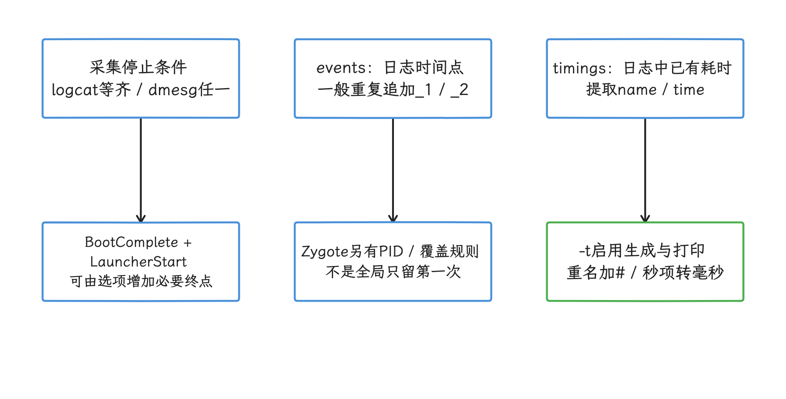

图：默认 logcat 要等齐固定条件，events 与 timings 则提供不同类型的观测。 默认 BootComplete 匹配 phase 1000，LauncherStart 是 HOME 请求；详细 timings 要 -t，0 ms 会省略，均不证明首屏可交互。

### 多轮采集

下面的命令使用 r1 wrapper 做十次回归采样：

```bash
ANDROID_BUILD_TOP="$PWD" \
CONFIG_YMAL="$PWD/system/extras/boottime_tools/bootanalyze/config.yaml" \
LOOPS=10 \
RESULTS_DIR="$PWD/out/boot-analyze" \
system/extras/boottime_tools/bootanalyze/bootanalyze.sh -a
```

`CONFIG_YMAL` 是源码里已经固化的拼写，照抄即可，写成 `CONFIG_YAML` 脚本就找不到配置。工具需要可执行 `su` 的测试设备，适合允许调试和 root 的 userdebug/eng 构建及实验室环境。
r1 wrapper 会无条件尝试 touch /data/bootchart/enabled；该命令没有套 su，adb shell 权限不足时可能失败，而且 wrapper 不检查这一步的返回值。-b 只控制后续 bootchart 处理。bootchart 是按进程展示 CPU 与 I/O 活动的启动时间线；做低扰动基线时应评估开启它的影响，或直接调用 `bootanalyze.py` 并自行管理采集开关。

wrapper 在每轮之间固定等待 20 秒；这段时间算不上统一的设备温度、关机静置或缓存控制。脚本返回成功后，我们仍要逐轮核对有效数据和全部必要终点：LOOPS=10 只说明跑满十轮，有效的 first-interactive 样本要按终点逐轮清点。


### 时间修正

启动早期 logcat 的日期时间可能被校时。默认 correction 正则只匹配非负 diff：脚本取该事件中的 delta，调整时间不晚于校时事件的 logcat 观测点，再用跨 logcat/dmesg 的锚点估算偏移；共同事件优先用 dmesg 时间，其余事件再换算。

默认还可能把 phase 1000 的日志与 sys.boot_completed Action 配对，两者有先后间隔，偏移应结合 second-stage 等锚点复核；负向或多次校时要按实际日志单独处理。一轮要形成有效结果，前提是凑齐必要锚点。dmesg 与 wall clock 的原值要经换算规则对齐后使用，报告需保留原始时间、换算规则和缺点情况。

<!-- gracker-diagram: ch18-06-08-clock-align -->
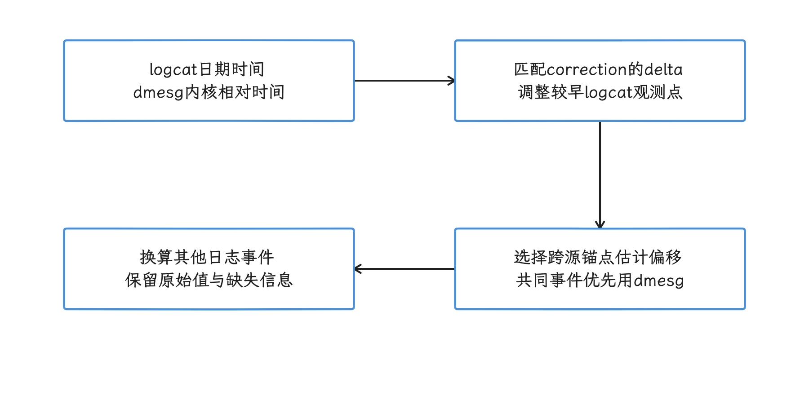

图：先修正配置识别的 logcat 校时，再用跨源锚点估算与 dmesg 的偏移。 默认只匹配非负 diff，部分锚点是不同平台边界；缺锚点或多次校时时，对齐精度要单独复核。

## bootio：先找 I/O 责任进程

bootio 的 r1 实现遍历 /proc，读取进程 io、stat、cmdline 等并采集 CPU 汇总。README 列出的 TASKSTATS 是 kernel 侧配置要求，r1 程序的数据实际来自这些 proc 节点，两者要分开读；产品还需包含 bootio 模块并允许它读取目标 proc 节点：

- `CONFIG_TASKSTATS=y`
- `CONFIG_TASK_DELAY_ACCT=y`
- `CONFIG_TASK_XACCT=y`
- `CONFIG_TASK_IO_ACCOUNTING=y`

它保存进程级计数快照，bootio 服务启动前已经退出的进程留在快照之外。r1 bootio.rc 把服务放在 main class，实际窗口从该服务运行起算。下面的 120 5 表示约 120 秒内五个采样间隔：collector 先取一份，再每隔整数除法 120/5=24 秒取一份，共六份快照。它不是重启五次，采集耗时还包含遍历开销；timeout 上限 120，samples 上限 30，且 samples 的取值要保持在 timeout 之内。

```bash
printf '120 5\n' | adb shell su root tee /data/misc/bootio/start
adb reboot
adb wait-for-device
# 确认本轮 bootio 采集完成后再打印；wait-for-device 只表示 ADB 已连通。
adb shell su root bootio -p
adb shell su root rm /data/misc/bootio/start
```

/data/misc/bootio/start 要在实验结束后手动清理；命令要求测试设备支持 su root，量产设备的权限要另行确认。r1 collector 从 /proc 读取计数且使用有限宽度字段，长窗口、大流量、进程消失或 PID 复用都要检查。总字节数只给出体量，文件调用链或块队列等待要接文件访问记录、ftrace/Perfetto 才能看到。

<!-- gracker-diagram: ch18-06-09-bootio -->
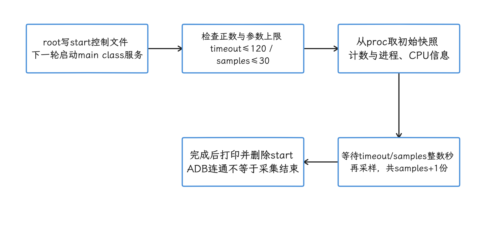

图：r1 bootio 从 proc 读取进程与 CPU 计数，按参数形成快照，再持久化结果。 120 5 得到六份快照、五个约 24 秒间隔；main class 之前退出的进程留在窗口之外，文件级调用链要另接工具。

## Perfetto：解释等待发生在哪里

bootanalyze 给出阶段，Perfetto 负责解释阶段内部的并发和等待。启动 trace 至少应覆盖：

- `sched_switch`、`sched_wakeup`、CPU frequency/idle；
- `binder_driver` 和主要 framework atrace category；
- block I/O、ext4、page fault；
- `init`、Zygote、SystemServer 的 atrace slice；
- 目标 HAL（framework 访问硬件实现的抽象接口）、SurfaceFlinger、SystemUI 和 Launcher 的自定义 slice。

启动采集应在重启前部署配置和下一次启动的启用条件，再验证新一次启动中 session 的实际开始时刻。标准 perfetto_trace_on_boot 要等 /data 挂载、持久属性加载和 traced 就绪才启动，并重置一次性启用属性；更早的 kernel、first-stage init 或已经结束的 APEX 工作，要另用 kernel boot tracing、bootloader/UART 或足够早启用的 ftrace 覆盖，并明确各段覆盖。设备起来后才手工启动 perfetto 会进一步丢失前半程；采集配置、丢事件和 buffer 开销也须保存为实验元数据。

<!-- gracker-diagram: ch18-06-10-perfetto-coverage -->
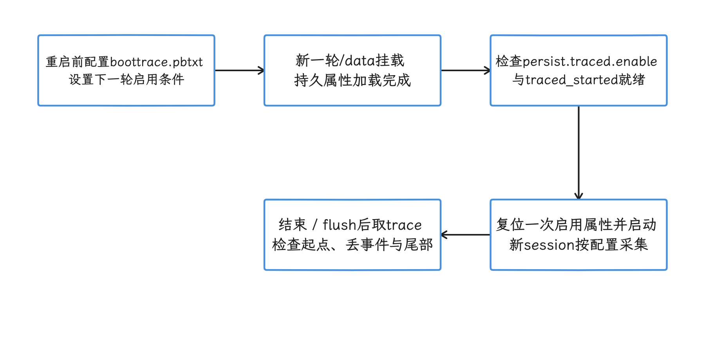

图：重启前部署配置，重启后满足持久属性、启用条件与 traced 就绪门才启动标准 session。 session 只从就绪门之后记起，更早 ftrace、UART 和 bootloader 证据需单独覆盖并校时。

`SystemServer.run()` 显式调用 `Producer.init(..., 4 * 1024)`，源码注释把它定义为 4 MiB 的 Perfetto producer shared-memory buffer。
producer 是向 Perfetto 写入事件的一端；这块内存只服务于 system_server producer，trace 的其余部分走中央 buffer。“追踪精度提升多少”“固定增加多少 CPU 开销”这类换算，要落在中央 buffer、采集事件、落盘和丢数据上。


## `init` 的串行队列与进程并发

init 的执行模型是一条串行队列：先处理到达的触发事件，再按已解析 Action 的顺序选出匹配项，匹配 Action 和其中的 command 依次执行；rc 的文件顺序要结合触发条件理解，同一段 rc 会因触发条件而在不同时机执行。r1 主循环在没有 property/exec 等待时调用 ActionManager::ExecuteOneCommand()，随后继续处理事件与进程。service 指由 init 启动和监管的进程。

串行的只是队列本身，启动期间的进程可以并发：

- `start` 和 `class_start` 依次 fork/exec service，即创建子进程并载入目标程序；启动后的 service 彼此可以并发运行。
- `exec`、`exec_start` 会让 Action 队列等待进程结束。
- `exec_background` 启动进程后不阻塞后续 command。
- `wait`、`wait_for_prop` 和同步的文件检查会把等待留在 init 关键路径。

<!-- gracker-diagram: ch18-06-12-init-queue -->
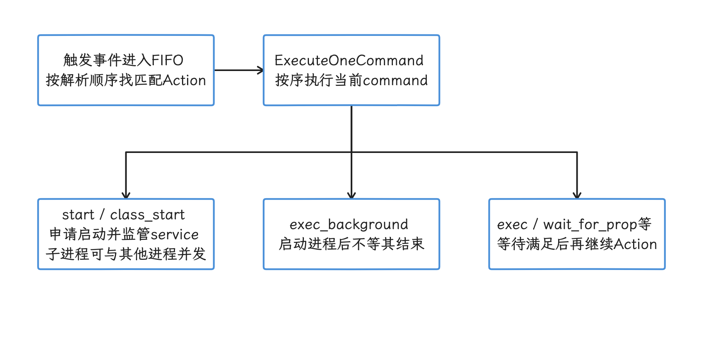

图：触发事件选择匹配 Action，init 依次执行 command，service 进程可独立并发。 exec / wait_for_prop 等会暂停后续 Action；service 启动请求与资源、Binder 或功能 ready 是两回事。

下面的 rc 片段展示如何把独立工作放到 service 中，再用 property 表达依赖完成：

```rc
service vendor_prepare_cache /vendor/bin/prepare_cache
    class main
    user system
    group system
    disabled
    oneshot

service vendor_consumer /vendor/bin/consumer
    class main
    user system
    group system
    disabled
    oneshot

on post-fs-data
    setprop vendor.prepare_cache.ready 0
    start vendor_prepare_cache

on property:vendor.prepare_cache.ready=1
    start vendor_consumer
```

这种写法允许 `vendor_prepare_cache` 与其他 service 并发。这个片段只定义了 producer，vendor_consumer 还需在其他 rc 中定义并设为 disabled，避免随 class main 提前启动；producer 成功完成后才应设置 ready。还要为重复启动清理旧 ready 值，并为失败设置超时、降级或错误传播。


### `class_start` 的分组语义

`do_class_start()` 遍历 `ServiceList`，对属于目标 class 的 service 调用 `StartIfNotDisabled()`。它有三点容易写错：

- persist.init.dont_start_class.<class>=true 时，整组 class_start 直接返回；其他情况下，disabled service 仍不随 class 自动启动。
- 单个 service 启动失败会记日志，遍历仍会继续。
- class 只提供分组，service 之间的依赖图要另行表达。


把 service 移到更早 class 前，应核对分区挂载、SELinux domain（安全策略中的进程域）、设备节点、APEX 激活、Binder service 和 HAL 依赖。service 能否提前启动，以上面这些依赖的就绪时点为准；rc 里没有显式 wait 这一点，并不足以作为提前启动的依据。

### event trigger 与 property trigger

on boot && property:x=y 这类组合条件，只在 boot 事件匹配时检查一次；boot 已过去后才把 x 设成 y，这个组合 Action 会保持未触发。仅 property 的 Action 要等 boot 事件末条命令之后的初始统一检查才第一次有机会触发，此后相关属性新建或变更时再逐次检查。把 ready 写成 property 依赖前，先确认这个门控时点：早期 setprop 与 consumer 启动之间，隔着初始统一检查这道门。

<!-- gracker-diagram: ch18-06-15-trigger-gates -->
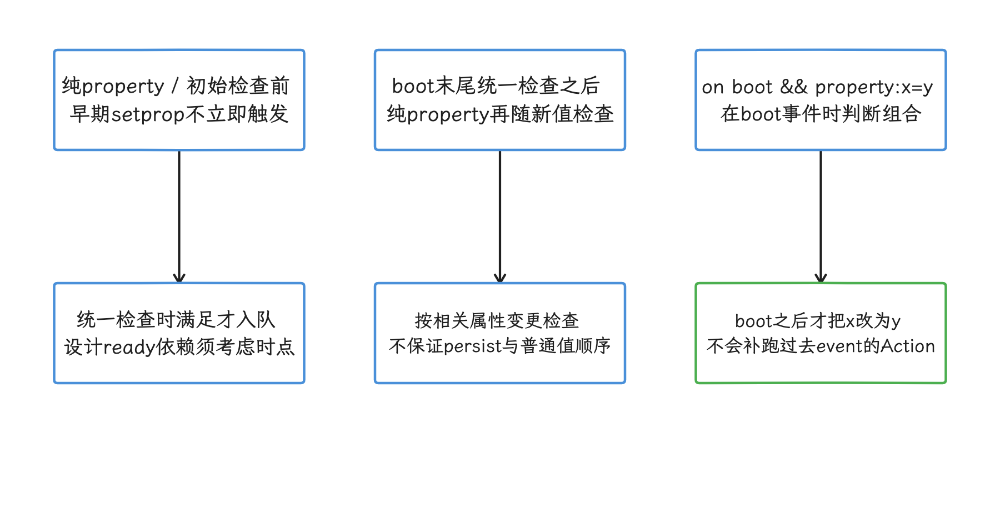

图：纯 property 的初始统一检查与后续变更触发分开，组合 event 条件只在该 event 时检查。 boot 已过后才满足属性会错过 event Action；跨属性的固定顺序要靠状态机或显式 property 保证。

持久化 property 还有一层顺序问题：当 `ro.property_service.async_persist_writes=true` 时，写入持久化存储的 setprop 与普通 setprop 的触发顺序没有定义。修改 rc 时用状态机或显式 property 表达依赖，日志里一次偶然的先后只当线索看。

### APEX rc 与 `updatable` service

init 会处理 /apex/*/etc/*rc，按相同基名选择不超过当前 SDK 的最高 .#rc，无版本 .rc 按 SDK 0。这套版本化选择只作用于 APEX 内的 rc，vendor/system 目录照旧。标记为 `updatable` 的 service 如果在 APEX 激活完成前收到启动请求，init 会把启动延后；APEX 中的定义只覆盖带 `updatable` 标记的 service。


查启动回归时，`/system/etc/init/hw/init.rc` 只是起点，vendor、odm、APEX 和硬件专用 rc 都可能新增 Action、service 或 property 等待，要一并纳入检查。

## kernel：以 android17-6.18-2026-06_r6 为准

kernel 启动耗时通常集中在镜像加载/解压、module load、driver probe、firmware、存储和设备依赖。module 是可动态加载的内核代码；driver probe 是驱动发现设备后执行初始化并绑定设备的回调。
Android 官方 kernel boot-time 指南给出的优化方向，落到 6.18 这条基线上仍要逐驱动验证。

### 选择性异步 probe

`android17-6.18-2026-06_r6` 的 `drivers/base/dd.c` 会根据 driver 的 `probe_type` 和 `driver_async_probe=` 选择同步或异步 attach。模块可通过相应 async_probe 参数请求异步 probe；PROBE_FORCE_SYNCHRONOUS 明确禁止异步，PROBE_PREFER_ASYNCHRONOUS 直接允许，只有默认类型才进一步检查 driver_async_probe 和 module 请求。它们改变的是 driver core 的 probe 策略；某个 module_init 是否整体在后台执行，还要看模块自身的实现。

<!-- gracker-diagram: ch18-06-17-async-probe -->
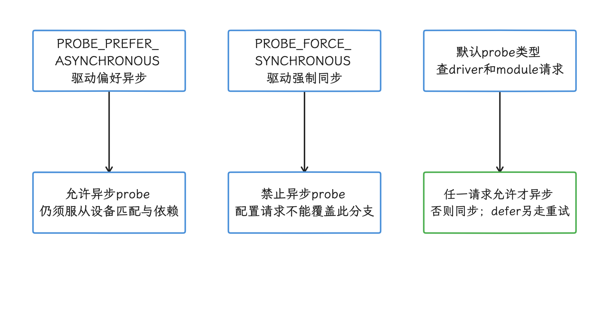

图：driver core 先按 probe_type 判断，只有默认类型才查询命令行和 module 请求。 异步 probe 改变的是 probe 阶段的调度，整个 module_init 是否后台执行另看实现；supplier 未就绪要正确 defer 并验证显示、触摸和恢复路径。

适合评估的对象通常有：

- 慢速 I2C/SPI 总线设备；
- probe 中加载 firmware 的设备；
- 大量硬件初始化且不阻塞首屏的设备。

异步 probe 要逐设备评估，全量开启有风险：consumer（依赖方）发现 supplier（提供时钟、电源等资源的一方）未就绪时，必须正确返回 `-EPROBE_DEFER`，让内核稍后重试。
显示、存储、clock、regulator（稳压器）、thermal（温控）等依赖若表达错误，耗时会从 module load 转成更晚的同步等待或功能故障。

官方文档给出的异步 probe 示例收益是 100–500 ms，移动非必要 module 到 second-stage init 的示例收益是 500–1000 ms。这些数字取决于硬件和 driver，说明量级可以，写进产品收益预期还差设备实测。

### first-stage 与 second-stage module

正常启动的 first stage 只应保留完成根文件系统和早期启动所需的 module。recovery/fastbootd 需要的 USB、显示等 module 可以保留在 ramdisk，却不必在 normal boot 的 first stage 全部加载。

相关构建变量包括：

- `BOARD_VENDOR_RAMDISK_KERNEL_MODULES_LOAD`
- `BOARD_VENDOR_RAMDISK_RECOVERY_KERNEL_MODULES_LOAD`
- `BOARD_VENDOR_KERNEL_MODULES_LOAD`

移动 module 后，要同时验证 normal boot、recovery、fastbootd、OTA 和 crash recovery。second-stage 后台加载还要提供 ready property 或可靠的设备节点等待，避免 HAL 在 driver 未就绪时无限阻塞。

### CPUfreq/devfreq 的启动顺序

CPUfreq 控制 CPU 频率，devfreq 用同类机制控制 DRAM、互连等设备频率。它们过晚上线，会让早期串行工作长期运行在 bootloader 留下的低频状态。
提前 probe 前要确认 clock、regulator 和 thermal supplier 已就绪。频率上升带来的功耗和温升也要纳入回归，验收时把 boot time 与两者放在一起看。


## Zygote：预加载成本放在哪个阶段

r1 的 primary 64-bit Zygote 由 `init.zygote64.rc` 启动，命令行没有 `--enable-lazy-preload`，因此在 fork `system_server` 前执行完整 preload。

primary Zygote 负责设备主 ABI（应用二进制接口，例如 `arm64-v8a`）并派生 `system_server`；双 Zygote 设备还会启动面向另一 ABI 的 secondary Zygote。preload 是在派生子进程前预先装入常用类、资源和本地库，让后续进程共享已经初始化的内存页。

完整 preload 包括：

- classes 与 non-boot classloader（非 Boot Classpath 的类加载器）cache；
- framework resources；
- app-process HAL 和 graphics driver；
- `android`、`jnigraphics` 等 shared library；
- text/font cache 与 compatibility rules；
- flag 开启时的 `HttpEngine.preload()`；
- WebViewFactory.prepareWebViewInZygote() 的共享准备和 JCA provider warm-up；这一步只做共享准备，WebView 专用 Zygote 要另行创建。JCA 是 Java Cryptography Architecture，provider 是其密码算法实现方。

preload 会增加 boot 阶段的 CPU、I/O 和 page fault，同时让 fork 后进程复用更多已初始化状态。删减预加载项时要同时测系统 boot、首个 App、首个 WebView、PSS（按共享页比例折算的进程内存）和连续启动。


[Boot image profiles](https://source.android.com/docs/core/runtime/boot-image-profiles) 文档把 boot classpath Profile、system_server Profile 和 Zygote 预加载类清单放在同一套设备调优流程中。
这些数据应来自真实 CUJ（critical user journey，关键用户路径）并随系统镜像发布；它们不同于应用安装时的 Baseline Profile。删类或扩充清单都应由目标设备采样与回归结果驱动。

### lazy preload 与 64/32 配置

`--enable-lazy-preload` 在较早 Android 版本已经存在。Android 17 的 64/32 配置里，`init.zygote64_32.rc` 仍给 32-bit secondary Zygote 传这个参数；primary Zygote 不传。

lazy 模式跳过启动期 preload，收到首次 preload 请求时由 `ZygoteConnection` 调用 `ZygoteInit.lazyPreload()`，后者仍执行同一套完整 `preload()`。它改变的只是支付时间，preload 本身仍完整执行，没有自动的增量拆分。

<!-- gracker-diagram: ch18-06-20-lazy-preload -->
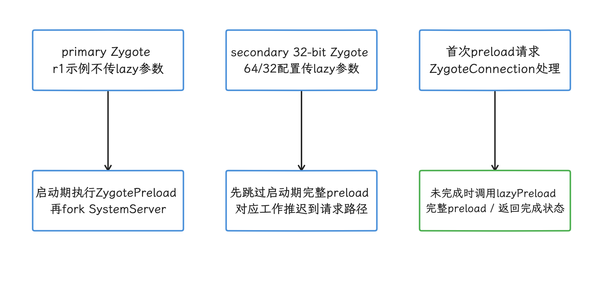

图：64/32 配置的 secondary 可延迟 preload，请求到来后仍执行完整 preload。 primary 配置不传 lazy；这项能力较早版本已经存在，preload 也仍完整执行，须测首个对应 ABI 请求。

回归时应分别记录：

- primary Zygote 的 `ZygotePreload`；
- secondary Zygote 的 `ZygoteInitTiming_lazy`；
- 首个 32-bit 进程请求前后的延迟；
- 双 Zygote 设备与纯 64-bit 设备的配置差异。

## SystemServer：从 trace slice 看同步点

`SystemServer.run()` 的主线结构是：

1. 初始化 SystemServer 进程环境和 Perfetto producer；
2. 启动 `SystemServerInitThreadPool`；
3. 把 `SystemConfig::getInstance` 尽早提交到线程池；
4. 加载 `android_servers`；
5. 创建 system context 和 `SystemServiceManager`；
6. 依次进入 bootstrap、core、other、APEX service 分组；
7. 进入各个 boot phase，直到 AMS 完成 boot。


主线程上的 `startService()` 调用顺序仍然重要，但某些 service 会把工作提交到线程池。判断某个 slice 是否阻塞关键路径时，要同时看主线程是否等待 future（异步任务的结果句柄）、Binder reply、锁或 property；slice 宽度只给出总耗时，其中多少是 CPU 执行，要按等待对象拆开看。

### SystemConfig 早期并发

r1 在正常 SystemServer 初始化主线无条件调用 startSystemConfigInit()，将 SystemConfig::getInstance 提交到线程池；提交用的 ReadingSystemConfig slice 只覆盖提交动作，后台扫描的完整耗时另有区间。SystemConfig.getInstance() 在类锁内创建单例，consumer 若在扫描完成前进入，会在这个锁上等待；主线程是否通过 Future.get() join，是另一条独立路径。

<!-- gracker-diagram: ch18-06-22-systemconfig -->
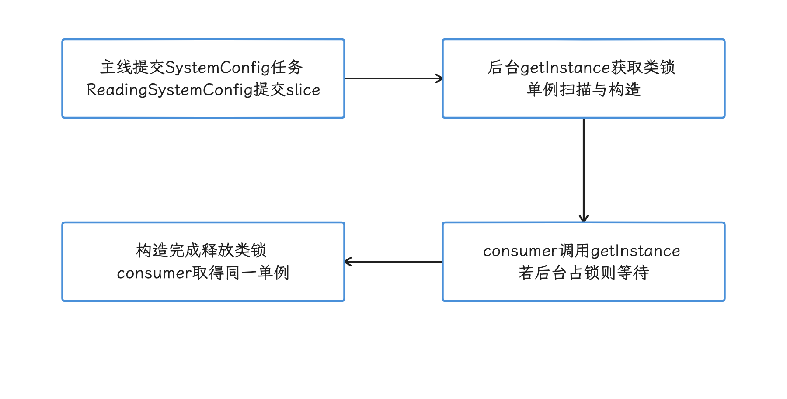

图：早期提交 SystemConfig 可以与其他初始化重叠，consumer 是否等待取决于单例创建是否完成。 ReadingSystemConfig 提交 slice 只见提交动作，完整后台扫描要另行计时；consumer 在 SystemConfig 类锁上等待，Future.get() 是否出现与之无关。

优化方向应围绕“提交是否足够早、consumer 在哪里 join、配置扫描是否变重”展开。源码仅证明并发结构，固定毫秒数的收益要靠改动前后实测拿到。

### ART Mainline 的早期初始化

`startBootstrapServices()` 很早就调用 `ArtModuleServiceInitializer.setArtModuleServiceManager(...)`。class linking 会解析类及其依赖，GC（garbage collection）负责回收 Java 堆内存。
源码注释说明 `service-art.jar` 的 class linking 和 GC 互斥；把首次引用放在 PackageManager 大量分配之前，可避开后面的 GC 竞争。

这段初始化和特殊启动中的 boot dexopt 要分开：

- `ArtModuleServiceInitializer` 是早期注册与 class-linking 时点。
- `UpdatePackagesIfNeeded` 在 later `startOtherServices` 中运行。
- first boot、OTA 或 Boot Classpath APEX 变化时，`ArtManagerLocal.onBoot()` 才执行阻塞式包 dexopt。
- 普通 cold boot 不走这轮 boot dexopt。


### APEX system service 的分组位置

`startApexServices()` 遍历 `ApexManager.getApexSystemServices()`，启动 APEX 声明的 system service，然后调用 `SystemServiceManager.sealStartedServices()`，禁止后续再注册新的 system service。
源码注释要求 APEX service 是启动 service 的末组，避免 platform service 反向依赖可独立更新的 APEX service。

我们把它当架构约束看：APEX service 压在末组，保障的是依赖方向与更新稳定性，“APEX 并行挂载带来固定收益”这类结论要靠专门实验。bootanalyze 默认配置只提供 `apexd_activated`、`apexd_bootstrapping_done` 和 `apexd_ready` 三个 apexd 日志事件；挂载 namespace（进程可见的挂载视图）、单个 APEX 校验和单个 service 初始化仍要靠更细的 trace 或自定义日志。


### Boot phase 的分组与可选并行

SystemServer 触发 PHASE_WAIT_FOR_DEFAULT_DISPLAY、PHASE_WAIT_FOR_SENSOR_SERVICE、PHASE_SYSTEM_SERVICES_READY、PHASE_ACTIVITY_MANAGER_READY、PHASE_THIRD_PARTY_APPS_CAN_START 等递增阶段。r1 startBootPhase() 先按 Flags.parallelizeOnbootphase() 与 service.getBootPhaseSerial(phase) 分组：关闭开关时全部串行；开启时先执行串行组，再把未标为串行的 callback 提交到 SystemServerInitThreadPool，等待全部 Future.get() 后才结束该阶段。阶段号只推进时序，服务依赖图要另行梳理；并行是否实际发生，以产品 flag、各服务 phase 标记和 trace 为准，画图时按实际分组画。

<!-- gracker-diagram: ch18-06-25-phase-barrier -->
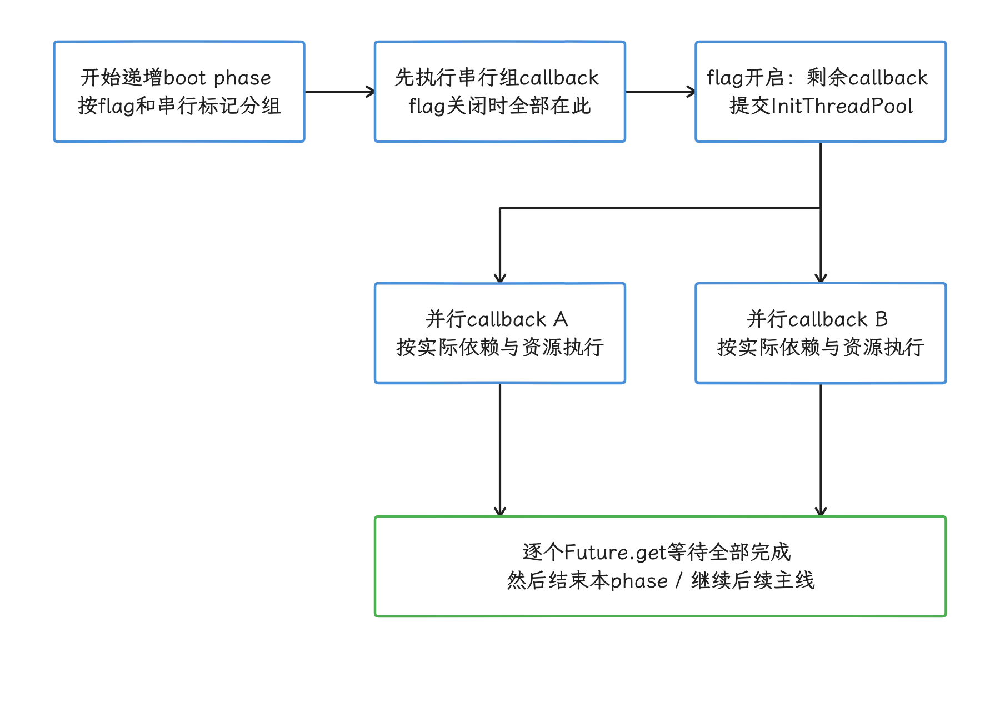

图：r1 开关开启时先执行串行 callback，再提交其余 callback，并等待所有 Future 完成。 开关关闭则全串行；phase 标记和依赖须逐服务核实，图示两任务数量与执行时长均为示意，实测数据另行采集。

平台新增 service 时，应记录：

- constructor/start 的 trace slice；
- 各 boot phase callback；
- 首次 Binder 发布和 ready 事件；
- 失败时的降级路径；
- 是否阻塞默认显示、PMS、AMS、SystemUI 或 Launcher。

## `finishBooting()` 内还有哪些工作

AMS 要等 boot animation 完成后才继续 `finishBooting()`；动画尚未完成时，会记录待处理状态并返回。进入收尾后，顺序包含：

1. 通知 Zygote 与 VMRuntime boot completed；
2. 提交存储 checkpoint，失败时请求重启；
3. 触发 `PHASE_BOOT_COMPLETED`；
4. 启动此前 hold 的进程；
5. 设置 `sys.boot_completed=1` 和 `dev.bootcomplete=1`；
6. 向 lmkd 发送 `LMK_START_MONITORING`；
7. 进入用户级 boot completion，随后调度用户 profile 启动。

<!-- gracker-diagram: ch18-06-26-finish-boot -->
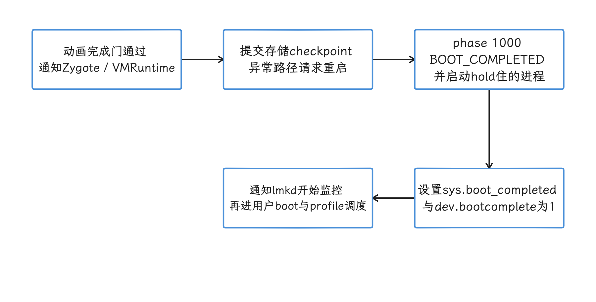

图：动画完成门通过后，AMS 通知 ART、提交 checkpoint、完成 phase 并设置平台 boot property。 checkpoint 异常请求重启；factory test 等有额外分支，property 后用户广播和 profile 启动仍可继续占用资源。

lmkd 是 low memory killer daemon，在内存压力下协助选择并结束进程；PSI 是内核提供的资源压力指标。

因此，下面三个说法要修正后再用：

- “boot animation 停止就是 `sys.boot_completed`”：两者有顺序关系，还要看 AMS 收尾。
- “property 置 1 后没有启动工作”：用户回调、广播和应用进程仍可能继续占用 CPU/I/O。
- “LMKD PSI 在 Android 17 全程关闭”：framework 只证明 boot complete 后显式发送 start-monitoring 命令，早期是否已经监控还受 lmkd 配置影响。

## bootstat：适合版本看板的持久化事件

bootstat 可持久化事件名与整数值，单位要按事件解释：-r 自定义事件以 boot_clock/CLOCK_BOOTTIME 的整数秒记录，包含休眠；RecordBootComplete() 用毫秒记录 boot_complete 等值，并减去可选 ro.boot.boottime_offset。两类值要按各自单位解读，把它们都当 uptimeMillis、或在容器内把自定义 -r 与 boot_complete 无条件相减，都并不合适。r1 bootstat.rc 用 sys.bootstat.first_boot_completed 门控，一次完整重启只在首次 sys.boot_completed=1 后提交下列采集；userspace reboot 之下，这组指标不会再自动提交：

- `--record_boot_complete`
- `--record_boot_reason`
- `--record_time_since_factory_reset`
- `-l`

`RecordBootComplete()` 还会收集一组明确列出的 `ro.boottime.init.*`、`ro.boottime.event.*` 字段，以及 `ro.boot.boottime` 中的 bootloader 分段。
event 字段只有在 init 的 event timestamp flag 开启并成功写入 property 时才有值。上电到 kernel 的耗时以 bootloader 写入的 `ro.boot.boottime` 为来源；这段来源缺席时，bootstat 侧没有补足手段。

下面的命令用于记录自定义事件并检查本机事件：

```bash
adb shell su root bootstat -r vendor_display_ready
adb shell su root bootstat -p
adb shell su root bootstat -l
```

-r 记录执行命令时的 CLOCK_BOOTTIME 整数秒；命令需有事件目录的读写权限，以上示例使用 su root。这个主机下发的自定义点有 ADB 延迟与秒级量化，当作粗略标记用，精确的显示 ready 硬件时间要另取。r1 的 `-l` 实现会把已支持的事件映射到 bootstats atoms；atom 是 statsd 使用的结构化事件类型。README 中“EventLog/Tron histogram”的描述已经落后于当前实现。自定义事件仍可持久化和打印，带 `kBootEventToAtomInfo` 映射的才会作为受支持 atom 写出。


## I/O、page fault 与文件布局

启动 I/O 要分三层：

| 层级 | 典型现象 | 证据 | 调整方向 |
|---|---|---|---|
| 文件 | APK/JAR/APEX/配置被过早扫描 | file access、文件映射与 page cache；bootio 仅辅助定位进程 | 延迟非关键读取、减少重复扫描 |
| block/fs | queue 等待、读放大、verity、fsck | block/ext4/f2fs trace | I/O scheduler、read ahead、文件布局 |
| memory mapping | major fault、mmap 抖动、解压 | page fault + sched + file map | 热点布局、预加载清单、压缩策略 |

读放大指底层读取量超过上层真正需要的数据量；verity 是对只读分区做完整性校验的机制；fsck 是文件系统一致性检查。mmap 把文件映射进进程地址空间，major fault 则需要从存储读取缺失页。

“减少读取字节”也可能把成本推到 Launcher 显示之后。评估时至少保留两个窗口：

- kernel entry 到 `sys.boot_completed`；
- `sys.boot_completed` 到 first interactive。

OTA 后 checkpoint、pre-reboot dexopt artifact 提交、APEX 切换和首次包扫描要单独标记。pre-reboot dexopt artifact 是重启前为更新后的系统预先生成、待更新生效时提交的 ART 编译产物。它们属于升级成本，评估时按升级首启单独设目标，与普通 cold boot 分开算。


## 16 KB page size 是设备级基线变化

page size 是内核管理虚拟内存和文件映射的基本页粒度。Android Developers 的 16 KB page size 文档给出一组初始测试：system boot time 平均改善 8%，约 950 ms，同时说明不同设备结果会变化。这个数字来自官方测试样本，不会自动套用到 Android 17 的每台设备；各设备要以同条件实测为准。

比较 4 KB 与 16 KB 时，页表、mmap 和 page fault 的粒度与成本可能变化，还需满足 native ELF 与 ZIP 对齐要求；文件系统和存储硬件是否随页大小改变，要看具体方案。将 page size 写入样本维度，在同一硬件并尽量固定文件系统、存储、镜像功能和启动类型下比较两个可用构建，另列为支持 16 KB 必须做的构建差异。别把跨设备或其他配置差异算到某个 SystemServer service 头上。


## 从慢阶段回到处理动作

| 慢阶段 | 优先确认 | 常见处理 |
|---|---|---|
| bootloader | 镜像读取、解压、UART、boot reason | 减少日志、选择合适压缩、拆分硬件阶段 |
| kernel / coldboot | module load、probe、firmware、supplier | 移动非必要 module、选择性 async probe |
| first-stage init | 存储、dm-verity、first-stage module | 缩小 ramdisk 关键集合 |
| second-stage init | `exec`、property wait、service class | 后台 service、显式 ready、修正依赖 |
| Zygote | classes/resources/library preload | 调整清单并回归首个 App 与共享内存 |
| PMS / ART | 包扫描、first boot/OTA dexopt | 分类启动类型、检查 compiler filter 与 artifact |
| SystemServer | service start、boot phase、Binder/锁 | trace 到具体 callback 和等待对象 |
| SystemUI / Launcher | 进程创建、首帧、资源竞争 | 单独测 shown 与 first interactive |

每次改动只回答一个假设。例如，“I2C touch probe 阻塞 module load”要用 probe 时间证明；改成 async 后再验证触摸在 Launcher 首帧前 ready、recovery 可用、没有 defer storm。defer storm 指大量 probe 反复返回 `-EPROBE_DEFER` 并重试，消耗启动期 CPU 和时间。把多项 kernel、rc 和 framework 调整合在一个版本里，收益和回归就都断了归因线索。

## 实验与回归门禁

一组可复现的 boot 实验至少记录：

- build fingerprint、AOSP tag、kernel tag、vendor image；
- page size、文件系统、存储型号和加密状态；
- normal/first boot/post-OTA/userspace reboot；
- 电池、充电、温度和关机静置时间；
- bootchart、Perfetto、UART 等采集开关；
- `sys.boot_completed`、Launcher shown、first interactive；
- P50、P90、样本数和剔除规则。

安全与稳定性门禁包含：

- verified boot、SELinux、KeyMint/Gatekeeper 和 checkpoint 顺序不变；
- recovery、fastbootd、OTA、加密解锁都能完成；
- display、touch、radio、audio 等产品关键硬件按场景 ready；
- service 失败有超时和降级，不制造无限 property wait；
- boot 变快后，首屏 jank（掉帧或卡顿）、首个 App、功耗和内存没有回归。

KeyMint 管理硬件支持的密钥与密码操作，Gatekeeper 负责锁屏凭据验证；两者都不会为缩短首屏时间而随意后移，要动它们先过安全评估。


关闭日志和 trace 可以减少测试机上的开销，但量产配置与可观测性要分别评估。没有可回放证据的优化，一旦在后续版本回归，定位成本通常高于省下的少量启动时间。

## 与其他章节的边界

- 完整启动流程、Zygote fork、USAP 与 preload 机制见 [1.3 系统启动、Zygote 与图形栈预加载](../../part1-fundamentals/ch01-architecture/03-boot-zygote-graphics-preload.md)。
- ART compiler filter 与 dex2oat 见 [1.5 ART 编译、验证与去优化机制](../../part1-fundamentals/ch01-architecture/05-art-compilation-verification-deoptimization.md)。
- Perfetto 配置与采集见 [14.1 Perfetto 入门、Trace 抓取与可靠性](../../part3-tools/ch14-perfetto/01-perfetto-intro-capture-reliability.md)。
- 16 KB kernel/用户态边界见 [4.5 16 KB Page Size 与 Android 性能](../../part1-fundamentals/ch04-memory/05-16kb-page-size.md)。

## 参考资料

- [AOSP：Optimize boot times](https://source.android.com/docs/core/perf/boot-times)
- [AOSP：Kernel boot time optimization](https://source.android.com/docs/core/architecture/kernel/boot-time-opt)
- [AOSP：Boot image profiles](https://source.android.com/docs/core/runtime/boot-image-profiles)
- [Android Developers：Support 16 KB page sizes](https://developer.android.com/guide/practices/page-sizes)
- [Perfetto：Record system traces](https://perfetto.dev/docs/getting-started/system-tracing)
- [AOSP r1：bootanalyze README](https://android.googlesource.com/platform/system/extras/+/refs/tags/android-17.0.0_r1/boottime_tools/bootanalyze/README.md)
- [AOSP r1：bootanalyze.py](https://android.googlesource.com/platform/system/extras/+/refs/tags/android-17.0.0_r1/boottime_tools/bootanalyze/bootanalyze.py)
- [AOSP r1：bootanalyze.sh](https://android.googlesource.com/platform/system/extras/+/refs/tags/android-17.0.0_r1/boottime_tools/bootanalyze/bootanalyze.sh)
- [AOSP r1：bootanalyze config.yaml](https://android.googlesource.com/platform/system/extras/+/refs/tags/android-17.0.0_r1/boottime_tools/bootanalyze/config.yaml)
- [AOSP r1：bootio README](https://android.googlesource.com/platform/system/extras/+/refs/tags/android-17.0.0_r1/boottime_tools/bootio/README.md)
- [AOSP r1：init README](https://android.googlesource.com/platform/system/core/+/refs/tags/android-17.0.0_r1/init/README.md)
- [AOSP r1：init.cpp](https://android.googlesource.com/platform/system/core/+/refs/tags/android-17.0.0_r1/init/init.cpp)
- [AOSP r1：service.cpp 中的 service 启动时间属性](https://android.googlesource.com/platform/system/core/+/refs/tags/android-17.0.0_r1/init/service.cpp)
- [AOSP r1：init.zygote64.rc](https://android.googlesource.com/platform/system/core/+/refs/tags/android-17.0.0_r1/rootdir/init.zygote64.rc)
- [AOSP r1：init.zygote64_32.rc](https://android.googlesource.com/platform/system/core/+/refs/tags/android-17.0.0_r1/rootdir/init.zygote64_32.rc)
- [AOSP r1：bootstat.cpp](https://android.googlesource.com/platform/system/core/+/refs/tags/android-17.0.0_r1/bootstat/bootstat.cpp)
- [AOSP r1：bootstat.rc](https://android.googlesource.com/platform/system/core/+/refs/tags/android-17.0.0_r1/bootstat/bootstat.rc)
- [AOSP r1：ZygoteInit.java](https://android.googlesource.com/platform/frameworks/base/+/refs/tags/android-17.0.0_r1/core/java/com/android/internal/os/ZygoteInit.java)
- [AOSP r1：SystemServer.java](https://android.googlesource.com/platform/frameworks/base/+/refs/tags/android-17.0.0_r1/services/java/com/android/server/SystemServer.java)
- [AOSP r1：SystemServiceManager.java](https://android.googlesource.com/platform/frameworks/base/+/refs/tags/android-17.0.0_r1/services/core/java/com/android/server/SystemServiceManager.java)
- [AOSP r1：ActivityManagerService.java](https://android.googlesource.com/platform/frameworks/base/+/refs/tags/android-17.0.0_r1/services/core/java/com/android/server/am/ActivityManagerService.java)
- [AOSP r1：ProcessList.java](https://android.googlesource.com/platform/frameworks/base/+/refs/tags/android-17.0.0_r1/services/core/java/com/android/server/am/ProcessList.java)
- [AOSP r1：DexOptHelper.java](https://android.googlesource.com/platform/frameworks/base/+/refs/tags/android-17.0.0_r1/services/core/java/com/android/server/pm/DexOptHelper.java)
- [AOSP r1：ArtManagerLocal.java](https://android.googlesource.com/platform/art/+/refs/tags/android-17.0.0_r1/libartservice/service/java/com/android/server/art/ArtManagerLocal.java)
- [AOSP kernel：android17-6.18-2026-06_r6 driver core](https://android.googlesource.com/kernel/common/+/refs/tags/android17-6.18-2026-06_r6/drivers/base/dd.c)

- [r1：android-boot-tracing.md](https://android.googlesource.com/platform/external/perfetto/+/android-17.0.0_r1/docs/case-studies/android-boot-tracing.md)
- [r1：perfetto.rc](https://android.googlesource.com/platform/external/perfetto/+/android-17.0.0_r1/perfetto.rc)
- [r1：bootio_collector.cpp](https://android.googlesource.com/platform/system/extras/+/android-17.0.0_r1/boottime_tools/bootio/bootio_collector.cpp)
- [r1：action_manager.cpp](https://android.googlesource.com/platform/system/core/+/android-17.0.0_r1/init/action_manager.cpp)
- [r1：SystemService.java](https://android.googlesource.com/platform/frameworks/base/+/android-17.0.0_r1/services/core/java/com/android/server/SystemService.java)
- [r1：boot_event_record_store.cpp](https://android.googlesource.com/platform/system/core/+/android-17.0.0_r1/bootstat/boot_event_record_store.cpp)
