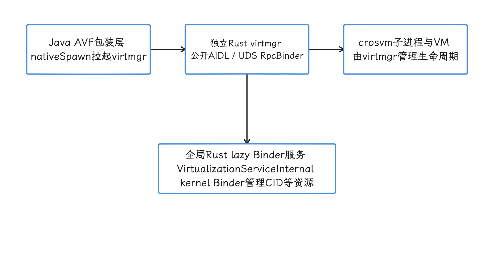
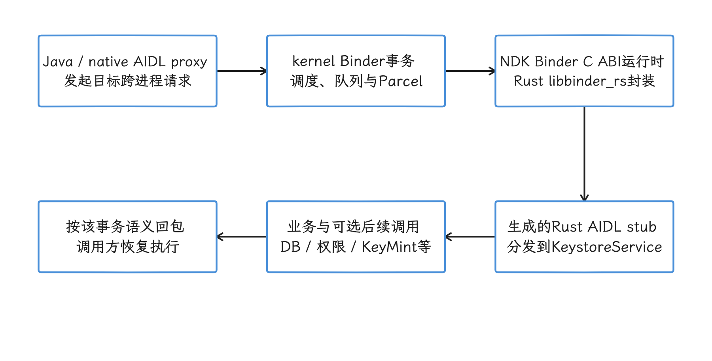
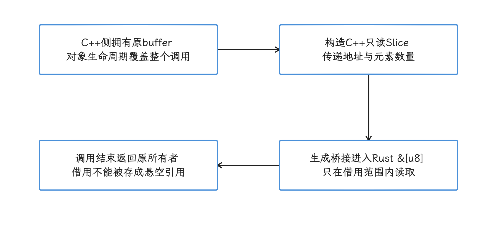
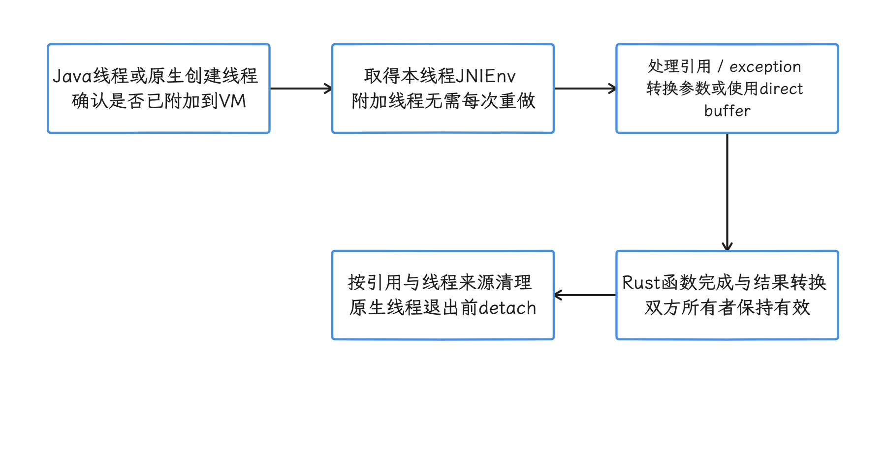
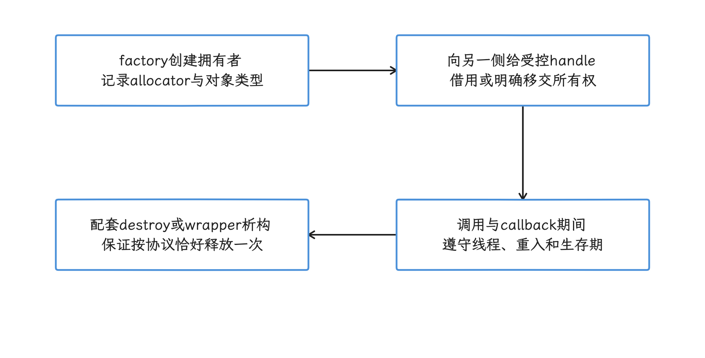
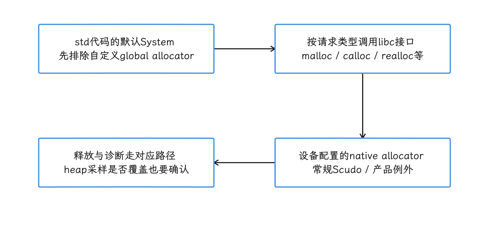
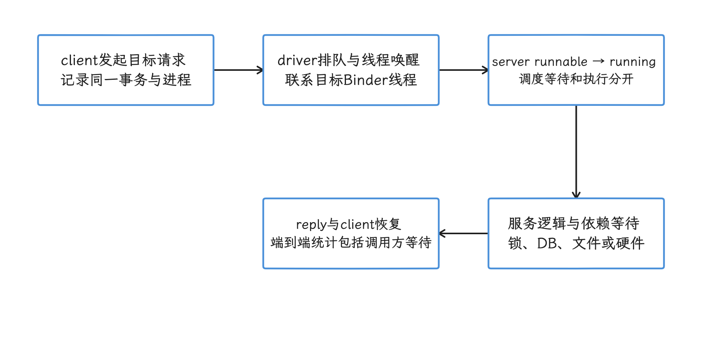

# Android 17 平台 Rust 性能边界：Binder、CXX 与 Soong

平台引入 Rust，降下来的是一部分内存安全风险；Binder、FFI、分配与调度这些成本不会因为换语言而消失。我们评估平台 Rust 服务时，把语言运行时、CXX 边界、错误处理和 Soong 构建配置拆开来看，再按目标进程的实际调用路径逐项验证。

## 结论

Rust 进入 Android 平台，主要目标是减少新增 native（编译为设备机器码） 代码里的内存安全缺陷；性能是快是慢，要看具体路径。同样叫“跨语言”，同进程跨一次 C ABI（C 二进制调用约定），可能只多出一次普通函数调用；换成一笔跨进程 Binder 调用，就要经过 Parcel 序列化、内核事务和线程调度。字符串复制、所有权转换、锁竞争、分配器和代码体积，每一项都可能把结果拉向另一边。

下面这些结论，都能在 AOSP `android-17.0.0_r1` 里直接核对：

- Keystore2 与全局 VirtualizationServiceInternal 都有 Rust AIDL 服务入口，借助 libbinder_rs/libbinder_ndk 分发，业务层无需先落到固定 C++ AIDL stub。AVF 另有客户端拉起的 virtmgr：公开 Java 包装层与它通过 Unix 域套接字上的 RpcBinder 通信；AVF 的传输要按这两段分别核对，归并成同一条内核 Binder 路径会看错方向。
- DnsResolver 仍是 C++ 与 Rust 的混合模块：Rust 以 `libresolvrs_ffi` 静态 FFI（Foreign Function Interface，跨语言调用接口）库参与 DoH（DNS over HTTPS）、HTTP/3 和 DNS proxy 等部分，整个 resolver 离全部换成 Rust 还有一段距离。
- UWB 包含 Rust 实现的 UCI（UWB Command Interface）core、packet 与 HAL adapter（硬件抽象层适配器）；Bluetooth 在 `system/rust` 下提供 `libbluetooth_rs`，
  通过 `cxx` 生成的 CXX bridge（由 `cxx` 生成的 Rust/C++ 桥接层） 接入现有 C++ 代码。两者都走渐进式替换。
- 设备端 Rust 全局启用 `panic=abort`、整数溢出检查、强栈保护与 unwind table，ThinLTO（链接期轻量全程序优化）默认开启。解释平台上 Rust 的表现时，这些构建配置比通用 Rust 项目的经验数字更合适。
- 未自定义全局 allocator（内存分配器） 的 Rust 标准库代码，通常经 libc `malloc/free` 进入设备配置的 native allocator：常规 Android 设备这里是 Scudo，低内存产品可能换用其他实现。
  所以换到 Rust，分配器这层的安全成本依然在。

这一篇我们也不给 “FFI 固定几十纳秒”“Rust 比 C++ 快或慢 5%”“二进制必然大 20%” 这类数字。它们取决于 CPU、工具链、优化级别、参数形态、调用频率、是否跨进程和负载；要引用其中任何一个，先拿可复现实验把它测出来。

## 1. Android 平台怎样采用 Rust

我们先把平台采用 Rust 的动机和 r1 里可核对的代表组件摆清楚，再进入边界、成本与测量的讨论。

### 1.1 版本目标

Android 12 开始在 AOSP 平台构建中正式支持 Rust，并同时引入 Rust AIDL backend。
Google 在 2021 年发布 Rust 支持时提到，内存不安全问题长期约占 Android 高严重性安全漏洞的 70%。这是当时漏洞结构的历史数据，直接当作 Android 17 的现状并不合适。

迁移策略侧重新增 native 代码和能够独立替换的组件：大规模逐行重写成熟的 C/C++ 模块会带来功能回归、兼容性和验证成本，所以 AOSP 长期保留混合语言结构，FFI、Binder 与生成代码都是这种演进方式的一部分。

还有一点容易被忽略：Rust 的安全保证里有一部分是运行时工作。所有权、生命周期与大部分借用规则在编译期检查，数组边界、整数溢出以及某些状态约束则可能留到运行期——Soong 对设备端 Rust 显式开启 `-C overflow-checks=on`。对照 r1 的构建配置，“安全检查全部在编译期完成”的说法站不住。


### 1.2 r1 中可核对的代表组件

| 组件 | r1 形态 | 主要边界 |
|---|---|---|
| Keystore2 | <code>system/<wbr>security/<wbr>keystore2</code> 下的 `rust_binary` | Java/Native 客户端经 Binder 到 Rust AIDL 服务；Rust 再经 Binder 调 KeyMint 等 HAL |
| Virtualization<wbr>Service<wbr>Internal | virtualization<wbr>service Rust binary 中的全局 lazy Binder 服务 | 管理 CID 等全局资源；客户端拉起的独立 virtmgr 管理 VM/crosvm，公开包装层经 UDS RpcBinder 连接 virtmgr |
| DnsResolver | C++ resolver + `rust_ffi_static` 的 `libresolvrs_ffi` | CXX bridge 连接 C++ resolver 与 Rust DoH/HTTP3、DNS proxy 代码 |
| UWB | <code>packages/<wbr>modules/<wbr>Uwb/<wbr>libuwb-uci</code> 中的 Rust packet、core 与 HAL adapter | Rust AIDL、Binder、JNI（Java Native Interface）与厂商 UCI HAL |
| Bluetooth | <code>packages/<wbr>modules/<wbr>Bluetooth/<wbr>system/<wbr>rust</code> 中的 `rust_ffi_static` | CXX bridge 连接 Rust LE Audio（低功耗蓝牙音频）/协议模块与既有 C++ stack |

这张表描述的是源码形态。要判断一项功能是否真的全部改成了 Rust，我们直接看它在源码树里的实际路径：比如 DnsResolver 根目录仍有 `DnsResolverService.cpp`、`ResolverController.cpp`、`res_send.cpp` 等大量 C++，Bluetooth 的 Rust 库也是作为现有 stack 的静态 FFI 组件构建的。

r1 的 UWB 位于 packages/modules/Uwb，Bluetooth Rust 模块位于 packages/modules/Bluetooth/system/rust。这里核对的 DnsResolver 根目录、Rust FFI defaults 和 Bluetooth 静态桥说明它们仍是混合模块；判断形态以当前目录与构建规则为准，旧路径或历史迁移说法只能当背景。至于其他 HTTP engine、bpfloader 或整个仓库有没有重写，要另找对应模块和构建证据，仅凭这几处目录的存在或缺失还下不了全局结论。

<!-- gracker-diagram: ch18-07-04-avf-two-levels -->


图：公开 Java 包装层连到独立 virtmgr 的 socket RpcBinder，全局内部服务再管理共享资源。 这些 Rust 服务位于不同进程且使用不同传输；整条 AVF 路径要按两级分别画，Java 经一次 driver 直达全局服务的画法与源码不符。

### 1.3 Keystore2 的 Binder 入口

我们先看 Keystore2 的服务入口。它的 `Android.bp` 依赖 `libbinder_rs`，`KeystoreService` 在 Rust 中实现 `IKeystoreService`，进程启动后直接注册 native Binder 对象，创建和注册可见下列片段：

```rust
let ks_service = KeystoreService::new_native_binder(id_rotation_state).unwrap_or_else(|e| {
    panic!("Failed to create service {KS2_SERVICE_NAME} because of {e:?}.");
});
binder::add_service(KS2_SERVICE_NAME, ks_service.as_binder()).unwrap_or_else(|e| {
    panic!("Failed to register service {KS2_SERVICE_NAME} because of {e:?}.");
});
```

这段保留 r1 的创建与注册错误策略：失败调用 panic!，在设备 panic=abort 配置下终止进程。它取自依赖外围类型、状态与已启动线程池的源码，属于片段而非独立 main 程序。调用发生时，Java framework 侧的 AIDL proxy（客户端代理） 发出一笔 Binder transaction，服务端由 Rust AIDL stub（服务端分发代码） 接收；
`libbinder_rs` 构建在 `libbinder_ndk` 上，内部虽然跨了 Rust/C ABI 边界，但那里没有第二笔 Binder IPC，业务层也无需先进入 C++ stub。

生成密钥或签名请求的端到端时延，常见来源是 Binder 排队、数据库事务、SELinux 权限检查、KeyMint HAL、TEE（可信执行环境）/StrongBox 和远程密钥供应；这笔时延要按这些环节逐项拆解，一个空 FFI 函数的纳秒值覆盖不了它。

<!-- gracker-diagram: ch18-07-03-keystore -->


图：Keystore2 用 Rust AIDL 与 libbinder_rs/libbinder_ndk 接收请求，注册失败保留 r1 的 panic 策略。 C ABI 库边界只是进程内调用，没有额外一次 Binder IPC；业务请求还可能涉及数据库、权限和可选硬件路径，估计时延要按这些环节来，空 FFI 成本覆盖不了它。

## 2. 三类边界

Rust 服务可能遇到三类边界：AIDL/Binder 的跨进程调用、与 C/C++ 的同进程 FFI、暴露给 Java/Kotlin 的 JNI。三者的成本结构差别很大，我们一类一类看。


### 2.1 Rust AIDL 与 Binder

Rust AIDL backend 会生成包含 proxy/stub 的 Rust crate（Rust 的编译与依赖单元），再通过 `libbinder_rs` 使用稳定的 NDK Binder API。典型调用路径如下：

跨进程 kernel Binder 示例：Java/native client → AIDL proxy → Binder driver → Rust AIDL stub → Rust service

这条路径中的主要成本通常来自：

- Parcel 编码、对象与文件描述符处理；
- 用户态与内核态切换；
- 目标 Binder 线程被唤醒和排队；
- 大参数复制或共享内存映射；
- 服务端锁、数据库、文件系统或硬件调用；
- 回包与调用方重新调度。

上述是跨进程 kernel Binder 的示例。相同进程中的本地 Binder 可走直接调用，RpcBinder 可经 socket 传输，oneway 调用也没有相同的同步 reply 等待。Rust backend 保留类型与所有权模型并遵守 AIDL wire format，实际是否经过 driver、是否等待回包，要按目标对象和传输核实。所以我们先测 transaction 的排队与执行，再看生成代码和对象转换是否变成了高占比路径。


### 2.2 Rust 与 C/C++ 的同进程 FFI

extern "C" 声明的是 C 调用约定；结构体还要配上相应的 repr(C) 布局和 C ABI 兼容字段，默认 Rust 布局照原样暴露没有兼容保证。函数本身可以很轻，但内联、免复制与指针安全都另有条件；成本风险主要落在边界两侧的工作上：

- 所有权、生命周期与异常约束要人工设计；
- 字符串、容器、trait object（动态分派调用的对象）和 C++ 对象要做表示转换；
- 生成的桥接代码可能做分支、长度校验、分配或析构；
- 回调频率过高会放大每次固定成本。

跨 Rust/C++ 编译单元的调用通常互不内联，这和 LTO 配置直接相关。Soong `compiler.go` 对 `lto` 属性的注释写得很清楚：它控制的是最终 Rust 链接的 LTO，cross-language LTO（跨语言链接期优化）在它管辖之外。所以 r1 默认的 ThinLTO（链接期的轻量级全程序优化） 能优化 Rust crate（Rust 编译与依赖单元） 依赖图；Rust/C++ 边界会不会被跨语言内联，从 ThinLTO 默认值本身读不出来。


数据是否复制取决于接口形态。下面的 CXX bridge 例子用借用 slice 传递指针和长度：

```rust
#[cxx::bridge]
mod ffi {
    extern "Rust" {
        fn checksum(data: &[u8]) -> u64;
    }
}
```

这种接口可以避免为 payload（实际传入的数据） 建立第二份字节数组，前提是调用期间元素对齐、内存范围和生命周期有效，共享借用期间不发生违反 Rust 别名规则的写入；C++ 侧也必须遵守这些约束。
CXX 的 Rust String/Vec 与 C++ CxxString/CxxVector 是两种所有权表示。CxxString 和 CxxVector 在 Rust 一侧要按桥支持的引用、Pin 或 UniquePtr 使用，按值持有的写法不在支持之列；具体 wrapper 的复制、移动、分配和析构要逐接口确认。需要 NUL 结尾的 CString 还要检查内部 NUL；跨语言字符串的复制路径要按接口逐个看，统一推导成一次 malloc+memcpy 会出错。

<!-- gracker-diagram: ch18-07-07-borrowed-slice -->


图：CXX 把受支持的 slice 表示转换为 Rust 借用，调用期间可直接访问原 payload。 免去第二份 payload 数组，推不出零调用开销；所有者、对齐、范围和别名/写入规则由两侧共同遵守。

| 参数形态 | 常见实现 | 主要风险 |
|---|---|---|
| 整数、浮点、指针 | 直接按 ABI 传递 | 对齐、空指针与有效期 |
| `&[u8]` / `rust::Slice` | 指针 + 长度，通常可借用 | 生命周期与调用期并发修改 |
| `&str` / 字符串 view | 指针 + 长度 | UTF-8 与所有权约束 |
| `CString` / `const char *` | 检查内部 NUL，按构造方式决定是否分配 | 隐藏扫描、复制与释放方不一致 |
| Rust/C++ 容器 | bridge wrapper、逐项转换或转移所有权 | 循环调用、重复分配和异常语义 |
| opaque object（调用方看不到内部布局的对象） | `Box`、`UniquePtr` 或 handle | 析构方、线程安全与 use-after-free |

“字符串一定执行一次 malloc + memcpy”同样说得太满：借用已有的 `CStr` 可以做到零复制，`CString::new` 处理拥有的数据时则要检查内部 NUL，还可能产生新的分配。


### 2.3 Rust 与 Java 的 JNI

JNI 适合把同进程的 Rust library 暴露给 Java/Kotlin：Soong 用 `rust_ffi_shared` 生成可动态加载的 `cdylib`（面向 C ABI 的共享库） 共享库，Rust 借助 `jni` crate 就能直接导出 JNI symbol，只有既有接口或依赖有要求时才需要 C++ wrapper。

我们把 JNI 成本拆成几块来看：

- Java 与本机代码之间的 managed/native transition（Java 运行时与本机代码之间的切换）；
- local/global reference（JNI 局部/全局引用） 管理；
- Java 字符串、数组与 Rust 类型的转换；
- 原生创建的线程在需要 JNI 时附加到 Java VM，并在退出前 detach；Java 已附加的线程不需每次调用都重新 attach；
- Java exception 查询与转换；
- Rust 函数自身的工作。

大 payload 可以评估 direct `ByteBuffer`（Java 与 native 共享的直接缓冲区）、共享内存、文件描述符或批量接口。
direct ByteBuffer 仍须核对容量、偏移、实际所有者和 Java/native 双方的有效期；它不会自动解决释放或跨 Binder 数据交付。纯 JNI 接口要限制对象生存期、单次延迟和取消粒度；数据还要继续跨 Binder 传输时，才需要额外考虑 Binder transaction 的大小上限。

<!-- gracker-diagram: ch18-07-09-jni-path -->


图：同进程 JNI 调用要核对线程是否附加、Java 引用、类型转换和共享缓冲区生存期。 原生创建线程按需 attach 并在退出前 detach；direct ByteBuffer 不自动解决释放，也不自动跨进程共享。

顺带澄清一个常见归类：Keystore2 对外的系统服务入口是 Binder，归入“Rust JNI 服务”并不合适；把所有 Java→Rust 交互都归为 JNI，会把 IPC 成本和语言转换成本混成一项。

## 3. panic、错误与资源所有权

边界两侧的语言接上之后，错误处理和资源归属要一起设计。这一节依次看三件事：panic 怎么处理、内存由谁释放、`unsafe` 审核看什么。

### 3.1 设备端的 `panic=abort`

`build/soong/rust/config/global.go` 为 device Rust 添加了 `-C panic=abort`：panic 一旦触发，进程直接终止，不会沿 C/C++ stack frame（调用栈帧） 展开；`catch_unwind` 在这类设备构建上也提供不了进程内恢复。

所以我们在设计 FFI API 时，要把可预期的失败编码成 `Result`、错误码、AIDL `Status` 或明确的 nullable/optional 返回值，panic 只留给违反内部不变量这类不可恢复错误。CXX 的 Result 声明可把受支持的 C++ exception 转成 Rust Err，反向也可生成 C++ 的 rust::Error；这是一套由生成代码显式处理的失败协议，任意 C++ exception 或 Rust panic 穿透 ABI 都超出了它的范围。

`panic=abort` 也没有让 r1 去掉全部 unwind metadata（栈回溯所需的元数据）：Soong 同时设置 `-C force-unwind-tables=yes`，服务于栈回溯、采样和诊断。二进制会因此缩小多少，从 panic 策略是推算不出来的。


### 3.2 谁分配，谁释放

跨 FFI 传递拥有所有权的内存之前，我们先把几件事明确下来：

- 分配使用哪个 allocator；
- 由哪一侧调用析构或 free；
- 对象能否跨线程；
- callback（反向回调） 结束后引用是否失效；
- panic、early return（提前返回） 或进程退出时怎样清理。

即便 Rust 与 C++ 最终都走同一份 Scudo，`Vec`、`String`、`std::vector` 和 C++ class 的析构规则仍然不同。
常见做法是让创建对象的一侧导出配套的 destroy 函数，或者用 CXX 的 `Box`/`UniquePtr` 把所有权约束住。

<!-- gracker-diagram: ch18-07-11-ownership -->


图：创建对象的一侧或指定 wrapper 管理析构，调用方遵守句柄与借用有效期。 共享同一个 native allocator 不会统一 Vec、String 与 C++ 对象的析构规则；提前返回、重入和失败路径也要覆盖。

### 3.3 `unsafe` 的审核边界

Rust 编译器证明不了裸指针、C ABI、设备寄存器与外部库满足安全条件。每个 `unsafe` block、每个承诺类型可跨线程传递或共享的 `unsafe impl Send/Sync`（由开发者承诺类型可跨线程传递或共享），都应写明：

- 指针非空、对齐和长度的来源；
- 别名规则；
- 对象有效期；
- 调用线程要求；
- 回调重入条件；
- 外部函数可能修改哪些内存。

我们审查 `unsafe` 的封装质量，看的就是这一点：设计得好，少量 `unsafe` 会被封装在窄接口里，其余业务代码继续写 safe Rust；反过来，把大段逻辑放进 `unsafe`，既减少迁移带来的安全收益，也让性能回归更难定位。


## 4. 运行时成本

边界之外，Rust 代码自身还有四块运行时成本要分开评估：分配器、边界与溢出检查、锁与原子、代码体积。我们逐项来看。

### 4.1 分配器与 Scudo

没有设置 `#[global_allocator]` 的 Android Rust 标准库代码，默认 System allocator 通过 libc 分配接口工作；正常、清零、重分配或高对齐请求可能分别进入 malloc、calloc、realloc 或对齐分配，释放走相应系统路径。
Android 官方 Scudo 文档的说法是：Android 11 起常规设备的 native 分配由 Scudo 提供，low-memory 设备仍使用 jemalloc；落到具体产品，要以进程映射和设备构建为准。

<!-- gracker-diagram: ch18-07-13-allocator-path -->


图：默认 System allocator 通过 libc 分配接口进入设备 native allocator，特殊 allocator 路径另查。 常规设备可为 Scudo，低内存或产品配置可能不同；malloc/calloc/realloc/对齐分配各有路径，按同一个调用看待会失真。

Scudo 是强化堆分配器，使用 chunk metadata 校验、分区与随机化等机制，部分能力按平台配置启用。r1 flags.inc 的普通 heap quarantine_size_kb 与 thread_local_quarantine_size_kb 默认都是 0，“所有 free 都付一笔固定 quarantine 延迟”在这里没有依据；secondary cache 和 MTE 相关隔离另看配置。它主要减轻破坏风险；ASan 式的完整检测、逐个小对象的独立 guard page，都超出它的范围。具体产品是否覆盖默认选项，要核对构建和运行时设置。


Rust 和 C++ 共用 native allocator 时，malloc 热点可以用 heapprofd 统一观察。下面这些情况需要单独处理：

- crate 使用自定义 `#[global_allocator]`；
- `no_std` 组件使用静态 arena（预留内存池） 或专用 allocator；
- 对象来自共享内存、mmap 或硬件 buffer；
- 编译器优化消除了短命分配；
- 采样率太低，漏掉小而频繁的对象。

选择自定义 allocator 之前，要核对安全策略、APEX（可独立更新的系统模块容器）与进程的边界、malloc 调试工具、heap profiler（堆采样器） 和所有权协议。
若只是一次 benchmark 里 malloc 时延偏高就替换系统 allocator，搭进去的可能是平台防护、诊断能力和跨模块的一致性。

### 4.2 边界检查与溢出检查

Rust slice 索引可能生成 bounds check（越界检查），Android device build 还开启整数 overflow check（溢出检查）；LLVM 能在循环边界清晰时消除一部分检查，但结果依赖代码形态。常见的优化方向：

- 使用 iterator 或一次验证后的 slice 分段；
- 避免循环体内重复计算长度；
- 对确需 wrapping/saturating（回绕/饱和）语义的运算显式调用对应 API；
- 用 benchmark 和反汇编确认检查是否留在热点；
- 不用 unchecked 访问替代尚未量化的检查成本。

`get_unchecked` 可以移除 bounds check，也把越界责任交给调用者。我们要等 profiler 和反汇编都证明检查位于高占比热点、且不变量能被测试与审核覆盖，再评估它才有价值。


### 4.3 锁、原子与 async

锁的成本同样取决于竞争形态。`Arc<Mutex<T>>` 把跨线程引用计数和互斥锁组合在一起，而未竞争锁、跨核竞争、优先级反转和持锁 I/O 是不同的问题；`std::sync::Mutex`、Tokio async mutex 与 Binder thread pool（处理 Binder 请求的线程池） 的调度语义也各不相同。

我们分析系统服务时，关注的是这几件事：

- 锁等待时间和持锁区间；
- Binder thread pool 是否耗尽；
- async executor（异步任务执行器） 是否被阻塞式 syscall（系统调用） 卡住；
- callback 是否回到持锁对象；
- atomic refcount（原子引用计数） 是否在跨核高频路径中反复争用同一 cache line；
- channel（任务间消息队列） 是否积压并造成内存增长。

safe Rust 的类型规则能挡住数据 race（多个线程无同步地读写同一内存）；业务层的死锁、队头阻塞和优先级反转，还是要我们在分析里自己去找。


### 4.4 代码体积与 i-cache（指令缓存）

先看体积从哪来：泛型单态化（按具体类型各生成一份代码）、内联、async state machine、格式化和错误上下文，都可能扩大 ELF 的 `.text` 代码段。

动态链接可能共享文件代码页；rlib 是静态依赖归档，最终去重、删除与跨 crate 优化仍受可见性、链接和 LTO 配置影响。静态链接不保证每份代码都被复制，也不保证所有未用代码都消失。两种策略下，文件体积、PSS（按比例分摊共享页的进程内存指标）、启动 relocation（动态重定位） 和 i-cache 的行为要分别测量。

Soong 在 r1 默认开启 Rust ThinLTO；Keystore2 又显式设置 `prefer_rlib: true`。该注释回顾的是历史：Android S 时 keystore2 是 /system 上唯一使用动态 Rust 的进程，因此保留 prefer_rlib。把它当成 Android17 全系统仍只有一个 Rust 进程、或当前已重测收益的证据，都会读错这段注释；这是按组件算出来的取舍，推广到所有 Rust 服务缺少依据。


r1 的几个全局编译选项可从 `build/soong/rust/config/global.go` 直接核对。下面只列与本节相关的四项：

```text
-C opt-level=3
-C overflow-checks=on
-C force-unwind-tables=yes
-C panic=abort
```

优化级别、溢出检查和回溯信息会同时影响性能与体积；设备可执行文件/共享库通常按默认 strip 策略移除调试信息并保留 mini debuginfo，但 strip.none、strip.all 等属性可以改变它；rlib 不按相同的最终 ELF strip 分支处理。
我们分析产物大小时，要区分 unstripped、stripped、磁盘文件页和运行时私有页。

## 5. Soong 中容易写错的部分

r1 global.go 默认选择 Rust 1.93.1 与 edition 2021，RUST_PREBUILTS_VERSION/BASE 等环境可覆盖工具链。以下是该 tag 的默认规则；模块、sanitizer、fuzz 或产品配置仍应从最终 rustc/link 命令验证，主机上任意 Rust 版本的 release 默认值替代不了这份规则。


### 5.1 模块类型

Soong 的 Rust 模块类型不少，我们先把 r1 里实际注册的那些摆出来，再说两个容易写错的点：

| 模块 | 产物与用途 |
|---|---|
| `rust_binary` | Rust 可执行文件 |
| `rust_library` | 同时提供 rlib 与 dylib variant，供 Rust 模块依赖 |
| `rust_ffi` | 同时构建 shared `cdylib` 与供后续静态 FFI 链接使用的 `rlib` variant |
| `rust_ffi_shared` | 只构建 shared `cdylib`，适合 JNI 等需要动态加载的场景 |
| `rust_ffi_static` | 只构建 `rlib`，供最终 C/C++ 静态链接步骤使用 |
| `rust_bindgen` | 从 C header 生成 Rust binding crate |
| `rust_proc_macro` | 过程宏 |
| `aidl_interface` 的 Rust backend | 生成 Rust AIDL crate，供 `rustlibs` 引用 |

`rust_ffi_static` 并不直接产出通用的 Rust `staticlib`：r1 的 `library.go` 把它注册到 `RustLibraryRlibFactory`，注释也写明这个 rlib 会留到最终 C/C++ 静态链接步骤处理。这是 Soong 的实现约定。


`rust_dylib` 不是 r1 注册的 Soong 模块类型，需要强制使用 Rust dylib variant 时可以用 `rust_library_dylib`；一般 Rust 依赖优先写入 `rustlibs`，由构建系统选择兼容的静态或动态 linkage（静态或动态链接方式）。

### 5.2 ThinLTO 语法与默认值

`lto` 是一个属性组，合法形式是 `lto: { thin: true }` 或 `lto: { thin: false }`。r1 默认值已经是 `true`，常规生产模块无须重复声明。`lto: "thin"` 与该 tag 的属性类型不符。

Soong 注释指出 ThinLTO 对 Rust code size 收益很大，生产构建若要关闭需要清楚的理由。
sanitizer（运行时错误检测）、fuzz（模糊测试）、构建时间或工具兼容性可能要求例外；这类例外要通过最终的 rustc command 和产物指标来确认，只读一段 Blueprint（`Android.bp` 使用的描述语言） 是不够的。


### 5.3 第三方 crate 管理

大量平台 crates.io 依赖由 external/rust/android-crates-io 管理，位于 crates/<name>/，Rust 代码还有别的落点：这里用到的 CXX 就在 r1 的 external/rust/cxx 独立仓库，Cargo.toml 标注版本 1.0.189。每个目录可包含 `cargo_embargo.json`、Android 补丁、许可证元数据和生成的 `Android.bp`。

仓库根目录的 `crate_tool` 是入口脚本：它通过 AOSP 预置 Cargo 调用 `development/tools/external_crates` 中的 Rust CLI。
正常 import/regenerate 路径从受控 vendor 输入再生源码、应用补丁、核实许可证并调用 cargo_embargo 生成 Android.bp；regenerate --metadata-only 会跳过 cargo_embargo。再生成功不表示 Android 产品已经构建或测试通过，仍需检查目标模块、APEX 与产品集成。


这套流程不使用 `external/upstream` 与 `development/tools/regex_gen_cargo2android.py`。
平台开发要把 crate 版本、license、patch、Soong rule、APEX 可用性和测试都纳入 AOSP 管理，`cargo build` 的依赖解析结果照搬不进系统镜像。

## 6. 怎样测 Rust 边界

### 6.1 先定义要回答的问题

一个有效实验只回答一个主要问题，例如：

- 一次 CXX bridge 的固定成本是多少？
- 1 KiB、64 KiB、1 MiB payload 的转换是否复制？
- Java→Rust Binder 与 Java→C++ Binder 在等价空服务中的差异是多少？
- Rust 服务的 CPU 时间花在 bridge、锁、allocator、Binder 或业务代码中的哪一项？
- static Rust std 与 dynamic linkage 对文件体积、PSS（Proportional Set Size） 和启动 relocation 有什么影响？

“Rust 服务快不快”这种问法要先落到可测的对象上；我们把业务语义、输入、线程数、CPU affinity（把线程限制到指定 CPU）、编译配置和设备温度固定下来，再决定用什么工具。


### 6.2 同进程 FFI microbenchmark

为 C++→Rust 与纯 C++/纯 Rust 各写语义相同的 benchmark，至少覆盖：

- 标量空调用；
- 借用 slice；
- owned string/vector；
- Rust→C++ callback；
- 错误返回；
- 单线程与并发；
- 多种 payload 大小。

统计每次调用的 cycles（CPU 周期）、instructions、branch misses（分支预测失败）、allocation count 和复制字节：空调用用来估计每次调用的固定开销，业务 payload 用来判断这笔固定开销在总耗时里的占比。

两侧产物要使用相同优化级别；一侧保留断言或日志、另一侧关闭，比较就失真了。

### 6.3 Binder 端到端

Perfetto 中建议同时抓：

- `sched_switch` 与 thread state（线程运行、可运行与睡眠状态）；
- Binder transaction 与目标线程；
- CPU frequency、idle 与 thermal；
- process/thread runtime；
- 服务内部自定义 trace slice；
- 文件系统或硬件调用。

Binder 测试要记录五段时间：client 发起请求、driver 排队、server 进入 runnable（可运行但未必已上 CPU）、server 执行，以及 reply 返回。
计时范围要覆盖全程：只取服务函数入口，调用方阻塞和调度延迟就留在视野外了。

<!-- gracker-diagram: ch18-07-23-binder-timing -->


图：对目标同步 kernel Binder 事务关联 client、driver、目标线程和 reply，才能分解总耗时。 runnable 只表示可运行，上没上 CPU 要看调度记录；服务 slice 可能包含锁、I/O 或硬件等待，异步与 socket 路径另定义时间点。

### 6.4 CPU 采样

在 userdebug/eng 或具备相应 profiling 权限的设备上，可用下面的命令观察 Keystore2 的事件计数与调用栈：

```bash
keystore_pid=$(adb shell pidof keystore2) || exit 1
keystore_pid=${keystore_pid//$'\r'/}
case "$keystore_pid" in
  ''|*[!0-9]*) printf '%s\n' '需要唯一且有效的 keystore2 PID' >&2; exit 1 ;;
esac
adb shell su root simpleperf stat -p "$keystore_pid" \
  --duration 10 -e task-clock,cpu-cycles,instructions,branch-instructions,branch-misses || exit 1
adb shell su root simpleperf record -p "$keystore_pid" \
  --duration 10 --call-graph dwarf,16384 -o /data/local/tmp/keystore2.data
```

`keystore_pid` 保存在主机 shell 中，再作为 `simpleperf` 参数传入设备。
命令以支持 su root 的测试设备为例；系统服务附加权限还受 build type、SELinux、PMU 可用性与 simpleperf 策略限制。DWARF 的 16 KiB 栈转储限制可能截断深栈；它和展开成功率、采样频率及开销需一起记录。若采用 fp，必须先验证整条调用链保留了 frame pointer，单有 unwind table 不够。两次采集之间服务可能重启，PID 与进程代际也要重新核对。user build 上附加失败，说明的是权限或构建条件不满足。

Soong 使用 Rust v0 symbol mangling（把函数签名编码进链接符号名），并保留 unwind table，但 Simpleperf/Perfetto 报告仍要核对是否成功加载了对应符号。
看见大量十六进制地址，应先修正 symbol path 和 build ID（唯一标识该 ELF 构建的值）；采样还归在“unknown”里就继续比较语言，结论也就没了依据。


### 6.5 文件体积、链接与 PSS

下面的主机和设备命令分别检查 ELF section（代码、数据等分段）、动态依赖与进程映射：

```bash
: "${ANDROID_PRODUCT_OUT:?请先设置目标产品输出目录}"
llvm-size -A "$ANDROID_PRODUCT_OUT/system/bin/keystore2"
llvm-readelf -d "$ANDROID_PRODUCT_OUT/system/bin/keystore2"
keystore_pid=$(adb shell pidof keystore2) || exit 1
keystore_pid=${keystore_pid//$'\r'/}
case "$keystore_pid" in
  ''|*[!0-9]*) printf '%s\n' '需要唯一且有效的 keystore2 PID' >&2; exit 1 ;;
esac
adb shell su root showmap "$keystore_pid"
```

llvm-size 统计 ELF section，readelf -d 列出动态依赖而不直接证明每个 Rust crate 的静态来源；DT_NEEDED 中没有某库，可能是静态并入、未使用或已删除。结合链接命令、依赖图和 unstripped 符号再判定。showmap 读取当前进程映射；先核对本机 ELF 与设备 build ID 一致，再把文件大小和运行时内存关联。

三者各有分工：磁盘文件更大不等同于私有 RSS 更大，动态库页也可能在多个进程间共享；PSS 会按比例分摊共享页，更适合与 RSS 一起报告。
读取系统服务映射可能需要 userdebug/eng、root 或额外调试权限。


### 6.6 native heap

heapprofd 能观察经过 malloc/free 的 Rust 分配。配置采样时要记录 interval（采样覆盖的分配字节间隔）、持续时间、进程启动阶段和符号版本，并确认目标没有使用自定义 allocator。

heapprofd 主要观测分配来源和存活量，不直接给出每次 malloc 的调用耗时。对小且频繁的对象可加源码计数或专门 benchmark，并分析采样统计的方差；不要把未采到的对象当作从未分配。


## 7. 优化顺序

### 7.1 先处理架构级成本

优先级通常如下：

1. 减少不必要的 Binder transaction 与 callback 往返。
2. 缩短持锁区，移出数据库、文件和硬件 I/O。
3. 避免 payload 的重复编码与复制。
4. 控制 executor、Binder pool 和 channel 的背压（生产速度超过消费速度时限制继续入队）。
5. 减少热点分配和跨核原子写。
6. 在证据充分时调整 bridge 表示、linkage 或 compiler 配置。

如果 Binder 排队或硬件操作占掉大部分端到端时间，我们再省下一条普通 call instruction，对总耗时的影响也会很小。
所以要看 profiler 里 bridge 的占比：已经显示占比高，才值得评估批量调用、借用数据或 ownership transfer（跨边界移交对象所有权）；其余情况先处理占比更高的部分。


### 7.2 接口设计

- 用稳定的 C ABI、AIDL 或 CXX 明确边界，不暴露 Rust 私有布局。
- 对 buffer 使用 pointer+length 或受支持的 slice wrapper，并写清生命周期。
- 让创建对象的一侧负责销毁，导出显式 destroy API。
- 批量 API 要设置大小上限、取消语义和背压策略。
- callback 中避免持有外层锁。
- 预期错误使用 `Result`/Status，panic 留给内部不变量破坏。
- 为所有 `unsafe` 前置条件写测试、fuzz case 与注释。

### 7.3 构建与观测

- 保留 Soong 默认 ThinLTO，除非构建或测量证明需要关闭。
- 用 `rustlibs` 让 Soong 选择 linkage；`prefer_rlib` 应带组件级体积/PSS 依据。
- 保留 build ID 和对应符号文件，验证 Rust v0 符号能正确 demangle。
- 将二进制体积、PSS、启动时延、CPU、allocator 与 Binder 指标分开。
- 对版本升级重新测量，rustc、LLVM、Scudo 与 crate 更新都会改变结果。

## 8. 常见误判

| 说法 | r1 证据下的修正 |
|---|---|
| Rust FFI 是零成本 | C ABI 调用可很轻，跨语言内联、转换、析构和 callback 仍有成本 |
| Keystore2 每次调用经过 JNI→C++ AIDL→Rust | Java AIDL proxy 经一笔 Binder IPC 到 Rust AIDL 服务；业务层没有固定 C++ stub |
| DnsResolver 已由 Rust 完整重写 | r1 是 C++ resolver 与 `libresolvrs_ffi` 混合 |
| 所有字符串跨 FFI 都 malloc + memcpy | 借用 view 可以零复制，owned/NUL-terminated 转换按接口决定 |
| panic 可以在 FFI 入口用 `catch_unwind` 恢复 | device Rust 全局 `panic=abort`，panic 会终止进程 |
| `panic=abort` 会删除 unwind table | r1 同时强制生成 unwind table |
| Rust 分配不受 Scudo 影响 | 默认 System allocator 经 libc 分配接口，仍由设备 native allocator 服务 |
| Scudo 给每个对象放 guard page | Scudo 使用多种 hardened heap 机制，不等于逐对象 guard page |
| ThinLTO 需要写 `lto: "thin"` 才开启 | r1 默认开启，属性结构为 `lto: { thin: ... }` |
| Rust 服务性能可用固定百分比概括 | 需要按 IPC、FFI、分配、锁、代码体积和业务 I/O 分项测量 |

## 9. 版本边界

| Android 版本 | 与平台 Rust 相关的节点 |
|---|---|
| Android 12 / API 31 | AOSP 正式支持平台 Rust；Rust AIDL backend 引入；Keystore2 成为代表组件 |
| Android 13 / API 33 | 官方当时报告约 21% 的新增 native 代码使用 Rust，AOSP Rust 约 150 万行；案例包括 Keystore2、UWB、DNS-over-HTTP/3 与 AVF |
| Android 14～16 / API 34～36 | Rust 在 Mainline（可独立更新的系统模块）、虚拟化、连接与底层组件中继续扩展，混合语言边界仍然存在 |
| Android 17 / API 37 | `android-17.0.0_r1` 中可核对 Rust Binder 服务、CXX 混合模块、默认 ThinLTO、panic/overflow/unwind 配置与新 Bluetooth Rust 组件 |

这里不讨论内核 Rust 配置或驱动；平台用户态模块也说明不了 `android17-6.18-2026-06_r6` 的内核能力——要分析 Rust for Linux，需要另行核对该 kernel tag 的 Kconfig（内核配置）、toolchain、bindings 和具体驱动。

## 源码与官方资料

固定 tag 的目录索引：

- [Keystore2](https://android.googlesource.com/platform/system/security/+/refs/tags/android-17.0.0_r1/keystore2/)
- [DnsResolver](https://android.googlesource.com/platform/packages/modules/DnsResolver/+/refs/tags/android-17.0.0_r1/)
- [UWB Rust](https://android.googlesource.com/platform/packages/modules/Uwb/+/refs/tags/android-17.0.0_r1/libuwb-uci/src/)
- [Bluetooth Rust](https://android.googlesource.com/platform/packages/modules/Bluetooth/+/refs/tags/android-17.0.0_r1/system/rust/)
- [VirtualizationService](https://android.googlesource.com/platform/packages/modules/Virtualization/+/refs/tags/android-17.0.0_r1/android/virtualizationservice/)
- [Soong Rust](https://android.googlesource.com/platform/build/soong/+/refs/tags/android-17.0.0_r1/rust/)
- [Keystore2 Android.bp：Rust binary、libbinder_rs、prefer_rlib 与 AFDO](https://android.googlesource.com/platform/system/security/+/refs/tags/android-17.0.0_r1/keystore2/Android.bp)
- [Keystore2 main：Rust Binder 服务注册](https://android.googlesource.com/platform/system/security/+/refs/tags/android-17.0.0_r1/keystore2/src/keystore2_main.rs)
- [Keystore2 service：Rust 实现 IKeystoreService](https://android.googlesource.com/platform/system/security/+/refs/tags/android-17.0.0_r1/keystore2/src/service.rs)
- [DnsResolver root Android.bp：C++ resolver 使用 Rust FFI defaults](https://android.googlesource.com/platform/packages/modules/DnsResolver/+/refs/tags/android-17.0.0_r1/Android.bp)
- [DnsResolver rust Android.bp：libresolvrs_ffi 与 CXX bridge](https://android.googlesource.com/platform/packages/modules/DnsResolver/+/refs/tags/android-17.0.0_r1/rust/Android.bp)
- [UWB Rust core 与 HAL adapter](https://android.googlesource.com/platform/packages/modules/Uwb/+/refs/tags/android-17.0.0_r1/libuwb-uci/src/Android.bp)
- [Bluetooth Rust library 与 FFI module](https://android.googlesource.com/platform/packages/modules/Bluetooth/+/refs/tags/android-17.0.0_r1/system/rust/Android.bp)
- [VirtualizationService Rust binary](https://android.googlesource.com/platform/packages/modules/Virtualization/+/refs/tags/android-17.0.0_r1/android/virtualizationservice/Android.bp)
- [libbinder_rs：Rust Binder 对 libbinder_ndk 的依赖](https://android.googlesource.com/platform/frameworks/native/+/refs/tags/android-17.0.0_r1/libs/binder/rust/Android.bp)
- [Soong Rust global flags](https://android.googlesource.com/platform/build/soong/+/refs/tags/android-17.0.0_r1/rust/config/global.go)
- [Soong Rust LTO 属性与默认值](https://android.googlesource.com/platform/build/soong/+/refs/tags/android-17.0.0_r1/rust/compiler.go)
- [Soong Rust library 模块类型](https://android.googlesource.com/platform/build/soong/+/refs/tags/android-17.0.0_r1/rust/library.go)
- [Android Rust introduction](https://source.android.com/docs/setup/build/rust/building-rust-modules/overview)
- [Android Rust modules](https://source.android.com/docs/setup/build/rust/building-rust-modules/android-rust-modules)
- [AIDL backends](https://source.android.com/docs/core/architecture/aidl/aidl-backends)
- [Scudo](https://source.android.com/docs/security/test/scudo)
- [Rust in the Android platform](https://security.googleblog.com/2021/04/rust-in-android-platform.html)
- [Memory Safe Languages in Android 13](https://security.googleblog.com/2022/12/memory-safe-languages-in-android-13.html)
- [android-crates-io 与 crate_tool](https://android.googlesource.com/platform/external/rust/android-crates-io/+/refs/tags/android-17.0.0_r1/README.md)
- [crate_tool 子命令与调度入口](https://android.googlesource.com/platform/development/+/refs/tags/android-17.0.0_r1/tools/external_crates/crate_tool/src/main.rs)
- [边界核对：main.rs](https://android.googlesource.com/platform/packages/modules/Virtualization/+/android-17.0.0_r1/android/virtualizationservice/src/main.rs)
- [边界核对：VirtualizationService.java](https://android.googlesource.com/platform/packages/modules/Virtualization/+/android-17.0.0_r1/libs/framework-virtualization/src/android/system/virtualmachine/VirtualizationService.java)
- [边界核对：Cargo.toml](https://android.googlesource.com/platform/external/rust/cxx/+/android-17.0.0_r1/Cargo.toml)
- [边界核对：slice.html](https://cxx.rs/binding/slice.html)
- [边界核对：result.html](https://cxx.rs/binding/result.html)
- [边界核对：flags.inc](https://android.googlesource.com/platform/external/scudo/+/android-17.0.0_r1/standalone/flags.inc)
- [边界核对：struct.System.html](https://doc.rust-lang.org/1.93.1/std/alloc/struct.System.html)

## 相关章节

- [1.9 Android IPC 全景与 Binder 性能](../../part1-fundamentals/ch01-architecture/09-ipc-binder-performance.md)：补充 Binder transaction、线程池与 Parcel 成本。
- [1.26 Android 17 AVF 架构与 pKVM 隔离性能边界](../../part1-fundamentals/ch01-architecture/26-virtualization-framework-pkvm-performance.md)：补充 VirtualizationService 与内核虚拟化边界。
- [3.6 键盘、鼠标与指针输入性能 — 桌面模式交互管线](../../part1-fundamentals/ch03-input/06-keyboard-mouse-pointer-input-performance.md)：其中的 InputFlinger Rust 键盘 filter 是另一个渐进式 Rust 组件案例。
- [1.6 JNI、NDK 与 Bionic 原生运行时性能](../../part1-fundamentals/ch01-architecture/06-jni-ndk-bionic-performance.md)：补充 libc malloc、动态链接与 Scudo 接口。
- [15.2 Simpleperf 与 ARM Topdown 微架构分析](../../part3-tools/ch15-other-tools/02-simpleperf-arm-topdown.md)：补充 native CPU 采样和 PMU 事件。
- [20.10 Android 17 Keystore 密钥配额与登录恢复](../../part5-app/ch20-stability/10-keystore-quota-login-stability.md)：补充 Keystore2 业务与稳定性诊断。
