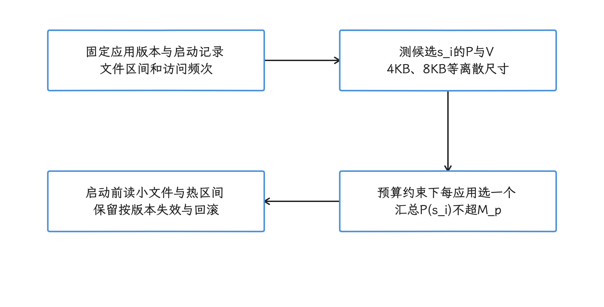
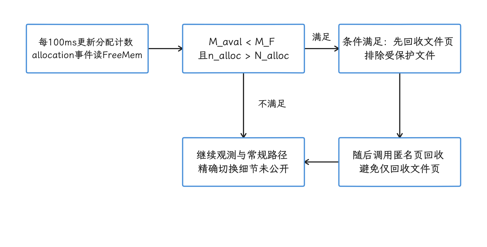
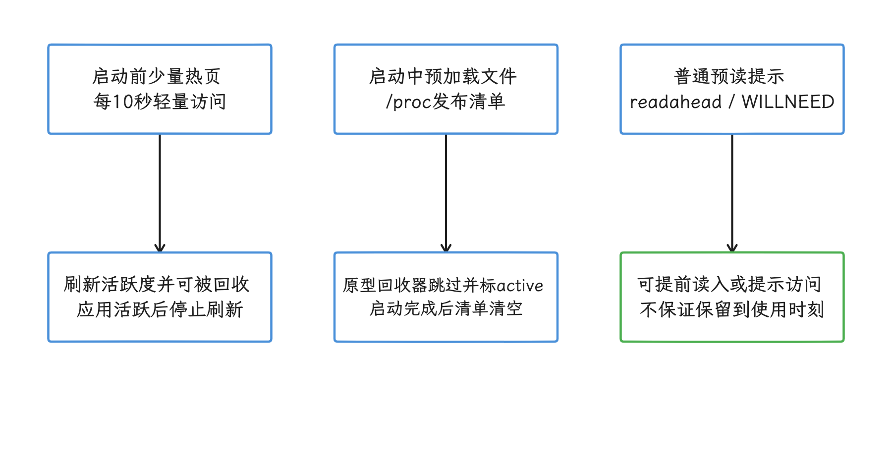
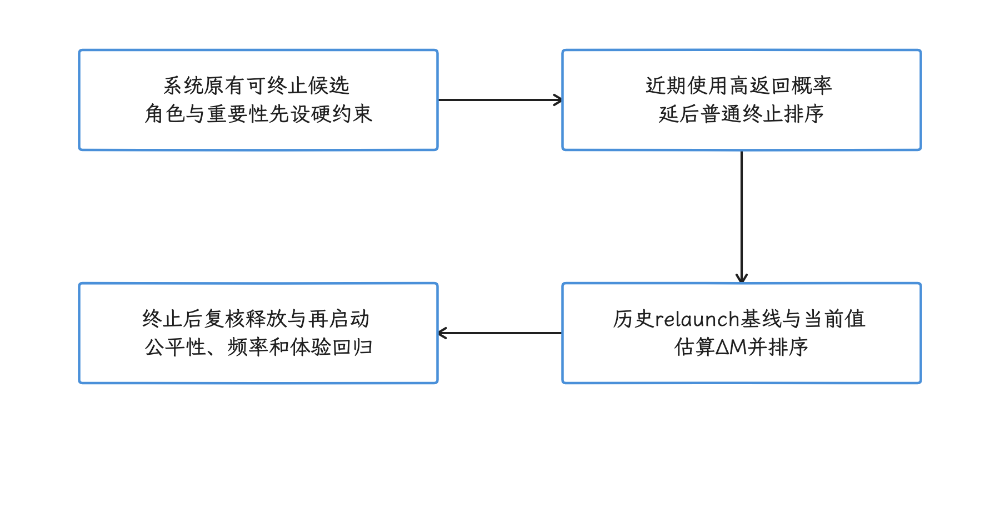
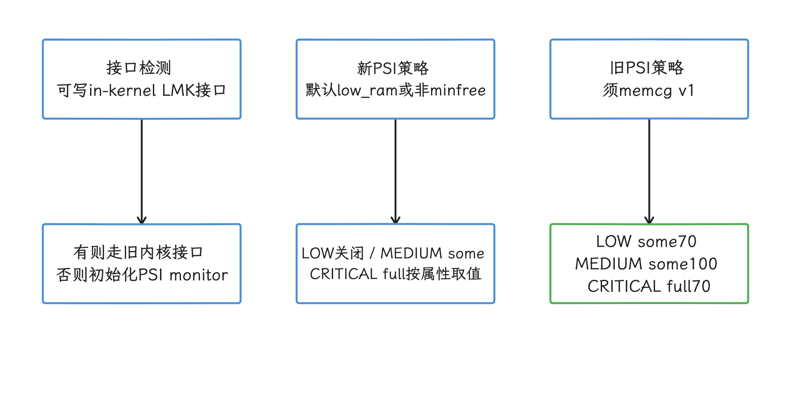
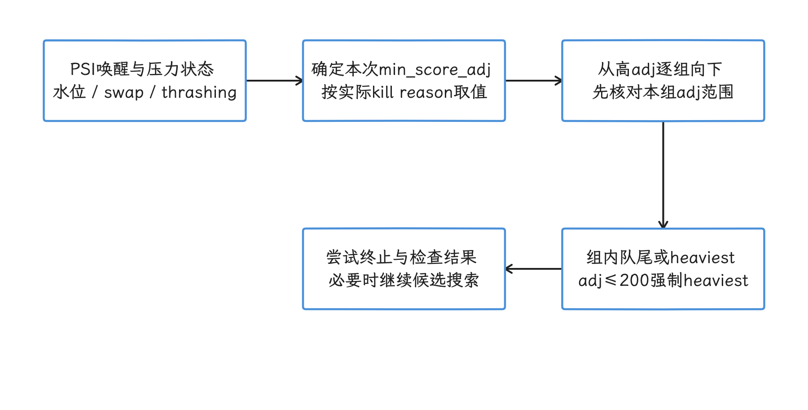
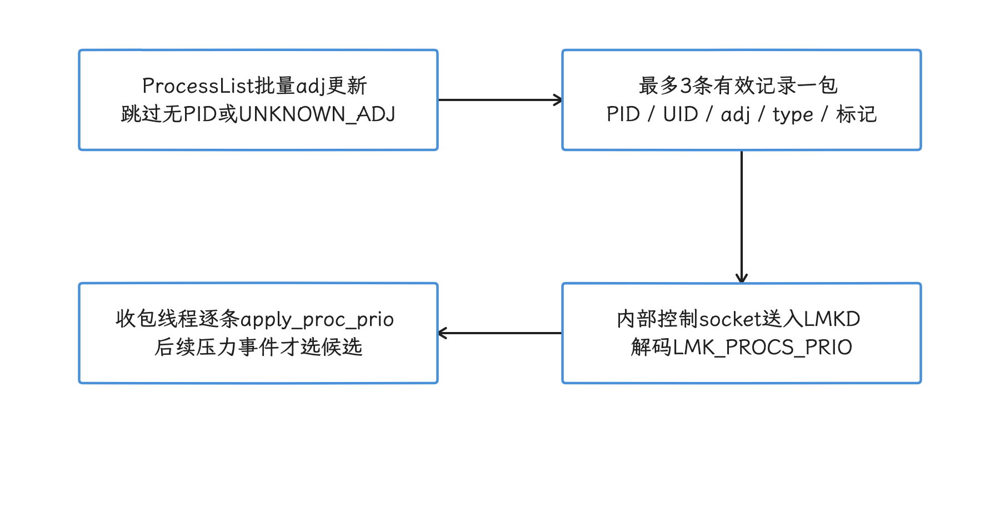
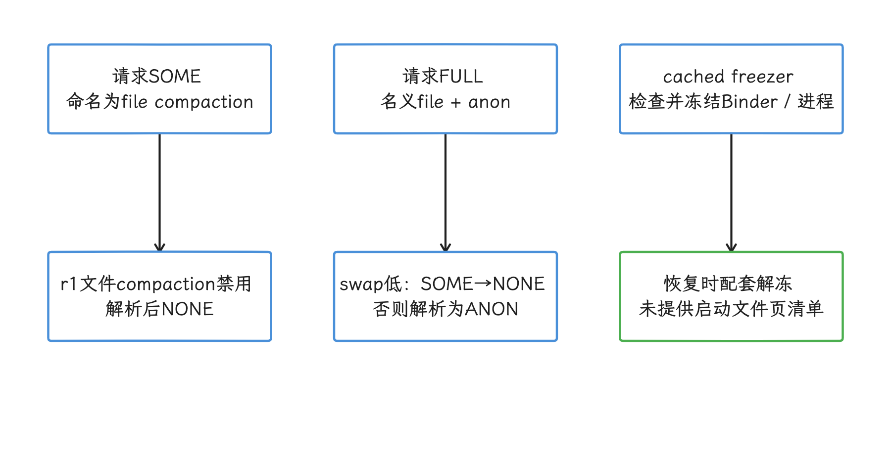

# AppFlow 研究原型：GB 级应用冷启动内存联合调度

GB 级应用冷启动会同时竞争文件页、匿名页、CPU 与进程生存空间，单点预读可能把延迟转移成更强的内存压力。要判断 AppFlow 的价值，我们顺着两条线来看：它自己的论文证据，以及 Android 17 平台源码里已有的能力；重点看文件预加载、内存回收和进程终止各自解决什么，又在哪些条件下互相抵消。

## 证据边界

AppFlow 是 MobiCom 2026 论文提出的研究原型，同时协调文件预读、内存页回收和后台进程终止。当前可公开核查的是 2026 年 3 月发布的 arXiv v1；实验系统以 Android 15 为基础，部署在 Pixel 7、Pixel 8 和 Raspberry Pi 4B 车载试验台上。

所核对的 arXiv v1 未提供完整 Framework 与 kernel patch 的获取链接——前者指 Android 系统服务层改动，后者指 Linux 内核改动。我们核对过的 Android 17 r1 LMKD、Framework 与 kernel 回收路径里也没有对应实现，所以下面的内容要分开读：原型归论文，平台能力归源码。本文依赖两个独立的依据：

- 原型的设计与实验数字，以 [AppFlow 论文](https://arxiv.org/html/2603.17259v1) 为准；
- 平台已有能力，以 `android-17.0.0_r1` 与 kernel `android17-6.18-2026-06_r6` 为准。

128KB 文件分界、100MB 预加载预算、每 100ms 统计 12,800 个分配页等值来自论文参数搜索。66.5%、67.9%、95% 等结果同样只描述论文设备、应用集合和测试方式；Android 17 上有没有对应配置和收益，要另回到源码与实测确认。

## 冷启动为什么会变成系统问题

Android 官方把 cold start（冷启动）定义为从头创建应用进程，并完成应用和首个 Activity 的初始化；系统终止后台进程后再次打开应用，也属于冷启动。TTID（time to initial display）衡量首帧出现时间；TTFD（time to full display）从系统收到启动 intent 开始计时，到应用调用 `reportFullyDrawn()` 为止，用来表示应用已经完整显示并可用。TTFD 依赖应用在正确时机主动上报，系统侧并没有自动判断业务是否可操作的办法；大型应用还可能在 TTFD 之后加载模型、贴图或媒体素材，因此实验应另记“关键功能首次可用”的业务时刻。

一次大型应用冷启动可以粗略拆成三段成本：

| 成本 | 形成方式 | 常见证据 |
|---|---|---|
| CPU 与调度 | 进程创建、类加载、初始化、已编译代码执行、线程竞争 | `sched`、主线程 slice（trace 时间片）、ART（Android 运行时）与 Binder（进程间调用）trace |
| 文件 I/O | APK、DEX、SO、资源、模型、贴图或数据库页不在 page cache（文件页缓存） | 目标文件映射的 major fault、块设备 I/O、线程 D 状态与文件系统 trace 交叉核对 |
| 内存分配与回收 | 新分配触发 `kswapd`、direct reclaim、内存规整或 swap | PSI、`pgscan_*`、`allocstall`、zRAM、workingset refault |

这几段成本要用内核侧的几个概念来读。`kswapd` 是内核后台回收线程；direct reclaim 表示发起内存分配的线程同步参与回收，应用可能直接等待。PSI（Pressure Stall Information，压力停顿信息）报告任务因资源不足而停顿的情况。内存规整（compaction）尝试得到连续物理页，和 zRAM 的数据压缩是两回事；swap 会把匿名页移出 DRAM，Android 常把它们压入 zRAM。

线程处于 D 状态时正在不可中断睡眠，常见原因是等待块设备或内核 I/O；D 状态本身只说明线程在等内核，要定位等待对象，需要与文件系统等 trace 交叉核对。major fault 也可能来自匿名页的 swap-in；zRAM 换入会产生缺页与解压成本，不自动代表访问 UFS。`pgscan_*` 统计回收器扫描的页面数，`allocstall` 统计内存分配因同步回收而停顿的次数；workingset refault 表示工作集页面逐出后很快又被访问，常用来识别缓存抖动。

多任务会让三段成本互相影响：预读会占用 page cache；内存回收可能在使用前逐出刚读入的页；匿名页换入 zRAM 会争用 CPU 与 DRAM 带宽，只有实际使用块设备 swap 或启用 zRAM writeback 等路径时，才会直接增加与预读竞争的存储 I/O。低内存终止守护进程 `lmkd` 终止后台应用后，用户返回时还要重新创建进程并加载文件。只分析 `Application.onCreate()` 会漏掉这些系统等待，所以我们要把视野放宽到文件、页面和进程三层。

论文用 `T_cold = T_I/O + T_cpu + T_alloc` 表示问题，并把系统可调部分放在 I/O 与分配等待上。这是个分析模型：三段在设备上可能并行或互相阻塞，把 trace 中的 wall time（端到端经过时间）直接按公式相加会算错，耗时还是要沿关键路径解释。

## 论文给出的四个观察

AppFlow 的设计来自论文样本中的四组测量，我们引用这些数据时，要把样本语境一起带上。

| 论文观察 | 论文报告的数据 | 能支持的判断 |
|---|---|---|
| 启动访问具有重复性 | 24 个应用中，97.2% 的 cold-launch I/O wait 涉及可预测静态数据 | 稳定资源存在预读机会 |
| 切换期 I/O 有空闲 | 论文原文称 79% 的 “DRAM I/O bandwidth” 未使用 | 作者的实验窗口存在预读机会，不能直接推导目标设备的 UFS 或内存带宽余量 |
| 小文件数量多、体积小 | 图 5 汇总为小文件数约是大文件的 4.7 倍、占用约为大文件的 2.2%；TikTok 个例为 1,002 个、数量 7.47 倍、23MB、约为大文件的 4% | 小文件适合在有限预算内提前读 |
| 预读和回收会互相抵消 | 低内存下，预读页被回收后启动 I/O 延迟增至 6.4 倍 | 只加 prefetch（预读）可能增加压力与重复读取 |

论文正文在汇总值和 TikTok 个例之间用了两组不同的数字。工程文档引用时要注明数字来自 Figure 5 的图表汇总，还是来自 TikTok 这一个应用；两组数字拼在一起当成所有应用共有的常数，样本语境就丢了。

论文还引用既有研究中的“30 分钟内再次访问 92.5%”，并报告 Android 基线终止了其中 62% 的高概率应用。前一项不是 AppFlow 自己的 100 天数据，后一项依赖论文的 workload（应用组合与切换序列）和判定方式；产品预测器需要用自身用户群、场景和隐私约束重新训练与验证。

## Selective File Preloader

预加载器要回答三个问题：何时读、读哪些内容、每次读多大。我们按启动前、启动中和记录失效三个阶段来看它怎么做。

### 启动前：频次优先

系统从历史 launch trace（启动期间的文件路径、偏移和访问时间记录）提取稳定访问的文件区间，在应用启动前读入小文件以及大文件中反复访问的区间。小文件会产生较多离散请求，但总字节数较小，适合在严格预算下减少同步等待。

论文为每个应用选择文件大小分界 `s_i`，候选值限制在 4KB、8KB 等 2 的幂。每个候选值都对应预计预读体积 `P(s_i)` 和启动期 I/O 吞吐 `V(s_i)`，随后用 multiple-choice knapsack（多选背包）求解：每个应用只能从自己的候选分界中选一个，同时让所有应用的预读体积不超过全局预算。论文把启动前总预算设为 100MB，求解 60 个应用的配置耗时低于 0.1ms。

128KB 只是论文观察和搜索空间中的代表值，具体应用仍有自己的 `s_i`。产品规则要是固定成“预读所有小于 128KB 的文件”，就会忽略压缩包内部偏移、资源版本、F2FS/ext4 文件系统布局、UFS 请求队列、16KB page size（内存页大小）和应用更新造成的访问变化。

<!-- gracker-diagram: ch18-08-04-knapsack-budget -->

图：每个应用先测离散候选的 P(s_i)、V(s_i)，再在全局预算内选择自己的文件分界。 100MB 与小于0.1ms 是论文配置和求解报告；128KB 不是所有应用共享的固定规则，更新后需重新验证记录。

### 启动中：吞吐优先

应用开始启动后，预加载器用较大块读取余下的大文件，论文以不小于应用分界 `s_i` 的 block size 描述这一阶段，并把它放在独立低优先级进程中，希望预读跟不上时给前台读取让路。不过低调度优先级只作用于 CPU 竞争，block 层或文件系统会不会先完成前台请求，它保证不了。所以产品实现还要观测 I/O priority（存储请求优先级）、queue depth（同时在途的请求数）和读放大（实际读取量与最终使用量之比）。

### 历史访问记录何时失效

文件路径相同，内容和访问区间却可能已经变了。遇到以下变化，我们应降低历史记录的权重，严重时直接失效：

- APK、APEX、资源包、模型或动态特性更新；
- 用户登录态、语言、主题、A/B 实验改变启动路径；
- 低内存模式、车载用户切换或屏幕形态改变资源选择；
- 加密状态、文件系统、page size 或存储固件发生变化；
- 预读命中后仍出现较高 refault（文件页逐出后很快又被访问）或前台 I/O 延迟。

记录键至少包含包版本、build fingerprint（系统构建标识）、ABI（应用所用指令集接口）、page size 与资源版本。回滚时应能立即停用预测与预读，恢复靠停用开关完成，不能依赖清空用户数据。

## Adaptive Memory Reclaimer

预读成功只说明数据进入 page cache；启动线程使用它之前，内核仍可能回收这些文件页。AppFlow 因此修改了 Linux 内核的回收路径。

### 论文原型的两种控制

论文正文以约 100ms 的周期描述内存与分配量观测；Algorithm 1 更具体地写为每 100ms 更新分配计数，并在每个 allocation event 读取 `FreeMem()`。当空闲内存 `M_aval < M_F` 且最近窗口分配量 `n_alloc > N_alloc` 时，原型先进入 file-first 阶段，只回收未受保护的文件页；论文参数搜索得到的 `N_alloc` 是 12,800 页。论文没有公开 `FreeMem()` 的实现，我们读代码时也别把它直接认成 Linux `/proc/meminfo` 的 `MemAvailable`。这个门槛按页计数，换算成字节取决于 page size：4KB 页约为 50MiB，16KB 页约为 200MiB。

Algorithm 1 在同一条件分支中，先调用 `ReclaimFilePages(exclude protected files)`，再调用 `ReclaimAnonPages()`；正文另用“高压时 file-first、压力缓解后 rebalance、最终恢复常规回收”描述模式切换。两种写法抽象粒度不同，用来理解先后顺序和防止匿名页堆积的意图是够的；至于精确的切换时机、扫描配额或失败回退，patch 未公开，还缺少下结论的依据。

<!-- gracker-diagram: ch18-08-07-reclaim-guard -->

图：分配计数每100ms更新，事件读取空闲内存；满足双条件后先回收非保护文件页，再调用匿名页回收。 12,800页在4KB/16KB设备分别约50/200MiB；FreeMem 实现、扫描配额和模式切换细节未公开，图不补造状态机。

对预加载页，原型按两个窗口处理：

- 启动前读入的少量页每 10 秒访问一次，用来刷新内核记录的活跃度；这不会锁住页面，应用活跃后也会停止；
- 启动中读入的文件通过 `/proc`（内核导出的伪文件系统）发布清单。原型修改 `shrink_page_list()` 回收函数，扫描到清单中的页时暂不逐出，并把页标为 active；启动完成后清除清单。

这项行为来自 kernel patch。作为对比，`readahead()` 可以提前把文件内容读入 page cache，`madvise(MADV_WILLNEED)` 可以提示内核即将访问某段映射，但两者都不保证页面一直留到应用使用时刻——普通 page-cache 访问也没有这种保证。论文报告一次活跃度刷新约耗时 10ms，CPU 开销约 0.1%；目标 SoC（系统芯片）、文件集合和电源状态变化后仍需复测。

<!-- gracker-diagram: ch18-08-08-page-retention -->

图：启动前内容通过轻量触页刷新活跃度，启动中清单由原型内核回收路径检查。 触页、readahead 和 WILLNEED 都到不了 pin 的效果；按清单跳过逐出需要原型扩展，启动结束须清除，成本是论文测量。

### Android 17 kernel 6.18 的现状

我们再回到平台现状：`android17-6.18-2026-06_r6/mm/vmscan.c` 没有 AppFlow 的预加载文件清单或启动窗口。classic LRU（传统的近似最近使用链表）路径中，`get_scan_count()` 会综合 swap 能力、swappiness（匿名页与文件页的相对回收权重）、reclaim priority 和 file LRU 大小，再参考 refault 成本与 cache-trim 状态，最终在 `SCAN_FILE`、`SCAN_ANON`、`SCAN_EQUAL` 或比例扫描里做选择。这里 reclaim priority 表示当前回收轮次的扫描强度，file LRU 大小表示文件页链表规模，cache-trim 状态表示系统有足够的非活跃文件缓存可优先回收。

启用 MGLRU（Multi-Generational LRU，按访问代际管理页面）且满足相应分支条件时，则进入另一套老化和逐出路径，例如 r6 `shrink_lruvec()` 仅在 `lru_gen_enabled() && !root_reclaim(sc)` 时转入 `lru_gen_shrink_lruvec()`。还有一处命名差异要留意：r6 的基础回收函数已使用 `shrink_folio_list()`，论文旧基线的 `shrink_page_list()` 函数名，移植时照抄会踩空。

论文对其 Android 15 基线“文件页与匿名页交替回收”的概括，拿到 Android 17 kernel 6.18 上要重新核对——前面的代码已经说明了原因：r6 会按运行状态调整扫描比例，也提供 `page_should_be_protected`、`tune_scan_type`、`evict_folios_bypass` 等 vendor hook。但这些通用扩展点离 AppFlow 还差一层：文件热集、启动会话与清单传递都要自己实现，AppFlow 增加的正是这类短时启动上下文；具体产品模块是否扩展了这些 hook，需要另查。

file-backed 页的成本也分情况：干净文件页可以直接丢弃，脏文件页要先回写；被丢弃的页若很快 refault，会再次触发存储读取和 stall（任务因资源不足而停顿）。匿名页则可能压入 zRAM，代价由压缩算法、CPU、swap 空间和后续 swap-in（把页读回内存）共同决定。所以评估回收策略时，我们要看每类页的实际后备，file/anon 二分只是起点。

## Context-Aware Process Killer

页回收释放内存的速度赶不上需求时，AppFlow 才会转向后台进程。论文使用两类上下文：

- 近期使用过的应用具有较高返回概率，延后终止；
- 长时间运行且内存相对刚启动基线增长 30%～50% 的应用，重启后缓存和临时分配会回到较低水平。

论文用 `ΔM = M_current - M_relaunch` 估算一次终止带来的长期净释放量，并优先选择 `ΔM` 较大的候选；`M_relaunch` 表示应用被终止后再次冷启动的内存基线。要拿到这个量，我们得先记录应用重新启动后的历史数据，仅凭当前 RSS/PSS 的大小推不出重启后的占用。RSS 是进程映射到物理内存的页面总量，PSS 会按比例分摊共享页，两者都不完整覆盖 GPU 内存；再加上 memcg（memory cgroup）的记账归属、isolated process（使用隔离 UID 的辅助进程）和独立服务进程，“应用占用”很难由单一 PSS 说清。

候选集合仍要服从 Android 的进程重要性规则。导航、通话、音频、可感知前台服务、设备管理、车载安全界面和系统持久进程，不因预测分数低就进入普通 cached process 的可终止集合。预测器的活动空间是给系统原本允许终止的候选重新排序，同时限制同一应用连续成为候选的次数，并设置公平性和最大等待时间，避免出现长期得不到运行机会的 starvation（饥饿）。

<!-- gracker-diagram: ch18-08-11-killer-score -->

图：候选先服从系统重要性与角色约束，再考虑近期返回概率和当前占用减去 relaunch 基线。 ΔM 是长期净释放估计，和即时 RSS 是两个量；relaunch 基线需历史测量，多进程、GPU 和共享页另计，公平性是产品约束。

## Android 17 r1 的 LMKD 基线

看完原型的进程终止，我们回到平台基线，看真实的 `lmkd`：它是一个用户空间守护进程，源码同时保留三类路径——以 PSI 检测内存压力的新策略；依据 `minfree` 阈值的 legacy（兼容旧设备）策略；以及检测旧版内核 LMK 接口的兼容分支。三类路径都属于同一个守护进程，AOSP 没有名为“LMKD v2”的正式组件或第二个守护进程。

### 压力检测

r1 里已经没有旧材料中的 `ro.lmk.use_psi` 开关：检测到可写的旧 in-kernel LMK 接口时走兼容分支，否则初始化 PSI monitor。PSI 下的 `use_new_strategy` 默认取 `low_ram_device || !use_minfree_levels`，设备可覆盖；旧策略则要求 memcg v1。新策略相关属性的源码默认值见下表，`psi_window_size_ms` 默认 1,000ms，同样可覆盖：

| 参数 | 常规 | 低内存 | 含义 |
|---|---:|---:|---|
| <code>psi_<wbr>partial_<wbr>stall_ms</code> | 70ms | 200ms | 1,000ms 窗口内 PSI `some` 的停顿门槛 |
| <code>psi_<wbr>complete_<wbr>stall_ms</code> | 700ms | 700ms | 1,000ms 窗口内 PSI `full` 的停顿门槛 |
| <code>thrashing_<wbr>limit</code> | 100% | 30% | workingset refault 相对 file page cache 的比例门槛 |
| <code>thrashing_<wbr>limit_<wbr>decay</code> | 10% | 50% | 因 thrashing 终止进程后，下一轮门槛的下调比例 |

PSI `some` 表示窗口内至少有部分任务因内存不足而停顿，`full` 表示所有非空闲任务同时停顿；lmkd 的变量名用 partial/complete，Linux `/proc/pressure/memory` 中对应的字段名则是 `some/full`。表内数字是 r1 源码默认值，产品属性可以覆盖；low-RAM 的 partial 默认值更高，触发也更不敏感。

这里最容易混的是新旧策略的阈值：“LOW some 70 / MEDIUM some 100 / CRITICAL full 70”仍是 r1 `psi_thresholds` 数组的初值，旧策略保留它们；新策略才把 LOW 设为 0（不注册），把 MEDIUM/CRITICAL 改成 partial/complete 属性值。解释常规新策略时按属性值来，旧初值也确实还在源码里，两件事分开说就都清楚了。

<!-- gracker-diagram: ch18-08-12-psi-strategies -->

图：r1 新 PSI 策略关闭 LOW，并以 partial/complete 属性配置 MEDIUM/CRITICAL；旧策略保留数组初值。 新策略默认 low_ram 或不用 minfree；旧策略需 memcg v1。表内70/200与700ms基于默认1秒窗口，实际配置仍需核对。

PSI 提供的是唤醒和压力严重度信号。`lmkd` 收到压力事件后，还要检查 zone watermark（各内存区域的空闲页水位）、swap、thrashing（页面反复逐出又读回）和 direct reclaim 等状态；具体终止哪个进程，则交给候选选择。

### 候选进程和 `oom_score_adj`

ActivityManagerService（AMS）根据进程状态、组件关系和用户可感知性计算 `oom_score_adj`，数值越高通常越容易成为低内存终止候选；`ProcessList.setOomAdj()` 或 `batchSetOomAdj()` 把结果发给 `lmkd`。`lmkd` 从较高 adj 分组向较低分组查找：`kill_heaviest_task=false` 时通常取该分组队尾，配置为 true 时选取组内占用较大的进程。源码还规定，搜索一旦进入 `PERCEPTIBLE_APP_ADJ` 或更重要的范围，选择逻辑会强制切换为 heaviest，意图是用更少的终止次数释放足够内存。

adj 表达的是 Android 组件此刻的重要性。若把“预计稍后会打开”的应用伪装成 perceptible（用户能感知）或 visible（界面可见），会破坏 AMS、LMKD 和 cached process 管理共同使用的优先级约定，还可能把更多内存压力转移给真正可感知的进程。

<!-- gracker-diagram: ch18-08-13-kill-selection -->

图：压力事件结合水位、swap 和 thrashing 决定门槛，再从较高 adj 分组向下寻找。 组内可取队尾或 heaviest；搜索到 adj≤200 强制 heaviest。预测不得把普通 cached 应用伪装成可感知角色。

### `LMK_PROCS_PRIO` 的准确含义

Android 17 r1 的 `LMK_PROCS_PRIO` 是 framework 到 `lmkd` 控制 socket（进程间通信通道）的内部批量协议：

- `include/lmkd.h` 把每个控制包的记录上限定为 3；
- `ProcessList.batchSetOomAdj()` 读取每个 `ProcessRecordInternal.getCurAdj()`，跳过无有效 PID 或 adj 未知的记录，按最多 3 条有效记录分包；每条携带 PID、UID、adj、ptype 和 `for_lmkd_only` 这 5 个字段；
- `lmkd.cpp::cmd_procs_prio()` 在收包线程内循环调用 `apply_proc_prio()`；
- r1 `lmkd.cpp` 没有 io_uring 处理器，也没有 32 条记录的主线协议。

这项批处理的价值是减少控制消息次数，它传输的也只是优先级记录：“保护将启动应用”没有对应的策略接口，文件页回收改不了，AppFlow 的 `ΔM`、访问概率或预加载清单也传不进来。io_uring 是 Linux 的异步 I/O 接口，AOSP 17 r1 的 `lmkd.cpp` 没有相关处理器；移植设计若参考第三方 fork（从 AOSP 分出的代码分支），必须先区分分支扩展与主线能力。

<!-- gracker-diagram: ch18-08-14-priority-protocol -->

图：Framework 过滤无效记录，每包最多三条、每条五个字段；LMKD 解码后逐条应用。 这是内部控制 socket 协议，既不传文件清单或预测分数，也不改变页回收；r1 所核查文件没有 io_uring 处理器。

### 全局 LMKD 属性与预测器的分工

`ro.lmk.lowmem_min_oom_score`、`ro.lmk.kill_heaviest_task`、thrashing 门槛等属性影响的是整台设备。以 `lowmem_min_oom_score` 为例，它在 r1 新策略的 `LOW_MEM` 兜底原因分支设置 `min_score_adj`，管到的只是这个分支，谈不上覆盖所有 kill reason 的统一门槛。在使用该值的分支内，调高它会缩小候选集合、调低则扩大；过度缩小可能加剧 direct reclaim、系统 stall 或 kernel OOM。也正因为作用于整台设备，按应用或启动窗口动态表达预测结果，超出了这些全局属性的能力范围。

我们再看 shell 命令这条路：所核对的 r1 `ActivityManagerShellCommand.java` 命令分发与帮助中没有 `set-isolated-process-uid-list`，这条路走不通；`get-isolated-pids <UID>` 倒是存在，但它只查询关联 isolated process 的 PID，后台应用保护、文件页预读或 LMKD 排序都在它的能力之外。

## CachedAppOptimizer 能做什么

`CachedAppOptimizer` 在 Android 17 r1 中负责 cached app compaction 和 freezer。这里的 compaction 指针对目标进程回收页面：命名上 SOME/ANON/FULL 分别请求 file/anon/两类，但请求发出只是第一步，实际执行还要过解析——r1 `ENABLE_SHARED_AND_CODE_COMPACT=false`，`resolveCompactionProfile()` 把 SOME 改为 NONE、FULL 改为 ANON；FULL 遇到空闲 swap 比例低于 20% 时先降成 SOME，随后也变为 NONE，另有节流、取消等条件。它和前文为取得连续物理页而进行的内核内存规整是两回事。freezer 则暂停 cached 进程的调度，先处理该进程的 Binder 通信，恢复使用时再解冻。至于 AppFlow 关心的启动文件热集，这个类既不记录，也不会在 `vmscan` 中保护预读文件页。

若要让 AppFlow 的进程终止分数影响 `CachedAppOptimizer`，要改的还是 AMS 的进程策略，并验证 compaction、freezer、adj 更新和 LMKD 选择之间没有 race condition（执行先后变化导致结果不一致）；源码里也还没有可直接复用的 AppFlow hook（扩展入口）。

<!-- gracker-diagram: ch18-08-16-cao-profile -->

图：r1 命名上的 file/anon 请求还要经过 profile 解析、节流和取消，freezer 则控制进程调度与 Binder。 r1 关闭 shared/code compaction：SOME→NONE，FULL→ANON；FULL 在空闲swap<20%时先降SOME，最终NONE。这些不实现 AppFlow 热集保护。

## 原型组件与 Android 17 能力映射

| 原型组件 | Android 17 已有基础 | 原型需补足 | 权限与改动 |
|---|---|---|---|
| Selective File Preloader | 应用启动事件、文件 I/O、page cache、UsageStats | 跨应用文件访问记录、两阶段预算器、启动预测服务 | 平台服务、文件访问权限、预读执行器 |
| Adaptive Memory Reclaimer | classic LRU/MGLRU、zRAM、memcg、PSI、`vmscan` | 启动窗口、预加载文件标记、逐出跳过规则 | 内核扩展与接口；先审 hook 是否足够 |
| Context-Aware Process Killer | AMS adj、`lmkd`、cached LRU、PSS/RSS 采样 | relaunch 基线、返回概率、净释放排序 | Framework 与 `lmkd` 策略改动 |
| 验证与回滚 | Perfetto、statsd（系统指标收集服务）、<code>Application<wbr>ExitInfo</code>、系统属性 | AppFlow 专用原因码、命中率和页保护统计 | 指标记录、实验开关、版本化访问记录 |

`UsageStatsManager.queryEvents()` 需要 `PACKAGE_USAGE_STATS`，在 `AndroidManifest.xml` 声明后还需用户到设置中授予 usage access（使用情况访问权）；只查询本包事件的接口不需要该权限。论文使用后台采集应用，这层授权到普通三方应用这里就没有了：无提示收集整台设备的应用使用序列行不通；系统镜像内的预测服务也要遵守多用户、工作资料、访客和数据保留期限。

## 三种实施权限下的可做范围

### 普通应用

没有平台权限的普通应用，能做的是自己这一侧的事：优化初始化、生成 Baseline Profile、记录 TTID/TTFD、采样自己的文件访问，并控制自己的资源读取。`TRIM_MEMORY_UI_HIDDEN` 表示应用 UI 从可见变为不可见，应用可在该回调中释放能够重建的界面缓存。从 API 34 起，RUNNING_MODERATE/LOW/CRITICAL 与 MODERATE/COMPLETE 这些等级不再通知应用，API 35 将它们标记为 deprecated；`TRIM_MEMORY_UI_HIDDEN` 和 `TRIM_MEMORY_BACKGROUND` 仍保留——它们是状态提示，覆盖面到不了全局压力监视的程度。应用还可用 `ApplicationExitInfo` 查询此前的退出原因。

另一面是权限限制：普通应用访问不了 `lmkd` 控制 socket，写不了其它进程的 `oom_score_adj`，改不了 `vmscan`，保护不了 page cache 中的指定文件，也默认读取不了其它应用的使用历史。应用内预读可能有收益，但它与 AppFlow 的联合调度分属两个层次。

### 特权 Framework 原型

系统厂商可以在 platform service（系统服务）中采集经过授权的应用切换序列，维护带版本号的文件访问记录，并在 launch observer（启动事件观察器）收到事件前后调度预读。这个阶段可以验证预测准确率、I/O 干扰、100MB 级预算是否适合目标设备，以及进程终止模型是否有稳定信号。

若 kernel 未改，预读页随时可能按常规策略被回收，所以实验报告要把“读取内容最终被使用”和“页面一直留到使用时刻”分开记录，偶然的 page-cache 命中就算不成回收保护效果。这个阶段也不宜随意降低 adj 来模拟后台存活收益。

### 产品级 OS 与 kernel 原型

要复现论文完整设计，需要同时修改 Framework 和 kernel：建立启动会话 ID；传递文件或 inode/offset（文件对象编号与字节位置）标识；在 classic LRU 和 MGLRU 中都定义短时保护。还要处理文件截断、更新、卸载、memcg 迁移和多用户隔离；最后把进程排序限制在 AMS/LMKD 已允许终止的候选集合内。

GKI（Generic Kernel Image，通用内核镜像）允许 vendor module 通过受控 hook 扩展部分功能，r6 已有前述保护、扫描和 MGLRU hook。模块方案行不行，我们先核查这些 hook 的参数、调用点、KMI 可用性及对两条路径的覆盖；论文修改过 core mm 这件事，既证明不了模块方案一定可行，也证明不了它一定不可行。若现有接口不足而确需修改 core mm，就要长期维护产品 kernel 分支、模块接口与安全更新合并，而且改 core mm 并不自动带来 GKI/KMI 或兼容性认证。验证范围还要覆盖 CTS/VTS/GTS（应用兼容、厂商接口和 Google 认证测试）、SELinux 权限、OTA 升级、suspend/resume（休眠与唤醒）、low-RAM 设备和 kernel OOM 回归。

## 如何设计一轮可信实验

### 固定启动口径

设计实验的第一步是把启动状态固定下来：测试脚本应记录目标应用在每轮前的进程状态和 page-cache 条件。cold 表示应用进程不存在；hot 表示进程和 Activity 都仍在内存中，只需回到前台；warm 处于两者之间，例如进程仍在但 Activity 要重建。三类样本必须分组，分组依据是进程与 page-cache 条件，`am start -W` 的 ActivityManager 时间输出回答不了这个问题；Android 官方的 TTID/TTFD、Jetpack Macrobenchmark 的启动模式和 Perfetto launch slice 可以互相校验。

清空全局 page cache 只适合受控实验室镜像，因为它会改变所有进程和文件系统状态；线上制造 cold 样本没有这条路，应观察自然发生的冷启动，并按上次退出原因、包版本、设备 uptime（自开机起的运行时间）和内存压力分层。

### 建立负载组合

每个设备至少覆盖：

- 空闲、常规多任务、内存紧张和 swap 接近上限；
- 4KB/16KB page size、不同 DRAM 档位和存储型号；
- 首次安装、普通版本、应用更新后、系统 OTA 后；
- 屏幕亮灭、充电/电池、温度和 thermal throttling（温控降频）；
- 前台导航、音频、通话、端侧模型推理等不可随意中断的并发任务。

每种组合都要报告样本数、P50/P90/P95/P99（有 50%/90%/95%/99% 样本不超过该值）、置信区间和异常值规则，平均数仅作补充。

### 同时观察四组证据

| 目标 | 指标 | 反例信号 |
|---|---|---|
| 启动变快 | TTID、TTFD、关键功能可用时刻、cold relaunch（后台进程被终止后的冷重启）比例 | 首帧更快但关键功能更晚可用 |
| 预读有效 | 预读字节、使用字节、major fault、block wait、refault | 读放大、命中低、前台 I/O 被拖慢 |
| 内存更稳 | memory PSI、`pgscan_direct`、allocstall、zRAM、swap-in/out | stall 下降但 swap 或功耗大增 |
| 多任务可接受 | LMK 次数、后台存活、短时间 relaunch、用户可感知 LMK | 保护目标应用后其它任务更早被终止 |

`ApplicationExitInfo.REASON_LOW_MEMORY` 可用于应用侧回看，但设备支持有差异：`ActivityManager.isLowMemoryKillReportSupported()` 返回 false 时，低内存终止可能只记录为 `REASON_SIGNALED` 和 `SIGKILL`。`ApplicationExitInfo` 也不包含完整的 LMKD 候选评分，平台实验仍需结合 `lmkd` 日志、statsd 和 trace。

### 分离三个组件的贡献

至少保留四组：

1. Android 17 原生基线；
2. 只有 Selective File Preloader；
3. Preloader 加 Adaptive Memory Reclaimer；
4. 三个组件全部开启。

AppFlow 论文在 Pixel 8（6GB）的组件实验给了参照：只开 Selective File Preloader 时耗时下降 26.1%，cold-launch 次数却增加 30%；AMR 单独开启时次数下降 60%、耗时下降 14.7%；三组件集成后耗时下降 40.8%、保留后台应用达到 1.85 倍。次数与耗时是两个指标，只开 SFP 时一升一降，可以理解为预读带来的内存压力抵消了一部分收益。本文建议的逐级组合还需在目标产品上自行运行；按组件分组后，我们才能区分“读取时间提前”“页面保留更久”和“后台进程选择变化”各自造成的影响。

## 论文实验结果该怎样阅读

读结果之前，先把实验装置看清楚：论文在 Android 15 原型上修改约 1,672 行 Framework 和 1,107 行 Linux kernel 代码；Pixel 设备通过修改 `arm64_memblock_init()`，把内核可见内存限制为 6GB 或 8GB——这是受控实验配置，设备实际物理内存另说；Raspberry Pi 4B 车载试验台使用 4GB 内存。测试包含 60 多个应用、模拟多任务负载，以及一条记录应用使用顺序的 100 天 trace。

| 场景 | 论文报告结果 | 限定条件 |
|---|---|---|
| 论文摘要 | cold-launch latency（冷启动耗时）最多下降 66.5%，示例从 2s 降到 690ms；100 天中 95% 的启动小于 1s | 作者原型与工作负载 |
| Pixel 8 cold launch | 相对 Android 平均下降 33.7%～43.6%；6GB 高负载个例最多下降 57% | 8 个 GB 级应用，三档负载 |
| 17 应用多任务 | 保留后台应用从 7/17 增到 13/17，平均 relaunch 时间下降 37.6% | Pixel 7，6GB/8GB，高负载 |
| 高压力机制指标 | direct reclaim 次数下降 67.9%，LMK 事件下降 33.7% | Pixel 8 6GB 高负载 |
| 100 天案例 | 平均 cold-launch latency 下降 23%，GB 级 cold relaunch 次数下降 31.6% | 一条 60+ 应用 trace |
| 车载案例 | 4.3s 降到 2.0s，下降 53.4% | BYD Seal 供电、Pi 4B 计算、5 个应用 |
| 端侧生成式负载 | 后台终止数从 8～9 个降到 0～3 个，survivability（任务存活率）从 66.6% 升到 100% | Pixel 8 8GB 的论文场景 |

这些结果展示了原型潜力，也带着明确的复现限制：公开论文没有提供完整 Android/kernel patch、每个参数的产品配置、全部原始 trace 和功耗数据；`am start -W`、清文件缓存和人为限制内存也不同于线上自然发生的启动。产品评估应把论文作为待验证假设，在目标设备和真实负载上重新测量——我们引用上表任何一个百分比时，都带着这层限定。

## 与 Baseline Profile、Cloud Profile 的关系

Profile 与 AppFlow 处理的是不同成本：

| 技术 | 主要对象 | 主要收益证据 | 局限 |
|---|---|---|---|
| Baseline/Startup Profile | 热方法、类、DEX 布局与预编译 | CPU running（线程实际执行）时间、JIT/解释执行、class load | 模型和资源文件不在 page cache |
| Cloud Profile | 用户群聚合后的 ART profile 与 dexopt | 编译 artifact（编译产物）、启动 CPU 和代码布局 | 当前设备的内存压力与后台存活 |
| AppFlow | 启动文件页、回收窗口、后台进程选择 | major fault、I/O wait、refault、LMK、relaunch | 应用自身重初始化与低效业务逻辑 |

同一次启动可能同时受 CPU 和 I/O 限制。做 A/B 实验时，我们应先固定 dexopt 状态和 Profile 版本，再比较预读策略；评估 Profile 时也要记录 page-cache 和后台进程状态。这些控制变量缺一个，收益来自代码编译、文件缓存还是后台进程存活，就说不清了。

## 车载、端侧模型和大型游戏

车载系统有导航、媒体、语音、仪表、多屏和多用户并发，后台进程的重要性要按角色判断，单看最近使用时间推断不出来；冷启动优化要服从驾驶安全和音视频连续性，预测失误的代价比手机社交应用场景更高。

端侧模型的权重常通过 `mmap` 映射文件，访问到的权重页因此是 file-backed 页面；推理中间张量和 runtime（模型运行时）的堆又会增加匿名页。页面类型取决于具体 runtime，模型权重按什么页算，要落到映射方式上看。大型游戏同样混合 APK/asset pack（按需分发的资源包）、native heap（原生代码堆）、图形驱动和 GPU 分配，单看进程 RSS 会漏掉关键资源。

这三类负载适合验证 AppFlow 提出的联合问题，但我们要把进程终止规则按角色加上硬约束：导航、通话、正在播放音频和安全相关服务不得由预测模型降级。模型或游戏只有在温度、电量和前台 I/O 都满足启用条件时才能预读。

## 产品化风险与退出条件

| 风险 | 典型后果 | 保护与退出条件 |
|---|---|---|
| 预测错误 | 读入未使用数据，增加 I/O 与 DRAM 占用 | 命中率、读放大、版本化访问记录、快速停用 |
| 页保护过强 | 其它工作集 refault、direct reclaim 或 OOM | 最大保护字节、最大时长、压力强制退出 |
| 进程终止偏置 | 某些后台应用长期成为牺牲对象 | 角色白名单、每应用终止频率、公平性 |
| 隐私越界 | 跨应用使用序列泄露用户行为 | 本地最小化、多用户隔离、保留期限、审计 |
| kernel 分叉 | 安全补丁合并困难、MGLRU/classic LRU 行为分裂 | 尽量小的 patch、双路径测试、持续 rebase（把改动迁移到新基线） |
| 功耗与温度 | 空闲预读唤醒存储，竞争前台任务 | 电源与温度启用条件、能耗 A/B、存储队列监控 |

任一压力档位出现 kernel OOM、SystemUI/Launcher 被终止、导航或音频中断、P99 变差或 I/O 读放大失控时，策略都应自动停用并恢复 Android 原生行为；退出路径本身也要经过同等规模的压力测试。

## 源码核对入口

- [`android-17.0.0_r1/system/memory/lmkd/lmkd.cpp`](https://android.googlesource.com/platform/system/memory/lmkd/+/refs/tags/android-17.0.0_r1/lmkd.cpp)：PSI、thrashing、候选选择和 `cmd_procs_prio()`。
- [`android-17.0.0_r1/system/memory/lmkd/include/lmkd.h`](https://android.googlesource.com/platform/system/memory/lmkd/+/refs/tags/android-17.0.0_r1/include/lmkd.h)：控制协议与 3 条记录上限。
- [`android-17.0.0_r1/frameworks/base/.../ProcessList.java`](https://android.googlesource.com/platform/frameworks/base/+/refs/tags/android-17.0.0_r1/services/core/java/com/android/server/am/ProcessList.java)：adj 发送与 `batchSetOomAdj()`。
- [`android-17.0.0_r1/frameworks/base/.../CachedAppOptimizer.java`](https://android.googlesource.com/platform/frameworks/base/+/refs/tags/android-17.0.0_r1/services/core/java/com/android/server/am/CachedAppOptimizer.java)：cached app compaction 与 freezer。
- [`android-17.0.0_r1/frameworks/base/.../UsageStatsManager.java`](https://android.googlesource.com/platform/frameworks/base/+/refs/tags/android-17.0.0_r1/core/java/android/app/usage/UsageStatsManager.java)：使用历史接口与权限说明。
- [`android-17.0.0_r1/frameworks/base/.../ApplicationExitInfo.java`](https://android.googlesource.com/platform/frameworks/base/+/refs/tags/android-17.0.0_r1/core/java/android/app/ApplicationExitInfo.java)：低内存退出原因和设备支持差异。
- [`android17-6.18-2026-06_r6/mm/vmscan.c`](https://android.googlesource.com/kernel/common/+/refs/tags/android17-6.18-2026-06_r6/mm/vmscan.c)：classic LRU、MGLRU 和回收扫描选择。

## 与其他章节的边界

- Android 进程优先级、PSI 与 LMKD 机制见 [4.3 lmkd、Cached App Freezer 与内存压力治理](../../part1-fundamentals/ch04-memory/03-lmkd-freezer-memory-pressure.md)。
- 冷、温、热启动和 TTID/TTFD 见 [8.2 App 冷启动链路与 Binder Trace 分析](../../part2-performance/ch08-responsiveness/02-app-cold-start-binder-trace.md)。
- Baseline Profile 的采集与验证见 [21.4 Baseline、Startup 与 Cloud Profile 编译优化](../../part5-app/ch21-startup/04-baseline-startup-cloud-profile.md)。
- 系统启动及 I/O 分阶段分析见 [18.6 Android 系统启动耗时优化与 bootanalyze](06-system-boot-time-optimization.md)。
- 应用启动诊断流程见 [21.1 App 启动路径、监控与度量](../../part5-app/ch21-startup/01-app-startup-path-monitoring.md)。

## 参考资料

- [AppFlow 论文 HTML](https://arxiv.org/html/2603.17259v1)
- [AppFlow 论文摘要与版本信息](https://arxiv.org/abs/2603.17259)
- [AOSP：Low memory killer daemon](https://source.android.com/docs/core/perf/lmkd)
- [Android Developers：App startup time](https://developer.android.com/topic/performance/vitals/launch-time)
- [Android Developers：Low memory killers](https://developer.android.com/topic/performance/vitals/lmk)
- [Android Developers：ComponentCallbacks2](https://developer.android.com/reference/android/content/ComponentCallbacks2)
- [Linux kernel：Pressure Stall Information](https://docs.kernel.org/accounting/psi.html)
- [AOSP r1：lmkd.cpp](https://android.googlesource.com/platform/system/memory/lmkd/+/refs/tags/android-17.0.0_r1/lmkd.cpp)
- [AOSP r1：lmkd.h](https://android.googlesource.com/platform/system/memory/lmkd/+/refs/tags/android-17.0.0_r1/include/lmkd.h)
- [AOSP r1：ProcessList.java](https://android.googlesource.com/platform/frameworks/base/+/refs/tags/android-17.0.0_r1/services/core/java/com/android/server/am/ProcessList.java)
- [AOSP r1：CachedAppOptimizer.java](https://android.googlesource.com/platform/frameworks/base/+/refs/tags/android-17.0.0_r1/services/core/java/com/android/server/am/CachedAppOptimizer.java)
- [AOSP r1：UsageStatsManager.java](https://android.googlesource.com/platform/frameworks/base/+/refs/tags/android-17.0.0_r1/core/java/android/app/usage/UsageStatsManager.java)
- [AOSP r1：ApplicationExitInfo.java](https://android.googlesource.com/platform/frameworks/base/+/refs/tags/android-17.0.0_r1/core/java/android/app/ApplicationExitInfo.java)
- [Android kernel：android17-6.18-2026-06_r6 vmscan.c](https://android.googlesource.com/kernel/common/+/refs/tags/android17-6.18-2026-06_r6/mm/vmscan.c)
- 本地精读笔记：`Android-2026-05-23-AppFlow-ColdLaunch/03-精读.md`
- 研究采集稿：`intake/research-feeds/2026-04-02-15-ch05-appflow-cold-launch-scheduler.md`
