# AOHP 研究原型：将 Android 改造为 Agent 原生 OS

AOHP（Android Open Harness Project）是一套基于 AOSP fork 的研究原型。fork 是从 AOSP 分出的独立源码分支：这些改动只在分支里存在，标准 Android 尚未收录。

本文沿用 agent 这个术语，指能观察环境、调用工具并连续执行多步任务的 AI agent（智能体）。AOHP 为它提供 OS-level harness，也就是由系统服务、接口和策略组成的运行支架；能力调用、策略检查和审计都放进系统控制面，由这个控制面决定“谁能调用什么、数据可流向哪里”。

论文与开源仓库都把 AOHP 标为早期研究项目，尚未达到生产环境或高安全场景的可用程度。

读这篇文章时，我们要分清四类材料各自的适用范围：

- **论文设计**：来自 arXiv 2606.23449 v1，说明作者提出的架构和实验；
- **AOHP 实现**：framework 结论固定到 `a2d4a80b...`，container daemon 固定到 `d1fc184b...`，说明当前原型已经写出的机制；
- **Android 17 对照**：来自 `android-17.0.0_r1` 和 API 37 文档，说明标准平台提供什么；
- **工程判断**：依据前述材料推导的接入建议，是推断而非平台行为。

> [!NOTE]
> AOHP 没有进入 Android 17。AOHP 仓库以 Android 16 QPR2 作为构建基线；
> 标准平台对照为 Android 17 / API 37 / `android-17.0.0_r1`。AOHP 自己的 framework fork 不能当作 Android 17 源码。

<!-- gracker-diagram: ch18-09-01-evidence-layers -->
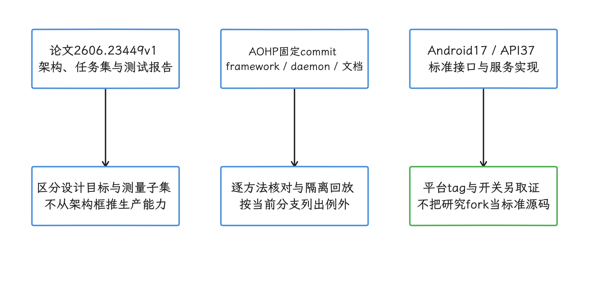

图：论文提出目标，固定 AOHP commit 说明实现，Android17 r1 作为独立平台对照。 AOHP 的构建基线为 Android16 QPR2；论文的五项 Pass 没有绑定本文检查的 commit，不能迁移成当前所有路径均通过。

## 1. AOHP 要解决什么问题

传统 Android 以应用 UID、组件和用户可见界面组织能力，这个模型是给人直接操作应用设计的。agent 的负载带来了几个系统过去无需统一处理的维度：

| 维度 | 标准应用交互 | agent 工作负载带来的变化 |
| --- | --- | --- |
| 能力入口 | Activity、Service、Provider、Intent 和应用内 UI | 一次任务可能跨多个应用、CLI、文件和服务 |
| 观察形式 | 像素与面向人的语义 | agent 更适合结构化、可定位、可验证的状态 |
| 生命周期 | 前台交互、受控后台执行 | agent 可能等待事件、并行处理多个子任务 |
| 授权对象 | 权限授给应用或角色 | 数据可能继续进入模型上下文、工具和外部服务 |
| 审计单位 | 组件调用、AppOps、网络或文件访问 | 还需解释一次任务中数据从 source 到 sink 的传播 |

涉及信息流时，我们先把 source 和 sink 这对词说清楚：source 是数据进入任务的位置，sink 是数据离开受控范围或触发动作的地方。联系人地址是典型的 source，上传接口或支付确认是典型的 sink。

这些维度，标准 Android 已有各自的机制：Binder、权限、AppOps、URI grant、Keystore、Accessibility、VirtualDisplay 和后台执行规则都在。AppOps 负责对敏感操作做运行时记录与限制，URI grant 把某个 `content://` 对象的临时访问权交给指定组件。缺口集中在跨工具的任务语义、数据传播和 agent 专用控制面。AOHP 的选择是修改 framework 与系统服务，把这些能力放进统一的 harness。

论文把方案归为三部分：

1. **个性化服务组合**：从 API、CLI、结构化 UI 和 GUI 中发现能力，按用户任务生成入口；
2. **高效 agent 接口**：用虚拟显示、结构化 UI、文件对象、事件流和本地执行环境减少 GUI 往返；
3. **安全信息流**：在 agent 看到数据前把敏感明文替换为不透明引用，并在输入、输出和敏感动作处执行策略。

“OS 级”三个字在这里有具体含义：AOHP 直接修改 `frameworks/base`、`system/core`、SELinux policy、Launcher3 和 system app。普通 APK 只靠几个公开 API，复制不出同等权限。

<!-- gracker-diagram: ch18-09-02-harness-control -->
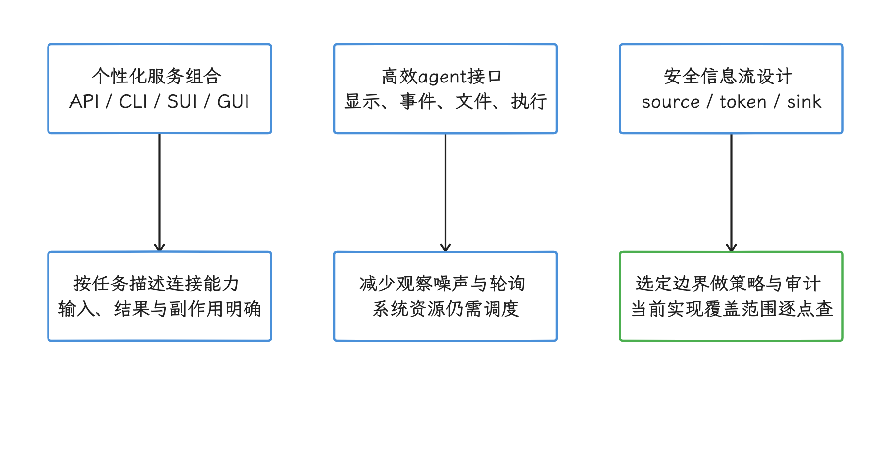

图：AOHP 在研究系统中组合服务入口、结构化观察和敏感数据边界，支撑跨应用任务。 底层 Binder、权限、AppOps 和 URI grant 仍存在；普通 APK 不自动取得这套定制系统权限。

## 2. 从论文架构到代码路径

### 2.1 四层模型

我们按论文的分层从下往上过一遍：

| 层 | 职责 | 典型对象 |
| --- | --- | --- |
| Android 兼容层 | 继续运行现有应用、系统服务和硬件 | Activity、Binder、Display、文件、传感器 |
| 统一交互层 | 归一化 agent 能调用的接口 | API、CLI、Structured UI、Rendered GUI |
| AOHP 能力层 | 管理可复用状态和执行能力 | system memory、skills、UI utilities |
| 服务组合层 | 围绕任务生成用户入口 | task schema、service graph、presentation policy |

几个名词先交代：这里的 system memory 指 OS 管理的偏好与任务状态，与物理内存无关；skill 指可复用的能力描述和执行步骤；task schema 规定任务输入，service graph 描述服务发现与组合，presentation policy 决定结果的呈现方式。

这是一张研究架构图；哪个框有稳定 API，图本身说明不了。仓库中的 `AohpVirtualDisplayService`、`AohpEventStreamService`、`AohpContainerService`、`AohpFileBridgeService`、`AohpVaultService` 和 `AohpSecurityBridgeService` 提供了可追踪的实现入口。

服务组合的质量，则仍取决于 skill 描述、应用适配和 agent 规划。

<!-- gracker-diagram: ch18-09-03-architecture -->
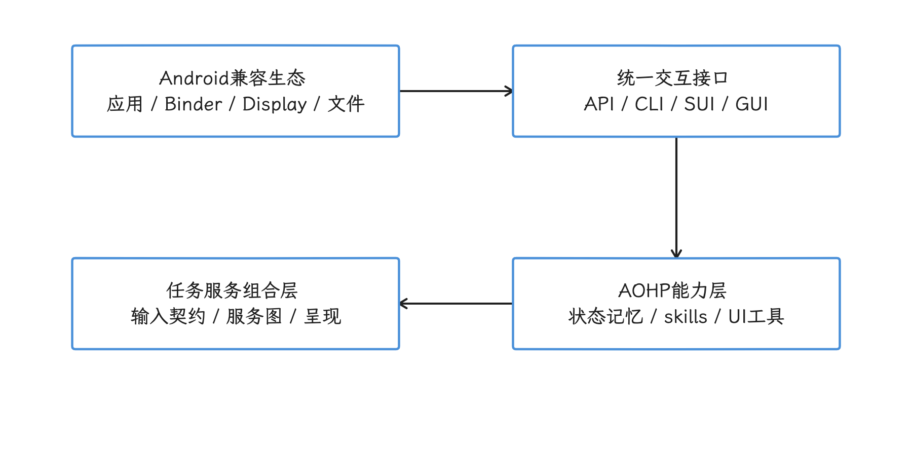

图：兼容生态承接应用和硬件，交互层归一化调用，能力层组织状态与技能，组合层生成任务入口。 箭头表达层间依赖，非固定运行时顺序；架构中的 system memory 也不是物理内存，稳定 API 与实现完整性另查。

### 2.2 生成式服务入口

论文中的 generated entrance 是围绕当前任务生成的用户入口，Android 已有的组件类型里没有对应物。它包含三个要素：

- **task schema**：任务字段契约，包括目标、输入和完成条件；
- **service graph**：API、CLI、GUI 或 skill 之间的依赖与执行关系；
- **presentation policy**：决定哪些结果展示给用户，哪些中间状态留在任务内部。

能力描述需要写清输入/输出 schema、前置条件、副作用和策略标签。搜索商品这类动作可以并行执行，付款和外发敏感文件则要经过确认——这样区分，有助于把“会读取数据”和“会改变外部状态”分开。

AOHP 也允许 legacy 应用通过 GUI 或结构化 UI 参与；legacy 在这里指没有为 AOHP 或 AppFunctions 专门改造的既有应用。它们的能力发现仍处于研究阶段，论文把更强的自动推断列为后续工作。写工程文档时，别把任意页面说成已经自动转换成了可靠函数。

<!-- gracker-diagram: ch18-09-04-generated-entrance -->
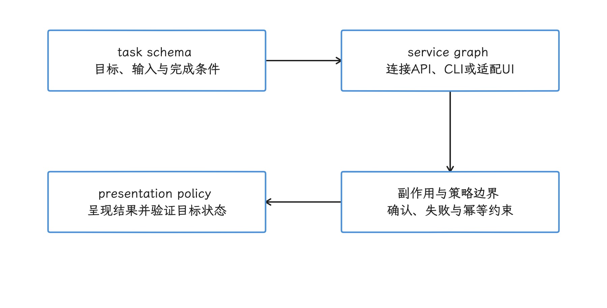

图：任务入口连接输入、能力依赖、呈现与完成条件，既有应用可通过适配后的 UI 路径参与。 这是研究设计；并行读取、付款确认等是工程约束，任意页面尚不能自动变成可靠函数。

### 2.3 跨服务记忆

论文把记忆分为三类：

| 类型 | 作用域 | 风险控制 |
| --- | --- | --- |
| 持久 profile | 跨任务偏好 | 可审计、可撤销、限制用途 |
| task-local | 当前任务的候选项和中间状态 | 任务结束后清理 |
| sensitive memory | 地址、支付凭据等私密值 | 由 vault token 间接引用 |

这里的 profile 是长期偏好档案，不是性能 profile；task-local 表示状态只在当前任务内有效；vault token 是对敏感明文的间接引用，当前实现的限制后文会说明。

这套 memory 是论文里由 OS 管理的状态，和 LLM context window 是两回事：context window 是一次模型请求可容纳的输入范围，本身也起不了跨任务持久存储的作用。它同样不是 Android 17 的 `OnDeviceIntelligenceManager`——后者在标准 AOSP 17 中是受权限管理的 `@SystemApi` 推理服务接口，部分能力还受 feature flag（功能开关）约束；API 37 公开文档里没有 `FoundationModelManager` 这个平台类，`OnDeviceIntelligenceManager` 也没有定义 AOHP 的跨应用记忆协议。

<!-- gracker-diagram: ch18-09-05-memory-scopes -->
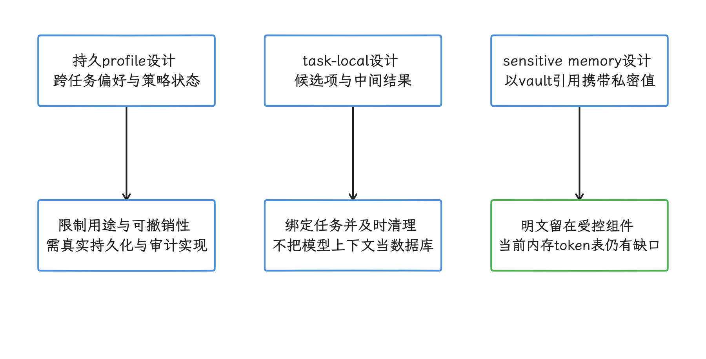

图：论文区分跨任务偏好、任务内状态和敏感值引用，生命周期与访问策略分别管理。 这套跨服务状态不是 LLM context window，也不是物理内存或标准 OnDeviceIntelligence 推理接口；当前 vault 限制另看实现。

## 3. 高效 agent 接口的实现边界

论文的第二部分是高效 agent 接口：虚拟显示、结构化 UI、事件流、文件桥和本地沙箱。这一节逐个看它们在原型里对应哪条代码路径、又受哪些系统权限约束。

### 3.1 虚拟显示与后台交互

Android 公共 `DisplayManager.createVirtualDisplay()` 从早期版本就已存在，但公共 API 创建的 display 默认是 private、non-secure：private display 主要限制其他 UID 在其上放置 Activity，non-secure display 显示不了受 `FLAG_SECURE` 保护的内容；安全显示、自动镜像、可信显示和输入注入还受系统权限限制。

所以，创建一个 `VirtualDisplay` 并不会自动获得以下能力：

- 在后台随意启动其他应用 Activity；
- 绕过 private display 的 UID 放置规则；
- 读取 `FLAG_SECURE` 窗口；
- 向任意应用注入输入；
- 豁免进程冻结、后台启动、前台服务和资源限制。

AOHP 通过 `signature|privileged` 权限 `MANAGE_AOHP_VIRTUAL_DISPLAY` 和 framework 内部接口扩展了这条路径，这类权限只会授予使用系统签名或位于特权分区且进入许可名单的应用。原型在调用参数 `flags=0` 时采用下面的默认 flag 组合，并始终追加 `OWN_FOCUS`；传入非零 flags 时并不会自动补齐其他默认 flag。以下是 framework 内部片段，不是普通应用可直接照用的公开 SDK 示例：

```java
effectiveFlags = DisplayManager.VIRTUAL_DISPLAY_FLAG_PUBLIC
        | DisplayManager.VIRTUAL_DISPLAY_FLAG_OWN_CONTENT_ONLY
        | DisplayManager.VIRTUAL_DISPLAY_FLAG_TRUSTED
        | DisplayManager.VIRTUAL_DISPLAY_FLAG_SUPPORTS_TOUCH;
effectiveFlags |= DisplayManager.VIRTUAL_DISPLAY_FLAG_OWN_FOCUS;
```

我们逐个看这些 flag：`PUBLIC` 允许其他 UID 的 Activity 按策略进入 display；`OWN_CONTENT_ONLY` 禁止在无内容时回退到默认屏幕镜像；`TRUSTED` 让 display 参与可信显示策略，允许承载相应受限窗口，但不等于 `SECURE`，也不自动赋予读取 `FLAG_SECURE` 内容的能力；`SUPPORTS_TOUCH` 声明它支持触摸；`OWN_FOCUS` 给它独立输入焦点。这些 flag 仍依赖系统权限与内部 display policy，`SUPPORTS_TOUCH` 本身不会授予调用方输入注入权限。

<!-- gracker-diagram: ch18-09-06-display-authority -->
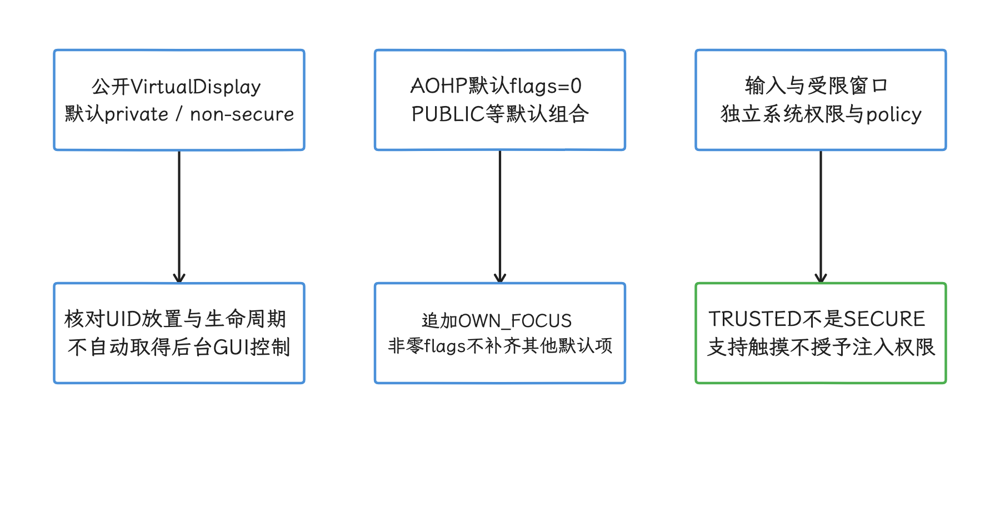

图：AOHP 用特权入口和内部 display/Activity policy 运行后台界面；默认 flags 仅适用于 flags=0。 PUBLIC、TRUSTED、OWN_FOCUS 与输入注入是不同条件；TRUSTED 不等于 SECURE，普通 API 创建 display 不会自动豁免后台或安全内容规则。

`AohpVirtualDisplayService` 通过 `DisplayManagerInternal` 创建 display，并用 system_server 内部 Activity 启动路径把应用放到目标 display。固定 commit 的 `AohpVirtualDisplayPolicy` 用全局 `sOwnerUid` 加一组 display ID 表示当前 session：支持同一 owner 的多个 display，但不是每个 display、agent 或 user 独立一份 owner 表；另一次 `registerSession()` 会更新全局 owner。普通应用调用公共 `VirtualDisplay` API 得不到这组能力，产品化也不能据此宣称多 agent 已充分隔离。

<!-- gracker-diagram: ch18-09-07-display-owner -->
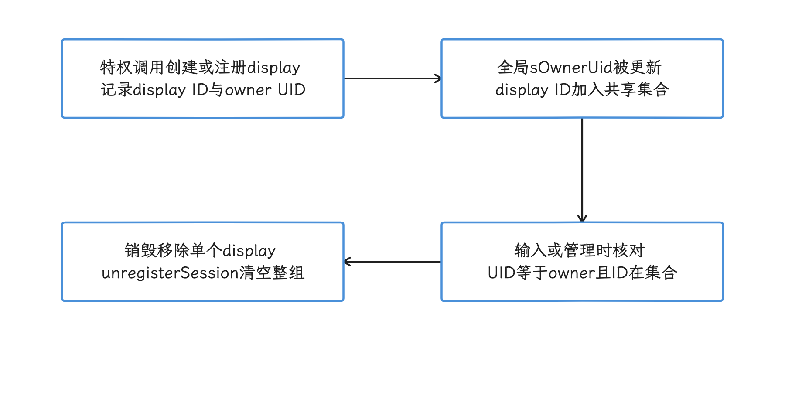

图：当前策略保存一组 display ID 和一个全局 owner UID，输入入口据此校验调用方。 同一 owner 可管理多个 display；新的 registerSession 会更新全局 owner，这不是独立的每 agent/user 租户映射。

AOHP 为每个虚拟显示挂接一个 RGBA 像素格式的 `ImageReader`，把 `maxImages` 设为 3，在后台线程持续获取并关闭最新帧。`maxImages` 限制的是同时被获取、尚未释放的 image 数量，从这个数字推不出系统会长期保存 3 张截图。

这个 `ImageReader` 同时向 display 暴露一个 producer surface，也就是显示帧写入缓冲队列的端点，避免 display 因为没有输出 surface 而进入 `STATE_OFF`；`ImageReader` 在另一端消费并及时关闭这些帧。代价也在这里：WindowManager、SurfaceFlinger、应用进程、图形 buffer、GPU 合成和输入分发都要工作。

<!-- gracker-diagram: ch18-09-08-display-buffers -->
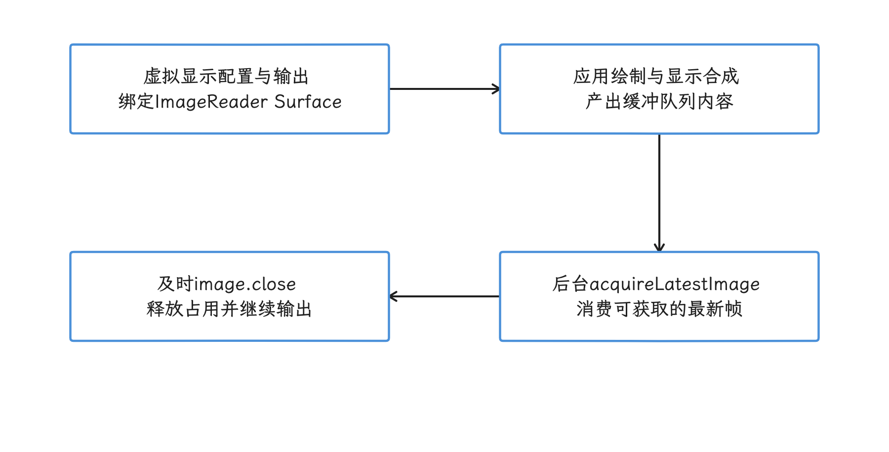

图：AOHP 的 ImageReader Surface 接住虚拟显示输出，后台线程获取并关闭最新 image。 maxImages=3 限制同时已获取未关闭的 image，不是长期保存三张截图；图形 buffer、合成和应用工作仍需独立测量。

论文没有报告虚拟显示的 CPU、GPU、内存、thermal 和能量开销，并把资源调度列为 future work。做工程评估时，至少要记录：

- 同时运行的 display、task 和应用进程数量；
- `ImageReader` buffer、图形内存、PSS（按共享页折算的进程内存）与 LMKD（Android 的低内存回收守护进程） 压力；
- SurfaceFlinger layer、GPU busy、帧率和无效重绘；
- agent 与前台用户争用 CPU/GPU 时的延迟；
- screen-off、Doze、thermal throttling（过热降频）与进程冻结行为；
- display 销毁、应用崩溃和 session owner 退出后的清理，session owner 指创建并持有这次会话的调用方。

### 3.2 Structured UI

AOHP 的 Structured UI（SUI）从 Android accessibility tree（可访问性节点树） 导出节点类型、文本、层级、resource ID、可操作性、bounds 和 display 信息——resource ID 是应用为 View 声明的资源标识，bounds 是节点在屏幕上的矩形坐标。相比截图，这种表示省去了纹理、阴影和其他像素细节。

仓库中的 `AohpUiTreeDumper` 负责导出这棵树，`AohpUiTreeSanitizer` 在结果进入 agent 视野前处理敏感字段。当前 sanitizer 只处理导出节点的 `text` 与 `contentDescription`：按 resource ID 查询应用声明，再用形似 11 位手机号、16 位银行卡号的正则补充；它们不校验真实号码，也不覆盖所有敏感文本。`filterUiTreeTrusted()` 在前台 package 无法确定时会标记错误并保留原树，正常过滤路径抛异常时才返回空 nodes，不能概括成所有未知状态都先脱敏再返回。

SUI 覆盖不了全部 Android UI：

- Canvas、OpenGL、游戏引擎和视频可能没有完整语义节点；
- WebView、Compose 和自定义 accessibility semantics 的质量取决于应用，semantics 是应用暴露给辅助功能与自动化工具的节点语义；
- 节点树与屏幕像素可能处在不同帧；
- resource ID、文本和 bounds 会随版本、语言和布局改变；
- 登录、支付、验证码等界面可能主动限制自动化。

所以 SUI 适合作为结构化观察通道，GUI 则是节点语义不足时的兼容回退。执行动作后，我们仍要验证目标状态，别把“命令返回成功”直接当成业务完成。

<!-- gracker-diagram: ch18-09-09-structured-ui -->
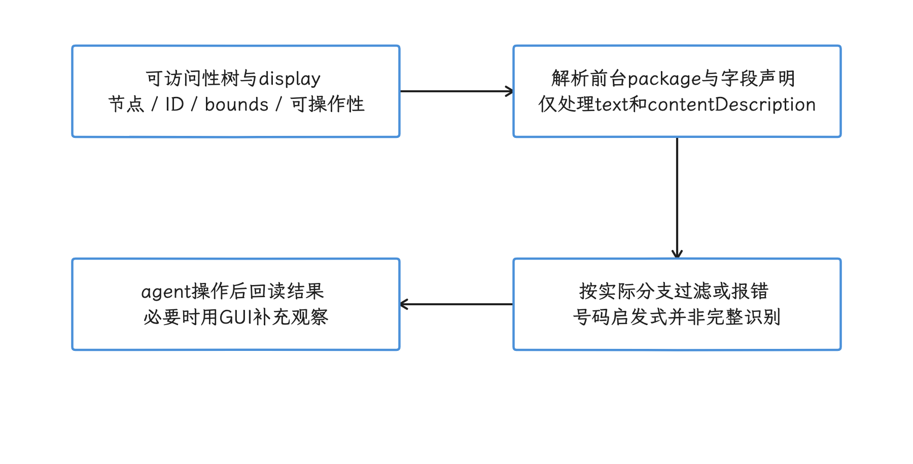

图：导出可访问性树的节点与字段，按声明和启发式过滤，再供 agent 选择动作并回读状态。 仅处理选定字符串；未知前台 package 可保留原树，正常过滤异常才返回空 nodes。自绘与语义缺失仍需兼容路径，动作返回不等于业务完成。

### 3.3 Event Stream

论文的 Event Stream 覆盖瞬态 UI 事件和传感器流。当前 `AohpEventStreamService` 有一个共享 `mEvents` 队列，各 session 只维护自己的 `nextSeq` 游标；入口包括 Toast、notification posted/removed 和 heads-up。它不是每个会话独立保存并隔离的一份事件队列：

- 注册选项的条数限制在 1–2000，但共享队列的实际容量取 `max(200, 各会话 maxEvents)`，较小选项不会把队列缩到 200 以下；
- 注册 TTL 选项限制在 10 秒到 1 小时，共享队列实际 TTL 取 `max(10分钟, 各会话 ttlMs)`；它限制事件保留，不会自动注销 session，清理在新增事件或 drain 时执行；
- `register` 从当前全局序号开始订阅，`drain` 推进本会话游标，`unregister` 移除会话；最后一个会话退出时清空事件；
- notification 与 heads-up 在这些入口写入 `displayId=0`，相关 activity 可另行尽力匹配；不是已可靠推断通知所属 display；
- 可附截图；2 MiB 是决定是否内联的原始 JPEG 字节阈值，Base64 后会更大。超过阈值只是不内联，不能据此推断捕获缓存或返回 JSON 总大小不超 2 MiB。

AOHP 在 NotificationManagerService、SystemUI 和 Toast 路径加入了 system_server hook；hook 是插入原有系统路径的回调点。这种实现，第三方 `NotificationListenerService` 复制不出来：标准应用走后者，要先拿到用户授予的通知访问权，靠该 API 也完整捕获不了其他应用的 Toast。

事件流能减少轮询，但消费者仍要处理积压、丢弃和重试，并按 `seq` 与时间戳使动作幂等。空 events 表示暂无可读事件，`unknown_session` 表示会话不存在；当前代码没有按 TTL 自动注销 session。`dropped` 是共享队列的累计丢弃量，不等于某一个消费者遗漏的事件数。

<!-- gracker-diagram: ch18-09-10-event-queue -->
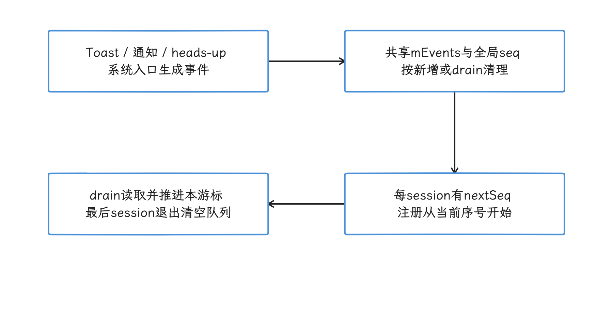

图：系统 hook 写入共享事件队列，注册保存当前序号，drain 独立推进每个会话游标。 实际容量至少200、事件TTL至少10分钟，并取各会话较大值；TTL不自动注销会话，dropped 是全局累计值。

敏感事件还有明确例外：`sanitizeEventJsonInner()` 跳过 Toast 顶层 `text`，`drain()` 的 `resolveToastVaultText()` 还会把可解析的 Toast vault 引用恢复为明文，再写入 summary。通知的选定字符串才按号码形态或长度启发式替换。截图像素并不经过这套字符串脱敏，安全 bridge 不存在时事件入口也可保留原始 JSON；不能把论文“敏感事件脱敏”的测试结果当作这些路径无例外的保证。

<!-- gracker-diagram: ch18-09-11-event-privacy -->
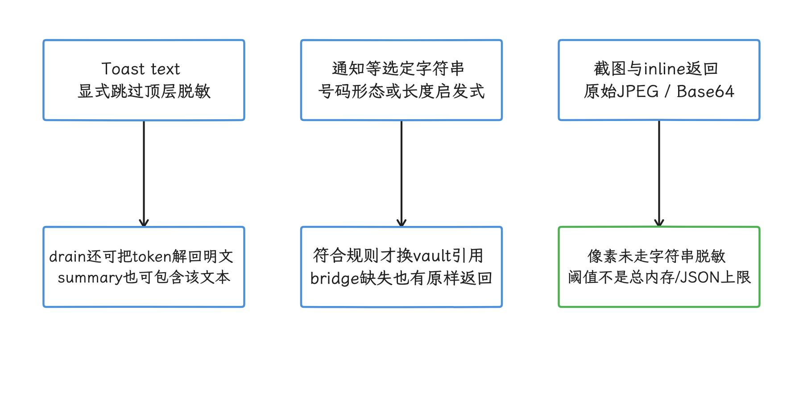

图：当前 Toast 顶层文本可保留明文，drain 还可解析 Toast token；其他选定字符串才经过启发式替换。 截图像素不经过字符串 sanitizer；2MiB是原始JPEG的内联阈值，Base64会变大，超限不内联也不证明未缓存或未捕获。

### 3.4 文件桥

AOHP 把 GUI 产生的文件与 CLI/API 消费的文件归一成任务对象，减少 agent 从截图猜路径的行为。这个设计依赖 privileged file bridge——具有系统权限的文件服务——以及后续工具与策略协作。固定 commit 的 `AohpFileBridgeService` 主要提供 `stat/list/recent/snapshot/diff` 等有界查找与元数据比对，显式路径限定在公共外部存储；不能把这个类本身画成已经实现任意文件内容转发、跨用户共享和完整信息流检查。

标准 Android 应用之间传文件，优先走 Storage Access Framework（系统文件选择框架）、`ContentProvider`/`FileProvider`、`content://` URI 与临时 URI grant；grant 是针对具体 URI 和目标组件的临时读写凭证。共享存储的绝对路径还会受到 scoped storage（分区存储）、用户选择、MIME type、provider 生命周期和目标应用支持的影响，别笼统写成“比 Intent 更可靠”。

一个可审计的文件交接至少要记录：

- source provider、URI、MIME type、长度和内容摘要；
- grant 的读写方向、目标 package 与过期时间；
- 文件是否包含 vault token 或敏感派生内容；
- 目标动作是否会上传、分享、覆盖或删除；
- 操作完成后 grant 和临时文件怎样回收。

<!-- gracker-diagram: ch18-09-12-file-objects -->
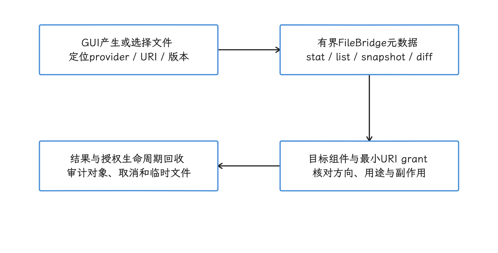

图：当前 FileBridge 做有界查找与 snapshot/diff；真正跨组件交接还需对象标识、最小 URI grant 与目标动作校验。 这张图组合当前查找能力与产品交接约束；不表示该类已实现任意内容转发、跨用户共享或内容级信息流追踪。

### 3.5 本地沙箱

`AohpContainerService` 通过 init 创建的 Unix domain socket 与设备侧 daemon 通信；daemon 是在后台处理容器命令的 native 进程。当前 CLI 把执行环境描述为 Linux chroot sandbox，skill 文档还说明这些 sandbox 共享设备 network namespace（网络命名空间）。

固定到 `d1fc184b...` 的 daemon 实现会尝试 `unshare(CLONE_NEWNS)` 创建独立 mount namespace，进入每个 sandbox 的 cgroup，再执行 `chroot()`。mount namespace 隔离挂载视图，cgroup 可提供资源分组与限制；但这里两者都是 best effort：namespace 创建失败时继续使用宿主挂载视图，cgroup 创建失败会记录“continuing without limits”，加入 cgroup 的失败也未被调用处作为终止条件。不能把“调用过接口”写成隔离与限额一定生效。

init 配置让 daemon 以 root 和多项 Linux capability 启动，当前子进程路径没有再执行 `setuid()`/`setgid()` 降权；capability 是拆分后的 root 特权，seccomp 是系统调用过滤器。结合共享的 network namespace，这套实现有了文件系统视图、挂载和资源分组机制，强身份与网络隔离还没有形成。

还要看到 chroot 的分量：它只改变路径解析的根目录，本身提供不了完整的安全隔离。评价“可安全执行 agent 代码”时，要核对 UID/GID、SELinux domain、mount namespace 失败路径、capability、seccomp、cgroup、网络出口、设备节点和凭据挂载。`AohpSandboxSecurityGate` 只对命令字符串中出现的 `aohp://vault/` 作拒绝检查，不是完整的命令语义、数据流或网络出口策略。当前原型适合受控的 Cuttlefish/userdebug 实验，离不可信代码的生产隔离还有距离。

<!-- gracker-diagram: ch18-09-13-sandbox-boundaries -->
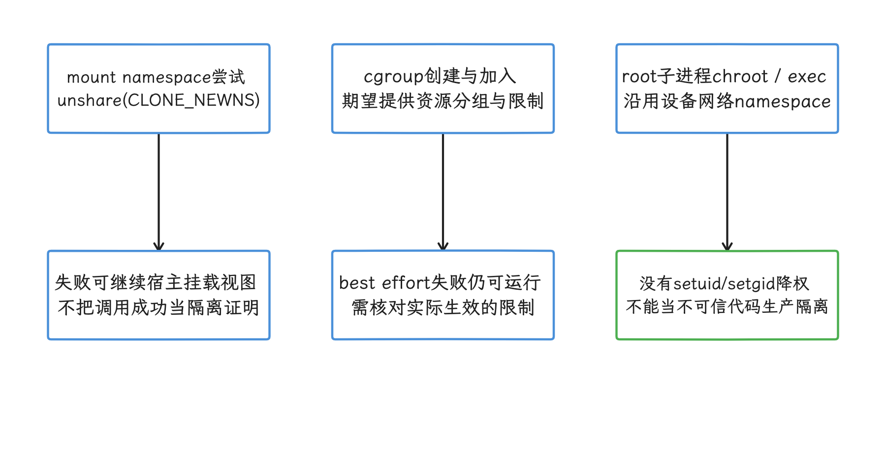

图：AOHP 经特权 Binder 与 Unix socket 调用 root daemon，尝试 namespace、资源分组后进入 chroot 执行。 当前网络 namespace 共享、子路径未降UID；namespace或cgroup失败可继续。命令中拒绝token字面量不等于完整语义或出口策略。

## 4. 安全信息流：设计目标与原型现状

这一节处理的问题是：论文设计的安全信息流，在当前原型里实现到了什么程度。我们先看论文的流程设计，再对照源码，分清已经写出的部分和还留下的缺口。

### 4.1 论文提出的处理流程

论文的敏感数据路径可以拆成六步：

1. source 被声明或启发式规则识别为敏感；
2. 明文进入 agent context 前替换为 typed placeholder；
3. vault 保存明文与 token 的映射；
4. agent 只携带 token 提交操作意图；
5. trusted executor 检查 source、purpose、destination、action 与 consent；
6. sink 前执行放行、确认或拒绝，并写审计记录。

这里的三个术语：typed placeholder 是带有数据类别但不含明文的占位引用，例如 `<home-address:uuid>`；trusted executor 是获准解析引用并执行敏感操作的系统组件；consent 是绑定 source、用途、目的地和动作的用户确认。

这套模型要控制的是“数据已经交给某个 agent 之后又流向哪里”。Android 已有的机制回答的是别的问题：运行时权限回答某个 UID 能否访问资源，URI grant 回答某个组件能否访问一个对象；对 LLM prompt、tool result 和跨工具派生数据，两者都不会自动理解。

<!-- gracker-diagram: ch18-09-14-flow-design -->
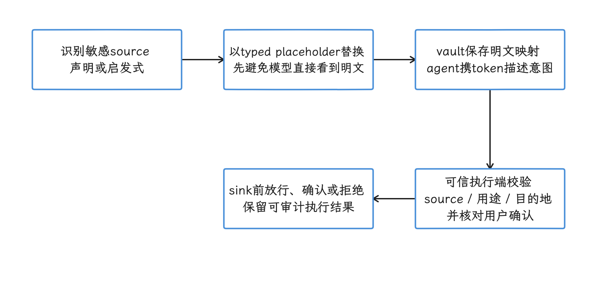

图：论文期望先识别敏感 source，以 token 交给 agent，再由可信执行端检查用途与目标并执行动作。 这是设计目标；不能把六步设计直接画成当前所有入口都强制执行，下面还要逐方法核对实现与例外。

### 4.2 当前 vault 是内存 token 表

AOHP framework commit `a2d4a80b...` 中，`AohpVaultService` 明确把实现标为 in-memory，核心状态如下：

```java
private static final String PREFIX = "aohp://vault/";
private final Map<String, Entry> mEntries = new ConcurrentHashMap<>();
```

`Entry` 直接保存 plaintext（明文）、category、source package 和创建时间。进程一重启，映射就消失了；当前类没有持久加密、硬件密钥绑定、用户切换隔离、自动过期，也没有 secure erase（可验证安全擦除）机制。

token 的不透明性可以减少 agent 直接接触明文的机会。当前 `resolveVaultToken(token, purpose)` 仅校验共用的特权 permission、记录 purpose 后读取映射；`purpose` 不是已执行的用途限制，也没有在该方法绑定 user、task、目的地或 consent。不能据 opaque token 宣称已有完整的用途授权或凭据存储保护。

<!-- gracker-diagram: ch18-09-15-vault-implementation -->
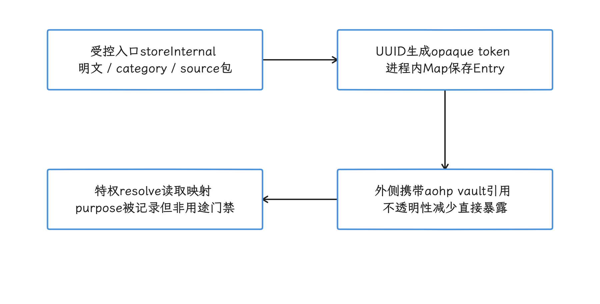

图：当前实现给明文生成随机 token，并在 ConcurrentHashMap 中保存值与来源元数据。 resolveVaultToken 校验共用特权 permission 后读取，purpose只写审计；未在该方法绑定任务、用户、目的地或consent，重启后映射丢失。

### 4.3 当前 taint tracker 的传播范围

taint 在这里表示附在数据上的来源与敏感级别标记，也称 provenance metadata，和数据是否损坏无关。`AohpTaintTrackerService` 为 vault token 建立 `taintId`，记录 source app、category、sensitive 标志和时间。

`AohpUiTreeSanitizer` 会在 UI 字段替换为 vault token 时注册该元数据，security bridge 再在输入、tap、skill output、file share 等选定位置执行检查。

TaintDroid 是 2010 年 OSDI 论文中的 Android 研究原型，修改 Dalvik 和系统路径实现多粒度动态 taint tracking，AOHP 当前的传播粒度与它不同：当前 AOHP 类没有在 Java/ART 指令、native 内存、Binder payload、文件内容和任意字符串变换中自动传播标签。把它写成“每一次 LLM 请求、每一个工具输入输出都自动携带 taint”，就超出了源码证据能支持的范围。

TaintDroid 从未成为 Android 标准安全组件，“后来被 Google 从 AOSP 移除”的说法对不上它的演进历史；AOHP 论文引用的只是这一研究方向。

<!-- gracker-diagram: ch18-09-16-taint-scope -->
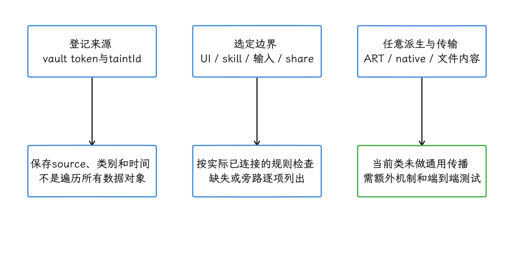

图：当前类为 vault token 建立 taintId，记录来源、类别与敏感标记，并在选定 UI/tool/file 边界检查。 这不同于指令级动态传播；当前这些类未自动跟踪任意ART/native内存、Binder内容、文件内容和派生字符串，不能从taint类名推完整覆盖。

### 4.4 策略检查与已知缺口

`AohpSecurityBridgeService` 已实现或部分实现：

- UI tree 敏感字段替换；
- vault token 输入前的 sink 校验；
- 敏感 tap 和输入的 consent；
- skill input/output 策略；
- file share 检查；
- audit log 与部分 fail-closed 路径，例如输入策略异常时返回 DENY；fail closed 表示特定检查失败时默认拒绝，不能扩写为所有观察与动作入口均覆盖。

源码也保留了清晰的未完成位置。下面的返回值用于文件读写策略尚未实现时拒绝请求：

```java
o.put("mode", "DENY");
o.put("stub", true);
o.put("reason", "file_read_policy_not_implemented");
```

这段代码只说明这两个 policy 方法的默认行为是 DENY，不能证明所有文件 I/O 都被它们中介。文件列表的 `filterFileListJson()` 实际为路径加风险标签，share 策略主要看路径形态，不扫描文件内容，`targetPackage` 在此只是附带返回。

<!-- gracker-diagram: ch18-09-17-policy-coverage -->
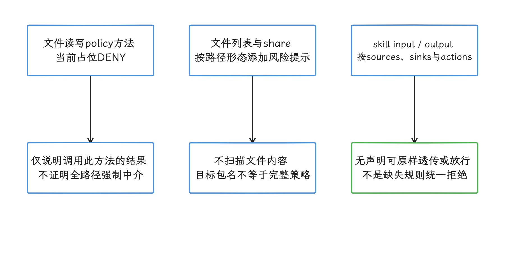

图：文件读写 policy stub 默认 DENY，文件列表只标记路径风险，skill 则按有无声明走不同分支。 单个DENY返回不证明所有I/O都被中介；无sources的skill输出可原样，无命中规则的输入可ALLOW，512行内存audit也不是持久防篡改记录。

动作入口也有差别：`injectTapWithTarget()` 调用语义 tap 策略，而原始坐标 `injectTap()` 仅校验特权 permission 与 display owner 后直接注入；`checkTapPolicyInner()` 对空 resource ID 直接 ALLOW。当前临时批准按 package/resourceId/kind 保存 10 分钟，并不逐次绑定 source、destination、金额或 task。论文提出的细粒度 consent 设计，不能直接当作这些方法已经实现的完整约束。skill 也不是缺失声明就统一拒绝：`checkSkillOutputPolicy()` 在没有 sources 时可原样返回，`checkSkillInputPolicy()` 在未命中 sink 且没有触发 action 规则时可 ALLOW。`AohpSecurityAuditLog` 只是最多 512 行的内存环形记录，不是持久、防篡改的审计存储。写安全报告时，我们要逐个 sink 标明状态——implemented（已实现） 是已实现、partial（部分实现） 是部分实现、stub（仅占位） 是仅占位、unobserved（未观测） 是未观测——别用论文架构图盖住代码缺口。

<!-- gracker-diagram: ch18-09-18-action-consent -->
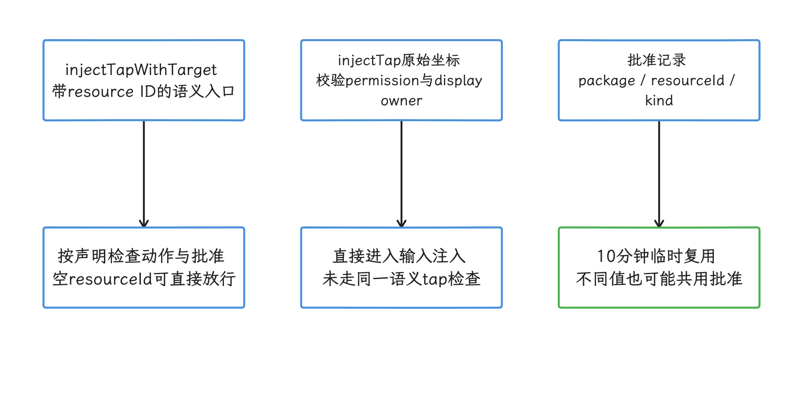

图：带 target 的 tap 可进入语义策略，原始坐标 tap 仅校验特权与 owner；临时批准按包、字段和动作种类复用。 批准有效期10分钟，不逐次绑定source、目标金额、destination或task；空resourceId还可直接ALLOW，不能据有consent界面断言完整动作约束。

### 4.5 五个 security case 怎样解读

论文在一个带敏感标注的支付应用上测试了五类行为：敏感显示替换、普通动作放行、敏感动作确认、未支持访问拒绝、敏感事件脱敏。论文报告五项全部通过，支持的是作者当时的原型、标注应用与测试流程；论文未把这些结果绑定到本文检查的 framework commit。当前 commit 的 Toast、空 resource ID、原始 tap 和用途审计等例外需要单独复测，不能将历史 Pass 直接迁移为当前版本每条路径的测试结论。

这些结果还证明不了：

- 对任意第三方应用的字段识别完整；
- 隐式流、native code、截图像素和 side channel（侧信道）都被跟踪；
- prompt injection（提示注入）诱导不了已授权动作；
- 用户审批不会被混淆、疲劳或界面覆盖攻击影响；
- vault 在重启、多用户、备份和设备失窃场景安全；
- framework service 不存在提权、绕过或 denial-of-service（拒绝服务）问题。

<!-- gracker-diagram: ch18-09-19-security-results -->
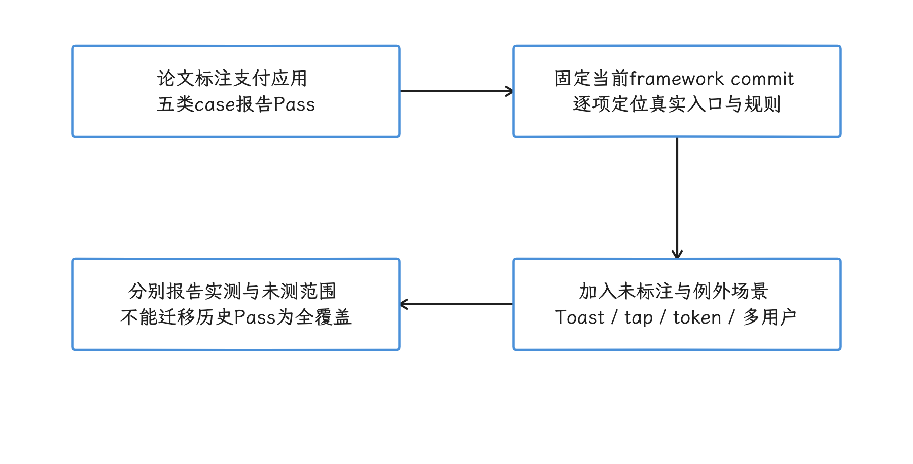

图：论文在标注支付应用报告五类 case 通过，当前版本仍需按具体入口与例外重新验证。 论文未将结果绑定本文检查的commit；号码规则、Toast、截图、tap旁路、用途审计和跨用户/重启边界不由历史五例证明。

## 5. 实验数据：数字成立在哪个范围

论文的实验数字分两块：任务完成率和执行成本。我们分别看它们，并随时注意每个数字成立在哪个子集上。

### 5.1 任务完成率

论文使用 OpenClaw 作为 agent 执行框架，设计了 30 个移动任务，覆盖 GUI、非 GUI、事件捕获、多源检索、记忆和混合工作流，每类 5 个。评分按 objective checkpoint（可客观验证的检查点）加权，所以完成率不是“完整完成任务数 / 30”：

| 设置 | checkpoint 加权完成率 | 完整完成 | 部分完成 |
| --- | ---: | ---: | ---: |
| OpenClaw on stock Android | 54.44% | 13 | 7 |
| OpenClaw on AOHP | 75.56% | 20 | 5 |
| 差值 | +21.12 个百分点 | +7 | -2 |

这组结果支持的说法是：同一 agent 在该任务集上使用 AOHP 接口后，完成度提高。再往外推——对所有 Android 应用、设备、模型或 agent 框架同幅度生效——超出了这组数据的支持范围。

<!-- gracker-diagram: ch18-09-20-completion-metric -->
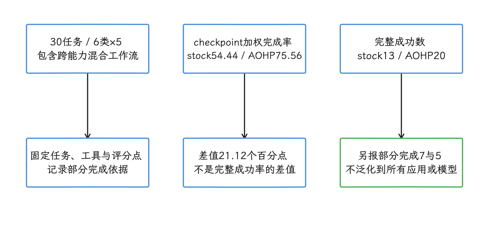

图：论文的30个任务每类五个，按 objective checkpoint 计分，并分别报告完整与部分完成数。 75.56%与54.44%不是完整成功任务数除以30；差值为21.12个百分点，效果限定于该agent和任务集。

### 5.2 执行成本

工具调用、时长、token 和 LLM 请求只统计两组都完整完成的 11 个任务；token 是模型处理文本时使用的计量单位：

| 设置 | 工具调用 | 时长 | Token | LLM 请求 |
| --- | ---: | ---: | ---: | ---: |
| stock Android | 233 | 33.94 min | 7,103,192 | 273 |
| AOHP | 129 | 18.93 min | 3,441,759 | 143 |
| 降幅 | 44.64% | 44.21% | 51.55% | 47.62% |

其中 input token 降低 51.50%，output token 降低 57.48%。结构化观察与更短的操作路径，减少了这个子集的上下文和往返。

论文表格给出的是这 11 个任务的汇总值；复现实验时，以下信息仍然缺失，需要补齐：

- 模型名称、版本、采样参数和输入计费口径；
- stock 与 AOHP 的提示词、tool schema（工具参数契约）和重试策略；
- 每个任务的多次运行分布，别只看单组 aggregate（汇总值）；
- 设备/模拟器配置、温度、网络和应用版本；
- AOHP 系统服务自身的 CPU、内存、GPU、磁盘和能量；
- 对 AppFunctions、Accessibility 自动化或其他结构化 baseline（对照方案）的比较。

“token 减半”是这 11 个共同成功任务上的测量结果，把它直接归到 SUI 单一机制头上并不成立：文件桥、事件流、CLI、虚拟显示和路径长度都同时变化。论文没有给出消融实验——逐项关闭机制来测量各自贡献——所以各项机制的贡献拆不出来。

<!-- gracker-diagram: ch18-09-21-cost-subset -->
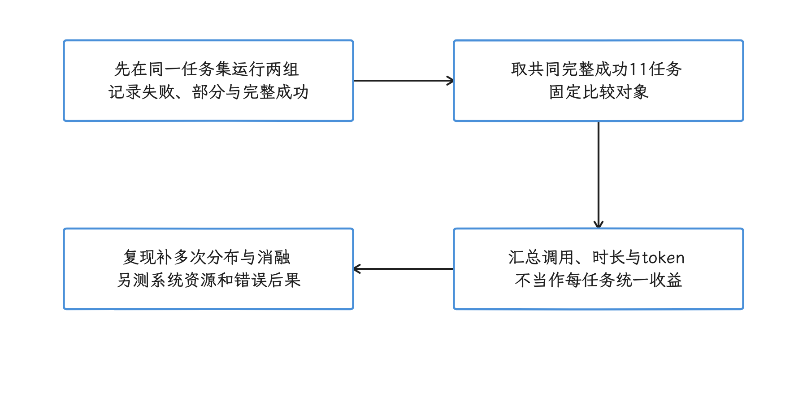

图：论文在双方都完整完成的11个任务上汇总工具调用、时长、token与模型请求。 这个子集不同于全30任务；多种接口与执行路径同时变化，不能把token下降直接归因单一SUI机制，论文没有提供机制消融。

## 6. Android 17 AppFunctions 的标准平台边界

看完研究原型，我们回到标准平台，看 AppFunctions 的 API 形态、system_server 的启动路径和 DeviceConfig 参数；下一节再把它和 AOHP 放在一起对照。

### 6.1 API 演进

AppFunctions 是目标应用主动发布结构化 function、再由获授权 caller 搜索和执行的平台接口。它从 API 36 进入平台，Android 17 / API 37 扩展了动态注册、搜索、观察和 activity-scoped function 等能力。

本次核对的官方概览页（页面更新日期 2026-10-22）仍标为 experimental preview（实验性预览），并说明 Gemini 集成处于 trusted testers 的 private preview，完整开发体验另有 Early Access Program。平台类存在，离“所有 Android 16/17 设备都有可用的端到端产品链路”还有距离。

两种 provider（能力提供方）形态要分开：

| 形态 | 声明与实现 | 生命周期 |
| --- | --- | --- |
| `AppFunctionService` | XML metadata + manifest service | 系统可按调用绑定服务，适合全局能力 |
| runtime registration | XML metadata + `registerAppFunction(s)` | 只能从 Activity 或 Service context 注册，随 registration/context 生命周期 |

metadata 是 function 的标识、参数、作用域等描述信息。r1 描述的两种形态都在 XML asset 声明 function，但 property 所在位置不同：service-based 放在 `<service>` 下，并要求 `BIND_APP_FUNCTION_SERVICE` 与对应 intent action，scope 始终 global；runtime 放在 `<application>` 下，activity scope 只能从 Activity context 注册。runtime registration 只是为已声明标识绑定实现，不会让 agent 随意执行任意应用方法。identifier、scope、注册状态、权限、package visibility 和 enabled state 都参与校验。

<!-- gracker-diagram: ch18-09-22-provider-forms -->
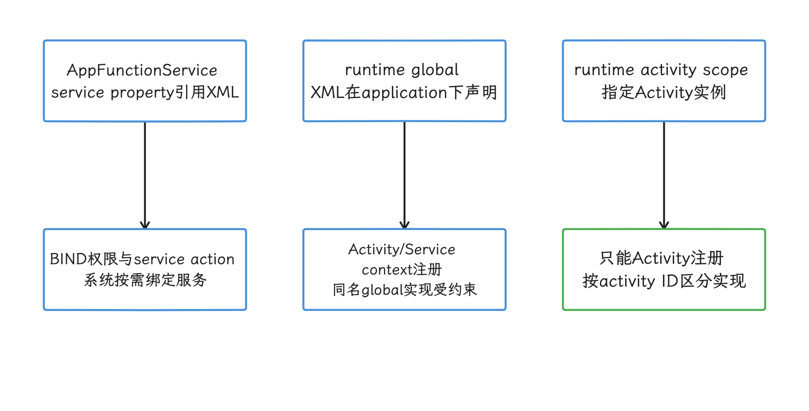

图：service-based 在 service 下声明 XML并由系统绑定；runtime 在 application 下声明 XML后绑定当前实现。 service-based scope始终global；activity scope必须从Activity注册，标识和scope校验仍在，注册不会把任意方法公开成function。

搜索其他 package 的 function 时，caller 需要 `EXECUTE_APP_FUNCTIONS`、`EXECUTE_APP_FUNCTIONS_SYSTEM` 或 `DISCOVER_APP_FUNCTIONS` 之一，并且目标 package 对 caller 可见；执行跨包 function 时，`DISCOVER_APP_FUNCTIONS` 不够。r1 的 V2 模型下，`EXECUTE_APP_FUNCTIONS` 还要通过 caller→target 的 allowlist，`EXECUTE_APP_FUNCTIONS_SYSTEM` 可免此 allowlist；V2 关闭时按 legacy 的 `EXECUTE_APP_FUNCTIONS` 路径检查。身份、用户/企业策略、可见性和 enabled state 等后续条件仍须满足。

公开文档把这类 caller 视为受信任调用方，普通应用默认发现和执行不了所有其他应用的 function。

<!-- gracker-diagram: ch18-09-23-permission-v2 -->
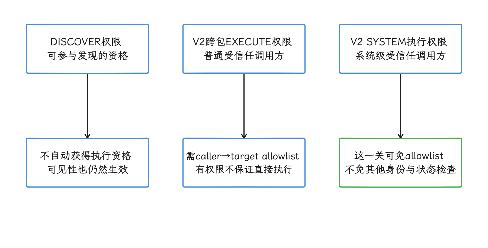

图：搜索权限与执行权限不同；r1 V2 中普通执行权限还需跨包allowlist，system执行权限可免该allowlist。 V2关闭走legacy执行权限路径；同包与root有专门分支。图示仅为执行权限这一关，身份、用户、可见性、enabled等仍须通过。

API 37 的 runtime function 还有一个容易遗漏的限制：注册进程被冻结时，系统不会进入该实现，注册 context 销毁后 registration 会被移除——context 指发起注册的 Activity 或 Service 生命周期对象。AppFunctions 因此替代不了 AOHP 的虚拟显示后台 GUI session。

<!-- gracker-diagram: ch18-09-26-runtime-lifecycle -->
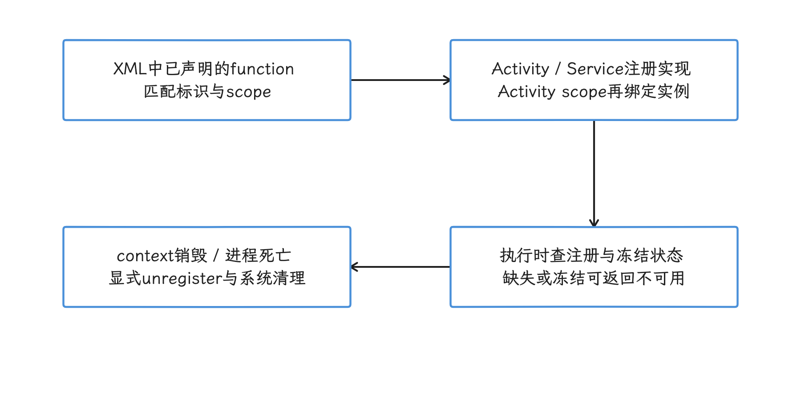

图：runtime function只对已注册的对应scope可调用；注册进程被冻结时返回不可用，销毁或死亡时清理注册。 这不是任意后台GUI workspace；注册方应显式unregister，activity scope也要匹配目标activity，不能用它替代AOHP显示session。

### 6.2 system_server 如何启动服务

Android 17 的 `SystemServer` 通过 `AppFunctionManagerConfiguration.isSupported(context)` 决定是否启动主服务；gate 是控制某段代码是否生效的条件开关。启动条件如下：

```java
if (AppFunctionManagerConfiguration.isSupported(context)) {
    t.traceBegin("StartAppFunctionManager");
    mSystemServiceManager.startService(AppFunctionManagerService.class);
    t.traceEnd();
}
```

`AppFunctionManagerConfiguration.isSupported()` 在该 tag 中返回 `enableAppFunctionManager()` flag，`AppFunctionManagerService.onStart()` 发布 Binder service（跨进程调用入口）前会再次检查相同条件。

代码说明功能受 build/device flag 控制；仅凭这个分支，断言不了所有 AOSP user build 默认开启或关闭。

V2 permission 模型还有独立的 `enableAppFunctionPermissionV2()` gate，`SystemServer` 会据此先启动 `AllowlistService`；allowlist 是明确列出获准主体的许可名单。构造函数中的 access service、`AppInteractionServiceImpl` 和 allowlist reader 也分别受 flag 管理——这些 gate 让权限与交互能力可以分阶段配置。

<!-- gracker-diagram: ch18-09-24-service-gates -->
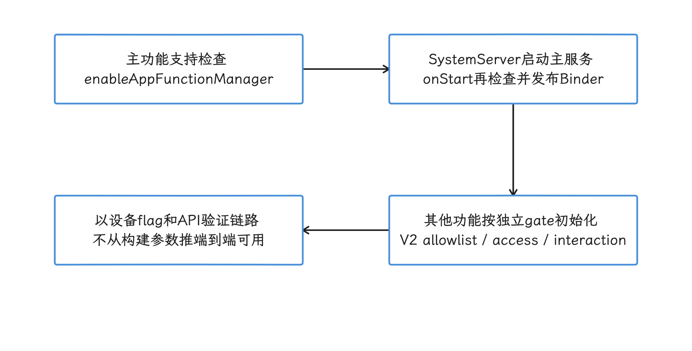

图：SystemServer 与服务onStart都以主功能flag检查支持，权限V2、access和interaction另有独立gate。 源码分支本身不能证明所有设备默认开关；stats log生成器的minApiLevel也不能推导平台API首引版本。

### 6.3 metadata、搜索与动态注册

`android-17.0.0_r1` 中可追踪的主要路径如下：

1. 应用在 XML asset 与 manifest property/service 中声明 function；
2. 应用声明与系统索引链路提供 metadata，system_server 的 reader/cache/sync 组件关联这些描述与运行时状态；
3. `AppFunctionManager.searchAppFunctions()` 通过 `AppSearchManager` 查询可见 metadata，`AppSearchManager` 提供设备内结构化索引与搜索；
4. caller 组装 `ExecuteAppFunctionRequest`；
5. `AppFunctionManagerServiceImpl` 做身份、权限、可见性、enabled state、URI grant 和目标服务校验；
6. 调用进入 `AppFunctionService` 或 runtime registry 中的实现；
7. cancellation、结果、异常和日志沿 Binder callback 返回。

AppFunctions 提供结构化参数和结果，但不会替 provider 自动完成业务授权：创建订单、分享文件、读取账号或修改设备状态，仍要由应用检查登录态、用户确认、数据权限和幂等性。

<!-- gracker-diagram: ch18-09-25-metadata-execution -->
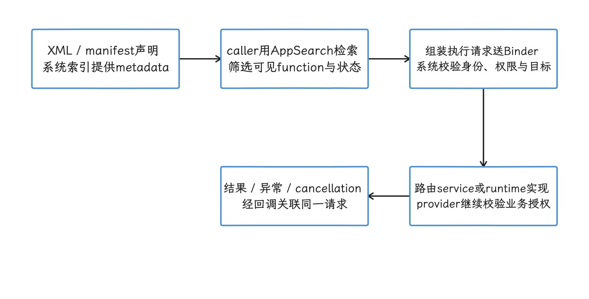

图：应用声明与索引提供metadata，caller通过AppSearch查可见描述，再向system_server提交执行请求。 reader/cache关联运行时状态；系统检查不能代替provider的登录态、业务确认、数据权限和幂等性。

### 6.4 DeviceConfig 参数的准确含义

`ServiceConfigImpl` 从 DeviceConfig 的 `appfunctions` namespace 同步读取以下参数；DeviceConfig 是平台按命名空间保存运行时配置的机制，namespace 用来隔离不同模块的键：

| property | 默认值 | 用途 |
| --- | ---: | --- |
| <code>execute_<wbr>app_<wbr>function_<wbr>cancellation_<wbr>timeout_<wbr>millis</code> | 5000 ms | 取消信号发出后，强制解绑目标 service 前的等待时限 |
| <code>search_<wbr>app_<wbr>function_<wbr>page_<wbr>size</code> | 20 | 内部搜索分页 |
| <code>app_<wbr>function_<wbr>metadata_<wbr>change_<wbr>debounce_<wbr>ms</code> | 500 ms | metadata 变更 debounce |
| <code>app_<wbr>function_<wbr>enabled_<wbr>state_<wbr>change_<wbr>debounce_<wbr>ms</code> | 200 ms | enabled state 变更 debounce |
| <code>app_<wbr>function_<wbr>enabled_<wbr>state_<wbr>change_<wbr>max_<wbr>debounce_<wbr>ms</code> | 1000 ms | debounce 最大等待 |
| <code>app_<wbr>function_<wbr>allowlist_<wbr>cache_<wbr>size</code> | 5 | 可缓存 allowlist 的 agent package 数量上限 |

debounce（防抖）会在连续变更后等待一小段时间再处理，避免同一批更新触发多次工作。这个类没有注册 `OnPropertiesChangedListener` 或永久缓存一般 getter 结果。搜索分页有例外：先用合法的 `sTestPageSize` 覆盖；否则读 DeviceConfig，仅接受 1–10,000，非法值回退 20。其他 getter 直接读对应键。配置在实际调用 getter 时读取，不必为这个类本身重启服务；但这不等于消费者热更新。例如 `SystemAppFunctionAllowlistReader` 构造 `LruCache` 时读取 cache size，当前类没有监听此配置并对既有 cache 调用 resize；已建立连接和已安排任务也要看各自何时重新取值。

<!-- gracker-diagram: ch18-09-27-config-read-times -->
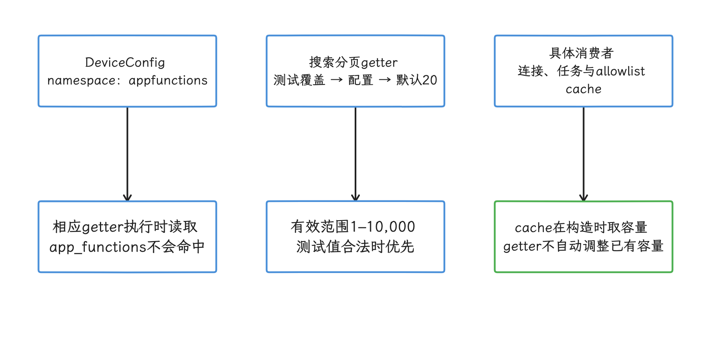

图：r1 使用 appfunctions 命名空间；一般getter实时读取，搜索page size还有测试覆盖与1–10,000范围校验。 读取新值不等于既有消费者立即重配；allowlist reader构造LruCache时取cache size，已建连接和延迟任务也须看自己的取值点。

`services/appfunctions/Android.bp` 中 stats log generator 的 `--minApiLevel 35` 只属于生成 `AppFunctionsStatsLog` 的构建命令：它证明不了 API 35 以下“不生成服务”，也推断不出 AppFunctions 主 API 的引入版本。API 的版本边界应以 SDK stubs（SDK 暴露的 API 签名）、`@AddedIn` 文档和 feature flag 为准。

## 7. AOHP 与 AppFunctions 的准确对照

标准 Android 上常被用于跨应用 agent 的三条入口，我们先分清各自的位置：`AccessibilityService` 面向辅助功能，依据可访问性树观察和操作 UI；`VoiceInteractionService` 是每个用户选择的 assistant 角色入口；AppFunctions 则由目标应用主动发布结构化能力。三者定位不同，不能互换；`BIND_*` 权限约束的也是服务实现者，不是调用方在 manifest 中声明后就能获得的通行证。

产品应优先采用目标应用明确发布的 function；只有业务确属辅助功能或系统 assistant 时，才使用相应服务角色，并把用户授权、可见提示与撤销路径纳入设计。

| 维度 | AOHP 研究原型 | Android 17 AppFunctions |
| --- | --- | --- |
| 交付方式 | AOSP fork + system services + privileged app/CLI | Android platform API + system_server service + Jetpack 辅助库 |
| 能力来源 | API、CLI、SUI、GUI、skills | 应用声明的结构化 function |
| legacy 应用 | 可通过 UI/CLI 适配，但语义质量不稳定 | 未声明 function 的应用不会自动获得 function |
| 后台 GUI | 特权虚拟显示与自定义 Activity/display policy | 不提供任意后台 GUI workspace |
| 执行生命周期 | AOHP session、display、container 和 agent driver | Service binding 或 Activity/Service runtime registration |
| 安全模型 | vault token、字段声明、边界策略、consent、审计原型 | Binder 身份、权限、package visibility、allowlist、enabled state、URI grant |
| 数据传播 | 原型在选定 UI/tool/file 边界记录 taint metadata | 不提供跨 LLM/tool 的通用 taint tracking |
| 兼容成本 | 需要定制系统镜像和持续合并 AOSP | 标准设备可用性由 API、flag、扩展库和 OEM 配置决定 |
| 成熟度 | README 明示 early-stage research prototype | API 仍标为 experimental preview，但属于标准平台接口 |

两者也可以组合：AppFunctions 适合让应用主动暴露稳定、类型化的操作，AOHP 探索系统如何容纳 legacy GUI、跨服务记忆、虚拟执行和敏感数据引用。组合之前，先定义单一的身份、consent、审计和撤销模型，免得两个控制面给同一个 agent 重复授权。

<!-- gracker-diagram: ch18-09-28-standard-vs-fork -->
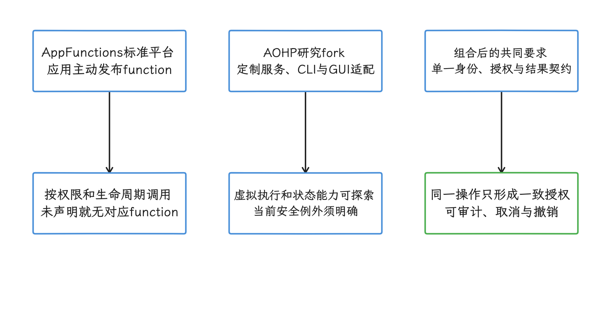

图：AppFunctions让应用主动发布受控函数，AOHP研究接口则兼容UI、跨服务状态与虚拟执行。 两者组合仍需统一身份、consent、审计与撤销；标准接口不会自动生成legacy function，也不提供通用跨LLM/tool taint。

## 8. 对工程团队的建议

我们按三类角色分别给建议：应用开发者、系统与 ROM 开发者、安全评审。

### 8.1 应用开发者

可优先采用以下顺序：

1. 对稳定业务能力使用 AppFunctions、公开 SDK、Provider 或受控 deep link（应用内深链入口）；
2. 对未提供结构化入口的 UI，使用 Accessibility/UI automation 只做兼容路径；
3. 为每个动作标明 read-only（只读）、reversible（可撤销）、destructive（破坏性） 或 external side effect（外部副作用）——只读、可撤销、破坏性或有外部副作用；
4. 对支付、发送、发布、删除和权限变更要求用户确认；
5. 返回可验证的结果 ID、状态和幂等键；幂等键用于识别重试，防止同一动作执行两次；
6. 文件通过 `content://` URI 和最小范围 grant 交接；
7. 日志中记录 caller、function、目标对象、结果和取消状态，过滤敏感参数。

结构化接口的价值来自少走 GUI 步骤和减少观察噪声。AOHP 实验给出的是方向性证据，单个项目仍要测自己的成功率、延迟、token、回退率和错误后果。

<!-- gracker-diagram: ch18-09-29-application-integration -->
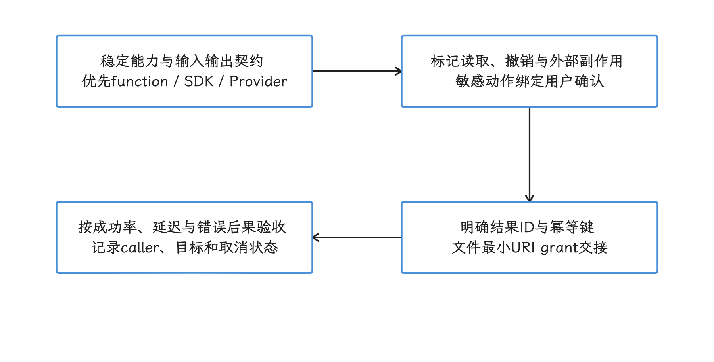

图：对稳定业务提供结构化入口，明确副作用、确认与幂等，再以最小URI授权交接对象。 这是工程建议；辅助功能与assistant角色有各自适用规则，用户授权、可见提示与撤销仍是接入条件。

### 8.2 系统与 ROM 开发者

系统级 agent 至少要拆分以下权力：

- 发现能力；
- 读取结构化状态；
- 启动组件；
- 注入输入；
- 解析 vault token；
- 执行 shell/container；
- 访问文件与传感器；
- 代表用户确认外部副作用。

AOHP 当前多个服务共用 `MANAGE_AOHP_VIRTUAL_DISPLAY` 这一 `signature|privileged` permission。研究镜像便于迭代，生产设计则应按能力拆分 permission、AppOp 和 role：permission 校验调用资格，AppOp 记录或限制具体操作，role 表示用户选择的系统角色。每次调用还应绑定 caller UID、user、display、task 与 purpose，避免一次授权被挪到另一项任务上。

虚拟显示的并行度要纳入资源管理：

- 设定每 agent、每 user 和全局 display 上限；
- 前台用户交互拥有更高 CPU/GPU/thermal 优先级；
- session 空闲、owner 死亡或 screen-off 时回收资源；
- 防止一个 display 上的应用观察或影响另一个 display；
- 对输入注入、截图、secure content 和 clipboard 建立独立审计；
- 用 `dumpsys display/window/activity`、Perfetto、meminfo 和 power rail 验证；power rail 是设备硬件电源轨的能量计数方式。

<!-- gracker-diagram: ch18-09-30-system-authority-budget -->
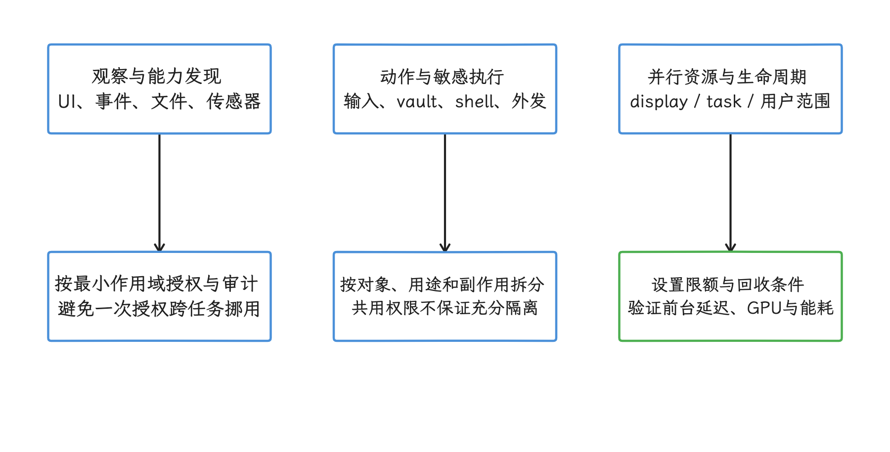

图：系统实现应拆分观察、输入、解析敏感值、文件与执行权限，并绑定caller、user、display、task和purpose。 当前多服务共用一项特权permission，不是生产级分权证明；display限额、前台优先与owner退出清理属于需要实现并验证的约束。

### 8.3 安全评审

安全评审要越过“有 vault 和 taint”这两个名词，逐条回答：

1. source 怎样声明，启发式误报和漏报怎样处理；
2. token 是否可伪造、重放、跨 user 使用或通过日志泄露；
3. plaintext 在内存、Binder、文件、截图和 crash dump 中出现在哪里；
4. derived value（由敏感输入计算出的派生值）的标签怎样合并和降级；
5. 每个 sink 的策略是 implemented、partial、stub 还是 unobserved；
6. consent UI 是否绑定准确的 source、destination、amount 和 action；
7. prompt injection（把外部数据伪装成指令的提示注入） 能否改变 purpose 或绕过 confirmation；
8. 审计日志是否可篡改，保留多久，由谁读取；
9. 服务重启、设备重启、备份恢复和用户切换时怎样处理；
10. fail closed 会不会被攻击者反复触发，形成可利用的拒绝服务。

<!-- gracker-diagram: ch18-09-31-security-audit -->
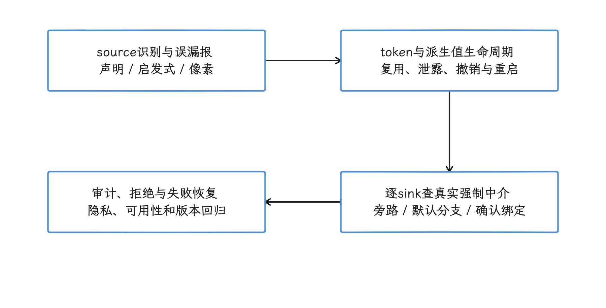

图：从敏感来源识别、token和派生值传播，走到每个sink的实际策略、用户确认和结果审计。 分类implemented/partial/stub/unobserved；还要覆盖未知package、未声明skill、原始tap、Toast、重启和跨用户，类名不能代替测试证据。

## 9. 如何复现与扩展这些结论

复现 AOHP 论文的结果，我们建议把实验拆成四组；baseline 是用来比较增益的对照设置：

| 组 | 目的 | 主要指标 |
| --- | --- | --- |
| stock GUI | 建立原始 agent baseline | 完成率、步骤、token、时长 |
| stock structured | 隔离 Accessibility/AppFunctions 的贡献 | 同上，并记录结构化覆盖率 |
| AOHP interface | 测量 SUI、event、file、CLI 的组合收益 | 成功率、回退率、事件丢失 |
| AOHP full security | 加入 vault、consent、policy | 泄露率、误拒绝、审批次数、延迟 |

每个任务运行多次并随机化顺序，固定模型与 tool schema，保存完整的调用 trace（按时间排列的模型、工具和系统调用记录）。资源侧同时采集 system_server、agent driver（驱动任务执行的 agent 进程）、目标应用、SurfaceFlinger 和 sandbox 的 CPU、PSS（按共享页比例折算后的进程内存占用）、GPU 与能量；安全侧加入未标注应用、custom View、WebView、native code、恶意 tool output、过期 token、跨用户和进程重启 case。

<!-- gracker-diagram: ch18-09-32-reproduction-controls -->
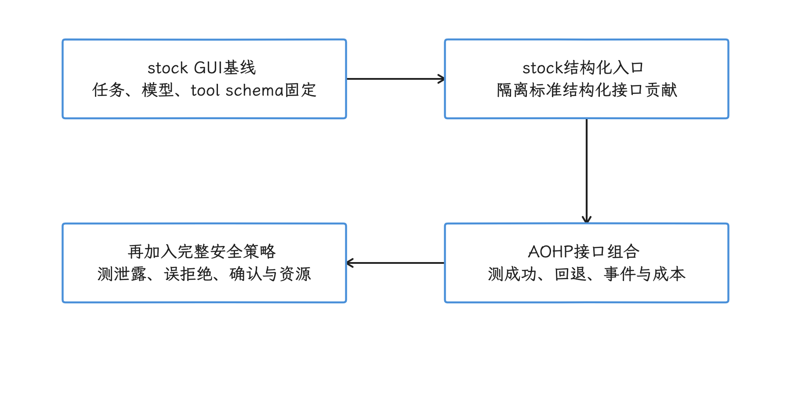

图：按stock GUI、stock结构化、AOHP接口、AOHP完整安全四组组织对照，并保存同任务的重复运行与系统资源证据。 这四组是本文复现建议；固定模型、工具契约、设备与应用版本，失败样本和安全误拒绝也必须进入报告，不能只比较共同成功成本。

这些测试做完，才能回答某个 AOHP 机制在目标产品上的收益和风险。论文给出可运行原型与初步结果，Android 17 给出标准化 AppFunctions 控制面，两者都还在快速演进。

## 10. 参考资料

### AOHP 一手资料

- [AOHP 论文：arXiv 2606.23449](https://arxiv.org/abs/2606.23449)
- [AOHP 项目仓库](https://github.com/aohp-os/aohp)
- [AOHP framework fork：`AohpVirtualDisplayService`](https://github.com/aohp-os/platform_frameworks_base/blob/a2d4a80ba16211ac73eee4baf6e73d6c7ba669fe/services/core/java/com/android/server/aohp/AohpVirtualDisplayService.java)
- [AOHP framework fork：`AohpEventStreamService`](https://github.com/aohp-os/platform_frameworks_base/blob/a2d4a80ba16211ac73eee4baf6e73d6c7ba669fe/services/core/java/com/android/server/aohp/AohpEventStreamService.java)
- [AOHP framework fork：`AohpSecurityBridgeService`](https://github.com/aohp-os/platform_frameworks_base/blob/a2d4a80ba16211ac73eee4baf6e73d6c7ba669fe/services/core/java/com/android/server/aohp/AohpSecurityBridgeService.java)
- [AOHP framework fork：`AohpVaultService`](https://github.com/aohp-os/platform_frameworks_base/blob/a2d4a80ba16211ac73eee4baf6e73d6c7ba669fe/services/core/java/com/android/server/aohp/AohpVaultService.java)
- [AOHP framework fork：`AohpTaintTrackerService`](https://github.com/aohp-os/platform_frameworks_base/blob/a2d4a80ba16211ac73eee4baf6e73d6c7ba669fe/services/core/java/com/android/server/aohp/AohpTaintTrackerService.java)
- [AOHP framework fork：`AohpContainerService`](https://github.com/aohp-os/platform_frameworks_base/blob/a2d4a80ba16211ac73eee4baf6e73d6c7ba669fe/services/core/java/com/android/server/aohp/AohpContainerService.java)
- [AOHP framework fork：`AohpFileBridgeService`](https://github.com/aohp-os/platform_frameworks_base/blob/a2d4a80ba16211ac73eee4baf6e73d6c7ba669fe/services/core/java/com/android/server/aohp/AohpFileBridgeService.java)
- [AOHP framework fork：`AohpUiTreeDumper`](https://github.com/aohp-os/platform_frameworks_base/blob/a2d4a80ba16211ac73eee4baf6e73d6c7ba669fe/services/accessibility/java/com/android/server/accessibility/AohpUiTreeDumper.java)
- [AOHP framework fork：`AohpUiTreeSanitizer`](https://github.com/aohp-os/platform_frameworks_base/blob/a2d4a80ba16211ac73eee4baf6e73d6c7ba669fe/services/core/java/com/android/server/aohp/AohpUiTreeSanitizer.java)
- [AOHP sandbox skill：chroot 与共享 network namespace](https://github.com/aohp-os/aohp/blob/b8ab9e98a2bd51f7fbd01a95d3b45dca078c5884/skills/aohp-sandbox/SKILL.md)
- [AOHP container daemon：mount namespace、cgroup 与 `chroot()`](https://github.com/aohp-os/platform_system_core/blob/d1fc184b0a138a5a1b1da70512516cd2406980d9/aohp-containerd/container_manager.cpp)
- [AOHP container daemon init 配置：root、capability 与 socket](https://github.com/aohp-os/platform_system_core/blob/d1fc184b0a138a5a1b1da70512516cd2406980d9/aohp-containerd/aohp-containerd.rc)

### Android 17 一手资料

- [Android 17 `AppFunctionManager`](https://android.googlesource.com/platform/frameworks/base/+/android-17.0.0_r1/core/java/android/app/appfunctions/AppFunctionManager.java)
- [Android 17 `AppFunctionManagerConfiguration`](https://android.googlesource.com/platform/frameworks/base/+/android-17.0.0_r1/core/java/android/app/appfunctions/AppFunctionManagerConfiguration.java)
- [Android 17 `AppFunctionManagerService`](https://android.googlesource.com/platform/frameworks/base/+/android-17.0.0_r1/services/appfunctions/java/com/android/server/appfunctions/AppFunctionManagerService.java)
- [Android 17 `AppFunctionManagerServiceImpl`](https://android.googlesource.com/platform/frameworks/base/+/android-17.0.0_r1/services/appfunctions/java/com/android/server/appfunctions/AppFunctionManagerServiceImpl.java)
- [Android 17 `ServiceConfigImpl`](https://android.googlesource.com/platform/frameworks/base/+/android-17.0.0_r1/services/appfunctions/java/com/android/server/appfunctions/ServiceConfigImpl.java)
- [Android 17 `SystemServer`](https://android.googlesource.com/platform/frameworks/base/+/android-17.0.0_r1/services/java/com/android/server/SystemServer.java)
- [Android 17 `OnDeviceIntelligenceManager`](https://android.googlesource.com/platform/frameworks/base/+/android-17.0.0_r1/packages/NeuralNetworks/framework/module/java/android/app/ondeviceintelligence/OnDeviceIntelligenceManager.java)
- [AppFunctions 概览](https://developer.android.com/ai/appfunctions)
- [平台 `AppFunctionManager` API](https://developer.android.com/reference/android/app/appfunctions/AppFunctionManager)
- [平台 `android.app.appfunctions` API](https://developer.android.com/reference/android/app/appfunctions/package-summary)
- [DisplayManager `VirtualDisplay` API](https://developer.android.com/reference/android/hardware/display/DisplayManager)
- [Android 多显示 Activity 启动策略](https://source.android.com/docs/core/display/multi_display/activity-launch)
- [TaintDroid OSDI 2010](https://www.usenix.org/conference/osdi10/legacy-presentation/taintdroid-information-flow-tracking-system-realtime-privacy)

### 库内延伸

- [系统托管 GenAI 与 OnDeviceIntelligence](../../part1-fundamentals/ch05-cpu-power/05-ondevice-ai-runtime-npu.md)
- [跨进程内存共享与端侧推理预算](../../part1-fundamentals/ch04-memory/10-cross-process-memory-ai-inference.md)
- [Agent Perfetto 分析协议](../../part3-tools/ch14-perfetto/11-agent-perfetto-analysis-protocol.md)
