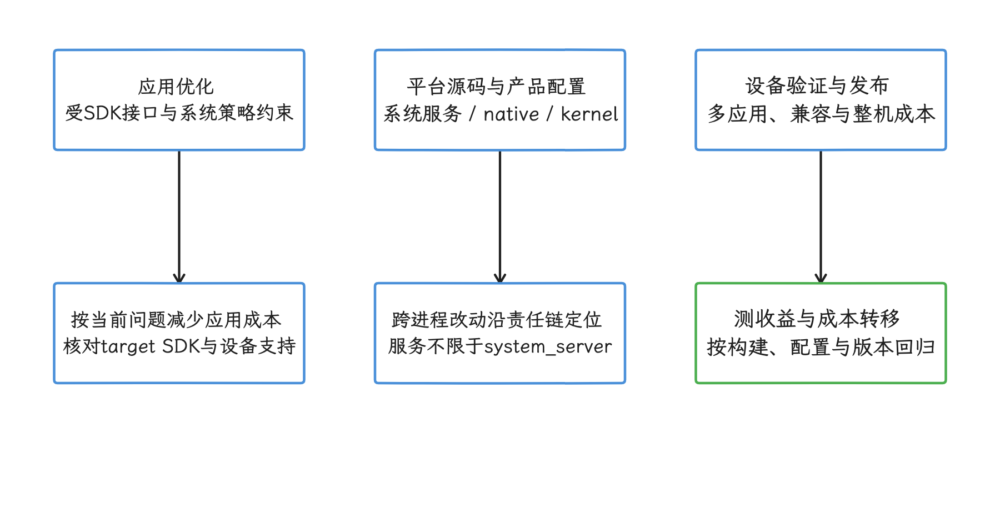
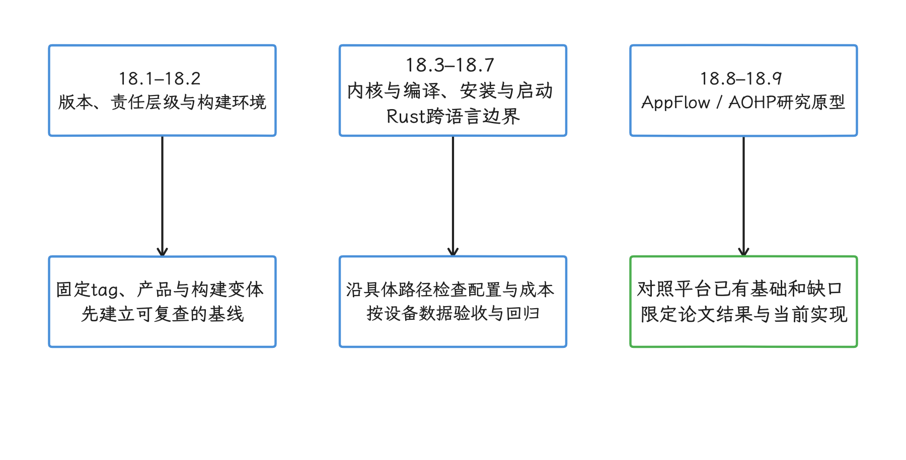
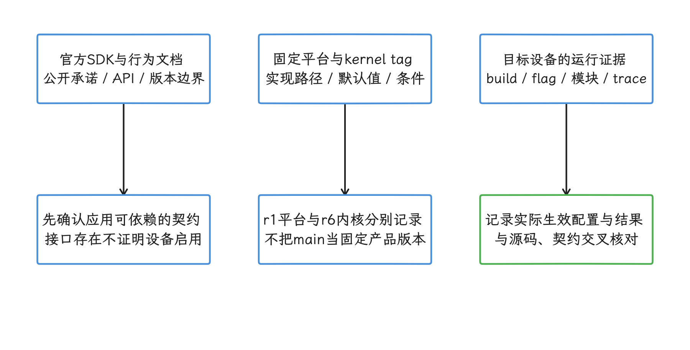

# 第 18 章：AOSP 性能优化

AOSP（Android Open Source Project）是 Android 开源平台源码。system service 指运行在系统进程、向 App 或其他系统组件提供能力的服务；本章所说的 ROM，指设备厂商基于 AOSP 构建并发布的系统软件。做这类平台侧优化时，可以直接修改系统代码、配置和调度策略。

App 侧优化通常只能在现有接口和系统策略内降低自身成本。系统侧改动会影响多个 App 或整台设备，因此还要评估设计约束、兼容性、整机收益，以及改动让原有功能或性能退步的回归风险。

<!-- gracker-diagram: ch18-index-01-change-scopes -->

图：应用在公开接口内降低自身成本，平台开发可修改系统实现与策略，并承担更广的兼容和整机回归验证。 system service 可由 system_server 或独立 native/Rust 进程承载；能修改源码不代表所有设备已采用该改动。

## 内容索引

- [18.1 AOSP 性能优化与 Android 版本变更](01-aosp-performance-version-changes.md)
- [18.2 AOSP 源码编译与调试环境](02-aosp-build.md)
- [18.3 Android 17 Kernel 6.18 与 ARM64 安全开销](03-android17-kernel-arm64-security.md)
- [18.4 AutoFDO 反馈导向优化与 Android 验证](04-autofdo-feedback-directed-optimization.md)
- [18.5 Profile、DM 与 Secure Dex Metadata 安装编译](05-profile-dm-sdm-install-compilation.md)
- [18.6 Android 系统启动耗时优化与 bootanalyze](06-system-boot-time-optimization.md)
- [18.7 Android 17 平台 Rust 性能边界：Binder、CXX 与 Soong](07-rust-system-services-performance.md)
- [18.8 AppFlow 研究原型：GB 级应用冷启动内存联合调度](08-appflow-large-app-cold-launch-memory-scheduling.md)
- [18.9 AOHP 研究原型：将 Android 改造为 Agent 原生 OS](09-agent-native-os.md)

## 阅读建议

- 如果负责 App 侧优化，可按当前问题选读系统改动与版本边界条目，先确认应用能够控制的范围。
- 如果负责系统、ROM 或平台开发，应结合调度、渲染、内存和功耗章节交叉验证，避免只改善单项指标却增加其他系统成本。
- 先用 18.1—18.7 建立主线平台能力，再把 18.8、18.9 当作尚未进入 AOSP 主线的研究原型阅读；论文结果不能直接当作 Android 17 默认行为。

<!-- gracker-diagram: ch18-index-02-reading-map -->

图：18.1–18.2 建立版本与构建基线，18.3–18.7 深入内核、编译、安装、启动和 Rust，18.8–18.9 单独评估研究原型。 这是按问题选读的分工图；AppFlow 与 AOHP 各有实验基线和实现边界，不能推为 Android17 的默认功能。

## 源码与引用口径

- 平台结论优先固定到 `android-17.0.0_r1`；内核结论固定到 `android17-6.18-2026-06_r6`。固定 tag 表示可复查的源码版本。main 是持续变化的开发分支；其他 GKI（Generic Kernel Image，通用内核镜像）分支只用于说明机制如何演进。
- release notes（版本说明）、behavior changes（行为变更文档）与 SDK 文档用于确定对开发者公开承诺的接口和行为边界；固定 tag 源码用于核对该版本的实现。设备上的 build（具体系统构建）、flag（功能开关）、模块版本和 trace（运行轨迹）用于证明目标设备实际启用了什么。
- 社区文章和研究论文可以提供问题线索或原型数据，不能替代平台源码、官方文档和目标设备实验。
- 每篇正文保留与主题直接相关的来源，通用入口用于定位资料，具体结论仍需关联到对应实现或公开契约。

<!-- gracker-diagram: ch18-index-03-evidence-chain -->

图：官方文档说明公开接口，固定 tag 核对版本实现，目标设备的构建、开关、模块与 trace 证明实际行为。 社区和论文提供线索及限定条件下的结果；main 变化、功能开关和产品覆盖都需要单独记录。
