# OEM 性能优化与应用协作

OEM 在调度、内存、功耗、温控和后台策略上拥有设备实现空间，应用只能通过公开 API、性能 hint 和可复现证据协作。优化案例要区分平台公共能力与厂商私有策略。

## 设备约束、厂商策略与公共接口（C/C++ 层接口）

### OEM 优化分析要回答什么

同一个 APK 在两台设备上表现不同，我们会先列出所有可能的来源：应用代码、硬件能力、AOSP 配置、厂商实现、用户设置，还有测试条件本身。直接把差异归因给“ROM 优化”，等于什么都没诊断。

做 OEM 性能分析时，我们要回答的是三个可验证的问题：

1. 当前设备相对 AOSP 基线改了什么；
2. 改动通过哪一层影响了目标进程；
3. 这项改动改善了哪个指标，又把成本转移到了哪里。

> 源码基线：AOSP `android-17.0.0_r1`；内核 `android17-6.18-2026-06_r6`。

这份基线定义的是我们对照哪份源码；商品设备未必运行相同的提交。设备的 `ro.build.fingerprint`（构建指纹）、APEX 模块版本、vendor 分区、内核配置、设备树、固件和产品资源 overlay 都可能改变运行结果。其中 APEX 是可独立更新的系统模块，vendor 分区存放厂商实现，overlay 覆盖 AOSP 的资源默认值。

Pixel 设备的 trace 适合当一组对照数据，当不了所有设备的“标准答案”。可靠的归因要同时有源码位置、设备配置和运行证据；缺哪一项，结论就只能写到哪一步为止。

<!-- gracker-diagram: ch19-01-01-attribution-baseline -->
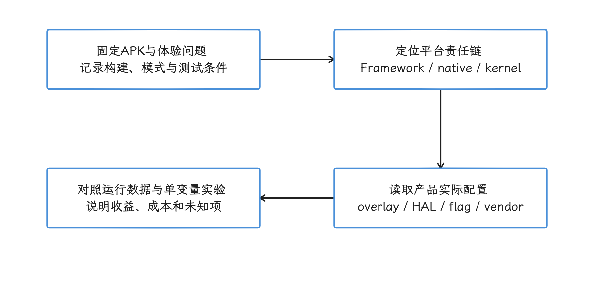

图：从应用和设备现象追到平台责任层，再用产品配置与同条件实验解释差异。 AOSP tag 只是对照源码，Pixel 也只是一个设备样本；品牌、系统模式名或单次 trace 不能独立命名私有策略。

### 五类目标共享同一组资源

OEM 优化通常覆盖启动、流畅性、内存、功耗和温控五类目标。这五类共享 CPU、GPU、内存带宽、存储带宽、电池功率与散热能力，所以局部收益经常伴随另一项成本。

| 方向 | 常用观测量 | 系统侧可调位置 | 容易遗漏的代价 |
|---|---|---|---|
| 启动 | TTID/TTFD（首屏/完整内容显示耗时）、进程创建、I/O、类加载、首帧 | Zygote、ART 编译策略、存储预取、启动阶段调度 | 预热内存、后台 CPU、系统启动时长 |
| 流畅性 | 帧时间、deadline miss（错过帧截止时间）、输入到显示延迟 | 调度、DVFS、RenderThread、SurfaceFlinger、HWC | 峰值功耗、温升、后台吞吐 |
| 内存 | RSS/PSS（进程内存占用）、swap、PSI（资源压力）、回收和重启次数 | `lmkd`、压缩、ZRAM、cached freezer、缓存上限 | 解冻延迟、换入抖动、冷启动 |
| 功耗 | CPU/GPU residency（驻留时间）、唤醒、网络与传感器活动 | EAS、schedutil、cpuidle、Power HAL、任务批处理 | 响应延迟、吞吐下降、通知延后 |
| 温控 | Thermal HAL severity（温控等级）、频率上限、机身温度、长时间稳态帧率 | Thermal HAL、冷却设备、功率预算、场景策略 | 峰值性能受限，短跑分与长稳态分离 |

#### 启动：先分清进程状态

一次 Activity 启动可能落在热启动、温启动或冷启动。系统若保留了进程，提前完成了 `dexopt`（DEX 编译优化） 或文件页预取，甚至直接从 USAP 池取一个现成进程，trace 形态都会跟着变。USAP（Unspecialized App Process，未专门化的应用进程）由 Zygote 预先 `fork()` 出来，等启动请求到达后再绑定应用身份。既然形态会被这些状态改变，我们分析时就要分别记录：

- 目标进程在点击前是否存在；
- Zygote 或 USAP 是否参与进程创建；
- APK、DEX、资源与动态库的页面是否已经进入页缓存；
- 编译产物和 ART profile（记录已执行代码、用于指导编译的数据）是否发生变化；
- 首帧前线程获得了多少 CPU，是否遭遇 I/O 或 Binder（Android 进程间通信） 等待。

TTID 是首次画面显示耗时，TTFD 是完整内容显示耗时。只拿一次 TTID 比较两台设备，等于把进程状态和缓存状态的差异都记到厂商账上。更完整的应用启动方法见[启动优化](../../part2-performance/ch08-responsiveness/03-launch-optimization.md)。

<!-- gracker-diagram: ch19-01-03-startup-state -->
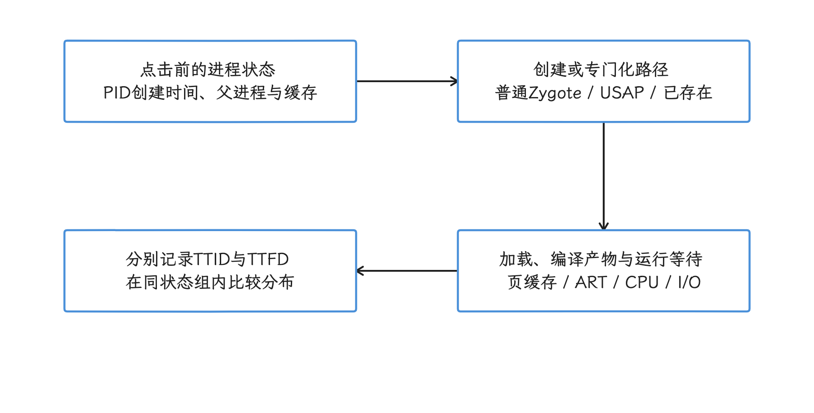

图：相同点击操作在进程、USAP、页缓存和编译产物不同的条件下，会形成不同的启动路径。 TTID 与 TTFD 分别记录；没看到 fork 不证明产品提前创建了目标应用，也不能据一次启动差异归因 OEM。

#### 流畅性：从 deadline（帧完成时限） 反推瓶颈

一帧横跨输入、应用主线程、RenderThread、GPU、Surface（应用提交图形缓冲区的接口）Flinger（系统合成服务）、HWC（Hardware Composer，硬件合成器） 和显示扫描，其中 HWC 负责选择硬件或 GPU 合成路径。OEM 在这条链路上可调的东西不少：Power HAL（电源硬件抽象层） 性能提示、线程分组、刷新率策略、合成选择和驱动行为。反过来，我们在 trace 里看到某个线程跑上了大核，能确定的只有调度结果这一层；“游戏加速”和应用白名单是否存在，还要另找依据。

分析掉帧时，我们围绕 deadline 回看这几项：runnable delay、运行时长、Binder 依赖、GPU fence、合成类型和频率变化。runnable delay 是线程已经可运行、却还没分到 CPU 的等待时间；fence 是 CPU、GPU 和显示模块之间的同步信号。渲染各阶段的职责可结合[渲染管线总览](../../part2-performance/ch13-rendering-pipelines/01-android-view-pipeline-analysis.md)阅读。

<!-- gracker-diagram: ch19-01-04-frame-critical-path -->
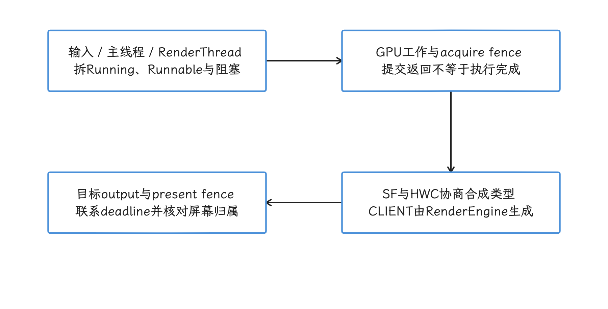

图：输入与 UI 工作进入渲染提交和 GPU，再由 SurfaceFlinger/HWC 组织目标 output 的合成与呈现。 箭头表示依赖，阶段可重叠；SF 与 HWC 协商合成类型，不能从线程跑上大核就断言命中私有白名单。

#### 内存：保留、压缩、冻结与回收是四种动作

内存治理要做的取舍远多过调大 `lmkd` 阈值。面对一个 cached（缓存） 进程，系统有四种动作可选：保留、压缩匿名页、把页面换到 ZRAM、冻结或终止。ZRAM 是用内存压缩块设备承载的交换空间。四种动作的代价各不相同：

- 保留进程减少重建成本，但继续占用物理页和内核对象；
- 压缩或换出释放 DRAM，切回时需要解压或换入；
- 冻结停止 CPU 执行，内存仍可被回收或交换；
- 终止进程释放范围最广，下一次进入要重新创建进程和应用状态。

`oom_score_adj` 表示进程在内存压力下的终止优先级，数值越高，越容易被 `lmkd` 选中。PSI（Pressure Stall Information） 记录任务因资源压力而停顿的时间，thrashing 指页面反复回收与换入，watermark 是内核触发内存回收的水位线。相关主线见[`lmkd` 与低内存回收](../../part1-fundamentals/ch04-memory/03-lmkd-freezer-memory-pressure.md)。

<!-- gracker-diagram: ch19-01-05-memory-actions -->
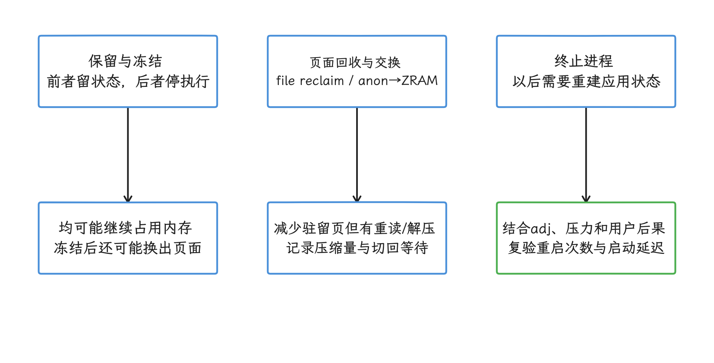

图：内存治理需区分进程保留、页面回收或交换、停止执行和终止进程，并记录切回代价。 ZRAM 压缩后仍占 DRAM；freezer 直接停止 CPU 执行，不能把冻结本身当作释放全部内存。

#### 功耗与温控的测试窗口

内核里的 EAS（Energy Aware Scheduling，能效感知调度）在 `kernel/sched/fair.c` 中通过 `find_energy_efficient_cpu()` 比较候选 CPU，再由 `compute_energy()` 按 Energy Model（能耗模型） 估算能耗。`schedutil` 是根据调度器利用率选择 CPU 频率的 governor（调频策略）。

capacity 表示 CPU 的相对算力，uclamp 限制任务的利用率请求，cpuset 限定任务可运行的 CPU 集合。设备拓扑、这些参数和驱动响应都会改变结果；旧资料里的 `sched_energy_cost`，在这套内核里已经不是通用调参入口。

这些机制都工作在当前功率和温度的约束之内。Android Thermal HAL 报告的 severity（温控严重等级） 会影响系统服务、任务调度和冷却动作。所以我们测试游戏或相机时，要同时给出冷机阶段、升温过程和稳态窗口：只截取开局几十秒，测到的只是短时提频与调度加速，说明不了持续性能。

<!-- gracker-diagram: ch19-01-06-scheduler-thermal -->
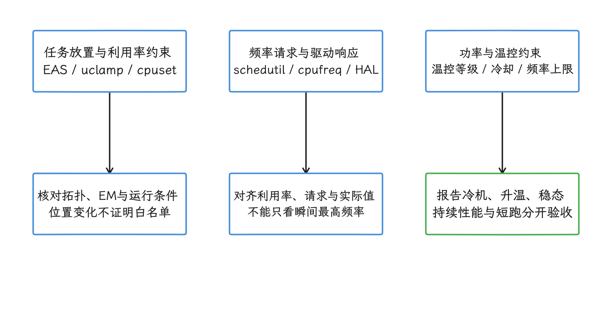

图：EAS 结合候选 CPU 与 Energy Model 选择位置，schedutil 处理频率请求，温控和硬件约束决定可持续范围。 EAS 有拓扑和过载条件；图不表示系统始终启用 EAS，也不把 governor 请求等同于设备实际频率。

调度、调频和温控的基础可继续阅读[Linux 调度](../../part1-fundamentals/ch05-cpu-power/01-linux-eas-big-little-scheduling.md)、[DVFS](../../part1-fundamentals/ch05-cpu-power/02-dvfs-thermal-android-power.md)与[温控机制](../../part1-fundamentals/ch05-cpu-power/02-dvfs-thermal-android-power.md)。

<!-- gracker-diagram: ch19-01-02-shared-budget -->
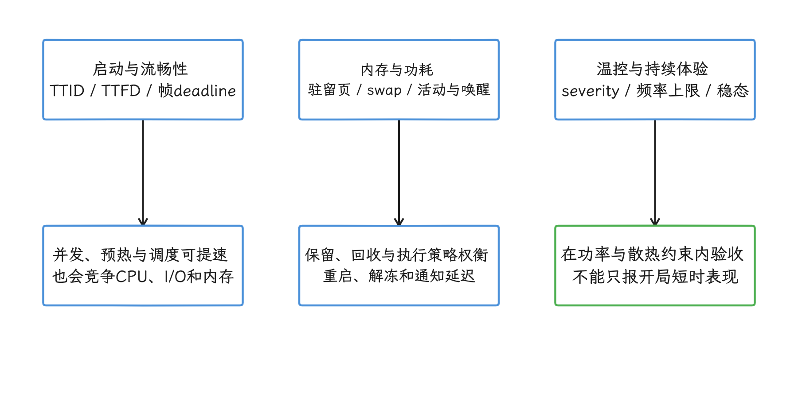

图：启动、流畅性、内存、功耗与温控共享 CPU、GPU、带宽、功率和散热预算。 这些是目标与代价的联系，不是固定百分比换算；短时提速与持续稳态要分开验收。

### 从内核到应用的改动位置

OEM 的性能能力很少集中在一个服务里。我们把现象放回分层路径上逐层看，排查范围会小很多。

#### 内核：执行与资源控制

这一层包括：

- EEVDF/CFS 公平类调度、EAS、uclamp、cpuset 和 CPU affinity（亲和性）；
- schedutil、cpufreq、cpuidle 与 SoC（系统级芯片） 驱动；
- cgroup v2 的 CPU、内存、I/O 和 freezer 控制；
- PSI、内存回收、ZRAM、块 I/O 与文件系统；
- GPU、显示、相机、网络等设备驱动。

OEM 可能通过内核补丁、Kconfig 编译选项、设备树、内核模块或 sysfs 运行参数改变行为；tracepoint 是内核埋点，sysfs 节点是内核暴露给用户空间的配置或状态接口。看到非标准节点时，我们先弄清它属于 GKI（Generic Kernel Image，通用内核镜像）、vendor module（厂商内核模块） 还是产品私有实现，再谈语义。

#### Native 层：跨进程通信与硬件合成

Native 层主要包括 C/C++ 用户空间服务、运行库和 HAL，常见位置有 Binder 驱动及用户态库、SurfaceFlinger、RenderEngine、HWC、AudioFlinger 和媒体服务。显示路径的差异往往来自 HWC 能力、图形缓冲区格式、合成策略或驱动同步 fence。遇到 Binder 延迟，我们要把它分解成客户端 runnable delay、事务排队、服务端执行和回复四段；看到等待时间长就推断厂商改了线程池，跳步了。

#### Framework 层：策略决策

Framework 层主要指 `system_server` 里的 Java 系统服务：AMS/ATMS 负责进程、Activity 和任务生命周期，WMS 管理窗口与过渡，`CachedAppOptimizer` 处理 cached 进程的内存整理与冻结，JobScheduler、AlarmManager、DeviceIdleController、App Standby 与 PowerManager 管理后台和功耗。产品资源 overlay、DeviceConfig、Settings、task profile（进程资源配置组合） 及厂商服务都可能在这一层改写策略。

#### 应用与系统应用：公开 API 和产品能力

应用侧能稳定依赖的是 SDK 行为，例如 WorkManager、JobScheduler、前台服务（foreground service，FGS）、`Performance（性能）HintManager`、Game Mode 或厂商公开 SDK；cached freezer 没有面向第三方应用的公开控制 API。产品宣传里的“预启动”“内存扩展”“性能引擎”都只是名称，我们要分别查清它控制的到底是编译、缓存、进程、调度、存储还是 UI 展示，名称本身说明不了技术行为。

<!-- gracker-diagram: ch19-01-07-responsibility-layers -->
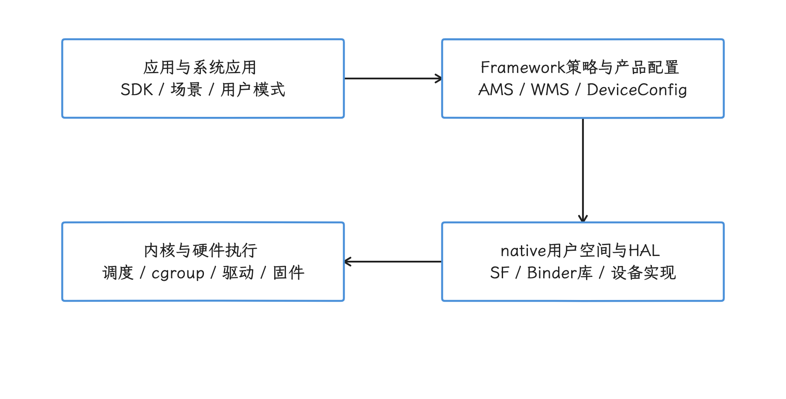

图：应用通过公开 API 表达需求，系统服务决定策略，native/HAL 与内核驱动实施各自的资源动作。 这是责任依赖图，非每次调用必经四层；Binder 驱动位于内核，Rust 系统服务也可独立于 system_server。

### Cached Apps Freezer：Android 17 的源码边界

#### Frozen Process 指什么

Android 文档里说的 frozen process（冻结进程） 通常就是 cached 进程：Linux 进程和内存状态都还在，线程已经暂停执行，拿不到 CPU 时间，但仍可能持有内存、文件描述符和部分内核资源。内存压力到来时，`lmkd` 照样可以终止它。

Android 14 起，当一个应用的全部进程都进入 frozen 状态，系统还会终止其活动 TCP socket（套接字连接）。想靠冻结实现后台网络保活，是行不通的。

#### SIGSTOP 方案为什么不够用

应用对 `SIGSTOP` 既捕获不了，也忽略不了：向一个进程发送该信号，会暂停它的线程组，也就是同一进程中的全部线程；`SIGCONT` 可恢复执行。其他独立的子进程不会跟着暂停。

这条方案缺的是配合：Android 的进程状态、Binder 和组件生命周期都不知情。进程若在持锁或 IPC（进程间通信） 临界区里停住，依赖方可能长时间等待。所以我们把 SIGSTOP 留给调试和受控实验；第三方应用拿它当后台治理接口，是用出了它的设计范围。

<!-- gracker-diagram: ch19-01-08-sigstop-versus-freezer -->
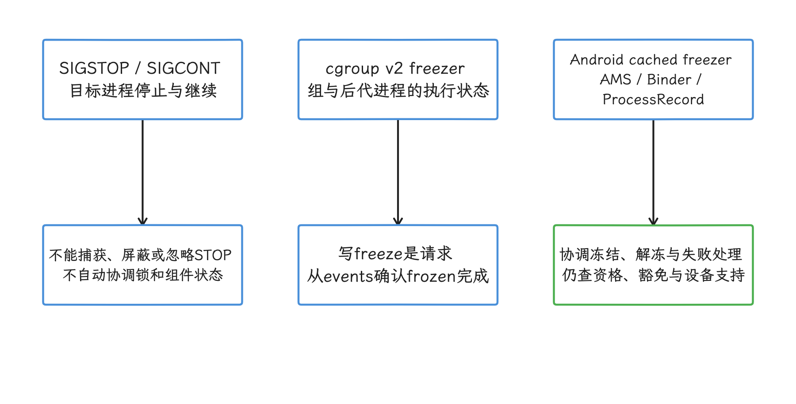

图：SIGSTOP 暂停目标进程线程组，Android cached freezer 还需要处理 Binder、进程和 UID 状态。 其他独立子进程不自动随 SIGSTOP 暂停；普通应用不能把调试信号当公开后台治理接口。

#### cgroup v2 freezer 的语义

内核的 `cgroup.freeze` 接收 `1` 或 `0`。冻结请求可能需要一段时间才完成，完成状态要从 `cgroup.events` 的 `frozen` 字段读取。冻结一个 cgroup 会暂停其中及其子 cgroup 的进程；进程迁入 frozen cgroup 后也会停下，迁出后可以重新运行。所以“写入以后瞬间、原子地冻结整个应用”是过度描述。

Framework 按 `ProcessRecord` 发起冻结。`android.os.Process.setProcessFrozen(pid, uid, true)` 的 JNI 实现给目标 pid 应用 `Frozen` task profile；该 profile 把目标 pid cgroup 的 `FreezerState` 写为 `1`。同一 UID 的多个进程会分别进入冻结流程，全部进程都冻结之后，`UidRecord` 才标记为 frozen。

下面的源码摘录用于确认 Binder 与 cgroup 的调用顺序，省略了错误处理和统计代码。

```java
// CachedAppOptimizer.java @ android-17.0.0_r1
if (mFreezer.freezeBinder(pid, true, FREEZE_BINDER_TIMEOUT_MS) != 0) {
    handleBinderFreezerFailure(proc, "outstanding txns");
    return;
}
mFreezer.setProcessFrozen(pid, proc.uid, true);

// Freezer.java @ android-17.0.0_r1
public void setProcessFrozen(int pid, int uid, boolean frozen) {
    Process.setProcessFrozen(pid, uid, frozen);
}
```

顺序在这里很关键：Framework 先冻结 Binder 接口，确认没有待处理事务，再对进程应用 freezer。解冻时先查询 Binder 的冻结信息——若冻结期间收到过同步事务，AOSP 会终止目标进程，免得调用方无限等待——然后解冻 Binder，最后撤销进程 freezer。这套顺序正是 AOSP cached freezer 与简单 SIGSTOP 的主要工程差别。

<!-- gracker-diagram: ch19-01-09-pid-cgroup -->
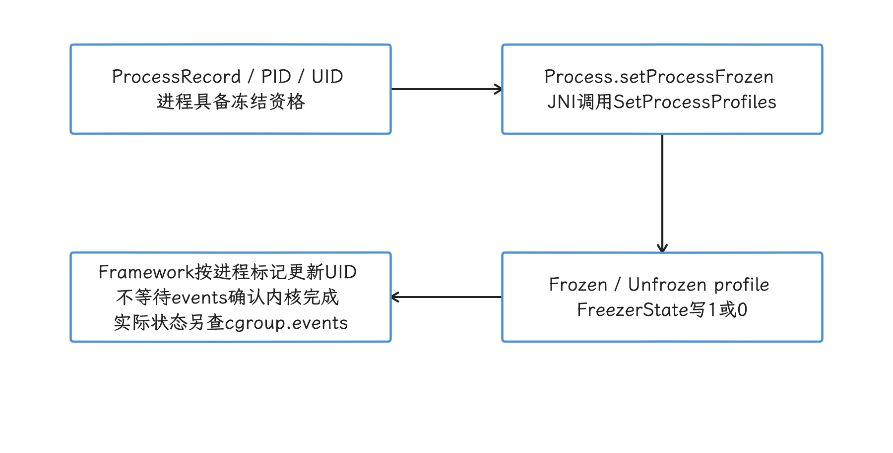

图：ProcessRecord 经 JNI 给目标 PID 写入对应 cgroup.freeze，Framework 按进程冻结标记更新 UID；内核完成状态要另查。 cgroup 冻结是异步完成的请求；同 UID 的多个 PID 分别处理，路径还受产品配置和读取权限约束。

<!-- gracker-diagram: ch19-01-10-binder-freeze-order -->
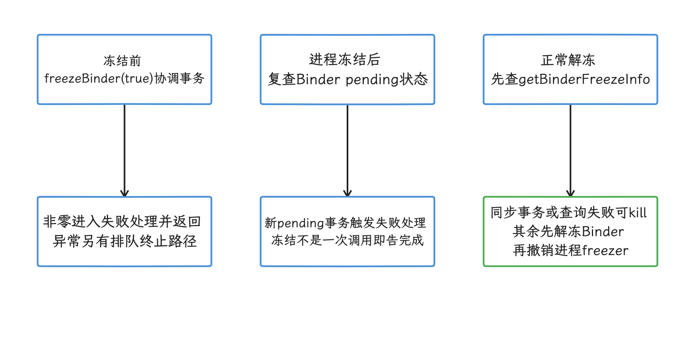

图：冻结先协调 Binder，再请求进程 freezer，随后复查事务；正常解冻先查状态，再解冻 Binder 和进程。 这是成功路径的骨架。非零、异常与竞态各有失败处理；r1 的冻结 RuntimeException 分支排队 kill 后仍可能继续尝试，不能从节选推完整控制流。

#### 默认值、覆盖项与豁免

`android-17.0.0_r1` 的基线如下：

- `CachedAppOptimizer.DEFAULT_USE_FREEZER = true`；
- `config_defaultFreezerDebounceTimeout = 10000` 毫秒；
- `Settings.Global.CACHED_APPS_FREEZER_ENABLED` 可写入 `enabled` 或 `disabled` 覆盖策略；
- `activity_manager_native_boot/use_freezer` 与 `freezer_debounce_timeout` 可通过 DeviceConfig 调整；
- 设备还要通过 `Freezer.isFreezerSupported()` 的内核能力检查。

这组默认值仍允许产品 overlay 和运行配置调整。Android 官方文档还列出文件锁、使用 `BIND_WAIVE_PRIORITY` 标志建立的绑定等豁免。至于进程进入 cached 状态后是否真在十秒左右冻结，我们以目标系统版本的 dumpsys 和事件记录为准。

<!-- gracker-diagram: ch19-01-11-freezer-configuration -->
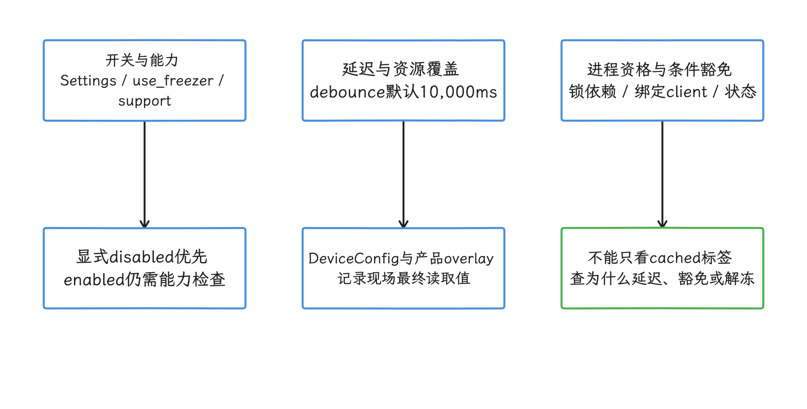

图：r1 默认启用 freezer、默认 debounce 为十秒，但 Settings、DeviceConfig、产品资源和支持检查共同约束结果。 文件锁要阻塞非 cached 进程，WAIVE_PRIORITY 绑定还要看 client 状态；十秒不是所有进程都必然遵守的固定冻结承诺。

#### 如何确认设备发生了冻结

下面的只读命令用于核对开关、AOSP 统计和事件日志。

```bash
# DeviceConfig 中未设置时，AOSP 会回到源码默认值
adb shell device_config get activity_manager_native_boot use_freezer

# 开发者选项使用的全局覆盖值：enabled、disabled 或 null
adb shell settings get global cached_apps_freezer

# CachedAppOptimizer 会打印 use_freezer、debounce timeout 和 Apps frozen
adb shell dumpsys activity | sed -n '/Freezer settings/,+20p'

# AOSP EventLogTags 中的冻结与解冻事件
adb logcat -b events -s am_freeze am_unfreeze
```

`device_config get` 返回 `null` 只说明这一项没有配置，源码默认值仍可能生效。debounce timeout 是进程具备冻结资格后、系统实际执行冻结前的宽限时间。`Apps frozen` 来自 `CachedAppOptimizer.mFrozenProcesses`，比“线程一段时间没跑”更有判别力。

在 userdebug 调试版本或已经取得 root 权限的设备上，还可以检查 Android 17 r1 的 PID 级 cgroup 文件。下面的 UID 和 PID 仅作路径示例。

```bash
adb shell su 0 cat /sys/fs/cgroup/apps/uid_10123/pid_23456/cgroup.freeze
adb shell su 0 cat /sys/fs/cgroup/apps/uid_10123/pid_23456/cgroup.events
```

量产 user build（面向用户的发布版本） 通常不允许 shell 读取这些节点，厂商也可能用 task profile overlay 改变布局。这时读不到节点，说明的是权限或路径不匹配；要判断 freezer 是否关闭，还得回到上面的开关与事件日志。

Perfetto 中可以把 `Freezer` 轨道、进程调度 slice、`am_freeze`/`am_unfreeze` 事件，以及 Android 17 提供的 `AndroidFreezerEvent` TrackEvent 放在一起判断。slice 是带起止时间的区间；TrackEvent 是结构化事件，携带 PID、UID 和冻结时长等字段。线程长期没有 slice 也可能只是正常睡眠，我们要再找显式状态来互证。

### 预加载、USAP 与预测启动

#### Zygote 预加载

Zygote 在系统启动时读取 `/system/etc/preloaded-classes`，预加载 Framework 类、资源和部分 native 库。应用进程由它 `fork()` 而来，页面走写时复制：没改动就能共享，改了才产生私有副本。把预加载集合扩大，应用启动期的类加载可能变少，但 Zygote 的启动工作、常驻共享页和脏页风险都会增加。而某个应用自己的业务类，通常并不在系统 Zygote 的通用预加载集合里。

修改 `frameworks/base/config/preloaded-classes` 前，应在干净开机与多应用场景中同时衡量：

- Zygote 预加载时长；
- `system_server` 进入 ready 状态的时间；
- Zygote PSS、共享页和应用私有脏页；
- 多个代表应用的 TTID/TTFD；
- 低内存设备上的重启与 swap（交换）。

只优化一个高频应用，可能把成本分摊给每次开机和每个应用进程。

<!-- gracker-diagram: ch19-01-13-zygote-preload -->
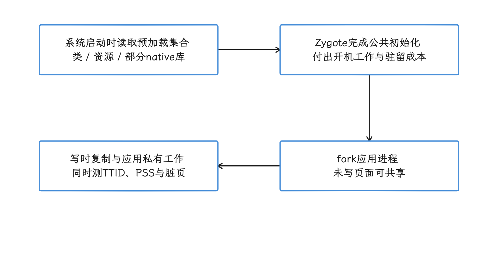

图：Zygote 预加载平台类、资源与部分库，fork 后共享未写页面；应用写入后形成私有页。 扩大集合可能减少应用加载，也会增加开机工作和内存成本；普通应用业务类不自动进入系统预加载清单。

#### USAP Pool 只提前创建进程

USAP 池里存的是尚未专门化的进程，由主 Zygote 或次 Zygote 预先 `fork()` 得到。启动请求满足条件时，`ZygoteProcess` 连接 USAP socket，把 UID/GID（用户和组身份）、SELinux 标签、数据目录和运行参数交给池成员；池成员再通过 `Zygote.specializeAppProcess()` 绑定应用身份和运行环境。

下面的 r1 判断代码说明，USAP 启动要同时满足支持、启用、策略和命令参数四项条件。

```java
// ZygoteProcess.java @ android-17.0.0_r1
private boolean shouldAttemptUsapLaunch(
        int zygotePolicyFlags, ArrayList<String> args) {
    return mUsapPoolSupported
            && mUsapPoolEnabled
            && policySpecifiesUsapPoolLaunch(zygotePolicyFlags)
            && commandSupportedByUsap(args);
}
```

主/次 Zygote 支持 USAP，为特定应用或场景创建的 child Zygote（子 Zygote） 则不支持。策略只把延迟敏感（latency-sensitive）、且非 system process 的合格请求送入 USAP；需要 wrapper 进程、启动 child Zygote、预加载包等参数的请求会退回普通 Zygote 路径。`ZygoteConfig.USAP_POOL_ENABLED_DEFAULT` 到 Android 17 r1 仍是 `false`，池容量基线为最少 1、最多 3，产品可以通过 `runtime_native` DeviceConfig 命名空间或 `dalvik.vm.*` 系统属性覆盖。

<!-- gracker-diagram: ch19-01-14-usap-launch -->
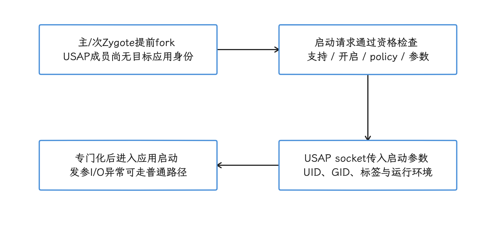

图：主或次 Zygote 预先创建未专门化池成员，合格请求经 socket 传参后绑定应用身份；发参 I/O 异常可退回普通 Zygote。 support、enabled、policy 和命令参数必须同时满足；child Zygote 不支持池，wrapper 或不支持参数会走普通路径，USAP 不是目标应用已初始化。

两项属性可以帮我们区分“源码支持”和“当前系统版本已经启用”：

```bash
adb shell getprop dalvik.vm.usap_pool_enabled
adb shell device_config get runtime_native usap_pool_enabled
```

两处都为空时，Android 17 r1 回到 `false` 默认值。trace 里的 `Zygote:FillUsapPool` 能证明填池动作发生过；而某次启动没看到普通 Zygote 的 fork，离“厂商预测启动”的结论还差 PID 创建时间和 USAP 专门化路径两步验证。

<!-- gracker-diagram: ch19-01-15-usap-property-order -->
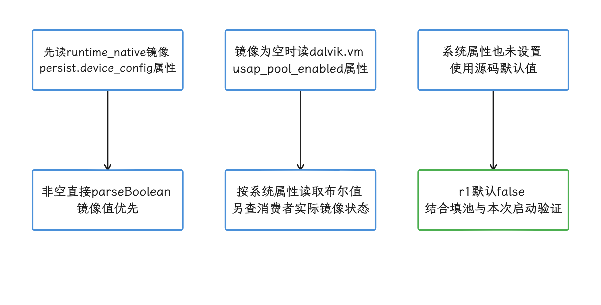

图：ZygoteConfig 先读 persist.device_config.runtime_native 镜像，再读 dalvik.vm 属性，最后用 r1 默认 false。 DeviceConfig 查询值与消费者镜像值需分别确认；配置开关开启也不证明某次启动满足 USAP 的全部条件。

#### 预测启动要按执行动作验证

“智能预测下一应用”说的是决策输入，动作是什么还要另看。产品可能基于时间、位置、前一应用、使用频率或桌面交互做预测，命中之后可以选择：

- 提前完成 ART 编译或 profile 维护；
- 预取文件页或资源；
- 保留已有 cached 进程；
- 填充通用 USAP 池；
- 创建产品私有的预热进程；
- 调整短时调度或 I/O 优先级。

这些动作的成本差异很大。提前创建目标应用进程还牵涉组件生命周期、权限、存储解锁、隐私和内存压力，仅凭“点击后很快”就断定系统预先创建了进程，是站不住的。

验证预测策略时，我们设计命中组和未命中组，固定网络、温度、编译状态与页缓存条件，并记录预测前后的进程、I/O、CPU 和内存。策略来自哪里，只有产品文档、系统日志或逆向得到的调用链能回答；trace 主要负责证明动作及其效果。

<!-- gracker-diagram: ch19-01-16-prediction-actions -->
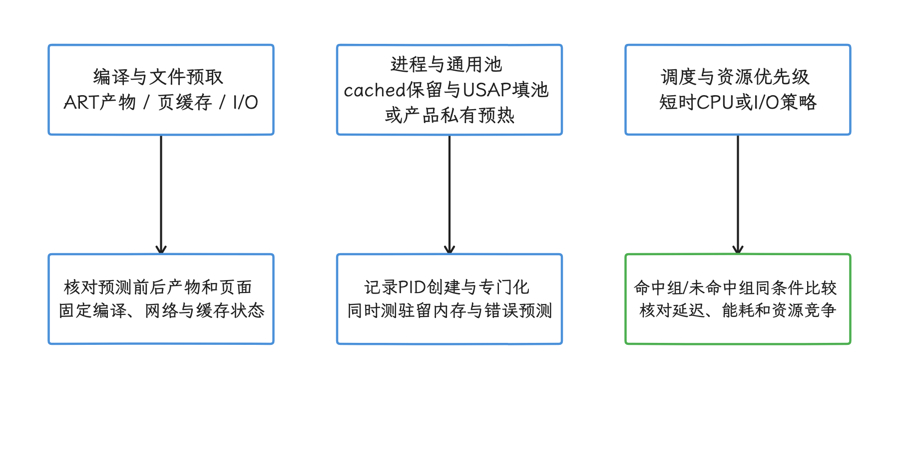

图：同一种预测结果可以触发编译、页预取、保留进程、USAP 填池或产品私有预热，需分别度量成本。 这是可能动作的分类，未宣称任一品牌采用特定方案；trace 证明动作，策略来源还要产品配置或调用链。

### 后台治理：在系统公开规则内选择工作类型

后台治理要在三个目标之间取舍：用户可感知功能的连续性、延迟任务的完成率、整机功耗与内存。AOSP 已经给出 Doze、App Standby buckets、后台执行限制、JobScheduler、AlarmManager、前台服务和 cached freezer 这套工具；其中 App Standby bucket 按应用近期活跃程度划分待机等级，等级不同，对应的任务与网络配额也不同。OEM 在兼容性约束内配置产品策略，也可能因实现缺陷造成额外的延迟或进程终止。

拿品牌和地区当依据，替代不了具体设备上的实测。同一品牌下，系统版本、机型、内存档位、用户省电设置和应用使用频率任何一个不同，结果都可能不同；用“某厂商一定杀后台”指导代码，排障就会变成长期维护的例外清单。

#### 应用应该怎样选 API

| 工作 | 推荐入口 | 约束 |
|---|---|---|
| 离开页面即可取消的进程内任务 | `coroutine` / `executor`（协程/线程执行器） | 进程终止后任务消失 |
| 需要跨进程重启继续的可延期任务 | WorkManager | 受约束、配额与系统调度影响，不承诺精确时刻 |
| 平台级任务调度控制 | JobScheduler | 需要正确声明网络、充电、设备空闲等条件 |
| 用户指定时刻的提醒 | AlarmManager | 精确闹钟受权限和政策约束 |
| 用户持续可感知的工作 | 前台服务（FGS） | 类型、权限、后台启动和超时均受版本限制 |
| 消息送达 | 平台可用的推送通道 | 推送唤醒后仍要遵守后台启动规则 |

前台服务只适合用户能持续感知的工作。Android 12 起，`targetSdk 31+` 的应用从后台启动 FGS 会受到限制；Android 14 起，`targetSdk 34+` 的应用还必须声明正确的服务类型，系统会在创建服务时检查对应权限。相机、麦克风和位置这类 while-in-use 权限只在应用处于前台时有效，后台启动另有豁免条件。

FGS 也当不了“所有后台任务最稳”的替代品：持久、可延期任务优先用 WorkManager；要精确的用户提醒，再评估 AlarmManager。

厂商推送通道属于产品集成选项，接不接入按目标市场、系统服务可用性、送达率与隐私要求决策。至于进程互相唤醒、静音音频、透明 Activity、周期性自唤醒这类绕过系统策略的做法，普通应用不要依赖。

<!-- gracker-diagram: ch19-01-17-background-api-choice -->
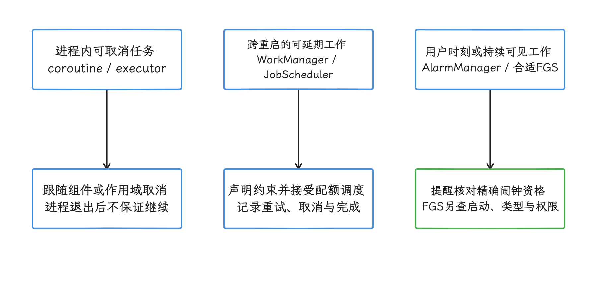

图：进程内任务、持久可延期工作、定时提醒与持续可见工作各有合适入口，消息送达也需遵守后续启动限制。 WorkManager 不承诺精确时刻；FGS 的后台启动、类型、权限与 while-in-use 条件独立检查，不能由进程存活推任务可继续。

#### 区分正常约束和产品偏差

下面的命令用于收集后台状态。包名要替换为待测应用。

```bash
adb shell am get-standby-bucket com.example.app
adb shell dumpsys jobscheduler com.example.app
adb shell dumpsys deviceidle
adb shell cmd appops get com.example.app RUN_ANY_IN_BACKGROUND
adb shell dumpsys package com.example.app
```

这组输出分别覆盖 standby bucket、JobScheduler、Doze、后台运行 AppOp 和包配置；AppOp 记录敏感操作的授权状态和调用结果，`ApplicationExitInfo` 记录进程退出原因。它们要与 logcat、Perfetto 和服务端请求日志按时间对齐。任务延迟的候选原因很多——约束未满足、配额、Doze、网络、进程退出或应用异常——只看“预定时间没执行”就把账算给 OEM，太早了。

若设备行为偏离公开 SDK 规则，就准备最小复现、系统版本信息、完整 bugreport、trace 和同版本对照机结果。bugreport 由 `adb bugreport` 收集，包含服务状态、日志和关键配置。这样一套材料，比要求用户手动加白名单更容易定位问题，也能分清是产品设计还是系统缺陷。

<!-- gracker-diagram: ch19-01-18-background-diagnosis -->
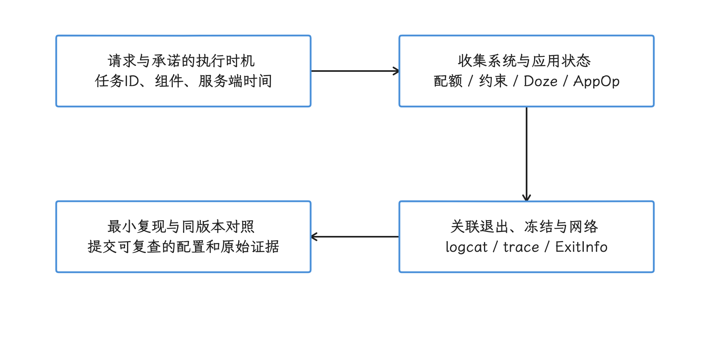

图：把任务请求、约束、配额、Doze、网络、进程退出和服务端证据按时间对齐，再缩小候选原因。 相同品牌不同构建和用户设置也会不同；缺少配置或 trace 的部分标未知，不能只靠任务晚执行命名厂商策略。

### 一套可复用的 OEM 归因流程

#### 1. 固定实验条件

我们先把实验条件钉住：记录机型、内存档位、`ro.build.fingerprint`、安全补丁、目标 SDK、安装来源、温度、刷新率、电量、网络和省电模式。启动实验还要固定编译状态、进程状态和缓存状态。

#### 2. 建立 AOSP 17 基线

再从 `android-17.0.0_r1` 找到负责决策的 Framework/Native 层入口，涉及内核时对照 `android17-6.18-2026-06_r6`。把基线默认值、可覆盖项和事件输出记下来，避免拿旧版本的属性解释 Android 17。

#### 3. 读取目标设备配置

接着读目标设备的配置：Settings、DeviceConfig、resource overlay、task profiles、系统属性、HAL 服务和内核配置。user build 上读不到的内容就标成未知，不靠猜测填补。

#### 4. 用 trace 确认执行动作

围绕问题定义时间窗口和因果链：

- 启动：输入事件 → Activity 启动 → 进程创建/专门化 → `bindApplication` → 首帧；
- 掉帧：应用 deadline → runnable/运行 → GPU fence → SF/HWC → `present`；
- 后台：组件退入后台 → procstate/adj（进程重要性与终止优先级）→ freezer 或进程终止 → 下一次唤醒；
- 功耗：工作负载 → 调度/频率 → idle residency（CPU 低功耗状态驻留时间）→ Thermal severity → 性能变化。

#### 5. 逐层做单变量验证

能控制的情况下，逐项切换刷新率、省电模式、游戏模式、开发者 freezer 选项或应用后台设置——这种逐项关闭或替换机制的实验也叫消融实验。每次只改一个变量，并恢复到同一热状态；一次动多个开关，收益归谁就说不清了。

#### 6. 给结论标注证据等级

- **L1：源码与运行证据一致。** 可以描述调用链和目标系统版本的行为。
- **L2：官方文档或产品配置，加上运行证据。** 可以描述可观察策略；对未公开的内部实现，判断要留有余地。
- **L3：仅有 trace 现象或用户反馈。** 只记录现象与候选原因，不命名私有机制。

<!-- gracker-diagram: ch19-01-19-oem-validation-loop -->
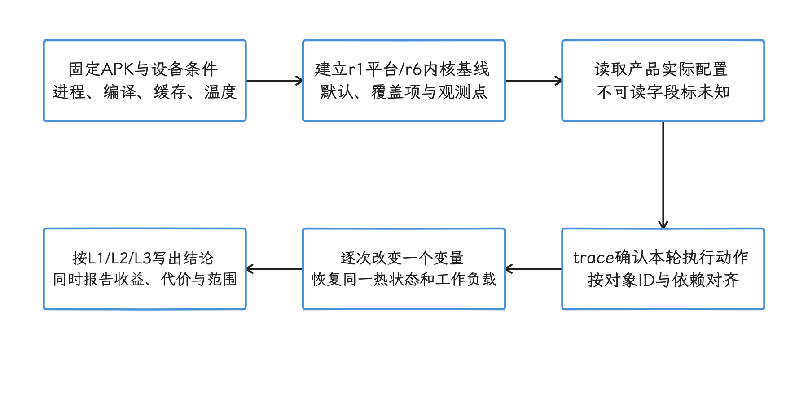

图：固定实验条件、建立 r1/r6 对照、读取产品配置、确认执行动作、逐项对照，最后按证据强度限定结论。 L1 需要源码与运行一致；L2 限定公开配置和可观察策略；L3 只保留现象与候选原因，不能命名未证的私有机制。

### 版本演进到 Android 17

| 版本 | 对 OEM 性能策略的影响 |
|---|---|
| Android 5.0 / 6.0 | ART、JobScheduler、Doze 和 App Standby 逐步建立编译与后台任务基线 |
| Android 8.0 | 后台服务和隐式广播限制趋严，应用需要迁移到受调度的后台工作 |
| Android 9 | App Standby buckets 与 Adaptive Battery 让使用频率进入资源分配 |
| Android 11 | AOSP 支持 cached apps freezer，cgroup v2 freezer 成为系统冻结基础 |
| Android 12 | `targetSdk 31+` 的应用从后台启动前台服务受到明确限制 |
| Android 14 | 在支持并启用 freezer 的设备上，cached 进程通常在进入 cached 状态十秒后冻结；动态注册广播可排队到解冻后；`targetSdk 34+` 的应用必须声明 FGS 类型并满足对应权限检查 |
| Android 17 / API 37 | r1 基线中 freezer 默认开启且带 Binder 协调，默认 debounce 为十秒；USAP 代码保留但默认关闭，产品差异仍需读取配置确认 |

这张表保留的是历史语境；排查当前设备时，我们仍要回到 Android 17 的源码和目标系统版本。旧版属性名、私有 sysfs 节点和早期厂商方案，直接套用到 API 37 会出错。

### 源码与官方文档核查入口

#### Android 17 / API 37 源码

- [`CachedAppOptimizer.java`](https://android.googlesource.com/platform/frameworks/base/+/refs/tags/android-17.0.0_r1/services/core/java/com/android/server/am/CachedAppOptimizer.java)：开关、延迟、Binder 协调、冻结与解冻状态机。
- [`Freezer.java`](https://android.googlesource.com/platform/frameworks/base/+/refs/tags/android-17.0.0_r1/services/core/java/com/android/server/am/Freezer.java)：Framework freezer 包装层。
- [`Process.java`](https://android.googlesource.com/platform/frameworks/base/+/refs/tags/android-17.0.0_r1/core/java/android/os/Process.java) 与 [`android_util_Process.cpp`](https://android.googlesource.com/platform/frameworks/base/+/refs/tags/android-17.0.0_r1/core/jni/android_util_Process.cpp)：PID 级 Frozen/Unfrozen profile 入口。
- [`config.xml`](https://android.googlesource.com/platform/frameworks/base/+/refs/tags/android-17.0.0_r1/core/res/res/values/config.xml)：freezer debounce 的 AOSP 基础资源值。
- [`task_profiles.json`](https://android.googlesource.com/platform/system/core/+/refs/tags/android-17.0.0_r1/libprocessgroup/profiles/task_profiles.json)：`FreezerState` 与 Frozen/Unfrozen profile。
- [`ZygoteInit.java`](https://android.googlesource.com/platform/frameworks/base/+/refs/tags/android-17.0.0_r1/core/java/com/android/internal/os/ZygoteInit.java) 与 [`preloaded-classes`](https://android.googlesource.com/platform/frameworks/base/+/refs/tags/android-17.0.0_r1/config/preloaded-classes)：Zygote 预加载入口和类清单。
- [`ZygoteConfig.java`](https://android.googlesource.com/platform/frameworks/base/+/refs/tags/android-17.0.0_r1/core/java/com/android/internal/os/ZygoteConfig.java)、[`ZygoteServer.java`](https://android.googlesource.com/platform/frameworks/base/+/refs/tags/android-17.0.0_r1/core/java/com/android/internal/os/ZygoteServer.java) 与 [`ZygoteProcess.java`](https://android.googlesource.com/platform/frameworks/base/+/refs/tags/android-17.0.0_r1/core/java/android/os/ZygoteProcess.java)：USAP 默认值、填池、启动资格和 child Zygote 的范围。

#### Android 17 kernel 6.18 源码

- [`kernel/sched/fair.c`](https://android.googlesource.com/kernel/common/+/refs/tags/android17-6.18-2026-06_r6/kernel/sched/fair.c)：EAS 的候选 CPU 与能耗估算。
- [`kernel/sched/cpufreq_schedutil.c`](https://android.googlesource.com/kernel/common/+/refs/tags/android17-6.18-2026-06_r6/kernel/sched/cpufreq_schedutil.c)：schedutil governor。
- [`Documentation/scheduler/sched-energy.rst`](https://android.googlesource.com/kernel/common/+/refs/tags/android17-6.18-2026-06_r6/Documentation/scheduler/sched-energy.rst)：Energy Model 与 EAS 的约束。
- [`Documentation/admin-guide/cgroup-v2.rst`](https://android.googlesource.com/kernel/common/+/refs/tags/android17-6.18-2026-06_r6/Documentation/admin-guide/cgroup-v2.rst)：`cgroup.freeze` 与 `cgroup.events` 语义。

#### 官方行为文档

- [Background optimization](https://developer.android.com/topic/performance/background-optimization)
- [Cached apps freezer](https://source.android.com/docs/core/perf/cached-apps-freezer)
- [Background work](https://developer.android.com/develop/background-work)
- [Task scheduling / WorkManager](https://developer.android.com/develop/background-work/background-tasks/persistent)
- [Foreground services](https://developer.android.com/develop/background-work/services/fgs)
- [Restrictions on starting a foreground service from the background](https://developer.android.com/develop/background-work/services/fgs/restrictions-bg-start)
- [Android 14 foreground service types](https://developer.android.com/about/versions/14/changes/fgs-types-required)
- [Thermal mitigation](https://source.android.com/docs/core/power/thermal-mitigation)
- [Power and performance management](https://source.android.com/docs/core/power/performance)

### 常见误区：进程、调度与后台

#### “进程还在，所以应用可以继续工作”

cached 进程可能已被冻结，可能没有调度机会，也可能在内存压力下被终止。后台工作要靠组件状态和公开调度 API，指望进程恰好存活是靠不住的。

#### “启动 trace 没看到 fork，所以系统预启动了应用”

目标进程可能早已存在，可能来自 USAP、App Zygote，也可能是 trace 窗口漏掉了进程创建。先核对 PID 的创建时间、父进程、`bindApplication` 和 USAP 状态，再下结论。

#### “CPU 上了大核，所以应用命中了白名单”

EAS、uclamp、top-app cpuset、任务利用率、CPU idle 状态、硬件中断（IRQ） IRQ 和热限制都能影响 CPU 选择；要命名白名单策略，需要额外的配置或厂商调用链。

#### “冻结能省内存”

freezer 的直接作用是停止执行。匿名页是否被压缩、换出或回收，取决于后续的 compaction 内存整理、ZRAM 和内存压力；被冻结保留的进程，也还在占用页表、内核对象和未回收页面。

#### “加入电池白名单能修复所有后台问题”

白名单只改变特定电源限制，修不好错误的 WorkManager 约束、FGS 类型、权限、服务端推送、网络失败或应用崩溃。不同设备上，用户设置的名称和影响范围还可能各不相同。

## 应用协作、实验设计与案例边界

厂商策略弄清楚之后，应用一侧要做的是用场景、指标、版本和对照实验表达需求。至于私有白名单，这条路我们不走：维护成本高，结论也带不到下一台设备上。

### 案例能证明到哪一层

我们读行业案例，读的是特定应用、设备、版本和实验条件下的结果。它最有价值的地方，是一个团队怎么把问题缩小、怎么选指标；最容易犯的错，是把这些数字读成跨设备的普遍规律。

拿到一份案例，我们先把它拆成四层，再决定信到哪一层：

| 层次 | 要回答的问题 | 常见证据 |
| --- | --- | --- |
| 公开事实 | 团队公开做了什么、报告了什么结果 | 官方博客、演讲、源码、API 文档 |
| 机制解释 | 为什么这些动作可能影响指标 | AOSP、AndroidX、内核、图形或媒体源码 |
| 设备实现 | OEM（设备厂商）如何响应提示、配置频率或温控 | 设备厂商文档、设备配置、厂商 trace |
| 本地复现 | 在自己的应用和设备上是否成立 | Perfetto、Macrobenchmark、计数器、A/B 对照实验（两组只改一个变量） |

公开案例给出的百分比，要放回原案例的分母里理解：设备分布、样本数、统计区间和版本信息这四样凑不齐，它就成不了项目排期或行业基准。

本篇对 API 语义和建议的核对，以 Android 17（API 37）和 AOSP `android-17.0.0_r1` 为准；旧案例保留历史背景，API 层面的结论都按这个版本重新检查过。

<!-- gracker-diagram: ch19-01-20-case-evidence -->
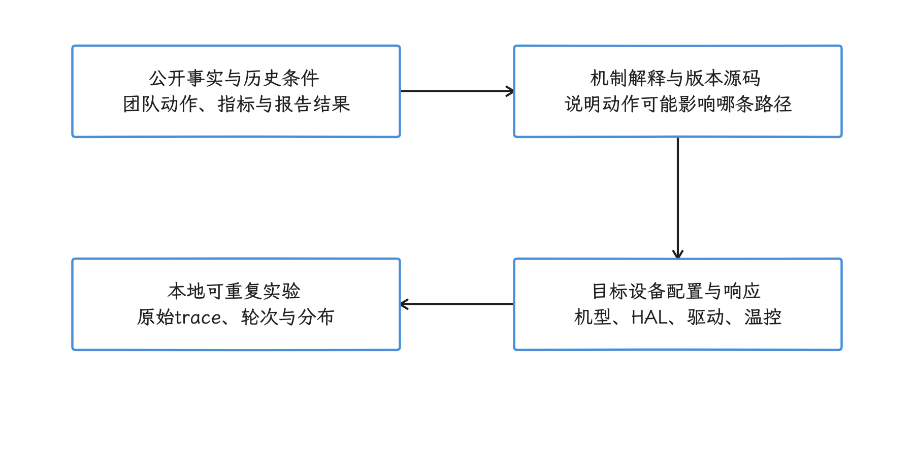

图：先保留团队公开报告的结果，再用源码解释候选机制，最后核对目标设备实现与本地重复实验。 这是一条验证依赖，不能从公开百分比跨越到自己的收益；设备分布、分母和统计条件不全时只保留案例范围。

### Samsung：用户模式与合作接口是两条路径

Samsung 的公开材料是一个范围划得很清楚的 OEM 案例，我们把用户模式和合作接口分开看。

Samsung 支持页把 Game Booster 描述为游戏运行时自动启动的用户功能，会在电量、性能和温度之间做平衡。页面没有公开 governor 策略、uclamp 上下界、GPU 驱动参数或温控阈值，所以仅凭 Game Booster 的界面选项，还到不了固定的内核动作那一层。

Samsung 2022 年的 SceneSDK 文章描述了另一条路径：合作接口。游戏把自己所处的场景告诉设备侧服务——loading（加载）、lobby（大厅）、gameplay（对局）——服务可以按场景调整 CPU / GPU 频率；设备降频时，还可以把通知发回游戏。文章还描述了按目标帧率调整显示刷新率的合作方式。

SceneSDK 在 Android SDK 的公共 API 之外。文章里的 JSON（机器可读的结构化文本）协议、支持范围和策略都来自当时的 Samsung 合作环境，换一台 Galaxy 设备、换一个应用，是否可用都要重新确认。它展示的是一种双向协作方式：

- 应用提供比 CPU 利用率更早的场景和目标帧率信息；
- 设备提供温控、频率变化和资源约束信息；
- 应用收到约束后降低可调整的负载，设备按场景分配资源；
- 双方用帧时间、功耗和热稳态验证结果。这里的热稳态指设备温度和运行频率不再持续漂移的阶段。

我们要在一台 Galaxy 设备上验证 Game Booster 或 SceneSDK 类策略，就得同时记录场景标记、CPU / GPU 频率、FrameTimeline（Android 帧生命周期轨道）、温控状态、显示刷新率和电源模式。光有界面上的模式名称，说不出调度器或驱动到底执行了什么，归因要落在这些运行数据上。

这套分层也适用于其他 OEM 的游戏入口。厂商公开页能证明的，是用户有哪些选项；绑核（把线程限制到指定 CPU 核）、频率投票（子系统向调频策略提交性能需求）和驱动策略，仍要落到对应机型、系统版本和 Perfetto trace（性能跟踪记录）上验证。

<!-- gracker-diagram: ch19-01-21-scene-feedback -->
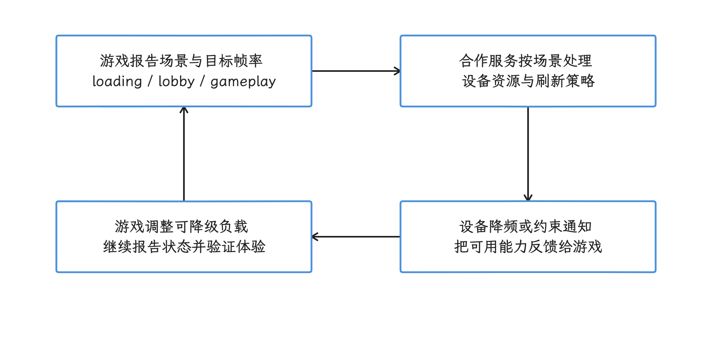

图：2022 年 Samsung 案例中，游戏上报场景与目标帧率，设备侧调整资源并可回传降频信息，游戏据此调整负载。 这是当年合作接口的描述，不是 Android 公共 API 或所有 Galaxy 的承诺；固定频率动作和收益仍需目标设备 trace。

### Game Mode：用户选择、应用适配与厂商干预

Android Game Mode 里有三个容易混淆的角色，我们按用户、应用、厂商三方拆开来看：

1. **用户选择**：Standard（标准）、Performance（性能）、Battery Saver（省电），以及 Android 14 引入的 Custom（自定义）。
2. **应用适配**：游戏读取 `GameManager.getGameMode()`，调整自己的分辨率、画质、帧率或后台工作。
3. **厂商干预**：OEM intervention 指系统或设备厂商无需修改游戏代码便能应用的配置，包括 backbuffer resize（后缓冲区缩放）、ANGLE 和 FPS throttling（帧率限制）。ANGLE 是图形兼容层，可把 OpenGL ES 调用转到另一种图形后端。

按 Android Developers 文档的说法，Game Mode API 与厂商干预可用于部分 Android 12 设备以及 Android 13 及以上设备。范围之外，返回值也要留意：`getGameMode()` 仍可能返回 `GAME_MODE_UNSUPPORTED`，应用要备好默认策略。

Android 17 的 `GameManager.java` 还保留 Custom 的兼容处理：当模式为 `GAME_MODE_CUSTOM`，而应用 `targetSdkVersion` 不高于 Android 13 时，`getGameMode()` 返回 Standard。游戏应在 Activity 每次进入 `onResume()` 时重新读取模式，未知值走安全分支。

下面的配置用于声明游戏自行处理 Performance 与 Battery 模式：

```xml
<!-- AndroidManifest.xml 的 <application> 内 -->
<meta-data
    android:name="android.game_mode_config"
    android:resource="@xml/game_mode_config" />

<!-- res/xml/game_mode_config.xml -->
<game-mode-config
    xmlns:android="http://schemas.android.com/apk/res/android"
    android:supportsBatteryGameMode="true"
    android:supportsPerformanceGameMode="true" />
```

声明 `supports*GameMode="true"` 后，游戏要自己实现对应策略，平台会清除此前对该模式应用的 OEM 干预。`allowGameDownscaling` 和 `allowGameFpsOverride` 则是两项独立的 opt-out 退出开关（opt-out），分别控制画面降分辨率和帧率覆盖，与 `supports*` 属性各管各的。

#### 厂商干预的测量方法

三项干预各有作用点。WindowManager 的 backbuffer resize 改变游戏后缓冲区尺寸，再由系统缩放到显示尺寸，GPU 的像素处理量可能因此下降，清晰度也会受影响；FPS throttling 从 Android 13 起可用，目标是让帧率更稳定、功耗更低；ANGLE 干预改变的是 GLES 的实现路径，结果跟着色器、图形驱动和设备支持情况走。

我们对比有无厂商干预时，先把这些条件固定住：

- 同一 APK、关卡、画质、输入脚本和网络数据；
- 分辨率、显示刷新率、目标帧率和电源模式；
- 冷机起点、预热时长、环境温度和运行轮次；
- TTFF（Time to First Frame，首帧时间）、P50 / P95 帧时间（第 50 / 95 百分位）、未赶上显示截止点的帧数（deadline miss）、GPU 忙碌时间、功耗和温控状态。

Android 文档里的节能或 GPU 降幅，是文档给定设备与条件下的示例；本项目的验收门槛，要由自己设备上的数据来定。

<!-- gracker-diagram: ch19-01-22-game-mode-roles -->
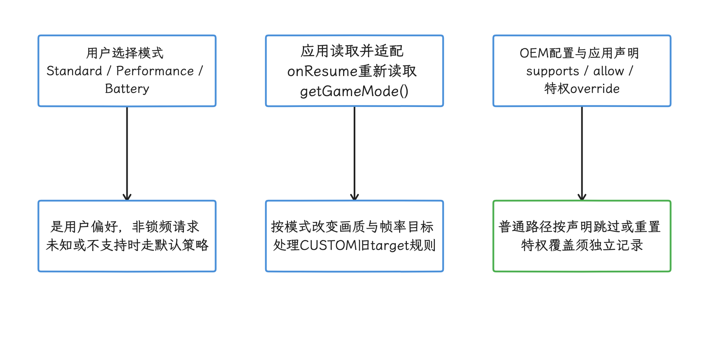

图：用户选择偏好，应用按 getGameMode 适配，系统依据配置决定是否执行可用干预；应用声明会改变普通配置路径。 r1 对 targetSdk≤33 的 CUSTOM 返回 STANDARD；特权 config override 可覆盖普通应用声明，声明不等于所有系统覆盖都被禁止。

<!-- gracker-diagram: ch19-01-23-game-intervention-evidence -->
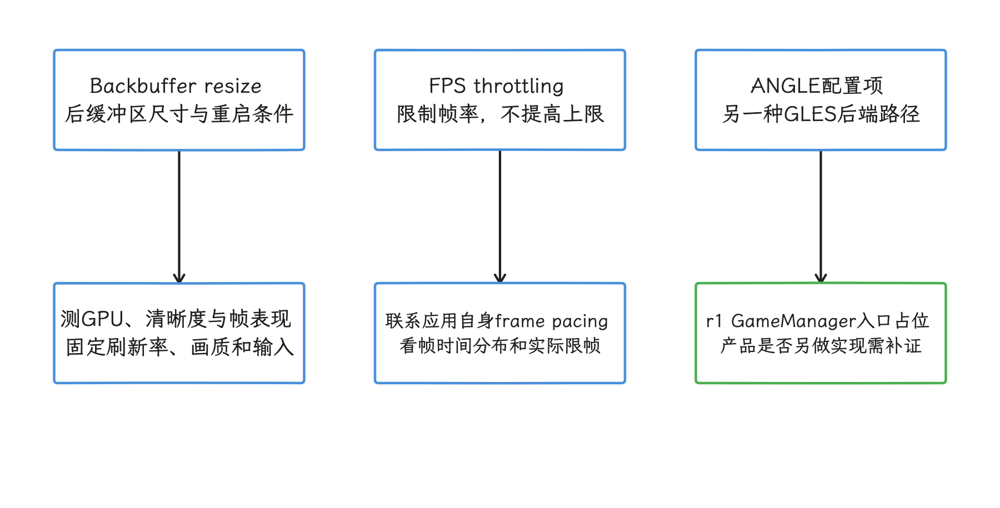

图：Backbuffer resize 改变像素处理量，FPS throttling 限制供帧目标；ANGLE 需要独立确认实现与执行证据。 r1 updateUseAngle 仍为空方法；缩放需应用重启，限帧不会把 60 fps 提升为 120 fps。文档节能数字不是项目通用收益。

### ADPF：用反馈调节负载与温控余量

ADPF（Android Dynamic Performance Framework，Android 动态性能框架）让应用把工作目标和运行状态告诉系统，也把温控信号读回来。它给的是反馈信号；拿它去锁定 CPU 或 GPU 频率，接口就用错了。

#### Thermal API（温控 API）

`PowerManager.getThermalHeadroom(int)` 从 API 30 提供，参数范围 0～60 秒，返回的是无单位的当前或预测温控压力值，下文简称 headroom。注意它不是摄氏温度：`1.0` 对应 `THERMAL_STATUS_SEVERE` 阈值，数值也可以大于 `1.0`。设备不支持时返回 `NaN`，调用明显快于每秒一次也可能得到 `NaN`。

`getThermalHeadroomThresholds()` 从 API 35 提供，返回设备为温控状态定义的 headroom 阈值映射表；设备没有定义的状态不一定出现在表中。调用可能抛出 `UnsupportedOperationException` 或 `IllegalStateException`。从 API 36 起这份映射表还可能在运行时变化，Android 17 应用可以用 `addThermalHeadroomListener()` 接收 headroom 与阈值更新。

下面的代码用于 Android 12～17 共用模块以较低频率采样，并为 API 35 以下设备保留 `SEVERE == 1.0f` 的定义：

```kotlin
data class ThermalSample(
    val headroom: Float,
    val severeThreshold: Float,
)

fun sampleThermalBudget(powerManager: PowerManager): ThermalSample? {
    val headroom = powerManager.getThermalHeadroom(10)
    if (headroom.isNaN()) return null

    val severeThreshold =
        if (Build.VERSION.SDK_INT >= 35) {
            runCatching {
                powerManager.thermalHeadroomThresholds[
                    PowerManager.THERMAL_STATUS_SEVERE
                ]
            }.getOrNull() ?: 1.0f
        } else {
            1.0f
        }

    return ThermalSample(headroom, severeThreshold)
}
```

这段代码只读取信号，降级幅度由调用方决定。调用方应按秒级节奏运行，并给画质或帧率切换加上滞回控制（降低与恢复使用不同阈值）和最短保持时间，免得 headroom 在阈值附近波动时频繁切档。返回 `null` 时退回保守的默认策略，并记录设备信息。

验证温控策略时，我们核对三个时间关系：headroom 何时接近阈值、应用何时降低负载、帧时间与频率何时稳定。只看温度值或平均 FPS，说明不了反馈有没有生效。

<!-- gracker-diagram: ch19-01-24-thermal-feedback -->
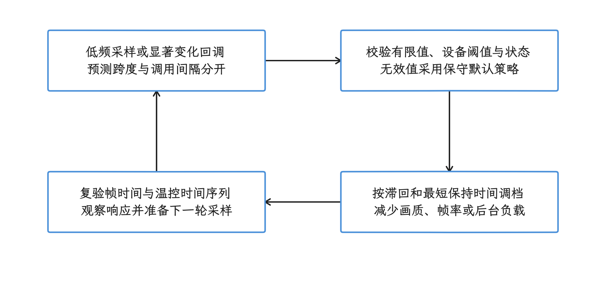

图：低频读取当前或预测 headroom，过滤不可用值，按阈值与滞回调整负载，再观察稳定帧与温控响应。 10 是预测秒数，非采样定时器；headroom 无单位，1.0 对应 SEVERE。监听回调不能完整替代预测轮询，也不保证锁频或降温幅度。

#### Performance Hint API

`PerformanceHintManager` 从 API 31 提供。应用用一组属于本进程的工作线程创建 `Session`（提示会话，下文简称 HintSession），给出周期性工作的目标时长（target duration），每个周期调用 `reportActualWorkDuration()` 上报实际时长；目标变化时调用 `updateTargetWorkDuration()`，API 34 起线程集合变化时还可以调用 `setThreads()`。

HintSession 传递的是工作目标；用哪个 CPU 核、什么频率、要不要特定调频动作，决定权在系统一侧。系统框架（Android framework）通过 native 接口把会话交给设备实现，Power HAL 与厂商策略决定怎么响应。`createHintSession()` 可能返回 `null`，会话结束时还要调用 `close()`。

以 60 Hz 游戏为例，目标值可以从一个周期的预算出发，但机械地写成整帧 `16.67 ms` 并不合适。会话若只覆盖模拟线程（simulation）或渲染提交线程（render-submit），目标时长和实际时长就都应描述这组线程负责的周期工作；GPU 完成时间、UI 线程和其他进程的耗时，要和这组线程的 CPU 工作时长分开记。

评估 HintSession 时，我们做只改变会话开关的 A/B 对照，同时观察：

- 会话的目标时长、实际时长与线程集合；
- 线程处于运行（running）、可运行但等待 CPU（runnable）或睡眠（sleeping）的时间；
- CPU 频率、空闲状态、uclamp 或可用的厂商计数器；
- FrameTimeline、GPU 完成时刻、thermal headroom 和功耗；
- 冷机短时突发负载与热稳态的差异。

API 调用成功，只说明信号送到了系统框架；资源有没有响应、体验有没有改善，还要由设备数据来回答。

<!-- gracker-diagram: ch19-01-25-hint-session -->
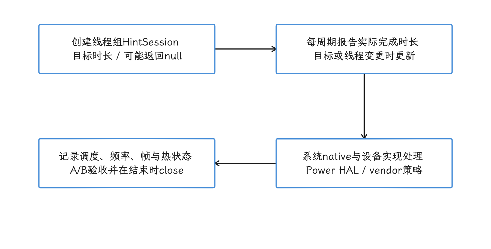

图：为本进程线程组创建会话，设置目标并报告周期完成时长，系统根据设备策略作出调度或频率响应。 创建可返回 null；周期经过时长不等于纯 CPU running 时间，GPU 扩展上报另查 API/flag。关闭会话并用同条件实验验证实际效果。

#### Game State API

Game State API 从 Android 13（API 33）提供，用于告诉系统当前处于 loading、gameplay 等状态，以及内容是否正在加载。它和 Game Mode 的用户偏好、HintSession 的周期工作时长各说各的事。

应用只应上报含义稳定、说得出原因的状态转换。把所有场景都标成高负载，状态就失去了区分度，也保证不了系统持续提高 CPU 或 GPU 频率。

<!-- gracker-diagram: ch19-01-26-game-signals -->
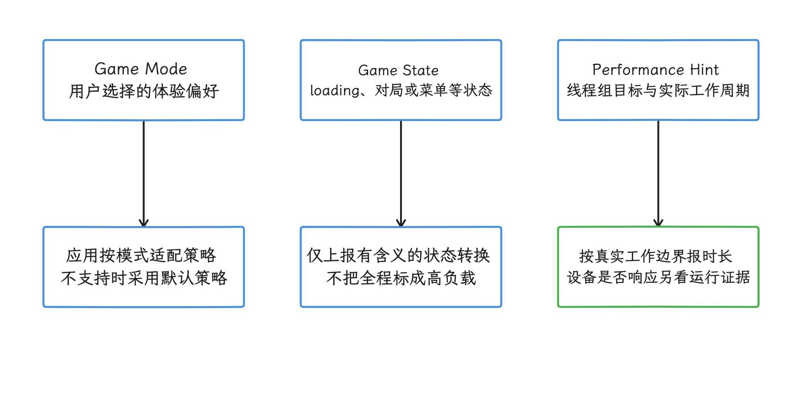

图：Game Mode 表达用户偏好，Game State 表达场景或 loading 状态，Performance Hint 描述线程组周期工作目标。 三类信号互补，不是任意提高 CPU/GPU 频率的请求；所有场景都报最高负载会失去区分度。

### 大型应用的启动案例

#### TikTok × Android：公开结果与动作

Android Developers 2022 年发布的 TikTok 案例报告的是一次单项目的结果，数字先列在这里：

- 应用启动时间减少 45%；
- 以“帧率低于目标值的概率”衡量的流畅性指标改善 49%；
- 视频首帧出现速度提升 41%；
- 视频卡顿概率减少 27%；
- 30 天内每位用户的活跃天数和平均单次使用时长（session duration）各提升 1%。

这些数字都出自 TikTok 当时的版本、设备分布和指标定义；公开文章没有给出供其他团队复算的完整原始数据，我们读的时候，就把它们当作这个案例自己的结果。

比数字更可复用的是文章公开的工程动作：

- 启动：参考 Jetpack App Startup，按需加载组件并细化调度；用 simpleperf 与 Android Studio Profiler 检查 I/O、线程和锁竞争。
- 流畅性：用 Layout Inspector 简化 View 层级，把集中在一帧内的 `doFrame()` 任务分散到不同帧。
- 播放：按 codec 编解码格式复用媒体播放器实例，改善网络连接与 socket 复用，动态调整缓冲区，并对下一条视频做 preload 预加载和 prerender 首帧预渲染。
- 防回归：持续使用 Perfetto、CPU Profiler 和线上指标观察版本变化。

文章还提到用后台线程加载 View。View 构造、资源访问和自定义 View 行为可能受主线程约束，这项做法直接复制到任意界面是有前提的：先明确哪些步骤可以异步执行，再用线程检查、截图测试和多种设备组合验证。

<!-- gracker-diagram: ch19-01-27-tiktok-engineering -->
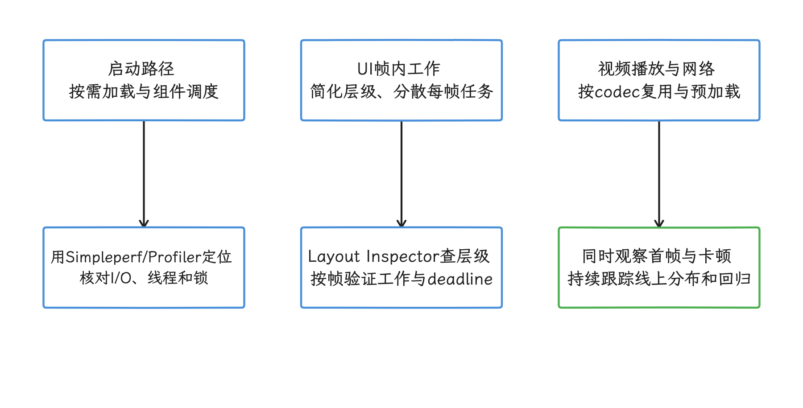

图：TikTok 2022 年案例分别优化组件初始化、每帧工作与播放器/网络复用，并用工具和线上指标防回归。 45%、49%、41%、27% 和两个1% 都属于该项目；异步 View 构造需单独验证线程与资源约束，不能复制为任意 UI 的通用做法。

#### 抖音归档材料：300 多个启动任务

本库保存的字节技术文章记录了另一个历史样本：启动阶段超过 300 个任务，团队先分成配置、预加载和功能三类，再分别做按需配置、预加载收益评估、功能拆分与调度。

这个样本可复用的是判断顺序：

1. 任务是否影响 TTID（Time to Initial Display，初始画面显示时间）或 TTFD（Time to Full Display，完整画面显示时间）之前的必要功能；
2. 延后后能否保持线程安全、跨进程一致性和功能可用；
3. 预加载在目标人群中的命中率与节省时间是多少；
4. 后台并发是否抢占 CPU、I/O、锁或内存，反而拖慢主线程；
5. 每次改动能否由 Macrobenchmark 与 Perfetto 重复验证。

任务数只是规模描述。减少一个 10 μs 任务，和减少一次主线程磁盘读取，收益完全不同；排期要看关键路径的墙钟耗时（wall time，即包含等待在内的实际经过时间）和资源竞争。

<!-- gracker-diagram: ch19-01-28-startup-task-value -->
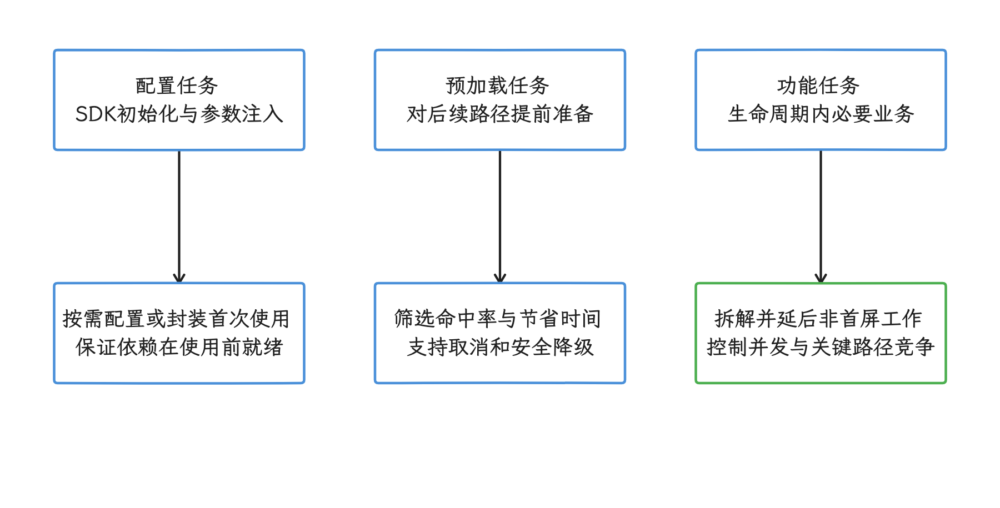

图：历史抖音案例把任务分为配置、预加载和功能三类，分别做按需化、收益筛选和拆分调度。 任务数不等于时长；延后必须保留功能与线程安全，预加载也可能抢占启动 CPU/I/O/锁，最终以 TTID/TTFD 和 trace 验收。

### 启动源码中的 ContentProvider（内容提供者组件，下文简称 provider）

`ActivityThread.handleBindApplication()` 决定了 ContentProvider 初始化与 `Application.onCreate()` 的先后关系。下面的 Android 17 源码摘录用于确认顺序：

```java
if (!data.restrictedBackupMode) {
    if (!ArrayUtils.isEmpty(data.providers)) {
        installContentProviders(app, data.providers);
    }
}

timestampApplicationOnCreateNs = SystemClock.uptimeNanos();
mInstrumentation.callApplicationOnCreate(app);
```

同进程 provider 在 `Application.onCreate()` 前安装，它们的 `attachInfo()` / `onCreate()` 因此进入冷启动关键路径。我们从 Perfetto trace 里找优化对象：移除无用 provider、按库文档关闭自动初始化、用 AndroidX Startup 合并初始化入口，或把非必要工作推迟到首次使用。

<!-- gracker-diagram: ch19-01-29-provider-startup-order -->
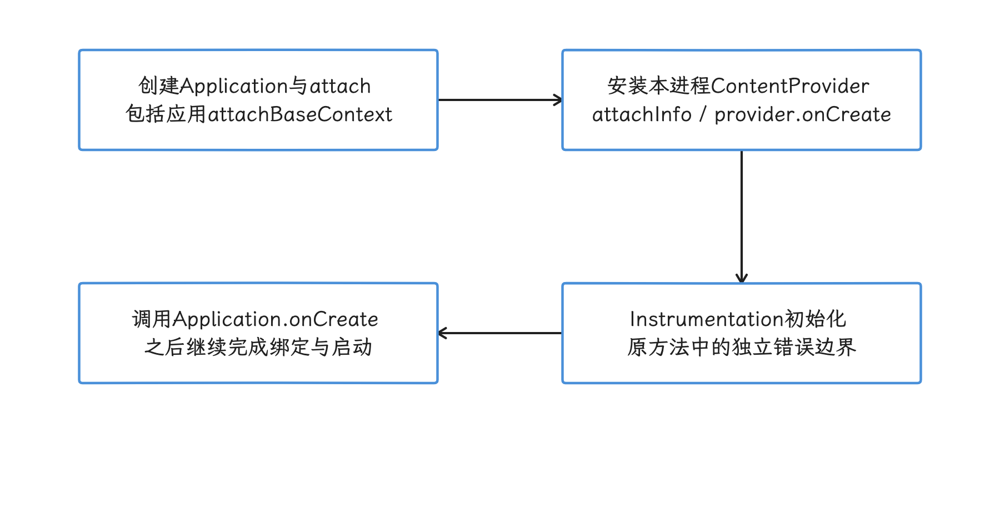

图：创建 Application 并完成 attach 后，正常绑定路径先安装同进程 provider，再进入 Instrumentation 和 Application 回调。 provider 的 attachInfo/onCreate 可进入冷启动关键路径；图省略中间设置与异常处理，provider 失败时不保证后续 Application 回调执行。

#### FileProvider 历史技巧：先核对依赖版本

抖音归档文章描述过一项历史字节码方案：临时修改 `ProviderInfo.grantUriPermissions`，利用当时 FileProvider 的安全检查顺序中断 `attachInfo()`，再把路径策略（path strategy，即内容 URI 与本地文件路径之间的映射规则）推迟到首次文件访问。

这项技巧要过完下面的核对，才谈得上进 Android 17 项目：

- `exported=false` 和 `grantUriPermissions=true` 是 FileProvider 要求的安全配置，绕过检查会增加升级与安全风险；
- 当前 AndroidX `androidx-main` 的 `attachInfo()` 只校验安全属性、保存 authority（内容 URI 中标识 provider 的字段）并清理缓存，路径配置 XML 由 `getLocalPathStrategy()` 在首次需要时解析；
- AndroidX 版本由应用依赖决定，系统是 Android 17，说明不了项目已经用上这份实现；
- 延后路径解析只会转移这部分耗时，首次分享文件或打开内容 URI 的延迟也要测量。

项目应检查锁定版本的 AndroidX Core 源码，同时测量冷启动和首次文件访问。若当前版本仍有可测量开销，可以优先升级、减少重复的 FileProvider、缩小路径配置并按官方 API 使用；至于修改 `ProviderInfo` 或捕获后忽略 `SecurityException` 来延迟初始化，属于要避开的做法。

<!-- gracker-diagram: ch19-01-30-fileprovider-lazy -->
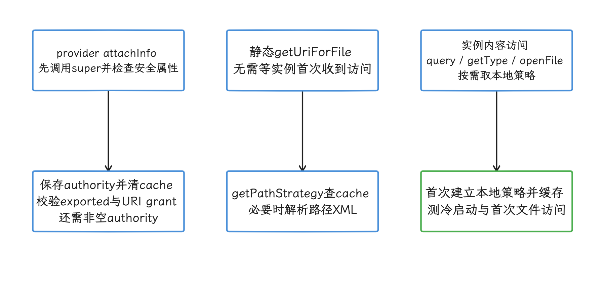

图：固定 AndroidX commit 中，attachInfo 保留父类与安全检查；路径策略在静态 URI 生成或实例访问需要时解析并缓存。 AndroidX 依赖版本独立于系统 Android 版本；延后解析会转移首次使用成本，修改 grantUriPermissions 或忽略安全异常不能当通用优化。

#### Rhea / btrace 的可复用部分

归档文章里的 Rhea 后续可以与字节开源的 btrace / RheaTrace3 对照：它补充应用的方法级调用信息，并把结果与 Perfetto 的调度、Binder、I/O 和渲染轨道放到同一时间轴上。

方法级插桩（向方法中插入测量代码）会改变包体和编译过程，插桩与采样都会带来采集或运行开销。专门用于诊断的构建包应记录插件版本、采样或插桩范围、过滤规则与额外开销；结论仍要回到系统 trace，分清方法墙钟耗时、Runnable 状态下等待 CPU 的时间和锁阻塞。

<!-- gracker-diagram: ch19-01-31-btrace-versions -->
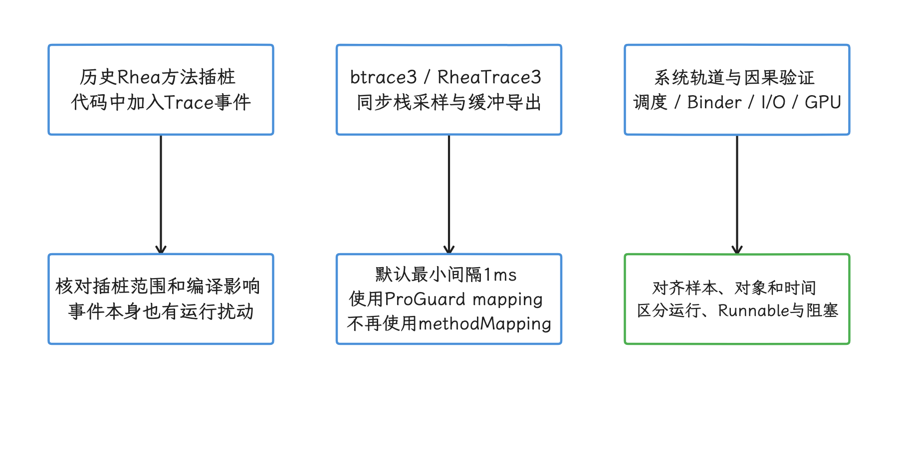

图：早期 Rhea 通过静态插桩记录方法事件，固定 btrace 3 使用同步采样并与可采集的系统轨道关联。 栈样本不是每次方法的完整起止记录；记录 commit、采样间隔、SDK/脚本和观测成本，不能直接把聚合样本解释为精确方法墙钟时长。

### 大型应用与 OEM 的协作方式

Samsung SceneSDK 与 TikTok 案例展示了两种合作关系：前者把应用场景交给设备侧的资源管理，后者是大型应用团队与 Android 团队围绕标准工具和 Jetpack 能力做的改造。

工程协作可以分为三层：

| 层次 | 接口与交付物 | 可移植性 |
| --- | --- | --- |
| Android 公共能力 | Game Mode、Game State、ADPF、Frame Pacing（帧节奏控制）、Perfetto | 较高，仍需检查设备支持 |
| OEM 设备配置 | 厂商干预、单应用配置（per-app profile）、驱动或电源配置 | 绑定机型和系统版本 |
| 联合诊断 | 稳定复现场景、双方 trace、计数器、实验报告 | 结论只覆盖已验证设备与版本 |

一次合作调优至少应交付：

- 可自动执行的场景脚本和用户指标；
- 应用、系统、内核、驱动、设备模式与温度信息；
- 原始 trace、采集配置、统计 SQL 和实验轮次；
- 标准 API 路径与私有配置路径的独立开关；
- 回退条件、版本范围和升级后的复验计划。

一个收益若只能靠私有配置拿到，应用就仍要保留公共路径和安全默认值；设备完成 OTA（系统在线更新）、更换 SoC 或游戏版本升级之后，都要重新验证一遍。

<!-- gracker-diagram: ch19-01-32-collaboration-delivery -->
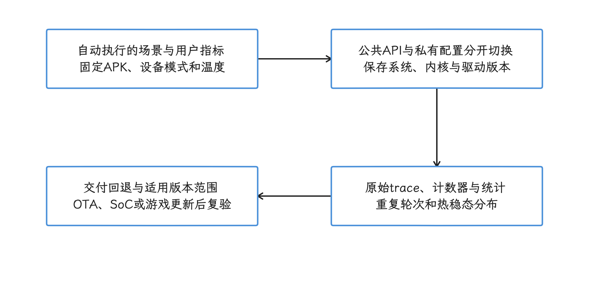

图：围绕稳定场景建立公共与私有路径的独立对照，交付版本、trace、统计和回退条件，并在 OTA 或硬件变化后复验。 OEM 配置绑定设备与版本，合作案例不替代公共默认路径；每次收益都限定已验证的工作负载与热状态。

### 折叠屏与多窗口：负载随窗口状态变化

折叠与展开可能牵动一整组状态：窗口尺寸、宽高比、像素密度、逻辑显示屏（Display）、刷新模式和折叠姿态；Activity 可能经历配置变更或重建，Surface 与缓冲区尺寸也可能随之变化。我们把性能问题按时间线分成：

1. 折叠状态或窗口尺寸变化；
2. Activity / Compose 状态恢复与重新布局；
3. Surface 创建、尺寸更新和缓冲区分配；
4. 首个正确内容帧与后续稳定帧；
5. 媒体、相机或游戏状态是否连续。

Jetpack WindowManager 提供 `FoldingFeature`（折叠区域及其姿态信息），Compose 自适应布局 API 用窗口尺寸和姿态信息选择布局。这些 API 并不会自动减少 Compose 重组、图片解码或 GPU 像素处理量，所以大型资源要按当前窗口需求加载，状态恢复也要避免在主线程重复 I/O。

<!-- gracker-diagram: ch19-01-33-fold-continuity -->
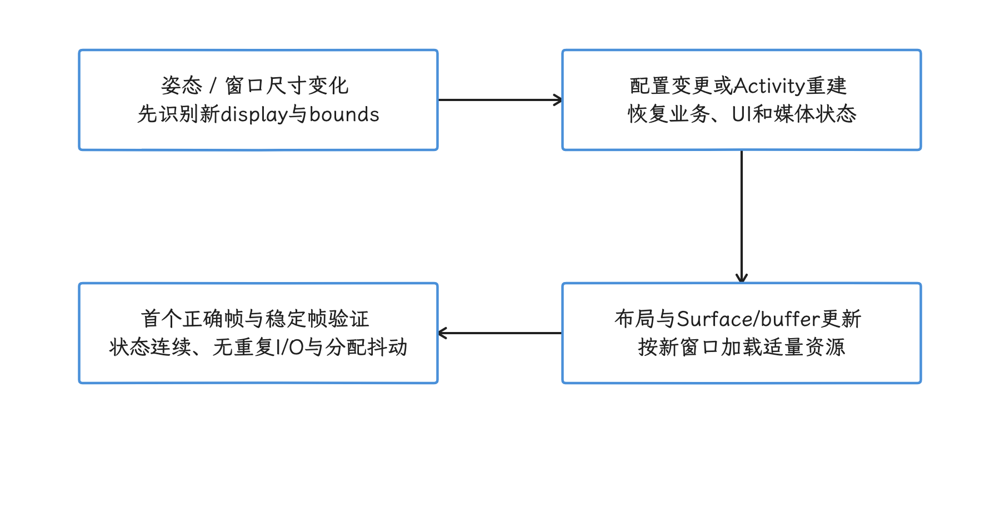

图：折叠或尺寸变化可能触发配置变更、Activity 重建和 Surface 更新，需要按新窗口恢复状态与加载资源。 FoldingFeature 和自适应布局不自动降低重组、解码或 GPU 成本；是否重建取决于配置与设备，顺序也可能交错。

多窗口的 GPU 工作量也换算不成固定倍数：每个窗口的可见面积、刷新节奏、内容复杂度、遮挡关系和硬件合成能力，都会改变 SurfaceFlinger 与 GPU 的负载。我们验证时记录各窗口的 bounds 边界尺寸（bounds）、合成层（Layer）、FrameTimeline、GPU 频率、内存和温控状态，再比较单窗口与多窗口。

折叠后我们仍靠 `Choreographer` 驱动帧回调，手写的 `16.6 ms` 定时器顶替不了它。Activity 或 ViewRoot 是否重建取决于配置与设备行为，帧回调要随其生命周期注册和清理；目标帧率、Surface 的 frame-rate vote 帧率请求、动画参数与媒体策略，则要按新的 Display 和窗口状态重算。

<!-- gracker-diagram: ch19-01-34-multiwindow-output -->
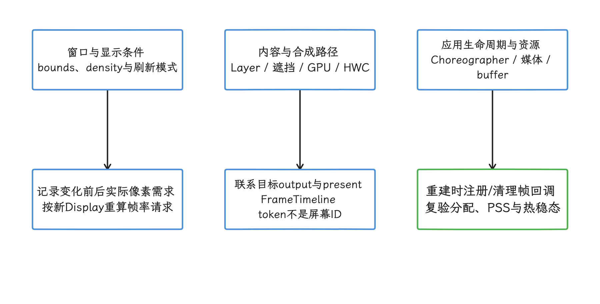

图：窗口变化后重算 Surface 尺寸、目标帧率和资源需求，按目标 output 记录合成与 GPU/内存负载。 窗口数不等于固定压力倍数；Choreographer 回调随 ViewRoot/Activity 生命周期管理，外屏归属还需 output 与 present fence 证据。

### 汽车、TV 与 IoT：保留机制，替换指标

手机案例的百分比搬到其他 Android 形态上会失真，可复用的是验证方法：

- **Android Automotive**：关注系统启动到可交互的时间、驾驶相关界面的响应时限、相机或音频链路和长期热稳态。
- **Android TV**：关注启动、遥控输入到画面呈现的延迟、视频首帧、掉帧、解码器与内存压力。
- **IoT**：关注受限内存、冷启动、持续功耗、闪存 I/O 与看门狗（检测卡死的监控机制）触发后的恢复。

每种形态都从用户可感知的指标开始，再用 Perfetto、内核跟踪记录、媒体或图形计数器定位。手机游戏的 60 / 120 fps、触摸延迟和短时升频（boost），不会自动成为车机、TV 或常驻设备的目标。

<!-- gracker-diagram: ch19-01-35-form-factor-metrics -->
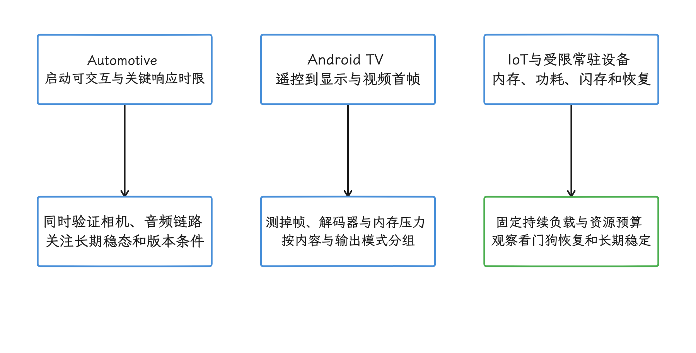

图：Automotive、TV 和 IoT 使用同一套可复现验证方法，但按交互、媒体、长期运行和资源约束选择指标。 这是工程测量建议；手机的 60/120 fps、短时 boost 和案例百分比不能自动成为其他设备形态的目标。

### 与相关章节的分工

- §5.2 与 §11.1 解释 DVFS（动态电压与频率调节）、Power HAL 与温控机制；这里关注应用如何提供信号并验证 OEM 响应。
- §2.2 与 §2.7 解释帧率、刷新率和 GPU；这里关注厂商干预、折叠和多窗口实验。
- §8.2、§8.3 解释启动路径；这里补充 TikTok、抖音与 ContentProvider 的公开案例。
- §13 解释 Perfetto；案例应附采集配置、原始 trace 和统计脚本。
- 本篇前半部分与 §19.2 解释 OEM 与 SoC 差异；这里把差异落到具体设备的实测里。

### 常见误区：工具、窗口与案例

#### “性能模式”就是内核机制

“性能”“加速”“智能温控”是产品层的名称。手头没有厂商文档或 trace 时，我们写进报告的，只有模式切换前后的可观测差异。

#### “HintSession 能锁频”

Performance Hint 传递的是目标时长与实际时长；绑核、固定频率、避开温控降频，这三样都在它的承诺之外。

#### “平均 FPS 正常就没有降频”

前半段高帧率、后半段降频，平均起来可能看不出异常；所以报告要同时给出时间序列、P95 帧时间、未赶上显示截止点的帧数与稳态窗口。

#### “旧版 FileProvider 改写可以直接照搬”

旧文章依赖的是当时的 AndroidX 实现。当前 `androidx-main` 已把本地路径策略延迟到首次访问，但项目锁定的版本可能不同，这部分耗时也可能转移到首次文件操作上。核对要同时覆盖依赖源码、冷启动 trace 和首次文件访问 trace；安全校验这一环，保持原样。

#### “多窗口压力是固定倍数”

窗口数量换算不出固定的 GPU 或内存倍数。窗口尺寸、内容、刷新率、合成路径和遮挡，都要进入实验条件。

#### “案例百分比就是自己的收益”

TikTok 的 45% 启动改善属于那个项目。我们自己的基线、设备分布和瓶颈都不同，收益要由本地实验给出。

## 小结

OEM 性能工作的主线，是先把平台公共机制、厂商产品策略和目标设备观测分开，再把可移植的应用协作放到公开 API、受控实验和可回退配置上。Freezer、预加载、游戏模式、ADPF、折叠屏与行业案例，都是这条验证链上的具体场景；品牌名和单次百分比，替代不了目标设备上的验证。

## 参考资料

### OEM 与行业案例

- [Samsung Game Booster 支持页](https://www.samsung.com/levant/support/apps-services/know-more-about-the-game-booster-app/)
- [Samsung SceneSDK 案例](https://developer.samsung.com/galaxy-gamedev/blog/en/2022/04/26/accelerate-game-performance-based-on-scenesdk)
- [TikTok Android 性能案例](https://android-developers.googleblog.com/2022/08/precise-improvements-how-tiktok-enhanced-its-social-experience-on-android.html)
- 本库归档：`Cubox/抖音 Android 性能优化系列：启动优化实践-2022-03-25.md`
- 本库归档：`Cubox/抖音 Android 性能优化系列：新一代全能型性能分析工具 Rhea-2022-01-14.md`
- [ByteDance btrace](https://github.com/bytedance/btrace)

#### Android API 与指南

- [Game Mode API 与厂商干预概览](https://developer.android.com/games/optimize/adpf/gamemode/about-API-and-interventions)
- [Game Mode API](https://developer.android.com/games/optimize/adpf/gamemode/gamemode-api)
- [Game Mode interventions](https://developer.android.com/games/optimize/adpf/gamemode/gamemode-interventions)
- [FPS throttling](https://developer.android.com/games/optimize/adpf/gamemode/fps-throttling)
- [Game State API](https://developer.android.com/games/optimize/adpf/gamemode/gamestate-api)
- [ADPF 总览](https://developer.android.com/games/optimize/adpf)
- [PowerManager thermal API](https://developer.android.com/reference/android/os/PowerManager)
- [PerformanceHintManager API](https://developer.android.com/reference/android/os/PerformanceHintManager)
- [PerformanceHintManager.Session API](https://developer.android.com/reference/android/os/PerformanceHintManager.Session)
- [AndroidX App Startup](https://developer.android.com/topic/libraries/app-startup)
- [Macrobenchmark 启动测量](https://developer.android.com/topic/performance/benchmarking/macrobenchmark-overview)
- [折叠屏适配](https://developer.android.com/develop/ui/compose/layouts/adaptive/foldables/learn-about-foldables)
- [AndroidX Window 版本说明](https://developer.android.com/jetpack/androidx/releases/window)

#### Android 17 与 AndroidX 源码

- [`GameManager.java`](https://android.googlesource.com/platform/frameworks/base/+/refs/tags/android-17.0.0_r1/core/java/android/app/GameManager.java)
- [`PerformanceHintManager.java`](https://android.googlesource.com/platform/frameworks/base/+/refs/tags/android-17.0.0_r1/core/java/android/os/PerformanceHintManager.java)
- [`PowerManager.java`](https://android.googlesource.com/platform/frameworks/base/+/refs/tags/android-17.0.0_r1/core/java/android/os/PowerManager.java)
- [`ActivityThread.java`](https://android.googlesource.com/platform/frameworks/base/+/refs/tags/android-17.0.0_r1/core/java/android/app/ActivityThread.java)
- [AndroidX FileProvider 当前源码](https://android.googlesource.com/platform/frameworks/support/+/refs/heads/androidx-main/core/core/src/main/java/androidx/core/content/FileProvider.java)

<!-- gracker-diagram: ch19-01-12-freezer-evidence -->
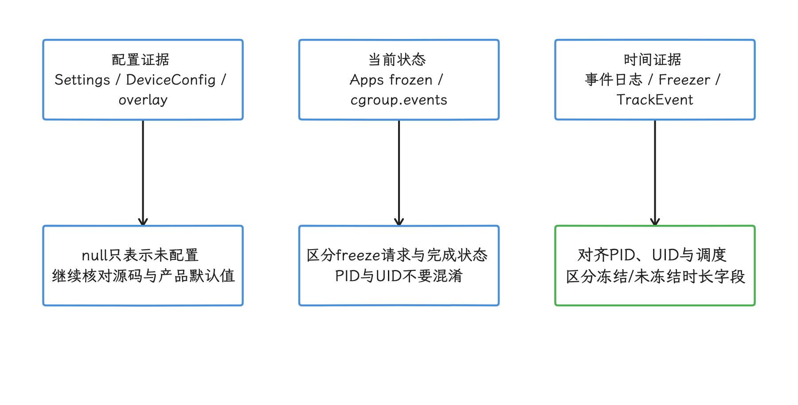

图：只读配置解释候选策略，dumpsys 与 cgroup 状态解释进程现状，日志和 tracing 关联状态切换时间。 读取失败可能是权限或路径差异；没有调度 slice 也可能只是睡眠。结构化事件还受 perfettoSdkTracingV3 与采集类别约束。
