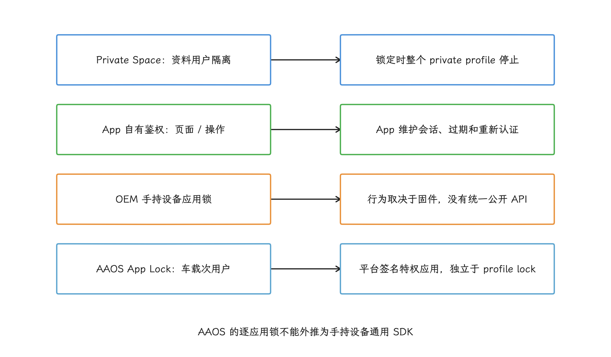
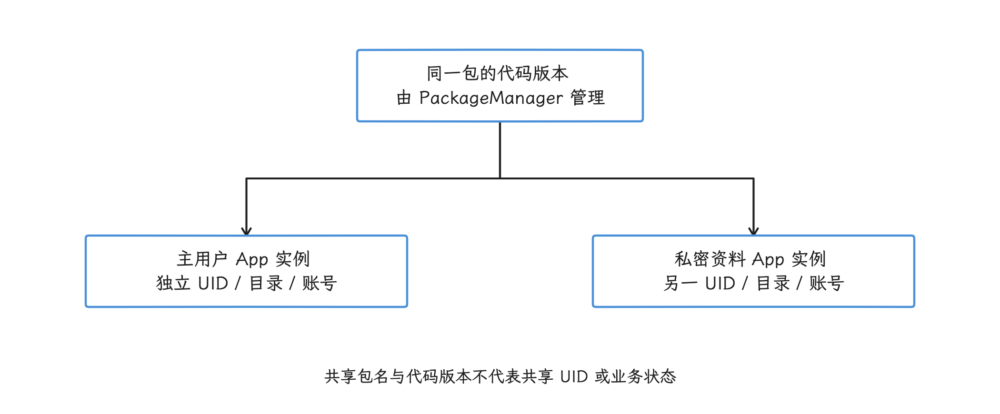
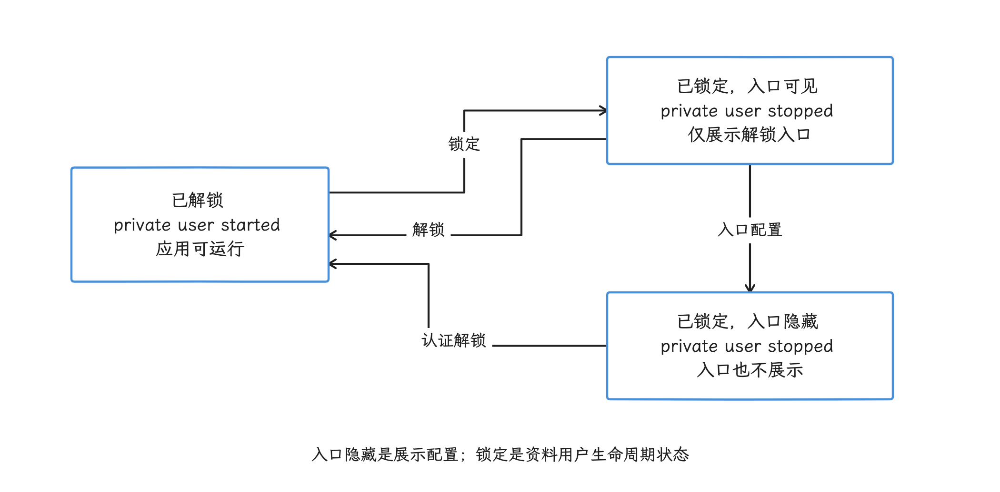
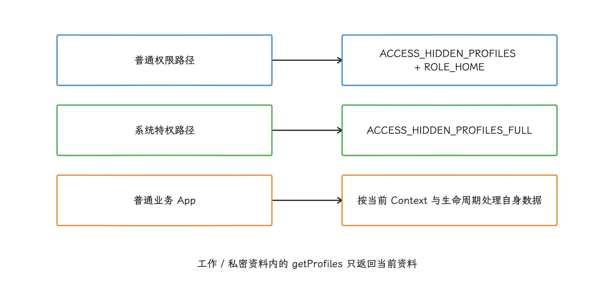
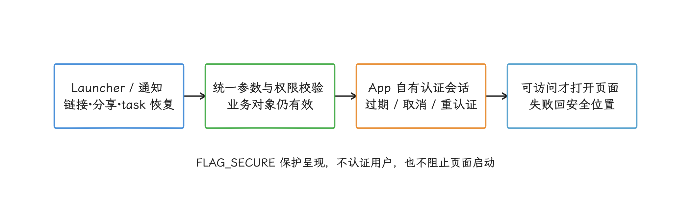
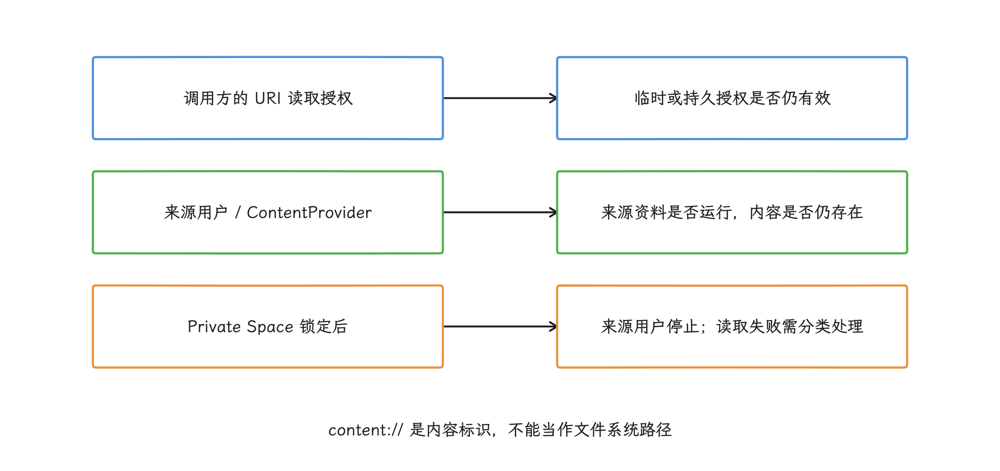
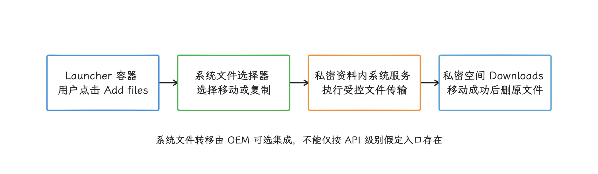
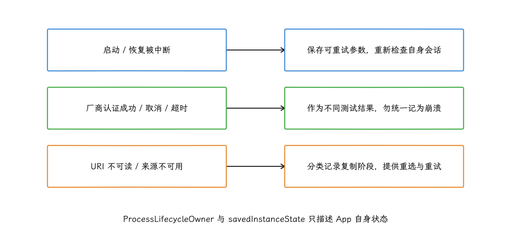
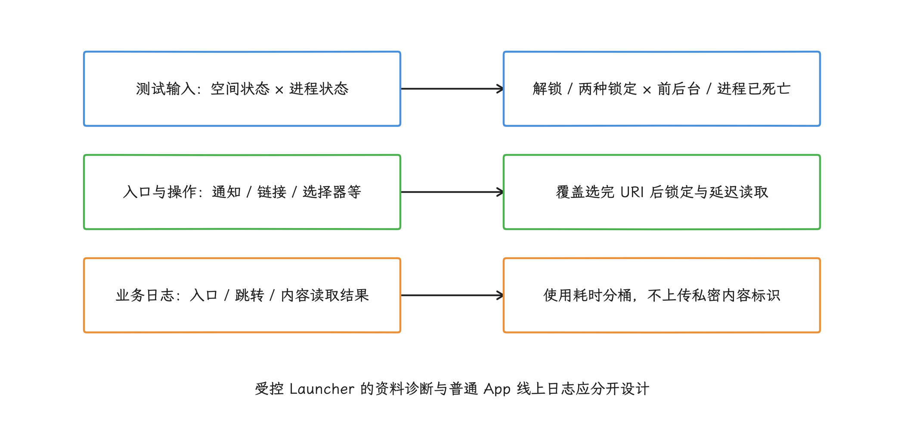

# Private Space 与应用锁的兼容性边界

Private Space、工作资料、AOSP App Lock、厂商应用锁和应用自身认证，是五套保护对象与运行模型都不相同的机制，它们在生命周期、可见性和通知上的行为要分别确认，互相之间类推不出来。做兼容性设计时，我们先分清系统身份落在哪一层，再检查启动、分享、最近任务和 URI 授权各条链路。

## 先分清“锁”保护的对象

<!-- gracker-diagram: a204-01-four-lock-models -->


图：名称相近的机制保护不同对象；Private Space、厂商认证取消与应用会话过期，应分成不同状态和恢复路径。

用户说“这个 App 被锁了”时，背后的系统机制可能完全不同：也许是整个私密资料用户停了，也许是 App 自己的会话过期，也许是厂商在启动入口前加了认证。下文的 profile 指 Android 多用户框架中的“资料用户”，每个资料用户都有独立的应用数据和运行状态；Launcher 指桌面或启动器。我们排查前先确认实际由哪一层负责阻止访问：

| 机制 | 保护对象 | 锁定后的系统行为 | 普通 App 能否识别 |
| --- | --- | --- | --- |
| AOSP Private Space | 一个独立的 `private profile`（私密资料用户）及其中的数据 | 资料用户停止运行，应用入口、最近任务和通知被隐藏 | 无法通过公开接口列出主空间之外的 `hidden profile`（隐藏资料用户） |
| App 自有鉴权 | App 内的敏感页面或操作 | 由 App 决定页面遮挡、会话超时和重新认证 | 可以，因为策略由 App 自己实现 |
| Android 17 AOSP App Lock（功能标记控制） | 符合条件的完整用户中的指定 App | 按 `PackageManager` 接口文档，为启动等入口增加认证，并遮挡敏感内容 | 相关查询与设置入口要求 `LOCK_APPS`，普通业务 App 不能通用调用 |
| 设备厂商（OEM）手持设备应用锁 | 厂商选定的 App 或入口 | 可能在启动、最近任务、通知或设置页前插入认证 | 没有跨厂商公开 API |
| Android Automotive App Lock | 车载次用户中的敏感 App | 由平台签名的特权 App 管理锁定清单和认证入口 | 仅适用于 Android Automotive OS（AAOS）集成，不是手持设备 SDK |

AOSP 源码里已经有一套受功能标记控制的逐应用锁接口与平台实现。`android-17.0.0_r1` 的 [`core/api/current.txt`](https://android.googlesource.com/platform/frameworks/base/+/android-17.0.0_r1/core/api/current.txt) 列出了 `@FlaggedApi("android.security.app_lock_apis")` 标注的下列成员：

- `PackageManager.GET_APP_LOCK_INFO`：查询时请求填充应用锁信息，调用者须持有 `android.permission.LOCK_APPS`，否则会抛出 `SecurityException`。它是 `long` 标志，要配合 `ApplicationInfoFlags.of(...)` 这类长整型参数使用；需要同时查询 attribution（应用归因信息）时使用 `GET_ATTRIBUTIONS_LONG`，它与旧的 `GET_ATTRIBUTIONS` 不能混用。
- `ApplicationInfo.isAppLockSupported` 与 `isAppLockEnabled`：分别描述目标 App 是否支持、是否启用了 App Lock。这两个字段只有在带上上述查询标志、且调用者有权限时才会填充，默认值为 `false`；未填充时读到的 `false` 只说明查询条件没有满足，还当不了“不支持”或“未开启”的证据。`isAppLockEnabled` 也只反映开关状态，说明不了此刻是否正在等待用户解锁。
- `PackageManager.getEnableAppLockIntentForPackage(packageName, enabled)`：返回用于打开系统认证与启用状态确认界面的 `PendingIntent`，由系统界面要求用户认证后更改启用状态。目标不支持或已处于请求状态时返回 `null`，服务端在 `app_lock_apis` 关闭时也返回 `null`；所以拿到 `null` 只说明这一次拿不到入口，要判断设备是否具备这组源码能力，还需要核实构建中的标记与权限条件。

[`AndroidManifest.xml`](https://android.googlesource.com/platform/frameworks/base/+/android-17.0.0_r1/core/res/AndroidManifest.xml) 把 `LOCK_APPS` 的保护级别设为 `internal|role|recents`，并注明面向 HOME 角色应用和最近任务组件；普通业务 App 仅在清单中声明它，并不会因此获得通用的逐应用锁控制能力。这条链路的具体调用经 `ApplicationPackageManager` 转到 `PackageManagerService`，再进入 `AppLockPackageHelper`；`PackageManager` 基类方法里抛出的 `UnsupportedOperationException` 只覆盖基类这一层的默认行为，判断整条链路是否已实现，要看后面这几个具体类。

运行范围同样收得很窄：[`AppLockPackageHelper`](https://android.googlesource.com/platform/frameworks/base/+/android-17.0.0_r1/services/core/java/com/android/server/pm/AppLockPackageHelper.java) 排除了手表、车载和 Leanback（电视）设备，不支持资料用户、受监督用户、无 Launcher 入口的 App，以及系统配置中的豁免包。它面向的是完整用户（full user），与 Private Space、工作资料这类资料用户分属两个范畴，所以这套逐应用锁的作用范围到完整用户为止，套不到私密资料中的 App 上。

接口在源码里存在，离设备上可用还有距离。`app_lock_apis` 与 `app_lock_core` 是两个独立功能标记，`AppLockActivity` 在任一标记关闭时都会退出；该标签的源码还保留着完成 App Lock UI、补齐部分状态失效事件监听的 TODO。这些是实现层面的现状，API 37 设备是否开放完整功能要看实际构建：系统集成方应核实构建中的标记、权限和目标包支持条件，并复测认证、通知及最近任务行为；普通业务 App 继续按自身生命周期与访问结果恢复。

Android 16 引入的 [Advanced Protection Mode](https://developer.android.com/privacy-and-security/advanced-protection-mode) 是一个整机安全总开关，一次同时启用多项防护限制；给某个 App 增加启动口令这件事在它的职责之外。

Android Automotive 的 App Lock 是另一个容易误读的名字。它从 Android 14 起以“非捆绑应用”提供，也就是可以独立于 AAOS 核心平台开发和维护；部署时仍须使用厂商平台密钥签名，作为特权应用放入系统镜像。它只服务于车载次用户，不支持 Guest 用户，与资料用户的锁定状态也相互独立；它的部署方式、用户范围和 PIN 策略都只对应车载场景，手持设备 AOSP App Lock 要按前文的方法单独看。

业务代码要把下面三种状态分开建模：`Private Space locked`（私密空间已锁定）、`OEM authentication canceled`（厂商认证已取消）和 `App session expired`（应用内会话已过期）——三者的生命周期、权限与恢复路径各不相同。

## Private Space 的系统模型

<!-- gracker-diagram: a204-02-user-data-isolation -->


图：在两个用户安装同一包会形成独立数据和运行环境；主空间的登录、数据库、缓存和下载内容不会自动复制。

Private Space 从 Android 15 / API 35 引入，建立在 Android 多用户框架上，资料用户类型是 `android.os.usertype.profile.PRIVATE`。同一个包分别安装到主用户和私密资料用户后，会形成两份相互隔离的 App 实例：

- Linux UID 不同。Android UID 是由 `userId` 与 `appId` 共同计算出的整数标识：前者区分 Android 用户，后者区分该用户下的 App。
- `/data/user/<userId>/<package>` 等应用数据目录不同。
- 账号、数据库、偏好、缓存和下载内容不自动复制。
- 每个用户分别记录安装状态，因此可以只在一边安装；同包名的代码版本由系统包管理器 `PackageManager` 统一管理，更新后各个已安装用户通常共用新版本。

这里最容易踩的坑在服务端。主空间的登录状态只覆盖主用户这一份；服务端如果只按账号与包名汇总数据，还可能把两个运行环境算进同一组统计结果。我们排查重复登录或活跃设备数异常时，要先把这层隔离关系考虑进去。

Private Space 的主要状态如下：

<!-- gracker-diagram: a204-03-profile-visibility-states -->


图：锁定的两种 UI 状态都意味着资料用户停止；解锁重新启动用户，应用仍应按进程死亡后的常规恢复流程重建状态。

| 状态 | 资料用户运行状态 | Launcher | 通知与最近任务 | 跨空间选择 |
| --- | --- | --- | --- | --- |
| 已解锁 | 用户已启动（`started`） | 展示容器和应用 | 可以显示 | 用户主动选择且系统策略允许时，分享面板和 Photo Picker 可提供内容 |
| 已锁定、入口可见 | 用户已停止（`stopped`） | 只展示 Private Space 解锁入口 | 私密应用及通知隐藏 | 私密应用和内容不可用 |
| 已锁定、入口隐藏 | 用户已停止（`stopped`） | 连 Private Space 入口也隐藏 | 私密应用及通知隐藏 | 私密应用和内容不可用 |

锁定操作停掉的是整个私密资料用户：运行在其中的 Activity、Service、Job 和进程都随用户停止而结束，影响范围远大于在一个 Activity 前显示认证页。解锁会重新启动该资料用户，但 App 拿到的是一次全新的进程创建，要按正常的进程创建和状态恢复流程重建依赖，锁定前的内存对象已经不在了。

一台设备只能创建一个 Private Space，而且只能归主用户所有；AOSP 的资料模型允许它与工作资料、clone profile（用于运行另一份 App 实例的克隆资料）共存。Settings 在锁定时也要遵守隐藏要求，应用列表里要一直看不出私密空间中安装了什么。

模型允许共存，具体到某台受管设备则要看管理策略。Android Enterprise 文档说明，个人所有且带工作资料的设备可以使用；公司所有的混合用途设备上，管理员可以阻止创建或移除已有空间；全托管设备、主空间存在受监督账号，或厂商与管理员关闭该功能时，也可能没有 Private Space。业务 App 应把“设备没有该入口”当作正常的配置差异来处理。

## 普通 App 所处的边界

普通业务 App 需要回答的问题只有一个：自己当前运行在哪个 Android 用户中。系统没有给出公开、跨设备可靠的途径去列出主用户的 Private Space，品牌、`userId` 范围或进程 UID 也都当不了识别依据。

一个包在 Private Space 内运行时，它看到的是自己的 `Context`（当前 App 实例的运行环境对象）、文件目录、权限和账号状态。业务代码要保证下面这些路径一直成立：

- 进程冷启动（系统中没有旧进程，需要重新创建）后，可以从持久化数据恢复页面。
- deep link（直接打开 App 内特定页面的链接）、通知、分享和文件选择都经过同一套入口参数与权限校验。
- 账号缺失、数据库为空或文件不可读时给出可恢复的 UI。
- 用户锁定空间造成任务中断时，重启后可以重试或明确终止。

公开接口这一侧，我们能用的是 `UserManager.isQuietModeEnabled(UserHandle)`，它查询资料用户是否处于 quiet mode（静默模式）：静默模式启用后，该资料中的 App 不运行、不发通知，也不消耗数据或电量。这个方法的前提是调用者先持有目标 `UserHandle`，而普通 App 拿不到隐藏私密资料用户的句柄，所以它只回答“我已知的这个资料用户是否静默”，当不了通用的 Private Space 检测接口。`requestQuietModeEnabled()` 的门槛更高：调用者必须是前台默认 Launcher，或持有 `MANAGE_USERS` / `MODIFY_QUIET_MODE`，业务 App 不要用它去控制 Private Space。

这些门槛本身就是隐私设计的一部分：一旦任意 App 都能判断设备是否创建了 Private Space、其中正在运行或安装了哪些包，Private Space 的隐藏语义就随之削弱了。

## 桌面（Launcher）与系统组件如何接入

<!-- gracker-diagram: a204-04-hidden-profile-access -->


图：默认 Launcher 需声明 normal 权限并持有 HOME 角色；具备 FULL 权限的系统组件有另一条路径，单独声明 normal 权限不足以访问。

默认 Launcher 就不同了，它能拿到隐藏资料用户的句柄。源码为这类访问设置了两条权限路径：

1. 在清单中声明 normal 保护级别的 `android.permission.ACCESS_HIDDEN_PROFILES`，同时持有默认桌面角色 `RoleManager.ROLE_HOME`。normal 表示安装时授予、不弹运行时授权框；它本身仍不足以访问 Private Space。
2. 系统应用持有 signature/privileged 保护级别的 `ACCESS_HIDDEN_PROFILES_FULL`，无需 HOME 角色。这类权限只会授予平台同签名应用，或系统镜像中经过特权权限配置的应用。

所以只声明 normal 权限还列不出 Private Space。访问隐藏资料时，`LauncherApps#getProfiles()` 的普通权限路径要求 HOME 角色，源码里另保留着 `ACCESS_HIDDEN_PROFILES_FULL` 系统特权路径；当调用进程本身位于 managed profile（工作资料）或 private profile 时，该方法只返回当前资料用户。

Launcher 可以用下列 API 读取资料用户类型、运行状态和入口配置：

- `LauncherApps.getProfiles()`：取得调用者有权访问的资料用户。
- `LauncherApps.getLauncherUserInfo(user)`：取得 `LauncherUserInfo`。
- `LauncherUserInfo.getUserType()`：与 `UserManager.USER_TYPE_PROFILE_PRIVATE` 比较。
- `UserManager.isQuietModeEnabled(user)`：判断资料用户是否处于 quiet mode。
- `LauncherUserInfo.getUserConfig()`：读取额外 Launcher 配置。
- `LauncherUserInfo.PRIVATE_SPACE_ENTRYPOINT_HIDDEN`：API 36 起表示锁定时是否隐藏入口。

下面的示例只适用于默认 Launcher 或具备相应特权的系统组件。它把“资料用户能否运行”和“锁定时是否显示入口”分别保存，避免混成一个状态：

```kotlin
data class PrivateProfileUiState(
    val user: UserHandle,
    val locked: Boolean,
    val hideEntrypointWhenLocked: Boolean,
)

fun readPrivateProfileStates(
    launcherApps: LauncherApps,
    userManager: UserManager,
): List<PrivateProfileUiState> {
    return launcherApps.profiles.mapNotNull { user ->
        val info = launcherApps.getLauncherUserInfo(user) ?: return@mapNotNull null
        if (info.userType != UserManager.USER_TYPE_PROFILE_PRIVATE) {
            return@mapNotNull null
        }

        val hidden = if (Build.VERSION.SDK_INT >= 36) {
            info.userConfig.getBoolean(
                LauncherUserInfo.PRIVATE_SPACE_ENTRYPOINT_HIDDEN,
                false,
            )
        } else {
            false
        }

        PrivateProfileUiState(
            user = user,
            locked = userManager.isQuietModeEnabled(user),
            hideEntrypointWhenLocked = hidden,
        )
    }
}
```

`locked` 表示私密资料用户是否已锁定，值为 `true` 时该资料用户处于停止状态；`hideEntrypointWhenLocked` 表示锁定后 Launcher 是否仍展示解锁入口。两个字段分开保存，才能表达“资料用户已锁定，但解锁入口仍可见”这种组合；若合并成一个 `isHidden`，这种状态就表达不出来了。

状态变化要靠广播。Launcher 应通过 `Context.registerReceiver()` 动态注册接收器，监听 `Intent.ACTION_PROFILE_AVAILABLE` 与 `Intent.ACTION_PROFILE_UNAVAILABLE`，并从 `Intent.EXTRA_USER` 读取发生变化的资料用户；[Android 17 的 `Intent.java`](https://android.googlesource.com/platform/frameworks/base/+/android-17.0.0_r1/core/java/android/content/Intent.java) 明确规定，这两个广播只发送给动态注册的接收器，清单里声明的接收器收不到。广播只说明 quiet mode 已改变，收到后仍要重新查询当前值；Launcher 进程重建或重新注册接收器时，也应主动查询状态，补齐接收器未注册期间的变化。`ACTION_MANAGED_PROFILE_AVAILABLE` 一类广播只针对 managed profile，监听 Private Space 时别把它当唯一入口。

## 启动、最近任务与通知

<!-- gracker-diagram: a204-05-sensitive-entry-gate -->


图：所有直接入口都经过相同业务校验；BiometricPrompt 完成本次认证，App 还需定义过期、进程死亡与取消后的安全路径。

Private Space 锁定后，系统会隐藏其中应用的 Launcher 图标、最近任务和通知。我们整理三项最容易写错的对应关系：

- 通知不可见说的是可见性这一层，`PendingIntent` 是否被系统删除是另一件事。官方约束描述的是锁定状态下的可见性与资料用户停止；点击失败在没有源码或复现证据前，先别归因到 `PendingIntent` 失效。
- 最近任务消失是系统隐藏任务的结果，业务 Activity 未必主动 `finish()` 过。Recents 是系统展示 Activity 任务栈的“最近任务”界面，私密资料用户停止后，系统会隐藏相关任务。
- 解锁也未必恢复原进程：应用应按进程死亡后的任务恢复规则重建依赖，并校验目标页面仍可访问。

所以页面跳转和访问检查要集中到同一处。Launcher 启动、通知、App Link、分享目标和恢复的 task（系统记录的一组 Activity 及其返回关系）都可能直接打开敏感页面；只在首页检查一次身份的话，其他入口仍可能绕过检查。

如果产品要求“每次进入支付页都认证”，这就属于 App 自有鉴权。AndroidX `BiometricPrompt` 可以组合强生物识别与设备凭据，认证成功后，App 再创建一段有明确过期时间的访问会话；这一层完全在 App 自己手里，既改不到 Android 用户或资料用户状态，也替代不了 Private Space 或厂商应用锁。

下面的代码用于构建 App 自有认证提示，应在所有敏感页面共用的入口检查处调用：

```kotlin
val authenticators =
    BiometricManager.Authenticators.BIOMETRIC_STRONG or
        BiometricManager.Authenticators.DEVICE_CREDENTIAL

val promptInfo = BiometricPrompt.PromptInfo.Builder()
    .setTitle("验证身份")
    .setSubtitle("继续访问敏感内容")
    .setAllowedAuthenticators(authenticators)
    .build()
```

认证回调只代表这一次系统认证完成，会话过期时间、进程死亡后的默认状态、后台停留阈值，以及认证取消时返回哪个安全页面，都还要 App 自己定义。`DEVICE_CREDENTIAL` 表示允许使用设备 PIN、图案或密码；启用它之后，系统会用“使用设备凭据”替代负向按钮，`setNegativeButtonText()` 这一路不再可用。

`FLAG_SECURE` 与应用锁是两回事：它可限制窗口截图和在非安全显示器上的呈现，适合保护已打开的敏感内容；认证用户、阻止其他入口启动 Activity，都不在它的职责之内。

## 系统分享面板、Photo Picker 与 URI 授权

<!-- gracker-diagram: a204-06-uri-two-conditions -->


图：拥有 URI grant 还需要来源用户和 Provider 可用；读取异常证明不了授权已撤销，重新解锁后也需重新验证来源。

Private Space 解锁时，系统可以通过 Sharesheet（系统分享面板）和 Photo Picker（照片选择器）提供受控的跨空间交互。锁定后，私密资料用户停止，其中的应用和内容会从这些系统入口中消失。

这里的 URI 通常是 `content://` 开头的内容标识，不是文件系统路径。排查读取失败时，应把两个条件分开：

1. 调用方是否持有该 URI 的临时或可持久保存的读取授权。这个授权也常写作 URI grant，表示系统允许某个调用方访问指定内容。
2. 提供内容的 Android 用户和 `ContentProvider` 是否正在运行。`ContentProvider` 是通过 `content://` URI 向其他组件提供数据的 Android 组件。

用户锁定 Private Space 后，内容提供方所在的资料用户会停止运行，此时读取可能抛出 `FileNotFoundException`、`SecurityException` 或与 `ContentProvider` 不可用有关的异常。看到这些异常，我们先记下“来源用户停了”这个事实，再核对授权：异常本身证明不了 URI 授权已被撤销；空间再次解锁后，如果授权仍在且来源对象没有被删除，读取可能恢复。

对于上传、转码、OCR（光学字符识别，用于从图片中提取文字）或索引等长任务，可以按以下原则处理：

- 在用户选择完成后立即检查 MIME 类型（例如 `image/jpeg` 这样的内容格式标记）、声明长度与可读性。
- 任务需要脱离来源长期执行时，将内容复制到当前 App 用户域内的受控存储。
- 记录复制是否完成，不把 `content://` 字符串当作文件系统路径。
- 重新打开 URI 时处理来源被删除、`ContentProvider` 不可用和授权变化。
- 日志不写原始 URI、文件名、媒体标题或私密空间包列表。

Android 16 QPR2 增加了从主空间向 Private Space 移动或复制文件的可选能力。QPR 是 Quarterly Platform Release，即在 Android 大版本之间发布的季度平台更新。用户从 Private Space 的 Launcher 容器选择 `Add files`（添加文件），通过系统文件选择器选取内容，再由私密资料用户中的系统前台服务完成传输并写入 `Downloads`；前台服务是一种用于执行用户可感知持续任务的 Service。AOSP 发布说明标注该功能由设备厂商选择是否集成，所以 App 要按“入口可能存在、也可能缺失”来设计，API 36 QPR2 或后续设备保证不了同一入口。

<!-- gracker-diagram: a204-07-file-transfer -->


图：系统 Add files 从 Android 16 QPR2 起可选集成；由私密资料中的系统前台服务转移文件，复制保留原文件，移动在成功后删除原文件。

媒体解码、转码与缓存的性能处理见 24.4；这里仅讨论 Android 用户与资料用户、`ContentProvider` 可用性和 URI 授权之间的关系。

## 设备厂商应用锁的兼容策略

<!-- gracker-diagram: a204-08-observable-results -->


图：普通 App 没有统一厂商应用锁状态码，应根据自身生命周期、页面到达和读取结果恢复，并固定固件与入口复现。

手持设备的厂商应用锁可能在 Activity 启动、任务切换、通知展示或厂商安全中心等位置要求认证，也可能只覆盖其中几项。它未必创建独立资料用户；锁定时是否终止进程、暂停后台任务或隐藏通知，都由厂商提供的系统软件版本（设备固件）决定。

这一侧的难点在缺少统一接口：厂商私有应用锁没有供普通业务 App 跨厂商查询“是否锁了我”的统一 API，也没有统一认证结果码。前述 AOSP 标记接口要求 `LOCK_APPS`，描述的是 AOSP App Lock 的支持与启用状态，厂商私有锁的认证结果不在它的返回范围内。厂商名适合用来整理测试结果；同一品牌在不同地区的固件、Launcher 版本或安全组件版本上，都可能采用不同策略，代码分支应交给运行时可观察的结果来决定。

兼容代码应围绕可观察结果设计：

| 用户路径 | App 可观察信号 | 应对方式 |
| --- | --- | --- |
| 冷启动后没有到达目标页 | 生命周期、页面跳转参数、进程创建时间 | 保存可重新执行的非敏感跳转参数，避免把中断记成崩溃 |
| 从后台回到前台 | `ProcessLifecycleOwner`、页面可见性、会话时间 | 重新校验 App 自有敏感会话 |
| 通知进入失败 | 通知发出时间、目标页面跳转是否已处理 | 统计跳转结果，不猜测厂商应用锁状态 |
| Picker 返回后读取失败 | URI 授权标志、异常类型、复制阶段 | 给出重选入口，区分选择取消与读取失败 |
| task 恢复到过期页面 | `savedInstanceState`、业务对象版本 | 回到安全的上一级页面并允许重试 |

`ProcessLifecycleOwner` 用于观察整个 App 进入前台或后台，`savedInstanceState` 保存 Activity 被系统重建时需要的少量界面状态；两者描述的都是 App 自己的生命周期，外部厂商应用锁处于什么状态，在它们的数据范围之外。

系统认证页属于 App 进程外的 UI，测试脚本如果只等待某个 Activity 出现，很容易把“用户还没完成认证”误判成启动超时。自动化用例应把“出现厂商认证页”“用户取消”“认证成功后继续启动”记成三种不同结果。

## 观测与隐私

<!-- gracker-diagram: a204-09-privacy-test-matrix -->


图：测试矩阵覆盖资料用户生命周期与多入口；业务上报只描述自己看到的结果，不去声称识别了私密空间或 OEM 锁定状态。

Private Space 的存在本身带有隐私含义。普通 App 的线上日志要避开 `user_serial_number`、`userId`、私密空间应用列表这类字段，也应避免尝试推断它们；即使先对 `userId` 做哈希，结果仍可能成为跨会话不变的标识，隐私风险并不会自动消失。

业务侧可以记录的字段包括：

- `entry_source`：`launcher`、`notification`、`app_link`、`share`、`picker`、`task_restore`。
- `process_start_kind`：冷启动、已有进程、未知。
- `route_result`：页面到达、认证取消、参数无效、来源不可读、状态已过期。
- `content_read_result`：成功、授权错误、来源不存在、`ContentProvider` 不可用、用户取消。
- `recovery_duration_bucket`：恢复耗时所在的范围，例如 0～1 秒或 1～3 秒；只记录范围，不记录精确时长。

这些字段只描述 App 自己看到的结果，识别 Private Space 或厂商应用锁这类判断不在其中。默认 Launcher、Settings、系统测试工具等受控组件可以在权限允许时记录资料用户类型、quiet mode 和入口隐藏配置，但也应优先保留在设备本地诊断中；需要上传汇总结果时，应先经过隐私审查。

测试范围至少覆盖：

- 主空间与 Private Space 分别全新安装，验证数据不会互相继承。
- Private Space 解锁、锁定且入口可见、锁定且入口隐藏。
- App 位于前台、后台、最近任务和进程已死亡四种起点。
- Launcher、通知、App Link、分享、Photo Picker、DocumentsUI 六类入口。
- 选择 URI 后立刻锁定空间，再执行同步读取与延迟读取。
- 厂商应用锁开启与关闭，并分别执行认证成功、取消和超时。
- 在具备相应标记 API 的受控构建上，检查 AOSP App Lock 的功能标记关闭、权限缺失、目标包不支持、已处于请求状态和认证取消等路径；启用状态与当前锁定状态分开记录。

测试报告要写明设备、Build fingerprint（构建指纹，标识具体固件版本的字符串）、API 级别、QPR 或厂商版本、Launcher 版本和复现入口；只写“Android 17 应用锁异常”，定位时看不出问题来自 AOSP Private Space、AOSP App Lock、AAOS App Lock、厂商策略，还是 App 自有鉴权。

## Android 17 结论

以 Android 17 / API 37 / `android-17.0.0_r1` 为锚点，可确认以下边界：

- AOSP 源码包含受 `app_lock_apis` 控制的逐应用锁 API 与平台实现；设置和查询入口要求 `LOCK_APPS`，普通业务 App 不能通用调用。
- API 声明、功能标记开启和设备完整可用是不同条件；还须核实 `app_lock_core`、完整用户与目标包的支持范围，仅凭 API 37 还推不出功能已开放。
- Private Space 仍是独立的私密资料用户；锁定时整个资料用户停止运行，AOSP App Lock 的支持范围排除了这类资料用户。
- Launcher 访问隐藏资料需要 HOME 角色与 `ACCESS_HIDDEN_PROFILES`，或系统特权权限 `ACCESS_HIDDEN_PROFILES_FULL`；状态变化广播须动态注册接收器。
- 普通 App 没有可靠识别 Private Space 的途径，应按当前用户中的常规生命周期和失败结果编程。
- Android Automotive App Lock 是车载特权组件，适用范围止于车载。
- 需要保护 App 内敏感页面时，应统一检查所有页面入口并管理认证会话，同时把它和系统资料用户锁分开测试。

## 参考资料

- [Private space | Android Open Source Project](https://source.android.com/docs/security/features/private-space)
- [Android 17 feature summary](https://developer.android.com/about/versions/17/summary)
- [Android 17 release notes | AOSP](https://source.android.com/docs/whatsnew/android-17-release)
- [Android 16 / QPR1 / QPR2 release notes](https://source.android.com/docs/whatsnew/android-16-release)
- [Behavior changes: all apps | Android 15](https://developer.android.com/about/versions/15/behavior-changes-all)
- [Android 15 FAQs: Private space for personal profile | Android Enterprise](https://support.google.com/work/android/answer/15534296?hl=en)
- [Hide sensitive apps with private space | Android Help](https://support.google.com/android/answer/15341885?hl=en)
- [Advanced Protection Mode | Android Developers](https://developer.android.com/privacy-and-security/advanced-protection-mode)
- [`LauncherApps.java` | `android-17.0.0_r1`](https://android.googlesource.com/platform/frameworks/base/+/android-17.0.0_r1/core/java/android/content/pm/LauncherApps.java)
- [`LauncherUserInfo.java` | `android-17.0.0_r1`](https://android.googlesource.com/platform/frameworks/base/+/android-17.0.0_r1/core/java/android/content/pm/LauncherUserInfo.java)
- [`UserManager.java` | `android-17.0.0_r1`](https://android.googlesource.com/platform/frameworks/base/+/android-17.0.0_r1/core/java/android/os/UserManager.java)
- [`ACCESS_HIDDEN_PROFILES` / `LOCK_APPS` permission declarations | `android-17.0.0_r1`](https://android.googlesource.com/platform/frameworks/base/+/android-17.0.0_r1/core/res/AndroidManifest.xml)
- [Public API signatures | `android-17.0.0_r1`](https://android.googlesource.com/platform/frameworks/base/+/android-17.0.0_r1/core/api/current.txt)
- [`PackageManager.java`: App Lock API contracts | `android-17.0.0_r1`](https://android.googlesource.com/platform/frameworks/base/+/android-17.0.0_r1/core/java/android/content/pm/PackageManager.java)
- [`ApplicationInfo.java`: App Lock query fields | `android-17.0.0_r1`](https://android.googlesource.com/platform/frameworks/base/+/android-17.0.0_r1/core/java/android/content/pm/ApplicationInfo.java)
- [`ApplicationPackageManager.java`: concrete API implementation | `android-17.0.0_r1`](https://android.googlesource.com/platform/frameworks/base/+/android-17.0.0_r1/core/java/android/app/ApplicationPackageManager.java)
- [`PackageManagerService.java`: permission and flag checks | `android-17.0.0_r1`](https://android.googlesource.com/platform/frameworks/base/+/android-17.0.0_r1/services/core/java/com/android/server/pm/PackageManagerService.java)
- [`ComputerEngine.java`: query flag validation | `android-17.0.0_r1`](https://android.googlesource.com/platform/frameworks/base/+/android-17.0.0_r1/services/core/java/com/android/server/pm/ComputerEngine.java)
- [`AppLockPackageHelper.java`: supported packages and users | `android-17.0.0_r1`](https://android.googlesource.com/platform/frameworks/base/+/android-17.0.0_r1/services/core/java/com/android/server/pm/AppLockPackageHelper.java)
- [`AppLockActivity.java`: feature gates and authentication | `android-17.0.0_r1`](https://android.googlesource.com/platform/frameworks/base/+/android-17.0.0_r1/core/java/com/android/internal/app/AppLockActivity.java)
- [App Lock feature flags | `android-17.0.0_r1`](https://android.googlesource.com/platform/frameworks/base/+/android-17.0.0_r1/core/java/android/security/flags.aconfig)
- [`Intent.java`: profile broadcast registration contract | `android-17.0.0_r1`](https://android.googlesource.com/platform/frameworks/base/+/android-17.0.0_r1/core/java/android/content/Intent.java)
- [LauncherApps API reference](https://developer.android.com/reference/android/content/pm/LauncherApps)
- [LauncherUserInfo API reference](https://developer.android.com/reference/android/content/pm/LauncherUserInfo)
- [UserManager API reference](https://developer.android.com/reference/android/os/UserManager)
- [Show a biometric authentication dialog](https://developer.android.com/identity/sign-in/biometric-auth)
- [BiometricPrompt.PromptInfo.Builder API reference](https://developer.android.com/reference/androidx/biometric/BiometricPrompt.PromptInfo.Builder)
- [App Lock | Android Automotive OS](https://source.android.com/docs/automotive/unbundled_apps/app-lock)
