# ANR 治理策略

ANR（Application Not Responding，应用无响应）是系统判定应用在特定时限内没有完成响应。判定的来源有很多：输入分发、组件回调、进程启动、Binder 等待、锁竞争，主线程卡顿只是其中常见的一种。我们治理 ANR 时，先把类型、计时的起止点和阻塞线程对应起来，再决定把工作移出主线程、缩短临界区、调整进程间协议，还是修复组件生命周期。

[9.1 ANR 机制、类型与触发条件](../../part2-performance/ch09-anr/01-anr-mechanism-types-triggers.md) 和 [9.2 ANR 与 Kernel Trace 联合诊断](../../part2-performance/ch09-anr/02-anr-kernel-trace-diagnosis.md) 已经讲过系统判定与现场分析，这里接着谈修复动作、预警能力和回归验证。

> 源码基线：AOSP `android-17.0.0_r1`，API 37。

文中会交替提到两类材料：ANR traces 指系统在 ANR 现场采集的线程堆栈与诊断信息，system trace 和 `Trace` section 指性能时间线及其中的标记区间。前者看的是某一刻的栈，后者看的是时间上的分布，我们分析时要选对工具。

## ANR 触发场景与超时阈值

拿到一份 ANR 报告，我们首先要把类型定下来。系统里并没有覆盖所有 ANR 的统一“5 秒计时器”：`InputDispatcher`、广播队列、`ActiveServices` 和 `ContentProviderHelper` 各自维护状态与时限，冷启动和线程排队会消耗窗口，Android 14 及以上的广播窗口还会在进程拿不到足够 CPU 时间时扩展。定类型靠的是 ANR 主题（报告中的概要描述）、`ApplicationExitInfo`、系统 traces 和事件日志，先看它们，再谈修复。

### 常见计时器

下表是排查时可以对照的基线。数值描述的是 AOSP 或官方文档的默认行为，设备厂商可以通过资源、设备配置或系统属性调整；部分 AOSP 常量还会乘以硬件超时系数（`Build.HW_TIMEOUT_MULTIPLIER`，由系统属性统一放大相关时限，通常为 1）。这些是系统允许的上限，我们给业务排预算时应留出自己的安全余量，直接照着上限排就没有缓冲了。

| 类型 | Android 17 基线 | 计时范围与边界 |
|---|---|---|
| 输入分发 | 常见基线为 5 秒，并应用硬件超时系数 | `InputDispatcher` 按目标应用或窗口的分发超时判断；“无焦点窗口”等场景也有独立状态。5 秒不能简化成“触摸事件进入主线程后开始计时”，目标窗口、焦点和待确认事件都参与判定。 |
| 前台优先级广播 | Android 13 及以下为 10 秒；Android 14 及以上为 10～20 秒 | `Intent.FLAG_RECEIVER_FOREGROUND` 决定短窗口。Android 14 及以上在进程 CPU 饥饿时可扩展到上限；冷启动也占用时间。 |
| 后台优先级广播 | Android 13 及以下为 60 秒；Android 14 及以上为 60～120 秒 | 未设置 `FLAG_RECEIVER_FOREGROUND` 时使用长窗口。`goAsync()` 延续同一次计时，截止点变为 `PendingResult.finish()`。 |
| 执行 Service | 前台 20 秒，后台 200 秒，再应用硬件超时系数 | AOSP 的服务执行基线由 `ActivityManagerConstants` 管理；冷启动以及 `onCreate()`、`onBind()`、`onStartCommand()` 都可能消耗窗口。 |
| 发布 ContentProvider | 10 秒 × 硬件超时系数 | `ContentResolver.CONTENT_PROVIDER_PUBLISH_TIMEOUT_MILLIS` 约束应用启动阶段的 provider 发布。provider 就绪等待、远程请求无响应属于另外的检测路径，不能都叫“10 秒 publish 超时”。 |
| 短时前台服务 | 约 3 分钟，随后还有短暂宽限 | Android 14 及以上的 `shortService` 到期会收到 `Service.onTimeout()`；继续不停止会进入短时前台服务 ANR 路径。具体值由系统配置决定。 |

广播文档里的“前台”和“后台”说的是 Intent 优先级标志，服务表里的前台/后台则是系统用来选择执行超时的服务状态，两个维度指的是不同的事，混用会读错表格。

输入超时也一样，主线程之外还有别的变量：窗口没有焦点、目标窗口迟迟未创建、应用正在等同步 Binder 返回，都会表现成输入没有按时完成。修复前我们从 ANR 类型和 traces 把计时期间发生了什么还原出来，再决定动哪里。

<!-- gracker-diagram: a210-01-timers -->
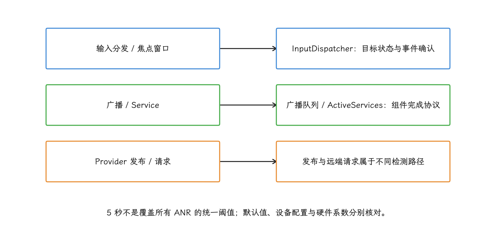

图：先用ANR主题定类型，再还原计时区间；主线程长任务只是多种原因之一。

### 前台服务的三类时限

前台服务的故障排查经常在三套计时器之间绕晕——`startForegroundService()` 的转前台时限、`shortService` 的短时窗口、按类型的累计额度，约束对象和到期结果各不相同。我们先分开看：

| 约束 | Android 17 AOSP 行为 | 超时结果 |
|---|---|---|
| `startForegroundService()` 后转入前台状态 | `mServiceStartForegroundTimeoutMs` 默认 30 秒；系统随后还有 `mServiceStartForegroundAnrDelayMs` 默认 10 秒的处理窗口 | 未及时调用 `startForeground()` 会进入 start-foreground-service ANR 处理。后台启动限制是另一套准入规则。 |
| `FOREGROUND_SERVICE_TYPE_SHORT_SERVICE` | `mShortFgsTimeoutDuration` 默认约 3 分钟；`onTimeout()` 后还有 `mShortFgsAnrExtraWaitDuration` 默认 10 秒 | 仍未停止服务时触发 ANR。 |
| 以 Android 15 及以上为目标平台的 `dataSync` / `mediaProcessing` | 应用处于后台时，每种类型在 24 小时内累计约 6 小时；用户把应用带到前台会重置额度 | 收到 `onTimeout()` 后仍不停止会抛出内部 `RemoteServiceException` 并导致崩溃，不能归类为 ANR。 |

这些默认值来自 `android-17.0.0_r1` 源码，产品代码仍应在业务可接受的时间内结束工作；拿系统超时减去一小段时间当日常预算，执行时仍贴着系统上限，稍有波动就越界。

版本边界必须保留：本篇固定标签里的 `ActiveServices.serviceForegroundTimeout()` 停止服务后，延迟进入 `serviceForegroundTimeoutANR()`；当前 [FGS 故障排查文档](https://developer.android.com/develop/background-work/services/fgs/troubleshooting) 仍说明 `ForegroundServiceDidNotStartInTimeException` 崩溃路径。旧版本或厂商实现不能直接套用本表的 Android 17 默认值与结果，报告分类应结合系统构建、退出原因和实际堆栈确认。

<!-- gracker-diagram: a210-02-fgs-boundaries -->
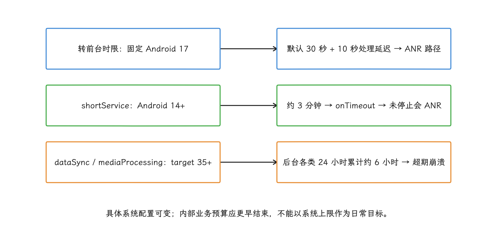

图：本图第一行仅描述固定AOSP标签；旧版与厂商转前台失败也可能是异常崩溃，不能统一归为ANR。

### 从类型进入修复路径

类型定下来之后，主题直接决定我们接下来核对哪条执行路径：

| ANR 主题或类型 | 优先核对的线程与状态 | 常见修复方向 |
|---|---|---|
| input dispatch（输入分发） | 主线程、焦点窗口、同步 Binder、锁持有者 | 缩短主线程任务，移除同步等待，修复焦点或窗口创建异常 |
| broadcast of intent（广播处理） | receiver 所在线程、冷启动、`goAsync()` 工作线程 | 缩短启动与 receiver 工作，使用独立工作线程，保证 `finish()` |
| executing service（执行 Service） | 主线程和进程启动 | 缩短 Application 与 Service 回调，后台执行可中断工作 |
| content provider not responding | provider 发布线程、provider Binder 线程、调用方 | 精简初始化，限制查询成本，修复 Binder 或锁等待 |
| start foreground / short FGS | Service 回调与停止时序 | 按时调用 `startForeground()` 或停止服务，处理 `onTimeout()` |
| job service start/stop | `JobService` 主线程回调 | 立即返回并异步执行，遵守通知与完成协议 |

用这张表时还要留意：一份主线程快照只说明采样那一瞬间。广播可能运行在自定义 `Handler` 上，`goAsync()` 的工作也可能落在后台 worker 线程；主线程栈里出现 `nativePollOnce`，只说明 Looper（线程消息循环） 正在等消息，看到它就把这类 ANR 排除掉，是会漏判的。

<!-- gracker-diagram: a210-03-type-thread -->
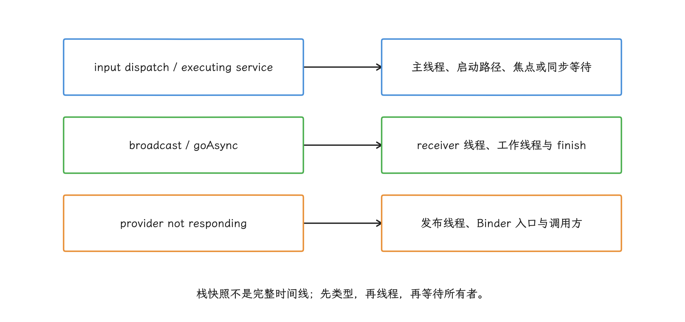

图：主线程nativePollOnce只说明采样时空闲；广播worker、焦点或晚采样仍可能解释ANR。

## 缩短主线程同步工作并异步化

主线程要处理 Looper 消息、组件回调、窗口与输入相关的工作，治理的目标是：每个同步阶段都有明确的耗时预算，每个等待都能找到所有者，超出预算的工作可以取消、降级或延后。这一节我们按“先选执行位置、再立预算”的顺序展开。

### 先按工作性质选择执行位置

| 工作 | 合适的执行位置 | 约束 |
|---|---|---|
| 磁盘、网络和其他阻塞 I/O | 专用 executor（负责调度任务的执行器）或 `Dispatchers.IO` | 线程数和排队长度要受控；超时后还要确认底层调用能否取消 |
| JSON 解析、图像处理、压缩等 CPU 工作 | `Dispatchers.Default` 或受控计算线程池 | 并行度应匹配 CPU 和产品负载，不能挤占所有可运行线程 |
| UI 状态提交 | 主线程 | 后台先准备不可变结果，主线程只做短时间状态切换 |
| 需要跨进程的查询 | 后台线程、缓存或异步协议 | 同步 Binder 没有通用调用超时，后文单独说明 |
| 可推迟且需要进程重启后继续的任务 | [WorkManager](https://developer.android.com/topic/libraries/architecture/workmanager) / JobScheduler | 适合持久、可延迟工作，不适合当前页面必须立即得到的结果 |

线程切换改变的只是执行位置：无界队列照样积压，不可取消的 I/O 照样占住 worker，错误地切回 `Dispatchers.Main` 照样阻塞界面。

<!-- gracker-diagram: a210-04-execution-place -->
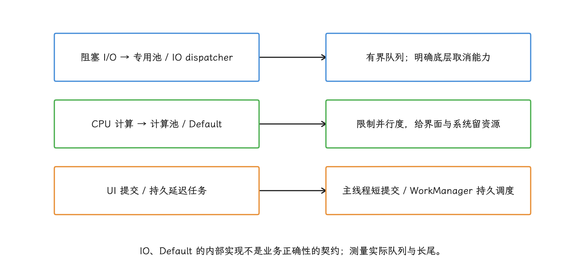

图：协程组织生命周期和取消传播，执行线程仍需指定；切线程不会消除积压或不可取消阻塞。

### 协程负责结构，线程由我们指定

协程本身只负责把结构组织好，阻塞 I/O 用 `Dispatchers.IO`、CPU 计算用 `Dispatchers.Default`、界面状态用 `Dispatchers.Main`，选择仍在我们。`Dispatchers.IO` 与 `Default` 的内部池和并行度属于 `kotlinx.coroutines` 版本实现细节，项目升级依赖后可能变化，业务正确性建立在这些实现细节上是很脆的。

下面的示例展示一个可取消的加载过程。读取和解析在后台完成，主线程只接收已经准备好的结果。

```kotlin
class ArticleRepository(
    private val ioDispatcher: CoroutineDispatcher,
    private val cpuDispatcher: CoroutineDispatcher,
) {
    suspend fun load(path: Path): Article {
        val bytes = withContext(ioDispatcher) {
            Files.readAllBytes(path)
        }
        return withContext(cpuDispatcher) {
            parseArticle(bytes)
        }
    }
}

class ArticleViewModel(
    private val repository: ArticleRepository,
) : ViewModel() {
    fun open(path: Path) {
        viewModelScope.launch {
            val article = repository.load(path)
            _uiState.value = UiState.Content(article)
        }
    }
}
```

这段代码把线程选择作为依赖传入，测试时可以替换调度器。取消协程能拦住后续步骤，但 Java 阻塞 I/O、JNI 或同步 Binder 能否立刻停下来，要看底层 API 响应中断还是提供取消接口。

### 启动阶段不要制造“异步假象”

`Application.onCreate()`、Activity 创建和 provider 安装共享主线程。启动管理框架能整理依赖顺序，但把初始化移到后台这件事它不会替我们做：

- **[AndroidX App Startup](https://developer.android.com/topic/libraries/app-startup)**：`InitializationProvider` 仍在启动时同步执行 `Initializer.create()`。它解决的是合并 provider、声明依赖和按需关闭自动初始化；初始化本身耗不耗时，仍要组件作者自己设计异步接口。
- **第三方 SDK**：先确认 SDK 是否允许延迟或后台初始化。擅自换线程可能违反其线程约束，造成更晚出现的崩溃或数据缺失。
- **StrictMode**：`detectDiskReads()`、`detectDiskWrites()` 等负责检测，`penaltyLog()`、`penaltyDeath()` 等策略决定处理方式，两者要配齐——只加检测不加策略，主线程 I/O 不会自己抛异常。
- **[SharedPreferences](https://developer.android.com/reference/android/content/SharedPreferences.Editor)**：`apply()` 把磁盘写入排队，但 Android 框架会在部分组件生命周期边界等待尚未完成的 queued work（框架登记的待完成任务）。短时间大量 `apply()` 可能把阻塞推迟到 Activity 或 Service 回调，批量写入和减少频率比机械替换 `commit()` 更可靠。
- **WorkManager**：适合需要持久化、满足约束后再执行的工作。页面打开后立刻需要的结果仍要使用明确的异步接口和界面状态。

启动优化要记录每个初始化项的调用线程、依赖、可延迟条件、失败处理与完成时刻；只记一句“已经异步”，说明不了主线程预算有任何改善。

<!-- gracker-diagram: a210-05-startup-sync -->
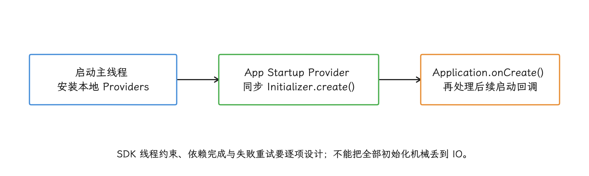

图：App Startup合并provider、整理依赖与支持按需初始化；同步create本身仍会占用启动线程。

### 为主线程任务建立预算

固定 500 毫秒之类的全局阈值会把不同业务混成一类，更稳妥的做法是按场景立基线，我们一步步来：

1. 对冷启动、页面切换、广播、Service 和 provider 分别采样。
2. 记录主线程消息耗时、排队时长、同步 Binder 时间、锁等待和设备状态。
3. 按设备等级、系统版本和温度分组，比较 P50、P95、P99（第 50、95、99 百分位）与长尾。
4. 结合输入响应和系统 ANR 数据设置内部告警线；告警线应早于对应系统窗口，并保留足够安全余量。
5. 每次修复同时验证成功路径、失败路径、取消路径和进程重建。

内部告警线服务于趋势发现：超过告警线时记“主线程 stall（长时间未继续处理消息）”或“ANR 风险事件”更准确，系统尚未判定，就先不要记成 ANR。

## IPC（Binder）调用治理

Binder 是 Android 的主要 IPC（inter-process communication，进程间通信）机制，同步调用会让调用线程一直等到对端处理完成。而 Binder 驱动没有为每笔普通同步事务提供应用可配置的通用超时，对端进程 CPU 饥饿、Binder 线程池占满、锁等待或再次调用其他进程，都可能把等待拉长。这一节我们就看在调用方和服务端两侧怎么管住这种等待。

### 调用方要控制等待位置与协议

主线程上的同步 Binder 只适合经过测量、结果稳定又没有替代方案的轻量操作，更常见的做法是我们都熟悉的几条：

- 缓存变化不频繁的系统信息，明确缓存失效条件，避免在绘制或输入路径重复查询。
- 合并多次小事务，减少往返和 Parcel（Binder 传递参数时使用的序列化容器）开销；单次数据量仍要受 Binder 事务大小限制。
- 把外部服务调用放到受控后台线程，并给业务结果设计超时、默认值或稍后重试。
- 对自有 AIDL（Android Interface Definition Language，Android 接口定义语言）设计异步回调或可取消请求，用 request ID（请求标识）丢弃迟到结果。
- 只有调用语义允许单向投递时才使用 AIDL 的 `oneway`：调用方提交后不等返回，但远端处理速度跟不上时，事务会在队列中积压，这就是这里所说的背压。可见 `oneway` 解决的是“不必等”，把积压问题原样搬到了对端。

`Future.get(timeout)` 等待后台任务时，调用方可以在超时后停止等待，但执行 Binder 事务的后台工作线程仍可能被占用；协程 `withTimeout` 会发出取消信号，阻塞式 Binder 事务通常不响应这次取消，工作线程仍要等远端返回。两种写法都终止不了远端正在执行的 `onTransact()`，主线程也就没有理由阻塞等这类结果。

<!-- gracker-diagram: a210-06-binder-timeout -->
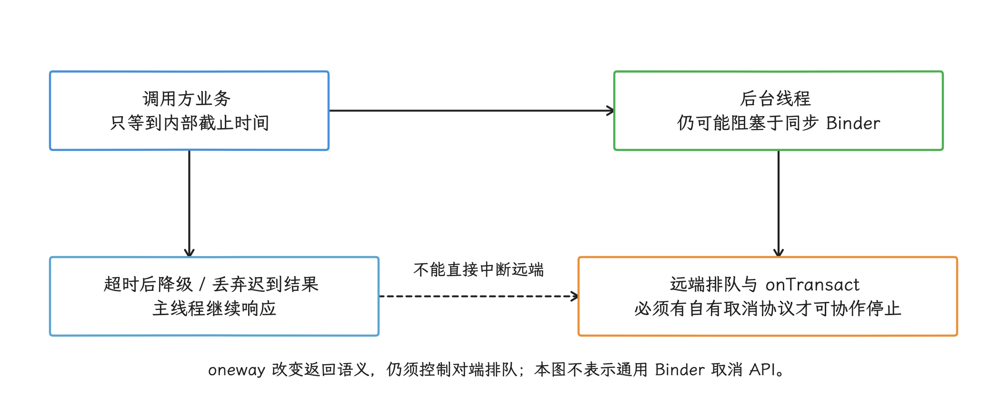

图：Future.get超时与协程取消只能改变调用方等待策略；同步Binder和远端工作可能继续占用资源。

### 服务端也会制造调用方 ANR

再看服务端这一头。远程 Binder 调用通常进入服务端的 Binder 线程池，这里常见的风险有：

- `onTransact()` 把工作同步切到主线程，再等待主线程返回。
- Binder 线程持锁执行磁盘、网络、回调或嵌套 Binder 调用。
- 所有 Binder 线程都被长事务占住，新请求只能排队。
- 服务端持有锁调用客户端回调，客户端又请求服务端同一把锁，形成跨进程环路等待。
- 大对象频繁序列化，占用 Binder 线程和内存带宽。

自有服务应记录接口名、请求 ID、调用方、排队时间、执行时间和结果状态；观测代码优先放在自有客户端代理（proxy）、服务端桩（stub）或调用点。隐藏的 `BinderProxy.transactNative()` Hook（拦截内部调用入口）这类做法容易随系统实现变化，也可能与运行时或其他 SDK 冲突，我们尽量不靠它。

怀疑系统服务变慢时，用 Perfetto、线程采样和系统 traces 一起判断。`system_server` 承载着 ActivityManager 等 Android 系统服务，它的问题会在多条路径上同时显现。

外部 Service 变慢要传导到 ContentProvider ANR，中间还差一条同步等待路径：应用线程在 provider 发布、provider 请求或其他受监控阶段同步等待该 Service，系统计时器到期后，才会形成相应类型的 ANR。

## 锁竞争与死锁预防

主线程等锁时，堆栈通常停在 `BLOCKED`（等待进入 Java `synchronized` 监视器）、`LockSupport.park()`（线程被并发工具暂停）、`Object.wait()`（等待其他线程通知）或 native mutex（本地代码互斥锁）。修复的思路是顺着三个问题追到持锁线程：谁持锁、持锁期间做了什么、有没有反向依赖。

下面这段线程摘录用于识别双锁环路，`held by tid=...` 表示该锁当前由哪个线程持有。

```text
"main" tid=1 BLOCKED
  waiting to lock <0x01> held by tid=8

"worker-1" tid=8 BLOCKED
  waiting to lock <0x02> held by tid=1
```

读一遍就能看出环：主线程持有 `<0x02>` 等 `<0x01>`，worker 持有 `<0x01>` 等 `<0x02>`。这种死锁延长超时、加线程都救不回来。

### 锁设计的工程约束

- **固定获取顺序**：需要多把锁时，在模块内规定稳定顺序，并用代码审查或测试检查反向获取。
- **临界区只保留内存状态变更**：磁盘、网络、Binder、等待 future（代表尚未完成结果的句柄）和外部回调都放到锁外；需要一致视图时，在锁内生成不可变快照，锁外执行耗时操作。
- **明确数据所有者**：单线程所有权、不可变对象或消息传递常比多处共享可变状态更容易验证。
- **主线程可以持有短而无竞争的锁**：一律禁锁反而会逼出复杂的无锁代码，要禁的是不可控等待和锁内阻塞。
- **粗锁与细锁都要测量**：粗锁减少嵌套却可能扩大竞争，细锁降低局部冲突却会增加顺序错误，怎么选取决于访问模式。
- **原子类只保护对应的原子操作**：`volatile`、`AtomicReference` 和并发容器各管各的原子操作，跨字段不变量或“检查后执行”落在自动保护之外。
- **`tryLock()` 需要安全退路**：超时后能返回旧值、跳过非必要工作或重试才有意义；业务必须等结果时，`tryLock()` 只是把失败换了个样子。

`Thread.getStackTrace()` 能从监测线程拿到处于 `BLOCKED` 状态的主线程栈。线上样本还要同时抓锁持有者和相邻线程——只抓主线程的话，我们只能看到“主线程在等”，看不到等待为什么没有结束。

### 把跨进程调用纳入锁图

下面这个顺序单进程审查很容易漏，跨进程看才明显：

1. 应用主线程持有锁 A，同步调用远端服务。
2. 远端服务把回调交给另一工作线程发起，并同步等待该任务完成；该回调不沿原嵌套 Binder 事务链重入应用主线程。
3. 应用 Binder 线程处理回调时也需要锁 A。
4. 主线程等远端返回，Binder 线程等主线程释放锁 A。

这里锁 A 只存在于应用进程，等待环却跨过了 Binder。规则还是那条：持锁期间不调用未知代码，也不做同步 IPC（inter-process communication）。 普通同步嵌套事务可能由 Binder 重入原调用线程，Java monitor 又允许同线程重入，因此不能仅凭“服务端会回调”就断言形成上述环；要确认实际回调线程与等待关系，见 [Binder 线程与嵌套事务](https://source.android.com/docs/core/architecture/ipc/binder-threading)。

<!-- gracker-diagram: a210-07-binder-lock-cycle -->
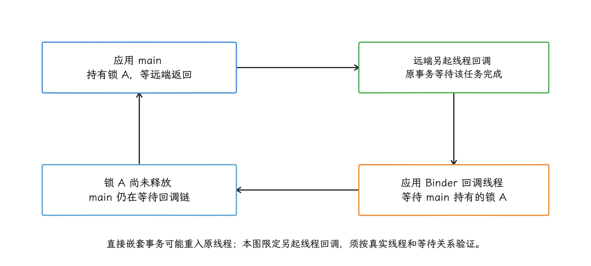

图：main持锁同步IPC，服务端另起线程发起回调并等待；应用Binder回调线程需要锁A，构成跨线程等待环。

## ContentProvider、BroadcastReceiver 与 Service 超时治理

组件 ANR 的计时范围常常比组件方法本身更长：冷启动、前置初始化和线程排队都可能被算进系统窗口。所以只测 `onReceive()` 或 `onStartCommand()` 的函数耗时是不够的，窗口的两头都要看。

### ContentProvider：区分发布和请求

应用冷启动时，`ActivityThread` 先安装清单中的 provider，再在 `Application.onCreate()` 之前调用 provider 的 `onCreate()`，多个自动初始化 provider 就这样依次占用同一条启动路径。治理动作包括：

- provider 的 `onCreate()` 只完成注册和必要状态创建，数据库迁移、网络访问和大文件读取移到可控时机。
- 关闭不需要的 SDK 自动初始化 provider；如果使用 AndroidX App Startup，要逐个审计 `Initializer.create()`——provider 合并只减少安装开销，初始化工作并没有变异步。
- 把可延迟组件改为显式按需初始化，并处理并发首次访问、失败重试和进程重建。
- 记录“进程启动 → provider 安装 → `Application.onCreate()`”的分段时间；只统计 provider 方法内部，会把冷启动本身的耗时漏在账外。

provider 发布完成后，`query()`、`insert()`、`call()` 等入口还可能被并发调用：远程调用经 Binder 线程进入进程，同进程调用则可能在调用线程直接执行。所以 provider 实现要按并发入口设计，“所有方法都在主线程”的假设靠不住，一把大锁包住数据库、文件和 IPC 的做法也一样。

publish 基线来自 `ContentResolver.CONTENT_PROVIDER_PUBLISH_TIMEOUT_MILLIS`。`ContentProviderHelper` 中等待 provider 就绪、请求方检测 provider 无响应等路径有各自的条件和时限，所以报告里要保留 ANR 类型和描述，看到 provider 名称就套 10 秒发布结论，容易把另一条检测路径当成 publish 超时。

<!-- gracker-diagram: a210-08-provider-stages -->
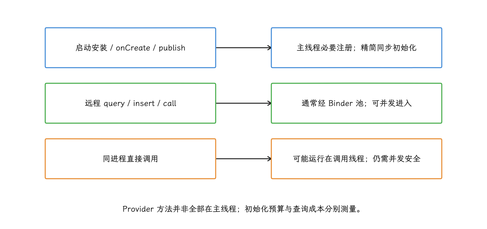

图：publish超时不能覆盖全部provider ANR；数据库迁移、文件与IPC等待要按实际入口追踪。

#### 案例：清单合并引入的 SDK Provider

如果 SDK 升级后，冷启动 P95 和启动附近 ANR 同时上升，主线程栈又停在 SDK Provider 的 `onCreate()`，这个位置仍只能作为候选。排查时依次验证同步磁盘、数据库迁移、Binder/网络等待、类加载与 page fault（访问的内存页尚未映射，需要内核补齐映射，部分情况会读取存储），以及 `Application.onCreate()` 本身的区间。

调查从 release variant（用于发布的构建变体）的 merged manifest（应用清单合并结果）入手，记录 Provider 的来源依赖、authority（系统识别 Provider 的唯一名称）、process（所属进程）、`initOrder`（初始化顺序）、direct-boot（用户解锁前可否运行）属性和官方关闭自动初始化方式。`ActivityThread.handleBindApplication()` 先安装本地 Provider 再调用 `Application.onCreate()`，清单合并带进来的组件即使业务从不主动调用，也可能占用启动主线程。另外，外部 Provider 访问、Job、Service、Broadcast 或推送都可能触发非桌面启动，数据必须带上启动原因和进程名。

自有 Provider 可用稳定的 Trace section（性能时间线中的命名区间）标记短区间：

```kotlin
class DiagnosticsProvider : ContentProvider() {
    override fun onCreate(): Boolean {
        Trace.beginSection("DiagnosticsProvider#onCreate")
        return try {
            installLightweightHooks(requireNotNull(context).applicationContext)
            true
        } finally {
            Trace.endSection()
        }
    }
}
```

trace 只负责测量，初始化不会因此变快，决定预算的是 `installLightweightHooks()` 只保留主线程可接受的注册工作。明确支持后台执行的磁盘与解析移出 Provider，可延迟能力改为按需初始化，要求主线程的 SDK 步骤留在主线程并压缩——把所有初始化统一丢给 `Dispatchers.IO`，调用方可能在初始化完成前访问能力，或者违反 SDK 的线程约束。

修复后至少重放这些场景：

- 全新安装。
- 数据库 schema（表和字段结构）跨版本覆盖升级。
- 桌面、Provider、Service、Broadcast、Job 和推送启动。
- 主进程与独立进程。
- 离线与弱网。
- 初始化完成前立即调用。
- 多调用方并发等待。

验证时各工具分工明确：Macrobenchmark 批量测量启动性能分布，Perfetto 用时间线确认主线程区间，`ApplicationStartInfo` 对齐系统记录的启动节点，`ApplicationExitInfo` 和 ANR traces 复核进程退出与现场栈。最后还要看质量指标：P95、P99 等高百分位启动延迟降了，SDK 初始化失败率却升了，这个修复不算合格。

<!-- gracker-diagram: a210-09-sdk-provider-audit -->
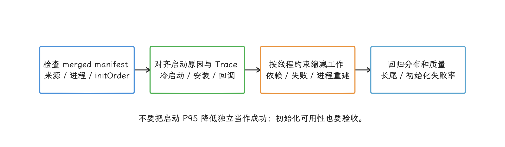

图：栈停在SDK Provider只提供候选；结合最终清单、Perfetto和启动系统节点确认，保留升级与并发首次访问回归。

### BroadcastReceiver：`goAsync()` 不增加时间

清单注册的 receiver 通常由主线程执行；动态注册时，可通过 `Context.registerReceiver()` 的 `scheduler: Handler` 参数指定接收线程，见 [BroadcastReceiver 线程说明](https://developer.android.com/reference/android/content/BroadcastReceiver)。换到后台线程保护了 UI 响应，但 receiver 仍受广播期限约束，线程池排队也要消耗时间——线程换掉了，期限没换。

`goAsync()` 返回的 `PendingResult` 允许 `onReceive()` 返回后继续处理，但计时起点仍是广播分发那一刻，直到 `PendingResult.finish()` 为止，异步工作沿用原有截止时间。进程在 receiver 完成后也可能被回收，需要在进程重建后继续的工作交给 WorkManager 或 JobScheduler。

<!-- gracker-diagram: a210-10-broadcast-window -->
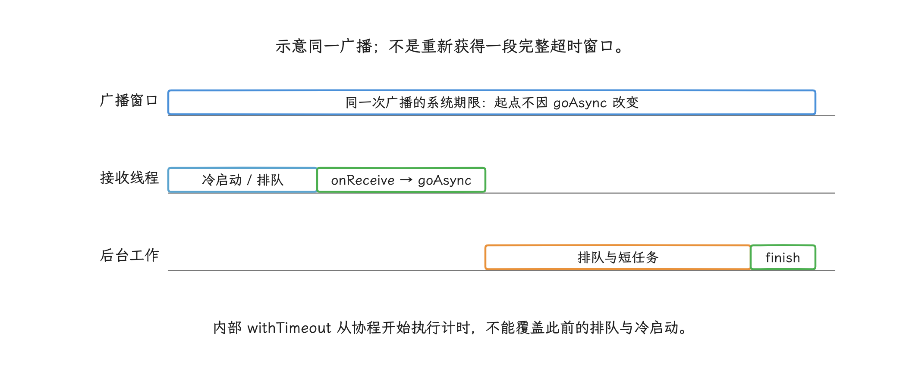

图：onReceive返回后由PendingResult.finish结束同一次广播；冷启动、工作线程排队和执行仍消耗该窗口。

示例只处理能在广播期限内完成、支持协程取消的短任务。`receiverScope` 由应用统一持有，避免每次广播创建无人管理的作用域；应用还应为它配置受控的后台调度器和异常处理。

```kotlin
class SyncReceiver(
    private val receiverScope: CoroutineScope,
    private val processor: SyncProcessor,
) : BroadcastReceiver() {

    override fun onReceive(context: Context, intent: Intent) {
        val pending = goAsync()
        val job = receiverScope.launch {
            withTimeout(processor.internalBudgetMillis) {
                processor.handle(intent)
            }
        }
        job.invokeOnCompletion {
            pending.finish()
        }
    }
}
```

默认 `launch` 可能在协程体开始执行前就被取消，这个分支协程体内的 `finally` 覆盖不到。`Job.invokeOnCompletion()` 在任务成功、失败或取消后执行一次；注册时任务若已完成，处理器也会立即执行，因此示例把唯一一次 `finish()` 放在完成处理器中。处理器可能在不同线程运行，只负责结束广播，不执行额外耗时工作。

<!-- gracker-diagram: a210-11-receiver-completion -->
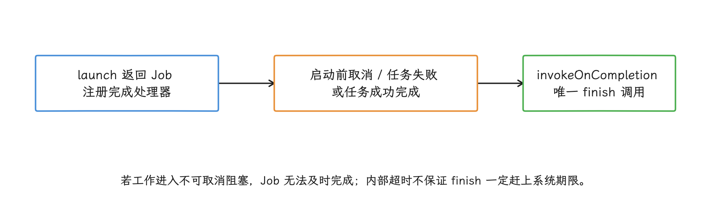

图：只在协程体finally调用finish会漏掉体未开始的取消；完成处理器仅结束广播，不做额外重活。

这里的内部预算必须短于对应广播窗口，由线上基线确定；排队时间仍会消耗广播窗口，协程内的计时把这一段落在账外。`processor.handle()` 还要能响应取消——一旦它进入不可取消的阻塞调用，`withTimeout` 也拦不住这段代码，按时完成任务并调用 `finish()` 就失去了保证。超过广播窗口或要求进程重建后继续的任务，在 `onReceive()` 里只入队持久任务即可。

### Service：生命周期回调必须很短

`Service.onCreate()`、`onStartCommand()`、`onBind()` 和 `onDestroy()` 默认都在应用主线程。执行 Service ANR 的窗口还可能包含进程冷启动，所以 Service 自身方法看起来再快，我们也要回头检查 `Application` 和 provider：

- 回调内完成参数校验、状态切换和任务调度，然后返回。
- 后台工作使用由 Service 持有的 executor 或协程作用域，`onDestroy()` 取消任务并释放资源，免得 Service 销毁后工作还占着线程。
- `startForegroundService()` 后尽早准备并发布通知，不要等待网络、数据库或远端配置。
- `shortService` 实现 `onTimeout()` 并立即停止；测试超时、重复 start 和进程重建。
- 以 Android 15 及以上为目标平台时，`dataSync`、`mediaProcessing` 等受总额度约束的 FGS（Foreground Service） 要实现 `onTimeout()`，超时后停止，避免被系统以异常结束进程。

返回 `START_STICKY` 决定的只是服务被杀后的重建策略：当前回调不会因此变短，ANR 时限也不会因此豁免。

## ANR Watchdog（看门狗）搭建

应用侧的 Watchdog 思路很简单：后台线程按固定周期向主 Looper 投一个探针（供主线程执行的轻量 `Runnable`），量它多久才被执行，主 Looper 长时间没有响应就能靠它发现。不过系统判定 ANR 的条件分散在 InputDispatcher、广播、Service、provider 和 `system_server` 各处，Watchdog 复刻不了这些，我们把它当补充证据用。

### 避免探针互相确认

常见示例的做法是每个周期把共享计数标记（tick）清零，再投递同一个 `Runnable`。这样旧探针晚到时可能替新周期盖章成功，连续阻塞时探针也会在主队列里越堆越多。生产实现应该始终只保留一个待确认 token（本轮探针的唯一标识），让 `Runnable` 只能确认自己的 token。

下面的精简实现展示单探针设计。`uptimeMillis()` 是设备启动以来、不计深度休眠时间的单调时钟，用户改系统时间影响不到它，系统多条 ANR 计时路径用的也是这个基准。示例保证同一次 stall 只上报一次。

```kotlin
data class MainStallSample(
    val delayedMillis: Long,
    val mainStack: Array<StackTraceElement>,
)

class MainLooperWatchdog(
    private val pollMillis: Long,
    private val stallThresholdMillis: Long,
    private val onStall: (MainStallSample) -> Unit,
) : Thread("main-looper-watchdog") {

    init {
        require(pollMillis > 0) { "pollMillis must be positive" }
        require(stallThresholdMillis > 0) { "stallThresholdMillis must be positive" }
    }

    private val mainHandler = Handler(Looper.getMainLooper())
    private val mainThread = Looper.getMainLooper().thread
    private val nextToken = AtomicLong(0L)
    private val pendingToken = AtomicLong(0L)
    private val postedAt = AtomicLong(0L)
    private val reportedToken = AtomicLong(0L)

    override fun run() {
        while (!isInterrupted) {
            val now = SystemClock.uptimeMillis()
            val token = pendingToken.get()

            if (token == 0L) {
                val newToken = nextToken.incrementAndGet()
                postedAt.set(now)

                if (pendingToken.compareAndSet(0L, newToken)) {
                    val accepted = mainHandler.post {
                        pendingToken.compareAndSet(newToken, 0L)
                    }
                    if (!accepted) {
                        pendingToken.compareAndSet(newToken, 0L)
                    }
                }
            } else {
                val delayedMillis = now - postedAt.get()
                if (delayedMillis >= stallThresholdMillis &&
                    reportedToken.getAndSet(token) != token
                ) {
                    onStall(
                        MainStallSample(
                            delayedMillis = delayedMillis,
                            mainStack = mainThread.stackTrace,
                        )
                    )
                }
            }

            try {
                sleep(pollMillis)
            } catch (_: InterruptedException) {
                interrupt()
            }
        }
    }
}
```

旧 `Runnable` 的 token 与当前 token 不同时，`compareAndSet()` 不会替新周期盖章；当前 token 未完成前也不再投递探针（供主线程执行的轻量 `Runnable`）。同一个 `Thread` 实例只能 `start()` 一次，重复调用会抛出 `IllegalThreadStateException`；应用仍需统一管理实例，防止创建多个独立 Watchdog。示例省略了应用退出处理、采样频率上限和持久队列。`onStall` 是发现长时间无响应后的回调，里面别同步做网络或大文件写入。

<!-- gracker-diagram: a210-12-watchdog-token -->
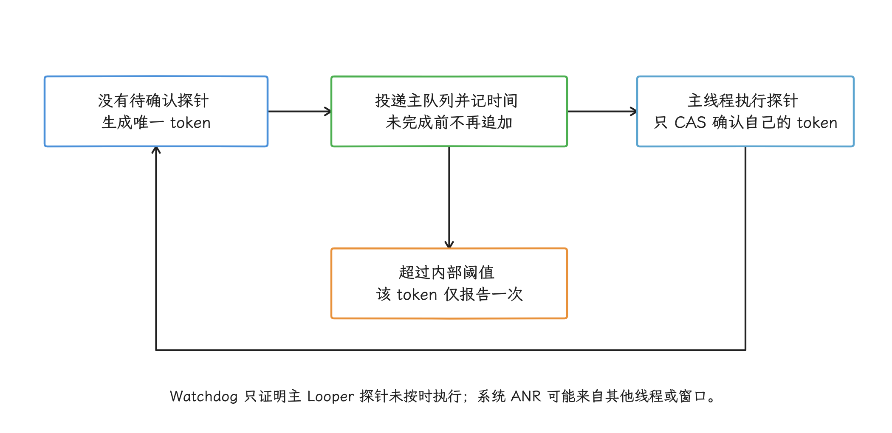

图：未确认期间只监测当前token，旧Runnable不能确认新token；同一Thread不可重复start，实例仍需统一管理。

### 阈值来自产品基线

Watchdog 阈值没有通用的 3 秒或 5 秒答案：定短了，正常的长消息、调试器暂停和设备进出休眠的时刻都会被记成风险事件；定长了又起不到预警作用。配置时我们考虑：

- 对应业务最常见的系统 ANR 类型及其时限。
- 设备等级、系统版本、温度和应用进程状态。
- 主线程消息耗时的线上分布与采样开销。
- 同一 stall 的去重、两次上报之间的最短间隔和每日上报配额。
- debug 构建、性能测试和已连接调试器时的排除规则。

Watchdog 报告应包含 token、投递时间、延迟、主线程栈、若干关键线程栈、进程状态和设备负载。`Thread.getStackTrace()` 能抓到主线程等锁时的栈，但单次采样说明的东西有限，连续样本能帮我们区分“正在推进的慢任务”和“停在同一位置的等待”。

向自身发送 `SIGQUIT` 会让 ART 生成 thread dump（所有线程在采样时刻的堆栈快照）。这个动作本身有开销，普通应用通常也读不到系统保存在 `/data/anr` 的文件，所以我们只在内部调试或受控的小流量发布里用它，避免每次线上 stall 都触发。

### Watchdog 的能力边界

- 它证明的只是主 Looper 探针未按时执行；系统是否已经判定 ANR，要以系统侧记录为准。
- receiver 运行在自定义线程或 `goAsync()` worker 卡住时，主 Looper 可能完全正常。
- 无焦点窗口和部分系统侧等待不一定表现为主线程持续阻塞。
- 系统可能在 Watchdog 上报前、同时或之后判定 ANR，没有“必定提前通知”的保证。
- 主线程恢复后，Watchdog 样本仍有价值；ANR 不是 Java Crash，不一定终止进程。

所以 Watchdog 事件与系统 ANR 应分开存储，之后按时间、进程、ANR 类型和堆栈签名（由关键栈帧生成的事件指纹）关联。

<!-- gracker-diagram: a210-13-watchdog-limits -->
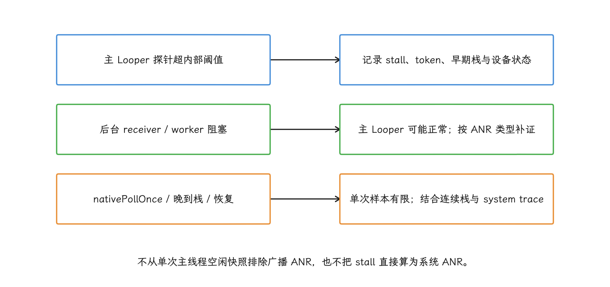

图：内部阈值取自产品基线；系统可能在Watchdog前后判定，不保证提前预警或一定结束进程。

## ANR 预警与主动发现

应用 Watchdog 之外，系统在近两个版本补上了官方的预警能力：Android 17 增加了接近系统 ANR 时限的公开回调，Android 16 增加了 ANR 触发式 profiling。两者都只在系统条件允许时提供，不保证每次事件都有回调或结果，我们接它们是为了多一路现场信息。

### Android 17：`registerAnrWarningListener`

API 37 的 `ActivityManager.registerAnrWarningListener()` 在应用接近 ANR 超时时通知监听器。官方要求 executor 别用主线程；系统既不保证一定回调，也不保证回调后还留有足够时间，接入时要按“尽力而为”设计。

下面的接入示例只保存小型结构化记录，`AnrWarningStore` 代表项目自定义的有界存储接口。监听器对象要留着，注销时用的是同一个实例。

```kotlin
@RequiresApi(37)
class AnrWarningCollector(
    context: Context,
    private val store: AnrWarningStore,
) : AutoCloseable {

    private val activityManager =
        context.getSystemService(ActivityManager::class.java)

    private val executor = Executors.newSingleThreadExecutor { runnable ->
        Thread(runnable, "anr-warning")
    }

    private val listener = Consumer<AnrWarningResult> { result ->
        store.append(
            anrId = result.anrId,
            anrType = result.anrType,
            consumedMillis = result.consumedMillis,
            timeoutMillis = result.timeoutMillis,
            description = result.description,
            mainStack = Looper.getMainLooper().thread.stackTrace,
        )
    }

    fun start() {
        activityManager.registerAnrWarningListener(executor, listener)
    }

    override fun close() {
        activityManager.unregisterAnrWarningListener(listener)
        executor.shutdown()
    }
}
```

`AnrWarningResult` 给出 `anrId`、`anrType`、已消耗时间和总时限，已消耗时间用的就是 `uptimeMillis()` 那套基准。`description` 面向诊断且格式不稳定，存下来或给相似报告分组可以，解析成长期协议不行。监听器里只采集有限信息、追加到预分配或有界存储，远端上报留给进程恢复后再做。

如果预警最终发展成 ANR，可用 `anrType + anrId` 与 API 37 的 `ApplicationExitInfo.AnrInfo` 关联；官方只保证 `anrId` 在同一 ANR 类型内唯一，不能把 ID 单独作为全局主键。读取退出记录时还要处理 `getAnrInfo()` 返回 `null` 的情况。`AnrInfo` 还包含 ANR 类型、系统等待时限和 `isUserPerceptible()`。这里的 user-perceptible（用户可感知）按系统是否展示 ANR 对话框定义，Google Play 的 user-perceived core vital（用户可感知的主要质量指标）当前只统计 input dispatch ANR，两个统计的算法不同，对照数据时留意。

### Android 16 及以上：ANR Profiling Trigger

API 36 的 `ProfilingTrigger.TRIGGER_TYPE_ANR` 在系统识别 ANR 后、可能结束应用前触发，返回正在采集的 system trace 快照。Profiling 指按配置采集性能数据，system trace 记录一段时间内的线程调度、CPU 和系统事件。触发器触发只说明系统识别到了 ANR，之后应用未必结束；采集结果也受系统资源、频率限制和配置影响，我们拿它补充 ANR traces、`ApplicationExitInfo` 和业务监控，而不是替代它们。

可以把三类信号按时间关联：

| 信号 | 发生阶段 | 能回答的问题 |
|---|---|---|
| 应用 Watchdog | 主 Looper 超过内部阈值 | 主线程何时开始不响应，早期栈停在哪里 |
| `AnrWarningResult` | API 37，接近系统时限 | 系统正在观察哪种 ANR、已经消耗多少预算 |
| `ApplicationExitInfo.AnrInfo` / profiling 结果 | 系统认定 ANR 后，或进程退出后 | ANR 类型、ID、系统时限、用户可感知状态和 system trace |

同一个事件用 `anrType + anrId`、进程启动标识、单调时钟时间和堆栈签名关联。单调时钟的绝对值不能跨设备重启直接比较，关联进程重启前后的记录时还要保存启动会话或其他时钟锚点。这里用单调时钟是有讲究的：Wall clock 是可被用户或网络校时调整的日历时间，单调时钟只向前累计，计算同一进程内的时间间隔更适合用它。

<!-- gracker-diagram: a210-14-warning-evidence -->
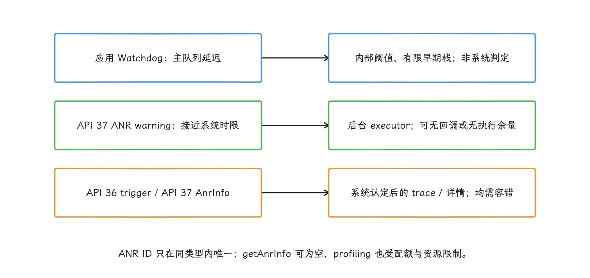

图：用ANR类型和ID、进程生命周期、时间及签名关联；description格式不可作为长期协议。

### Looper 与 Binder 的主动监测

`Looper.setMessageLogging()` 可以通过 `Printer` 回调接口观察消息分发前后的文本，但有三个限制要记牢：每个 Looper 只有一个 `Printer` 槽位且没有公开的读取方法，文本格式属于诊断输出，持续解析会增加主线程成本。所以接入时由一个组件统一持有 `Printer`，把其他消费者加入内部观察者列表，并在目标 Android 版本验证格式；线上使用要配采样、频率限制和远程开关。

单条消息的风险阈值应来自场景基线，统一写成 500 毫秒并不可取：总延迟里还有消息排队、同步屏障（临时阻止普通同步消息通过、让异步消息先执行的队列标记）、渲染工作、Binder 和锁等待，Looper 分发时长只覆盖其中一部分。

Binder 监测优先在自有接口的调用点记录开始、结束和请求 ID。隐藏 API Hook 依赖未公开接口，系统升级后可能失效，也很难区分对端排队与执行阶段，因此改不了的系统调用我们用 Perfetto、采样栈和 ANR traces 交叉判断。

## 后台 ANR 与前台 ANR 的差异化治理

谈差异化治理之前，我们先把前台、后台和 Google Play 三套统计的算法分开说清，混在一起会把问题规模看错。

Google Play 当前提供三项以 DAU（daily active users，当日活跃用户）为分母的指标。这里按用户与设备组合计数：同一人在同一天使用两台设备，两台都会贡献活跃用户数，不能当作跨设备去重的人数：

- **ANR rate**：当天至少经历一次任意类型 ANR 的活跃用户占比。
- **User-perceived ANR rate**：当天至少经历一次 user-perceived ANR 的活跃用户占比；当前只把 `Input dispatching timed out` 计入该指标。
- **Multiple ANR rate**：当天至少经历两次 ANR 的活跃用户占比。

User-perceived ANR rate 是 Google Play 用于影响曝光判断的 core vital（主要质量指标），官方当前给出的全局不良行为阈值为 0.47%，单设备型号阈值为 8%。这些数值和定义可能调整，发布治理规则前我们再核对一次官方页面。

<!-- gracker-diagram: a210-15-play-denominators -->
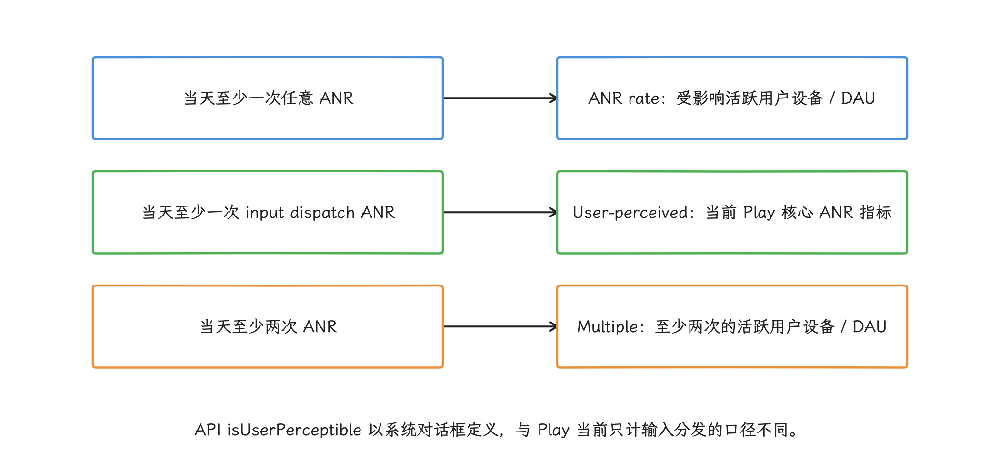

图：2026-10-25复核：全局阈值0.47%，单设备型号8%；用户设备按天计数，不能与事件数或会话率直接比较。

后台 ANR 可能不展示对话框，但仍会进入 overall ANR（全部类型 ANR）数据，也可能揭示共享线程池、锁、广播冷启动或 Service 回调的问题。“用户没看到”影响的只是修复优先级，把它当忽略的理由并不成立。

治理看板至少分开：

- 进程重要性与界面可见状态。
- 系统 ANR 类型和 API 37 的 `isUserPerceptible()`。
- Google Play 的 overall（全部类型）、user-perceived（用户可感知）和 multiple（同一用户一天多次发生）指标。
- 会话级 stall、Watchdog 风险事件和系统确认 ANR。
- 设备型号、RAM（运行内存容量）、系统版本、应用版本与场景。

不同指标的分母不一样：“每千次启动 ANR 数”和 Play 的“受影响日活用户占比”放在一起直接比，比出来的结论没有意义。

## 系统负载导致的 ANR 识别与过滤

线上告警里总有一批 ANR，乍看像是系统负载造成的：高 CPU、存储等待、内存压力、Binder 拥塞和 thermal throttling（设备过热后主动降低 CPU 等硬件频率）都会放大同一段代码的耗时。系统负载可以作为归因依据和分组维度，但凭一个信号就删 ANR 记录，很容易把真问题一起删掉。

### 多信号判断

所以一条“疑似系统负载”的判断，至少要凑齐以下几类信号再看：

- ANR 窗口内本进程和系统 CPU 时间、可运行线程压力。
- I/O wait（CPU 等待存储设备完成读写的时间）、进程读写量与同设备同期基线。
- 内存可用量、回收活动，以及 PSI（Pressure Stall Information，资源压力造成任务等待的比例）记录的 memory/CPU/I/O 压力。
- Binder 线程状态、事务排队与 `system_server` 相关栈。
- 设备温度、降频状态与 CPU 频率。
- 同型号、同系统构建、同时间窗口的其他进程是否一起变慢。
- 应用主线程与相关工作线程是否停在同一业务位置。

固定“I/O wait 大于某百分比”或“RAM 小于 2 GB”这样的单条规则都不足以定原因。低端设备也是产品用户，统计时单独分组、保留在整体指标里；把它们从分母剔除，看板会变好看，用户遇到的无响应一点没少。

### 容易误判的信号

- **主线程 `nativePollOnce`**：它只说明采样时主 Looper 正在等待。广播可能在自定义 `Handler` 或工作线程上，快照也可能晚于阻塞点，要按 ANR 类型查看相关线程。对于 executing service 的大量同堆栈晚采样，官方文档允许结合其他信号降低问题组的优先级；换到其他 ANR 类型，这条经验未必仍然成立。
- **`am_proc_died` / `am_kill` 密集**：这两个事件分别记录进程死亡和系统终止进程，短时间大量出现支持“系统内存压力高”的判断，但要证明本次 ANR 与应用代码无关，还得回到应用自己的栈。
- **cached app freezer（缓存应用冻结器）**：系统暂时冻结不活跃的缓存进程，减少其 CPU 使用。应用侧没有可靠的“刚解冻”通用 API，凭时间差跳过必要的状态恢复并不安全，把 freezer 当删除记录的理由同样站不住。
- **`getRunningAppProcesses()`**：这是采样时刻的进程列表，证明不了先前的 ANR 为假，拿来当上报有效性过滤同样不合适。
- **设备启动后不久**：系统服务可能繁忙，但应用冷启动和同步 IPC 同样可能有优化空间，要与同设备基线和系统 traces 一起判断，再下归因结论。

工程上，监控平台可以增加 `system_load_suspected`（疑似系统负载）及证据字段，降低这类事件在告警列表中的排序优先级，或放入单独队列；原始事件、分母和系统确认状态照常保留。多次版本对比后，如果问题只出现在某个设备系统构建、应用栈又分散，我们再把线索交给设备厂商或平台团队联合排查。

<!-- gracker-diagram: a210-16-system-pressure -->
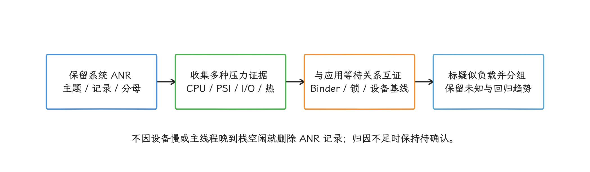

图：高负载、低RAM、进程死亡日志或freezer单个信号都不能证明本次ANR与业务无关。

## 治理与验证流程

最后我们把流程串起来。一个 ANR 修复要能回答三个问题：系统在等什么、哪条线程没有前进、改动如何证明有效。代码改了却没有同场景回归，风险只是换了个位置。

1. **建立事件关联标识**：组合应用版本、进程启动标识、ANR 类型、单调时钟、场景和可用的 `anrId`，用来判断不同记录是否属于同一次事件。
2. **保全证据**：系统 traces、ANR 主题、事件日志、`ApplicationExitInfo`、性能采集结果、Watchdog 连续栈和设备状态分别存储。
3. **还原计时区间**：确认计时开始、结束与已消耗预算，标出冷启动、排队、执行和等待阶段。
4. **找到等待所有者**：主线程卡住时继续查锁持有者、Binder 对端或工作线程；主线程空闲时转向 receiver 线程、焦点窗口和系统状态。
5. **选择可验证的修改**：移出主线程、减少工作、改变 IPC 协议、缩短锁区，或调整需要在进程重启后继续执行的任务方案；每次修改对应一个可观察指标。
6. **做故障注入**：在测试环境让自有 Binder 服务延迟、锁持有时间增加、I/O 变慢、receiver 冷启动，检查取消、降级、`finish()` 和 `onTimeout()`。
7. **覆盖慢设备与压力状态**：低 RAM、CPU 受限、存储繁忙、冷热启动和前后台切换都要进入回归测试。
8. **观察发布前后趋势**：同时看事件数、受影响用户、会话风险事件、设备分组和堆栈问题组，避免分母变化掩盖回归。

每个高频问题组都应有负责人、证据、修复版本和验证结果。材料不齐时标“原因待确认”即可，为了报表整洁直接归入“系统原因”，是把未知当成了已知。

<!-- gracker-diagram: a210-17-governance-loop -->
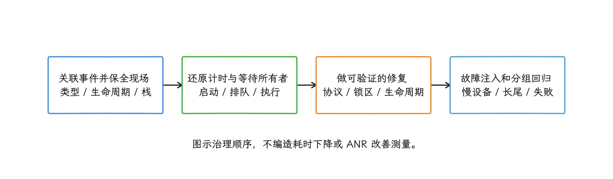

图：延迟自有Binder、延长持锁或模拟receiver冷启动，检查降级、取消、finish与onTimeout，再比较同口径质量趋势。

## 小结

ANR 治理从系统类型和计时窗口开始：主线程、Binder、锁和组件回调各有各的等待关系，Watchdog、API 37 预警、profiling 与 `ApplicationExitInfo` 提供的是互补证据，拼在一起才是一次完整的现场。

工程动作可以压缩成四条：让主线程同步阶段可测且短；让跨线程、跨进程等待可取消或可降级；让组件生命周期遵守系统协议；让每次修复都能在同场景和慢设备上复现、对比。系统负载只用来解释和分组，原始 ANR 记录与用户分母始终保留。

## 参考资料

- [Android Developers：Diagnose and fix ANRs](https://developer.android.com/topic/performance/anrs/diagnose-and-fix-anrs)
- [Android Developers：Android vitals ANR](https://developer.android.com/google/play/vitals/anr)
- [Android Developers：ActivityManager.registerAnrWarningListener](https://developer.android.com/reference/android/app/ActivityManager)
- [Android Developers：AnrWarningResult](https://developer.android.com/reference/android/app/AnrWarningResult)
- [Android Developers：ApplicationExitInfo.AnrInfo](https://developer.android.com/reference/android/app/ApplicationExitInfo.AnrInfo)
- [Android Developers：ProfilingTrigger.TRIGGER_TYPE_ANR](https://developer.android.com/reference/android/os/ProfilingTrigger#TRIGGER_TYPE_ANR)
- [Android Developers：Foreground service timeouts](https://developer.android.com/develop/background-work/services/fgs/timeout)
- [Android Developers：Foreground service types](https://developer.android.com/develop/background-work/services/fgs/service-types)
- [Android Developers：App Startup](https://developer.android.com/topic/libraries/app-startup)
- [Android Developers：WorkManager](https://developer.android.com/topic/libraries/architecture/workmanager)
- [Android Developers：SharedPreferences.Editor](https://developer.android.com/reference/android/content/SharedPreferences.Editor)
- [Android Developers：BroadcastReceiver](https://developer.android.com/reference/android/content/BroadcastReceiver)
- [kotlinx.coroutines：launch 的启动与取消契约](https://kotlinlang.org/api/kotlinx.coroutines/kotlinx-coroutines-core/kotlinx.coroutines/launch.html)
- [kotlinx.coroutines：Job.invokeOnCompletion](https://kotlinlang.org/api/kotlinx.coroutines/kotlinx-coroutines-core/kotlinx.coroutines/-job/invoke-on-completion.html)
- [AOSP Android 17：ActivityManagerService.java](https://android.googlesource.com/platform/frameworks/base/+/refs/tags/android-17.0.0_r1/services/core/java/com/android/server/am/ActivityManagerService.java)
- [AOSP Android 17：ActivityManagerConstants.java](https://android.googlesource.com/platform/frameworks/base/+/refs/tags/android-17.0.0_r1/services/core/java/com/android/server/am/ActivityManagerConstants.java)
- [AOSP Android 17：BroadcastConstants.java](https://android.googlesource.com/platform/frameworks/base/+/refs/tags/android-17.0.0_r1/services/core/java/com/android/server/am/BroadcastConstants.java)
- [AOSP Android 17：ActivityManager.java](https://android.googlesource.com/platform/frameworks/base/+/refs/tags/android-17.0.0_r1/core/java/android/app/ActivityManager.java)
- [AOSP Android 17：ActivityThread.java](https://android.googlesource.com/platform/frameworks/base/+/refs/tags/android-17.0.0_r1/core/java/android/app/ActivityThread.java)
- [AOSP Android 17：ContentResolver.java](https://android.googlesource.com/platform/frameworks/base/+/refs/tags/android-17.0.0_r1/core/java/android/content/ContentResolver.java)
- [AOSP Android 17：ContentProviderHelper.java](https://android.googlesource.com/platform/frameworks/base/+/refs/tags/android-17.0.0_r1/services/core/java/com/android/server/am/ContentProviderHelper.java)
- [AOSP Android 17：ActiveServices.java](https://android.googlesource.com/platform/frameworks/base/+/refs/tags/android-17.0.0_r1/services/core/java/com/android/server/am/ActiveServices.java)
- [AOSP Android 17：InputDispatcher.cpp](https://android.googlesource.com/platform/frameworks/native/+/refs/tags/android-17.0.0_r1/services/inputflinger/dispatcher/InputDispatcher.cpp)
- [AOSP Android 17：IInputConstants.aidl](https://android.googlesource.com/platform/frameworks/native/+/refs/tags/android-17.0.0_r1/libs/input/android/os/IInputConstants.aidl)
- [AOSP Android 17：Service.java](https://android.googlesource.com/platform/frameworks/base/+/refs/tags/android-17.0.0_r1/core/java/android/app/Service.java)
- [AOSP Android 17：Binder.java](https://android.googlesource.com/platform/frameworks/base/+/refs/tags/android-17.0.0_r1/core/java/android/os/Binder.java)
- [AOSP Android 17：BroadcastReceiver.java](https://android.googlesource.com/platform/frameworks/base/+/refs/tags/android-17.0.0_r1/core/java/android/content/BroadcastReceiver.java)
- [AOSP Android 17：CachedAppOptimizer.java](https://android.googlesource.com/platform/frameworks/base/+/refs/tags/android-17.0.0_r1/services/core/java/com/android/server/am/CachedAppOptimizer.java)
- [AOSP Android 17：ART monitor.cc](https://android.googlesource.com/platform/art/+/refs/tags/android-17.0.0_r1/runtime/monitor.cc)
