# Native 内存泄漏的线上分层监控

排查 Native 内存问题时，我们手里有好几个数字：`malloc` 尚未释放的字节、allocator（内存分配器） 向内核映射的页、进程的 RSS（Resident Set Size，当前驻留在物理内存中的页）、按共享比例分摊后的 PSS（Proportional Set Size），以及 GPU 或 dma-buf（让进程与硬件驱动共享缓冲区的内核机制） 占用。它们各自回答不同的问题，很少能靠其中一条曲线就给泄漏定性。要是把这些数字笼统叫作“Native Heap”，也就是由 `malloc`、`new` 等接口管理的本地堆，告警之间会互相矛盾，定位也容易走偏。本文讨论普通三方应用可以部署的分层监控方法。

> 源码基线：Android 17 / API 37 / AOSP `android-17.0.0_r1`，内核 `android17-6.18-2026-06_r6`。涉及 Android 10—16 的内容仅用于说明接口演进和兼容性差异。

## 1. Android 17 的 App Memory Limits

Android 17 引入了 App Memory Limits（应用内存限制），它让异常增长更早地变成进程退出。这套机制对运行在 Android 17 上的所有应用生效，不取决于 `targetSdkVersion`，但只在实施该机制的设备上启用；现行 [AOSP 指南](https://source.android.com/docs/core/perf/memory-limiter) 已列出按设备 MemTotal 与可见状态划分的标准限制；应用仍没有运行时查询自身上限的公开 API。固定 r1 标签、后续标准配置和具体设备镜像需分别核对，不能把某一档的数值当作所有设备的通用上限。

AOSP Memory Limiter 文档把目标写成限制单个应用占用过量系统内存，从而降低整体内存压力，并避免关键前台或缓存进程被激进低内存回收。它解释的是系统的保护目标；文档给出了标准档位，但没有提供应用在运行时读取实际生效上限的公开 API。[AOSP Memory Limiter 指南](https://source.android.com/docs/core/perf/memory-limiter)

在启用该机制的构建中，`MemoryLimiter` 跟随 AMS（Activity Manager Service，活动管理服务） 的进程生命周期和状态变化调整限制。AOSP 文档写明默认监控应用进程（UID >= 10000），核心系统进程为稳定性而豁免。

<!-- gracker-diagram: a212-01-limiter-states -->
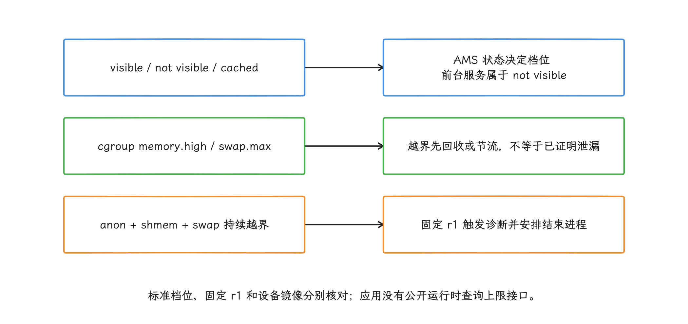

图：Android17所有target范围内应用都可能受约束，仍取决于设备是否启用；核心系统进程与应用范围不同。

`android-17.0.0_r1` 的状态表把进程状态归成几档：`PERSISTENT`/`PERSISTENT_UI` 归为 unrestricted，`TOP`/`BOUND_TOP`/`IMPORTANT_FOREGROUND`/`TOP_SLEEPING` 归为 visible，`FOREGROUND_SERVICE`、`IMPORTANT_BACKGROUND`、`SERVICE`、`RECEIVER`、`HOME`、`LAST_ACTIVITY` 等归为 not visible，`CACHED_*` 归为 cached。cached 状态下进程会先被冻结，再被最大化回收。[AOSP Memory Limiter 指南](https://source.android.com/docs/core/perf/memory-limiter)；[Android 17 r1 源码](https://android.googlesource.com/platform/frameworks/base/+/refs/tags/android-17.0.0_r1/services/core/java/com/android/server/am/MemoryLimiter.java)

配置路径上有一处版本差异需要单独记下。AOSP 文档把标准配置文件写成 `/system/etc/memory-limiter-config.xml`，XML 数值单位为 MiB；首个 AOSP 标签 `android-17.0.0_r1` 的 `MemoryLimiter.CONFIG_PATH` 则硬编码 `/vendor/etc/memory-limiter-config.xml`。所以调试时我们先记录设备 build fingerprint（系统构建指纹），用设备上的 `am memory-limiter status` 和镜像里的实际文件核对，再决定以哪条路径为准——两条路径在不同构建上未必一致。[AOSP Memory Limiter 指南](https://source.android.com/docs/core/perf/memory-limiter)；[Android 17 r1 源码](https://android.googlesource.com/platform/frameworks/base/+/refs/tags/android-17.0.0_r1/services/core/java/com/android/server/am/MemoryLimiter.java)

<!-- gracker-diagram: a212-02-limiter-config -->
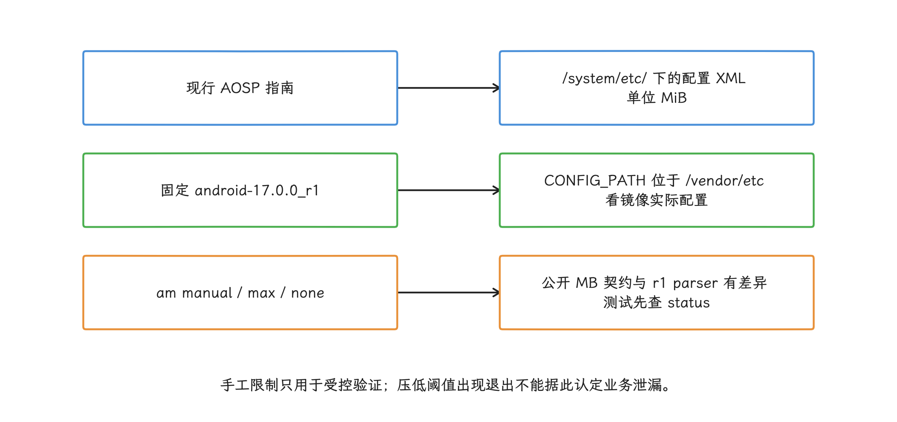

图：记录系统构建指纹和镜像配置，不能把固定源码的shell实现差异泛化到所有Android17设备。

具体执行靠 JNI（Java Native Interface，Java 与 C/C++ 的调用桥） 操纵进程所属的 cgroup v2，也就是 Linux 按进程组统计和约束 CPU、内存等资源的接口。`r1` 中可观察的 cgroup 文件名如下，调试时可以直接引用：[AOSP Memory Limiter 指南](https://source.android.com/docs/core/perf/memory-limiter)；[Android 17 r1 源码](https://android.googlesource.com/platform/frameworks/base/+/refs/tags/android-17.0.0_r1/services/core/jni/com_android_server_am_MemoryLimiter.cpp)

- `memory.high`：设置内存高水位；越过后会触发直接回收并减慢新的内存分配，但允许用量短时超过该值；
- `memory.swap.max`：设置 swap 用量上限；swap 是被换出的匿名页，Android 设备通常由压缩内存设备 zram 承载；
- `memory.swap.current`：读取当前 swap 用量；
- `memory.stat`：读取 `anon`（匿名内存）与 `shmem`（共享内存）；
- `memory.events`：观察 `memory.high` 事件。

越过 `memory.high` 之后，最先发生的是清洁文件页回收、非活跃匿名页换出和临时执行节流；只有匿名内存持续增长并耗尽可用 swap 这类极端情况，才会走向分配失败或进程退出。所以线上上报要分清两件事：发生过 high 事件，和已经证明某类资源泄漏——前者只是征兆，后者才是结论。[AOSP Memory Limiter 指南](https://source.android.com/docs/core/perf/memory-limiter)

还有一处容易踩的坑：源码里部分 Java 注释和日志仍把该文件称作 `memory.swap.high`，JNI 实际写入的却是 `memory.swap.max`。应用侧别依赖具体的 cgroup 文件名。

那系统怎么判定异常？固定 `r1` 的 native 监测进入 `isRed()` 状态后，会轮询 `memory.stat` 中的 `anon + shmem` 与 `memory.swap.current` 的合计值；越过组合阈值时进入 Java 的 `onLimitExceeded()`。尝试报告 `TRIGGER_TYPE_ANOMALY` 还需要相应功能开关与包名等条件；应用注册触发器后，能否取得结果仍受正在运行的 trace、配额和系统资源限制。无论剖析是否成功，这条固定 `r1` 路径都会安排约 30 秒后的进程结束，不能把一次指标越界理解为必然立即取得 profile。

历史退出记录可以通过 `ApplicationExitInfo`（系统保存的进程退出元数据）识别：

- `ApplicationExitInfo.reason == REASON_OTHER`；
- `ApplicationExitInfo.description` 包含 `MemoryLimiter:AnonSwap`。

下面的代码在 Android 17 及以上检索最多 16 条退出记录中的首个 MemoryLimiter 匹配；它不等于断言最近一次进程退出就是该原因。上报还需核对进程名、时间和应用版本，并持久化已消费记录，避免后续启动重复上报同一条历史记录：

```kotlin
fun findRecentMemoryLimiterExit(context: Context): ApplicationExitInfo? {
    if (android.os.Build.VERSION.SDK_INT < 37) return null
    val am = context.getSystemService(ActivityManager::class.java)
    return am.getHistoricalProcessExitReasons(
        context.packageName,
        0,
        16
    ).firstOrNull { exit ->
        exit.reason == ApplicationExitInfo.REASON_OTHER &&
            exit.description?.contains("MemoryLimiter:AnonSwap") == true
    }
}
```

命中该条件只说明系统因为匿名内存和 swap 约束结束了进程，还不足以定性为 `malloc` 泄漏——匿名 `mmap`、线程栈、共享内存和分配器页都可能参与增长。上报时我们至少携带应用版本、ABI（Application Binary Interface，用于区分 arm64-v8a 等二进制架构）、设备型号、进程名、前后台状态、运行时长，以及此前采集的内存时间序列。

<!-- gracker-diagram: a212-03-limiter-exit -->
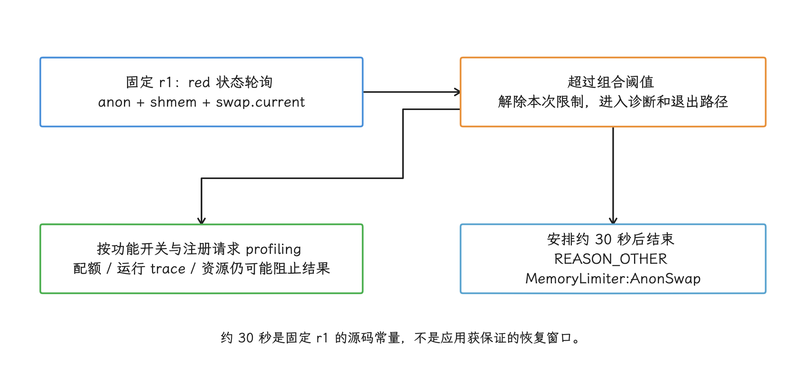

图：退出描述能辅助定位MemoryLimiter路径，不能独立确定malloc泄漏；历史记录还要按进程、时间和版本去重。

在支持该功能的 Android 17 设备上，可以用以下命令验证应用在约束下的行为：

```shell
adb shell am memory-limiter status
adb shell am memory-limiter manual <pid> 512
adb shell am memory-limiter ignore <uid>
adb shell am memory-limiter ignore none
```

截至 2026-10-25 复核的 Android 17 官方文档规定，`manual` 后面的数字是整数 MB，所以上例表示 512 MB。`manual <pid> max` 移除该 PID（进程 ID）的全部内存限制，`manual <pid> none` 清除手动覆盖并恢复系统默认限制；`ignore none` 只清除 UID（Android 用户标识符）维度的忽略设置。

不过首个 AOSP 标签 `android-17.0.0_r1` 与这份公开契约存在实现差异：shell help 把数字写成总 RAM 百分比，执行路径却按 MiB（1,048,576 字节）放大；parser（命令参数解析器） 不接受 `max`，还会先把 `none` 对应的 `-1` 乘以 `1 MiB`，导致 native 层忽略这次更新。这是 `r1` 的源码审计结论，后续 Android 17 构建未必相同，测试前先记录设备 build fingerprint，用设备上的 help 与 `status` 核对实际实现。若使用基于 `r1` 的调试镜像，重启目标进程可让新 PID 重新取得默认限制。

这些命令在未启用 MemoryLimiter 的设备上没有效果。测试要确认的两件事是：监控数据能在退出前解释增长，重启后能关联上退出原因。压低阈值后出现的退出，别急着归类为泄漏。

## 2. 先分清各类“内存”

分层的第一步是划清各类“内存”的范围。一次采样至少要保留下面这些维度。表中的 live 指分配器仍记为“在用”，mapped/retained 指已经向内核映射或释放后仍由分配器保留，owner（负责创建、持有和释放资源的组件） counter 指业务组件自己维护的资源计数。

| 维度 | 典型来源 | 能回答的问题 | 不能回答的问题 |
| --- | --- | --- | --- |
| allocator live bytes（在用字节） | `mallinfo().uordblks`、`Debug.getNativeHeapAllocatedSize()` | 当前分配器认为仍在用的总字节数 | 哪个对象应当释放；匿名 `mmap` 或 GPU 占用 |
| allocator mapped/retained（映射/保留字节） | `mallinfo()`、`malloc_info()` | 分配器映射、空闲和保留页的大致状态 | 页是否全部驻留；业务所有者 |
| RSS | `/proc/self/status`、Perfetto RSS 计数器 | 进程当前驻留在物理内存的页 | 共享页归属；分配调用栈 |
| PSS | `smaps_rollup`、`dumpsys meminfo` | 把共享页按映射数分摊后的进程占用 | 一次分配的调用栈；业务生命周期 |
| VMA（Virtual Memory Area，虚拟内存区域）分类 | `/proc/self/smaps`、`dumpsys meminfo` | `[anon:scudo:*]`、文件映射、栈等增长在哪类映射 | allocator 内每个存活对象的所有者 |
| sampled allocations（采样分配） | heapprofd | 采样窗口内分配与释放的调用栈 | 未采到的小对象；绕过 `malloc` 的分配 |
| owner counters（所有者计数器） | 图片池、解码器、媒体组件、自研 arena（从大块内存中二次分配的内存池） | 资源数量、字节数和业务场景 | 未接入组件的系统级总量 |

用这张表的时候，有三个误判最常见：

1. **RSS 上升未必是泄漏。** 新触达的代码页、文件页、线程栈和 allocator 保留页都会抬高 RSS。
2. **`uordblks` 回落而 RSS 不回落，未必是 `free()` 失效。** Scudo 可以保留已释放页供后续复用，是否归还内核还受尺寸、碎片和 release（把空闲页归还内核） 策略影响。
3. **Native Heap 平稳未必代表 Native 资源平稳。** `mmap(MAP_ANONYMOUS)` 的自研内存池、GraphicBuffer、AHardwareBuffer、dma-buf 与驱动内存可能绕过 `malloc`。

所以线上监控要同时回答两个问题：哪类内存在增长，增长是否脱离了业务生命周期。单个数值顾不了两头。

<!-- gracker-diagram: a212-04-memory-domains -->
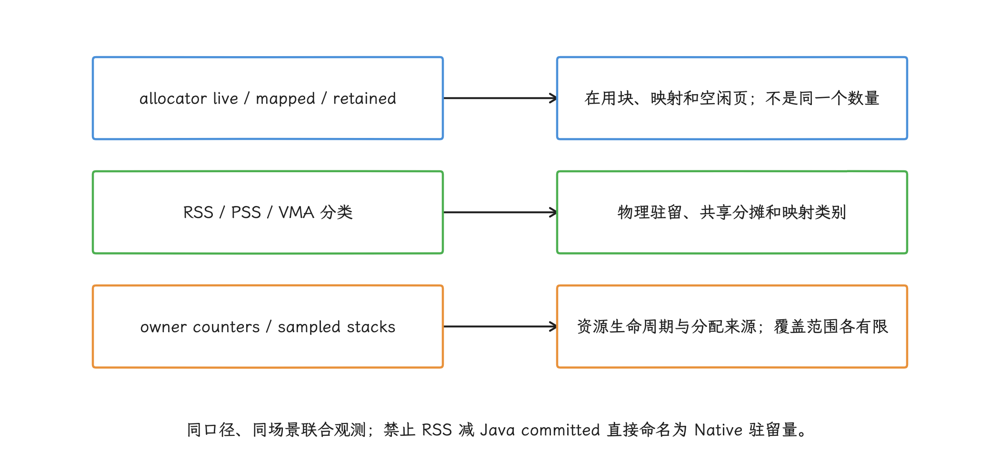

图：RSS增长可来自新触页或保留页，free后页未归还不等于free失效，malloc平稳也不覆盖mmap与图形。

## 3. `mallinfo` 的用途与局限

### 3.1 `mallinfo2()` 在 bionic 中的实现

在 bionic（Android 的 C 标准库） 的 `<malloc.h>` 里，`struct mallinfo` 的字段已经是 `size_t`。`struct mallinfo2` 具有相同字段布局，`mallinfo2()` 通过 `__RENAME(mallinfo)` 指向同一个 `mallinfo` 符号。所以它并没有一条“Android 12 以后才提供、专门解决 64 位溢出”的独立运行时路径。

这一点和 glibc（GNU C 标准库） 的历史不同：glibc 的 `mallinfo` 用过窄整数。移植跨平台代码时，别把 glibc 的版本规则直接套到 bionic 上。

Scudo 的 C 包装层按以下方式填充主要字段：

- `uordblks`：allocated bytes；
- `fordblks`：free bytes；
- `hblkhd`：mapped bytes；
- `usmblks`：同样取 mapped bytes；
- `fsmblks`：free bytes。

这些数字是 allocator 统计；进程的 RSS/PSS 是另一套数字。bionic 头文件把 `mallinfo()` 和 `mallinfo2()` 标为“inherently unreliable”，并建议需要更多信息时改用 `malloc_info()`，用意是提醒调用方别依赖跨 allocator 的精确语义。只要 allocator 和配置保持一致，我们仍能用这些计数器观察趋势。

下面的 C++20 示例用指定成员初始化，低频采集当前 allocator 的三个基础指标；使用更早的 C++ 标准时应改成相应的普通初始化写法：

```cpp
#include <malloc.h>
#include <cstdint>

struct NativeAllocatorSnapshot {
    uint64_t allocated_bytes;
    uint64_t free_bytes;
    uint64_t mapped_bytes;
};

NativeAllocatorSnapshot ReadNativeAllocatorSnapshot() {
    const struct mallinfo info = mallinfo();
    return {
        .allocated_bytes = static_cast<uint64_t>(info.uordblks),
        .free_bytes = static_cast<uint64_t>(info.fordblks),
        .mapped_bytes = static_cast<uint64_t>(info.hblkhd),
    };
}
```

这个采样函数不做栈回溯、磁盘 I/O 或网络上传，适合放在独立监控线程里按秒级或分钟级间隔调用。我们把它和单调时钟、进程状态、业务场景一起记录；单独保存某个时刻的绝对值看不出趋势。

Java 层的 `Debug.getNativeHeapAllocatedSize()` 看到的是同一套统计。`android-17.0.0_r1` 的 `android_os_Debug.cpp` 直接调用 `mallinfo()` 并返回 `uordblks`；`getNativeHeapSize()` 返回 `usmblks`，`getNativeHeapFreeSize()` 返回 `fordblks`。这几个接口看到的仍是当前 malloc dispatch（当前生效的分配函数转发表）。

<!-- gracker-diagram: a212-05-mallinfo-dispatch -->
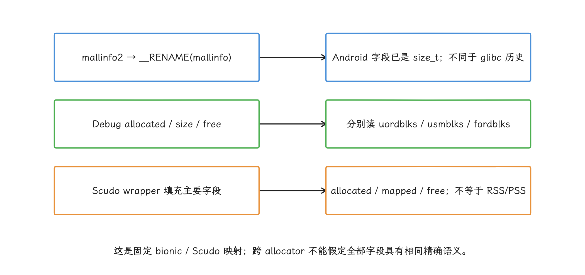

图：当前malloc dispatch、sanitizer与profiler会影响可用性与语义；零值和无数据必须区分。

### 3.2 sanitizer（内存错误检测工具） 与 hook 会改变可观测结果

bionic 通过 `MallocDispatch` 转发 `mallinfo`、`malloc_info` 和 `mallopt`。heapprofd（Native 堆采样器）、GWP-ASan（对少量堆分配启用保护检查的低开销工具） 或其他受支持的 malloc dispatch 一旦处于工作状态，统计就由当前 dispatch 路径提供。换到 HWASan（Hardware-assisted AddressSanitizer，硬件辅助内存错误检测工具） 路径上，`__sanitizer_malloc_info()` 会返回 `-1`，把 `errno`（C 接口保存最近一次错误原因的线程局部变量） 设为 `ENOTSUP`，相关统计可能拿不到。

所以采集端必须允许“无数据”：

- 别把 0 自动解释成没有分配；
- 记录 sanitizer、GWP-ASan 和 profiler 是否开启；
- 灰度组之间比较时保持构建类型、ABI 与 allocator 配置一致；
- 对 `malloc_info()` 检查返回值和 `errno`。

### 3.3 `malloc_info()` 的 XML 不是稳定业务协议

`malloc_info(int options, FILE* fp)` 在 bionic 中从 API 23 起可用。Scudo 输出的结构以 `<malloc version="scudo-1">` 开头，按 size/count 列出当前分配，和旧版 jemalloc 示例的 arena、bin（按尺寸组织分配块的内部类别） 结构不同。

拿到这份 XML 的代价也有限制：Scudo 实现要分配临时尺寸数组、暂停 allocator 并遍历 chunks（分配器管理的内存块）。因此 `malloc_info()` 既不适合放在信号处理器里，也不适合当高频心跳。更合适的用法是：低内存告警后在安全线程执行一次，保存原始 XML 文本，让解析器按 allocator/version 分派。

监控平台只需要稳定趋势时，优先保存 `uordblks`、RSS/PSS 和 owner counters。XML 属于诊断附件，别把某个 XML 节点写成长期兼容的告警字段。

<!-- gracker-diagram: a212-06-malloc-info-cost -->
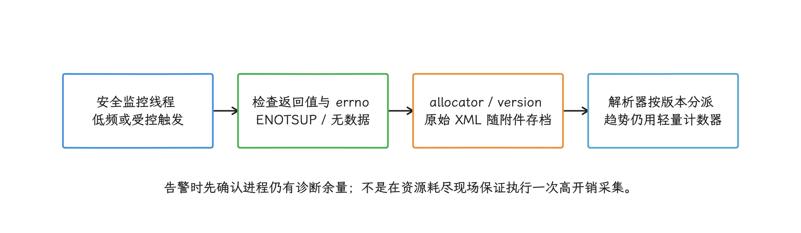

图：Scudo生成XML可能分配临时数组并暂停allocator、遍历块；不能放进信号上下文或高频心跳。

## 4. RSS、PSS 与 `smaps`：判断增长落在哪类映射

### 4.1 `smaps_rollup` 只有总览

`/proc/self/smaps_rollup` 汇总进程所有 VMA 的 RSS、PSS、共享/私有页、匿名页和 swap 等数据。它输出的文本比完整 `smaps` 少，但内核统计时仍要遍历页表，所以不该放在每帧或其他高频热路径上。

这份 PSS 把 Java 堆、Native allocator、线程栈、代码、文件映射和其他进程映射都算了进去，直接叫作 `PSS-Native` 名不副实；要做类别拆分，得读完整 `smaps`，或者用系统已经分好类的 `dumpsys meminfo`/Perfetto 数据。

### 4.2 `[heap]` 只是一小部分 Native Heap

读完 rollup 想进一步拆分类别时，还要注意：现代 Android 上，Scudo 会创建带名称的匿名映射，例如 `[anon:scudo:*]`，GWP-ASan 也有自己的匿名映射。只累计传统 `[heap]` VMA，会漏掉大部分 allocator 区域。

对完整 `smaps`，我们按“映射语义”而非固定单一名称来分类：

- `[anon:libc_malloc]`、`[anon:scudo:*]`、GWP-ASan 区域：allocator 相关；
- `[stack]` 与线程栈：线程数量和栈提交；
- `dalvik-*`、ART space：托管堆和 ART（Android Runtime）自身的内存区域；
- `.so`、`.dex`、`.oat`、`.art`：代码和文件映射；
- 业务命名的匿名 VMA：自研 arena、缓存或引擎内存；
- dmabuf、GraphicBuffer、GPU：结合系统服务和组件计数器分析。

VMA 名称会随版本和 allocator 变化。解析器要保留原始名称，无法识别的项归入 `other_anon` 或 `other_file`，别静默丢弃。

<!-- gracker-diagram: a212-07-vma-classification -->
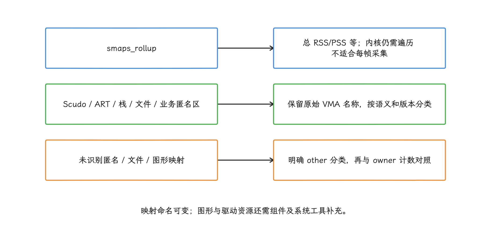

图：传统[heap]只是malloc区域的一部分；不能把rollup总PSS重命名成PSS-Native，也不静默丢弃未知映射。

### 4.3 用时间窗口看能否回到基线

建议为每个进程构建场景化时间线：

1. 冷启动完成；
2. 核心场景预热完成；
3. 前后台切换并等待缓存清理；
4. 重复同一场景若干轮；
5. 回到相同稳态后再次采样。

各比较点之间在页面、网络、播放和前后台状态上要保持相近。启动后 1 分钟、10 分钟、1 小时这类固定时刻只适合连续使用场景；用户行为不同时，时间点本身就没有可比性。

线上告警可以同时观察：

- `allocated_bytes` 的稳态斜率；
- 按 VMA 分类后的 allocator、匿名映射、线程栈与文件驻留量变化；不能用 `RSS - Java committed` 当成 Native 驻留量：Java committed 是虚拟机提交容量，与 RSS 的实际驻留口径不同；
- 多轮场景后的回落幅度；
- owner counter 与 allocator 增量是否一致；
- 相同版本、设备档位、ABI 和场景下的分位数变化。

单设备连续增长适合触发诊断；版本级回归则要看同版本、同设备档位等可比样本组（cohort）的分布。

<!-- gracker-diagram: a212-08-comparable-windows -->
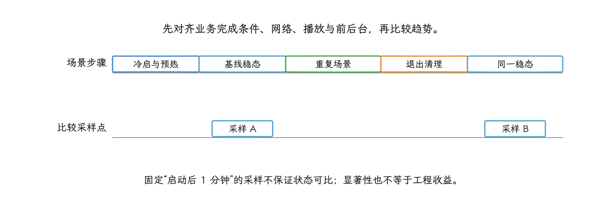

图：重复同场景并在相近稳态比较allocator、映射驻留与owner变化；版本回归还要分设备、ABI和构建组。

我们还要留意统计显著性和工程意义的差别：千万级 DAU（日活跃用户数） 会让很小的差异也具有统计显著性，所以除了显著性还要设工程意义阈值，例如 P95（95% 分位）增量、退出率和持续增长时长。p-value 只表示在“没有差异”的假设下出现当前或更极端结果的概率，数值小未必值得工程介入。

## 5. `malloc/free` hook 的覆盖范围

自建 hook 要自己回答几件事：它能拦到哪些调用，账本记得全不全，热路径怎么设计才安全。

### 5.1 PLT hook 的工作方式

自建 hook 时，xhook、bhook 一类方案通常修改 ELF 模块的 PLT/GOT relocation（动态链接器用于解析外部函数地址的跳转表重定位项），让该模块对 `malloc`、`free` 等导入符号的调用进入代理函数。这类 hook 只改写命中的导入调用，覆盖范围达不到进程级 allocator 替换，Android 平台也没有承诺它是稳定 API。

Android 8 以后，linker namespace（动态链接器的库隔离空间） 会影响库的可见性、加载和符号解析，但并没有一个“namespace 开关”能把 PLT hook 全部禁用。具体覆盖情况，要看下面几点：

- 目标函数是否经由可改写的 PLT relocation 调用；
- 模块是否已加载，后续加载模块是否会被注册；
- 调用是否被静态链接、内联、本地绑定或隐藏；
- 库是否使用自研 allocator；
- Android 版本、RELRO（把重定位完成后的相关内存改成只读的加固机制）与 hook 库自身的兼容性。

线上监控别把访问 linker 私有结构或绕过 namespace 限制当作主要实现。这类实现不受 NDK ABI 兼容性承诺保护，系统升级后可能直接崩溃。

<!-- gracker-diagram: a212-09-plt-coverage -->
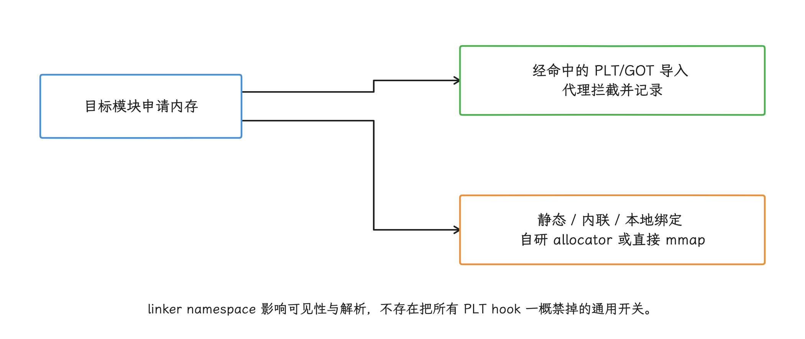

图：覆盖清单要列模块、加载时机、导入方式及分配API；没有事件不能证明该模块没有分配。

### 5.2 分配账本要覆盖的路径

要维护“仍存活的分配”这份账，至少得处理下面这些路径：

- `malloc`、`calloc`、`realloc`、`free`；
- `posix_memalign`、`aligned_alloc`、`memalign` 等对齐分配；
- C++ `new/delete`、数组和 sized/aligned delete 变体；
- 模块动态加载与卸载；
- 地址复用和重复事件。

其中 `realloc` 尤其容易写错：

- 输入指针为 `nullptr` 时等价于分配；
- 请求 size 大于 0 而分配失败返回 `nullptr` 时，旧分配仍然有效；
- 成功时地址可能不变，也可能搬迁；
- size 为 0 的行为不宜脱离当前 libc 契约自行假定。

账本单靠裸指针地址这一个 key（索引键）是不够的：地址释放后会被复用，事件还可能因为异步消费而乱序。记录里要带上单调时间、分配序号、线程 ID、尺寸、模块 Build ID（标识某次二进制构建的 ID） 和原始 PC（Program Counter，指令地址），消费端才能区分同一地址在不同分配周期中的事件。

<!-- gracker-diagram: a212-10-realloc-ledger -->
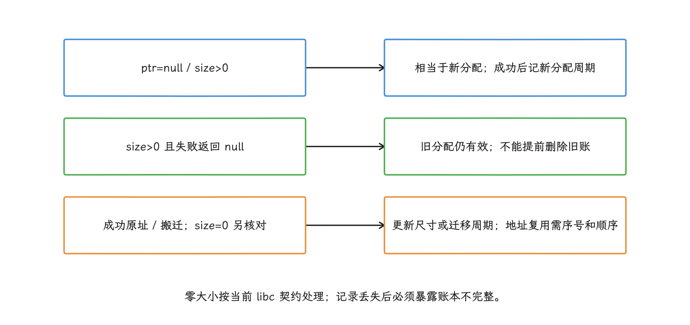

图：分配地址可复用，异步事件可能乱序；用分配周期、线程、时间和构建身份解释，不能只用裸指针作为生命周期证明。

### 5.3 hook 热路径的设计约束

进了代理函数，第一条约束就是避开一切可能分配内存的路径：`std::string`、普通容器、日志格式化、在线符号化、文件 I/O 和完整 unwind（从当前栈帧逐层还原调用链） 都可能递归回到 allocator 上。

稳妥的事件路径通常包含：

- TLS（Thread-Local Storage，线程局部存储） 重入标记；
- 预分配的有界 ring buffer（容量固定、首尾相接的环形缓冲区）；
- 原子写入的固定长度事件；
- 少量原始 PC，或仅记录返回地址；
- 单独消费者线程；
- 离线按 Build ID 符号化，也就是把指令地址还原成对应版本的函数和源码位置；
- 缓冲区满时丢弃并计数，不阻塞分配线程；发生丢弃后标记该诊断窗口账本不完整，未匹配释放量不能再当作精确泄漏字节。

完整调用栈必须在线采集时，要结合 [20.3 Native Crash、堆栈回溯与符号化](03-native-crash-unwinding-symbolication.md) 评估 unwind 的安全性与成本。hook 自身还应有远程关闭、时限、进程白名单和崩溃熔断；这里的熔断指诊断功能引发异常达到阈值后自动关闭，避免把故障面扩大。

<!-- gracker-diagram: a212-11-bounded-hook -->
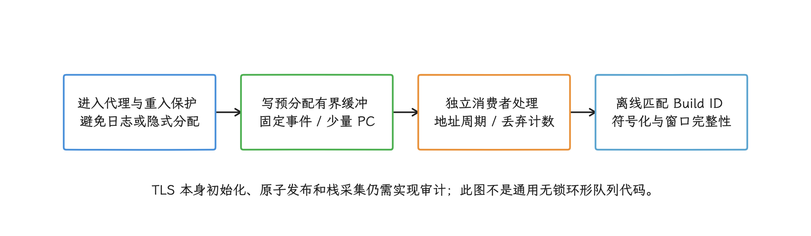

图：缓冲满时保护分配线程并记丢弃；丢事件的窗口不能输出未经限定的精确泄漏字节。

### 5.4 按事件计数采样的偏向

按事件随机采样时，一次 64 MiB 分配和一次 32 B 分配可具有相同入样概率，样本通常更容易被高频小对象主导，低频大对象的估计方差也可能很大；固定每 1000 次取一次还可能与业务周期重合。相同概率的随机样本若正确加权，并非必然产生字节总量的系统偏差。要估算字节归因，我们可以按尺寸分层，也可以用以分配字节为权重的随机采样，服务端再用每条记录的采样概率反推总体规模。

低采样率还会带来配对问题。释放事件采到了、分配事件没采到时，应记录为未匹配释放或窗口外事件，不能凭空保留一个“存活分配”或计成泄漏；只对分配采样时，要给入样对象建立专用追踪状态，释放时查询这一状态。任何估算都要附带样本数和采样概率。

<!-- gracker-diagram: a212-12-sampling-accounting -->
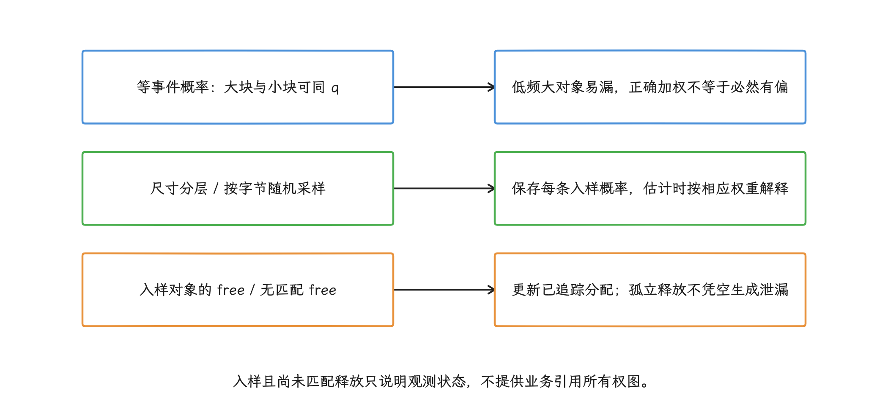

图：区分估计方差、固定间隔周期偏差和事件丢失；任何估计都附样本数、窗口和概率。

自建 PLT hook 适用于模块已知、做受控灰度（仅向小比例设备启用）和复现特定问题的场景。需要通用的 sampled allocation stack（采样分配调用栈）时，平台的 heapprofd 通常更可靠。

## 6. heapprofd：按触发采样调用栈

heapprofd 是 Perfetto 的 Native 堆采样器，从 Android 10 起提供；Android 17 继续完善它的平台剖析 API、触发机制和生产部署路径。

它和自建 PLT hook 的接入点就不同：heapprofd 在 bionic 中接入 `MallocDispatch`，`malloc_heapprofd.cpp` 会检查其他 hook，可以在保留 GWP-ASan backing allocator（GWP-ASan 下层继续负责实际分配的 allocator） 的前提下接入，而第三方 hook 要逐个修改各 ELF 的 PLT。

heapprofd 能提供：

- 入样分配的调用栈，以及用于更新其存活状态的释放记录；不是每次 `free()` 的调用栈；
- 分配大小、进程、线程和时间信息；
- 按栈聚合的 allocated（已分配）、freed（已释放）与 unreleased（采样窗口内尚未匹配到释放）视图；
- Perfetto trace 中与进程时间线的关联。

下面这些限制也要记牢：

- profile 开始前已经存在的分配，补不回原始分配栈；
- 采样可能漏掉小对象，结果需要按采样权重解释；
- 直接 `mmap`、自研 arena 内部切分、GPU 与 AHardwareBuffer 不经过 malloc 时不可见；
- `unreleased` 表示采样窗口内尚未匹配到 free 的分配，不等同于从所有业务根不可达；
- 它没有 Java 对象到 Native 资源的所有权引用图。

生产环境中，我们更适合在异常趋势、MemoryLimiter anomaly（内存限制异常触发） 或灰度命中之后开启短窗口采样。持续高频 profiling（性能剖析） 会推高 CPU、内存、trace 存储和隐私成本。

<!-- gracker-diagram: a212-13-heapprofd-window -->
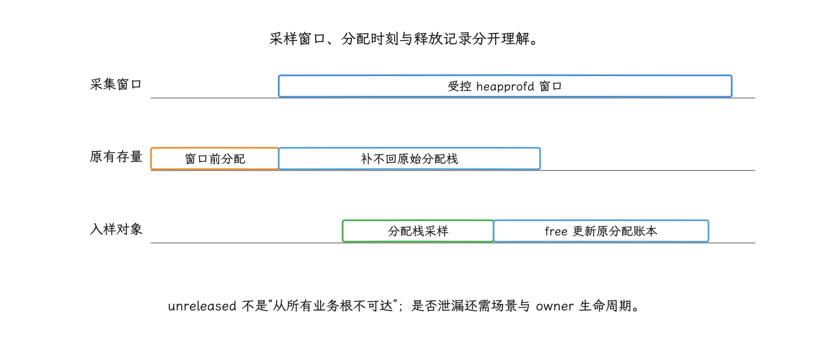

图：分配位置的allocated/freed/unreleased归因不等于free调用栈；窗口前存量、自研mmap与图形盲区需其他证据。

Android 15 / API 35 起，普通应用可以通过 `ProfilingManager` 请求受系统管理的 heap profile（堆剖析）。Android 10—14 中能否采集，取决于应用是否声明 `profileable`、是不是 `debuggable` 调试构建，以及请求是否由 shell 发起。

完整配置见 [26.13 heapprofd、procfs CPU 与 Page Fault 分析](../ch26-observability/13-heapprofd-procfs-page-fault.md)。实施时直接复用该章已经验证过的权限模型、guardrail（平台为控制开销设置的采样护栏）和符号化流程，不要再维护一套私有规则。

## 7. Scudo、GWP-ASan、HWASan、MTE 各自查什么

选工具前先明确 Scudo 的定位：Android 11 起，Scudo 用于大多数 Android Native 分配；低内存设备仍可能使用 jemalloc。它是 hardened allocator（通过完整性检查、隔离和随机化降低堆破坏风险的分配器），但不会自动指出是哪个对象泄漏、归谁所有。

| 工具 | 适用环境 | 主要能力 | 对普通泄漏的能力 |
| --- | --- | --- | --- |
| Scudo | 日常系统与应用进程 | allocator 安全加固、部分错误检测、统计与释放策略 | 只给 allocator 视角，不给业务所有权 |
| GWP-ASan | 生产小概率采样 | 捕获被采中对象的 heap UAF（Use After Free，释放后使用）和越界 | 不负责检测普通泄漏 |
| HWASan | 自动化测试、fuzz（模糊测试）、dogfood（团队内部试用） | 高覆盖 UAF、越界和栈错误 | 不是低开销线上泄漏监控 |
| MTE（Memory Tagging Extension，内存标签扩展） | 支持硬件与系统配置的 64 位设备 | 用硬件内存标签辅助发现或缓解内存破坏 | 不提供泄漏引用图 |
| ASan（AddressSanitizer，内存错误检测工具） | HWASan 不可用的测试场景 | 传统地址检查 | 已被替代，不适合线上 |
| heapprofd | 灰度或异常触发的采样窗口 | 入样分配栈、释放与存活记录 | 可定位入样分配的未释放增长，结论需结合生命周期 |

有三处版本差异值得单独说明：

- HWASan 的 NDK 支持可追溯到 NDK r21 / API 29；到 API 34 与 NDK r26 之前，部署通常需要兼容的系统镜像。把它说成“Android 14 才出现的 ARM MTE”是一种误解。
- MTE 依赖 Arm 硬件标签能力、64 位进程与设备系统配置。它和编译器插桩的 HWASan 是两条路径。
- ASan 官方已标为被其他工具取代，官方给出的量级约为 CPU +100%、代码 +50%、内存 +100%，写所有应用固定“2—3 倍”并不准确。

HWASan 官方给出的典型成本约为 CPU +100%、代码 +50%、内存 +10%—35%，仍应以应用实测为准。GWP-ASan 的生产灰度、MTE 配置与两类报告的差异统一见 [20.11 MTE 与 GWP-ASan Native 内存安全检测](11-mte-gwp-asan-native-memory-safety.md)。

<!-- gracker-diagram: a212-14-safety-versus-leak -->
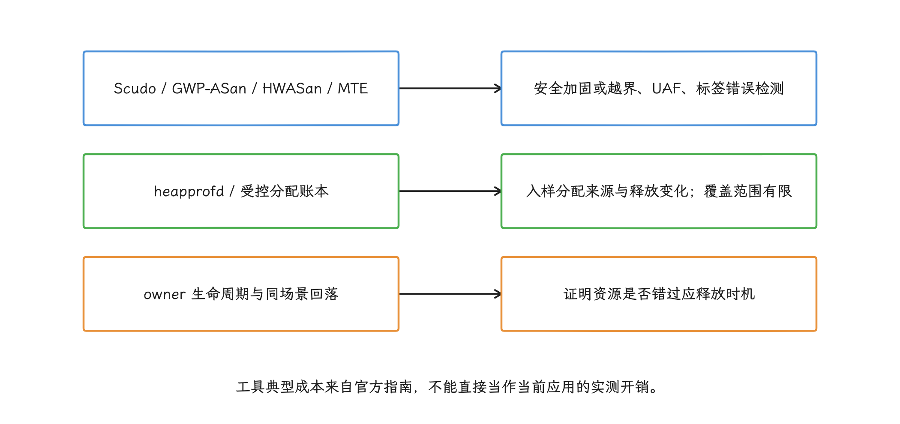

图：工具命中安全错误按崩溃证据修复；普通泄漏结论要有增长、分配来源与生命周期相互支持。

## 8. Scudo 选项与 `mallopt` 的实际作用

Scudo 支持通过 `__scudo_default_options()` 或 `SCUDO_OPTIONS` 配置部分行为，但只适用于可控的 Native 进程、测试构建或系统组件。由 Zygote（预加载公共资源并派生应用进程的父进程） 启动的普通三方应用，别把环境变量当作可远程切换的线上开关。

Android 17 也没有公布名为 `options=scudo_options` 的 Scudo 配置语法，选项名称和默认值可能随平台构建变化，用之前以目标版本的 Scudo 文档和源码为准。

bionic 对外提供的 `mallopt` 命令更适合在应用代码里调用。这里的 decay 指空闲页等待自动归还内核的时间策略，purge 指主动请求归还当前可释放的空闲页：

- `M_DECAY_TIME`：API 27 起调整 decay 时间；
- `M_PURGE`：API 28 起请求释放空闲内存；
- `M_PURGE_ALL`：API 34 起请求更广的 purge；
- `M_PURGE_FAST`：API 37 新增，以较低成本快速释放部分空闲页，可能少于普通 purge。

下面的代码用于 Android 17 设备在明确的低频生命周期节点请求快速 purge：

```cpp
#include <android/api-level.h>
#include <malloc.h>

bool RequestFastNativeHeapPurge() {
    if (android_get_device_api_level() < 37) {
        return false;
    }
    return mallopt(M_PURGE_FAST, 0) == 1;
}
```

这段代码要以 API 37 头文件编译，并在调用前检查设备 API。`mallopt` 符号在 API 37 之前就已存在，Android 17 新增的是 `M_PURGE_FAST` 这个命令值；只有 API 37 及以上的设备能执行该调用。

purge 只能尝试把 allocator 中已经空闲、可以归还的页交回内核。仍被引用的泄漏块不会因此消失，碎片也可能让一部分页无法释放。所以如果每次 purge 后 RSS 暂时下降、随后又持续上升，我们该回到对象生命周期上继续查，别把周期性 purge 当作修复手段。

<!-- gracker-diagram: a212-15-purge-boundary -->
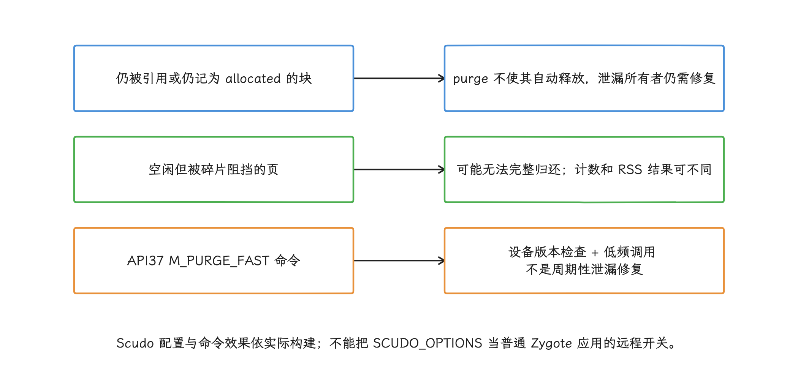

图：mallopt符号早已存在，新增命令仍需API37支持；测量资源回落并检查功能和性能副作用。

## 9. `mmap`、自研内存池与图形内存的账本

malloc 之外的分配是另一块盲区：游戏引擎、数据库、媒体栈和模型推理库常用 `mmap(MAP_ANONYMOUS)` 直接创建匿名虚拟内存映射，再在内部用 arena 切分。我们用 heapprofd 和 malloc hook，最多只能看到 arena 的外层申请；外层若直接走 `mmap`，两者都看不到。

自研组件应在资源所有者一侧记录：

- `mmap/munmap` 的地址、长度、保护位和用途；
- arena committed（已向系统取得）、used（业务正在使用）、free（池内空闲）和 high-water mark（历史峰值）；
- 缓存条目数量、预算、逐出原因；
- 关联场景、实例 ID 和生命周期；
- VMA 命名，便于 `smaps` 与 Perfetto 分类。

要是在进程里无差别 hook 所有 `mmap`，运行时、linker、线程栈、JIT（运行时即时编译器）、文件映射和系统库的调用会一起进来，先要结合 flags（映射标志）、fd、VMA 名称与 owner events（业务所有者记录的申请/释放事件） 分类；没有做完这层分类，这个总量还称不上业务泄漏。

<!-- gracker-diagram: a212-16-owner-ledgers -->
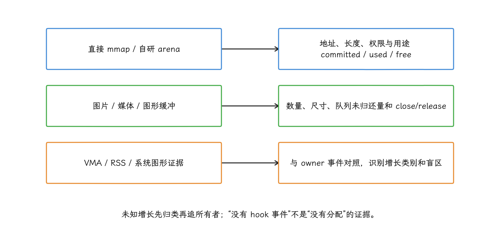

图：heapprofd平稳而图形或映射增长时，应换到对应资源域继续取证；提高malloc采样率补不回这些盲区。

对直接 `mmap` 的资源，先建立 owner 侧申请与释放账本，再与 `smaps`/VMA 分类、Perfetto RSS 数据和组件计数器对照。新的追踪工具只有在源码、公开接口契约和支持范围均可验证时才进入方案，不能用未确认的工具名称补足观测盲区。

## 10. 三类常见案例怎样建立证据

### 10.1 图片与 Bitmap

Android 8 以后，Bitmap 像素数据通常由 Native 内存承载，但 Java `Bitmap`、Drawable、图片缓存和解码任务仍可能掌握所有权。排查时需要同时观察：

- Java `Bitmap` 数量及 retaining path（从 GC Root 到该对象的强引用链）；
- 图片缓存 current/max bytes、命中和逐出；
- Native allocator 或图形内存增长；
- 页面退出、请求取消、进程后台后的回落；
- 硬件 Bitmap、GraphicBuffer 与普通软件 Bitmap 的差异。

看到“Native Bitmap 增长”先别直接写成“Skia 对象未释放”。我们按顺序查 Java owner、缓存预算与解码生命周期；Java owner 已经消失而 Native 内存仍在增长时，再用 heapprofd、图形内存统计和平台 trace 缩小范围。更多版本差异见 [23.4 Bitmap 与图片内存优化](../ch23-memory-practice/04-bitmap-optimization.md)。

### 10.2 第三方 SDK

第三方 `.so` 持续增长时，诊断包里至少要留 SDK 版本、ABI、模块 Build ID、进程、初始化次数和采样栈。heapprofd 的栈停在 SDK 导出函数上时，应让供应方用相同 Build ID 的未裁剪符号文件还原；只靠函数地址无法跨版本比较。

还要确认 SDK 是否使用自研 allocator 或直接 mmap。malloc hook 没有记录，只说明目标调用不在当前 hook 覆盖范围内，未必代表它没有分配。

### 10.3 音视频与相机

媒体内存可能分布在 malloc buffer、codec buffer（编解码器缓冲区）、Image、GraphicBuffer、AHardwareBuffer、共享内存和驱动侧。排查要从 owner，也就是负责创建、持有和释放资源的组件开始：

- `MediaCodec`、`Image`、`ImageReader` 是否按生命周期 `close()`/`release()`；
- 队列中 outstanding buffer（已经交出、尚未归还的缓冲区）数量是否持续增加；
- 解码分辨率、并发路数和缓冲深度是否变化；
- allocator live bytes、graphics/dmabuf 与 mmap 哪一类在增长；
- stop/release 后资源是否回到可复用基线。

heapprofd 平稳而 graphics/dmabuf 上升时，要转向 buffer queue（生产者与消费者之间传递图形缓冲区的队列）、fence（表示 GPU/显示操作何时完成的同步对象） 和组件释放路径；继续加大 malloc 采样率不会带来新证据。

## 11. 一套可运行的线上监控分层

把前面这些手段组织起来，就是一套按成本分层的监控方案：L0—L3 表示采集成本和证据深度逐层增加，和事故严重等级无关。L0 常驻，L1 确认增长类别，L2 定位调用栈，L3 回到测试环境复现。

### 11.1 L0：常驻低成本指标

按进程和场景采集：

- `mallinfo().uordblks`；
- RSS，必要时低频 PSS；
- Java heap committed/used；
- 线程数；
- 图片、媒体、自研 arena 等 owner counters；
- 前后台状态、页面、运行时长和版本维度。

采样周期由性能测试决定：前台活跃时可以密一些，后台稳态降低频率。任何采集都要避免阻塞主线程。

### 11.2 L1：异常确认

连续窗口斜率异常、回落不足，或同类样本的分位数比上一版本变差时，先做这几件事：

- 追加一次 `smaps_rollup`；
- 在允许的诊断环境保存完整 `smaps`；
- 采集 `malloc_info()` 附件；
- 提高 owner counter 频率；
- 记录 MemoryLimiter 状态和历史退出原因。

这一层的目标是把问题归到 allocator、mmap、graphics、线程栈或文件映射等类别。

### 11.3 L2：调用栈定位

按设备、版本、渠道和进程灰度：

- heapprofd 短窗口；
- 受控模块的 malloc hook；
- 针对自研 arena 的 owner allocation events；
- 保留 Build ID 的 Native 符号化。

诊断开始和结束都要把窗口记下来，避免把窗口外的存量解释成窗口内的泄漏。

### 11.4 L3：测试环境复现

把线上场景带回自动化测试、fuzz 或 dogfood：

- HWASan 查 UAF、越界和栈错误；
- MTE 在支持设备上查标签错误；
- GWP-ASan 验证线上低概率出现的堆内存安全崩溃；
- ASan 只用于其他方案不可用的兼容场景；
- 循环场景并验证回到同一稳态后的内存差值。

工具命中内存安全错误时，按崩溃证据修复；只有稳定增长、未释放栈与业务生命周期互相吻合，我们才把结论写成泄漏。

<!-- gracker-diagram: a212-17-monitoring-levels -->
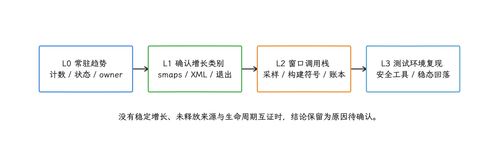

图：L0到L3表示采集成本与证据深度，不是事故严重级别；诊断开始和结束都保留窗口与完整性。

## 12. 评审清单

上线一套 Native 内存监控前，逐项回答：

- 指标测的是 allocator、RSS、PSS、VMA、graphics 还是业务 owner？
- `Debug.getNativeHeapAllocatedSize()` 是否被错误命名成“全部 Native 内存”？
- `mallinfo` 在当前 allocator/sanitizer 组合下是否可用？
- `malloc_info` 解析器是否按 allocator/version 区分，并保留原始输出？
- PLT hook 覆盖了哪些模块和分配 API，明确漏掉哪些路径？
- hook 是否有重入保护、有界缓冲、丢弃计数、远程关闭和崩溃熔断？
- 采样概率是否与尺寸分布匹配，服务端是否正确加权？
- heapprofd 窗口、Build ID、符号文件和 profileable 权限是否匹配？
- `mmap`、图形、媒体和自研池是否有 owner counters？
- 告警比较的场景与进程状态是否一致？
- Android 17 MemoryLimiter 退出是否通过 `ApplicationExitInfo` 单独归因？
- purge 是否只作为释放空闲页的动作，而没有被包装成泄漏修复？

## 13. 源码锚点与参考资料

### 13.1 Android 17 / `android-17.0.0_r1`

- [bionic `malloc.h`](https://android.googlesource.com/platform/bionic/+/refs/tags/android-17.0.0_r1/libc/include/malloc.h)：`mallinfo`/`mallinfo2`、`malloc_info`、`mallopt` 与 API 级别。
- [bionic `malloc_common.cpp`](https://android.googlesource.com/platform/bionic/+/refs/tags/android-17.0.0_r1/libc/bionic/malloc_common.cpp)：malloc dispatch 和统计接口转发。
- [bionic `malloc_heapprofd.cpp`](https://android.googlesource.com/platform/bionic/+/refs/tags/android-17.0.0_r1/libc/bionic/malloc_heapprofd.cpp)：heapprofd hook、兼容性检查及 GWP-ASan backing allocator。
- [Scudo `wrappers_c.inc`](https://android.googlesource.com/platform/external/scudo/+/refs/tags/android-17.0.0_r1/standalone/wrappers_c.inc)：Scudo 的 `mallinfo`、`malloc_info` 和 purge 实现。
- [frameworks/base `android_os_Debug.cpp`](https://android.googlesource.com/platform/frameworks/base/+/refs/tags/android-17.0.0_r1/core/jni/android_os_Debug.cpp)：`Debug.getNativeHeap*()` 到 `mallinfo` 字段的映射。
- [frameworks/base `MemoryLimiter.java`](https://android.googlesource.com/platform/frameworks/base/+/refs/tags/android-17.0.0_r1/services/core/java/com/android/server/am/MemoryLimiter.java)：配置、进程状态、异常剖析、延迟结束与退出描述。
- [frameworks/base `ActivityManagerShellCommand.java`](https://android.googlesource.com/platform/frameworks/base/+/refs/tags/android-17.0.0_r1/services/core/java/com/android/server/am/ActivityManagerShellCommand.java)：`memory-limiter` 测试命令的参数解析与 help 文案差异。
- [frameworks/base `MemoryLimiter.cpp`](https://android.googlesource.com/platform/frameworks/base/+/refs/tags/android-17.0.0_r1/services/core/jni/com_android_server_am_MemoryLimiter.cpp)：cgroup v2 文件、事件与限制写入。
- [common kernel `cgroup-v2.rst`](https://android.googlesource.com/kernel/common/+/refs/tags/android17-6.18-2026-06_r6/Documentation/admin-guide/cgroup-v2.rst)：`memory.high`、`memory.swap.max` 与内存控制器语义。

### 13.2 官方指南

- [Android 17：App memory limits](https://developer.android.com/about/versions/17/behavior-changes-all#app-memory-limits)
- [Android：Trigger-based profiling](https://developer.android.com/topic/performance/tracing/profiling-manager/trigger-based-capture)
- [Android NDK：Memory error debugging and mitigation](https://developer.android.com/ndk/guides/memory-debug)
- [AOSP：Scudo](https://source.android.com/docs/security/test/scudo)
- [Android 游戏内存管理](https://developer.android.com/games/optimize/memory-overview)
- [Android 游戏：Low memory killers 与诊断工具](https://developer.android.com/games/optimize/vitals/lmk)
- [Android 应用内存管理](https://developer.android.com/topic/performance/memory-management)

## 小结

这一章引用的资料在这点上是一致的：低成本计数器负责发现异常，带调用栈的采样负责定位增长来源，owner 生命周期用于证明资源是否错过释放时机，内存安全工具负责发现越界和释放后使用。四类证据分别保存，我们才能在 Scudo、mmap、图形内存和 Android 17 MemoryLimiter 同时存在时，给出经得起对照检验的结论。
