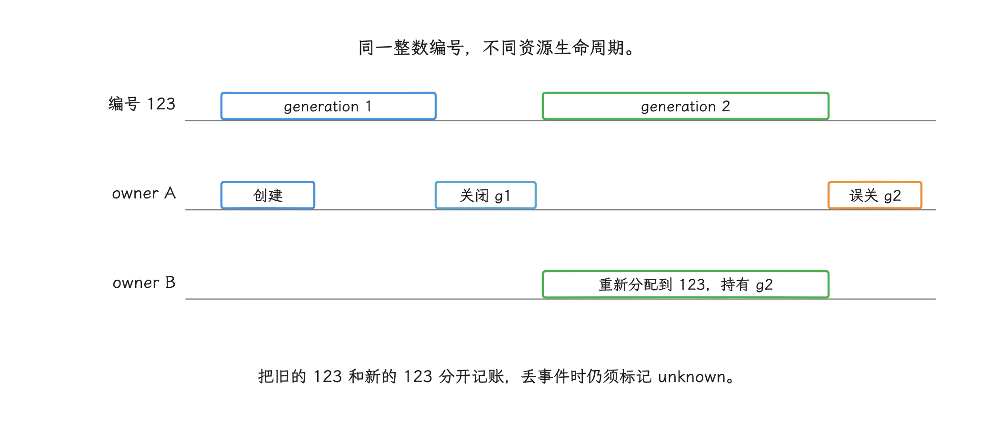
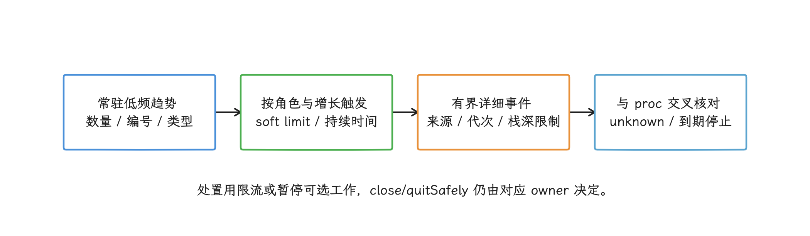
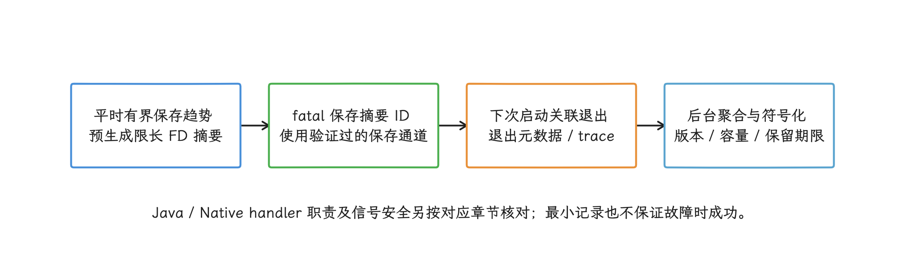

# FD 耗尽监控与故障排查

FD（file descriptor，文件描述符）是进程用来引用内核对象的整数编号。文件、socket（网络套接字）和 pipe（管道）都会占用 FD，eventfd（事件通知描述符）与 epoll（事件监听器）这类内核对象同样如此。FD 接近进程限额时，新建对象会失败；即使打开数量不多，把编号过高的 FD 交给旧式 `select()`，也可能触发 bionic（Android 的 C 标准库及底层运行时）的 FORTIFY 检查，检查失败会主动中止进程。

排查 FD 问题时，我们要把打开数量、FD 编号、对象类型、generation（创建代次）与 owner（负责释放资源的所有者）分开；`/proc/self/fd` 给的是某一时刻的近似快照，每个 FD 由谁创建、应由谁关闭，要靠创建与关闭事件补齐。

> 源码基线：Android 17（API 37）/ AOSP `android-17.0.0_r1`；内核 `android17-6.18-2026-06_r6`。

线程与协程见 20.8，Native 内存见 20.6；本文只在它们与 FD 出现在同一故障现场时说明证据关系。

## 数量、编号、对象与所有者

拿到一份 FD 数据，我们先问它量的是哪个维度。FD 是进程文件描述符表中的整数索引，监控记录至少要把下面几项分开：

- 当前打开 FD 的数量；
- FD 数值本身，例如是否达到 `FD_SETSIZE`；
- symlink（symbolic link，符号链接）指向的对象类型；
- 创建事件的 generation；
- 哪个所有者负责关闭；
- `dup` 复制后，新旧描述符各自的生命周期。

generation 是同一编号每次重新创建或复用时递增的代次，用来区分“旧的 123”和“新的 123”；所有者可以是创建该 FD 的对象、模块或任务，职责是保证每条成功创建路径都有且只有一次关闭。


编号会复用，generation 因此存在。关闭一个 FD 后，内核通常会把较小的空闲编号分配给后续对象；double-close 指同一编号被关闭两次，第二次关闭时，该编号可能已经指向另一线程刚创建的对象，最终造成 use-after-close（关闭后仍使用）或数据损坏。所以单有“编号 123 曾由谁打开”这一条还不够，要配上 generation 和所有者，才讲得清一次完整的资源周期。

<!-- gracker-diagram: a213-04-fd-reuse -->


图：A关闭g1后编号可被B复用；A再次按旧整数close时，可能操作B的g2，造成关闭后使用或数据损坏。

这些维度大多从 procfs 取数——内核通过 `/proc` 暴露进程和系统状态的虚拟文件系统。`/proc/self/status` 中的 `FDSize` 表示已分配的描述符槽位数，读的是槽位；当前打开的 FD 则列在 `/proc/<pid>/fd` 目录，Linux 6.18 的 procfs 文档说明，该目录包含进程当前打开 FD 的符号链接。应用采集自身进程时应使用 `/proc/self/fd`，这样可以避开 PID（进程编号）复用和跨进程访问权限问题。

### 常规计数与触发式详细快照

采集分两层：常规计数常开，详细快照按条件触发。枚举 `/proc/self/fd` 需要遍历目录；采样期间，其他线程仍可能打开或关闭 FD，所以结果只能视为近似快照。下面的代码只计算名称为数字的目录项，不读取每条符号链接。

```kotlin
fun readOpenFdCount(): Int? {
    return try {
        File("/proc/self/fd").list()
            ?.count { it.toIntOrNull() != null }
    } catch (_: SecurityException) {
        null
    }
}
```

目录枚举本身可能短暂占用一个 FD，并发打开或关闭还会造成竞态；趋势监控容忍少量测量误差即可，固定减 1 这类“修正”可以省掉。

6.18 内核文档还提供了快速通道：`/proc/<pid>/fd` 的 `stat().st_size` 保存进程的打开文件数，可用于快速读取。旧 Android 或 vendor kernel（设备厂商使用的内核）未必具有相同语义，应用要先按设备验证，再把它作为优化路径。

计数只回答“有多少”；要看“都是什么”，就在计数、增长速度等条件触发诊断时读取各条符号链接。链接目标可用于类型归类，原始路径按「隐私与数据质量」一节处理后再上传。

```kotlin
data class FdItem(
    val number: Int,
    val kind: String,
    val normalizedTarget: String
)

data class FdSnapshot(
    val items: List<FdItem>,
    val complete: Boolean,
    val skipped: Int
)

fun collectFdSnapshot(): FdSnapshot {
    val entries = try {
        File("/proc/self/fd").listFiles()
    } catch (_: SecurityException) {
        null
    } ?: return FdSnapshot(emptyList(), complete = false, skipped = 0)

    var skipped = 0
    val items = entries.mapNotNull { entry ->
        val number = entry.name.toIntOrNull() ?: return@mapNotNull null
        val target = try {
            Os.readlink(entry.absolutePath)
        } catch (_: ErrnoException) {
            skipped++
            return@mapNotNull null
        }

        FdItem(
            number = number,
            kind = classifyFd(target),
            normalizedTarget = normalizeFdTarget(target)
        )
    }
    return FdSnapshot(items, complete = skipped == 0, skipped = skipped)
}
```

这一层要接受读取失败：`readlink()` 读取符号链接目标时，FD 可能已经关闭，失败并不罕见。所以调用方要保留 `complete`（快照是否完整）和 `skipped`（跳过条目数）；快照缺了条目，说明的是这一轮没读到，资源是否恢复要由后续样本确认。`complete` 的含义也要看准：它只表示枚举出的数字条目均成功读取链接，枚举与读取可能分属不同时刻，期间新增或复用的 FD 仍可能漏掉或改变对象。


类型归类交给 `classifyFd()`：文件或目录、`socket:`、`pipe:`、`anon_inode:`（没有普通文件路径的内核对象）、ashmem 和 memfd 等类型都可以区分。路径的归一化交给 `normalizeFdTarget()`：把应用私有文件归入稳定的目录或资源类别，并去掉文件名、用户 ID、URI 和查询参数。

再往下一层是单个 FD 的细节：判断少量可疑 FD 时，读取 `/proc/self/fdinfo/<fd>`。普通文件至少包含当前位置 `pos`、打开标志 `flags`、挂载点编号 `mnt_id` 和 inode（文件系统对象编号）；eventfd、epoll 等对象还会提供各自字段。这一步逐个读取、成本较高，不适合高频采样。

## FD 限额和 FD_SET 是两条边界

第一条边界是 `RLIMIT_NOFILE`。它的软限制规定新分配 FD 编号的上界：内核要找到小于该值的空闲编号，又通常分配最小可用编号，所以也限制了可同时分配的数量。降低软限制只影响之后的新分配，已有的高编号 FD 会保持打开；想用当前最大编号或总数简单反推这条限制，行不通。soft limit 是当前生效上限，hard limit 是普通进程可提高 soft limit 的最大值。

新建 FD 会超出 soft limit 时，调用通常返回 `EMFILE`；`ENFILE` 则表示系统级打开文件表承受压力。限额取决于设备与进程环境，采样时读取 `/proc/self/limits`，或在 Native 层调用 `getrlimit(RLIMIT_NOFILE)` 拿到实际值，比写死统一数值可靠。

第二条边界在 `select()` 一侧。`FD_SETSIZE` 是 `select()` 所用 `fd_set` 位集合的默认表示边界，bionic 的 `sys/select.h` 将它定义为 1024。FORTIFY 是 bionic 的运行时参数检查，fatal 表示检查失败后主动中止进程：`__check_fd_set()` 一旦发现 FD 小于 0、FD 不小于 `FD_SETSIZE`，或调用方提供的 `fd_set` 空间不足，就会触发 FORTIFY fatal。

两条边界各自独立，交叉起来有四个结论：

- “打开 FD 总数超过 1024 就会崩溃”是错误结论；
- 进程打开数量很少，也可能通过 `dup2` 得到一个大于等于 1024 的 FD；
- 泄漏使新 FD 编号持续升高时，旧库调用 `FD_SET` 的风险会增加；
- 新代码处理大量 FD 时应优先使用 `poll` 或 `epoll`，避免自行扩大未经验证的 `fd_set`。

tombstone 是 Android 系统生成的 Native 崩溃记录。当我们在其中看到 `FD_SET: file descriptor ... >= FD_SETSIZE`，先定位把高编号传给 `select()` 的库，再检查进程为何产生该编号；改用合适的等待接口与修复 FD 泄漏，可能是两个独立任务。


## 用创建代次处理 FD 编号复用

快照回答“现在有多少、都是什么”；生命周期的问题，我们要靠事件回答。FD 的创建入口远多于 `open()`，诊断采集至少要考虑：

- `open/openat/creat`；
- `socket/socketpair/accept/accept4`；
- `pipe/pipe2`、eventfd、epoll、inotify、timerfd、memfd；
- `dup/dup2/dup3` 与 `fcntl(F_DUPFD*)`；
- `close` 及语言或框架层所有者发起的关闭。

eventfd、epoll、inotify 和 timerfd 都是通过 FD 暴露能力的内核接口；`dup*` 和 `fcntl(F_DUPFD*)` 会复制描述符。

Hook 指在运行时拦截函数调用。只拦截 `open()` 与 `close()` 的话，上面列表里的其他入口都会漏掉；在所有用户进程长期启用一组 libc（C 标准库）Hook，开销和兼容风险也很高。

事件表使用 `fd + generation` 作为本地键。每次成功创建或复制，都为目标编号递增 generation；`dup2()` / `dup3()` 成功覆盖不同的目标编号时，要先结束目标编号的旧记录，再建立新记录。同编号赋给自己是特例：`dup2(oldfd, oldfd)` 在源 FD 有效时是成功的无操作，描述符原样保留，generation 也不变；`dup3(oldfd, oldfd, flags)` 则失败并返回 `EINVAL`。每条事件至少包含操作、结果、类型、单调时间、线程 ID、来源 ID，以及按采样规则选取的调用栈。


Hook 实现还要处理：


- 使用 thread-local（每线程独立）标志防止重入，避免展开调用栈、写日志或分配内存时再次打开 FD；
- 设置固定容量和淘汰规则，避免诊断表自身无限增长；
- 创建、复制和关闭分别按契约更新：失败的创建不建立记录；`dup2` 同编号成功不换代；Linux `close()` 除 `EBADF` 外即使晚报 I/O 错误，FD 也可能已释放，不可保留成确定存活或盲目重试。固定 Bionic 的普通 `close()` 还把底层 `EINTR` 转成成功，见 [Bionic EINTR 说明](https://android.googlesource.com/platform/bionic/+/refs/tags/android-17.0.0_r1/docs/EINTR.md)；
- 记录未拦截的创建 API、直接 syscall（系统调用）与 hook 加载顺序造成的盲区；
- 验证与其他 Native Hook SDK 的兼容性；
- 在 16 KB 页设备上验证 ELF 对齐、内存权限和运行时页计算；
- 定期用 `/proc/self/fd` 交叉核对，并把无法匹配的条目标成 `unknown`（来源未知），不要声称事件表完整。

### fdsan 与 fdtrack 的准确用途

Android 10 引入 fdsan（file descriptor sanitizer，文件描述符检查器），Android 11 起默认在检测到所有权错误时中止进程。fdsan 用 owner tag（所有者标签）在所有权交换及关闭时检查标签，能发现由重复关闭、错误所有者关闭等引起的所有权错误。检查时机也固定在这两处，每次 `read/write` 并不会再查标签，覆盖所有关闭后使用的通用检测超出了它的能力范围。

只有参与标签协议的 FD 才能获得完整检查，泄漏数量的统计交给前面的计数与事件表。若 tombstone 显示 “fdsan: attempted to close file descriptor ...”，要做的动作是修正所有权与关闭协议；降低错误级别只是把问题藏起来。

平台侧也有现成实现：AOSP（Android Open Source Project，Android 开源项目）包含 fdtrack。bionic 内部 Hook 接收 FD 创建与关闭事件，`libfdtrack` 使用 unwindstack（Native 调用栈展开库）保存最多 32 帧的创建栈。这个实现需要为事件展开调用栈，并维护固定的 FD 表，适合系统镜像、可调试构建和短时诊断。

`libfdtrack.so` 与 `android_fdtrack_compare_exchange_hook` 属于平台内部接口，跨 Android 版本没有稳定性承诺，不适合直接包装成 App SDK。线上方案应使用经过验证、开销有上限的自有诊断组件，或采用低频 `/proc` 快照并在资源封装层记录所有者。


## 修复所有权

修复的主线，是把每个 FD 交回给明确的所有者。Java/Kotlin 代码优先使用 `use {}` 或 try-with-resources，让作用域结束时自动关闭资源；Native 代码可使用 RAII wrapper：RAII 把资源生命周期绑定到 C++ 对象生命周期，wrapper（封装类）的析构函数负责关闭 FD。

最容易含糊的交接点是 JNI。FD 跨越 JNI（Java 与 Native 代码的调用接口）时，`FileDescriptor`、`ParcelFileDescriptor` 和原始 `int fd` 的接口文档要把下面几件事写明确：

- 参数是 borrowed（调用方仍持有，接收方不能关闭）还是 transferred（所有权转给接收方）；
- 哪一方负责调用 `close()`；
- `dup()` 后哪一方拥有新的描述符；
- `detachFd()` 取出原始 FD 后，Java 封装对象不再负责关闭哪些资源；
- 异常与取消路径怎样关闭；
- callback（异步回调）超时、页面销毁和进程切换时怎样释放。

有一类操作要坚决避开：根据 `/proc/self/fd` 中“看起来没用”的编号直接调用 `close()`。符号链接目标说明的是对象类型，给不出所有者信息；一旦关掉的是 Binder（Android 进程间通信）、Looper（线程消息循环）、数据库或其他线程正在使用的 FD，带来的就是关闭后使用和数据损坏。


线程同理，不能因为名称陌生就强制 `interrupt`、`stop` 或 `cancel`；线程生命周期的排查与修复见 20.8。两类资源最终都应回到创建模块和明确的生命周期所有者。

## 与 OOM、ANR 和 Native Crash 的证据关系

常见故障现象与各自要看的资源证据：

| 现象 | 资源证据 | 不能直接推出 |
| --- | --- | --- |
| `OutOfMemoryError: pthread_create` | Linux task 趋势、栈大小、`VmSize`、创建模块 | Java heap 已满 |
| `EMFILE` / “Too many open files” | FD count、soft limit、类型、增长来源 | 某一个失败的 `open` 是泄漏点 |
| `ENFILE` | 系统级文件表压力与设备状态 | 当前 App 单独泄漏 |
| fdsan abort | owner tag、close 双方栈、FD 复用 | FD 数量已到上限 |
| `FD_SET` FORTIFY abort | 高编号、`select` 调用方、FD 趋势 | 打开数量必然超过 1024 |
| Binder 线程都在等待 | ANR traces、Binder 事务、线程池状态 | 单纯增加 Binder 线程就能解决 |
| eventpoll/eventfd 持续增长 | 对应 Looper、HandlerThread、SDK 生命周期 | 所有 anon_inode 都是泄漏 |

表里两个词先交代一下：Linux task 是内核调度的任务实体，线程会各自对应一个 task；`VmSize` 是进程虚拟地址空间总量。这些字段要和 FD 证据共同判断；单独一项只能当线索，根因要等多条证据到齐。

拿两行容易误读的举例。Binder 线程池无法继续处理请求，常由同步事务阻塞或调用环造成，线程数量只是伴随现象；HandlerThread 是自带 Looper 的线程，Looper/MessageQueue 会正常持有 epoll/eventfd，所以看到 `anon_inode:[eventpoll]`，我们能确定的只有对象类型。是否泄漏要看趋势：这些对象随着所属页面或模块反复销毁而持续增长，才构成泄漏证据。


本文的证据到故障前为止：FD 趋势、创建来源和所有权。Crash、ANR（应用无响应）和 OOM（内存不足）的完整判定分别见 20.3、20.4、20.5；tombstone、ANR trace（ANR 线程记录）和 `ApplicationExitInfo`（系统保存的应用退出信息）各自承担故障时刻的记录，两边拼在一起才是完整链路。

## 按进程基线和增长速度触发采样

阈值怎么定？我们先看一个事实：主进程、WebView 进程、播放器、下载服务和 isolated process（权限与组件范围受限的隔离进程）的 FD 基线不同。采样策略至少按进程角色、应用版本、ABI（处理器架构与二进制接口）、前后台状态和关键功能分组。

常规样本建议保留：

- 当前打开数、历史最高值和一段时间内的增量；
- FD 类型分布和最大 FD 编号；
- `RLIMIT_NOFILE` 的 soft limit 与 hard limit；
- 快照失败或字段缺失的原因；
- 是否同时出现 ANR、OOM、网络、数据库或日志错误。

触发条件应综合绝对值、占 soft limit 的比例、增长速度、持续时间和同类设备分位数；分位数用于表示样本在同类设备分布中的位置，例如 P95 高于 95% 的样本。所有进程共用固定阈值会掩盖进程角色差异；增长形态也要区分，短时峰值随后回落，与每次进入页面都只增不减，代表的风险并不相同。

进入详细诊断后，应设置：

<!-- gracker-diagram: a213-09-monitoring-flow -->


图：主进程、播放器、下载与隔离进程基线不同；保留峰值、回落和缺失原因，避免所有进程共享固定阈值。

- 明确最长运行时间、最大事件数和采样率；
- 只保留出现次数最多的 K 个来源，并限制调用栈深度与字符串长度；
- 为前台关键路径设置可接受的 CPU、内存和耗时开销；
- 到期自动停止，并设置两次详细诊断之间的冷却时间；
- 远程开关不可用时采用本地安全默认值；
- 同一进程只启用一个 Native FD 事件采集器，避免多个 hook 争用。

## 释放动作由所有者执行

FD 持续增长且接近上限时，可按影响范围采取以下动作：

- 对新任务施加 backpressure（背压），通过限速、排队或拒绝新任务减少继续创建 FD；
- 停止可选预热、调试日志、长连接或并发下载；
- 由对应页面或模块执行自己的 `close()`、`shutdown()` 或 `quitSafely()`；
- 停止隔离进程中的可选功能，并在满足预设条件后重建该进程；
- 主进程无法安全恢复时，向用户展示升级或重试入口。

清单之外是红线：强制关闭任意 FD、停止未知线程、清除用户数据、把主动终止主进程当日常恢复方案，都不要做。SafeMode（安全模式）只能跳过边界明确的可选模块，详见 20.2。

## 崩溃现场的最小证据

崩溃现场的原则是把工作提前做完。资源接近耗尽时，创建线程、分配大数组、枚举全部调用栈或打开新文件都可能失败，所以 fatal handler（致命故障处理器）里，`Thread.getAllStackTraces()`、遍历每个 `fdinfo`、启动上传任务这类操作都要挪到崩溃前，现场只写最小证据。

更稳的做法是：

1. 平时把低成本趋势写入固定容量环形缓冲区，写满后覆盖最旧记录；
2. 阈值触发时预生成有大小上限的 FD 摘要；
3. 如果已有预留并验证过的低成本写入通道，崩溃现场只写摘要 ID 和少量计数；
4. Android 11（API 30）及以上，下一次启动先用 `ApplicationExitInfo` 退出元数据与本地摘要核对；API 31+ 的 Native crash 还可尝试通过其 `getTraceInputStream()` 取得允许为空的 protobuf tombstone。系统 tombstone 目录并非普通应用可直接读取；其他版本或无系统 trace 时，用已有 SDK 记录、本地摘要或有权限的调试材料补充；
5. 后台再上传、符号化和聚合；符号化是把机器地址还原为函数名与源码位置。

证据文件要使用原子替换，确保读取方只能看到完整旧版本或完整新版本；还要限制总容量，并为格式设置版本号。Crash/ANR 证据包见 26.2、26.3；Java/Native handler 的职责边界见 20.2、20.3。

<!-- gracker-diagram: a213-11-prebuilt-evidence -->


图：系统Native tombstone流允许为空且普通应用无目录读取权；fatal handler不临时开线程、枚举全部栈或遍历fdinfo。

## 隐私与数据质量

线程名、文件路径、socket 目标和调用栈都可能包含业务或用户信息。上报前应：

- 线程名保留稳定模块前缀，去掉动态 ID；
- 私有目录归一化为目录类别，不传原始文件名；
- socket 只保留协议、类型和经过审核的 endpoint ID（服务端点编号）；
- 调用栈按 build ID、模块和符号 ID 表示；build ID 是链接器写入二进制的构建标识，用于匹配正确的符号文件；
- 所有字符串限制长度，来源不明时使用 `unknown`；
- 客户端样本与服务端聚合都设置保留期限。

还有一个常见误区：hash（散列值）不会自动完成脱敏。低熵文件名、手机号或固定 URL 的候选范围很小，即使散列也可能被字典逐一猜出；能使用枚举类别和模块 ID 时，就不要上传原值的 hash。

## 验证方法

单元测试应覆盖监控器内部的状态机，也就是一条 FD 记录从创建、复制到关闭的状态变化：

- FD 编号关闭后被新对象复用；
- `dup2()` / `dup3()` 覆盖已经打开的目标编号；
- `close()` 失败、未拦截创建和 `/proc` 交叉核对差异；
- Hook 内部再次打开 FD 时的重入；
- 事件环达到容量上限后的淘汰；
- `/proc` 读取失败时明确标记缺少数据，不能写成 0。

集成测试要在受控测试进程中注入资源故障：

| 场景 | 预期证据 |
| --- | --- |
| 循环创建但不关闭文件 | 文件类型和同一来源持续增长 |
| socket/pipe/dup 泄漏 | 对应类型、generation（创建代次）和所有者可见 |
| double-close | fdsan 指向所有权错误，不误报成数量耗尽 |
| FD 编号不小于 1024 后调用 `FD_SET` | Android 17 bionic FORTIFY 路径可复现 |
| 资源接近上限时触发崩溃 | 故障处理器不再生成高开销快照 |

故障注入完成后，要让测试进程退出或显式释放资源，避免污染后续用例。降低 limit 或制造真实泄漏来验证线上告警，只应在受控测试进程中进行，承载用户数据的进程不参与这类验证。

## 复核清单

线程、线程池、`pthread` 与协程的专项清单见 20.8。FD 复核只检查以下项目：

- [ ] `FDSize` 是否没有被误当成当前 FD count？
- [ ] FD 快照是否使用 `/proc/self/fd` 并容忍并发竞态？
- [ ] 事件表是否处理 FD 编号复用、`dup2()` / `dup3()` 和 generation？
- [ ] 是否区分 `EMFILE`、`ENFILE`、fdsan 与 `FD_SET` 主动中止？
- [ ] 是否由明确的所有者关闭资源，避免根据符号链接目标猜测？
- [ ] Native Hook 是否限时、限量、防重入，并与 `/proc` 交叉核对？
- [ ] fatal handler 是否只写预生成且大小受限的摘要？
- [ ] 阈值是否按进程基线、soft limit、增长和持续时间计算？
- [ ] 所有路径、线程名和调用栈是否限长、归一化并脱敏？

## 源码与官方资料

### 当前 FD 依据

- [Java `FileDescriptor` API](https://developer.android.com/reference/java/io/FileDescriptor)：Java 封装对象的有效性检查与同步接口。
- [Android NDK：File Descriptor](https://developer.android.com/ndk/reference/group/file-descriptor)：API 31 起 Java `FileDescriptor` 与 Native `int fd` 之间的 JNI 转换接口。
- [AOSP `bionic_fortify.h`（android-16.0.0_r1）](https://android.googlesource.com/platform/bionic/+/refs/tags/android-16.0.0_r1/libc/private/bionic_fortify.h)：用于比较 Android 16 与下一条 Android 17 源码中的检查条件。
- [AOSP `bionic_fortify.h`（android-17.0.0_r1）](https://android.googlesource.com/platform/bionic/+/refs/tags/android-17.0.0_r1/libc/private/bionic_fortify.h)：`__check_fd_set()` 的 FORTIFY 条件。
- [AOSP `sys/select.h`（android-17.0.0_r1）](https://android.googlesource.com/platform/bionic/+/refs/tags/android-17.0.0_r1/libc/include/sys/select.h)：`FD_SETSIZE=1024` 与 `poll` 建议。
- [AOSP `fdsan.cpp`（android-17.0.0_r1）](https://android.googlesource.com/platform/bionic/+/refs/tags/android-17.0.0_r1/libc/bionic/fdsan.cpp)：FD 所有者标签检查实现。
- [AOSP `libfdtrack`（android-17.0.0_r1）](https://android.googlesource.com/platform/bionic/+/refs/tags/android-17.0.0_r1/libfdtrack/)：平台 FD 创建栈追踪实现及其内部边界。
- [Android Developers：`Os.readlink()`](https://developer.android.com/reference/android/system/Os#readlink(java.lang.String))：应用读取自身 FD 符号链接的公开接口。
- [Android Developers：`ApplicationExitInfo`](https://developer.android.com/reference/android/app/ApplicationExitInfo)：API 30 起可读取应用进程退出信息，用于和本地崩溃、ANR 摘要交叉核对。
- [Android 11 behavior changes：fdsan](https://developer.android.com/about/versions/11/behavior-changes-all#fdsan)：fdsan 默认中止与所有权错误语义。
- [Android Common Kernel `proc.rst`（android17-6.18-2026-06_r6）](https://android.googlesource.com/kernel/common/+/refs/tags/android17-6.18-2026-06_r6/Documentation/filesystems/proc.rst)：`Threads`、`FDSize`、`fd` 和 `fdinfo` 的内核接口语义。

### 线程资源的关联阅读

FD 增长伴随线程数增长时，还应检查创建线程的组件是否同时持有 socket、pipe 等资源。线程创建、退出与协程取消的证据及源码入口见 [20.8 线程与协程泄漏治理](08-thread-coroutine-leak-governance.md)。

## 小结

回到开头的几个维度：打开数量说明资源压力，快照说明对象构成，创建与关闭事件说明生命周期责任。我们要提前保存的，就是这三类少量、可信且能关联所有者的证据；三类证据分开记录，既能控制监控成本，也能避免在资源紧张时引发新的故障。
