# 线程与协程泄漏治理

线程泄漏指线程的生命周期超出了业务需要，协程泄漏则要沿 Job、Scope 和挂起任务确认所有者与取消状态。我们排查时要分别记录线程创建与退出、任务开始与结束，再把它们持有的对象和外部资源关联起来；线程数量代替不了协程生命周期证据。

> 源码基线：Android 17 / API 37 / AOSP `android-17.0.0_r1`；涉及 task 创建、`/proc` 和资源限制时，内核为 `android17-6.18-2026-06_r6`。

全文围绕几类对象展开，先把词定下来。Linux task 是内核调度的执行实体，应用线程会在 `/proc/self/task` 中各有一个目录；FD 是 file descriptor，即进程访问文件、socket、pipe 等内核对象时使用的整数句柄。pool 指复用一组执行线程的线程池，worker（工作线程） 是其中执行任务的线程，owner 是负责创建、取消和关闭该资源的组件或生命周期对象。

线程载体也要分清：Java peer 是 ART 线程关联的 `java.lang.Thread` 对象，Java platform thread 是由操作系统线程承载的普通 Java 线程，raw pthread（直接通过 POSIX 线程接口创建的线程） 是 C/C++ 代码直接通过 `pthread_create()` 创建、没有 Java peer 的线程。这三者的回收协议不同，后文会反复用到。

## 线程创建、所有者与退出监控

### 1. 先定义“泄漏”的对象

“线程数很多”只是现象。线程处于 `WAITING` 未必是泄漏：线程池空闲 worker、Binder 线程、GC 线程和等待消息的 `HandlerThread` 都可能长期休眠。我们把“泄漏”限定为资源超过约定生命周期后仍存活，或仍被强引用；动手排查前，先确认讨论的是哪一类对象。

pthread 的回收分两种：joinable pthread 退出后保留回收信息，必须由另一个线程调用 `pthread_join()`；detached pthread 在线程退出时自行回收。协程侧的对应概念是，`Job` 表示可取消、可等待完成的任务生命周期，`CoroutineScope` 管理一组子 `Job`，dispatcher 决定这些任务在哪些线程上运行。堆分析则会用到两个词：GC root（垃圾回收的根引用） 是垃圾回收器判定为天然存活的引用起点，heap dominator 是堆分析中的支配对象，所有从 GC root 到被支配对象的强引用路径都经过它。

| 问题 | 仍能在 `/proc/self/task` 看到吗 | 主要证据 | 典型修复 |
| --- | --- | --- | --- |
| 不再需要的 Java/Native 活线程 | 能 | task 数持续增长、名称、状态、栈和创建来源 | 结束任务，修正 owner 的取消与退出协议 |
| 重复创建或未关闭的线程池 | 只看到仍存活的 worker | pool size、队列、pool 实例来源、`shutdown` 状态 | 复用 pool，由 owner 关闭 |
| 协程/任务生命周期泄漏 | 不一定增加线程 | `Job` 树、scope owner、队列和 dispatcher | 使用结构化并发，取消 owner 对应 scope |
| 已退出但未 `join`/`detach` 的 joinable pthread | 不能 | `pthread_create`、入口返回、`pthread_exit`、`pthread_join`、`pthread_detach` 事件差额 | 创建时设 detached，或保证一次 join |
| 活线程造成 Java 对象滞留 | 能 | heap dominator、`ThreadLocal`、Runnable 或线程子类字段 | 清理引用并结束不再需要的线程 |
| 线程创建失败 | 新线程未出现 | `pthread_create` 返回值、ART OOM 文案、内存映射和进程限制 | 按失败层定位，不能只看 Java heap |

上表几类问题可以同时发生。OOM 的含义是某层内存或相关资源满足不了分配请求，`ThreadLocal` 是按线程保存值的线程局部存储：某个 SDK 每次初始化都创建一个 pool，每个 worker 又持有 `ThreadLocal<Activity>`，每个任务还打开 socket，于是 Linux task、Java heap 和 FD 一起增长——这推不出“每条线程固定占一个 FD”。

<!-- gracker-diagram: a214-01-leak-objects -->
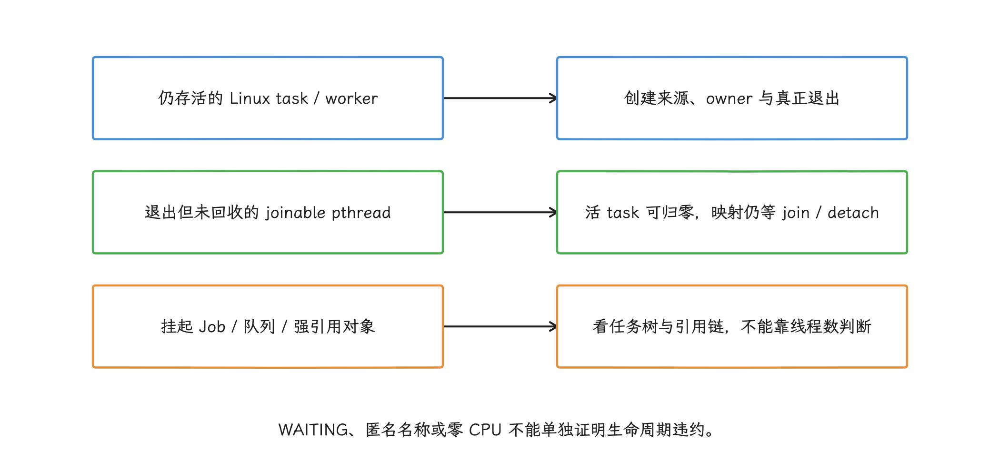

图：多种资源可以同时增长，但没有每个线程固定占一个FD的规则。

OpenJDK 的 `Thread.exit()` 会调用 `clearReferences()`，清空 `target`、`threadLocals`、`inheritableThreadLocals`、`blocker` 和未捕获异常处理器等引用；Android 17 的行为不同，`android-17.0.0_r1` 标签的 `Thread.getThreadGroup()` 源码明确注明 ART 在线程退出时没有调用 `Thread.exit()`。

ART 的 `Thread::Destroy()` 会分发未捕获异常、从 `ThreadGroup` 移除 Java peer、清除 Native peer，并唤醒等待 `join()` 的线程，但不会代替 Java `clearReferences()` 清空上述字段。

这里要区分两类对象链。仍存活的线程会作为 GC root 保留栈和线程局部引用；已经终止的 `Thread` 不再对应 Linux task，但业务静态集合、线程注册表或其他长生命周期对象若仍强引用它，`target`、`ThreadLocalMap` 或线程子类字段仍可能继续保留对象。等终止线程本身不再被引用，这些字段才随整个 `Thread` 对象一起回收。所以 heap dominator 分析要确认具体强引用链，单看线程状态是推断不出来的。

<!-- gracker-diagram: a214-02-terminated-thread-retention -->
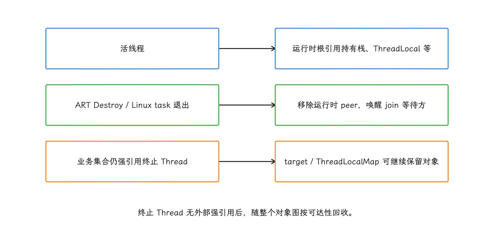

图：固定Android标签未调用Java Thread.exit来统一清字段；须沿实际堆引用链判定滞留。

### 2. “匿名线程”指来源不明

我们说的“匿名线程”，指名称只有通用序号、看不出创建模块的线程，和 Java 语法里的匿名类没有关系。Java 无参命名路径会产生 `Thread-N`，`Executors.defaultThreadFactory()` 的常见名称是 `pool-N-thread-M`。这类名称说明归因信息不足，单凭它判断不了线程该不该存活。排查时要回答三个问题：

1. 哪个模块创建了它？
2. 它执行哪类任务，由谁取消或关闭？
3. 同一个 owner 在一次进程生命周期中允许创建多少个 pool 和 worker？

Linux task 名称还有长度限制。`comm` 是内核保存的 task 短名称；bionic 的 `pthread_setname_np()` 把缓冲区长度上限定为 16 字节，名称达到 16 字节时返回 `ERANGE`，表示参数超出允许范围；内核 `TASK_COMM_LEN` 同样是 16，而且要把末尾值为 0 的 NUL（值为 0 的字符串结束字节） 结束字节算在内。所以 Java 里较长的 `Thread.name` 与 `/proc/self/task/<tid>/comm` 可能对不上。用于 Native 快照的模块标识应放在前 15 个 ASCII 字节内，完整来源另存到固定容量的注册表。

命名格式推荐短而稳定的 `模块-用途-序号`，例如 `img-dec-3`、`net-dns-2`；账号、URL、订单号等用户数据不要放进线程名。改名补不回历史创建栈，所以命名要和创建入口记录一起实施。

<!-- gracker-diagram: a214-03-identity-domains -->
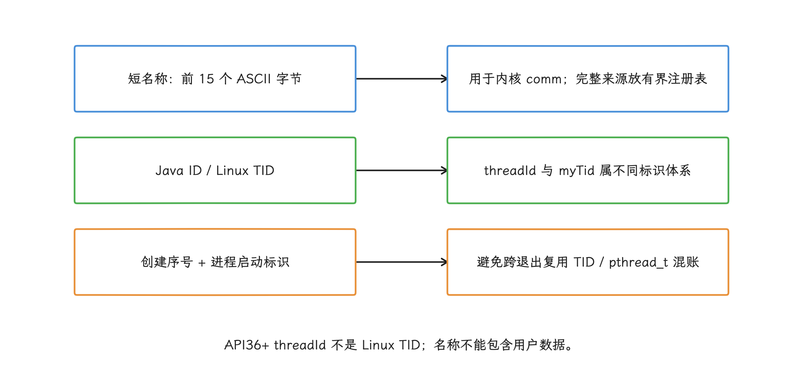

图：通用名称说明来源不足；命名不补历史创建栈，身份关联须同时保存创建代次和采样时间。

### 3. 四个观测面

TID 是 Linux 分配给 task 的线程 ID。下面四个入口分别观察内核 task、ART Java 线程和组件自己的任务模型，各自统计的范围不一样：

<!-- gracker-diagram: a214-04-observation-surfaces -->
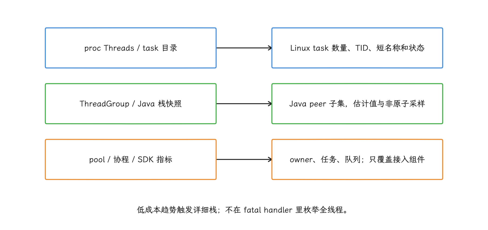

图：原生pthread、已退出未join映射与协程生命周期都有各自盲区，不能把不同计数直接相减。

| 观测入口 | 能回答什么 | 主要盲区 |
| --- | --- | --- |
| `/proc/self/status` 的 `Threads` | 当前进程有多少 Linux task | 没有来源和状态细节 |
| `/proc/self/task/<tid>` | 当前 task 的 Linux TID、短名称与调度状态 | 看不到已退出未 join 的 pthread 映射 |
| Java `Thread` 快照 | 有 Java peer 的线程、Java 状态和调用栈 | 纯 native pthread；快照不是同一时刻 |
| pool、协程和 SDK 自身指标 | owner、worker、任务与队列关系 | 只能覆盖已经接入的组件 |

#### 3.1 `ThreadGroup` 的近似计数

`ThreadGroup.activeCount()` 的文档和实现都说明返回值是估计值：线程可能在计数和枚举之间启动或结束，`enumerate(Thread[])` 在数组过小时还会静默截断，默认只遍历指定 group 的子树。它和进程 Linux task 数是两回事，硬限流别依赖它。

`ThreadGroup` 的若干生命周期 API 已废弃。pool 所有权要交给 `ExecutorService`、`CoroutineScope` 或组件 owner 显式管理，别寄托在 `ThreadGroup.destroy()` 一类机制上。

#### 3.2 `Thread.getAllStackTraces()` 的成本与时机

它的实现先取得 Java 线程记录，再逐个调用 `getStackTrace()`，会创建 `Map` 和每条线程的栈数组；各条栈采样时间不同，线程还可能在过程中结束。比较稳妥的用法是先用低成本计数发现持续增长，再用它生成诊断快照——秒级轮询开销过高，也覆盖不到没有 Java peer 的 raw pthread。

Java Crash、ANR 和跨线程栈采集机制见 [20.2 Java Crash、异常架构与线程堆栈分析](02-java-crash-exception-stack-analysis.md)；进程级线程与 FD 常态监控见 [20.7 FD 耗尽监控与故障排查](07-fd-resource-monitoring.md)。

#### 3.3 `/proc` 快照与并发退出

常态只读取 `/proc/self/status` 的 `Threads` 字段。需要查看构成时，再在后台、触发式地枚举 `/proc/self/task`。下面的示例限制返回数量，并把读取过程中已经退出的线程当作正常竞态。

```kotlin
data class NativeThreadRow(
    val tid: Int,
    val kernelName: String
)

data class NativeThreadSnapshot(
    val rows: List<NativeThreadRow>,
    val truncated: Boolean,
    val skipped: Int
)

fun snapshotNativeThreads(
    maxRows: Int = 256
): Result<NativeThreadSnapshot> = runCatching {
    require(maxRows in 1..1024)
    val taskDirs = File("/proc/self/task").listFiles()
        ?: throw IOException("cannot list /proc/self/task")

    var skipped = 0
    val sampledRows = taskDirs
        .asSequence()
        .mapNotNull { taskDir ->
            val tid = taskDir.name.toIntOrNull() ?: return@mapNotNull null
            val name = runCatching {
                File(taskDir, "comm").readText().trimEnd()
            }.getOrNull() ?: run {
                skipped++
                return@mapNotNull null
            }
            NativeThreadRow(tid, name)
        }
        .take(maxRows + 1)
        .toList()
    NativeThreadSnapshot(
        rows = sampledRows.take(maxRows),
        truncated = sampledRows.size > maxRows,
        skipped = skipped
    )
}
```

`listFiles()` 失败通过 `Result.failure` 表示，调用方应把它记录为“缺测”，别上报成 0 条线程。遍历期间某个 TID 目录消失通常是正常退出竞态；读取失败也可能来自权限或 I/O，示例统一计入 `skipped`，不能仅凭失败断定线程已退出。`truncated` 为 `true` 时只能分析已采到的名称分布，`rows.size` 代表的也只是返回的有效行数；`skipped` 只覆盖为取得这些行而实际尝试读取的数字条目，未处理的余项并未统计。`listFiles()` 仍会先枚举整个目录，这个上限限制返回量，不是目录枚举的硬 I/O 预算。这个函数会产生文件 I/O 和对象分配，不要放在主线程、crash handler（崩溃回调） 或高频定时器中。

<!-- gracker-diagram: a214-05-snapshot-quality -->
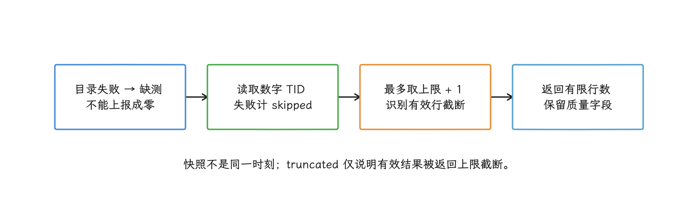

图：listFiles先枚举整个目录；返回上限不代表硬IO预算，跳过条目也不能一概当成正常退出。

Java `Thread.threadId()` 从 API 36 起可用，加上旧的 `getId()`，两者都是 Java 生命周期 ID，和 Linux TID 是两个体系。要拿到真正的 TID，得在线程内部调用 `Process.myTid()`，或在可靠的 Native 创建事件中取得，这样才能与 Perfetto、tombstone 和 `/proc` 对齐。TID 在线程退出后会复用，跨时间关联还必须带进程启动标识和采样时间。

### 4. 从创建入口保存来源

能控制的 Java worker 应统一经过 `ThreadFactory`（创建和配置线程的工厂）。下面的示例在线程开始执行后登记 Java ID 和 Linux TID，并在任务入口退出时删除记录；`ThreadRegistry` 是示例里自造的线程注册表，Android 没有对应 API。实现时要限制容量，采用无锁或低竞争数据结构，并保证注册失败不影响业务线程。

```kotlin
class TrackedThreadFactory(
    private val sourceId: String,
    private val registry: ThreadRegistry,
    private val delegate: ThreadFactory = Executors.defaultThreadFactory()
) : ThreadFactory {
    private val sequence = AtomicInteger()

    init {
        require(sourceId.matches(Regex("[a-z0-9-]{1,7}")))
    }

    override fun newThread(task: Runnable): Thread {
        val ordinal = Integer.toUnsignedString(sequence.incrementAndGet(), 36)
            .padStart(7, '0')
        val name = "$sourceId-$ordinal"
        val wrapped = Runnable {
            val current = Thread.currentThread()
            val javaId = if (Build.VERSION.SDK_INT >= 36) {
                current.threadId()
            } else {
                @Suppress("DEPRECATION")
                current.id
            }
            val tid = Process.myTid()

            registry.tryOnStart(
                javaId = javaId,
                linuxTid = tid,
                sourceId = sourceId,
                javaName = current.name
            )
            try {
                task.run()
            } finally {
                registry.tryOnStop(javaId = javaId, linuxTid = tid)
            }
        }
        return delegate.newThread(wrapped).apply {
            this.name = name
        }
    }
}
```

这里用不超过 7 个 ASCII 字节的 `sourceId` 和固定 7 位 base-36（36 进制） 序号，把 Java 名称控制在内核 `comm` 的 15 字节载荷内。注册表记录的是 worker 生命周期，每个提交任务的生命周期要另行采集：若一个 pool 长期复用 worker，还要单独包装任务，采集队列等待、执行时长、取消和异常。创建栈成本较高，可以在新 pool 出现、数量增长或诊断开关开启时采样，每次任务提交都存完整堆栈就太重了。

<!-- gracker-diagram: a214-06-factory-worker-task -->
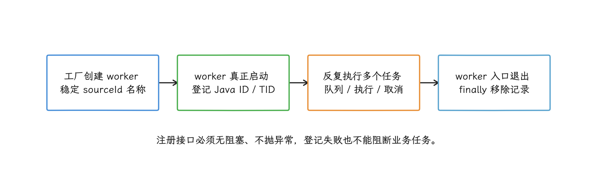

图：ThreadFactory包装的是worker入口；线程池会复用worker，每个任务的事件需要另外包装。

第三方 SDK 接不进 factory 时，可按风险从低到高采用：

- 记录 SDK 版本、初始化次数和进程角色，与线程名前缀和数量变化对齐；
- 对可修改的依赖入口传入自有 executor（任务执行器）；
- 在内部或诊断构建中做有限范围的字节码插桩，即在编译产物中自动加入创建事件记录；
- 对必须诊断的 Native SDK，在受控版本中跟踪 pthread 生命周期。

不要用 `Thread.stop()`、`pthread_cancel()` 或反射强制终止未知线程。线程可能持有 Java monitor、malloc 锁、数据库事务或库内状态，强停会把“线程多”变成数据损坏或死锁。

### 5. Native pthread 的特殊盲区

#### 5.1 Java `Thread` 与 raw pthread 的回收协议不同

ART 的 `Thread::CreateNativeThread()` 会把 pthread attribute 设成 `PTHREAD_CREATE_DETACHED`，再调用 `pthread_create()`。普通 Java `Thread` 因而由 detached pthread 承载，退出时业务无需调用 `pthread_join()`。

raw `pthread_create()` 在未传 detached 属性时使用 joinable 语义，bionic 的状态迁移如下：

| 事件 | bionic 状态 | 栈映射何时释放 |
| --- | --- | --- |
| 创建默认 pthread | `THREAD_NOT_JOINED` | 尚未释放 |
| 入口函数返回或调用 `pthread_exit()` | `THREAD_EXITED_NOT_JOINED` | 继续保留，等待 join |
| 调用 `pthread_join()` | `THREAD_JOINED` | join 路径移除并释放 |
| 创建时 detached，或存活时 `pthread_detach()` | `THREAD_DETACHED` | 线程退出时自行释放 |
| 已退出后再 `pthread_detach()` | 清理路径转到 join | 当次调用释放 |

`THREAD_EXITED_NOT_JOINED` 已经没有 Linux task，因此 `/proc/self/task`、`Threads`、Java 栈快照都不能把它计为活线程；Perfetto 的 `thread` 表可以保留它退出前的历史记录，但不能显示残留的 pthread 用户空间映射。该 pthread 的主映射仍等待 `join` 或 `detach` 回收。若 Native RSS 或虚拟地址空间持续增长而活线程数会回落，就该查这一类资源。

<!-- gracker-diagram: a214-07-pthread-reclaim -->
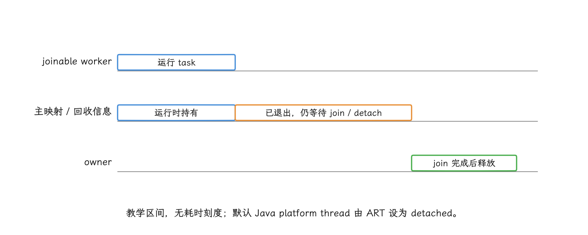

图：创建后必须明确detach或一次join；历史trace可保留线程实体，但它不表示用户空间映射仍被持有。

#### 5.2 监控必须覆盖成对事件

对自有 C/C++ 代码，优先提供 RAII（对象析构时自动执行清理） 或统一包装层，让清理在对象析构时自动发生，并明确以下约束：

- 无需返回结果、创建方不再等待的 worker 在创建前设置 detached；
- 需要结果的 joinable worker 只能由一个 owner join；
- 创建失败时不把未初始化的 `pthread_t` 写入注册表；
- 入口函数正常返回、异常适配层返回和显式 `pthread_exit()` 都要结算状态；
- registry 以创建序号作为事件 ID，避免长期只用可能复用的 `pthread_t` 或 TID；
- 平时周期保存成功创建总数、创建失败数；正常退出时可再补充一次。摘要包含 `running`、`exited-unjoined`、`joined-reclaimed`、`detached-reclaimed` 等互斥生命周期状态；
- 不要把可重叠计数直接相减。

PLT（Procedure Linkage Table，过程链接表）hook 通过改写动态链接跳转表拦截函数，inline hook 则改写函数入口指令。它们可以观察三方库，但会受 ABI（二进制接口）、加载顺序、静态链接、设备厂商改动和重入影响——重入指 hook 内部再次触发被 hook 函数。在 hook 里采完整 Native 栈、扩容容器或写文件，还会引入新故障。所以这类方案要限定构建类型、进程、启用时长和事件上限，并用 `/proc/self/task` 核对；把它写成所有版本默认开启的稳定接口是不可靠的。

### 6. 每条线程的资源成本

“每条线程默认占用 1 MiB 栈空间”过于简化，还容易把虚拟地址预留误算成 RSS。先分清两个量：虚拟地址空间是进程可寻址的范围，RSS（resident set size，常驻内存集）只统计当前驻留在物理内存中的页面，两者怎么算完全不同。

bionic 对 raw pthread 的默认栈常量是 1 MiB 减去独立信号栈的可用部分。这条 pthread 的主映射里还有：用于捕获越界的 guard page（设置为不可访问、用于捕获越界的保护页）、static TLS（线程局部存储）、专用 libgen buffers（为 basename/dirname 等接口提供的线程局部字符缓冲区） 和另一侧保护页，并使用 `MAP_NORESERVE`，也就是创建映射时不要求内核预留等量交换空间。架构和内存安全能力还可能增加 alternate signal stack（处理信号时使用的备用栈）、shadow call stack（单独保存返回地址、用于检测破坏的影子调用栈）等线程私有区域。

Java `Thread` 还会经过 ART 的 `FixStackSize()`：传入 0 时先取运行时 `-Xss` 默认值，随后为 Dalvik/Android 兼容增加 1 MiB，再加入栈溢出保护与保留区并按页对齐。`Thread` 构造器的 `stackSize` 参数只是依赖虚拟机实现的提示，没跑过深递归、JNI 和低内存压力测试，就不要随意缩小。

<!-- gracker-diagram: a214-08-thread-mapping -->
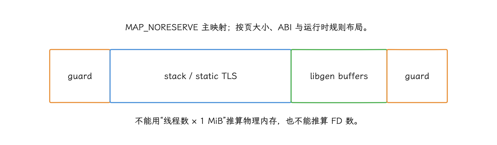

图：示意固定bionic映射组成；备用信号栈、shadow call stack等附属区域另计，ART还会按Xss及保护区调整。

监控至少区分三种量：

- 虚拟地址空间中的线程映射；
- 已提交并驻留的物理页面；
- task、TLS、信号栈和运行时附属结构。

估算别只做“线程数 × 1 MiB”。应在目标 ABI、页大小、设备内存和相同业务负载上，比较 `/proc/self/maps`、`smaps_rollup`（各映射内存统计的进程级汇总）、RSS 与 task 数的共同变化——`/proc/self/maps` 列出进程内存映射，`smaps_rollup` 是各映射内存统计的进程级汇总。

线程也不会天然持有一个 FD：`/proc/self/task/<tid>` 只是 procfs（内核导出的进程信息伪文件系统） 视图，进程并没有为每条线程常驻打开文件描述符。线程和 FD 一起增长，通常说明同一模块在同时创建 worker 与 socket、pipe、eventfd 或文件；关联是否成立，还要按 owner 和时间线证明。FD 的计数、限额与复用规则见 [FD 耗尽监控与故障排查](07-fd-resource-monitoring.md)。

### 7. 线程创建失败的多层来源

内核 `copy_process()` 会检查 `RLIMIT_NPROC` 上限和系统 `max_threads`，前者按 real user（内核记账使用的真实用户 ID）——内核记账使用的真实用户 ID——统计。超过数量限制时返回 `-EAGAIN`，表示当前资源条件不允许再次创建；task 结构、内核栈等分配失败还可能返回 `-ENOMEM`，表示内存不足。设备若启用 cgroup（按线程组管理资源的控制组） pids controller（按控制组限制 task 数的内核机制），还会按控制组受到额外的 task 数约束。

在到达内核 `clone` 前，bionic 还要建立线程映射并初始化 TLS；ART 创建 Java 线程前还要分配内部 `Thread`、JNI 环境和 Java peer 关联。所以同一个“线程创建失败”报错，可能来自：

- 用户/系统/cgroup 的 task 数限制；
- 虚拟地址空间不足或碎片；
- native 内存、页表、内核内存压力；
- 线程栈或 TLS 映射失败；
- ART 自身分配失败；
- 某个库请求了异常大的 stack size。

`/proc/self/limits` 的 Max processes 读出来的数字，算不出“本进程还能创建多少条线程”。`RLIMIT_NPROC` 按 real user 计数，Android 的应用 UID、共享 UID 和进程角色都会影响结果，其他限制也可能更早触发。

诊断时要保存 bionic/ART 原始错误和 errno（C 库错误编号），以及进程角色、ABI、task 数、`VmSize`（虚拟地址空间总量）、RSS 和近期增长，别只记 Java heap 剩余空间。

<!-- gracker-diagram: a214-09-creation-failure -->
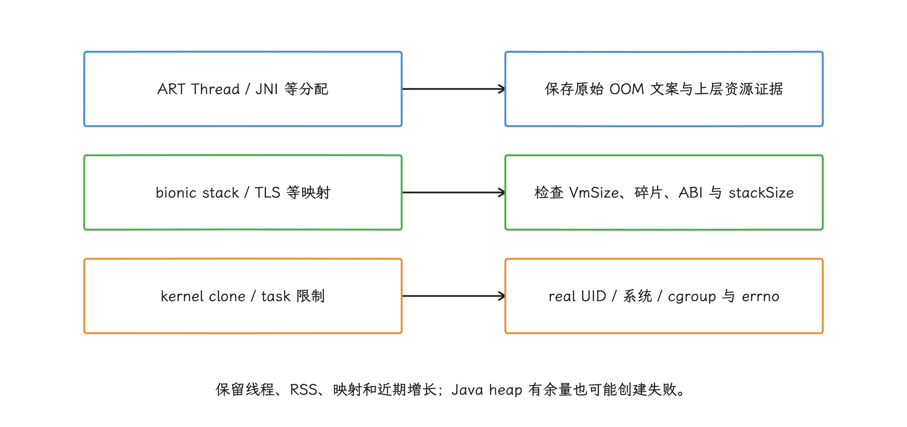

图：RLIMIT_NPROC按真实UID记账，不能从Max processes直接算出本进程还可创建多少线程。

Android 17 bionic 还在线程映射中加入页对齐的专用 libgen buffers，并加强备用信号栈初始化失败的处理。这些是内存布局和错误处理层面的变化，从中推导不出“应用最多 500 条线程”之类的平台规则。

### 8. 线程池：看容量、任务和 owner

#### 8.1 `activeCount < poolSize` 很正常

`ThreadPoolExecutor.getActiveCount()` 返回正在执行任务的 worker 估计数，`getPoolSize()` 返回当前 worker 数。空闲 worker 会等在队列上，所以 `activeCount` 小于 `poolSize` 多半只是空闲，判断泄漏还要看下面这些量。建议同时记录：

- `corePoolSize`、`maximumPoolSize`、`poolSize`、`largestPoolSize`；
- `activeCount`、`completedTaskCount`、`taskCount`；
- 队列长度、最老任务等待时间与拒绝次数；
- pool 创建来源、实例数、`isShutdown`、`isTerminated`；
- 前后台状态和对应功能是否仍然存活。

固定线程池常用无界队列，worker 数稳定时仍可能发生任务或内存堆积；cached pool 会按需增加 worker，阻塞任务突发时线程数可能快速上升，空闲 worker 默认在 keep-alive（空闲存活时间） 到期后回收。两类线程池要用不同的证据判断。

#### 8.2 `ScheduledThreadPoolExecutor` 要看取消策略

周期任务会持续执行到取消；一次性延迟任务被取消后，默认仍可能留在按执行时间排序的 delay queue（按执行时间排序的延迟队列） 里，直到原延迟到期，大量长延迟任务因此造成对象滞留。业务允许时可启用 `setRemoveOnCancelPolicy(true)`，并由 owner 保存代表计划任务句柄的 `ScheduledFuture`，在生命周期结束时取消任务，再关闭专用 executor。

`ScheduledThreadPoolExecutor` 基于固定数量的 core worker（核心 worker） 和无界 delay queue，调大 `maximumPoolSize` 通常没有作用。“worker 没退出”和“取消任务仍在队列”要分开看，两者的修复点不同。

<!-- gracker-diagram: a214-10-pool-evidence -->
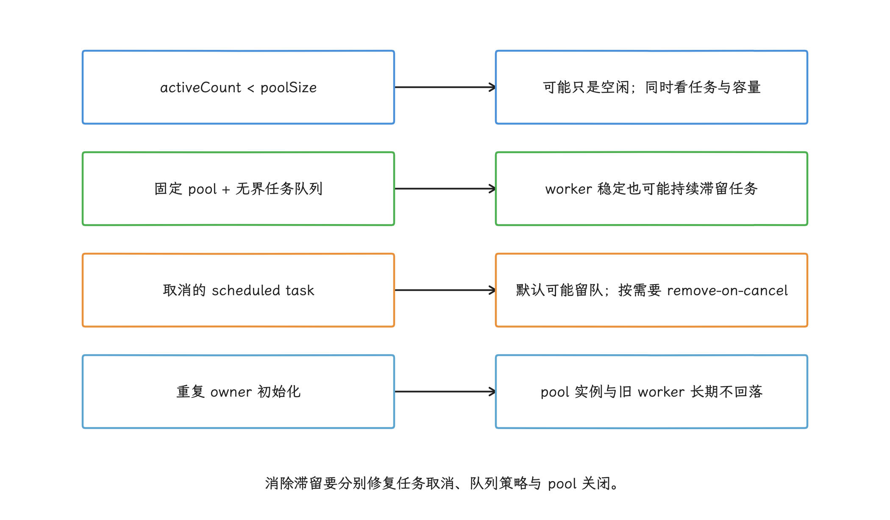

图：关闭协议由owner负责；ScheduledThreadPoolExecutor用core worker和无界delay queue，增maximumPoolSize通常无效。

#### 8.3 重复创建 pool 的排查信号

线程名前缀里的 pool 序号不断增长、旧 pool worker 长期存活，通常提示组件重复初始化或缺少关闭。注册表要记录 pool 实例来源和 owner 生命周期，只记线程是不够的。进程级单例也没要求所有场景共用一个全进程 executor：隔离明确、能独立关闭的模块可以有自己的专用 pool，前提是有并发预算和 owner。

### 9. 协程：任务泄漏与线程泄漏要分开

`Dispatchers.Default` 和 `Dispatchers.IO` 会复用调度器 worker，一万个挂起协程占用的 Linux task 可能远少于一万条。挂起协程保存继续执行所需的状态，等条件满足后再由 dispatcher 调度。`GlobalScope` 没有可供业务 owner 统一等待或取消的父 `Job`，容易让任务及其捕获对象超过页面或会话生命周期；但它也不会自动为每个协程新建线程。

更接近线程资源泄漏的协程用法包括：

- 重复创建 `newSingleThreadContext()` 后没有 `close()`；
- 把新建 `ExecutorService` 转成 dispatcher 后没有关闭 dispatcher 或 executor；
- 每次进入页面都创建独立 dispatcher，并把它保存在长生命周期对象里；
- 阻塞任务占满共享 dispatcher，又通过错误补偿持续增加其他 pool。

若不要求专用物理线程，且只需让各挂起点之间的代码片段串行执行，可用现有 dispatcher 的 `limitedParallelism(1)`；需要把包含挂起点的整个业务操作串行化时，使用 `Mutex`、`Semaphore` 或单消费者队列。结构化并发要求子任务的生命周期嵌套在父 scope 内；页面、ViewModel、服务或会话应使用有 owner 的 scope。协程取消采用协作机制，取消 scope 后还要确认阻塞调用能否响应线程中断或自身的取消协议。

排查时我们可以同时画两条曲线：活跃 `Job`/队列数与 Linux task 数。只有 Job 增长，重点查 scope 和任务；两者都增长，再查自定义 dispatcher、executor 或 native 库。

### 10. 常见组件的判断要点

#### 10.1 OkHttp

OkHttp 官方建议复用一个 `OkHttpClient`：通过已有 client 的 `newBuilder()` 派生出的客户端，会共享连接池、线程池和基础配置。连接池保存可复用的网络连接，`Dispatcher` 管理同步与异步请求的排队和执行；多个独立构造的 client 可能各自持有这些资源，实际共享关系要查过才知道，光数 client 对象说明不了问题。

应记录 client 构造来源、`Dispatcher.runningCallsCount()`、`queuedCallsCount()`、请求取消和回调是否返回。不要为了降低快照中的线程数就关闭全局共享 client：关闭 dispatcher executor 后，后续请求会被拒绝；连接池中的空闲连接会按自身策略释放。

#### 10.2 WorkManager

WorkManager 里重复的 `WorkRequest` 更常见的是任务重复，未必产生一条新 worker。unique work 用业务唯一名称约束同类工作，`WorkInfo` 记录任务状态、输出和停止原因；排查时还要检查约束与重试策略。自定义 `Configuration` 时，执行器要有容量上限，并区分运行 Worker 的 executor 与 WorkManager 内部协调任务用的 task executor。

<!-- gracker-diagram: a214-11-component-resources -->
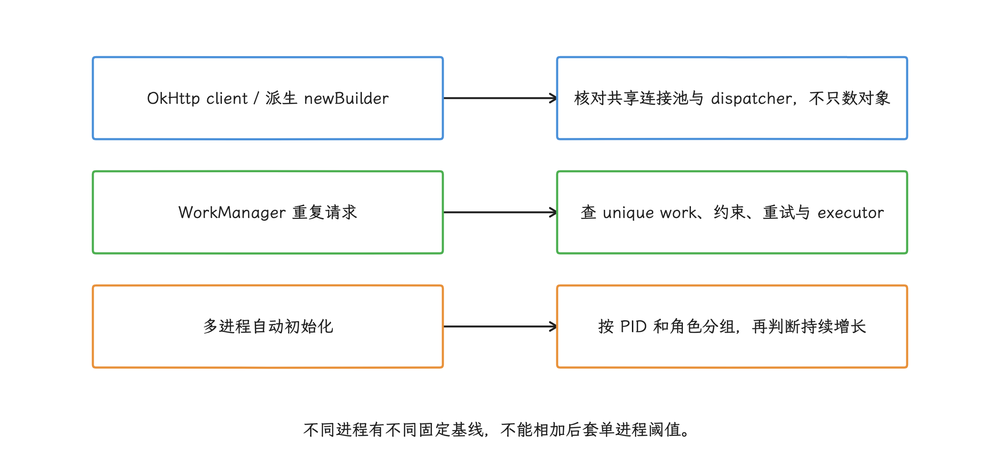

图：单例复用和模块隔离都需要明确owner；不要为压低线程快照关闭全局共享client。

多进程应用要按进程记录 PID（进程 ID）、进程名和角色。每个进程都有自己的 ART、Binder 和库初始化开销，把主进程与远程进程 task 数相加再套单进程阈值会误报；若某个依赖在每个进程都自动初始化，应通过 AndroidX Startup、manifest 配置或进程判断缩小初始化范围。

### 11. 告警要看基线、增量和持续时间

`200 / 400 / 500` 可以是某个产品在特定设备分组上的经验值，别把它写成 Android 平台通用阈值。主进程、WebView 进程、音视频进程和 isolated process（以隔离 UID 运行、权限受限的进程）——以隔离 UID 运行、权限受限的进程——基线各不相同；ABI、设备内存、页大小、目标版本和功能开关也会改变成本。

我们把一条可解释的线程风险规则拆成这些信号：

| 信号 | 含义 |
| --- | --- |
| 同进程角色、版本和设备分组的 P95/P99 | 用第 95/99 百分位判断当前值是否偏离同类样本 |
| 相对冷启动稳定点的增量 | 排除启动后原本就存在的平台与组件基线 |
| 一段时间内的增长斜率 | 用单位时间增量识别快速创建 |
| 页面退出、任务取消或进入后台后的回落 | 验证生命周期是否收敛 |
| 名称/sourceId 的增量贡献 | 指向 owner |
| pool 队列、RSS、VmSize、FD 与失败日志 | 判断资源后果 |

建议使用分层触发：

1. 常态只采 `Threads`、pool 摘要和历史高水位（进程生命周期内观测到的最大值），即进程生命周期内观测到的最大值；
2. 增长持续多个窗口后，读取 `/proc/self/task` 名称分布；
3. 某来源异常时，短时开启创建事件或采样栈；
4. 接近故障或出现创建失败时，写入预留的有界摘要；
5. 下一次启动在 API 30+ 关联 `ApplicationExitInfo` 历史退出元数据；API 31+ Native crash 可尝试取得允许为空的 protobuf tombstone 流。其他 ANR trace、系统 tombstone 或 SDK 记录按接口、版本与访问权限取得。

崩溃 handler 中不要调用 `Thread.getAllStackTraces()`、遍历几百个 `/proc` 文件或启动上传线程。资源紧张阶段这些动作可能再次分配失败，甚至覆盖原始现场。

<!-- gracker-diagram: a214-12-bounded-diagnostics -->
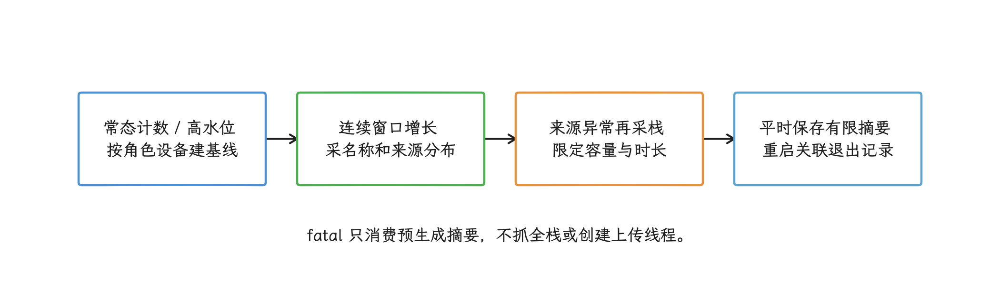

图：页面退出后的回落、同类分位和增长贡献共同解释风险；固定200/400/500不是平台规则。

### 12. 用 Perfetto 还原生命周期

实验室或可控设备上，我们可以用 Perfetto 把“某时段线程数增加”细化成创建、改名、调度和退出事件。下面的配置片段通过 ftrace（Linux 内核事件跟踪机制）——Linux 内核事件跟踪机制——采集 task 生命周期与调度切换，同时轮询进程统计；实际 buffer 大小、时长与权限应按测试场景调整。

```textproto
data_sources: {
  config {
    name: "linux.ftrace"
    ftrace_config {
      ftrace_events: "sched/sched_switch"
      ftrace_events: "sched/sched_process_exit"
      ftrace_events: "sched/sched_process_free"
      ftrace_events: "task/task_newtask"
      ftrace_events: "task/task_rename"
    }
  }
}
data_sources: {
  config {
    name: "linux.process_stats"
    process_stats_config {
      scan_all_processes_on_start: true
      proc_stats_poll_ms: 1000
    }
  }
}
```

`task_newtask` 用于补充线程开始时间，`sched_process_exit` 和 `sched_process_free` 分别记录 task 退出与最终释放，`task_rename` 能看到内核短名称变化；`sched_switch` 记录 CPU 在 task 间切换。Perfetto 的 `utid` 是一次 trace 内分配的唯一线程标识，分析时不要只用可能复用的操作系统 TID。

Perfetto 不会自动给出 Java 创建调用点，也看不到已退出未 join 的 pthread 用户空间映射；前一类来源要与 `ThreadFactory` 或受控采样关联，后一类要靠 pthread 成对事件或内存映射证据。

<!-- gracker-diagram: a214-13-perfetto-correlation -->
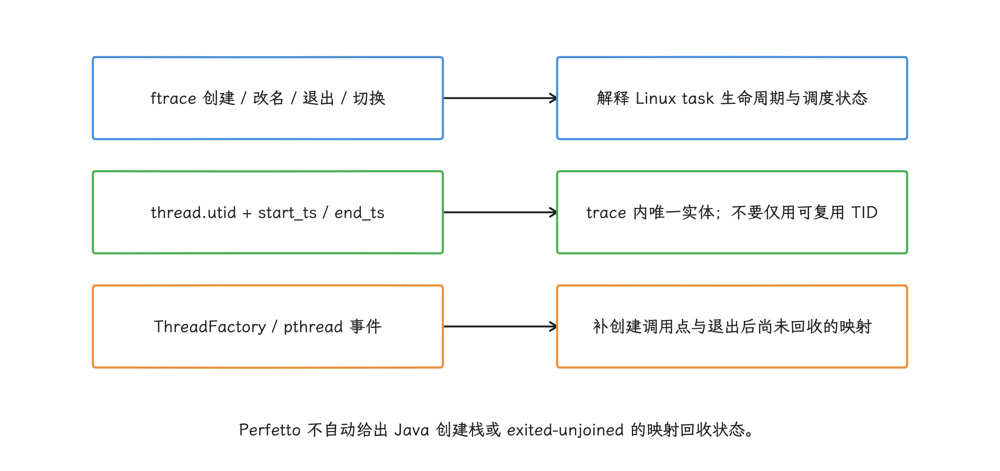

图：历史thread表可保留退出记录，缺少创建/销毁事件时边界也可能为空。

### 13. 四类案例怎样判

#### 13.1 `pthread_create` OOM 与页面线程泄漏

看到 `OutOfMemoryError: pthread_create (...) failed`，只能确认 ART 在线程创建路径抛了 `OutOfMemoryError`；Java heap 尚有余量时，资源耗尽照样可能发生。失败可能在 ART `Thread`/JNI 环境分配、bionic stack/TLS 映射或内核 `clone` 中的任何一层，因此要保留原始错误、线程数、`VmSize`/RSS、ABI、页大小、进程角色和近期增长。

一个可重复的调查过程是：

1. 按进程角色和设备内存/性能分组绘制 Linux task 数、Java 线程、pool 实例、队列、VmSize 与 RSS 时间线；
2. 在增长刚越过基线时采集 `/proc/self/task` 名称分布和有限 Java 栈，不等到创建已经失败；
3. 用统一 `ThreadFactory`、executor registry 或诊断构建中的 pthread 包装定位创建 owner；
4. 页面/组件退出后等待契约规定的宽限期，确认线程、pool 和任务是否回落；
5. 修复 owner 的取消、shutdown、join/detach 和重复初始化；提高阈值或缩小未知线程栈，修不好生命周期错误。

复现样例应运行在独立测试进程：重复进入页面，每次错误创建一组 `HandlerThread` 或 executor 且不退出，直到 task 数和虚拟地址映射呈阶梯增长。修复版保存 owner，在 `onDestroy` 或 `close` 中停止任务，调用 `quitSafely()` 或 `shutdown()`，并等待明确终止。验收应比较相同循环次数后的峰值、回落时间、任务完成率和内存；单凭“不再抛 OOM”不足以证明资源已经回收。

告警要同时使用基线、增长斜率和回落情况。固定的 400/500 不是 Android 平台上限；阈值要按主进程、WebView 或媒体进程、ABI、设备内存和实测栈成本校准。fatal 路径指致命故障后的最小采集回调，它只写入预生成且有容量上限的摘要，资源即将耗尽时不要在这里创建上传线程或抓取全部线程栈。

#### 13.2 广告 SDK 出现大量短名称线程

光凭 `Thread-123` 这样的名字，推不出“广告 SDK 泄漏并耗尽 FD”。可靠的证据链是：

1. SDK 初始化或广告页面进入后，特定短名称或 `sourceId` 分布持续增加；
2. 页面退出和 SDK 关闭后，多个稳定窗口仍不回落；
3. Java/Native 栈或受控创建事件指向同一依赖版本；
4. pool 实例、任务队列或 pthread 状态能解释存活原因；
5. FD 若同步增长，还能按 socket/pipe/file 类型归到相同 owner。

修复可能是升级 SDK、禁止重复初始化、传入共享 executor、补充关闭协议或隔离到可控进程。强停未知线程不在可接受方案内。

#### 13.3 `GlobalScope` 数量增长

若协程任务增长而 Linux task 稳定，这是 scope 或任务生命周期问题。应定位未完成的 Job、捕获对象和不可取消的调用，不要通过扩大 `Dispatchers.IO` 并发来掩盖。只有自建 dispatcher 或 pool 数量同步增长时，才同时归为线程资源问题。

#### 13.4 WorkManager 多进程 task 数上升

先按 PID 分组，确认哪些进程加载了 WorkManager 和业务依赖，再检查有没有重复 enqueue（入队） 同一工作、有没有用 unique work、有没有在远程进程重复初始化自定义 executor。多进程的固定基线开销，和同一进程内的持续增长，是两类信号。

### 14. Android 17 的虚拟线程边界

API 36 已公开 `Thread.isVirtual()` 查询方法，从它推不出普通应用已经稳定获得虚拟线程创建能力。`android-17.0.0_r1` 的 `isVirtual()` 实现会检查 `VirtualThreadContext` 或 `BaseVirtualThread`，与同一文件中“Android 总返回 false”的旧注释不一致，判断以该标签实现和设备行为为准。

Android 17 还包含 `Thread.ofVirtual()`、`startVirtualThread()`、`Executors.newVirtualThreadPerTaskExecutor()` 及对应 ART 实现；这些创建入口仍带 `FlaggedApi`（由平台功能开关控制的 API 标记） 标记——由平台功能开关控制的 API——底层实现还受 `is_exported: false` 的 `virtual_thread_impl_v1` ART flag 控制。

所以面向普通应用的设计，要当作 Project Loom（OpenJDK 的虚拟线程项目）尚未成为默认能力；生产监控仍要把 Java platform thread 和 Native pthread 映射到 Linux task，Kotlin coroutine 和 Java virtual thread 也是两回事。若未来版本全面公开并启用虚拟线程，监控模型要新增“虚拟线程数量”和“carrier platform thread 数量”两个维度——carrier thread 是某一时刻承载并执行虚拟线程的操作系统线程，届时“一条 Java 线程对应一个 Linux task”的假设就不再成立。

<!-- gracker-diagram: a214-14-virtual-boundary -->
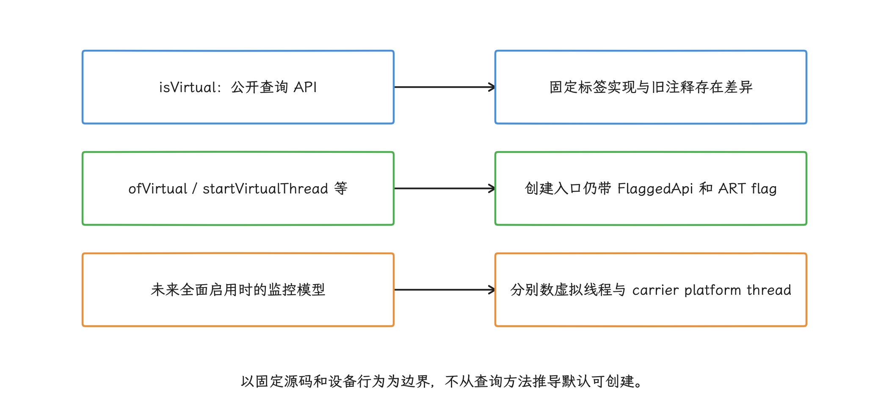

图：当前生产线程模型以已验证的平台线程能力为准，协程Job与Java虚拟线程仍是不同对象。

### 15. 验证方案

建议在独立测试进程中覆盖以下场景：

| 注入场景 | 预期结果 |
| --- | --- |
| 重复创建固定 pool 且不 shutdown | pool 实例、worker 和 Linux task 同步增长 |
| cached pool 提交一批短任务 | task 数短时上升，keep-alive 后回落 |
| 取消长延迟 scheduled task | 开启 remove-on-cancel 前后队列保留差异可见 |
| 创建 `newSingleThreadContext` 后不关闭 | dispatcher owner 与 task 数持续增加 |
| raw joinable pthread 立即返回且不 join | 活 task 回落，但 pthread 事件差额和映射压力增长 |
| raw detached pthread 立即返回 | task 和映射都能回收 |
| 仍存活线程持有 `ThreadLocal<Activity>` | heap dominator 指向活线程；线程终止并释放外部 `Thread` 强引用后，整条对象链可回收 |
| 已终止 `Thread` 仍被静态注册表保存 | `/proc` 已无 task，但 dominator 仍经该 `Thread` 指向 `target`、`ThreadLocalMap` 或子类字段 |
| 线程与 socket 同时泄漏 | 两种资源都能归到同一 owner，而非按数量猜测 |
| `/proc` 遍历时线程退出 | 快照容忍 TID 消失并标记缺测/跳过 |
| 接近资源压力时触发摘要 | 不抓全栈，不创建新线程，摘要仍有界 |

测试结束后必须退出测试进程，或由明确 owner 释放资源。不要在承载用户数据的线上进程中制造几百条线程、降低资源限制或留下 joinable pthread 来验证告警。

### 16. 评审清单

- [ ] 是否区分 Linux task、Java platform thread、pool worker、协程 Job 与 raw pthread？
- [ ] 是否用生命周期和 owner 证明泄漏，而非看到 `WAITING` 或匿名名称就下结论？
- [ ] 常态监控是否只采低成本计数，详细栈是否由增长触发？
- [ ] 是否把 Java ID、Linux TID、pthread 事件 ID 分开保存并处理复用？
- [ ] 是否区分仍存活的线程与被业务强引用的已终止 `Thread`，没有假定 ART 会调用 `Thread.exit()` 清字段？
- [ ] `ThreadGroup.activeCount()` 是否只作为估计，不用于硬限流？
- [ ] `/proc/self/task` 是否容忍并发退出，并与 Java 快照解释差额？
- [ ] 自有 pool 是否有稳定 sourceId、容量、队列、拒绝和关闭协议？
- [ ] 计划任务是否保存 `ScheduledFuture`、正确取消并处理队列保留？
- [ ] 协程 scope 和 dispatcher 是否都有明确 owner？
- [ ] native joinable pthread 是否保证一次 join，或创建时设为 detached？
- [ ] 是否避免把 Java `Thread` 的 ART 栈映射写成固定 1 MiB？
- [ ] 是否避免把线程数与 FD 数写成一一对应？
- [ ] 告警是否按进程角色、版本、设备分组、增量和持续时间校准？
- [ ] 创建失败是否同时保留 errno、task 数、`VmSize`/RSS 与进程限制？
- [ ] 线程名、调用栈和来源字段是否限长并去除用户信息？
- [ ] fatal 路径是否只消费预生成的有界摘要？

### 17. 源码与官方资料

- [AOSP `Thread.java`（android-17.0.0_r1）](https://android.googlesource.com/platform/libcore/+/refs/tags/android-17.0.0_r1/ojluni/src/main/java/java/lang/Thread.java)：默认命名、`getAllStackTraces()`、Android 未调用 `exit()` 的兼容注释和虚拟线程 API 边界。
- [AOSP libcore `current.txt`（android-17.0.0_r1）](https://android.googlesource.com/platform/libcore/+/refs/tags/android-17.0.0_r1/api/current.txt)：虚拟线程相关入口的 `FlaggedApi` 标记。
- [AOSP `ThreadGroup.java`（android-17.0.0_r1）](https://android.googlesource.com/platform/libcore/+/refs/tags/android-17.0.0_r1/ojluni/src/main/java/java/lang/ThreadGroup.java)：`activeCount()` 与 `enumerate()` 的估计和竞态语义。
- [AOSP ART `thread.cc`（android-17.0.0_r1）](https://android.googlesource.com/platform/art/+/refs/tags/android-17.0.0_r1/runtime/thread.cc)：`Thread::Destroy()`、`FixStackSize()`、detached pthread 属性和 Java 线程创建失败路径。
- [AOSP ART `art-flags.aconfig`（android-17.0.0_r1）](https://android.googlesource.com/platform/art/+/refs/tags/android-17.0.0_r1/build/flags/art-flags.aconfig)：`virtual_thread_impl_v1` 实现 flag 的声明与导出边界。
- [AOSP ART `java_lang_Thread.cc`（android-17.0.0_r1）](https://android.googlesource.com/platform/art/+/refs/tags/android-17.0.0_r1/runtime/native/java_lang_Thread.cc)：Java `Thread` 到 ART 创建入口。
- [AOSP bionic `pthread_create.cpp`（android-17.0.0_r1）](https://android.googlesource.com/platform/bionic/+/refs/tags/android-17.0.0_r1/libc/bionic/pthread_create.cpp)：线程映射、TLS、guard、`MAP_NORESERVE`、clone 和默认 join 状态。
- [AOSP bionic `pthread_internal.h`（android-17.0.0_r1）](https://android.googlesource.com/platform/bionic/+/refs/tags/android-17.0.0_r1/libc/bionic/pthread_internal.h)：默认栈、备用信号栈和 guard 大小常量。
- [AOSP bionic `pthread_exit.cpp`（android-17.0.0_r1）](https://android.googlesource.com/platform/bionic/+/refs/tags/android-17.0.0_r1/libc/bionic/pthread_exit.cpp)：detached 与 exited-not-joined 的映射回收差异。
- [AOSP bionic `pthread_join.cpp`（android-17.0.0_r1）](https://android.googlesource.com/platform/bionic/+/refs/tags/android-17.0.0_r1/libc/bionic/pthread_join.cpp)：join 状态迁移和释放路径。
- [AOSP bionic `pthread_detach.cpp`（android-17.0.0_r1）](https://android.googlesource.com/platform/bionic/+/refs/tags/android-17.0.0_r1/libc/bionic/pthread_detach.cpp)：线程存活与已经退出两种情况下的 detach 路径。
- [AOSP bionic `pthread_setname_np.cpp`（android-17.0.0_r1）](https://android.googlesource.com/platform/bionic/+/refs/tags/android-17.0.0_r1/libc/bionic/pthread_setname_np.cpp)：16 字节 kernel comm 边界与 `prctl`/proc 写入路径。
- [Android Common Kernel `fork.c`（android17-6.18-2026-06_r6）](https://android.googlesource.com/kernel/common/+/refs/tags/android17-6.18-2026-06_r6/kernel/fork.c)：`RLIMIT_NPROC`、`max_threads`、`EAGAIN` 与 task 分配失败路径。
- [Android Common Kernel `proc.rst`（android17-6.18-2026-06_r6）](https://android.googlesource.com/kernel/common/+/refs/tags/android17-6.18-2026-06_r6/Documentation/filesystems/proc.rst)：`Threads`、task 目录和 proc 字段语义。
- [Android Developers：`Thread`](https://developer.android.com/reference/java/lang/Thread)：`threadId()`、`isVirtual()` 和平台 API 契约。
- [Android Developers：`ThreadGroup`](https://developer.android.com/reference/java/lang/ThreadGroup)：估计计数、枚举和废弃 API。
- [Android Developers：`ThreadPoolExecutor`](https://developer.android.com/reference/java/util/concurrent/ThreadPoolExecutor)：pool、active、queue 与生命周期指标。
- [Android Developers：`ScheduledThreadPoolExecutor`](https://developer.android.com/reference/java/util/concurrent/ScheduledThreadPoolExecutor)：取消任务保留和 remove-on-cancel 策略。
- [Kotlin Coroutines：`newSingleThreadContext`](https://kotlinlang.org/api/kotlinx.coroutines/kotlinx-coroutines-core/kotlinx.coroutines/new-single-thread-context.html)：专用 native 线程资源与关闭要求。
- [Kotlin Coroutines：`GlobalScope`](https://kotlinlang.org/api/kotlinx.coroutines/kotlinx-coroutines-core/kotlinx.coroutines/-global-scope/)：无 owner Job 的生命周期边界。
- [OkHttp 5.1.0：`OkHttpClient.kt`](https://github.com/square/okhttp/blob/parent-5.1.0/okhttp/src/commonJvmAndroid/kotlin/okhttp3/OkHttpClient.kt)：客户端复用、共享资源和关闭行为。
- [Android Developers：WorkManager `Configuration`](https://developer.android.com/reference/androidx/work/Configuration)：worker executor 与 task executor 配置。
- [Android Developers：管理 WorkManager](https://developer.android.com/develop/background-work/background-tasks/persistent/how-to/manage-work)：unique work、取消与工作状态。
- [Perfetto：CPU scheduling](https://perfetto.dev/docs/data-sources/cpu-scheduling)：ftrace 调度和 task 生命周期事件。
- [Perfetto：SQL tables](https://perfetto.dev/docs/analysis/sql-tables)：thread 的 `start_ts`、`end_ts`、TID 与 `utid` 语义。

### 第一部分小结

线程治理的目标，是让每个 worker 都能回答“谁创建、为谁工作、何时退出”。到这里我们可以把线索串起来：进程计数负责发现趋势，组件指标负责说明任务压力，创建事件负责确认来源，heap/FD/内存映射负责判断后果。把这些证据按时间和 owner 对齐，才能区分正常峰值、生命周期错误与临近资源耗尽。

## Scope、Job 与结构化并发

前半篇的线程监控看 OS 线程有没有结束；协程这边我们还要沿父子 Job、取消传播和 Dispatcher 找到任务所有者——协程泄漏未必增加线程数。

> 源码基线：Android 17 / API 37 / AOSP `android-17.0.0_r1`；内核 `android17-6.18-2026-06_r6`；协程与 Lifecycle（Jetpack 的组件生命周期库） 库版本以 `kotlinx.coroutines 1.11.0`、AndroidX Lifecycle 2.11.0 公开文档为准。

协程与 Lifecycle 独立发布，Android 版本代替不了库版本。平台调度的是 `Handler` 消息、Java 线程和 Linux task，内核没有单独的“协程”类型；协程的 `Job` 树（父子任务关系）、挂起状态、Flow 订阅与取消传播都由 Kotlin/Jetpack 库管理。排查时要把平台线程线索和库层任务线索关联起来，单凭某个 `DefaultDispatcher-worker` 工作线程长期存在，证明不了协程泄漏。

### 1. 什么才算协程泄漏

本文把 owner 定义为负责启动任务、确定生命周期并在结束时取消任务的 Activity、ViewModel、service 或进程级组件。“协程泄漏”限定为以下情况之一：

- owner 结束后，`Job` 仍未完成，包括继续执行或等待，以及卡在取消清理阶段的情况；
- 挂起 continuation（保存挂起函数恢复位置与局部状态的对象）捕获 Activity、Fragment View、回调或大对象，使其超过预期生命周期；
- Flow、Channel 或 callback（回调函数） bridge（把回调式 API 转成 Flow/Channel 的适配层）的生产者没有退出，底层 listener（监听器）、socket、sensor 等资源继续注册；
- 重复创建的长期任务没有替换或取消，造成未结束的 `Job`、缓冲数据或业务请求持续累积；
- 自建 dispatcher/executor 的 owner 已结束，但 scope 和线程池没有关闭。

“Job 已经 completed，但监控表还保存着它”属于监控器自身的对象滞留；“线程池仍有空闲 worker”属于线程资源治理。两者都要修，只是别和未结束的协程混为一类。

协程挂起时不占用专属线程，却仍保留 continuation、`CoroutineContext`（随协程携带的 `Job`、dispatcher、名称等上下文元素） 和被 lambda 捕获的对象——`CoroutineContext` 随协程携带 `Job`、dispatcher、名称等上下文元素——恢复时还可能换到另一个 worker。所以线程数和协程数没有一一对应关系；线程层的归因与阈值，直接沿用前半篇建立的 task、pool 和 owner 模型。

#### 1.1 判断泄漏要同时满足“超期”和“仍被持有”

长期运行本身算不上泄漏：进程级事件总线、WebSocket 接收循环和应用级缓存刷新，都可以合法地存活到进程结束。反过来，一个早已挂起、CPU 为零的 collector（Flow 下游的数据接收者）仍可能持有 Fragment View。

每类任务需要预先定义：

| 字段 | 示例 | 用途 |
| --- | --- | --- |
| owner（所有者） | `fragment-view:detail`、`viewmodel:player`、`process:sync` | 决定取消时机 |
| operation（任务类型） | `collect-ui-state`、`load-page`、`listen-socket` | 聚合同类任务 |
| expected lifetime（预期寿命） | view、ViewModel、service、process、request | 判断是否超出边界 |
| deadline（期限） | 5 秒、30 秒、无限但需 heartbeat（周期性存活信号） | 判断异常时长 |
| cardinality（同类实例上限） | 每 owner 1 个、最多 4 个并发 | 发现重复创建 |
| cancellation contract（取消约定） | owner end、new request、timeout、manual | 指定谁负责取消 |

只有当 owner 已结束或任务超过约定，且对应 `Job` 仍未 completed 或资源仍未释放，才具备泄漏证据。

### 2. `Job` 树决定生命周期

结构化并发靠 `Job` 的父子关系约束任务寿命和失败传播。下文的 parent、child、sibling 分别指父任务、子任务和同属一个 parent 的兄弟任务：

- parent 等待 children 完成后才完成；
- parent 被取消时，取消向 children 传播；
- 普通 child 以非 `CancellationException` 失败时，会使普通 parent 失败并取消 siblings；`CancellationException` 是协程用来传递正常取消的控制异常；
- `SupervisorJob` 隔离 child failure，某个 child 失败不会自动取消 siblings；
- 即使使用 `SupervisorJob`，parent 自身被取消时仍会取消所有 children。

`SupervisorJob` 只改变失败传播，替代不了 owner 取消。把一个全新的 `SupervisorJob()` 直接传给 `launch`，还会让新协程脱离原 scope 的 `Job` 关系；`kotlinx.coroutines 1.11.0` 的 `launch`/`async` KDoc 已明确把“向 builder 的 context 传入 `Job`”列为不受支持的模式，并给出迁移说明。需要局部监督时用 `supervisorScope`，需要长期 root——没有业务 parent 的根 `Job`——时在 owner 内创建 scope。

<!-- gracker-diagram: a214-15-job-propagation -->
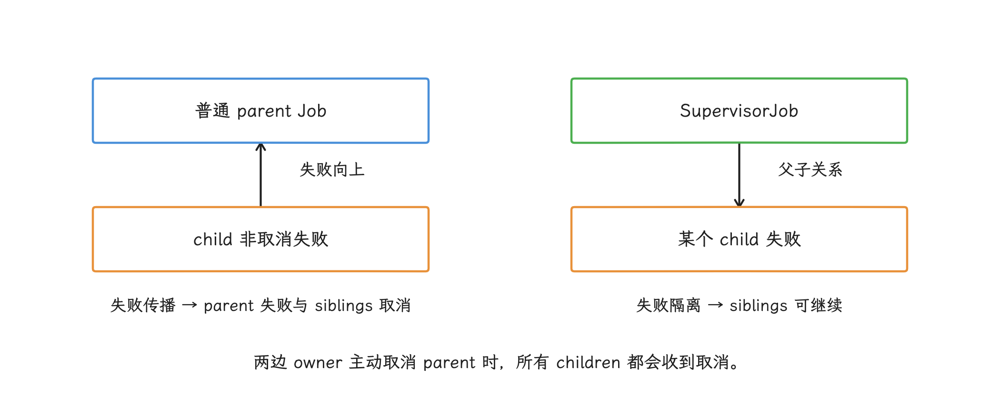

图：普通child失败影响普通parent与siblings；SupervisorJob隔离child失败，但任何parent取消仍传播给children。

取消采用协作机制：代码需要执行取消检查或进入支持取消的挂起点，才能停止。`delay`、多数 Channel/Flow 操作和支持取消的挂起 API 会检查取消；不含挂起点的 CPU 循环、吞掉 `CancellationException` 的捕获逻辑，以及不可中断的阻塞 I/O，可能在 `cancel()` 后继续运行。

#### 2.1 手动 scope 的 owner 与关闭入口

scope 是 `CoroutineContext` 与任务创建入口的组合，决定新协程继承哪个 `Job` 和 dispatcher。`CoroutineScope(Dispatchers.IO)` 工厂会在 context 没有 `Job` 时补一个 `Job`，所以它不是“没有 Job”。问题在于新 root 与 Activity、View 或服务没有自动关系，调用方若忘记取消，它会存活到任务自然结束或进程退出。

下面的代码用于没有现成 Lifecycle owner 的长期组件，明确创建和关闭 root scope：

```kotlin
class FeatureScope(
    private val ownerId: String,
    dispatcher: CoroutineDispatcher
) : CoroutineScope, AutoCloseable {
    private val rootJob = SupervisorJob()

    init {
        require(ownerId.matches(Regex("[a-z0-9._-]{1,48}")))
    }

    override val coroutineContext: CoroutineContext =
        rootJob + dispatcher + CoroutineName("owner:$ownerId")

    override fun close() {
        rootJob.cancel(
            CancellationException("owner closed: $ownerId")
        )
    }
}
```

`close()` 必须由组件确定的结束回调调用；`ownerId` 用取值范围有限的短标识，别带账号、搜索词或 URL。一次请求内部需要并发子任务时，用 `coroutineScope { ... }` 或 `supervisorScope { ... }`，不要为每个请求再造一个 root。

`GlobalScope` 是带 `DelicateCoroutinesApi`（提示该 API 容易破坏结构化生命周期） 标记的进程级独立 scope——这个标记提示该 API 容易破坏结构化生命周期——启动的任务没有业务 parent。只有任务明确允许存活到进程结束、不会捕获短生命周期 owner、并且有自己的失败与资源清理协议时，才有理由用它；工程上更易审阅的做法，是注入命名的 application scope（由进程级 owner 管理的 scope），由进程级 owner 管理。

`MainScope()` 每次调用都会创建一个新的 `SupervisorJob + Dispatchers.Main`。它适合没有 Lifecycle 的 UI owner，但 owner 必须保存实例并在结束时调用 `cancel()`；在不同方法里反复 `MainScope().launch`，调用方就再也找不到此前的 root。

#### 2.2 Android owner 的推荐 scope

| owner | 推荐 scope | 自动取消点 | 常见误用 |
| --- | --- | --- | --- |
| Fragment View | `viewLifecycleOwner.lifecycleScope` | View lifecycle `DESTROYED` | 用 Fragment 的 `lifecycleScope` 捕获已销毁的 View |
| Activity/Fragment | `lifecycleScope` | 对应 Lifecycle `DESTROYED` | 以为进入 `STOPPED` 就会取消 |
| ViewModel | `viewModelScope` | `ViewModel.clear()` | 期望配置变更或页面暂时不可见时取消 |
| Composable effect | `LaunchedEffect` | 离开 Composition 或 key 变化 | 在 composition body 直接 `launch` |
| Composable event | `rememberCoroutineScope()` | 调用点离开 Composition | 把 scope 保存到全局对象 |
| process 级组件 | 注入的 application scope | 进程级 owner 主动关闭 | 捕获 Activity/View |
| 可靠后台任务 | WorkManager/合适的系统调度 API | 由 scheduler（系统任务调度器）管理 | 用 process scope 假装任务可跨进程存活 |

`lifecycleScope` 在 `DESTROYED` 时取消，不会因为 `STOPPED` 自动取消。只应在界面可见时运行的 Flow，需要 `repeatOnLifecycle`。

<!-- gracker-diagram: a214-16-owner-scope -->
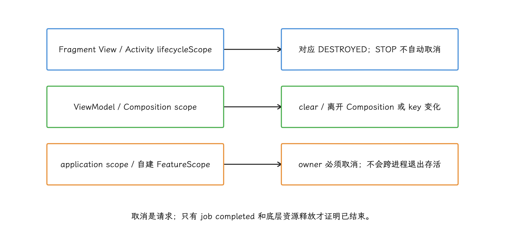

图：ViewModel可注入测试scope；库版本独立于Android平台版本，scope必须对应真正需要的存活边界。

AndroidX Lifecycle 2.8 的重要变化是 `viewModelScope` 可作为 `ViewModel` 构造参数注入，便于替换 dispatcher、`SupervisorJob` 或测试 scope，`lifecycleScope` 的销毁取消约定没有变。Lifecycle 2.11.0 又为 Compose 增加了 scoped `ViewModelStore`，可把 ViewModel 绑定到 Pager 页面等特定 UI 范围，并在对应 Composable 永久移出层次结构时清理。这些是库演进，和 Android 17 平台行为是两回事。

### 3. Flow 与 Channel：collector 和 producer 是两条生命周期

collector 是从 Flow 接收数据的下游任务，producer 是生成数据或维护底层订阅的上游任务。停止 collector 未必会停止独立存在的 producer，排查时我们要分别记录两者的 owner 与 `Job`。

#### 3.1 冷流、热流的泄漏边界不同

冷 `Flow` 每次 `collect` 都启动一条新的上游执行。取消 collector 通常会沿挂起调用取消该次上游。若在同一个页面重复启动 collector，每次都会重复网络、数据库或 callback 注册。

`StateFlow`/`SharedFlow` 是热流，取消某个 collector 只结束该订阅者，不会取消其他订阅者，也不会自动结束生产者。由 `shareIn`/`stateIn` 创建的 sharing coroutine（负责把单一上游共享给多个订阅者的协程）由传入的 scope 管理：

- `SharingStarted.Eagerly` 立即启动；
- `Lazily` 在首个订阅者出现后启动，之后即使没有订阅者也继续；
- `WhileSubscribed(...)` 可在订阅者归零后停止上游；
- 取消 sharing scope 才是无条件结束 sharing coroutine 的控制点。

`collectLatest` 只会在新值到达时取消上一轮 action，它不会把 collector 绑定到 Lifecycle。`launchIn(scope)` 的生命周期就是传入 scope；`collectIn` 不是 `kotlinx.coroutines` 或 AndroidX Lifecycle 的标准公开 API，项目里若有同名扩展，要单独审阅它的 scope 语义。

<!-- gracker-diagram: a214-17-flow-two-lifetimes -->
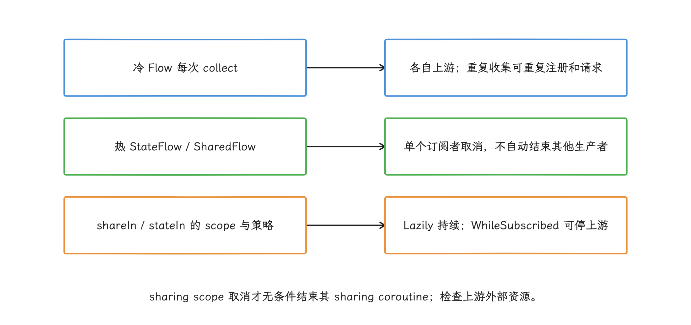

图：collectLatest只取消上一轮action；生命周期绑定由scope与repeatOnLifecycle决定。

#### 3.2 View 层使用 `repeatOnLifecycle`

下面的代码用于 Fragment View 在可见期间并行收集两个 Flow：

```kotlin
override fun onViewCreated(
    view: View,
    savedInstanceState: Bundle?
) {
    viewLifecycleOwner.lifecycleScope.launch {
        viewLifecycleOwner.repeatOnLifecycle(
            Lifecycle.State.STARTED
        ) {
            launch {
                viewModel.uiState.collectLatest(::render)
            }
            launch {
                viewModel.events.collect(::showEvent)
            }
        }
    }
}
```

进入 `STARTED` 时，`repeatOnLifecycle` 会为传入的 block 创建新的 child scope；状态变为 `STOPPED` 时取消这一轮 children，再次可见时重新启动。外层 job 在 View `DESTROYED` 时取消。多个 Flow 要并行收集，所以分别放进 child `launch`；连续写两个 `collect`，第二个会被第一个长期挂起。

<!-- gracker-diagram: a214-18-repeat-lifecycle -->
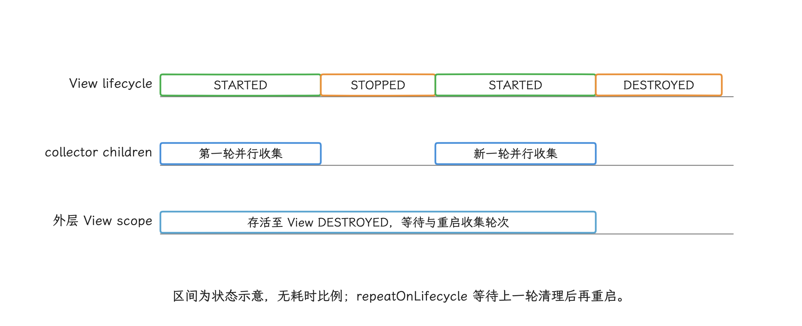

图：每次STARTED重建收集轮次，STOP取消这一轮；两个长期Flow需要不同child并行collect。

Compose 中优先用 `collectAsStateWithLifecycle()` 把 UI 状态收集绑定到 Lifecycle。一次性事件仍要明确消费和重放策略；`replay` 是新订阅者可收到的历史值数量，调大它解决不了丢事件或重复消费的协议问题。

#### 3.3 callback bridge 要在取消时注销

`callbackFlow` 的资源边界由 `awaitClose` 表达。下面的代码把需要注册和注销的 listener 转成冷 Flow：

```kotlin
fun SensorClient.events(): Flow<SensorEvent> = callbackFlow {
    val listener = object : SensorListener {
        override fun onEvent(event: SensorEvent) {
            trySend(event)
        }
    }

    register(listener)
    awaitClose {
        unregister(listener)
    }
}
```

collector 取消、上游失败或 channel 关闭时，`awaitClose` 的清理 block 都应解除注册。`trySend` 失败时，要按业务决定丢弃、计数或释放 element（传输的数据项） 自带的资源；若流里传输的 element 持有需要 `close()` 的句柄，可用带 `onUndeliveredElement` 的 Channel 设计资源回收，避免取消与缓冲区操作并发时漏掉清理。

<!-- gracker-diagram: a214-19-callback-cleanup -->
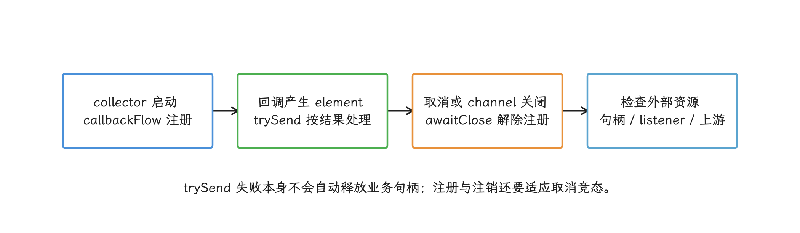

图：consumer提前退出时也要终止仍在运行的producer/channel；持有句柄的未交付element需要明确回收协议。

`produce`/`produceIn` 返回 `ReceiveChannel`。若 consumer（从 Channel 读取数据的消费端） 提前退出而 owner scope 仍活跃，应取消 channel；owner scope 被取消时，producer 会随结构化关系退出。单看“channel 是否 close”判定不了泄漏，关键仍是 producer job、consumer job 和底层资源是否终止。

`flatMapMerge` 的并发 child 会随下游取消而取消，但并发度会影响同时活跃的上游数量和缓冲规模。把 `concurrency`（并发上限） 参数、buffer capacity（缓冲容量） 与 owner 生命周期放在一起监控，才好区分合法并发与任务积压。

### 4. Dispatcher 管线程，scope 管任务

dispatcher 决定协程每次恢复后由哪个线程或线程池执行，scope 通过 `Job` 决定任务何时结束。同一协程可以在多个挂起点之间分段执行，并在恢复时换线程。

#### 4.1 三个常用 dispatcher 的 Android 实现

| Dispatcher | 1.11.0 实现要点 | 适用任务 | 主要风险 |
| --- | --- | --- | --- |
| `Main` | Android `HandlerContext`，通过绑定主 Looper（主线程消息循环）的异步 Handler 投递 | UI 状态与短小主线程操作 | 阻塞、长计算、消息队列积压 |
| `Default` | `CoroutineScheduler` 共享 worker，CPU 并行度接近核心数且至少 2 | CPU 密集计算 | 阻塞 I/O 占住 CPU permit |
| `IO` | 与 Default 共享线程资源的弹性 view；未覆盖系统属性时，并行限制默认为 `max(64, cores)` | 阻塞 I/O | 大量阻塞任务与 elastic views 扩大并行线程 |

`Dispatchers.Main.immediate` 在已经位于目标 Looper 时可以直接执行，省一次 `Handler.post`；但它也带来同步重入语义，别只为省一次调度就全量替换。

`Dispatchers.IO.limitedParallelism(n)` 创建的是 dispatcher view（复用原 dispatcher、只改变并行额度的视图）无需 `close()`。IO 的 view 具有弹性，各 view 的 parallelism 之和不受 IO 默认并行值约束。

它限制同时执行的 task 数，不保证固定使用某几条线程，也不限制挂起协程的数量。CPU permit（调度器的 CPU 并行额度） 是 `CoroutineScheduler` 内部用于限制同时执行 CPU 任务的额度，不是业务请求许可。

Default 与 IO 共享调度器线程，`withContext(Dispatchers.IO)` 从 Default 进入时不保证发生一次 OS 线程切换。dispatcher 切换的工程成本还包括队列等待、任务粒度和 context element（`CoroutineContext` 中随协程传递的元素）——`CoroutineContext` 中随协程传递的元素——评估它别只用“协程切换比线程切换快”的固定数字。更完整的调度与背压（生产速度超过消费速度后形成的排队压力）分析见 [8.4 Kotlin Coroutine、Flow 与线程调度实践](../../part2-performance/ch08-responsiveness/04-coroutine-performance.md)。

#### 4.2 限并行与限业务并发

`limitedParallelism(1)` 只保证同一时刻最多一段代码在线程上执行；一个协程挂起后，另一个协程就能进入，所以它当不了跨挂起点的互斥锁。

下面的代码分别限制 CPU 图片处理的并行执行，以及跨挂起网络请求的业务并发：

```kotlin
private val imageDispatcher =
    Dispatchers.Default.limitedParallelism(
        parallelism = 2,
        name = "image-decode"
    )

private val requestGate = Semaphore(permits = 8)

suspend fun decode(bytes: ByteArray): Bitmap =
    withContext(imageDispatcher) {
        decodeBitmap(bytes)
    }

suspend fun fetch(request: Request): Response =
    requestGate.withPermit {
        withContext(Dispatchers.IO) {
            blockingClient.execute(request)
        }
    }
```

图片处理每次占用 CPU 时最多并行 2 个；`Semaphore` 的 permit 会跨 `withContext` 和挂起点持续持有，把 in-flight（已经开始、尚未完成）请求限制在 8 个。数据库连接池、服务端配额这类资源，用 `Semaphore` 或资源池本身限流，别从 dispatcher 线程数间接推断。

<!-- gracker-diagram: a214-20-parallel-vs-concurrency -->
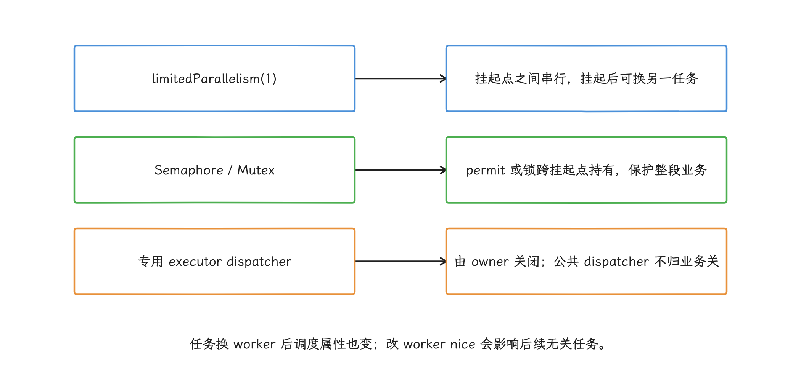

图：IO与Default共享线程；IO弹性view的额度之和不受默认IO值约束，不代表固定专用线程。

如果通过 `ExecutorService.asCoroutineDispatcher()` 创建独立 dispatcher，owner 结束时要关闭返回的 `ExecutorCoroutineDispatcher`；公共的 `Dispatchers.Default`、`IO`、`Main` 则轮不到业务去关。

#### 4.3 协程没有独立的 Linux 调度优先级

Android 内核调度的是线程。协程恢复到哪个 worker，就临时继承该 worker 的 nice（Linux 线程调度权重）、cgroup 和调度属性。在线程池协程里调用 `Process.setThreadPriority()` 改的是可复用 worker：后续无关任务可能继承这个值，协程换 worker 后预期又落空。

需要稳定线程属性的组件，应使用有界的专用 executor，在 `ThreadFactory` 里设好线程属性，再把它转成 dispatcher；这些线程由 owner 关闭，并纳入前半篇定义的 task/线程池监控。

### 5. Android 上没有可依赖的全局协程枚举

#### 5.1 `kotlinx-coroutines-debug` 的 JVM agent 与 ART

JVM agent 是在 JVM 启动时或运行中附加、用于观察或改写类行为的模块。`kotlinx-coroutines-debug` 的 `DebugProbes.install()` 依赖 ByteBuddy（运行时字节码改写库）和 Java Instrument API（JVM 类重定义接口）；1.11.0 的官方 README 明确说明 ART 不支持所需的 Instrument API，打包进 Android 项目还可能遇到资源合并问题。

`kotlinx.coroutines 1.11.0` 的公开 API 与源码里，也没有面向 Android 应用的稳定 `CoroutineTracing` 或 `correlate()` 接口；别把这些名称当成“1.7+ 已提供”的版本结论。

所以下面这些对象，都当不了 Android 线上监控的基础：

- `DebugProbes.dumpCoroutinesInfo()`；
- 没有公开出处的 `DebugCoroutinesInfo`、`correlate()`；
- `CoroutineStackFrame`；
- `kotlinx.coroutines.internal.recoverStackTrace`；
- 替换 `DebugProbesKt.bin` 或探测 continuation 内部字段。

`CoroutineStackFrame` 属于 Kotlin continuation 调试协议，`recoverStackTrace` 在 coroutines 源码中是 internal 实现。它们的对象布局和调用时机没有应用级兼容承诺，R8（Android 字节码优化与压缩工具）、Kotlin 编译器或 coroutines 升级都可能改变行为。

常规 JVM 进程可以借助 Kotlin 插件的 Coroutine Debugger 查看运行/挂起状态、creation stack（创建调用栈） 和 coroutine dump（协程快照）。这项能力依赖 coroutine agent，而 1.11.0 官方文档明确说明 ART 不支持该 agent，Android 模拟器也用不上这套 Coroutine Debugger。Android debuggable 构建仍可用普通断点查看当前线程栈和局部变量，只是别把 IDE 的全局协程面板当成 Android 可用的枚举接口。

`-Dkotlinx.coroutines.debug` 是常规 JVM 进程的启动属性，会在调试模式下把 coroutine ID/`CoroutineName` 附加到执行线程名，便于日志分析。它需要在 coroutines 运行时初始化前配置；Android 应用没有通用的应用级 `-D` 启动入口。该属性也不会生成可供生产环境遍历的 `Job` 注册表，更不会让 Perfetto 自动理解父子 `Job`。

#### 5.2 线上方案从受控创建入口登记

线上我们不拦截所有 continuation，改为给关键 root scope 和 operation 建立显式注册表。注册表只覆盖团队主动接入的创建入口，谈不上枚举进程内所有协程，至少记录：

<!-- gracker-diagram: a214-21-android-debug-boundary -->
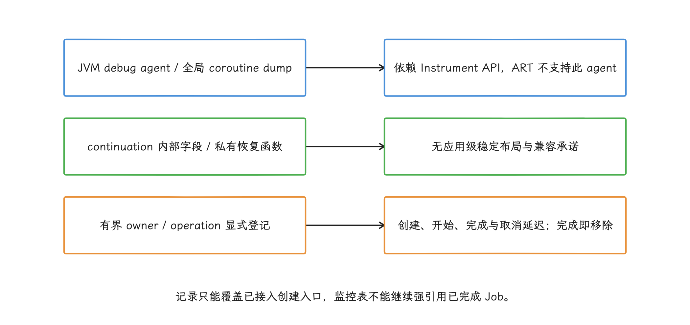

图：ThreadContextElement只传播上下文，不产生进程全局创建完成计数；CoroutineName也不自动生成Perfetto切片。

- 有界的 operation/owner ID；
- 创建、开始执行、完成的单调时钟，也就是只向前推进、不受系统时间调整影响的时钟；
- 完成原因：success、cancel、failure；
- dispatcher 类别；
- 分别记录 active、cancelling，以及覆盖所有未完成状态的 not-completed 数；
- 最长 age 与 P50/P95/P99 分位时长，P95 表示 95% 的样本不超过该值；
- owner end 到 job completion 的取消延迟；
- 同一 owner/operation 的峰值基数；
- 诊断灰度下采样的创建栈或调用点 ID。

下面的 helper（辅助函数） 用公开 API 登记一个 operation，并用 `androidx.tracing` 1.3.0 的 suspend `traceAsync` 在 Perfetto 中标出逻辑时段。

```kotlin
private val nextTraceCookie = AtomicInteger()

interface CoroutineMonitor {
    fun onCreated(
        cookie: Int,
        owner: String,
        operation: String,
        scheduledAtNs: Long
    )

    fun onStarted(cookie: Int, startedAtNs: Long)

    fun onCompleted(
        cookie: Int,
        completedAtNs: Long,
        cause: Throwable?
    )
}

fun CoroutineScope.launchTracked(
    owner: String,
    operation: String,
    monitor: CoroutineMonitor,
    block: suspend CoroutineScope.() -> Unit
): Job {
    require(owner.matches(Regex("[a-z0-9._-]{1,32}")))
    require(operation.matches(Regex("[a-z0-9._-]{1,48}")))

    val cookie = nextTraceCookie.incrementAndGet()
    val scheduledAtNs = SystemClock.elapsedRealtimeNanos()
    monitor.onCreated(cookie, owner, operation, scheduledAtNs)

    return launch(CoroutineName("$owner/$operation")) {
        monitor.onStarted(
            cookie,
            SystemClock.elapsedRealtimeNanos()
        )
        traceAsync("co:$owner/$operation", cookie) {
            block()
        }
    }.also { job ->
        job.invokeOnCompletion { cause ->
            monitor.onCompleted(
                cookie,
                SystemClock.elapsedRealtimeNanos(),
                cause
            )
        }
    }
}
```

`onCreated` 到 `onStarted` 是调度等待，`onStarted` 到 `onCompleted` 是包含挂起时间的逻辑持续时间，和 CPU time（线程实际占用 CPU 的时间）是两个量。`invokeOnCompletion` 也能覆盖尚未开始就被取消的 job。监控实现必须线程安全、无阻塞、不抛异常，并在 completion 后移除对应的未完成任务记录，否则监控器自己就成了新的泄漏源。

<!-- gracker-diagram: a214-22-operation-timing -->
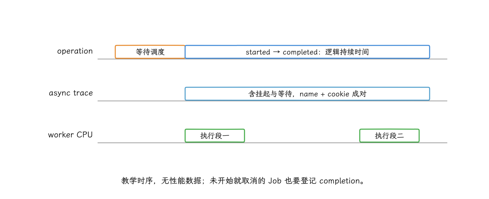

图：创建到开始是排队，开始到完成是逻辑持续时间；async trace包含挂起，CPU段需对齐sched，不能把长slice当高CPU。

示例的 `AtomicInteger` cookie 最终会回绕；生产注册表应只分配当前未占用的 cookie，并限制同时在途记录数。创建栈通过 `Throwable().stackTrace` 采集成本较高，只应在低比例灰度或异常触发后启用。成本更低的做法是在调用点传入编译期常量 ID，再通过应用版本与自维护的“ID → 源码调用点”映射表离线还原。

#### 5.3 `ThreadContextElement` 的适用范围

`ThreadContextElement.updateThreadContext()`/`restoreThreadContext()` 会在协程 resume、切换线程前后运行，适合传播 MDC（日志诊断上下文）、trace token（串接同一次请求的追踪标识） 等少量线程上下文——trace token 用来串接同一次请求。实现必须处理恢复顺序和并发，其中不该 unwind（还原调用栈） 调用栈、写文件或上传网络。

它看不到没携带该 element 的协程，给不出全局创建/完成计数。用它传播已存在的 trace ID 没问题，拿它替代 operation 注册表则会留下大量盲区。

### 6. Perfetto 中怎样读协程

Perfetto slice 是时间轴上的一段有起止时间的事件。系统 trace 不会自动把 `CoroutineName` 变成 slice，默认能看到的是：

- 主线程与 `DefaultDispatcher-worker-*` 的 sched 状态，即内核记录的运行、可运行、睡眠等调度状态；
- 主 Looper 上的运行片段；
- CPU 频率、唤醒和线程迁移；
- 应用主动写入的同步/异步 trace event。

suspend block 可能跨线程恢复，所以同步 `trace {}` 包不住可能挂起并换线程的完整操作——同步 section 必须在同一线程成对开始和结束。`androidx.tracing` 的 suspend `traceAsync` 用 name+cookie（事件名与整数标识） 配对，适合表示跨挂起的逻辑时段。

异步 slice 的长度包含排队、delay、I/O 等待和 CPU 执行。判断性能问题时要将它和 sched/线程 slice 对齐：

- async slice 很长、CPU 很短：多半在等待 I/O、timer（定时器）、lock 或 dispatcher；
- Main 上连续 CPU slice 很长：主线程工作过重；
- scheduled→started 很长：dispatcher、executor 或 Main queue 积压；
- 大量同名重叠 async slice：缺少去重、并发上限或旧请求取消；
- owner end 后 slice 仍持续：生命周期违约候选。

Android 17 对 `targetSdkVersion >= 37` 的应用启用新的无锁 `MessageQueue` 实现。`Dispatchers.Main` 在需要 dispatch 时仍通过 Android Handler 投递，`Job` 与 Lifecycle 语义不变。

应用若反射 `MessageQueue` 私有字段会有兼容风险；不要把内部队列结构当成协程监控 hook。

Android Studio 的 Java/Kotlin method tracing 会做运行时插桩——在每个方法入口和出口加入时间戳——官方建议把记录限制在 5 秒以内。它适合短窗口定位方法耗时，插桩后的耗时别拿来当生产基线；采样型 CPU profiler 与 Perfetto 更适合观察较长场景。

### 7. Compose 的 scope 边界

Composition 是 Compose 当前保留的 UI 节点与状态集合。`LaunchedEffect(keys...)` 进入 Composition 时启动协程，key——决定 effect 实例身份的输入——改变时取消旧任务并启动新任务，离开 Composition 时取消。`rememberCoroutineScope()` 返回绑定到调用点的 scope，适合点击、动画等事件回调，调用点离开 Composition 时取消。

下面的代码区分“由状态驱动的 effect”和“由用户事件启动的任务”：

```kotlin
@Composable
fun DetailScreen(
    itemId: String,
    viewModel: DetailViewModel,
    onLoadError: (Throwable) -> Unit
) {
    val currentOnLoadError by rememberUpdatedState(onLoadError)
    val eventScope = rememberCoroutineScope()

    LaunchedEffect(itemId) {
        runCatching {
            viewModel.ensureLoaded(itemId)
        }.onFailure { error ->
            if (error is CancellationException) throw error
            currentOnLoadError(error)
        }
    }

    Button(
        onClick = {
            eventScope.launch {
                viewModel.refresh(itemId)
            }
        }
    ) {
        Text("Refresh")
    }
}
```

`itemId` 变化会重启加载；`rememberUpdatedState` 让 effect 读到最新的 callback，又不会因 callback 实例变化重启 effect。点击任务使用与 Composition 生命周期绑定的 scope。代码显式重抛 `CancellationException`，避免 `runCatching` 把正常取消改写成失败处理。

<!-- gracker-diagram: a214-23-compose-ownership -->
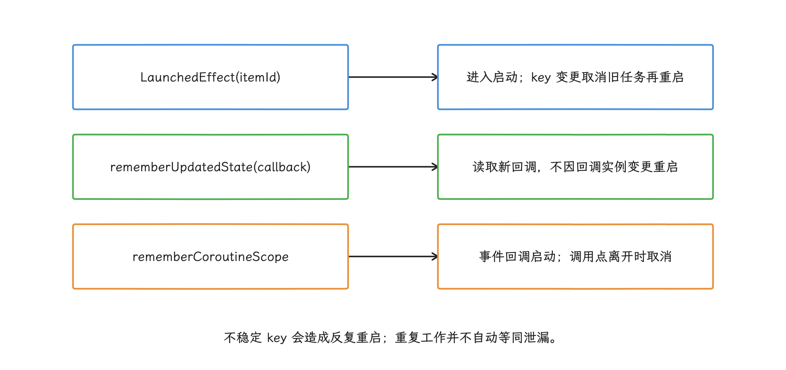

图：取消异常必须重抛；跨页面存活的工作提升到合适owner，不能把Composition scope保存在单例。

高频变化或不稳定的 key 会造成反复取消和重启，表现为请求抖动与重复分配；这未必泄漏，却浪费计算与网络资源。需要跨页面或跨 configuration change（例如旋转屏幕引发的 Activity 重建）——例如旋转屏幕引发的 Activity 重建——的工作，应提升到合适的 `ViewModel`/repository owner，不要把 Compose scope 存进单例。

### 8. 协程如何引发 ANR

`suspend` 只表示函数可以挂起和恢复，不保证函数内部不会阻塞线程。以下行为仍会卡住主线程：

- 在 `Dispatchers.Main` 上执行长循环、解码、压缩或大量序列化；
- 在 suspend 函数中调用阻塞 I/O，却没有切换到合适 dispatcher；
- 在主线程调用 `runBlocking` 等待 child；
- 持有 monitor/lock（互斥锁） 后挂起，或恢复后争用主线程所需的锁；
- 大量 Main resume 同时入队，形成消息队列积压；
- `NonCancellable` cleanup（不会响应取消的清理代码）没有时长上限或 timeout。

`delay` 会挂起并让出线程，`Thread.sleep` 则占住当前线程。`withTimeout` 通过取消协程实现，自动中断不了不响应取消的阻塞调用：对支持线程中断的 Java 阻塞 API 可用 `runInterruptible(Dispatchers.IO)`，对 socket、stream、codec 等资源还要提供能关闭底层对象的 close/cancel 方法。

<!-- gracker-diagram: a214-24-cancel-blocking-anr -->
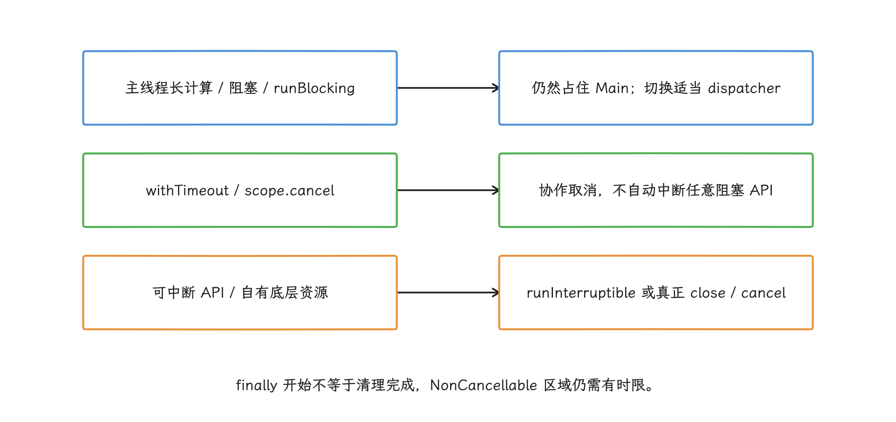

图：CPU循环适度ensureActive，清理阶段也要有界；ANR需关联operation、排队与当前线程栈。

CPU 密集循环应放到 `Dispatchers.Default`，并在合适粒度调用 `ensureActive()` 或使用本身可取消的操作。检查过密会增加开销，检查过疏会拉长取消延迟，需要按一次迭代成本实测。

ANR trace 记录的是 ANR 发生那一刻的各线程栈。协程可能正挂起，线程栈里没有完整的业务调用链，所以还要结合 operation 注册表、async trace 和 dispatcher 排队时长，别只凭 `DefaultDispatcher-worker` 名称归因。

### 9. Android 17 的后台边界

Android 17 没有一项“挂起函数后台特权”：协程不会提高进程重要性，也保证不了任务在应用离开可见状态、进程被回收或设备重启后完成。

按任务要求的存活范围和可靠性选择执行方式：

- 仅在当前界面有意义：View/Composition scope；
- ViewModel 存活期间有意义：`viewModelScope`；
- 进程活着时可尽力完成：application scope，并接受进程退出；
- 需要跨退出或重启可靠执行：WorkManager、JobScheduler 或对应领域 API；
- 用户可感知、长时间且必须立即运行：满足类型与权限要求的前台服务或合适的系统专用 API。

WorkManager 可以在 `CoroutineWorker` 内使用协程，但可靠性来自 WorkManager 的系统调度与持久化，而非协程本身。后台限制测试要验证进程退出、约束变化、重试和幂等（重复执行结果仍一致），别只在前台等一个 `delay()` 跑完。

<!-- gracker-diagram: a214-25-background-contract -->
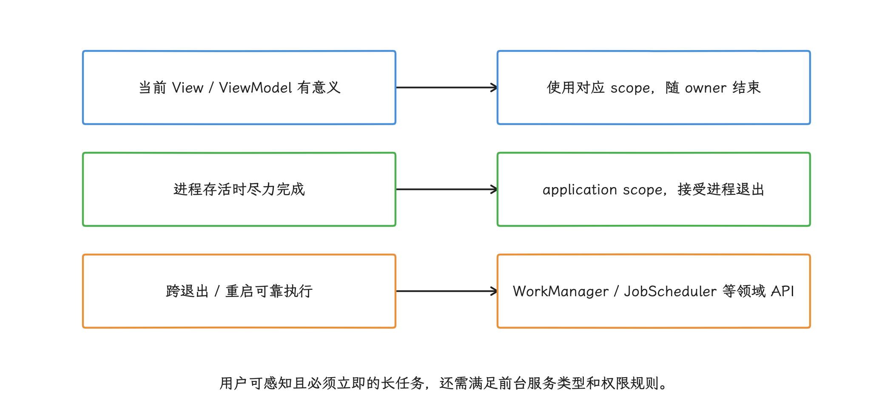

图：协程没有后台运行特权，也不提升进程重要性；系统约束、幂等与重试需在后台测试。

### 10. 告警算法与测试

#### 10.1 常驻指标

按 owner/operation 聚合，不上传任意协程名，避免标签取值无限增长或夹带账号、搜索词等业务数据：

- created、started、completed、cancelled、failed；
- active、cancelling，以及覆盖所有未完成状态的 not-completed gauge（某一时刻的任务数量） 与峰值；
- scheduled→started 延迟；
- operation duration；
- owner end→completion 取消延迟；
- timeout 和重复 key 数；
- Flow subscriber 数、sharing scope 状态；
- dispatcher/executor queue、active worker 与拒绝数。

线程数只能作旁证：not-completed 协程数上升而线程平稳，可能是挂起任务、Flow collector 或缓冲积压；线程上涨而已登记的协程数平稳，就该查 executor、SDK 或 raw pthread。

#### 10.2 泄漏候选判定

一次候选事件至少满足：

1. owner 已结束，或 operation 超过其 deadline；
2. job 仍未 completed，或底层 listener/channel/resource 仍注册；
3. 已等待按任务类型设定的取消宽限期，也就是给正常清理预留的时间；
4. 同一版本和场景能重复出现，或同类样本的分位数比上一版本明显变差；
5. 监控记录没有因采样、进程前后台变化或数据缺失产生误判。

不要把所有超过固定 30 秒的协程归为泄漏。WebSocket 可能预期长期存活，页面请求按自身约定运行 10 秒就可能异常。阈值属于 operation 的生命周期约定。

<!-- gracker-diagram: a214-26-leak-candidate -->
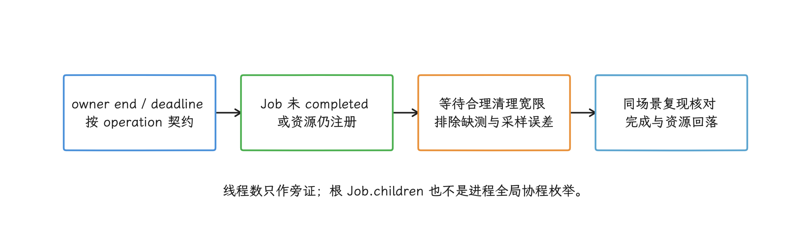

图：按owner和operation保存未完成数、取消延迟、订阅者与队列，结合任务允许的寿命判断，不能统一用30秒定泄漏。

#### 10.3 自动化验证

单元和集成测试应覆盖：

- owner close/destroy 后 root job 进入 completed；
- `repeatOnLifecycle` 在 STOP 时取消当轮 collector，在 START 时只恢复一组；
- key 变化后旧 `LaunchedEffect` 不再写 UI；
- callbackFlow 取消后 listener 被注销一次；
- `shareIn/stateIn` 的 `SharingStarted` 策略与产品预期一致；
- timeout 后底层阻塞资源也停止；
- failure 在普通 scope 与 supervisor scope 中按预期传播；
- 自建 executor/dispatcher 被关闭；
- monitor completion 会删除对应的未完成任务记录。

`runTest`、`TestScope` 和 Lifecycle test utilities（生命周期测试工具） 可以控制虚拟时间与状态切换；Lifecycle 2.8 起可向 `ViewModel` 注入 test scope，减少替换 `Dispatchers.Main` 的隐式依赖。测试结束时还应检查该 owner 持有的 root `Job.children`——它只覆盖这个 root 的结构树，谈不上进程全局枚举。

### 11. 评审清单

- [ ] 每个长期 scope 是否有清晰 owner 和取消入口？
- [ ] Fragment 是否把 View 相关任务放进 `viewLifecycleOwner.lifecycleScope`？
- [ ] UI Flow 是否通过 `repeatOnLifecycle` 或 `collectAsStateWithLifecycle` 管理可见性？
- [ ] `collectLatest` 是否被误当成 Lifecycle 取消？
- [ ] `shareIn/stateIn` 的 scope 和 `SharingStarted` 是否符合生产者寿命？
- [ ] `callbackFlow` 是否在 `awaitClose` 中解除注册？
- [ ] 是否有 `GlobalScope`、未关闭的 `MainScope()` 或临时 `CoroutineScope(...)`？
- [ ] 是否向 `launch/async` 直接传入新 `Job`，导致 parent 关系断开？
- [ ] `CancellationException` 是否被捕获全部 `Throwable` 的分支或 `runCatching` 吞掉？
- [ ] 阻塞 API 是否能在 cancel/timeout 时中断或关闭？
- [ ] `limitedParallelism` 是否被误当成跨挂起点的并发锁？
- [ ] IO elastic views 的并行上限之和是否经过压测？
- [ ] 自建 executor dispatcher 是否随 owner 关闭？
- [ ] 线上监控是否只使用公开 API，并避免 continuation 私有反射？
- [ ] Perfetto slice 是否区分逻辑持续时间、调度等待和 CPU time？
- [ ] Android 17 后台任务是否使用与可靠性契约匹配的系统 API？

### 12. 源码与官方资料

#### 12.1 验证基线

- [kotlinx.coroutines 1.11.0 源码](https://github.com/Kotlin/kotlinx.coroutines/tree/1.11.0)
- [Android dispatcher `HandlerDispatcher.kt`](https://github.com/Kotlin/kotlinx.coroutines/blob/1.11.0/ui/kotlinx-coroutines-android/src/HandlerDispatcher.kt)
- [`CoroutineScope.kt`](https://github.com/Kotlin/kotlinx.coroutines/blob/1.11.0/kotlinx-coroutines-core/common/src/CoroutineScope.kt)
- [`Supervisor.kt`](https://github.com/Kotlin/kotlinx.coroutines/blob/1.11.0/kotlinx-coroutines-core/common/src/Supervisor.kt)
- [`kotlinx-coroutines-debug` Android 限制](https://github.com/Kotlin/kotlinx.coroutines/blob/1.11.0/kotlinx-coroutines-debug/README.md#debugger-and-android)

#### 12.2 Kotlin 与 Android 指南

- [Kotlin：Coroutine basics 与 structured concurrency](https://kotlinlang.org/docs/coroutines-basics.html)
- [Kotlin：Cancellation and timeouts](https://kotlinlang.org/docs/cancellation-and-timeouts.html)
- [Kotlin：`Dispatchers.IO`](https://kotlinlang.org/api/kotlinx.coroutines/kotlinx-coroutines-core/kotlinx.coroutines/-dispatchers/-i-o.html)
- [Kotlin：`limitedParallelism`](https://kotlinlang.org/api/kotlinx.coroutines/kotlinx-coroutines-core/kotlinx.coroutines/-coroutine-dispatcher/limited-parallelism.html)
- [Kotlin：`shareIn`](https://kotlinlang.org/api/kotlinx.coroutines/kotlinx-coroutines-core/kotlinx.coroutines.flow/share-in.html)
- [Android：Lifecycle-aware coroutines](https://developer.android.com/topic/libraries/architecture/views/coroutines-views)
- [AndroidX Lifecycle release notes](https://developer.android.com/jetpack/androidx/releases/lifecycle)
- [Android：StateFlow 与 SharedFlow](https://developer.android.com/kotlin/flow/stateflow-and-sharedflow)
- [Compose：Side-effects](https://developer.android.com/develop/ui/compose/side-effects)
- [AndroidX Tracing `traceAsync`](https://developer.android.com/reference/kotlin/androidx/tracing/package-summary)
- [Android 17：MessageQueue behavior change](https://developer.android.com/about/versions/17/changes/messagequeue)
- [Android Studio：Record Java/Kotlin methods](https://developer.android.com/studio/profile/record-java-kotlin-methods)
- [Android：Background task scheduling](https://developer.android.com/develop/background-work/background-tasks/persistent)

## 小结

线程与协程都要明确所有者和结束条件，但我们要看的证据不同：线程看创建、退出、线程池容量及资源回收，协程看父子 `Job`、取消传播和挂起任务持有的引用。长驻 worker 或零 CPU 的挂起任务，都单独证明不了泄漏。把生命周期事件与 Perfetto 时间线、对象引用和资源释放结果对应起来，才能验证修复是否有效。
