# Binder IPC 故障判断与性能诊断

一次 Binder 调用抛出异常，我们最先拿到的一般只是一个 `RemoteException`。它说明的只是 IPC 链路上出了错；服务端到底执行没有、业务提交没有，要靠后面的证据回答。`oneway` 调用在本地就返回，目标是否处理，同样要另行确认。

Binder 是 Android 最主要的本机 IPC 机制。socket、pipe（字节流管道）、共享内存和文件描述符等机制也能跨进程传递数据，Binder 额外负责远端对象引用、调用者身份传递和服务端线程分派。AIDL（Android Interface Definition Language，Android 接口定义语言） 用于描述接口并生成调用代码，Parcel 是 Binder 参数和返回值的序列化容器。

一次看似普通的方法调用，会同时受 Parcel 大小、目标进程存活、Binder 线程池、进程冻结状态和远端异常影响。排查时，我们分别记录三个结果：**传输是否完成、服务端是否执行、业务是否成功。** 文中的 transaction 指一笔 Binder 请求或回复。

> 源码基线：AOSP `android-17.0.0_r1`，内核 Binder 驱动 `android17-6.18-2026-06_r6`。

## 1. 一次同步 Binder 调用有四个失败位置

我们沿一次同步调用的时间线走一遍：请求序列化、驱动投递、服务端执行、回复返回。四个位置失败时，调用方看到的东西不同，能下的结论也不同。

| 阶段 | 可能失败 | 调用方能看到什么 | 能否断言服务端未执行 |
|---|---|---|---:|
| 请求序列化 | Parcelable 编码错误、对象图过大、文件描述符（FD）无效 | 本地运行时异常，或提交 transaction 时出现传输异常 | 通常可以，但仍要确认异常发生位置 |
| 驱动投递 | 目标死亡、缓冲区分配失败、目标被冻结 | `DeadObjectException`、`TransactionTooLargeException` 或其他传输异常 | 不能只靠异常类型判断 |
| 服务端执行 | 权限拒绝、参数错误、业务错误、线程池阻塞 | 回复中编码的异常、超时或 ANR、业务状态 | 已经进入服务端 |
| 回复序列化与返回 | 返回值过大、服务端执行后死亡、客户端缓冲区紧张 | 传输异常；客户端通常无法区分请求和回复在哪一侧失败 | 不能，服务端可能已经产生副作用 |

Android 官方要求客户端把 `TransactionTooLargeException` 当作“部分失败”（partial failure）处理：请求可能尚未送达，也可能已经执行，只因回复过大而送不回来。客户端看到的都是调用失败，服务端处于哪种状态，要靠服务端侧的证据确认；服务端提交副作用后死亡，结果同样未知。

<!-- gracker-diagram: a215-01-failure-locations -->
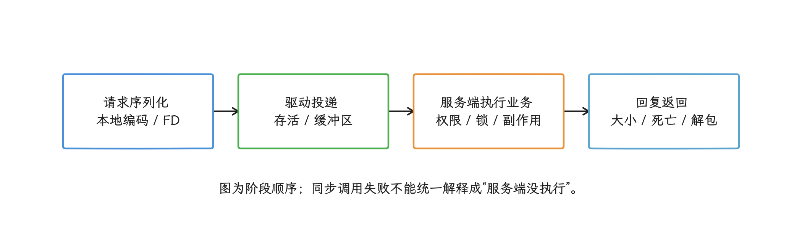

图：请求可能未到达，也可能已经提交但回复失败；异常类型不能替代服务端request ID与提交状态。

扣款、提交订单、删除文件这类非幂等操作，重放一次就多一次副作用；看到异常先查提交状态，再决定是否重放。

## 2. Java 层会出现哪些异常

### 2.1 `RemoteException` 家族

落到 Java 层，我们最常见到的是 `RemoteException` 家族。它是受检异常（checked exception），编译器要求调用方捕获它，或在方法签名中继续声明。常见子类包括：

| 类型 | 含义 | 注意点 |
|---|---|---|
| `DeadObjectException` | 远端进程不存在，或 Binder 端点已经不可用 | 旧代理对象已失效；`isBinderAlive()` 为真也只代表检查发生的那一刻 |
| `DeadSystemException` | Android 核心系统已经死亡并正在重启 | 它继承 `DeadObjectException`；应用随后通常也会被终止 |
| `TransactionTooLargeException` | 大 transaction 失败后的推测性分类 | 请求和回复都可能失败；异常名不能证明精确的字节原因 |
| 其他 `RemoteException` | 未实现 transaction、底层传输失败等 | 要结合接口版本、日志和服务端证据 |

`proxy` 是远端接口在客户端的本地代理对象。framework 管理类（系统 API 的 Java 外观类）是系统 API 的 Java 外观：普通应用调用 `PackageManager`、`ActivityManager` 时，管理类往往已经在内部捕获 `RemoteException`，再调用 `rethrowFromSystemServer()` 或转换成该 API 约定的运行时异常。所以“给所有系统 API 加 `catch (RemoteException)`”不一定能编译，也覆盖不了全部失败路径；要在调用处处理这组受检异常的，是自有 AIDL 代理对象，或方法签名明确声明 `RemoteException` 的接口。

### 2.2 回复中传播的运行时异常

异常还有另一条通路：服务端 `Binder.execTransactInternal()` 会把 `onTransact()` 抛出的异常编码进同步回复，前提是 Parcel 能表示这个异常类型。`android-17.0.0_r1` 的 `Parcel` 支持 `SecurityException`、`BadParcelableException`、`IllegalArgumentException`、`NullPointerException`、`IllegalStateException`、`NetworkOnMainThreadException`、`UnsupportedOperationException` 和 `ServiceSpecificException` 等类型。

这类异常表示请求通常已经到达服务端。处理方式取决于接口契约：

- `SecurityException` 是权限、用户或调用身份问题，自动重试解决不了。
- `IllegalArgumentException`、`BadParcelableException` 多半是客户端/服务端版本或数据契约问题。
- `ServiceSpecificException` 携带服务自定义的 `errorCode`。AIDL 的 Java 后端用它表达 `EX_SERVICE_SPECIFIC`，错误码应在接口中通过 `const int` 或以整数为底层类型的枚举定义。
`oneway` 没有回复通道，服务端异常走不了这条路，调用方也就收不到。

`@Throw` 不是 AIDL 语法，这是常见的误写。`ServiceSpecificException` 标有 `@hide` 和 `@SystemApi`，对普通 SDK 应用属于平台内部接口；自建 AIDL 表达业务失败，用公开的结果 `Parcelable` 或回调状态。平台代码使用服务自定义错误时，也要在接口契约中说明每个错误码能否重试。

### 2.3 本地解包和协议错误

第三类问题出在协议本身。Stable AIDL 要求接口跨版本保持兼容演进，`BadParcelableException`、`ParcelFormatException` 这类异常，加上类加载器找不到 Parcelable、Stable AIDL 版本不兼容，既可能发生在客户端读取回复时，也可能发生在服务端读取请求时，跟远端进程死没死是两回事。我们记录时至少写下接口版本、transaction code（方法在协议中的编号）、Parcelable 字段结构版本和出错方向；只按最外层异常名归类，会丢掉这些线索。

<!-- gracker-diagram: a215-02-exception-paths -->
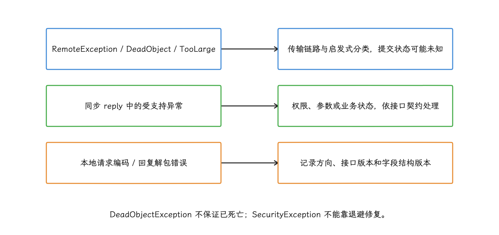

图：oneway没有远端回复异常通道；Java checked规则也不代表Kotlin编译器强制捕获。

## 3. `TransactionTooLargeException` 的成因与预算

### 3.1 1 MiB 的进程共享额度

这块缓冲区的定义在 `ProcessState.cpp` 里：

`BINDER_VM_SIZE = 1 * 1024 * 1024 - 2 * page_size`

这块映射是进程接收 Binder transaction 的虚拟地址区。公开文档把它概括成固定的 1 MiB 缓冲区，并明确说明：同一进程中所有正在处理的 transaction 共享这份空间。所以多笔中等大小的并发请求和回复也可能把它耗尽；一笔调用此刻发不发得出去，还要看进程当时的并发占用，单次是否小于 1 MiB 说明不了问题。

驱动还要为对象偏移、Binder 引用和 FD 等元数据留空间。发送方手里的 `Parcel.dataSize()` 只描述当前 Parcel 直接写入的数据大小；目标进程的并发占用、回复的大小，它都覆盖不到。

<!-- gracker-diagram: a215-03-shared-buffer -->
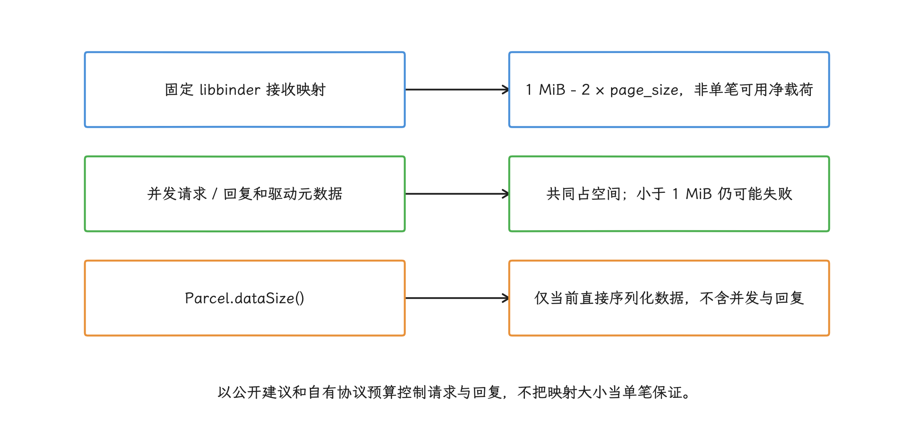

图：不同方向由不同接收进程承受缓冲区压力，发送方估算值不能证明线上事务一定可投递。

### 3.2 Java 异常名来自启发式映射

`android_util_Binder.cpp` 收到 `FAILED_TRANSACTION` 时会记录请求 Parcel 的大小。这份源码里，请求大于 200 KiB 才会按大小推测为 `TransactionTooLargeException`，更小的失败可能映射成 `DeadObjectException`。原因在于 `FAILED_TRANSACTION` 还可能来自格式错误的 transaction、已经关闭的 FD、远端在传输途中死亡或缓冲区空间不足。

这解释了两个排障现象：

<!-- gracker-diagram: a215-04-jni-heuristic -->
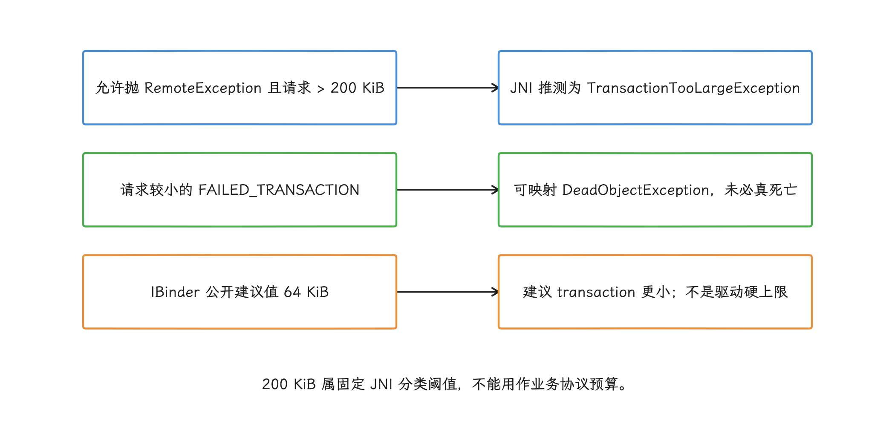

图：严格大于200KiB才进该分支；请求小并不排除回复过大或并发缓冲压力。

- 小 Parcel 也可能因并发占用而失败，异常未必叫 `TransactionTooLargeException`。
- 回复过大时，客户端日志中的请求大小可能很小；服务端可能已经执行完成，只在返回结果时失败。

200 KiB 是当前 Java JNI（Java Native Interface，Java 与 native 代码的接口） 层选择异常类型时的阈值，协议里并没有这笔预算。公开 API `IBinder.getSuggestedMaxIpcSizeBytes()` 从 API 30 起返回 64 KiB 的安全建议值，文档还建议 transaction 尽量更小。团队可以为具体接口设置更低预算；64 KiB 是建议上界，驱动硬上限是另一回事。

### 3.3 大块内容的传递方式

`CursorWindow`、`SharedMemory`、`ParcelFileDescriptor` 等对象通过 Binder 传递描述符和少量元数据，大块内容位于共享内存、memfd（内存支持的匿名文件）、pipe 或普通文件中。`CursorWindow` 自身的窗口容量和 Parcel 数据量是两回事；这时我们关注的是 Parcel 内的描述符和元数据数量、接收端资源，以及共享区域何时释放。

另一类对象没有共享内容可以借助，本身就会撑大 Parcel：大型 `Bundle`、字符串或对象列表、`byte[]`、多层嵌套的 Parcelable，以及 Activity/Fragment 保存状态。生命周期调用产生的 `TransactionTooLargeException` 常在 framework 提交 `savedInstanceState` 时出现，业务代码中未必找得到明确的 AIDL 调用点；这时我们转去检查 View 状态、Fragment 参数、Navigation 参数和 `onSaveInstanceState()`。

### 3.4 在自有协议里设置可测预算

下面的函数用于测试或可调试构建中估算一个 `Bundle` 的序列化大小：

```kotlin
fun marshalledSize(bundle: Bundle): Int {
    val parcel = Parcel.obtain()
    return try {
        parcel.writeBundle(bundle)
        parcel.dataSize()
    } finally {
        parcel.recycle()
    }
}
```

这个值适合为自有请求编写回归断言；线上 transaction 一定成功，它是保证不了的，并发缓冲区压力、回复、驱动对象开销和 framework 额外字段都不在里面。所以请求和回复都设置预算，并把 `IBinder.getSuggestedMaxIpcSizeBytes()` 作为公开的上界建议。

大数据协议优先使用：

- 分页，或使用续页标记（continuation token）继续读取下一批数据；
- 通过 `ParcelFileDescriptor` 和 pipe 传输连续字节流；
- `SharedMemory` 传递有明确尺寸和访问权限的共享区域；
- 文件或 ContentProvider URI，Binder 中只传 URI 和临时访问授权；
- 状态型回调只发送版本号和递增序号，让接收方按需拉取完整状态。

切分本身救不了非幂等操作。每个分片都需要 request ID（一次业务请求的唯一标识）、序号、总数、校验和与提交规则，进程死亡或消息重复投递后才有恢复依据。

<!-- gracker-diagram: a215-05-large-payload -->
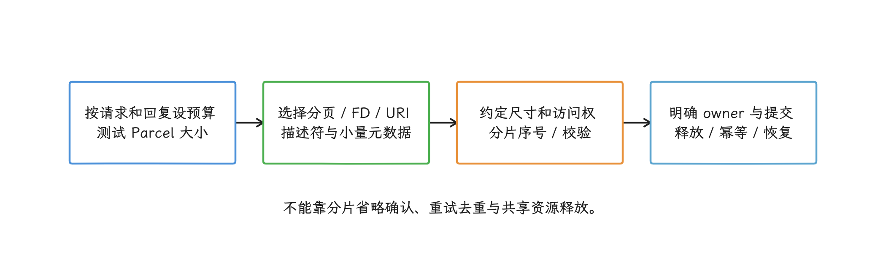

图：CursorWindow容量、共享区域尺寸和Parcel字节数不是同一个量；分片也需要提交协议避免重复副作用。

## 4. 死亡通知、重连与幂等性

处理远端死亡，我们手里的第一件工具是 `linkToDeath()`：远端 Binder 所在进程死亡时，客户端收到 `DeathRecipient` 回调。注册和回调之间存在竞态，目标状态可能在两次操作之间改变——注册时目标可能已经死亡，`linkToDeath()` 会抛 `RemoteException`；`isBinderAlive()` 刚返回，目标也可能随即退出。

死亡回调只做三件事：

1. 递增连接代次（epoch，每次重连都会变化的编号），并把当前代理对象标成不可用。
2. 清除依附于旧进程的会话、回调注册和缓存句柄。
3. 把重新 bind 或获取服务的工作交给应用统一管理的 executor（任务执行器）。

死亡回调线程里只做这三件事，磁盘、网络操作和等待新服务都安排到别处。重新连接后要获取新的代理对象，重新协商接口版本并恢复必要状态；旧代理对象就此作废。

<!-- gracker-diagram: a215-06-death-epoch -->
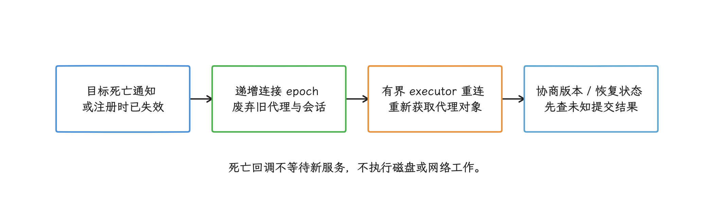

图：isBinderAlive只能提供瞬时观察；若连接代次已经变化，旧代次迟到结果不能污染当前会话。

重试策略由操作语义决定：

| 操作 | 传输失败后的动作 |
|---|---|
| 纯读取、可重复查询 | 重新获取代理对象后，可按既定上限重试一次 |
| 带稳定 request ID 的幂等写入 | 先查询服务端状态，确认未提交后再重放 |
| 扣款、消费一次性令牌（token）、追加日志 | 结果未知；查询提交状态，不能盲目重放 |
| `TransactionTooLargeException` | 修改协议或减小数据量；原样重试没有价值 |
| `SecurityException` / 参数错误 | 修复权限、身份或参数；退避重试无效 |
| `oneway` | 本地返回只代表无需等待回复；可靠投递要另建确认和序号协议 |

下面的包装器用在自有同步 AIDL 调用处。它只给结果分类，不自动重试，以免重复执行结果未知的操作：

<!-- gracker-diagram: a215-07-retry-contract -->
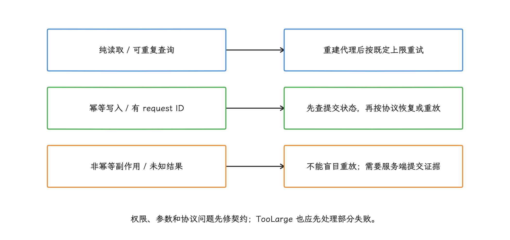

图：Indeterminate和TransportUnavailable都可能不知道服务端是否执行；不能从自定义分类名推断安全重试。

```kotlin
inline fun <T> callRemote(block: () -> T): IpcCallResult<T> {
    return try {
        IpcCallResult.Success(block())
    } catch (e: TransactionTooLargeException) {
        IpcCallResult.Indeterminate(
            kind = IpcFailureKind.TRANSACTION_FAILED_LARGE,
            cause = e,
        )
    } catch (e: DeadObjectException) {
        IpcCallResult.Indeterminate(
            kind = IpcFailureKind.REMOTE_DIED,
            cause = e,
        )
    } catch (e: RemoteException) {
        IpcCallResult.TransportUnavailable(e)
    } catch (e: SecurityException) {
        IpcCallResult.PolicyRejected(e)
    } catch (e: BadParcelableException) {
        IpcCallResult.ProtocolMismatch(e)
    }
}
```

`Indeterminate` 表示仅凭客户端异常判断不出服务端是否已经产生副作用。接口提供幂等键或状态查询能力时，调用方才可以重试。把所有 framework API 都包进 `catch (RuntimeException)` 没有必要；我们只处理公开 API 文档声明或自有协议约定的异常。

## 5. Binder Freezer：同步调用和 `oneway` 走不同路径

Binder Freezer 冻结的是缓存状态的应用进程：它们暂时不参与用户交互，其中的线程也随之停止运行。被冻结进程收到调用时的处理如下：

- 向被冻结应用发送同步 Binder transaction 时，驱动返回 `BR_FROZEN_REPLY`；系统会终止被冻结的目标应用，避免调用线程一直等待。目标进程的退出记录可能显示 `ApplicationExitInfo.REASON_FREEZER`。
- 向被冻结应用发送 `oneway` transaction 时，驱动暂存调用，并向发送方报告 `BR_TRANSACTION_PENDING_FROZEN`。同一 Binder 节点的首笔异步调用可分派到接收线程的待办队列或进程的 `todo`；前一笔异步调用尚未完成时，后续调用才进入该节点的 `async_todo` 待处理队列。目标解冻后才会处理；积压过多可能让接收进程崩溃，解冻时事件也可能已经过期。
- 只有新旧 transaction 都带 `TF_UPDATE_TXN`，且事务编号、完整标志位、发送进程 ID 和目标 Binder 节点等条件一致，新项才可替换冻结队列中的旧项。替换只扫描该节点的 `async_todo`，已分派到线程或进程待办队列的调用不在其中；普通 AIDL 指望不上这种自动合并。

API 36 起，`IBinder.addFrozenStateChangeCallback()` 是公开 API。服务端持有客户端的远程回调 Binder 时，可以用它观察对方当前是冻结还是解冻。注册后会收到初始状态，但连续变化可能被合并，因此它适合维护当前状态，统计冻结发生了多少次就靠不住了。它只支持远程 Binder；内核驱动不支持冻结通知时还可能抛出 `UnsupportedOperationException`。

<!-- gracker-diagram: a215-08-freezer-paths -->
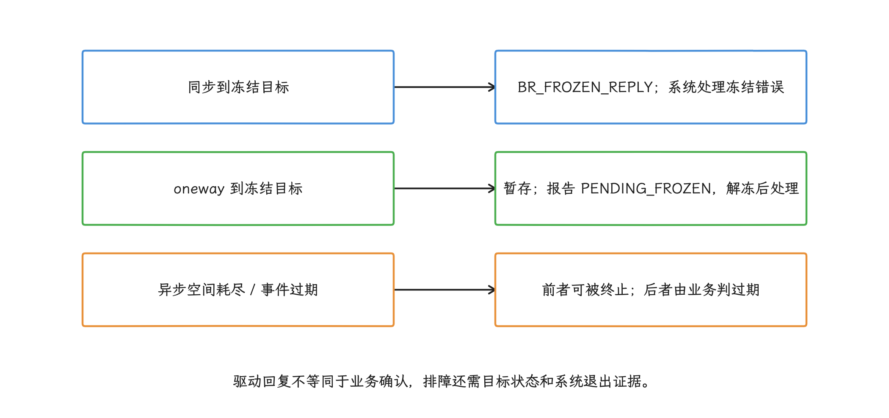

图：固定framework会按冻结同步调用或异步空间错误终止相应冻结进程；REASON_FREEZER与普通ANR区分。

管理一组远程回调时，可以通过 API 36 起提供的 `RemoteCallbackList.Builder` 配置 frozen callee policy，指定接收方被冻结时的回调处理方式：

<!-- gracker-diagram: a215-09-frozen-coalescing -->
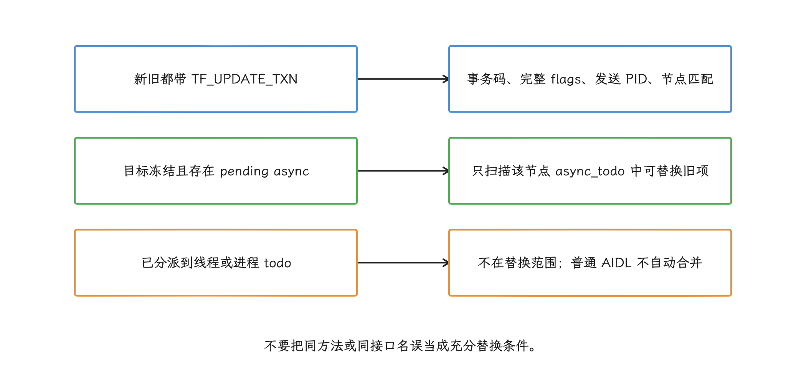

图：首笔异步事务可能已分派；替换条件属于固定驱动实现，应用层状态合并要自己设计。

- `FROZEN_CALLEE_POLICY_DROP`：直接丢弃，适合过期后没有价值的实时事件。
- `FROZEN_CALLEE_POLICY_ENQUEUE_MOST_RECENT`：只保留最新一条，适合状态同步。
- `FROZEN_CALLEE_POLICY_ENQUEUE_ALL`：按原顺序排队，适合必须保留历史的事件。默认上限是 1000 条，可通过 `setMaxQueueSize()` 调低；队列满后会丢弃最旧项，还要评估解冻后集中处理的压力。
- `FROZEN_CALLEE_POLICY_UNSET`：兼容旧行为，不建议作为新代码默认值。

设置冻结策略后应通过 `broadcast(Consumer)` 广播回调；`beginBroadcast()` 只支持 `FROZEN_CALLEE_POLICY_UNSET`，其他策略下会抛 `UnsupportedOperationException`。

<!-- gracker-diagram: a215-10-callback-policy -->
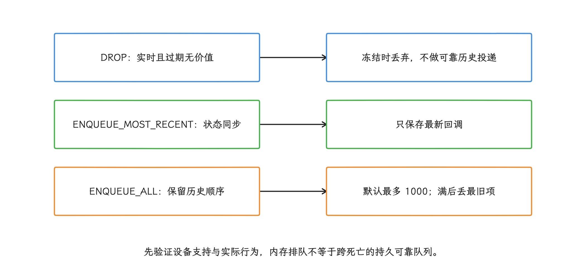

图：使用broadcast(Consumer)；非UNSET策略不能用beginBroadcast，且不支持驱动通知时会退回即时发送。

API 35 及以下不能依赖这组冻结策略接口。驱动不支持冻结通知时，Android 17 的 `RemoteCallbackList` 会捕获 `UnsupportedOperationException`，继续按未冻结状态即时发送回调，配置的丢弃或排队策略就不会生效。使用这些策略前，需要在目标设备上验证冻结通知支持和实际回调行为。

通过 `bindService()` 连接的 bound service（通过 `bindService()` 连接的服务），通常会因绑定关系提高进程重要性；能否进入缓存或冻结状态，还取决于绑定标志和当前进程状态。冻结状态从包名是猜不出来的，要判断就观察具体的远程 Binder，或在回调管理器中选择明确策略。

## 6. 线程池耗尽、嵌套调用与 ANR（Application Not Responding，应用无响应）

同步 Binder 调用会阻塞调用线程，直到收到回复或失败。主线程上的一次慢系统服务调用就足以造成卡顿，多次连续调用还会累加延迟；ANR 指南也把“主线程等待缓慢的 Binder 回复”列为常见原因。

### 6.1 Binder 线程数的构成

Android 17 C++ libbinder 的 `DEFAULT_MAX_BINDER_THREADS` 是 15。这个值表示内核最多还能按需启动多少线程；`startThreadPool()` 会先额外启动 1 个线程，手工调用 `joinThreadPool()` 也可能让调用线程加入线程池。Java 应用、native 守护进程（用 C/C++ 等实现的常驻进程）、HAL（硬件抽象层） 和 `system_server` 的配置并不完全相同。

排障时，我们从 Perfetto trace 或 bugreport（系统诊断报告） 读取目标进程实际存在的 Binder 线程及其状态。看到 15 个线程先别急着下结论，看到 16 个也未必触到了哪个通用上限，各进程的配置本来就不一样。

<!-- gracker-diagram: a215-11-threadpool-capacity -->
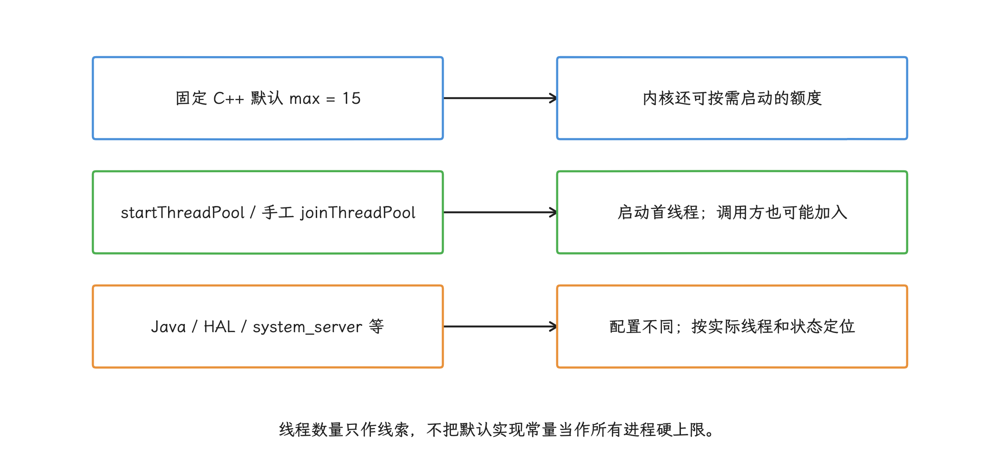

图：看到15或16条线程不能直接宣告统一上限；耗尽取决于忙时、锁和下游等待。

### 6.2 三类常见耗尽路径

- **服务端处理过慢**：Binder 线程持锁、执行磁盘 I/O、等待硬件，或调用缓慢的下游服务。
- **嵌套同步调用**：A 调用 B，B 处理期间又同步回调 A。Binder 允许这类递归调用，A 中正在等待的线程可能转而处理回调；双方若同时持有业务锁，容易形成跨进程循环等待。
- **`oneway` 处理过慢**：同一 `IBinder` 对象上的多个 `oneway` 调用按发送顺序逐个分派；它们可能由不同线程执行，但前一笔完成前不会分派下一笔。不同 `IBinder` 对象之间，以及同步和 `oneway` 混合调用之间，都没有这项顺序保证。

`oneway` 让发送方不必等待回复，却没有增加服务端的并行处理能力。

服务端 `onTransact()` 应快速校验并复制必要参数，把可以异步执行的耗时任务交给有容量上限的业务 executor，再尽快释放 Binder 线程。持有应用锁去发起外部同步 Binder 调用是危险的组合；实在避不开，就要规定统一的跨进程加锁顺序，并设计超时和取消方式。

<!-- gracker-diagram: a215-12-nested-reentry -->
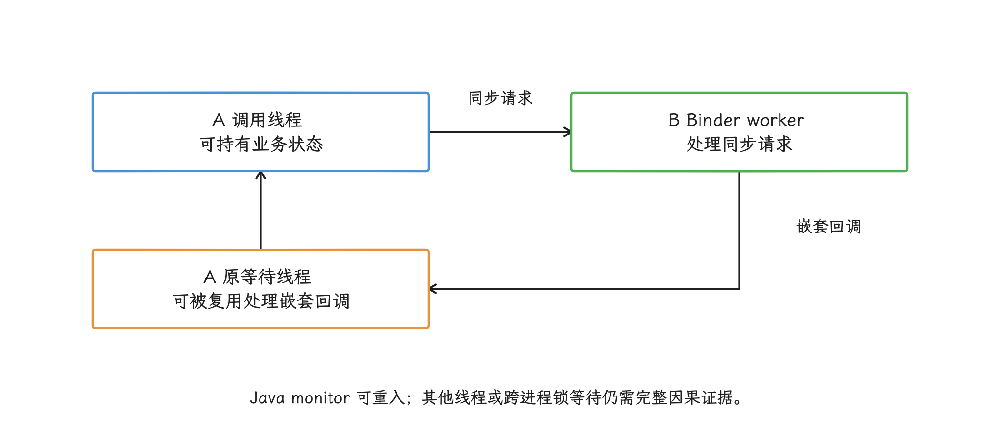

图：Binder允许递归同步调用；不能仅凭A等待B且B回调A就断言死锁，还要证明锁、执行线程与等待链。

<!-- gracker-diagram: a215-13-oneway-order -->
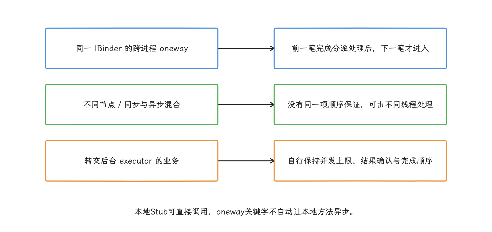

图：oneway不扩大线程池或接收缓冲，多个发送线程的业务先后也应由序号协议表达。

## 7. `oneway` 缓冲区与滥发检测

`android17-6.18-2026-06_r6` 的 `binder_alloc` 初始化时，把接收进程总缓冲区的一半设为异步 transaction 配额。新的 `oneway` 在配额不足时会分配失败，这种情况要按投递失败处理。

当前驱动的滥发检测器会在剩余异步空间低于总缓冲区的 10% 时开始检查发送进程。同一进程占用超过 50 个异步缓冲块，或占用量超过总缓冲区的 25% 时，驱动会把某笔 transaction 标为可疑。libbinder 收到 `BR_ONEWAY_SPAM_SUSPECT` 后，会打印 `oneway spamming` 和调用栈。

这些数值属于当前内核版本的实现细节，应用协议只能把它们当参考信号。检测器提供的是诊断信号，状态合并和可靠投递都要应用自己解决。

<!-- gracker-diagram: a215-14-async-budget -->
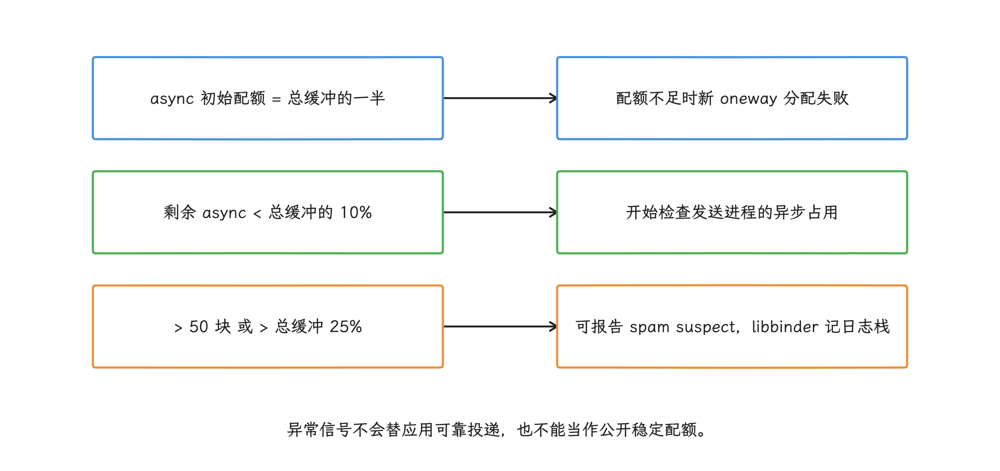

图：固定驱动阈值只提供诊断信号；应用仍须采样、状态合并、背压与明确确认。

高频事件应在发送前采样、去重，或只保留最新状态。每条消息都必须保留时，应使用带背压和确认的协议：接收方变慢后，发送方主动降速，并等待明确确认，`oneway` 的发送量始终有上限。

## 8. 排障：对齐客户端、服务端和驱动的时间线

### 8.1 客户端证据

- 完整的 Java/Kotlin 堆栈，保留 `BinderProxy.transactNative` 上方的 AIDL 或管理类方法。
- 接口名、方法或 transaction code（方法在 Binder 协议中的编号）、同步或 `oneway`、调用线程、耗时。
- 自有协议的请求和回复估算字节数、列表项数、FD 数和字段结构版本。
- request ID、重试序号、连接代次，以及调用前后对代理对象存活状态的观察。
- 原始异常类型、消息和原因链；异常消息脱敏后再上传。

### 8.2 服务端证据

- 对应 request ID 是否到达、是否完成副作用、回复序列化是否开始。
- `onTransact()` 和业务处理函数的耗时、Binder 线程状态、持有的锁和下游 IPC。
- 进程崩溃、LMK（低内存终止）、强制停止、冻结或重启的时间。
- `oneway` 队列策略、丢弃或合并数量、处理序号缺口。

### 8.3 工具边界

Perfetto 是 Android 的系统级追踪工具，它的时间轴由若干 track 组成：track 是时间轴中的一条轨道，slice 是轨道上的一段事件。采集 `binder_driver`、`sched` 和相关应用或系统 atrace（Android 追踪标记） 类别后，我们可以把客户端 transaction、服务端处理、回复与线程调度放在同一时间轴上；PerfettoSQL 的 `android.binder` 标准库还提供 transaction 耗时分解、阻塞函数和调用关系。筛选 slice 时按具体的 track 和事件来，别只按名称模糊匹配。

分析 ANR 时，先看主线程是否停在 `BinderProxy.transactNative`，再沿 Perfetto flow（连接跨线程事件的箭头）找到服务端线程，确认它正在运行、等待锁、执行 I/O，还是等待下游 Binder。只有客户端堆栈时，最多能证明“客户端正在等待某次 IPC”。

<!-- gracker-diagram: a215-15-binder-timeline -->
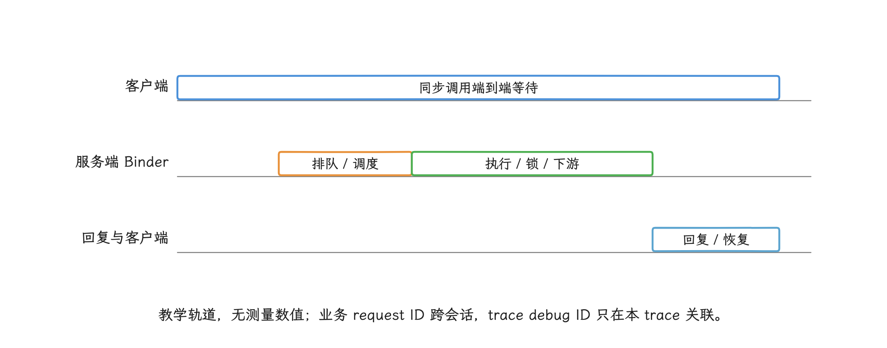

图：客户端停在transactNative只能证明等待；服务端是否在运行、等CPU、锁或下游，需两端slice与sched证据。

`/sys/kernel/debug/binder` 或 binderfs（Binder 文件系统） 的统计节点受系统构建类型、SELinux 权限策略、root（最高系统权限） 权限和设备配置限制，适合带调试能力的 userdebug、eng 构建或实验室设备；线上应用不能依赖内核调试节点。

使用 `dumpsys` 前先通过 `dumpsys -l` 确认设备提供的服务。AOSP 的 `BinderCallsStatsService` 注册名为 `binder_calls_stats`，可用 `dumpsys binder_calls_stats -h` 查看选项；它提供系统进程中 Java Binder 调用的统计，数据受采集配置和权限限制，不能按 PID 导出任意进程的驱动队列。排查具体调用仍需结合 Perfetto、两端日志和可访问的驱动节点。

日志中可以搜索 `FAILED BINDER TRANSACTION`、`oneway spamming`、`Sending oneway calls to frozen process`，但日志标签、级别和可见性会随构建变化，只能作为辅助证据。

## 9. 自有 AIDL 的持续监控

客户端在 AIDL 代理对象外层计时，得到的是同步调用的端到端等待时间：

```text
marshal + driver out + server queue + server execution
        + reply + unmarshal
```

其中，`marshal`/`unmarshal` 表示序列化/反序列化，`server queue` 表示请求在服务端等待线程处理的时间。这个总值适合衡量用户体验，指标命名避开“Binder 传输耗时”。`oneway` 外层计时只覆盖序列化和本地提交，远端是否执行它说明不了；同进程的本地 Binder 可能直接调用 Stub（服务端入口对象），应与跨进程样本分开统计。

普通应用找不到可依赖的全局 Binder 拦截点（Hook）。`Binder.ProxyTransactListener` 和 `BinderInternal.Observer` 属于隐藏或平台内部接口，native/Rust Binder 也不一定经过同一个 Java 入口。所以监控要贴着自己拥有的接口做：拥有 AIDL 契约时，在明确的客户端和服务端包装层记录；调用系统服务时，只在少数公开管理类方法外记录有用的业务信息。

下面的包装器记录逻辑接口、线程、耗时和原始失败类型，不依赖隐藏 API：

```kotlin
data class IpcCallSample(
    val service: String,
    val method: String,
    val oneway: Boolean,
    val durationNanos: Long,
    val mainThread: Boolean,
    val failureClass: String?,
)

interface IpcRecorder {
    // 非阻塞、无 Binder/网络调用、不会向调用方抛异常。
    fun tryRecord(sample: IpcCallSample): Boolean
}

inline fun <T> measuredIpc(
    service: String,
    method: String,
    oneway: Boolean,
    recorder: IpcRecorder,
    block: () -> T,
): T {
    val started = SystemClock.elapsedRealtimeNanos()
    var failureClass: String? = null
    try {
        return block()
    } catch (failure: Throwable) {
        failureClass = failure.javaClass.name
        throw failure
    } finally {
        try {
            recorder.tryRecord(
                IpcCallSample(
                    service,
                    method,
                    oneway,
                    SystemClock.elapsedRealtimeNanos() - started,
                    Looper.myLooper() == Looper.getMainLooper(),
                    failureClass,
                )
            )
        } catch (_: Throwable) {
            // 监控故障不能遮蔽业务结果；这里也不能递归记录日志。
        }
    }
}
```

标签只能来自编译期确定的枚举，URI、用户 ID、参数和异常消息都放不进去。`recorder` 使用固定容量缓冲区，写满后丢弃新样本并计数；高频接口可以写入预先分配的环形缓冲区（ring buffer，写到末尾后从头复用空间），写到末尾后从头复用空间，编码和上传则放到独立线程。

服务端包装层记录 `server_enter` 和 `server_exit`。两端需要关联时，把 request ID 纳入业务协议；两端日志可能存在时钟偏差，拿日志猜关联不可靠。

<!-- gracker-diagram: a215-16-own-interface-monitor -->
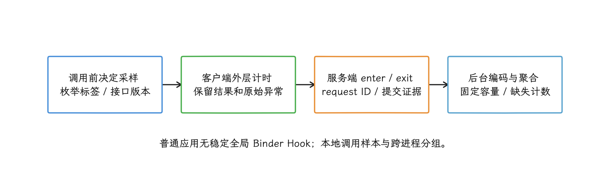

图：同步耗时含序列化、排队、执行与回复，不宜命名Binder传输耗时；oneway本地提交时长不能代表远端完成。

### 长尾采样与 Perfetto

总体分位数和慢调用诊断需要两条采样路径。我们用低比例均匀采样估计 P50/P90/P99，这三个值分别表示约 50%、90%、99% 的样本耗时不超过对应值；超过接口阈值的调用进入带冷却时间和速率上限的诊断缓冲区。只上传慢样本的话，得到的只是“慢调用内部的分布”。远端一次死亡可能让多条并发调用同时抛 `DeadObjectException`，统计死亡率时要按连接代次或一次死亡通知去重。

常驻指标发现慢接口后，再用 Perfetto 对齐 `android.binder`、`binder_driver`、`sched`、AIDL atrace 和应用 slice：先看客户端线程，再沿 flow 判断服务端是在排队、等待 CPU、等待锁、执行代码，还是发起下游 IPC，随后观察回复返回后客户端何时恢复。trace debug ID 只适合在同一份 trace 中关联事件，跨会话的业务主键要另选协议字段。

<!-- gracker-diagram: a215-17-sampling-unknown-results -->
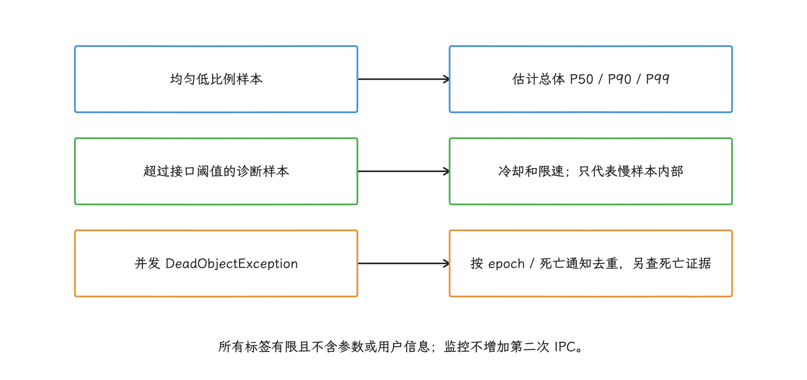

图：一笔远端死亡可以让多个并发调用失败；只上报慢样本不能还原总体延迟分布。

监控代码在关键路径上不做第二次 Binder 调用，不写同步日志，不访问磁盘或网络，也不争用全局重锁。采样决定在调用前完成；配置出错时可以直接停用监控，业务异常、重试次数和返回值都保持原样。

## 10. 稳定性与性能指标

建议为 IPC 单独建立一组指标，别只盯着 Java 崩溃：

| 指标 | 作用 |
|---|---|
| 同步调用 P50/P95/P99 与主线程占比 | 找出慢服务和界面卡顿风险 |
| 每个接口的请求/回复大小区间分布 | 找出协议数据量增长 |
| `DeadObjectException` 与连接代次 | 找出服务重启和旧代理复用错误 |
| `TransactionTooLargeException` / `FAILED_TRANSACTION` | 找出大数据、并发缓冲区压力或底层失败 |
| 权限、协议、业务错误码 | 区分传输失败和业务失败 |
| `oneway` 发送、合并、丢弃、消费序号 | 找出积压和过期事件 |
| 回调冻结策略命中数 | 验证丢弃、仅保留最新或全部排队是否符合业务含义 |
| 重试次数、去重命中、未知提交状态 | 发现重放风险 |
| 服务端 Binder 线程忙时与下游等待 | 找线程池耗尽根因 |

APM（Application Performance Monitoring，应用性能监控）的拦截代码，覆盖的是自身能够安全观察的范围。普通应用做不到可靠地全局拦截所有 Binder 代理对象，反射或 native Hook 还可能改变原有时序。自有 AIDL 应在生成代码之外的客户端包装层和服务实现中记录，系统 API 则依赖公开 trace、异常和方法级埋点。

## 11. Android 17 验证清单

| 用例 | 预期 |
|---|---|
| 请求大小在自有预算上下波动 | 超预算时在调用前拒绝，或改走分页/FD |
| 回复超预算 | 客户端按结果不确定处理，服务端可用 request ID 查询提交状态 |
| 多个中等 transaction 并发 | 能复现共享缓冲区压力，不误判成单笔超过 1 MiB |
| 请求含关闭的 FD 或损坏的 Parcelable | 分类为协议或 FD 问题，不只看异常名 |
| 服务端在执行前、执行中、提交后被杀 | 客户端不会盲目重放非幂等操作 |
| `linkToDeath()` 注册时与调用中死亡 | 连接代次正确，旧代理对象不再使用 |
| 主线程同步调用慢服务 | 测试门禁能发现，业务移动到合适线程或改协议 |
| Binder 线程持锁后反向回调 | 锁顺序检查能发现潜在死锁 |
| 高频 `oneway` 发往同一 Binder | 发送侧合并或背压生效，服务端没有无上限积压 |
| 回调接收进程被冻结 | 丢弃、仅保留最新、全部排队三种策略符合事件含义 |
| 冻结进程收到同步 transaction | 观察冻结回复与 `REASON_FREEZER`，不按普通 ANR 归因 |
| AIDL 客户端/服务端版本错配 | `unknown transaction`（对端不认识该方法编号）、默认值和错误方向可定位 |

## 12. 与相邻章节的分工

- 1.9 负责 Binder 驱动、对象引用、一次 transaction 的基础链路，以及不同 IPC 机制的选型。
- 4.3 负责缓存应用冻结机制（cached apps freezer）与进程生命周期。
- 20.4 负责 ANR 证据和超时类型，这里提供 Binder 侧等待链。
- 26.14 负责 Perfetto/eBPF 等观测工具，这里只说明 IPC 需要哪些证据。

## 小结

每次 Binder 调用都要分别回答传输是否完成、服务端是否执行、业务是否提交，再结合 Parcel 预算、连接代次、冻结策略、线程池和 Perfetto 时间线定位；单个 Java 异常名撑不起这个判断。协议已提供幂等键或提交状态查询时，结果不确定的写操作才谈得上安全重试。

## 参考资料

- [`RemoteException`](https://developer.android.com/reference/android/os/RemoteException)
- [`TransactionTooLargeException`](https://developer.android.com/reference/android/os/TransactionTooLargeException)
- [`IBinder`](https://developer.android.com/reference/android/os/IBinder)
- [`RemoteCallbackList`](https://developer.android.com/reference/android/os/RemoteCallbackList)
- [`RemoteCallbackList.Builder`（API 36 起）](https://developer.android.com/reference/android/os/RemoteCallbackList.Builder)
- [AOSP `android-17.0.0_r1`：`RemoteCallbackList.java`](https://android.googlesource.com/platform/frameworks/base/+/android-17.0.0_r1/core/java/android/os/RemoteCallbackList.java)
- [AOSP `android-17.0.0_r1`：`BinderCallsStatsService.java`](https://android.googlesource.com/platform/frameworks/base/+/android-17.0.0_r1/services/core/java/com/android/server/BinderCallsStatsService.java)
- [Handle cached and frozen apps](https://source.android.com/docs/core/architecture/ipc/binder-freezer)
- [Cached apps freezer](https://source.android.com/docs/core/perf/cached-apps-freezer)
- [AIDL backends - Error handling](https://source.android.com/docs/core/architecture/aidl/aidl-backends#error-handling)
- [Diagnose ANRs](https://developer.android.com/topic/performance/anrs/find-unresponsive-thread)
- [Perfetto：Android system tracing](https://perfetto.dev/docs/learning-more/android)
- [PerfettoSQL：`android.binder` standard library](https://perfetto.dev/docs/analysis/stdlib-docs#android-binder)
- [AOSP `android-17.0.0_r1`：`ProcessState.cpp`](https://android.googlesource.com/platform/frameworks/native/+/android-17.0.0_r1/libs/binder/ProcessState.cpp)
- [AOSP `android-17.0.0_r1`：`IPCThreadState.cpp`](https://android.googlesource.com/platform/frameworks/native/+/android-17.0.0_r1/libs/binder/IPCThreadState.cpp)
- [AOSP `android-17.0.0_r1`：Java Binder JNI mapping](https://android.googlesource.com/platform/frameworks/base/+/android-17.0.0_r1/core/jni/android_util_Binder.cpp)
- [AOSP `android-17.0.0_r1`：`Parcel.java`](https://android.googlesource.com/platform/frameworks/base/+/android-17.0.0_r1/core/java/android/os/Parcel.java)
- [Kernel `android17-6.18-2026-06_r6`：Binder driver](https://android.googlesource.com/kernel/common/+/android17-6.18-2026-06_r6/drivers/android/binder.c)
- [Kernel `android17-6.18-2026-06_r6`：Binder allocator](https://android.googlesource.com/kernel/common/+/android17-6.18-2026-06_r6/drivers/android/binder_alloc.c)
