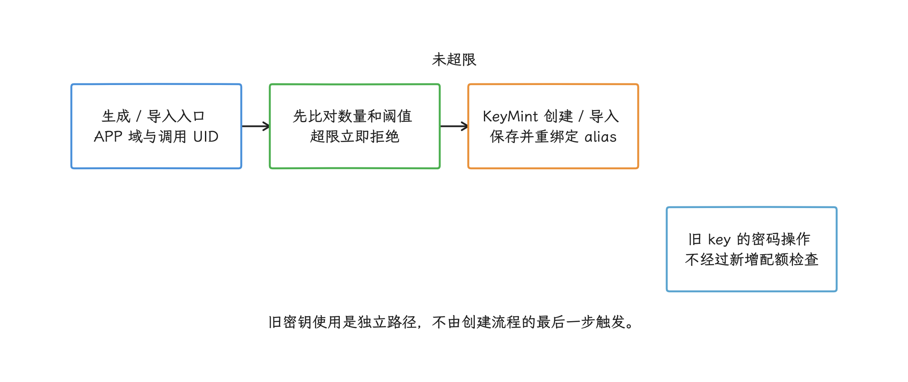
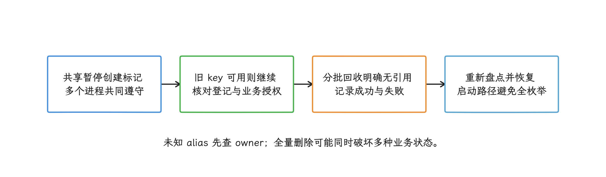
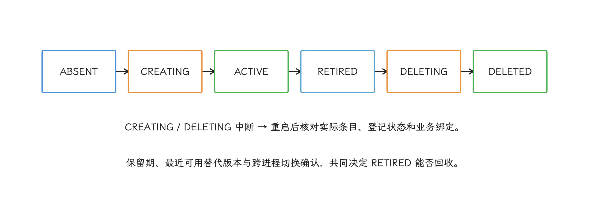

# Android 17 Keystore 密钥配额与登录恢复

Android Keystore 是由系统管理的密钥容器。应用通过 alias（密钥条目的名称）访问密钥；Keystore API 不提供导出私钥或对称密钥材料的途径，设备支持时密钥还可由安全硬件保护。

> 源码基线：AOSP（Android Open Source Project，Android 开源项目） `android-17.0.0_r1`；本章不讨论 Linux 内核实现。

Android 17 开始，系统按应用 UID 限制 Keystore 密钥条目数量。UID 是 Linux/Android 用来标识应用身份的数字，同一应用的多个进程通常共用一个。具体上限分两档：非系统应用的 target SDK（应用声明已适配的目标 API 级别） 不低于 37 时是 50,000，其余应用（含系统应用）是 200,000。达到上限后，系统不会主动删除旧密钥，也不会仅因配额耗尽就阻止应用继续使用仍有效的旧密钥；只有新的生成和导入请求会失败。

这类故障往往在登录、设备绑定、支付签名或加密数据库初始化时才暴露，而数量增长可能已经持续很久：alias（密钥条目的字符串名称） 每次带新时间戳、账号退出后不回收、轮换只增不减，或自动化测试长期留下密钥。处理时我们先把两件事看清楚：alias 归哪个责任模块、生命周期走到了哪一步；等数量逼近 50,000 才临时批量删除，就太被动了。

正文里反复出现三层组件，这里先交代一次：Android framework 是应用调用的 Java API 层；keystore2 是管理密钥元数据并转发密码操作的系统服务；KeyMint HAL 是系统与密钥实现之间的硬件抽象接口，密码运算和密钥保护由实现侧完成。TEE（Trusted Execution Environment，可信执行环境）和 StrongBox（隔离程度更高的安全硬件）是常见的两种安全级别。

## 1. Android 17 配额的适用范围

官方文档给出的规则如下：

| 运行环境与应用身份 | 密钥条目上限 | 创建超限时的公开错误码 |
|---|---:|---|
| Android 17，非系统应用，`targetSdkVersion >= 37` | 50,000 | `ERROR_TOO_MANY_KEYS` |
| Android 17，非系统应用，`targetSdkVersion < 37` | 200,000 | `ERROR_INCORRECT_USAGE` |
| Android 17，系统应用 | 200,000 | 由 target SDK 决定返回哪个公开错误码 |
| Android 16 及更早版本 | 不执行这项 Android 17 配额 | 不适用 |

这条规则属于 Android 17 的“所有应用行为变更”，所以 target SDK 低于 37 的应用同样要遵守 200,000 的上限。落到具体应用，数量上限同时取决于是否为系统应用与 target SDK；公开错误码也取决于有效 target SDK。系统应用的上限固定为 200,000；若以 API 37 或更高版本为目标，超限时仍返回 `ERROR_TOO_MANY_KEYS`。


### 1.1 源码按 UID 计数

配额到底按什么数？我们直接看源码。`Domain::APP` 表示应用拥有的密钥域；keystore2 把调用方 UID 写进 `KeyDescriptor` 的 `namespace` 字段，再按“域与命名空间”统计面向客户端的密钥条目。`count_key_entries()` 做的是加法：keystore2 数据库中的条目数，加上 legacy importer（读取旧版 Keystore 数据的兼容导入器） 列出的 alias 数量。按这个算法，下面几条推论都好理解：

- 配额属于 UID，不属于进程、业务模块或某个 `KeyStore` 对象。
- 同一安装包在不同 Android 用户或工作资料中通常有不同 UID，数量分别计算。
- 历史 shared UID 让多个包共享一个 UID。源码取这些包中最低的 target SDK；任一包属于系统应用，整个 UID 就都按系统应用处理。这类部署要按 UID 评估，别只看包名。
- TEE 与 StrongBox 没有各自独立的 50,000 额度；不同安全级别创建的应用密钥进入同一 UID 总数。
- 计数对象是客户端密钥条目。轮换后未删除的 alias 仍占额度；证书链或同一条目内部保存的二进制数据块不会按普通文件个数分别计数。

还有一个容易漏掉的细节：`count_key_entries()` 自身失败时，这份源码会记录错误并放行本次创建。这种放行只是容错设计，别把它当成可用的余量。固定源码先执行计数检查，再生成/导入并保存新条目，这不是为整个 UID 预留名额的跨调用原子事务；并发创建仍需要业务协调，不能把阈值当成任何瞬间都绝不会超出的数据库不变量。应用侧盘点用 `KeyStore.aliases()` 或 `KeyStore.size()`，它们给出的是应用视角的可见条目，算不上系统配额查询 API，结果只能当估算用；记录盘点结果时，把枚举失败和耗时一并记下来。


### 1.2 创建、导入与使用旧密钥走不同路径

AOSP `KeystoreSecurityLevel.check_key_counts()` 在三条路径进入 KeyMint 之前执行：`generate_key()`、`import_key()`，以及 `import_wrapped_key()`；最后这条导入的是被另一把包装密钥加密保护的密钥材料。

计数到顶，检查直接返回错误；而现有密钥的 `Cipher.init()`、`Signature.initSign()` 等使用路径并不经过这项检查。所以升级 target SDK 之后，旧密钥不会仅因配额变化而一起失效。

这里还有一个顺序上的坑：配额检查发生在 rebind（用新密钥替换同名 alias）之前。应用已经有 50,000 个条目时，哪怕用现有 alias 重新生成密钥，也可能先被拒绝。所以恢复流程要先确认并删除可回收的 alias，把额度腾出来再重建；反复用同名 alias 重试，解决不了满额问题。

<!-- gracker-diagram: a216-03-creation-vs-use -->


图：创建在计数检查后才进入KeyMint并保存；已有密钥的Cipher/Signature使用独立走操作路径，同名替换不能绕过满额检查。

## 2. 容易造成 alias 持续增长的设计

alias 的持续增长大多来自几类固定设计，我们逐项对照：

| 来源 | 常见设计 | 风险 | 调整方向 |
|---|---|---|---|
| 设备绑定 | alias 包含时间戳或每次绑定的随机 ID | 每次重绑都创建新密钥，不回收旧版本 | 一个设备槽位只保留当前版本；换代确认成功后回收旧版本 |
| 多账号登录 | 每次登录都新建账号密钥 | 账号切换或注销后仍留存 | 使用不含明文账号的稳定账号槽位；退出时只清理该账号拥有的密钥 |
| 生物认证 | 生物特征新增、删除或锁屏变化后直接新建 | 已失效密钥仍占 alias | 区分“需要再次认证”和“永久失效”，完成业务授权后再删除并重建 |
| 支付/风控 | 每笔订单或每次挑战各建一个密钥 | 密钥数量随业务请求线性增长 | 长期身份密钥与一次性挑战数据分开；一次性数据不写入 Keystore |
| 加密文件/数据库 | 每个文件、表或记录创建 Keystore 密钥 | 数据量直接决定 alias 数量 | 用少量 Keystore 密钥包装 DEK；DEK（data-encryption key，数据加密密钥）负责加密具体数据 |
| 证书/算法轮换 | 新版本创建新 alias，旧版本永久保留 | 多次升级后积累许多历史版本 | 登记当前版本、最近一次确认可用版本和待回收版本，并在回滚期结束后清理 |
| SDK 或多进程 | 各组件各自执行“没有就创建” | 命名冲突、重复创建、责任模块不明 | 由单一密钥管理组件负责，创建与删除使用跨进程协调协议 |
| QA/自动化测试 | alias 含测试用例 ID 或运行批次 ID | 共享测试设备长期累积 | 使用测试专用前缀，每轮结束时清理，并设置生成数量硬上限 |

Passkey 的密钥归属与普通应用密钥不同。relying party 是发起注册和登录的网站或应用，credential provider（凭据提供方）是保存并使用 passkey 私钥的密码管理器等组件。普通应用通过 Credential Manager 请求 passkey 时，私钥由用户选定的凭据提供方保存，不能把每个 passkey 都算成本应用的 Android Keystore alias。只有应用自己调用 Keystore 生成密钥，或者自己实现凭据提供方并管理相关密钥，这些条目才要纳入本 UID 的盘点。排查时我们看本应用 `AndroidKeyStore` 可见的 alias 和密钥创建调用栈就够了；按用户拥有的 passkey 数量推算配额，会得出错误的结论。


## 3. 用错误码、异常类型和调用阶段共同分类

`android.security.KeyStoreException` 从 API 33 开始提供 `getNumericErrorCode()`、`isTransientFailure()`、`getRetryPolicy()`、`isSystemError()` 和 `requiresUserAuthentication()`；API 37 又新增了 `ERROR_TOO_MANY_KEYS`，在 Android 17 的 AOSP 源码里常量值是 18。业务代码应引用 SDK 常量，数值 18 不写进协议或统计分支。

配额错误码按 target SDK 分两种：

- `targetSdkVersion >= 37`：`ERROR_TOO_MANY_KEYS` 可以直接确认配额超限。
- `targetSdkVersion < 37`：系统返回 `ERROR_INCORRECT_USAGE`，异常消息中会包含密钥数量限制信息。消息文本只当辅助诊断用——同一个公开错误码也可能来自算法或参数组合错误。

拿到异常后还有一层包装要剥：JCA（Java Cryptography Architecture，Java 加密 API 体系）可能把底层 `KeyStoreException` 包在 `ProviderException`、`InvalidKeyException` 或其他算法异常的 cause 链中。`UserNotAuthenticatedException`、`KeyPermanentlyInvalidatedException` 和 `StrongBoxUnavailableException` 是另外三个独立的公开异常类型。所以分类器要同时看外层异常、cause 链和公开错误码，再判断失败发生在哪个操作阶段。

常见失败可以分成下面几组，处理方式各不相同：

| 分类 | 可靠证据 | 处理 |
|---|---|---|
| 配额已确认 | Android 17、target 37+、`ERROR_TOO_MANY_KEYS` | 停止创建，进入受控盘点和回收，不循环重试 |
| 配额疑似 | Android 17、target 低于 37、`ERROR_INCORRECT_USAGE`，且消息明确提到密钥数量限制 | 标记为疑似配额；盘点后再决定是否清理 |
| 需要用户认证 | `requiresUserAuthentication()` 或 `UserNotAuthenticatedException` | 请求设备凭据或生物认证，不删除密钥 |
| 密钥永久失效 | `KeyPermanentlyInvalidatedException` | 完成业务身份验证后替换该 alias，旧条目可回收 |
| 密钥损坏或不存在 | `ERROR_KEY_CORRUPTED`、`ERROR_KEY_DOES_NOT_EXIST`，或本地记录与 Keystore 不一致 | 核对生命周期登记表和服务端绑定状态，再决定重建 |
| Keystore 尚未初始化 | `ERROR_KEYSTORE_UNINITIALIZED` | 区分 `KeyStore.load()` 尚未调用与设备未设置 LSKF |
| StrongBox 能力不足 | `StrongBoxUnavailableException`；若只有 `ERROR_UNIMPLEMENTED`，还需结合请求的安全级别和算法参数确认 | 只有既定安全策略允许时才改用 TEE 或服务端方案 |
| 权限或参数错误 | `ERROR_PERMISSION_DENIED`，或无配额证据的 `ERROR_INCORRECT_USAGE` | 修正调用身份、权限或参数，不通过重试恢复 |
| 暂时性故障 | `isTransientFailure() == true` | 按 `getRetryPolicy()` 指定的时机重试，并设置全局次数上限 |

我们用下面的代码做登录故障分类，区分已确认配额、旧错误映射下的疑似配额、认证要求和暂时性故障。历史 shared UID 的有效 target 可能低于本包声明值，包信息查询失败也可能进入兼容分支，因此 `ERROR_INCORRECT_USAGE` 的疑似判断不只按本包 target 划定。调用方仍要单独捕获 `UserNotAuthenticatedException` 等外层专用异常：

```kotlin
@RequiresApi(37)
fun classifyAndroid17KeystoreFailure(
    error: Throwable,
    targetSdk: Int,
): KeystoreFailure {
    val kse = generateSequence(error) { it.cause }
        .take(16)
        .filterIsInstance<KeyStoreException>()
        .firstOrNull()
        ?: return KeystoreFailure.Other(error.javaClass.name)

    val code = kse.numericErrorCode
    if (targetSdk >= 37 &&
        code == KeyStoreException.ERROR_TOO_MANY_KEYS
    ) {
        return KeystoreFailure.QuotaConfirmed
    }

    if (code == KeyStoreException.ERROR_INCORRECT_USAGE &&
        kse.message.orEmpty().contains("key", ignoreCase = true) &&
        (kse.message.orEmpty().contains("limit", ignoreCase = true) ||
            kse.message.orEmpty().contains("too many", ignoreCase = true))
    ) {
        return KeystoreFailure.QuotaSuspected
    }

    if (kse.requiresUserAuthentication()) {
        return KeystoreFailure.UserAuthenticationRequired
    }

    if (kse.isTransientFailure) {
        return KeystoreFailure.Transient(kse.retryPolicy)
    }

    return KeystoreFailure.Permanent(
        code = code,
        systemError = kse.isSystemError,
    )
}
```


这段代码把异常消息匹配降为“疑似配额”，并且只在 `isTransientFailure` 为 `true` 时读取重试策略。`@RequiresApi(37)` 只向静态检查声明调用要求，不执行运行时版本判断；调用方仍须确认 `Build.VERSION.SDK_INT >= 37`，旧系统共用入口时则使用版本隔离实现。诊断记录里要保留外层异常类、cause 链中的 `KeyStoreException`、公开错误码和清理状态，只保存一段可能变化的消息文本是不够的。

## 4. 登录与支付故障的恢复顺序

配额耗尽时，先放下“清空 Keystore 后重试”这个念头：全量删除可能同时破坏登录、端到端加密、支付、数据库解锁和第三方 SDK 状态。我们按以下顺序恢复：

1. **停止新增**：写入持久化的“暂停创建”标记，并让同一应用的其他进程读取它，阻止失败后继续生成密钥。
2. **继续使用旧密钥**：如果当前选中的 alias 仍存在且可用，优先完成解密、签名或登录恢复。
3. **核对生命周期登记表**：找出已退出使用的版本、孤立条目（Keystore 中存在、登记表中却没有归属记录的 alias）、测试前缀和已注销账号的候选集合。
4. **完成业务授权**：账号注销、设备解绑或凭据撤销需要服务端参与时，先完成服务端动作。
5. **小批量回收**：按责任模块和版本删除已确认无引用的 alias，每批记录成功、失败和剩余数量。
6. **重新盘点**：确认已释放足够余量，再恢复创建或轮换。
7. **在新进程中恢复**：启动路径只读取暂停标记和当前 alias；大规模盘点交给有执行时限的后台任务，避免主线程长时间阻塞并触发 ANR（Application Not Responding，应用未响应）。

可选功能遇到配额失败，可以关闭当前入口，并向用户说明可恢复的操作。启动必需密钥若没有可用旧版本，应进入受控的重新绑定或账号验证页面。无论多急，错误处理流程都不退回明文 token、共享外部存储或缺少认证约束的软件密钥；要不要从 StrongBox 改用 TEE，也由预先审查的安全策略决定。

<!-- gracker-diagram: a216-06-recovery-order -->


图：不用清空整个Keystore换取一次重试；保留登录、支付和数据解密依赖，StrongBox降级由预定策略决定。

## 5. alias 的生命周期

### 5.1 命名规则与生命周期登记表

生命周期登记表是应用自行维护的数据，不是 Android Keystore API 的一部分。alias 可由稳定业务域、不含敏感信息的账号槽位、用途和版本号构成，例如 `auth.<account-slot>.device-sign.v3`，四段依次对应业务域、账号槽位、用途和版本号。

不要把账号 ID、手机号、订单号、token 或容易猜测的简单哈希放进 alias。`account-slot` 可以是首次绑定时生成并持久化的随机标识。登记表至少包含：

- alias、责任模块、账号槽位、用途和版本号；
- 状态：`CREATING`、`ACTIVE`、`RETIRED`、`DELETING`、`DELETED`、`BROKEN`；
- 创建应用版本、创建时间、最近成功使用时间；
- 是否绑定生物认证、是否请求 StrongBox、当前安全级别；
- 替代 alias、回滚截止时间和服务端绑定状态。

这套状态的含义：`CREATING` 正在创建，`ACTIVE` 当前使用，`RETIRED` 已退出当前使用但仍在保留期，`DELETING` 和 `DELETED` 分别是删除中与已确认删除，`BROKEN` 表示条目缺失、损坏或属性不符合策略。状态名称可以调整，每个名称对应的允许操作要保持固定。

key material（私钥或对称密钥的原始字节）不进登记表，“数据库中有记录”也证明不了密钥存在。每次重要操作都要处理两种不一致：登记表有记录但 Keystore 无条目，以及 Keystore 有条目但登记表无归属。

### 5.2 用持久状态保护创建与删除

`containsAlias()` 返回 `false` 后就立即调用 `generateKey()` 是不安全的：两个进程可能同时拿到 `false`，随后各自创建密钥。所以我们用下面的状态流记录每一步是否完成；`ABSENT` 表示登记表与 Keystore 都确认没有该条目：

`ABSENT -> CREATING -> ACTIVE -> RETIRED -> DELETING -> DELETED`

- 单一密钥管理进程或跨进程文件锁负责状态转换。
- `CREATING` 记录应在生成前持久化。进程被终止后，下次启动看到该状态时要同时查询登记表与 Keystore，再决定继续提交还是回收。
- 生成成功后读取 key characteristics（系统返回的算法、安全级别和认证授权等属性）确认符合策略，再切换到 `ACTIVE`。
- 同一用途只能有一个 `ACTIVE` 版本；轮换期间可额外保留一个最近一次确认可用的版本。
- 删除先切 `DELETING`，调用 `KeyStore.deleteEntry(alias)` 后复查，再写 `DELETED`。

文件锁只协调本应用的合作进程，Keystore 的 UID 隔离仍由系统负责。第三方 SDK 如果自行创建密钥，宿主应要求它声明 alias 前缀、创建频率和删除 API；责任模块不明的 alias，很难安全回收。

<!-- gracker-diagram: a216-07-alias-lifecycle -->


图：CREATING在生成前持久化，ACTIVE前验证属性；DELETING后执行delete并复查，最后提交DELETED。

### 5.3 生物认证与锁屏变化

生物认证密钥什么时候失效，取决于 `KeyGenParameterSpec` 的参数：认证有效期、允许使用的认证器组合、新增生物特征后是否失效，都会改变结果。两类异常要分清：遇到 `UserNotAuthenticatedException`，先请求认证，别急着删密钥；遇到 `KeyPermanentlyInvalidatedException`，密钥已经不可继续使用，完成业务身份验证后再重建。混淆这两类异常，代价是不必要的删密钥和重新登录。

LSKF（Lock Screen Knowledge Factor）指锁屏 PIN、图案或密码等知识型认证因子。设备没有设置 LSKF 时，生成需要用户认证的密钥可能得到 `ERROR_KEYSTORE_UNINITIALIZED`；同一个错误码也可能表示应用还没调用 `KeyStore.load()`。我们结合失败发生的位置区分这两种情况，提示里别直接写“Keystore 损坏”。


## 6. 盘点与回收实现

枚举 alias 的成本容易被低估：每次都要经 Binder（Android 的进程间通信机制） 访问 keystore2、查数据库、分配字符串，全量枚举接近 50,000 个 alias 时，这些开销会明显放大。所以枚举的位置有三条红线：主线程和未捕获异常处理器里不跑，每次登录都执行一遍也要避免，`Application.onCreate()` 的首帧之前同样不跑。日常监控交给低频后台任务，采集总数和已知前缀分布就够了；进入预警区间或出现创建失败，再做详细盘点。

下面的代码在后台生成去标识化的盘点结果，只保留总数和受控前缀分布，完整 alias 不进遥测数据：

```kotlin
fun collectAliasInventory(
    knownPrefixes: Set<String>,
): AliasInventory {
    val keyStore = KeyStore.getInstance("AndroidKeyStore").apply {
        load(null)
    }
    val orderedPrefixes = knownPrefixes.sortedByDescending { it.length }
    val byPrefix = knownPrefixes.associateWith { 0 }.toMutableMap()
    var total = 0

    val aliases = keyStore.aliases()
    while (aliases.hasMoreElements()) {
        val alias = aliases.nextElement()
        total += 1

        val prefix = orderedPrefixes.firstOrNull { known ->
            alias.startsWith("$known.")
        }
        if (prefix != null) {
            byPrefix[prefix] = byPrefix.getValue(prefix) + 1
        }
    }

    return AliasInventory(
        total = total,
        knownPrefixCounts = byPrefix,
        unknownCount = total - byPrefix.values.sum(),
    )
}
```

这个函数返回的 `total`，是 `AndroidKeyStore` 安全提供程序向应用暴露的条目数，我们拿它观察趋势和接近阈值的风险是合适的；keystore2 内部的配额计数是另一回事。示例按最长匹配前缀归类，避免 `auth` 与 `auth.device` 重叠时随集合顺序改变责任模块。`unknownCount` 只说明有 alias 没匹配上任何已知前缀，处理方式是先查清归属，批量删除要等确认之后。盘点任务还要记录耗时、能观察到的枚举异常和触发原因，并限制运行频率与诊断窗口。固定 Android 17 提供程序的 `getAliasesBatch()` 会把底层 `KeyStoreException` 记入日志并转换为空批次，`engineSize()` 则可能在失败时返回 0。因此示例即使正常返回，也可能只有部分 alias 或得到看似为空的结果，公开接口无法保证完整性；遥测应标明完整性未知，不把数量骤降或 0 自动解释成配额恢复。截止时间通常只能在调用之间检查；普通协程取消不能自动中断已经进入 Keystore 的 Binder 调用，不能承诺任意时刻硬终止枚举。


回收名单从业务状态里来，“很久没使用”只是参考条件之一。一个候选条目通常要过四道确认：登记状态为 `RETIRED`、替代密钥已成功使用、回滚期结束、相关进程都切换到新版本。非对称身份密钥还要确认服务端不再接受旧公钥；本地数据加密密钥则要确认旧数据已经迁移或不再需要。测试前缀可以按测试环境的明确约定清理；未知前缀先确认责任模块，再动手。


## 7. 多进程、升级与回滚

target SDK 从 36 升到 37，系统并不会自动清理已有密钥。如果某个非系统应用 UID 已经积累 50,000 个或更多条目，升级后下一次生成或导入会立即失败。所以发布前，我们按数量区间分析历史设备，只测新安装设备是不够的。

多进程应用有两条路可走：把密钥管理集中到一个 bound service（供其他进程通过 Binder 绑定并请求的服务），或者用私有目录中的锁和持久状态协调。无论走哪条，都要满足：

- 每个 alias 前缀只有一个责任组件能够创建、轮换和删除密钥。
- 业务进程只请求“取得或创建某用途密钥”，不自行拼接随机 alias。
- 删除前要确认相关进程使用的版本，避免远程进程仍引用旧 alias 时将其清理。
- 配额失败后写入共享的暂停创建标记，其他进程读到后不再重复创建。
- 应用版本回滚时，新旧版本都要能读取生命周期登记表的结构；结构已变更时，保留兼容迁移逻辑。

卸载应用通常会清理对应 UID 的 Keystore 数据。但把“让用户重装或清除数据”当成线上恢复方案是行不通的：这一步同时清除业务数据和认证状态，alias 持续增长的代码问题也原样还在。


## 8. 线上诊断字段

一次密钥操作失败至少应记录以下字段：

| 字段 | 说明 |
|---|---|
| `scene`、`api` | 登录恢复、设备绑定、支付签名；失败发生在生成、导入、使用还是删除阶段 |
| `app_version`、`target_sdk`、`android_api` | 确认 Android 17 与 API 37 错误码边界 |
| `outer_exception`、`keystore_error_code` | 同时保留 JCA 外层异常类型和底层公开错误码 |
| `is_transient`、`retry_policy`、`is_system_error` | 判断是否可重试，以及错误属于系统还是单个密钥 |
| `requires_user_auth` | 避免把设备尚未解锁误判为配额问题 |
| `alias_owner`、`alias_prefix`、`generation` | 记录责任模块、受控前缀和版本号，不上传完整 alias |
| `alias_count_bucket`、`unknown_prefix_count` | 记录总数所在区间和未匹配已知前缀的数量 |
| `registry_state`、`cleanup_batch_result` | 确认恢复停在哪个生命周期状态，以及每批删除结果 |
| `security_level`、`auth_policy` | 区分 TEE、StrongBox 与用户认证策略 |
| `process_name`、`lock_owner` | 发现哪个进程正在持有密钥管理锁，以及是否出现创建竞争 |
| `last_exit_reason` | 启动崩溃后与 `ApplicationExitInfo` 中的进程退出原因对照 |

错误消息可能包含 alias 或内部信息，上报前先去除敏感字段。账号槽位要选反推不出账号、又关联不上其他用户的标识；直接对账号 ID 计算 SHA-256 也不保险，账号取值空间有限时仍可能被字典猜测。密钥、token、证书中的私密内容和完整 alias，一律不进日志。

`ApplicationExitInfo` 是 Android 11 起提供的历史进程退出记录。配额错误导致启动崩溃时，我们在下次启动读取该记录，与本地保存的最近一次密钥操作做关联。退出记录只覆盖“进程因未处理异常、ANR 等原因结束”这一层；要把原因落到 Keystore 头上，还要比对异常时间、进程名和本次启动标识。详细用法见 26.6。


## 9. 分阶段发布与容量测试

### 9.1 测试组合

| 用例 | 构造方式 | 预期 |
|---|---|---|
| 目标版本升级 | target 36 测试包积累 alias，再覆盖安装 target 37 测试包 | 旧密钥仍可用；新增密钥按 API 37 规则分类 |
| 恰好达到阈值 | 在隔离测试设备中建立 50,000 个 APP 密钥条目 | 下一次生成或导入失败；同名替换也验证配额检查结果 |
| target 低于 37 时超限 | Android 17 上使用 target 36 测试包达到 200,000 个条目 | 数值码为 `ERROR_INCORRECT_USAGE`，消息文本只作为疑似证据 |
| 删除后恢复 | 删除一批已知测试 alias，再创建新密钥 | 释放额度后可以创建，业务密钥未被误删 |
| 多进程竞争 | 主进程、支付进程和推送进程同时请求相同用途密钥 | 只有一个当前版本，不出现重复创建循环 |
| 进程中断 | 在 `CREATING`、`DELETING` 状态终止进程 | 重启后能按登记状态恢复，不生成随机新 alias |
| 生物认证变化 | 分别测试锁屏变化、生物特征新增或删除、认证超时 | 需要认证与永久失效得到不同分类 |
| StrongBox 不可用 | 在不支持或资源不足设备请求 StrongBox | 按安全策略处理，不误报为配额 |
| 大规模枚举 | 建立大量测试 alias 后运行后台盘点任务 | 不阻塞主线程，耗时和失败都被记录 |
| 启动路径失败 | 注入配额异常并模拟进程崩溃 | 下次启动不继续创建，并能关联退出记录 |

50,000 与 200,000 是系统正常计数路径拒绝创建的阈值，我们定业务预警线时设在更低的位置：按每日增长速度、清理能力和一次轮换可能增加的最大数量来算。容量脚本使用独立设备或可重置的测试用户、固定测试前缀和生成数量上限；任务正常结束或中断恢复时，都要清理测试密钥。


### 9.2 发布前检查

逐步扩大 target 37 版本覆盖范围前，至少确认：

- 所有 `KeyGenerator.generateKey()`、`KeyPairGenerator.generateKeyPair()`、普通导入和包装密钥导入入口都有明确责任模块。
- alias 不包含无限增长的时间戳、请求 ID、订单 ID 或测试运行 ID。
- 每个责任模块都有删除协议、同时允许保留的最大版本数和测试清理入口。
- 已确认配额、疑似配额、需要认证、永久失效和暂时性系统错误可以分别统计。
- 暂停创建标记不会触发明文存储降级或无限重试。
- 历史设备按 alias 数量区间观察，接近业务预警线的用户已有受控清理方案。
- 启动首帧前不会执行全量 alias 枚举或批量删除。

## 10. 与相邻章节的分工

8.5 讨论应用进程、keystore2、KeyMint HAL 与 TEE/StrongBox 之间的延迟、并发操作槽位和线程调度；本章讨论持久密钥条目数量与 alias 生命周期。并发操作槽位和 UID 密钥配额是两个不同的“多少”：前者限制同一时间能执行多少个密码操作，后者限制能保存多少个条目，我们统计时分开算。

20.2 讨论异常恢复、Crash Loop（应用启动后反复崩溃）与 SafeMode（降级启动模式），26.6 讨论 `ApplicationExitInfo`。本章只定义 Keystore 故障分类和恢复状态；进程退出记录能提供的是时间与结果信息。

## 小结

Android 17 Keystore 配额治理，就是把 alias 当作有责任模块、状态和回滚期的持久资源来管理。故障时先按调用阶段、异常链和公开错误码分清配额、认证、失效与暂时性问题，再依据生命周期登记表小批量回收。全量清空、无上限重试或降级到明文存储，都会把配额故障扩大成账号和数据安全故障。

## 参考资料

- [Android 17 behavior changes - Per-app keystore limits](https://developer.android.com/about/versions/17/behavior-changes-all#per-app-keystore-limits)
- [`KeyStoreException`](https://developer.android.com/reference/android/security/KeyStoreException)
- [API 36 -> 37 `KeyStoreException` diff](https://developer.android.com/sdk/api_diff/37/changes/android.security.KeyStoreException)
- [Android Keystore system](https://developer.android.com/privacy-and-security/keystore)
- [About passkeys](https://developer.android.com/identity/passkeys)
- [`KeyGenParameterSpec.Builder`](https://developer.android.com/reference/android/security/keystore/KeyGenParameterSpec.Builder)
- [AOSP `android-17.0.0_r1`：keystore2 quota check](https://android.googlesource.com/platform/system/security/+/android-17.0.0_r1/keystore2/src/security_level.rs)
- [AOSP `android-17.0.0_r1`：keystore2 alias count](https://android.googlesource.com/platform/system/security/+/android-17.0.0_r1/keystore2/src/utils.rs)
- [AOSP `android-17.0.0_r1`：public error mapping](https://android.googlesource.com/platform/frameworks/base/+/android-17.0.0_r1/keystore/java/android/security/KeyStoreException.java)
- [AOSP：Keystore architecture](https://source.android.com/docs/security/features/keystore)
- [AOSP：Keystore/KeyMint implementer reference](https://source.android.com/docs/security/features/keystore/implementer-ref)
