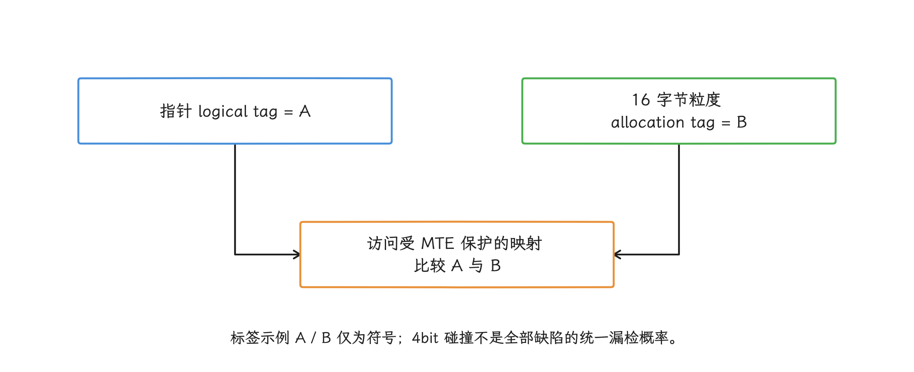
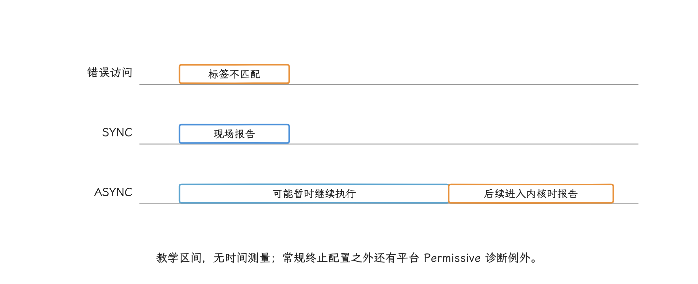
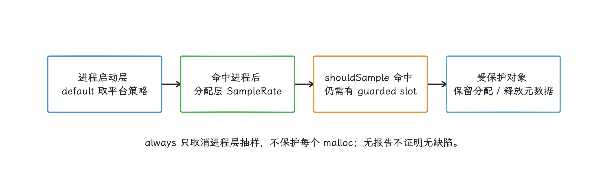
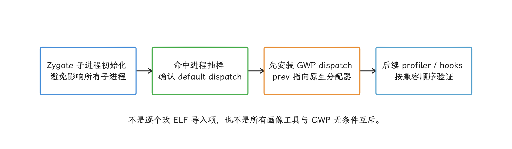
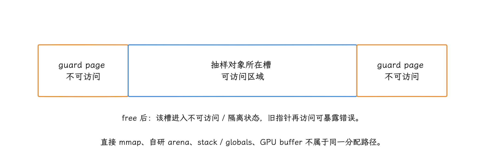
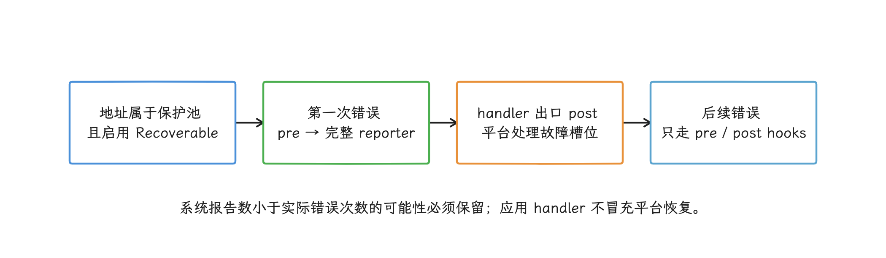

# MTE 与 GWP-ASan Native 内存安全检测

MTE（Memory Tagging Extension，内存标记扩展）会把一部分 Native 内存的越界和释放后访问，转换成可以识别的 `SIGSEGV` 信号。它既是安全缓解，也是稳定性诊断手段：错误会更早终止进程，静默内存破坏随之减少，短期内应用崩溃数却可能上升。所以我们的目标是发现、定位并修复内存安全缺陷，MTE 崩溃数下降应当是修复带来的结果。

> 源码基线：平台与用户空间（内核之外运行的系统库和应用代码） Android 17 / API 37 / `android-17.0.0_r1`；内核 `android17-6.18-2026-06_r6`。

版本上，Android 12 提供了内核和用户空间堆分配器支持，当前应用文档把“部分设备可用”的起点写为 Android 13；本文从 Android 12 讲起，说明的是平台能力出现的版本，某台 Android 12 商用设备能否为应用启用 MTE，仍要以该设备的实测为准。

MTE 依赖 Arm64 硬件、内核、进程配置、内存映射属性和分配器协作，manifest 里的一行配置只是这条链路的起点。

本文前半章讲 MTE，覆盖检查对象、检查模式、进程生效路径、崩溃报告阅读和分批启用；后半章讲抽样式检测器 GWP-ASan，覆盖两层抽样、受保护槽位、可恢复模式和发布取舍。

## MTE 检查的对象与盲区

我们先弄清楚 MTE 在检查什么，再看它管不到的地方。

MTE 以 16 字节为一个 allocation granule（分配标记粒度），为每个粒度保存 4-bit allocation tag（内存标签），并让指针携带 logical tag（指针标签）。CPU 读写启用了 MTE 的内存映射时比较这两种标签，不匹配就按当前检查模式报告错误。

Android 的标准 Native heap 由 Scudo（Android 默认的加固型 Native 分配器）管理标签，可以在这里发现两类高价值缺陷：

- heap buffer overflow / underflow（堆缓冲区上溢 / 下溢）跨越到不同标签的粒度；
- use-after-free（释放后继续访问）在旧指针标签与新分配标签不匹配时被捕获。

覆盖范围按存储类型分三类，启用条件各不相同：

<!-- gracker-diagram: a217-01-tag-comparison -->


图：标签不匹配按有效模式报告；同粒度内越界、相同标签碰撞和未受保护映射仍可能漏掉。

| 存储 | 只设置 `android:memtagMode` 是否足够 | 补充条件 |
| --- | --- | --- |
| 标准 Native heap（原生堆） | 对支持 MTE 的 64 位进程生效 | 由 Bionic/Scudo 管理 |
| 自定义 allocator（内存分配器）/ 自建映射 | 不足 | 映射需要 `PROT_MTE`，分配器负责指针标签与内存标签 |
| Native stack / globals（原生栈 / 全局变量） | 不足 | 需要编译器插桩、ELF（Native 二进制文件格式）标记，以及动态链接器和运行时库支持 |

Java/Kotlin 对象仍由 ART（Android 运行时）管理。保护范围之外的是 32 位进程、未启用 MTE 的映射、落在同一标记粒度内的越界，以及不配合的自定义分配器。面向应用的 Stack MTE（原生栈标记）从 Android 14 QPR3（第三次季度平台更新）开始提供，插桩后的应用只能运行在支持 MTE 的设备上。


检测是概率性的：4 位最多编码 16 种标签，释放后重新分配可能碰巧拿到相同标签，越界落在同一个 16 字节粒度内时也跨不过标签边界。工具对比中的约 1/16 指标签碰撞这一类随机漏检，不是所有越界、全部缺陷或一次运行的统一漏检率；同粒度越界与未启用标签的映射属于额外盲区。MTE 提高的是发现概率，报告里没有 MTE 错误，离“代码没有内存缺陷”的结论还很远。

MTE 也不统计 Native heap 大小。要定位“哪些调用栈分配最多”，我们用 heapprofd（低开销的抽样堆分析器）、`dumpsys meminfo`、`/proc/<pid>/smaps` 这些工具；MTE 回答的只是某次访问是否违反标签约束。

## `android:memtagMode` 的四个值

设置入口在 manifest：应用可在 `<application>` 或 `<process>` 上写 `android:memtagMode`，进程级值覆盖应用级值。

| 值 | 请求语义 | 建议用途 |
| --- | --- | --- |
| `off` | 不请求 MTE 访问检查 | 尚未完成 MTE 测试或明确不启用的进程 |
| `default` | 交给兼容性开关、平台默认和设备策略继续决定 | 事件记录中不能直接写成 off |
| `sync` | 请求同步检查 | 调试包、实验室和小范围诊断包 |
| `async` | 请求异步检查，并允许设备按 CPU 首选模式增强 | 充分测试后的正式发布候选 |

下面的 debug manifest 只让 debug 变体请求 SYNC，把它放在 `app/src/debug/AndroidManifest.xml`，调试策略就不会进入普通发布包：

```xml
<?xml version="1.0" encoding="utf-8"?>
<manifest xmlns:android="http://schemas.android.com/apk/res/android"
    xmlns:tools="http://schemas.android.com/tools">
    <application
        android:memtagMode="sync"
        tools:replace="android:memtagMode" />
</manifest>
```

最终生效的是 merged manifest（构建工具合并后的 manifest）；依赖库 manifest、构建类型和产品变体都可能改变合并结果，确认配置时以它为准。


这段配置表达的只是应用请求；设备有没有 MTE，要由 Zygote 在进程创建时按硬件能力决定。设备缺少 MTE 时，会降级到 TBI（Top Byte Ignore，CPU 忽略指针最高字节）或 NONE（不启用标签）。TBI 下 Bionic 仍可以在释放时检查标签，逐次的内存访问检查就没有了。即使硬件支持，最终检查模式也可能受兼容性开关、系统属性和设备的逐 CPU 策略影响。

## SYNC、ASYNC 与 ASYMM

三种模式的差别，我们先抓住主线：标签不匹配何时报告，以及现场能定位到什么程度。下面描述常规终止配置；平台用于诊断的 Permissive MTE 是可恢复例外，见后文，应用不能自行吞掉信号来模拟。

### SYNC

SYNC（同步检查）会在发生标签不匹配的内存读写指令处终止进程：

```text
signal 11 (SIGSEGV), code 9 (SEGV_MTESERR)
```

PC（Program Counter，程序计数器）和 fault address（触发信号的地址）通常就是错误访问现场。进程被配置为 SYNC 时，Android 分配器还会记录每次分配与释放的调用栈，用于解释释放后访问、上溢或下溢。同步检查和分配栈记录会增加成本；Scudo 使用有界的 ring buffer / stack depot，记录可能被覆盖，不是可永久查询的全量历史。因此，因此更适合测试与定向诊断。

AOSP 的设备配置指南要求普通正式版本在构建配置和 manifest 中请求 `async`，不要直接写 `sync`。若某个会处理大量外部不可信输入的进程确有更强安全需求，要由安全、性能和业务团队基于实测共同决定，调试包结论在这里只作参考。

### ASYNC

ASYNC（异步检查）发现标签不匹配后允许程序暂时继续执行，到下一次进入内核附近才终止：

```text
signal 11 (SIGSEGV), code 8 (SEGV_MTEAERR)
```

报告位置可能是后续系统调用、定时器中断或无关 Native 调用，错误地址通常不可用。它更适合作为低开销的正式版本检测与缓解；报告可以证明发生过 MTE 错误，最初的错误访问点则往往要靠后续排查。

<!-- gracker-diagram: a217-04-sync-async-timing -->


图：SYNC常见SEGV_MTESERR，可用当前PC与地址定位；ASYNC常见MTEAERR，当前栈可能是延迟报告点。

### ASYMM

ASYMM（非对称检查）对读访问做同步检查，对写访问做异步报告。它是 Armv8.7-A 的 CPU 能力，manifest 里没有对应的可填值。

应用请求 ASYNC 时，Bionic 会把 `PR_MTE_TCF_ASYNC | PR_MTE_TCF_SYNC` 交给内核；若内核不接受组合值，再退回单独 ASYNC。设备可在启动时通过 `/sys/devices/system/cpu/cpu*/mte_tcf_preferred` 为每个 CPU 配置 `async`、`sync` 或 `asymm`。线程迁移到不同 CPU 后，有效检查行为可能随首选模式变化。

请求模式与有效模式可能不一致，由此带来两个记录要点：

- manifest 的 `async` 只能记为 `requested_mode=async`，离 `effective_mode=async` 还差一层实测依据；
- ASYNC 请求在某个 CPU 上被增强为 SYNC 时，错误现场可能更精确，但进程并未按 SYNC 配置分配器，分配 / 释放调用栈仍未必可用。

普通应用没有公开的 `asymm` 请求值，也没有可靠 API 读取每次访问所在 CPU 的最终首选模式。事件上报应保留原始 `tagged_addr_ctrl`（线程的 tagged-address 控制位）或 tombstone（系统生成的 Native 崩溃报告）记录，并允许 `effective_mode=unknown`。


## 从 manifest 到 Scudo 的生效路径

我们把这条链路从头到尾过一遍，Java 应用的路径可以简化为：

```text
merged AndroidManifest.xml
  -> ApplicationInfo / ProcessInfo.memtagMode
  -> Zygote.getRequestedMemtagLevel()
  -> Zygote.decideTaggingLevel()
  -> runtimeFlags MEMORY_TAG_LEVEL_*
  -> native SpecializeCommon()
  -> mallopt(M_BIONIC_SET_HEAP_TAGGING_LEVEL, ...)
  -> Bionic SetHeapTaggingLevel()
  -> Scudo 管理标准 Native heap tag
```

`Zygote.getRequestedMemtagLevel()` 依次考虑平台为指定包设置的覆盖值、`<process>`、`<application>`、兼容性开关和平台默认值。`decideTaggingLevel()` 再检查 MTE/TBI 硬件能力；`userdebug` 或 `eng` 调试系统还可能通过平台属性把 ASYNC 请求升为 SYNC。

`system_server` 侧会调用 `Zygote.getMemorySafetyRuntimeFlags()` 计算内存安全标志：目标 `instructionSet` 非空且不是 `arm64` 时，跳过 MTE/TBI 标记；为空时按调用侧已检测的能力继续判断。这里的 `Zygote` 是工具类名，实际应用进程的 fork 仍由 Zygote 进程执行。

Native `SpecializeCommon()` 把运行时标志映射到 `M_HEAP_TAGGING_LEVEL_TBI`、`ASYNC`、`SYNC` 或 `NONE`，再调用 `mallopt(M_BIONIC_SET_HEAP_TAGGING_LEVEL, ...)`。Bionic 的 `malloc_common.cpp` 在锁保护下调用 `SetHeapTaggingLevel()`，标准分配器随后按该级别管理堆标签。


这条路径也说明了一项发布限制：manifest 配置在进程创建阶段生效。一个已经以 off 启动的进程，业务远程配置切不到 async；新发布的 manifest，也要等进程重新创建才起作用。

## 怎样确认支持与请求状态

确认分两步：先看设备是否具备 MTE，再看正在运行的进程实际请求到了什么模式。两步都要实测，型号名单只能当参考，官方推荐先检查：

```shell
adb shell grep -w mte /proc/cpuinfo
```

出现 `mte` 说明当前内核向用户空间公布了对应 CPU 能力。有些设备默认未启用，但开发者选项允许重启到 MTE 配置；没有该选项时，硬件和系统这一层应用侧补不上。

对正在运行的测试进程，可用 debuggerd（Android 的 Native 崩溃转储服务）查看 `tagged_addr_ctrl`：

```shell
adb shell debuggerd 12345 | grep tagged_addr_ctrl
```

把 `12345` 换成测试进程的 PID（进程号）。ASYNC 请求若允许逐 CPU 自动增强，输出应同时包含 `PR_MTE_TCF_ASYNC` 和 `PR_MTE_TCF_SYNC` 对应位。该字段描述线程允许的模式集合，某次内存访问最终采用的模式要另行确认。

应用代码若用 `prctl(PR_GET_TAGGED_ADDR_CTRL)` 检查，得到的也只是调用线程的状态：任意地址映射是否带 `PROT_MTE`、其他线程和其他 CPU 此刻是否同一模式，都要另外核对。


官方设备清单会更新。我们建议工程记录保存设备实测能力、build fingerprint（系统构建指纹）和 MTE 启动方式，型号只作为分组字段。

## 分批启用：按发布版本和进程控制

MTE 对标准 Native heap 是进程级属性，普通应用没有安全的远程启停开关，分批启用要靠发布节奏：

1. debug 与内部测试包使用 SYNC，覆盖 Native 代码的单测、集成测试和长稳场景；
2. 单独制作 canary build（只交给少量用户验证的候选包），或通过 Play 分阶段发布请求 ASYNC；
3. 多进程应用先选择 Native 风险高、业务可恢复的独立进程；
4. 观察稳定性、安全收益和性能后再扩大版本覆盖；
5. 出现不可接受的回归时停止扩大发布；已安装版本不会因暂停分发而回退，应发布更高 `versionCode`、关闭目标进程 MTE 或回退相关代码的修正版，并等待进程重新创建。

远程配置仍有用途：它可以关闭高风险 Native 功能、降低并发、展示原生错误页或阻止问题页面进入；Zygote 已经创建出的进程，检查模式改不动。


发布前要具备：

- 精确的 Build ID（每份 ELF 二进制的构建标识）与未剥离符号归档；
- 只负责一次 fatal signal（会终止进程的致命信号）采集的 Native 崩溃方案；
- tombstone 或系统进程退出记录的保留与解析；
- 关键状态的进程外持久化，能够承受 MTE 主动终止；
- 同一 workload（可重复的测试负载）下 off、SYNC 与正式发布配置的性能/功耗对照；
- 按进程、ABI（应用二进制接口，也就是 32/64 位和指令集）、设备能力和发布版本分组的停用依据。

SYNC 测试除了“正常路径”，还要覆盖不可信输入解析、跨语言 ownership（对象由谁创建、持有和释放）、异步回调、取消、对象池、JNI 引用、线程退出、热更新资源和第三方 `.so` 动态库。

## 怎样阅读崩溃报告

拿到报告，我们先分清 SYNC 还是 ASYNC，两者的排查权重完全不同。

| 证据 | SYNC / `SEGV_MTESERR` | ASYNC / `SEGV_MTEAERR` |
| --- | --- | --- |
| 当前 PC | 接近错误访问指令 | 常是延迟报告点 |
| fault address（错误地址） | 通常可用于定位 | 通常缺失或不精确 |
| access type（读或写） | 可从指令和报告分析 | 通常未知 |
| allocation/free stack（分配 / 释放栈） | 进程配置为 SYNC 时可用 | 通常没有 |
| 栈顶 fingerprint（聚合特征） | 可结合 Build ID 使用 | 不适合作为根因特征 |

SYNC 报告优先读取：

1. `Cause: [MTE]` 的错误类型；
2. 错误地址、指针标签与内存标签；
3. faulting PC 的 Build ID、relative PC（模块内相对地址）和反汇编；
4. 分配 / 释放调用栈；
5. 涉及对象的线程与所有权关系。

ASYNC 报告先用于确认受影响版本、进程、设备与业务入口；归并时不要拿当前 PC 强行分组，下一步应制作相同版本、相同测试负载的 SYNC 诊断包，或在后续小范围候选包中把目标进程改为 SYNC。


## APM 事件字段

APM（Application Performance Monitoring，应用性能监控）中的每个 MTE 事件至少保留：

| 字段组 | 内容 |
| --- | --- |
| 信号 | signal、`si_code`、错误地址是否存在、原始带标签地址 |
| 模式 | manifest / 应用兼容性开关请求值、`tagged_addr_ctrl`、由报告推断的错误模式、推断置信度 |
| 二进制 | ABI、`.so` 动态库、Build ID、relative PC、符号版本 |
| MTE 报告 | `Cause: [MTE]`、访问类型、分配 / 释放调用栈是否存在 |
| 进程 | 进程名、线程名、前后台、进程存活时长 |
| 设备 | build fingerprint、API、内核版本、MTE 能力、CPU/SoC（芯片型号） |
| 业务 | 去敏入口、分批发布版本、Native 模块、最近一次安全 checkpoint（可恢复业务状态） |
| 质量 | tombstone / APM 来源、截断状态、符号化状态、重复事件 ID |

聚合时我们按报告质量分层：

- SYNC：优先用错误类型、faulting Build ID + relative PC、分配 / 释放栈生成稳定的聚合键；
- ASYNC：按应用版本、进程、Native 模块、设备族、业务入口和时间相关性归为候选组，并保留低置信度标记；
- 未符号化：先完成 Build ID 匹配，不用库内绝对地址聚合；
- 同一事件多来源：以稳定事件 ID 去重，保留 tombstone 与应用采集结果的差异。

MTE 崩溃率必须同时报告用户、会话或进程启动分母。启用初期崩溃增加，可能是以前隐藏的缺陷被暴露；修复后，同一版本和测试负载下的 MTE 事件下降，才说明缺陷得到处理。

## 与 Native 崩溃采集器协作

MTE 错误仍以 `SIGSEGV` 进入 Native 崩溃采集体系。debuggerd 的信号处理器使用 `SA_SIGINFO | SA_ONSTACK | SA_EXPOSE_TAGBITS` 等标志：前两项让处理器收到完整信号上下文并使用备用信号栈，`SA_EXPOSE_TAGBITS` 则保留 arm64 错误地址中的标签位。

应用侧要守住几条规矩：

- 致命信号只由一个采集器负责，避免多个 SDK 反复覆盖信号处理配置；
- 信号处理函数不分配堆内存、不做完整符号化、不发网络请求；
- 原样保存 `siginfo_t`（信号信息）和 `ucontext_t`（寄存器与线程上下文）中的可用字段；
- 不盲目调用注册顺序和安全性未知的旧处理函数，也不尝试从 MTE 错误恢复业务执行；
- 保留系统默认终止和 debuggerd/tombstone 生成路径；
- ASYNC 报告里，信号处理函数看到的当前 PC 应记为延迟报告点，而非“内存破坏发生点”。

第三方采集器必须用受控故障验证：SYNC 释放后访问、SYNC 越界、ASYNC 错误、栈溢出和多线程同时崩溃。每个用例都要确认应用报告、系统 tombstone、Build ID、MTE `si_code` 和上传结果。


## 性能、兼容性与“误报”

MTE 的开销受 CPU 实现、检查模式、分配栈记录、分配行为和测试负载影响，任何单一百分比都代替不了全项目结论。应使用同一个正式版本、相同设备电源状态和相同测试负载比较：

- 启动、交互和长任务时延分布；
- CPU time、功耗与温升；
- 内存占用和分配器行为；
- Native 崩溃、ANR（Application Not Responding，应用无响应）、业务失败与进程重启；
- 不同进程和设备档位的差异。

MTE 标签不匹配通常表示进程违反了 tagged-memory（带标签内存）的访问约束，先按真实错误对待，再检查归因过程：错误可能出在把 ASYNC 报告点当作访问点、使用了不匹配的符号版本、自定义分配器没有遵循标签语义，或旧代码破坏了指针高位。要修的是证据指向的内存使用错误，靠屏蔽检查消除报告不是办法。

第三方 `.so` 也运行在同一进程中。启用前要完成 SDK 清单和 MTE 设备测试；无法更新且持续触发缺陷的 SDK，短期可隔离进程，或交付更高 `versionCode` 的修正版来回退相关代码、关闭该进程 MTE，吞掉 `SIGSEGV` 不是出路。

## 平台与内核的分工

平台与内核各自负责不同部分：

| 层 | 责任 |
| --- | --- |
| Arm CPU | 标签比较与 SYNC / ASYNC / ASYMM 错误行为 |
| kernel `arch/arm64/kernel/mte.c` | 带标签地址控制、各 CPU 首选模式与线程状态管理 |
| Android Zygote | 应用 / 进程请求值、兼容性开关与硬件能力决策 |
| Bionic/Scudo | 标准 Native heap 标签与诊断信息 |
| 动态链接器 / 编译器 | 栈和全局变量插桩，以及 ELF 元数据 |
| debuggerd | 信号上下文、tombstone 与 MTE 报告 |

排查看报告时，先按这张表把责任落到具体一层。设备厂商内核、SoC 的 MTE 模式性能和发布配置，仍需结合系统构建指纹与实测结果确认。


## GWP-ASan：抽样保护少量堆分配

MTE 用硬件标签检查受保护内存映射的访问；GWP-ASan（名称来自 “GWP-ASan Will Provide Allocation SANity”）走了另一条路：从 Native 堆分配中抽样，把少量对象放进 guarded pool（由不可访问页面包围的受保护内存池）。两者都能发现释放后访问和越界，命中范围、成本和报告含义各不相同，正式版本可以组合使用，两种覆盖率相加也得不出“内存安全百分比”。

### 两层抽样与覆盖面

GWP-ASan 的覆盖面由两层抽样决定：先决定某次进程启动是否启用，再从该进程的内存分配中抽样。`always` 模式把第一层命中率设为 100%，其他模式交给平台策略。只有同时通过两层选择的对象才进入 guarded slot（受保护池中的对象槽位），“应用启用了 GWP-ASan”离“所有 `malloc` 都受保护”很远，固定的 `1/N` 也推不出某个缺陷的准确发现率。

在 Bionic 适配层里，默认 `Recoverable=true`；`SampleRate=2500` 是被选中进程内的分配级抽样分母，`MaxSimultaneousAllocations=32` 是同一进程同时可占用的保护槽上限；`SYSTEM_PROCESS_OR_SYSTEM_APP` 与 `APP_MANIFEST_DEFAULT` 分支默认 `process_sample_rate=128`，默认覆盖要先过进程启动这一层。

<!-- gracker-diagram: a217-12-gwp-two-sampling -->


图：固定Bionic默认进程分母128、分配分母2500、最多32槽，属性可覆盖；不是某个bug的准确发现概率。

进程被选中后，每个分配入口先调用 `GuardedAlloc.shouldSample()`；未命中或 guarded pool 已满时，再委派给下一层原生分配器。（来源：[gwp_asan_wrappers.cpp](https://android.googlesource.com/platform/bionic/+/refs/tags/android-17.0.0_r1/libc/bionic/gwp_asan_wrappers.cpp)）

GWP-ASan 可用于 `targetSdkVersion >= 30`（面向 Android 11 / API 30 或更高版本）的应用。`android:gwpAsanMode` 支持三种请求：

| 值 | 语义 | 适用范围 |
|---|---|---|
| `never` | 对该应用或进程关闭 GWP-ASan | 已有明确兼容问题时使用 |
| `default` 或未填写 | Android 13 及以下对普通应用关闭；Android 14+ 使用约 1% 启动命中的 Recoverable GWP-ASan | Android 14+ 的正式版本基线 |
| `always` | 每次进程启动都启用，但仍只抽样部分内存分配；Android 17 中命中故障后的终止 / 可恢复行为还受 Bionic `Recoverable` 配置控制 | 测试包、内部日常使用包或小范围候选包 |

`always` 取消的只是进程启动这一层抽样，每次内存分配仍要过第二层抽样才进入受保护池。进程级配置可以覆盖 application 级配置，最终合并后的 manifest 才算数。


开发者文档仍把 `always` 下命中受保护池错误描述为进程终止；核对 Android 17 源码时，还要同时记录 Bionic 的 `Recoverable` 配置，因为 `SetDefaultGwpAsanOptions()` 默认将 `Recoverable` 设为 `true`，系统属性可改变这一行为。无论进程是否继续运行，GWP-ASan 报告都代表真实内存破坏，支付、写入这类有副作用的操作都不要自动重试。（来源：[Android NDK GWP-ASan](https://developer.android.com/ndk/guides/gwp-asan)；[gwp_asan_wrappers.cpp](https://android.googlesource.com/platform/bionic/+/refs/tags/android-17.0.0_r1/libc/bionic/gwp_asan_wrappers.cpp)）

启用的大致路径是：Zygote/AndroidRuntime 从应用配置和平台策略得到 GWP-ASan mode，每个 fork 出来的子进程在分配器初始化阶段调用 Bionic 的 `MaybeInitGwpAsan()`；Zygote 自身的 `app_process` 初始化会被显式跳过，避免一次采样影响所有子进程。

命中进程抽样后，Bionic 把 `gwp_asan_dispatch` 放到 malloc dispatch chain 的第一站，`prev_dispatch` 指向下一层原生分配器，并不会逐个修改 ELF 的导入跳转项。应用若安装自己的 `malloc` 拦截器，能否与 GWP-ASan 共存取决于安装顺序和 Bionic 分派链，单看 manifest 配置给不出答案。（来源：[gwp_asan_wrappers.cpp](https://android.googlesource.com/platform/bionic/+/refs/tags/android-17.0.0_r1/libc/bionic/gwp_asan_wrappers.cpp)；[malloc_common_dynamic.cpp](https://android.googlesource.com/platform/bionic/+/refs/tags/android-17.0.0_r1/libc/bionic/malloc_common_dynamic.cpp)）

还有一层互斥要留意：若本次启动已经由 `malloc_debug`、`malloc_hooks` 或 heapprofd 占用 default dispatch，`MaybeInitGwpAsan()` 会直接返回未启用。这不是绝对互斥：固定源码允许先安装 GWP-ASan、再安装 heapprofd / malloc_debug / malloc_hooks 的兼容顺序；反过来可能让 GWP-ASan 初始化直接退出。实验需记录安装先后与实际 dispatch 状态，必要时分开复现。（来源：[gwp_asan_wrappers.cpp](https://android.googlesource.com/platform/bionic/+/refs/tags/android-17.0.0_r1/libc/bionic/gwp_asan_wrappers.cpp)）

<!-- gracker-diagram: a217-14-dispatch-order -->


图：若其他default dispatch已先安装，GWP初始化可直接返回；GWP先装时可兼容后装的heapprofd/debug/hooks。

### 受保护槽位怎样暴露错误

每个被抽中的内存分配占用一个槽位，邻近的 guard page（权限设为不可访问的保护页）负责拦住跨页越界。对象释放后，槽位进入隔离状态，旧指针再次访问也会触发错误。metadata（分配器保存的诊断元数据）记录分配 / 释放线程和调用栈，debuggerd 会把这些信息写入 Native 崩溃报告。

它也有明确的盲区：

<!-- gracker-diagram: a217-15-guarded-slot -->


图：越界跨入guard page或访问已释放隔离槽可触发；仍在可访问区域内的越界、未抽中对象或槽复用可能漏掉。

- 未被抽中的内存分配不受保护；
- 越界仍落在槽位可访问范围内时可能不触发；
- 槽位复用会缩短某个旧地址的可诊断窗口；
- 直接 `mmap`、自研 arena（批量管理对象的内存区域）、栈 / 全局变量和 GPU 缓冲区不属于同一分配器路径；
- 普通内存泄漏不会因为对象长期未释放而自动触发 GWP-ASan。

保护页跟随系统页大小，16 KB 页设备上的虚拟地址布局和固定内存成本可能不同，需要单独测量。这是保护页机制带来的工程影响，据此推不出槽位数量或抽样率会自动变成 4 KB 页设备的四分之一。报告应记录实际页大小、ABI、Build ID 和进程配置。

### Recoverable 模式下的事件处置

Android 14 / API 34 及以上，当 manifest 未填写 `android:gwpAsanMode` 或使用 `default` 时，普通应用采用 Recoverable GWP-ASan：约 1% 的进程启动会启用它。Android 17 的 Bionic 默认把 GWP-ASan 设为 `Recoverable=true`。

发生受保护池错误后，debuggerd 会先调用 Bionic 注入的 pre-crash hook，生成首份完整报告，再在 handler 出口调用 post-crash hook，让分配器处理对应故障槽并允许进程继续运行。`debuggerd_handle_gwp_asan_signal()` 还用 `first_crash_mutex` 和 `static bool first_crash` 限制同一进程只有第一次 GWP-ASan 错误走完整 tombstone / DropBoxManager 流程；后续 GWP-ASan 错误只执行 pre/post hook，不再重复触发完整 reporter 输出。应用自定义的 `SIGSEGV` 处理函数不会收到这种可恢复错误，平台的恢复判断留给平台自己做。（来源：[gwp_asan_wrappers.cpp](https://android.googlesource.com/platform/bionic/+/refs/tags/android-17.0.0_r1/libc/bionic/gwp_asan_wrappers.cpp)；[debuggerd_handler.cpp](https://android.googlesource.com/platform/system/core/+/android-17.0.0_r1/debuggerd/handler/debuggerd_handler.cpp)）

“进程没有立刻退出”只是表象：发生释放后访问或越界后，官方将后续行为定义为不确定，Recoverable GWP-ASan 事件仍应进入稳定性指标、去重、告警和高优先级修复队列。支付、写入等有副作用的操作不能因为进程继续运行就自动重试。

<!-- gracker-diagram: a217-16-recoverable-first-report -->


图：first_crash锁限制完整报告次数；进程继续运行不保证业务状态有效，也不能自动重放副作用。

Recoverable GWP-ASan 与 Permissive MTE 最终都会把 `process_info.recoverable_crash` 设为 true 来避免按普通 fatal signal 终止进程，但入口条件不同：Permissive MTE 看 `SEGV_MTESERR` / `SEGV_MTEAERR` 与 `is_permissive_mte()`，GWP-ASan 则要求 `SIGSEGV` 带有 fault address，且 Bionic 注入的 `NeedsGwpAsanRecovery(si_addr)` 确认地址属于 guarded pool。APM 分类要把两条路径分开，一条可恢复 `SIGSEGV` 具体走哪条，按上面的入口条件判断。（来源：[debuggerd_handler.cpp](https://android.googlesource.com/platform/system/core/+/android-17.0.0_r1/debuggerd/handler/debuggerd_handler.cpp)）


### 报告、聚合与修复

GWP-ASan 报告优先读取错误类型、错误地址与槽位范围、分配 / 释放栈、访问线程、模块 Build ID 和 relative PC。它依靠 frame pointer（栈帧指针）低成本记录分配与释放栈；64 位应用要保留 frame pointer，避开 `-fomit-frame-pointer`，32 位报告则通常缺少这两类调用栈。采样、元数据生命周期、栈回溯或符号缺失也会让字段不完整，缺失值要原样记录，不做补猜。

Android 17 还会把 `gwp_asan_state` 与 `gwp_asan_metadata` 指针放进 `libc_shared_globals`，debuggerd 通过发送给 `crash_dump` 的结构偏移读取这些信息。若报告缺少 GWP-ASan metadata，排查顺序应先确认本进程是否被抽样、是否安装了 GWP-ASan dispatch、以及 tombstone / 符号收集是否完整，而不是把缺失字段补猜成“非 GWP-ASan”。（来源：[debuggerd_handler.cpp](https://android.googlesource.com/platform/system/core/+/android-17.0.0_r1/debuggerd/handler/debuggerd_handler.cpp)；[bionic_globals.h](https://android.googlesource.com/platform/bionic/+/refs/tags/android-17.0.0_r1/libc/private/bionic_globals.h)）


聚合键可以使用：

```text
error type
+ allocation top stable frames
+ deallocation top stable frames
+ faulting module/function
+ app build / ABI / module Build ID
```

绝对地址、线程 ID 和完整错误文本不适合充当长期聚合特征。一个事件可能在应用 SDK、tombstone、退出记录或 Play 平台留下不同证据，应按启动 ID、时间、信号、Build ID 与关键栈帧关联并保留来源差异。可恢复错误不一定导致退出，也不保证能从 `ApplicationExitInfo` 找到对应记录；固定系统 reporter 还只完整报告进程内第一次 GWP-ASan 错误，不能把报告数直接当作所有内存错误的次数。Android 12 / API 31 起，`ApplicationExitInfo.getTraceInputStream()` 可为 Native 崩溃返回 tombstone protobuf（二进制结构化数据），但全局环形缓冲区中的记录可能被覆盖，返回值也可能为空。

修复时我们仍要回答对象所有权问题：谁分配、谁释放，异步任务或容器为何在释放后继续持有地址。先在相同 Build ID 上用报告定位，再用 `always`、HWASan 或 MTE SYNC 的受控构建提高复现概率；抽样率提得再高，也代替不了生命周期修复。


### MTE、GWP-ASan 与其他工具的分工

| 工具 | 强项 | 不负责 |
|---|---|---|
| GWP-ASan | 低成本地在正式版本概率捕获堆释放后访问 / 越界 | 普通泄漏、全部内存分配 |
| MTE | 硬件标签检查与安全缓解，支持受控的正式版本策略 | 精确引用关系、保证检测同一标记粒度内的越界 |
| HWASan（Hardware-assisted AddressSanitizer，编译期插桩检测器） | 在测试或内部日常使用包中高覆盖检测堆、栈与全局变量错误 | 低开销地长期运行在全部正式版本 |
| heapprofd | 按分配调用栈统计抽样分配、释放与尚未释放的字节；不采集 free 的调用栈 | 判定释放后访问或越界 |
| Scudo | 加固系统分配器并检查部分分配器一致性错误 | 判断业务对象由谁持有，或给出泄漏根因 |

Android 14+ 的正式版本通常保留 `default`，用分阶段发布观察命中率、进程启动分母、致命 / 可恢复事件、符号完整率和业务影响；Android 13 及以下的 `default` 对普通应用仍是关闭状态。`always` 只用于能承受额外虚拟地址、内存成本、进程终止或可恢复后状态不确定风险的范围。发布报告必须同时写清进程启动覆盖与内存分配抽样，避免把“没有命中”解释为“没有缺陷”。

## 发布检查表

- [ ] 合并后的 manifest 中每个进程的 `memtagMode` 已确认
- [ ] 只在 64 位、实测支持 MTE 的设备上执行诊断
- [ ] 标准堆、自定义分配器、栈与全局变量的覆盖范围没有混写
- [ ] 调试包的 SYNC 已覆盖高风险 Native 场景
- [ ] 正式发布配置未把 SYNC 当作普通默认值
- [ ] 分批启用依赖分阶段发布或构建变体，没有假设远程动态切换
- [ ] Build ID、符号、tombstone 与事件去重可用
- [ ] SYNC 和 ASYNC 使用不同聚合规则
- [ ] 致命信号采集器不会破坏 debuggerd 语义
- [ ] 性能、功耗、应用崩溃与业务恢复都完成对照
- [ ] 更高 versionCode 修正版的交付、进程重建与关键状态恢复已经演练

## 源码与官方资料

- [Android 17 `Zygote.java`](https://android.googlesource.com/platform/frameworks/base/+/android-17.0.0_r1/core/java/com/android/internal/os/Zygote.java)
- [Android 17 `com_android_internal_os_Zygote.cpp`](https://android.googlesource.com/platform/frameworks/base/+/android-17.0.0_r1/core/jni/com_android_internal_os_Zygote.cpp)
- [Android 17 Bionic `malloc_common.cpp`](https://android.googlesource.com/platform/bionic/+/android-17.0.0_r1/libc/bionic/malloc_common.cpp)
- [Android 17 Bionic `libc_init_mte.cpp`](https://android.googlesource.com/platform/bionic/+/android-17.0.0_r1/libc/bionic/libc_init_mte.cpp)
- [Android 17 Bionic `heap_tagging.cpp`](https://android.googlesource.com/platform/bionic/+/android-17.0.0_r1/libc/bionic/heap_tagging.cpp)
- [Android 17 linker globals 实现](https://android.googlesource.com/platform/bionic/+/android-17.0.0_r1/linker/linker.cpp)
- [Android 17 debuggerd handler](https://android.googlesource.com/platform/system/core/+/android-17.0.0_r1/debuggerd/handler/debuggerd_handler.cpp)
- [Android 17 kernel arm64 MTE](https://android.googlesource.com/kernel/common/+/refs/tags/android17-6.18-2026-06_r6/arch/arm64/kernel/mte.c)
- [Android NDK：Arm MTE](https://developer.android.com/ndk/guides/arm-mte)
- [AOSP：Arm MTE](https://source.android.com/docs/security/test/memory-safety/arm-mte)
- [AOSP：MTE configuration](https://source.android.com/docs/security/test/memory-safety/mte-configuration)
- [AOSP：Understand MTE reports](https://source.android.com/docs/security/test/memory-safety/mte-reports)
- [Android NDK：memory error debugging](https://developer.android.com/ndk/guides/memory-debug)
- [Android NDK：GWP-ASan](https://developer.android.com/ndk/guides/gwp-asan)
- [AOSP：调试 Native 内存使用](https://source.android.com/docs/core/tests/debug/native-memory)
- [`ApplicationExitInfo`](https://developer.android.com/reference/android/app/ApplicationExitInfo)
- [Android 17 Bionic GWP-ASan allocator](https://android.googlesource.com/platform/bionic/+/refs/tags/android-17.0.0_r1/libc/bionic/gwp_asan_wrappers.cpp)
- [Android 17 Bionic malloc 初始化](https://android.googlesource.com/platform/bionic/+/refs/tags/android-17.0.0_r1/libc/bionic/malloc_common_dynamic.cpp)
- [Android 17 Bionic `libc_shared_globals`](https://android.googlesource.com/platform/bionic/+/refs/tags/android-17.0.0_r1/libc/private/bionic_globals.h)

## 小结

用 MTE 时，四件事要一直摆在前面：

1. manifest 记录的是应用请求，CPU 的最终检查模式要另行确认；
2. 堆、自定义分配器、栈与全局变量需要不同的启用条件；
3. SYNC 报告适合定位，ASYNC 报告更适合发现问题和用于正式版本缓解；
4. 进程创建时的配置，业务远程开关换不动。

当 Build ID、tombstone、模式记录、设备实测 MTE 能力和业务入口能够互相校验时，新增的 MTE `SIGSEGV` 才能转化为可修复的 Native 内存缺陷。

GWP-ASan 还要额外记录两层抽样：这次进程启动是否启用，以及具体内存分配是否进入受保护池。Android 14+ 的 `default` 会在少量启动中使用可恢复模式；`always` 每次启动启用，命中后的终止 / 可恢复行为仍要对照 Android 17 Bionic 的 `Recoverable` 配置记录。两种模式下，“没有报告”都证明不了“没有缺陷”。
