# Native Hook 技术选型与实现

Native Hook 指在进程内修改本地代码（C/C++）的函数解析结果或执行入口，让调用先经过代理函数。改一个地址这一步通常很简单，难点集中在命中范围、并发发布、ABI 一致性、动态装载和平台防护。只按 PLT/GOT、Inline、Trap 三个名字选型，容易把不同层级的机制混在一起。

> 源码基线：AOSP `android-17.0.0_r1`。本文讨论普通应用进程中的 arm64（AArch64）Native Hook。

Android 17 没有公开的 Hook API，Hook 框架也拿不到额外权限。业务代码优先走公开 NDK（Native Development Kit） API、编译期插桩、显式代理或系统诊断工具；只有调用方改造不了、诊断收益又足以覆盖稳定性成本时，我们再评估运行时 Hook。

文中沿用源码和业内常用名称：proxy 指 Hook 命中后先进入的代理函数；linker 指 bionic 动态链接器；debuggerd 指 Android 的 Native 崩溃转储组件；ART 指 Android Runtime。

## 1. 先确定要改写哪一层

Native Hook 的常见方案分别改写三个不同对象，我们先把它们分清楚。Android Native 的可执行文件和 `.so` 都采用 ELF（Executable and Linkable Format）格式；一个 ELF 调用外部函数时，PLT（Procedure Linkage Table）负责把调用引向动态链接结果，解析出的运行时地址则由 GOT（Global Offset Table）保存。实践中所说的 PLT/GOT Hook，改写的通常就是 GOT 中与动态重定位对应的槽位。

| 方案 | 改写对象 | 能观察到什么 | 主要盲区 |
|---|---|---|---|
| PLT/GOT Hook | 某个 ELF 调用方的导入重定位槽 | 该调用方经动态链接发出的外部函数调用 | 内部直接调用、内联、直接系统调用、已保存的函数指针 |
| Inline Hook | 目标函数入口或函数内指令 | 所有经过该指令地址的执行流 | 无法安全搬迁的指令、已经内联的调用、未命中的其他实现 |
| Trap/Breakpoint Hook | 指令替换为断点，借 `SIGTRAP` 改写上下文 | 命中断点的执行流和寄存器现场 | 信号冲突、调试器抢占、频繁信号带来的高成本 |

PLT/GOT Hook 按调用方修改重定位槽，Inline Hook 按目标指令地址修改执行流。同样是拦 `malloc`，两者覆盖面也不同：修改 `libfoo.so` 中 `malloc` 的导入槽，只影响 `libfoo.so` 经该槽发出的调用；修改 `libc.so` 中 `malloc` 的入口，可能影响进程内更多调用者，也会放大递归和并发风险。

<!-- gracker-diagram: a218-01-modified-object -->
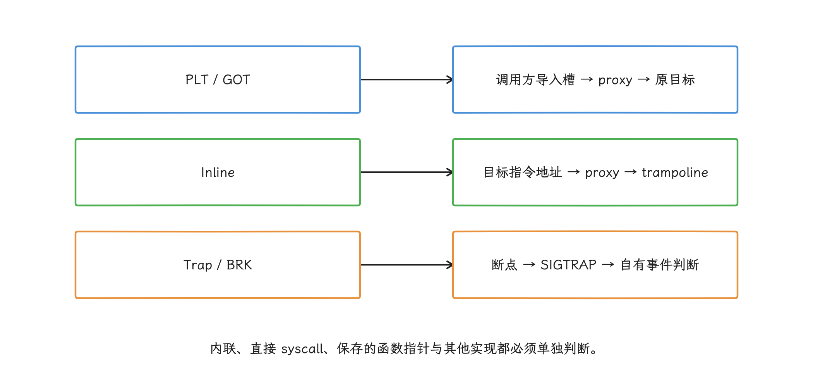

图：修改libfoo的malloc导入槽只影响经过该槽的调用；目标入口改写的影响范围与风险更大。

Trap Hook 接近用户态软件断点：用断点指令触发 `SIGTRAP`，再由信号处理函数改写执行现场。它与 debuggerd 之间没有扩展接口；调试器用 `ptrace` 控制目标线程，走的是另一套机制。框架要管理或正确串接 `SIGTRAP` 的 signal disposition（信号处置），识别自有断点，并通过 `ucontext_t` 读取或修改信号发生时的寄存器和 PC（Program Counter，程序计数器）。

## 2. 选型从“能否命中”开始

选型先确认目标调用能否被命中，再看框架成本和风险。常见需求与建议方案的对应如下，判断依据列在右列：

| 需求 | 建议 | 判断依据 |
|---|---|---|
| 自有模块的埋点、耗时或故障注入 | 显式代理或编译期插桩 | 类型、线程和生命周期均可由业务代码控制 |
| 观察指定 `.so` 对 libc/NDK 函数的外部调用 | PLT/GOT Hook | 调用方有对应动态重定位项，且覆盖范围可限定 |
| 拦截函数内部调用、隐藏符号或 `dlsym` 后的直接调用 | Inline Hook | 调用不再经过待改写的导入槽 |
| 低频、短期、实验室级指令探针 | Trap Hook | 需要处理信号与调试器兼容问题 |
| ART、linker、debuggerd 私有函数 | 原则上不用于应用线上路径 | 私有符号、结构和调用约定没有兼容性承诺 |
| 分配器、线程同步等高频基础函数 | 优先 heapprofd、GWP-ASan、Perfetto 等平台工具 | 代理函数极易递归，故障影响整个进程 |

heapprofd 是采样式 Native 堆分析器，GWP-ASan 通过抽样加 guard page（不可访问的保护页） 捕获部分堆越界和释放后使用，Perfetto 面向系统级跟踪。三者覆盖面各不相同，共同点是都能替我们省掉直接改写分配器或同步原语的工作。

“PLT Hook 失败就换 Inline Hook”属于跳过风险判断。动手之前，我们先把这些问题过一遍：

- 目标调用是否被 LTO（Link Time Optimization，链接时优化）、内联、隐藏可见性或直接绑定消掉了？
- 目标 ABI（Application Binary Interface，二进制接口）是否稳定？函数签名是否包含 C++ 隐式参数、可变参数或聚合返回？
- 安装 Hook 时，其他线程是否可能正在执行待覆盖的指令？
- 新装载和卸载的 ELF 如何加入或移出 Hook 集合？
- Hook 失败、重复安装、多个 SDK 同时 Hook、远程关闭时，状态是否可判定？
- 代理函数能否在递归、信号、低内存和进程退出阶段安全运行？

这些问题全部有了答案，Hook 才能进入面向全部用户的路径。

## 3. Android 17 linker 的约束

linker 的行为决定 Hook 能做什么、难在哪里。这一节按绑定时机、写权限、`DT_TEXTREL` 声明、库的可见范围和页大小五条线来看。

### 3.1 立即绑定：装载时完成函数地址解析

linker 是 Android 的动态链接器，负责装载 ELF、查找符号并应用重定位。我们关心的第一个问题是：函数地址在什么时机解析、写到哪里。`soinfo::prelink_image()` 里，`DT_JMPREL` 和 `DT_PLTRELSZ` 描述 PLT 重定位表及其大小；`DT_PLTGOT` 分支直接跳过，注释写明 `RTLD_LAZY` 不受支持：

```cpp
case DT_JMPREL:
  plt_rela_ = reinterpret_cast<ElfW(Rela)*>(load_bias + d->d_un.d_ptr);
  break;
case DT_PLTRELSZ:
  plt_rela_count_ = d->d_un.d_val / sizeof(ElfW(Rela));
  break;
case DT_PLTGOT:
  // Ignored (because RTLD_LAZY is not supported).
  break;
```

随后 `link_image()` 调用 `relocate()`。`process_relocation_impl<RelocMode::General>()` 中的常见类型分支，把 `R_GENERIC_JUMP_SLOT` 的解析结果写入对应的 GOT 槽位：

```cpp
if (r_type == R_GENERIC_JUMP_SLOT) {
  const ElfW(Addr) result = sym_addr + get_addend_norel();
  *static_cast<ElfW(Addr)*>(rel_target) = result;
  return true;
}
```

主干调用关系可以概括为：`dlopen(name)` → `do_dlopen()` → 库查找与装载 → `soinfo::prelink_image()` → `soinfo::link_image()` → `relocate()` → `process_relocation_impl<General>()` 的 `R_GENERIC_JUMP_SLOT` 分支。中间那些内部函数属于源码实现细节，应用的兼容性假设要建立在这条链路对外的可见行为上。

<!-- gracker-diagram: a218-02-eager-binding -->
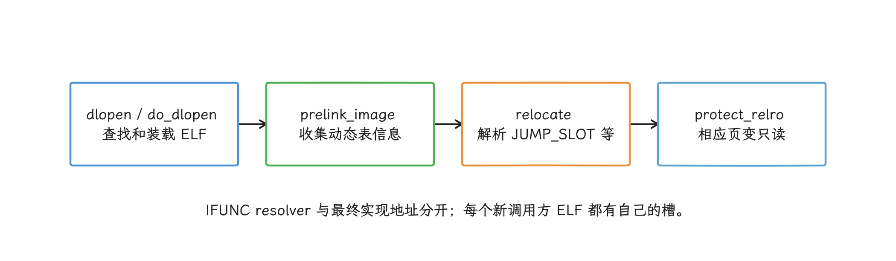

图：Android不支持RTLD_LAZY式首次调用解析；PLT Hook改的是已经完成重定位的槽。

这段流程带来三个结论：

1. 传入 `RTLD_LAZY` 不会启用桌面 Linux 常见的 lazy binding（首次调用时再解析地址）；Android 仍在装载期间完成相关重定位。
2. PLT/GOT Hook 修改 linker 已写好的重定位结果，不依赖 `DT_PLTGOT` 提供延迟解析入口。
3. 新装载的 ELF 有独立的重定位槽，必须另行扫描。已经完成解析的普通调用不会自行重新解析并覆盖 Hook。

IFUNC（indirect function，运行时选择实现的函数）有两条解析路径：`dlsym()` 返回解析后的符号地址；`R_GENERIC_IRELATIVE` 这类重定位则由 linker 调用 resolver，把结果写入目标槽。两条路径都可能拿到最终实现地址，走的却是不同分支。所以校验旧值时，我们比较的是最终实现地址；resolver 地址只用于选择实现，别拿它当普通函数入口。

MTE（Memory Tagging Extension，内存标记扩展）globals 会给符合条件的全局对象使用地址标记。这套支持在 Android 16 已存在，Android 17 延续了同样的重定位语义。`should_tag_memtag_globals()` 返回 true 时，`R_AARCH64_RELATIVE` 会读取重定位目标位置里原有的值，用其中的位生成带标记的结果：

```cpp
if (relocator.si->should_tag_memtag_globals()) {
  int64_t* place = static_cast<int64_t*>(rel_target);
  int64_t offset = *place;
  result = relocator.si->apply_memtag_if_mte_globals(result + offset) - offset;
}
```

这段代码能证明的只是：启用 MTE globals 的二进制会改变部分重定位的地址计算。至于每个 GOT 槽有没有 MTE 元数据，还是要按具体 relocation type、当前槽值和目标地址是否保留 tag 逐个校验。

### 3.2 RELRO 限制写权限，同进程修改仍需显式处理

RELRO（Relocation Read-Only）让动态链接器在重定位完成后把指定内存段改为只读，降低 GOT 等控制数据被覆盖的风险。`soinfo::link_image()` 在重定位完成后调用 `protect_relro()`：

```cpp
bool soinfo::link_image(...) {
  ...
  if (this != solist_get_vdso() && !relocate(lookup_list)) return false;
  ...
  if (!is_linker() && !protect_relro()) return false;  // 关键：RELRO 写保护
  if (!protect_16kib_app_compat_code()) return false;
  ...
}
```

待修改的函数地址可能位于 `.got.plt`、`.data` 或 `.data.rel.ro`。它有没有落进 `PT_GNU_RELRO`、当前页是什么权限，按目标 ELF 和运行时映射逐项判断。

重定位并应用 RELRO 后，相应槽位已经只读。若方案在 `dlopen()` 返回后才刷新模块，这时再安装 Hook，需要先确认页边界和当前权限，再决定是否用 `mprotect()` 临时加写权限。不要把这个观测时机当作 ELF 最早可枚举的时刻；构造函数可以重入 linker，框架私有回调也可能更早介入。这次调用可能因地址、长度、映射类型或进程安全策略而失败，失败要走进可观测的降级分支。

监听 `dlopen()` 解决的只是“何时重新扫描”；linker 从重定位结束到 `protect_relro()` 之间并没有公开插入点，要卡这个时机就得 Hook linker 私有实现，版本风险随之增加。

本轮固定 ByteHook `a8bd254f6e53`：`bh_elf_get_protect()` 先把落入 `PT_GNU_RELRO` 的地址视为 `PROT_READ`，再由 `PT_LOAD` 推导其他权限。这是按 ELF 结构推导的值，不是实时查询所有权限变更。安装时先回调原函数地址，再对推导为不可写的槽加 `PROT_WRITE`，最后用原子写替换 GOT；权限恢复语句在该提交中被注释。因此必须显式记录框架策略，不能默认写完自动恢复，也不能把 ELF 推导值当作并发变更后的当前权限。可靠的 PLT/GOT Hook 涵盖 ELF 解析、权限处理、发布顺序和错误恢复，扫一遍 `/proc/self/maps` 再写一个指针远远不够。

<!-- gracker-diagram: a218-03-relro-publication -->
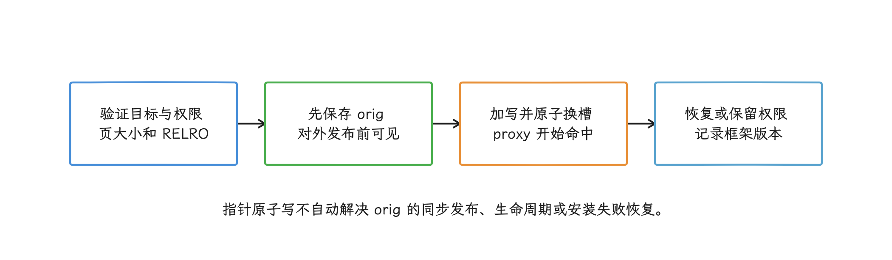

图：固定ByteHook提交注释掉恢复权限语句；program-header推导不能代替所有运行时映射变化。

### 3.3 `DT_TEXTREL` 与 Inline Hook 受不同机制约束

linker 在 LP64（64 位进程）中遇到 `DT_TEXTREL` 或 `DF_TEXTREL` 时会报错并拒绝装载。`TEXTREL` 表示 ELF 需要在装载重定位阶段修改代码段；对应检查位于 `soinfo::prelink_image()`：

```cpp
case DT_TEXTREL:
#if defined(__LP64__)
  DL_ERR("\"%s\" has text relocations", get_realpath());
  return false;
#else
  has_text_relocations = true;
  break;
#endif
```

64 位 `.so` 一旦声明 `DT_TEXTREL`，`dlopen()` 就会失败。这项检查针对 ELF 自己声明的装载期代码重定位。

<!-- gracker-diagram: a218-04-independent-constraints -->
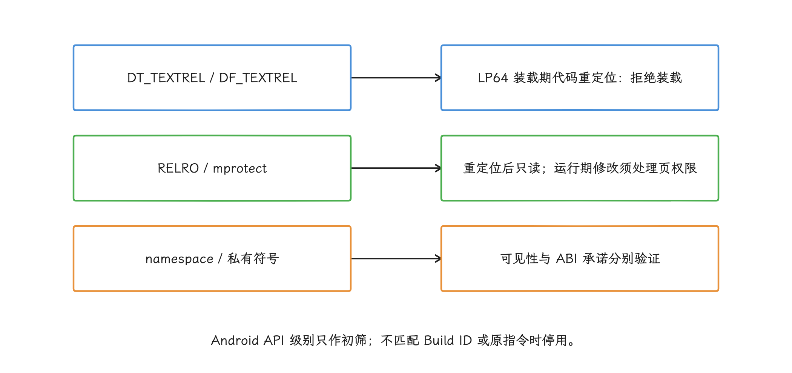

图：运行期Inline patch与ELF声明的装载期TEXTREL走不同路径；可见私有符号不等于稳定NDK接口。

Inline Hook 发生在库装载完成后，由进程自己调 `mprotect()` 改内存里的指令，和装载检查走的是两条路径；`DT_TEXTREL` 只约束装载期的代码重定位，Inline Hook 的成败和安全性要单独评估。

### 3.4 私有库和 linker namespace

还有一层约束来自 linker namespace（动态链接器命名空间）：它决定一组 ELF 可访问哪些库。从 Android 7.0 起，应用动态链接非 NDK 平台库就受到限制，namespace 在此之上进一步收窄可见范围。内存里能看到某个符号，只说明这个构建里有它；平台是否允许应用链接、ABI 是否稳定，都要另行确认。

如果诊断方案必须依赖私有符号，至少要把设备 API、ABI、Build ID（二进制构建标识）、符号名和函数开头的指令摘要纳入允许列表；任何一项不匹配就停用，猜测的偏移一律不上线。

### 3.5 16 KB page size（页大小）

内核以页为单位管理虚拟内存、设置页权限，页大小就是这个最小粒度。Android 从 15 起已支持 16 KB 页设备，这项约束自那时就有。arm64（AArch64，64 位 Arm 指令集） 指令仍固定为 4 字节，`B` 的编码范围也不随页大小变化；受影响的是 `mmap()`、`mprotect()`、trampoline（保存原指令并跳回原函数的跳板代码） 分配和页权限恢复：

- 用 `getpagesize()` 或 `sysconf(_SC_PAGESIZE)` 获取运行时页大小；
- 按运行时页大小向下、向上对齐保护区间；
- 处理“改写跨页”以及一页内存在其他函数的情况；
- 不把 `4096`、`PAGE_SIZE` 或 4 KB 掩码写死。

本轮固定 ShadowHook `9b8b4407c9b0` 与 ByteHook `a8bd254f6e53`，两者均通过 `getpagesize()` 初始化页大小，再据此计算保护区间。自研实现同样取 `getpagesize()` 或 `sysconf(_SC_PAGESIZE)` 的运行时结果，编译期常量替代不了它。

<!-- gracker-diagram: a218-05-page-size-vs-isa -->
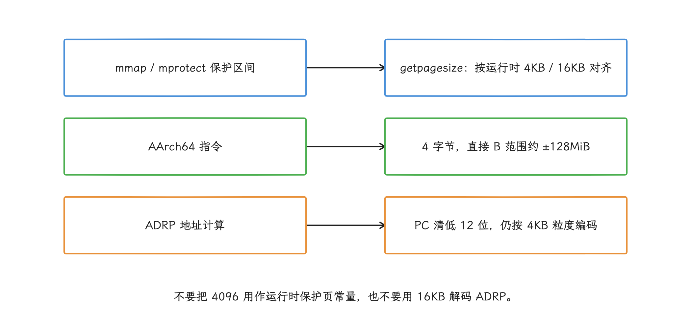

图：系统使用16KB页时，ADRP和直接B的编码语义保持不变；需要改变的是映射与保护区间计算。

## 4. PLT/GOT Hook：改写调用方的重定位结果

### 4.1 从 ELF 到目标槽

PLT/GOT Hook 的第一步，是在调用方 ELF 的动态段里找到对应重定位——一条调用找得到，才谈得上命中。`PT_DYNAMIC` 是 ELF 的动态链接信息段；Android packed relocations 是压缩保存重定位表的格式。

```text
dl_iterate_phdr()
  -> 选中调用方 ELF
  -> PT_DYNAMIC
  -> DT_SYMTAB / DT_STRTAB
  -> DT_JMPREL、DT_REL[A] 或 Android packed relocations
  -> r_info 中的 symbol index + relocation type
  -> slot = load_bias + r_offset
  -> 校验旧值并写入 proxy 地址
```

判断时要同时锁定调用方 ELF 和 relocation type。以 arm64 为例，常见函数导入会涉及 `R_AARCH64_JUMP_SLOT`，部分函数地址引用还可能落在 `R_AARCH64_GLOB_DAT` 或 `R_AARCH64_ABS64`。同名字符串只提供候选符号，附近地址要另行确认后才能改。

load bias 是 ELF 虚拟地址映射到进程地址时使用的装载偏移。定位出的槽地址可写成：

```text
runtime_slot = load_bias + relocation.r_offset
```

上面的公式只完成这一步换算。写入前，我们还要核对 relocation 对应的符号、当前槽值、目标映射和 ABI，确认目标槽对应的是函数入口，而不是同名数据符号或已被其他框架改写的槽。

<!-- gracker-diagram: a218-06-slot-resolution -->
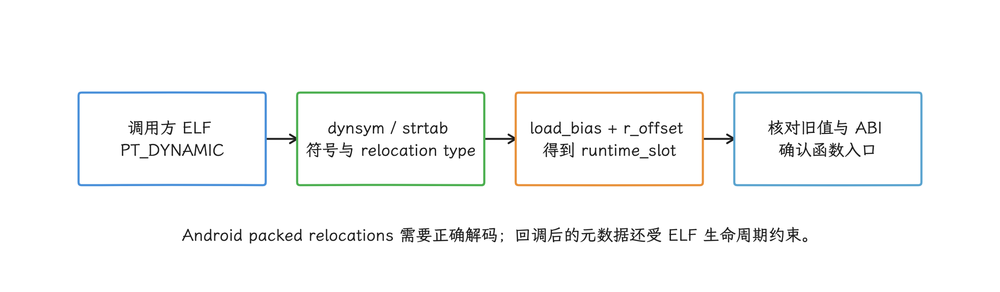

图：JUMP_SLOT、GLOB_DAT、ABS64按实际表项区分；同名字符串或附近地址不能直接用作改写证据。

### 4.2 安装顺序

一个可审计的安装过程通常包含这些步骤：

1. 通过 `dl_iterate_phdr()` 枚举当前 ELF，在回调内复制后续需要的元数据，并按调用方路径或 Build ID 过滤。
2. 从 `PT_DYNAMIC` 解析动态符号表、字符串表和 relocation 表。
3. 同时校验符号名、relocation type、当前槽值和预期目标函数。
4. 读取槽所在映射的原权限，并按运行时页大小计算 `mprotect()` 区间。
5. 在发布 proxy 前保存原函数地址；多个 Hook 共存时，由统一调度入口维护调用链。
6. 用对齐的原子指针写更新槽，记录调用方、槽地址、旧值、新值和结果。
7. 明确决定是否恢复原权限；若保留写权限，记录原因、影响范围和框架版本。

orig 指代理函数继续调用的原目标地址，它必须先于新槽值发布；如果槽已替换而 `orig` 对其他线程还不可见，proxy 就可能在这个窗口跳到空地址。发布顺序要用与并发模型匹配的原子操作和 memory order（内存序），普通 C 赋值给不了多线程可见性保证。

<!-- gracker-diagram: a218-07-publish-order -->
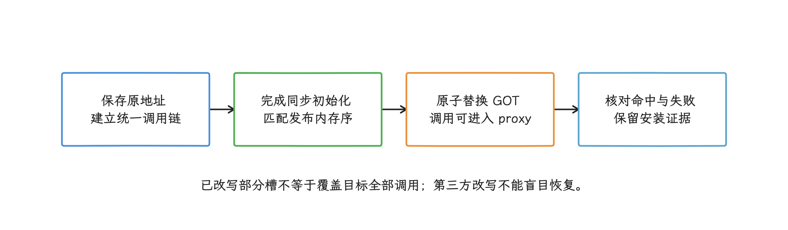

图：入口与orig的发布顺序有依赖，不能用两个普通C赋值假设其他线程必然按顺序观察。

### 4.3 覆盖盲区

下面这些调用不会因为修改某个 PLT/GOT 槽就自动被拦截：

- 同一 ELF 内部已解析为直接分支的调用；
- 编译器内联或 LTO 合并后的调用；
- hidden/protected visibility（隐藏或受保护的符号可见性）、`-Bsymbolic` 等导致的本地绑定；
- 通过 `dlsym()` 保存到其他变量后再发出的间接调用；
- 直接执行 `svc`（进入内核的 AArch64 异常指令）的系统调用封装；
- 在 Hook 安装后通过 `dlopen()` 加载的新调用方；
- 已卸载又复用同一地址区间的 ELF。

“Hook 成功”说明的只是部分 relocation slot 已改写；目标函数的调用有没有都被覆盖，要看测试报告同时给出的命中调用方列表和盲区清单。

### 4.4 动态装载和多框架共存

对新装载 ELF，若等外层 `dlopen()` 成功返回后再扫描，其 relocation 和构造函数已经执行完；这时安装只覆盖后续调用，无法补采构造函数中的调用。这不意味着构造前或构造过程中绝不可能枚举到模块，判断依据应是框架实际介入的时点。若框架声称能在构造函数之前介入，就要检查它是否依赖 linker 私有路径以及适配范围。

<!-- gracker-diagram: a218-08-dlopen-observation -->
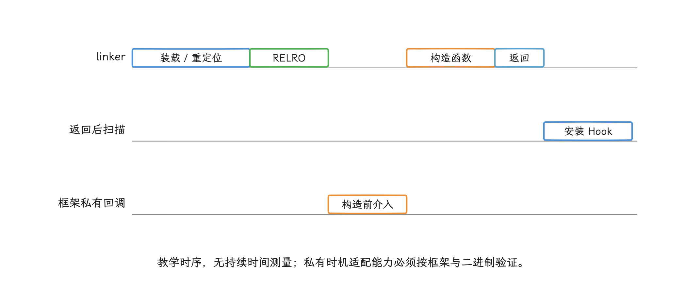

图：外层dlopen返回后安装无法补采构造函数中的调用；ShadowHook固定手册提供构造前pending任务与回调。

ByteHook 会在动态装载后刷新 ELF 管理器；ShadowHook 也能为尚未装载的目标保存 pending task（等待目标出现的安装任务），等目标出现再安装。无论选哪种，都要把新装载、卸载和重复装载纳入生命周期测试。

业务 proxy 里要避免随意递归调用 `dlopen()`、`dlsym()` 或日志组件，它们可能再次经过被 Hook 的路径。常见处理方式包括：

- 线程局部重入标记；
- 不分配内存的最小记录器；
- 统一使用 proxy 调度入口，避免多个 SDK 互相覆盖槽；
- unhook 前确认槽仍指向本框架入口，发现第三方改写时拒绝盲目恢复。

## 5. Inline Hook：指令搬迁比跳转更难

### 5.1 基本过程

Inline Hook 的做法是覆盖目标位置的一组指令，再把这些指令搬到 trampoline——一段保存原指令、执行完跳回原函数的跳板代码。搬完之后，我们要把所有依赖原 PC 的指令重新编码。AArch64 没有 Thumb 状态，省掉了指令集状态切换，指令重写要处理的问题却一个都省不掉。

| 维度 | ARM32 (AArch32/Thumb) | ARM64 (AArch64) |
|------|----------------------|------------------|
| 指令宽度与状态 | A32 指令为 4 字节；Thumb 同时存在 2 字节和 4 字节编码，还要保留执行状态 | 指令固定为 4 字节，没有 Thumb 状态切换 |
| PC-relative（相对当前指令地址） | `B/BL`、`ADR`、literal load 等；读取 PC 时还要区分 A32 与 Thumb 语义 | `B/BL`、`B.cond`、`CBZ/CBNZ`、`TBZ/TBNZ`、`ADR/ADRP`、literal load 等 |
| 返回地址 | 通常使用 LR（Link Register，链接寄存器）/R14，调用和状态切换规则取决于指令集状态 | X30 是 LR；PC 不能作为普通通用寄存器直接读取 |
| 远距离跳转 | 常用 veneer（中转跳转序列）处理范围和状态切换 | 直接 `B` 超出约 ±128 MiB 时，常用 `BR Xn` 的绝对跳转序列或近地址 branch island |

AArch64 Inline Hook 一般需要完成：

1. 选择函数入口或确定的指令地址。
2. 计算需要覆盖的完整指令数，并保存原字节。
3. 把被覆盖指令搬到 trampoline。
4. 重写所有受新 PC 影响的指令。
5. 在 trampoline 尾部跳回未覆盖的原函数。
6. 在原地址写入通往 proxy 或 branch island 的跳转。branch island 是分配在直接分支范围内的短中转代码。
7. 对生成和修改的代码区间执行 instruction-cache maintenance（指令缓存同步）。

其中步骤 4 的 PC-relative 重写难度最高。以 `ADRP` 指令为例：

<!-- gracker-diagram: a218-09-trampoline-relocation -->
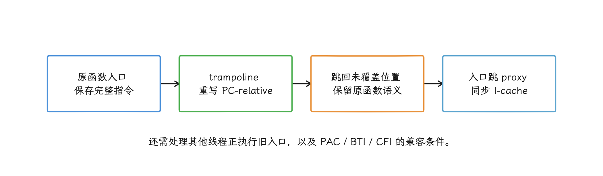

图：复制原字节不能自动保留PC-relative语义；发布入口之前，trampoline和返回路径都必须已准备。

```text
原始指令： ADRP X0, page_of(sym)
           ADD  X0, X0, #lo12_of(sym)
ADRP 结果 = AlignDown(PC, 4096) + SignExtend(imm21) * 4096
搬迁后：以原 PC 解出目标 4KB 页，再相对新 PC 重编码，或改写为等价序列。
        保留后续 ADD 的低 12 位语义；不能只复制原 ADRP 编码。
```

这里的 4 KB 是 `ADRP` 编码规定的地址粒度，与内核实际使用 4 KB 还是 16 KB 翻译页无关。保护区间使用运行时页大小，解码 ADRP 仍清除 PC 的低 12 位；把两者混用会产生错误。搬迁后的目标还须检查编码范围，超出范围时使用已验证的等价序列，不能强行截断立即数。

<!-- gracker-diagram: a218-10-adrp-target -->
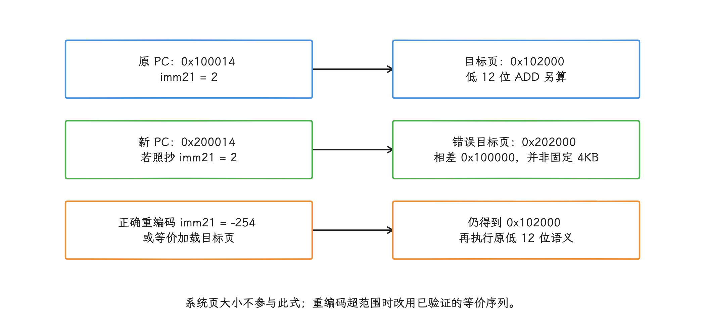

图：算例只展示地址计算，无真实设备故障；ADRP目标=原PC对齐4KB后加signed immediate×4096。

步骤 7 同样必做。代码经数据写入路径更新后，其他核心取指前必须看到新指令；Android NDK 代码中通常使用 `__builtin___clear_cache(begin, end)`。bionic 只在 32 位 `__arm__` 下声明 `cacheflush()`，头文件也建议新代码改用跨架构的 builtin。

ShadowHook 的 arm64 重写器显式识别 `B`、`BL`、`B.cond`、`ADR`、`ADRP`、literal load、`CBZ/CBNZ`、`TBZ/TBNZ` 等类型，每类指令都有独立的长度计算和 rewrite 分支；“复制几条指令后跳回去”这样的做法，离可靠实现还很远。

### 5.2 branch island 与并发改写

AArch64 的直接 `B` 使用 26 位有符号立即数并按 4 字节缩放，目标范围约为当前 PC 的前后 128 MiB。若能在范围内分配 branch island，原入口只需改写一条对齐的 4 字节指令；分配不到时，通常要写入多条指令组成的绝对跳转序列。

单条对齐的 32 位写入比多指令覆盖容易控制，但它只保证了“数据写入不撕裂”；要让其他核心立即按新指令执行，发布协议还要包含线程协调和指令缓存同步。多指令 patch 的窗口更大，其他核心可能取到新旧混合的指令序列，一次 `memcpy()` 提供不了所需的并发保证。

在可证明安全的前提下，近地址 branch island 还能把原入口的发布动作缩小到一条指令；节省 trampoline 空间只是附带收益。

<!-- gracker-diagram: a218-11-patch-concurrency -->
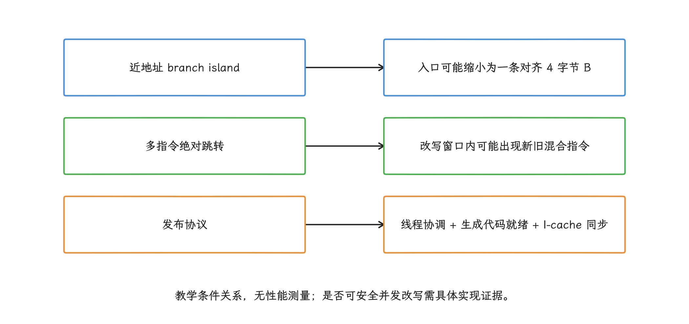

图：一次memcpy不能证明并发patch安全；__builtin___clear_cache也不能替代完整的安装与回收协议。

### 5.3 PAC、BTI 与 CFI

arm64 代码可能同时使用几类控制流保护：

- **PAC（Pointer Authentication Code，指针认证码）**：函数序言或返回路径可能对 LR 签名、认证。搬迁序言时，这些指令和它们依赖的栈状态都要原样保留，遗漏、重复或改动都会引入风险。
- **BTI（Branch Target Identification，分支目标识别）**：bionic linker 会读取 ELF note 里的 GNU property（处理器特性声明）；ELF 声明兼容且硬件支持时，为可执行段加入 `PROT_BTI`。若 proxy 或 trampoline 所在映射受 BTI 保护，间接 `BR/BLR` 到达的入口必须落在匹配的 landing pad（允许间接分支落入的入口指令） 上。
- **CFI（Control-Flow Integrity，控制流完整性）**：函数指针等间接调用到达签名不兼容的代理地址时，可能触发类型检查并终止进程。Hook 私有 CFI helper 以绕过检查，又会新增一组没有兼容性承诺的依赖。

Hook 框架要把这些能力纳入测试组合，CPU 架构只能当第一层筛选；至少覆盖启用 `-mbranch-protection`、LTO/CFI、不同链接可见性和不同系统库 Build ID 的产物。

<!-- gracker-diagram: a218-12-control-flow-protection -->
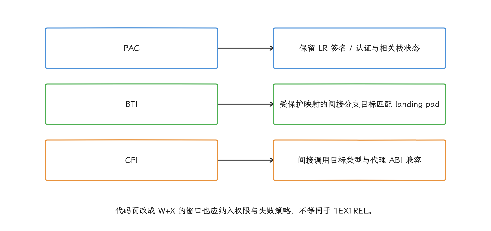

图：检查GNU property、编译选项、具体入口与Build ID；不能从同属arm64推出Hook兼容。

### 5.4 代码页权限

Inline Hook 需要修改可执行映射。当前 ShadowHook 源码会把目标区间 `mprotect()` 为 `PROT_READ | PROT_WRITE | PROT_EXEC`，写入后调用 `__builtin___clear_cache()`。这条运行时 patch 路径独立于 linker 的 `DT_TEXTREL` 检查。W+X 表示同一页同时可写、可执行，这段权限窗口本身就增加了攻击面。

工程上应缩短可写可执行窗口、限制可修改目标、记录权限变更失败，并在框架设计允许时恢复最小权限；至于关闭 SELinux、修改系统属性或依赖 root，都不属于普通应用能采用的方案。

## 6. Trap Hook：框架必须维护完整的信号语义

arm64 软件断点通常用 `BRK` 指令触发 `SIGTRAP`。信号可能来自软件断点、硬件断点、调试器或其他组件，处理函数至少要完成：

- 只消费 `si_code` 符合预期、且指令地址命中自有断点表的事件；
- 从 `ucontext_t` 读取并按 ABI 修改寄存器与 PC；
- 保证处理路径满足 async-signal-safe（异步信号安全）约束，即只调用 POSIX 明确允许在信号处理函数中使用的操作；
- 处理嵌套信号、线程退出、unhook 和断点表并发；
- 非本框架事件按完整 signal disposition 转发：区分 `SA_SIGINFO` 与单参数 handler、`SIG_DFL`、`SIG_IGN`，维护 mask 和重入语义；不能把 `SIG_DFL` / `SIG_IGN` 当函数地址调用，也不能无条件恢复默认处置；
- 与 ptrace 调试器、采样器、崩溃 SDK 和 native bridge（跨架构 Native 转换层）一起测试。

debuggerd 在 `debuggerd_init()` 中为 `SIGTRAP` 等致命信号注册处理函数，并设置 `SA_SIGINFO | SA_ONSTACK | SA_RESTART | SA_EXPOSE_TAGBITS`：

```cpp
struct sigaction action = {.sa_sigaction = debuggerd_signal_handler,
                           .sa_flags = SA_RESTART | SA_SIGINFO};
sigfillset(&action.sa_mask);
action.sa_flags |= SA_ONSTACK;          // alt-stack 应对栈溢出
action.sa_flags |= SA_EXPOSE_TAGBITS;   // 请求内核把 fault addr 的 tag bit 暴露给 user
debuggerd_register_handlers(&action);
```

`SA_EXPOSE_TAGBITS` 请求内核在 `siginfo_t.si_addr` 中保留受支持架构的 address tag bits（地址高位标记），供 MTE 等故障分析使用。Android 16 的同一路径已经设置该 flag，这里的代码能证明的只是 Android 17 继续使用它。

`debuggerd_signal_handler()` 处理 `SIGTRAP`、`SIGSEGV`、`SIGBUS`、`SIGFPE`、`SIGILL`、`SIGABRT` 等信号。致命路径会暂时允许 `crash_dump` 用 `ptrace` 读取进程，通过 `clone()` 建立共享地址空间的 pseudothread（分派崩溃转储的轻量线程），再由 `crash_dump` 暂停线程、生成 tombstone（Native 崩溃转储）。可恢复 GWP-ASan 和 permissive MTE（记录后继续执行的宽松模式）这类特定路径可能在记录后返回，其余致命路径会重新发出信号。

应用消费自有 `SIGTRAP` 时未必生成 tombstone，结果取决于 signal chain（信号处理函数调用顺序） 的串接顺序、`si_code`、调试器状态，以及事件是否继续传给 debuggerd。在 ART 进程中，sigchain（ART 的信号串接库）还可能把平台 special handler（优先运行的特殊处理函数） 和用户 handler 组合起来。别把一次 `sigaction()` 调用当作拿到了 `SIGTRAP` 的独占控制权。固定 ART sigchain 对 `SA_NODEFER` 有 mask 调整，但源码仍把 `SA_RESETHAND` 标为未实现；应测试具体 flags 的端到端行为，不能因存在 sigchain 就承诺完整 POSIX 透明转发。

这条链路给我们两条硬约束：

<!-- gracker-diagram: a218-13-trap-disposition -->
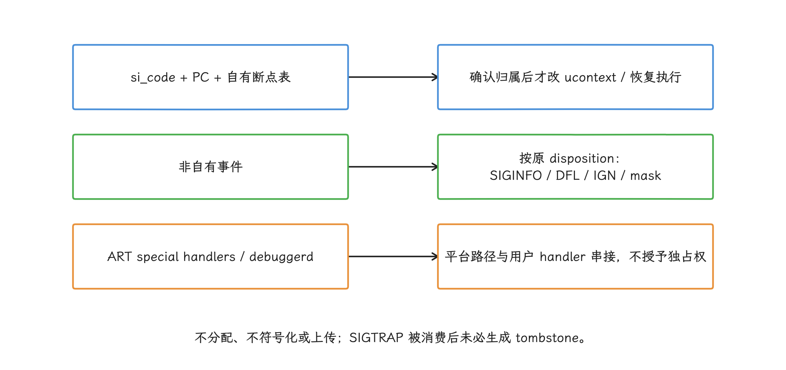

图：固定sigchain存在SA_RESETHAND支持限制；不得把默认或忽略处置强转成可调用函数。

1. debuggerd 的接口目标是生成崩溃转储，Trap Hook 想借它的私有 handler 协助恢复，这条路走不通。
2. 自定义 handler 只能消费能够证明属于本框架的事件。硬件断点、调试器事件和其他组件的断点必须继续按原语义处理。

对高频函数，逐次进出信号处理路径的成本和兼容风险通常难以接受。Trap 的合理位置是短期诊断或低频探针，通用线上拦截器这个角色它担不起来。

## 7. 代理函数的 ABI 和重入约束

代理函数必须与被替换目标使用完全兼容的调用约定。参数个数只是其中一项，还要核对：

- 整数、浮点和向量参数分别使用哪些寄存器；
- 大结构体返回是否通过隐藏的结果指针；
- C++ 成员函数的 `this`、name mangling（符号名编码）和异常边界；
- 可变参数、栈对齐和保留寄存器；
- PAC/BTI/CFI 编译选项；
- `errno`（线程局部错误码）是否属于接口语义。

下面的骨架只说明重入保护与保存 `errno` 的基本顺序，直接拿来当完整 Hook 是不够的：

```cpp
using ReadFn = ssize_t (*)(int, void*, size_t);

static ReadFn g_orig_read = nullptr;
static thread_local bool g_inside_read = false;

ssize_t proxy_read(int fd, void* buffer, size_t count) {
  if (g_inside_read) {
    return g_orig_read(fd, buffer, count);
  }

  g_inside_read = true;
  ssize_t bytes_read = g_orig_read(fd, buffer, count);
  int call_errno = errno;
  record_without_allocation(fd, count, bytes_read, call_errno);
  g_inside_read = false;
  errno = call_errno;
  return bytes_read;
}
```

这个示例仍省略了记录器异常退出、信号重入和多线程同时初始化的竞态；`g_orig_read` 必须在入口发布前完成同步初始化，记录器应避免异常越过代理边界。Android Bionic 不支持 `pthread_cancel`，不能把其他 POSIX 实现的取消点机制套到这里。

`thread_local` 标记只能约束当前线程的常规递归，记录函数的异步信号安全要另行保证。生产代码里我们用 RAII（让对象析构时自动执行清理） 或等价的 scope guard（退出当前作用域时自动清理） 兜住每条返回路径，清理线程局部状态，并逐项确认代理声明与目标导出声明一致。

<!-- gracker-diagram: a218-14-proxy-errno -->
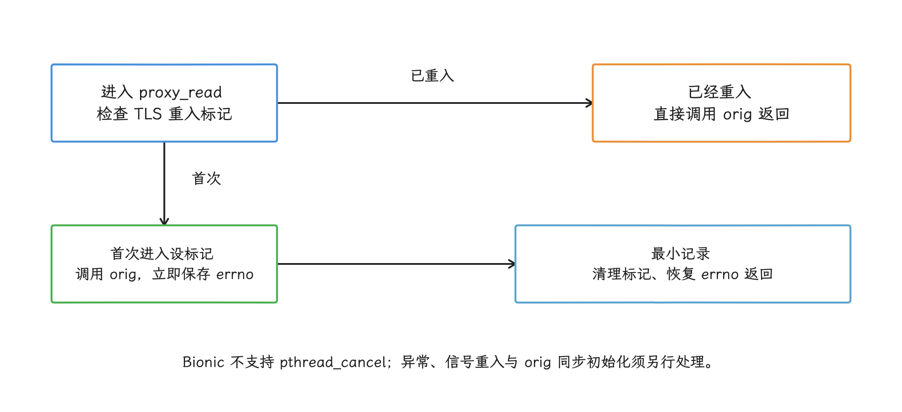

图：代码骨架只演示正常路径；异常、信号重入、orig同步初始化与ABI仍需完整实现和验证。

## 8. 生命周期设计

Hook 装上去只是开始。这一节把生命周期拆成三件事：状态怎么记、怎么安全停用、崩溃后靠什么还原现场。

### 8.1 状态机

每个 Hook 至少应有以下状态：

```text
DECLARED -> RESOLVING -> INSTALLING -> ACTIVE
                         |             |
                         v             v
                       FAILED       DISABLING -> DISABLED
```

状态机让重复初始化、动态装载、并发关闭和失败重试都有明确结果。`ACTIVE` 必须意味着目标集合、原地址和 proxy 都已发布；`FAILED` 要保留错误阶段与证据，一个布尔值装不下。

<!-- gracker-diagram: a218-15-hook-state-machine -->
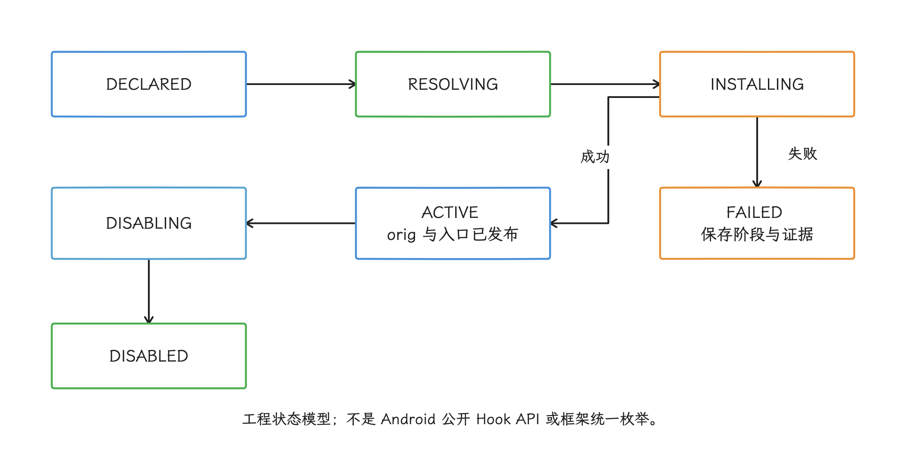

图：重复通知、动态装载和关闭都需有明确状态；ACTIVE不是任意一个槽写入成功就成立。

### 8.2 逻辑停用与物理卸载

恢复 GOT 指针之后，旧 proxy 可能仍有人在执行；恢复函数入口之后，线程也可能仍走在 proxy、原函数 trampoline 或被覆盖区间里，trampoline 要等这些调用都退出才能释放。

风险较低的关闭方式是保留稳定入口，只用原子开关让 proxy 直接调用原函数。若必须物理 unhook，先阻止新调用进入待回收路径，再用匹配入口发布协议的活动调用跟踪、grace period（等旧调用退出的宽限期）或线程协调确认没有仍可进入或执行的线程，最后回收 trampoline。某一瞬间计数为零并不充分；还要确认目标 ELF 未卸载、槽或指令仍属于本框架。

<!-- gracker-diagram: a218-16-retire-trampoline -->
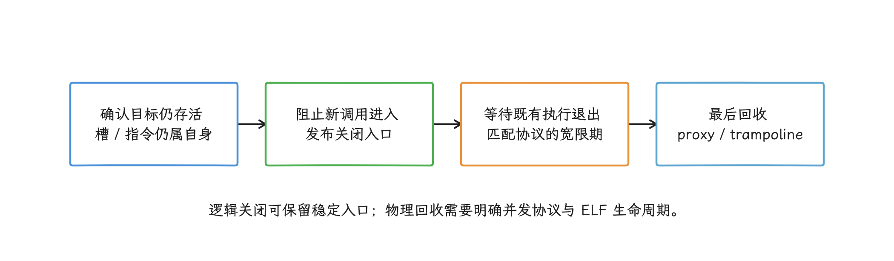

图：恢复GOT或原入口后仍可能有旧线程执行proxy/trampoline；瞬时活动数为零不证明入口已关闭。

### 8.3 记录可复现证据

安装记录至少包括：

- Android API 与 ABI；
- 目标 ELF 路径、Build ID、load bias 与装载代次（本次 load/unload 生命周期身份）；
- 符号名、相对偏移、原地址和 proxy 地址；
- relocation type 或被覆盖的原指令；
- 页大小、原权限、改写结果；
- 框架版本、配置版本和错误码；
- 是否存在其他 Hook，以及发现时的槽值或指令摘要。

崩溃发生后，这些信息应随稳定性事件上传；没有它们，判断崩溃位于业务代码、proxy、trampoline、指令搬迁还是多框架冲突会很困难。

## 9. 典型场景

有了前面的选型和约束，我们看几个典型需求怎么落到具体方案上。

### 9.1 文件描述符监控

观察自有或指定第三方 ELF 的 `openat`、`close`、`dup`、`socket` 等导入调用时，PLT/GOT Hook 通常比进程级 Inline Hook 更容易限定影响面。代理函数保存 `errno`、走无分配记录路径，并把“未经过导入槽的直接 syscall（系统调用）”写进覆盖盲区。

FD 即 file descriptor（文件描述符）。这类方案适合辅助定位 FD 泄漏，仍要结合 `/proc/self/fd` 快照、资源所有权和调用栈采样。参见 20.7《FD 耗尽监控与故障排查》。

### 9.2 分配器监控

直接 Hook `malloc/free`，日志、符号化、容器扩容乃至 Hook 框架自己都会再次进入分配器。定位堆问题时，我们先评估 heapprofd、GWP-ASan、Scudo 强化分配器的错误诊断和 MTE；这些工具覆盖不了、手里又有无分配采集器时，才考虑限定调用方的 PLT/GOT Hook。

### 9.3 私有运行时函数

对 `libart.so` 私有函数做 Inline Hook，即使在某台 Android 17 设备上成功，也推导不出相同 API level 的其他设备可复用。ART 等 Mainline 模块可以通过系统组件更新机制独立升级，厂商构建选项也会改变符号、函数序言、CFI 和调用时机。

这类 Hook 应按具体 Build ID 管理，并保留“一律不安装”的默认分支。用于研究的偏移和线上允许列表也应分开维护。

### 9.4 新 ELF 装载

若采集目标包含插件、动态特性或运行时 `dlopen()` 的 SDK，只扫描一次进程模块必然漏报。应订阅框架提供的装载回调或在安全时点刷新模块；同一装载代次内按路径、Build ID、load bias 和目标项去重。卸载时先失效旧任务，再建立新代次：同一路径、同一 Build ID 甚至同一地址都可能被重新装载，不能把地址复用当成旧实例仍存活。这里的装载代次是框架维护的生命周期标识，不是公开 NDK 提供的通用 generation 字段。

<!-- gracker-diagram: a218-17-module-generation -->
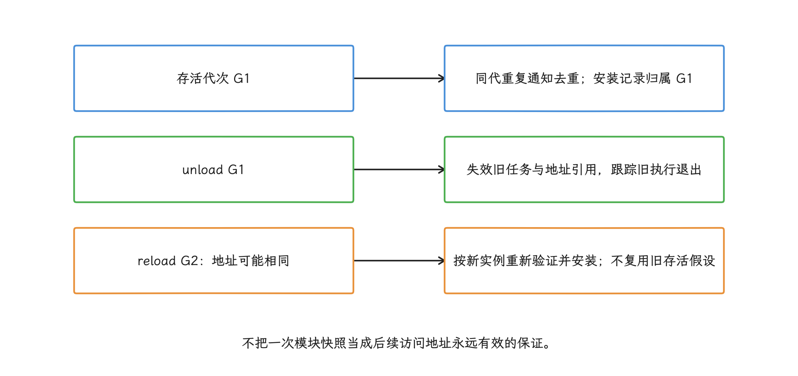

图：generation是框架自己的生命周期身份；Build ID识别二进制内容，不能独自证明实例仍存活。

自行 Hook linker 私有 `soinfo` 字段会把回调机制绑定到内部结构。ShadowHook 手册也说明，相关偏移需要按 Android 版本扫描和适配；采用这条路径时，适配表、失败停用和回滚策略都要随框架发布。

### 9.5 API level 与二进制身份校验

对照 `android-16.0.0_r1` 与 `android-17.0.0_r1` 可以确认：两者都不支持 `RTLD_LAZY` 的延迟解析，debuggerd 都会设置 `SA_EXPOSE_TAGBITS`，也都包含 permissive MTE（记录 MTE 故障后允许继续执行的宽松模式） 和 MTE globals 相关路径。所以这些机制区分不了 Android 16 与 17，更当不成某个 Hook 可安装的充分条件。

API level 只适合作为第一层筛选。安装前还要检查：

| 检查项 | 用途 |
|---|---|
| ABI 与运行时页大小 | 选择对应指令重写器，并正确计算 `mprotect()` 区间 |
| 目标 ELF 路径与 Build ID | 区分 Mainline、系统和厂商的不同二进制构建 |
| 符号版本、relocation type 与当前槽值 | 确认 PLT/GOT Hook 修改的是预期调用 |
| 函数入口指令摘要 | 确认 Inline Hook 的已验证序言仍然匹配 |
| GNU property 与编译选项 | 判断 BTI、PAC、CFI、LTO 等控制流条件 |
| Hook 框架版本与已安装项 | 识别版本能力和多框架覆盖冲突 |

## 10. 常见故障定位

排查安装失败和运行时异常时，我们按下表从现象入手：

| 现象 | 优先检查 | 常见原因 |
|---|---|---|
| 安装成功但没有回调 | 调用方 relocation、反汇编、命中模块列表 | 内联、直接调用、`dlsym` 函数指针、直接 syscall |
| `mprotect` 失败 | 地址、长度、运行时页大小、原映射 | 4 KB 写死、跨页计算错误、映射或策略不允许 |
| proxy 一进入就崩溃 | 完整函数签名、CFI、BTI、原函数发布顺序 | ABI 不匹配、非法间接目标、`orig` 尚未可见 |
| trampoline 附近 `SIGILL/SIGSEGV` | 原指令、重写结果、PC-relative 目标 | ADR/ADRP、literal load、条件分支搬迁错误 |
| 低概率随机崩溃 | patch 长度、安装时并发、I-cache | 多指令非原子改写、线程正在执行目标入口 |
| 动态加载模块漏采 | `dlopen` 事件和 ELF 刷新记录 | 只在启动时扫描一次 |
| 卸载后跳到野地址 | ELF 生命周期、活动 proxy、trampoline 所有权 | `dlclose` 后仍保留槽或目标地址 |
| 与崩溃 SDK 冲突 | `sigaction` 注册顺序和 handler 串接 | 吞信号、错误恢复默认 handler、信号内使用非安全 API |
| Android 17 某些设备才失败 | Build ID、BTI/CFI、16 KB、厂商 ABI | 用 API level 代替了二进制身份校验 |

<!-- gracker-diagram: a218-18-failure-evidence -->
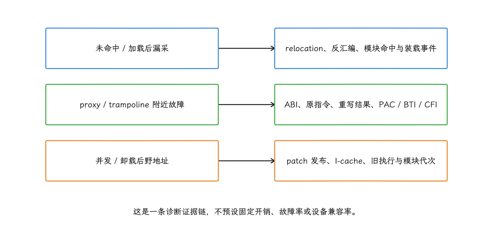

图：事件同时保存Build ID、相对偏移、框架版本、权限和原始槽/指令；地址只在具体进程生命周期内解释。

## 11. Android 17 上线检查表

- [ ] 只使用公开 NDK API 作为业务依赖，私有符号 Hook 有 Build ID 允许列表
- [ ] 明确记录 Hook 的调用方、被调用方和覆盖盲区
- [ ] arm64 之外的 ABI 有独立实现或明确禁用
- [ ] 使用运行时页大小，没有 4 KB 假设
- [ ] 验证 RELRO 页权限处理与失败分支
- [ ] 验证新 ELF 装载、卸载和重复安装
- [ ] 验证 PAC、BTI、CFI、LTO 与不同可见性组合
- [ ] 代理函数签名完整，保存 `errno`，具备重入保护
- [ ] Inline patch 有并发发布和 I-cache 维护证据
- [ ] Trap handler 只消费自有断点，并正确串接其他信号处理者
- [ ] 关闭功能不立即释放仍可能执行的 proxy 或 trampoline
- [ ] 崩溃事件可还原目标 Build ID、偏移、原指令或 relocation

## 12. 源码锚点与参考资料

正文的平台实现以 `android-17.0.0_r1` 为准：

- [bionic linker.cpp](https://android.googlesource.com/platform/bionic/+/refs/tags/android-17.0.0_r1/linker/linker.cpp)：`DT_JMPREL`、`DT_PLTGOT`、`DT_TEXTREL`、`protect_relro()`。
- [bionic linker_relocate.cpp](https://android.googlesource.com/platform/bionic/+/refs/tags/android-17.0.0_r1/linker/linker_relocate.cpp)：`R_GENERIC_JUMP_SLOT`、`GLOB_DAT`、IRELATIVE 等重定位处理。
- [bionic linker_phdr.cpp](https://android.googlesource.com/platform/bionic/+/refs/tags/android-17.0.0_r1/linker/linker_phdr.cpp)：GNU property（ELF 中声明处理器特性的 note） 与 arm64 `PROT_BTI`。
- [bionic unistd.h](https://android.googlesource.com/platform/bionic/+/refs/tags/android-17.0.0_r1/libc/include/unistd.h)：`cacheflush()` 的架构条件与 builtin 建议。
- [debuggerd handler.h](https://android.googlesource.com/platform/system/core/+/refs/tags/android-17.0.0_r1/debuggerd/include/debuggerd/handler.h)：致命信号集合与 `SIGTRAP` 注册。
- [debuggerd_handler.cpp](https://android.googlesource.com/platform/system/core/+/refs/tags/android-17.0.0_r1/debuggerd/handler/debuggerd_handler.cpp)：pseudothread（专用于分派崩溃转储的轻量线程）、`crash_dump` 和 `ptrace` 配合链路。
- [ART sigchain.cc](https://android.googlesource.com/platform/art/+/android-17.0.0_r1/sigchainlib/sigchain.cc)：special handler、debuggerd recovery hook 与用户 handler 的转发次序。

版本对照使用以下 `android-16.0.0_r1` 源码：

- [Android 16 linker.cpp](https://android.googlesource.com/platform/bionic/+/refs/tags/android-16.0.0_r1/linker/linker.cpp)：`RTLD_LAZY`、MTE globals 和 RELRO 路径。
- [Android 16 linker_relocate.cpp](https://android.googlesource.com/platform/bionic/+/refs/tags/android-16.0.0_r1/linker/linker_relocate.cpp)：MTE globals relocation 处理。
- [Android 16 debuggerd_handler.cpp](https://android.googlesource.com/platform/system/core/+/refs/tags/android-16.0.0_r1/debuggerd/handler/debuggerd_handler.cpp)：`SA_EXPOSE_TAGBITS` 与 permissive MTE 路径。

工程实现与平台规则：

- [ShadowHook manual](https://github.com/bytedance/android-inline-hook/blob/9b8b4407c9b0b8fcfbb09aad77bfb32ea44bc237/doc/manual.md) 与 [arm64 指令重写源码](https://github.com/bytedance/android-inline-hook/blob/9b8b4407c9b0b8fcfbb09aad77bfb32ea44bc237/shadowhook/src/main/cpp/arch/arm64/sh_a64.c)：指令重写、动态装载任务和当前实现行为。
- [ByteHook 原理说明](https://github.com/bytedance/bhook/blob/a8bd254f6e53022b65136f40d10ae3763b6ef8ad/doc/overview.zh-CN.md) 与 [GOT 重定位写入源码](https://github.com/bytedance/bhook/blob/a8bd254f6e53022b65136f40d10ae3763b6ef8ad/bytehook/src/main/cpp/bh_elf_relocator.c)：原函数发布、页权限调整与 GOT 原子写。
- [ShadowHook 写入与页大小源码](https://github.com/bytedance/android-inline-hook/blob/9b8b4407c9b0b8fcfbb09aad77bfb32ea44bc237/shadowhook/src/main/cpp/common/sh_util.c)、[ByteHook 权限推导](https://github.com/bytedance/bhook/blob/a8bd254f6e53022b65136f40d10ae3763b6ef8ad/bytehook/src/main/cpp/bh_elf.c) 与 [页大小源码](https://github.com/bytedance/bhook/blob/a8bd254f6e53022b65136f40d10ae3763b6ef8ad/bytehook/src/main/cpp/bh_util.c)。
- [Bionic POSIX 状态](https://android.googlesource.com/platform/bionic/+/refs/tags/android-17.0.0_r1/docs/status.md)：不支持 pthread 取消。
- [Android ABI](https://developer.android.com/ndk/guides/abis#arm64-v8a) 与 [Clang CFI](https://clang.llvm.org/docs/ControlFlowIntegrity.html)。
- [Arm A64 指令概览](https://developer.arm.com/-/media/Files/pdf/graphics-and-multimedia/ARMv8_InstructionSetOverview.pdf)：PC-relative 地址粒度与范围。
- [Android 16 KB page size 指南](https://developer.android.com/guide/practices/page-sizes)。
- [Android 7.0 非公开 Native 库限制](https://developer.android.com/about/versions/nougat/android-7.0-changes)。
- [Android linker namespace](https://source.android.com/docs/core/permissions/namespaces_libraries)。
- [Arm PAC、BTI 与 MTE 指南](https://developer.arm.com/-/media/Arm%20Developer%20Community/PDF/Learn%20the%20Architecture/Providing%20protection%20for%20complex%20software.pdf)。

关联阅读：

- 14.7《三方性能库、Hook 与可观测性基础设施》
- 20.7《FD 与资源耗尽监控》
- 20.3《Native Crash、堆栈回溯与符号化》

## 小结

Native Hook 的选型从“需要命中哪一条调用路径”开始：PLT/GOT 修改特定调用方的导入槽，Inline 改写目标指令，Trap 依赖完整的信号语义。上线前，我们把 ABI、Build ID、页大小、RELRO、PAC/BTI/CFI、动态装载、并发发布和多框架共存写成可验证的安装条件；任何条件不匹配时默认停用，猜测的偏移一律不执行。
