# App 启动路径、监控与度量

应用启动从用户或系统请求开始，经过进程创建、bindApplication、组件生命周期和首帧显示。本章围绕这条路径讲两件事：先从应用进程一侧把启动拆成可测阶段，说清 Trace（带时间轴的执行跟踪） 中一段区间究竟代表什么；再讲线上监控怎样记录启动类型、起止点、关键阶段和设备状态，避免只上报一个总时长。

分析部分要确认系统什么时候把执行权交给应用、关键路径包含哪些阶段。系统侧的进程创建、任务与窗口管理另见 8.2 节；初始化依赖治理、Baseline Profile 和首帧渲染分别在后续章节展开。

> 源码基线：Android 17 / API 37，AOSP `android-17.0.0_r1`；AndroidX 与 Perfetto（Android 系统级时间线分析工具） 独立发布，涉及之处会单独注明版本要求。

## 进程创建、初始化与首帧阶段

### 1. 冷、温、热描述的是启动前状态

[Android 应用启动文档](https://developer.android.com/topic/performance/vitals/launch-time)把启动分为 cold、warm、hot。我们先从这套分类看起：它概括的是启动前进程、Activity 和 UI 对象是否仍然存在，生命周期回调也会随任务状态变化。

| 类型 | 启动前状态 | 应用侧通常需要完成的工作 |
| --- | --- | --- |
| 冷启动 | 目标应用进程不存在 | 创建进程和 Application，安装 Provider，创建 Activity，生成第一帧 |
| 温启动 | 复用了一部分状态，但 Activity 或进程中的部分对象需要重建 | 常见情况是进程仍在而 Activity 重建；恢复路径取决于任务和保存状态 |
| 热启动 | 进程与目标 Activity 仍在内存中 | 将已有 Activity 带回前台，处理生命周期与必要的重绘 |

同一个入口在不同时间可能落入不同类型：用户从桌面点击、通知跳转、深链、最近任务恢复，也可能命中不同的 Activity 和任务栈。要判断平台记录的启动类型，光看 `onCreate()` 是否调用还不够。

<!-- gracker-diagram: a222-01-startup-preconditions -->
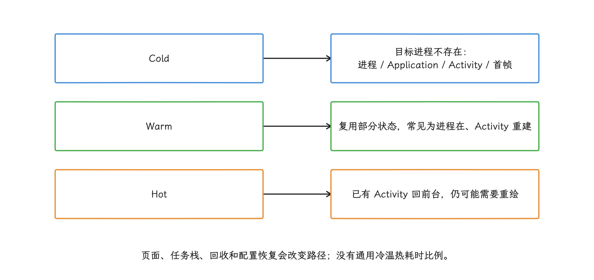

图：实验StartupMode构造固定条件，线上系统类型按入口、进程与会话核对；onCreate不是单独分类器。

工程上要区分两件事：

- **实验分类**：Macrobenchmark（AndroidX 宏基准测试库） 的 `StartupMode.COLD/WARM/HOT`（实验启动状态） 用固定前置条件构造可比较样本。
- **线上分类**：使用平台或 Play 的启动指标，并按入口、进程、版本和设备分组；Android 15+ 的 `ApplicationStartInfo` 可提供系统记录的启动类型，应用自有“进程首次启动”标记只能辅助解释。采集方法见后文「启动类型、时间点与线上指标」一节。

“温启动一定是冷启动的某个百分比”“热启动一定小于一帧”这类经验比例当不了基线：后台回收、配置变化、首屏数据、CPU 调频和页面重绘都会改变成本。

### 2. 冷启动的 App 侧路径

#### 2.1 从启动请求到应用主线程

冷启动开始时，系统解析启动请求、准备任务与 starting window（应用首帧完成前由系统显示的启动窗口），并向 Zygote 请求 fork 应用进程。Zygote 是预加载常用框架类的进程模板，fork 会从它派生新的 Linux 应用进程。这个阶段已经计入用户看到的启动等待，而应用自己的 `Application` 埋点还没有运行。

子进程进入 `ActivityThread.main()` 后，先准备主线程 Looper（按顺序取出并分发消息的事件循环）、创建 `ActivityThread`，再通过 Binder（Android 跨进程调用机制） 向 system_server（承载主要系统服务的进程） 登记，后续的绑定信息和生命周期事务再送回应用主线程。对写应用的我们来说，这段路径有两个含义：

<!-- gracker-diagram: a222-02-request-to-main -->
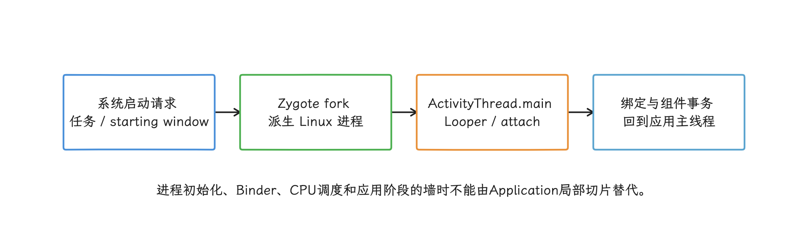

图：Application.attachBaseContext不是完整冷启动起点；进程前的系统工作与调度需平台记录或系统Trace。

1. `Application.attachBaseContext()` 不是整个冷启动的起点，早于它的系统与进程初始化同样消耗 TTID（Time To Initial Display）。
2. 只汇总应用内埋点会漏掉进程创建、调度等待、系统服务和跨进程通信时间。

#### 2.2 `ContentProvider`（内容提供者） 早于 `Application.onCreate()`

[`ActivityThread.handleBindApplication()`](https://android.googlesource.com/platform/frameworks/base/+/refs/tags/android-17.0.0_r1/core/java/android/app/ActivityThread.java)按以下关键顺序执行：

```text
创建并 attach Application
        ↓
installContentProviders(app, data.providers)
        ↓
Instrumentation.onCreate(...)
        ↓
Instrumentation.callApplicationOnCreate(app)
```

这段顺序针对普通应用绑定：固定实现会在 `restrictedBackupMode` 中跳过 Provider 安装，Provider 列表为空时也不会执行安装。实际自动初始化 Provider 的 `onCreate()` 仍早于应用 `Application.onCreate()`；`Instrumentation` 则是框架创建和驱动应用组件的入口。所以只给 `Application.onCreate()` 计时，会漏掉 App Startup、第三方 SDK（Software Development Kit，软件开发工具包） 和业务 Provider 的成本。

<!-- gracker-diagram: a222-03-provider-application -->
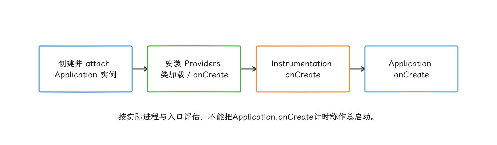

图：自动SDK与App Startup可能位于中间段；restrictedBackupMode和空Provider列表会跳过安装。

`Application.attachBaseContext()` 到 `Application.onCreate()` 之间可能包含：

- Provider 类加载、静态初始化与 `onCreate()`；
- 配置和资源初始化；
- instrumentation 初始化；
- 主线程上的 Binder、文件、数据库和锁等待。

Provider 治理见 [ContentProvider 启动优化](03-contentprovider-multiprocess-startup.md)。多进程应用还要核对每个 Provider 的 `android:process`：默认进程的 Provider 不会自动在每个子进程各运行一次，声明到某个进程的组件只随对应进程安装。

#### 2.3 Application 阶段

`Application.onCreate()` 在主线程同步执行。适合保留在这里的工作应同时满足：

- 当前进程需要；
- 当前入口需要；
- 在 Activity 或首帧之前必须完成；
- 能在给定主线程预算内结束；
- 不依赖不受控的网络或长时间锁等待。

常见长任务包括 SDK 初始化、同步数据库打开、反序列化大配置、原生库加载和批量对象构造。把它们全部提交到后台线程也可能延迟启动：主线程若随后等待结果，关键路径没有缩短；如果不等待，后台 CPU、I/O（存储读写） 和类加载仍会与首帧争用资源。

<!-- gracker-diagram: a222-04-background-critical-path -->
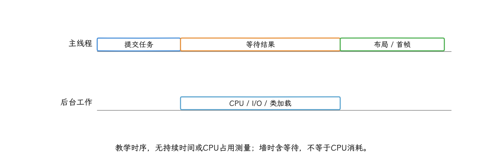

图：等待结果时端到端路径没有消失；即使不等待，后台CPU/I/O/类加载也可能与首帧竞争。

对于 `minSdkVersion >= 21` 的应用，平台原生支持从多个 DEX 加载类，不需要在 `Application` 中调用旧版 `MultiDex.install()`。只有仍支持 API 20 及以下的应用才需要单独审视这条兼容路径。

#### 2.4 Activity 创建与 UI 构建

应用收到启动 Activity 的 lifecycle transaction（系统发给应用主线程的一组生命周期操作）后，框架创建 Activity，并按目标状态执行 `onCreate()`、`onStart()`、`onResume()` 等回调。这串回调只是常见组合之一：已有 Activity 回前台、配置变化和任务恢复会走不同的组合。

View UI 的 `setContentView()` 会触发布局 XML 解析、View 创建和属性解析。Compose UI 则在 `setContent` 后经历初始 composition（执行 Composable 并建立 UI 结构）、layout 和 draw。两种 UI 技术都要关注：

- 是否在主线程读取磁盘或等待 Binder；
- 图片解码、字体和资源是否进入首帧关键路径；
- 首屏不可见区域是否提前创建；
- 自定义 View 构造、`onMeasure()`、`onLayout()`、`onDraw()` 是否执行重活；
- Compose 的首轮 composition 是否创建过多对象或读取未准备好的状态。

View 数量、布局深度或 Composable 数量都没有通用的危险阈值，优化依据是 Trace 中的耗时和调用路径。`ViewStub`（需要时才展开布局的占位 View）、条件 composition、懒加载、异步 inflate（在允许范围内把 View 创建移出主线程）各有语义限制，采用前要验证线程安全、状态恢复和首屏交互。

#### 2.5 第一帧从 traversal 到系统确认绘制

主线程在 VSync（显示刷新节奏信号） 驱动下进入 `Choreographer#doFrame`，执行 traversal，也就是对 View 树完成 measure、layout 和 draw。硬件加速路径中，UI 线程记录绘制命令，RenderThread 与 GPU 继续处理渲染，图形 buffer 再交给系统合成路径。

[`ViewRootImpl`](https://android.googlesource.com/platform/frameworks/base/+/refs/tags/android-17.0.0_r1/core/java/android/view/ViewRootImpl.java)在首次绘制请求完成后走 `reportDrawFinished(...)` 路径，窗口系统据此结束对应的启动绘制等待。我们在这里要区分几个相邻观测点：

| 观测点 | 可以说明什么 | 不能说明什么 |
| --- | --- | --- |
| `performTraversals` 结束 | 本轮主线程 traversal 返回 | GPU、buffer 提交和系统确认均已结束 |
| RenderThread `DrawFrame` | 渲染线程处理这一帧 | 像素已经被面板扫描显示 |
| frame commit callback | 硬件渲染内容已提交到 swap chain（等待显示的图形缓冲队列） | 用户已经看到该帧；该回调只适用于硬件渲染 |
| TTID | 系统记录的首帧启动指标 | 页面主要内容已经可用 |

帧预算取决于刷新率、这一帧在 FrameTimeline 里的 deadline 以及渲染流水线阶段，一律写死 16 ms 会把问题简化过头；120 Hz 显示器的节奏与 60 Hz 不同，同一段工作的可用时间也随之变化。一次 traversal 跨过某个 VSync 时，我们还要对照目标时间线和实际时间线，判断是否错过 deadline。

<!-- gracker-diagram: a222-05-frame-observation -->
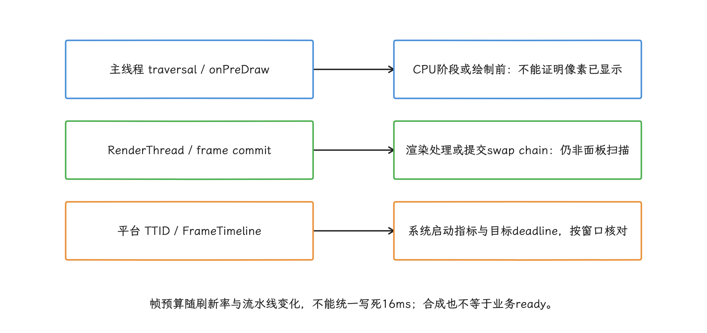

图：第一次同名slice未必属于目标窗口；应用frame callback也不能冒充平台TTID。

### 3. TTID 与 TTFD（Time To Full Display）回答不同问题

#### 3.1 TTID：首个 UI 帧

TTID 从系统收到启动请求开始，到目标 Activity 的第一帧被记录为已显示为止，全称 Time To Initial Display。冷启动时它包含进程创建，冷/温启动时还包含 Activity 创建和首帧工作。

TTID 很短，只说明用户很快看到一个应用帧；这一帧可能还是骨架、空列表或占位内容。系统 SplashScreen 的持续时间、应用第一帧、主要内容可用时间是三件事，要分开度量。

Logcat 中的 `Displayed ... +...`、`adb shell am start -W` 和 Perfetto 都能帮助本地诊断。命令行结果会受到任务栈、是否 force-stop、编译状态和设备状态影响，单次 `am start -W` 更适合当线索，而不是发布门禁。

Android vitals（Google Play 汇总的真实设备质量指标） 当前把冷启动 5 秒、温启动 2 秒、热启动 1.5 秒及以上列为 excessive。这三条是 Play 的告警门槛，不是优秀体验的目标值；内部预算怎么设，见后文「Android Vitals 怎样对标」。

#### 3.2 TTFD：由应用声明“主要内容可用”

TTFD 的平台报告以 `reportFullyDrawn()` 表达应用完成条件；系统记录会处理过早上报与首帧下限。Macrobenchmark 的 `timeToFullDisplayMs` 另以包含该调用或其后的第一帧完成渲染为终点。两种观测相关，但不能直接把方法调用时刻、`ApplicationStartInfo.FULLY_DRAWN` 时间戳与基准渲染完成点视为同一瞬间。`StartupTimingMetric` 的 `timeToFullDisplayMs` 从 API 29 起可用，更早版本可能拿不到这个指标。

<!-- gracker-diagram: a222-06-ttid-fullydrawn-endpoints -->
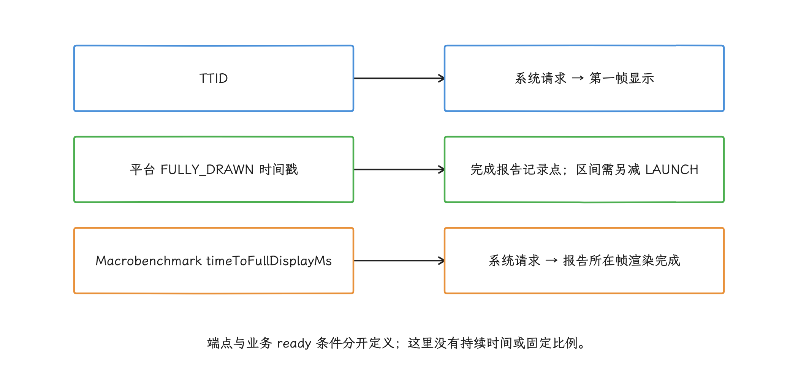

图：平台FULLY_DRAWN时间戳与Macrobenchmark timeToFullDisplayMs相关，但后者等包含报告或其后首帧渲染完成。

平台不知道每个产品何时“可用”，因此团队必须先定义完成条件。例如：

- 首页主列表已经展示本地缓存或网络数据；
- 关键按钮可点击，必要依赖已经准备好；
- 错误态或离线态也已形成可操作界面；
- 不影响首要任务的推荐、广告或二级卡片不进入条件。

下面的示例把“关键数据就绪”和“主内容完成布局”作为报告条件：

```kotlin
class MainActivity : ComponentActivity() {
    private var criticalDataReady = false
    private var mainContentLaidOut = false
    private var fullyDrawnReported = false

    private fun maybeReportFullyDrawn() {
        if (criticalDataReady &&
            mainContentLaidOut &&
            !fullyDrawnReported
        ) {
            fullyDrawnReported = true
            reportFullyDrawn()
        }
    }
}
```

`criticalDataReady` 和 `mainContentLaidOut` 应由对应状态与布局回调更新，每次更新后调用 `maybeReportFullyDrawn()`。报告只发送一次；完成条件应覆盖成功、离线和可恢复错误，避免网络失败后永远没有 TTFD。若调用发生在首帧之前，平台会以系统检测到的首帧时间为下限，因此提前调用不会生成比 TTID 更早的有效 TTFD。

AndroidX `ComponentActivity` 的 Fully Drawn 支持可协调多个组件或异步条件。无论使用平台方法还是 AndroidX 封装，团队都要把“fully drawn”定义写进测试，避免不同页面各自解释。

#### 3.3 自定义里程碑：解释 TTID/TTFD 内部时间

TTID 和 TTFD 是端到端指标，回答不了“慢在哪一段”；要解释端到端内部的时间，应用可以补充少量稳定里程碑：

- Application attach；
- 每个必要初始化器的开始和结束；
- Activity 创建、UI 状态提交；
- 关键数据可用；
- 主要内容完成布局；
- `reportFullyDrawn()` 请求。

区间计时使用单调时钟。`SystemClock.uptimeNanos()` 从 API 35 起公开，不计深度休眠，但包含线程等待和未获 CPU 的时间，因此不是 CPU 消耗；API 29–34 的应用局部区间可使用 `uptimeMillis()` 或选定的 `System.nanoTime()` 差值。`elapsedRealtimeNanos()` 计入深度休眠，提供本次开机的时基；不同类型时基不能直接相减。CPU 实际运行时间需线程 CPU 计数或调度证据。

埋点名称要稳定，可能出现的名称数量也要受控；监控系统把这种取值数量称为基数。不要把用户 ID、URL 或动态参数写入 Trace 名称。线上事件还需采样，并记录启动入口、应用版本、设备档位、编译状态和进程名。

### 4. 用 Macrobenchmark（固定条件的基准测试） 建立启动基线

里程碑解释了端到端内部的时间；要判断“这次改动有没有把启动变慢”，还需要固定条件下的端到端基准。[Macrobenchmark](https://developer.android.com/topic/performance/benchmarking/macrobenchmark-overview)从目标应用进程外驱动启动，并为每轮采集 Perfetto Trace。它比在 `Application` 内自行计时更适合端到端回归。目标使用非 debuggable 的可 profile 发布变体，在 `<application>` 内声明 `<profileable android:shell="true" />`，并核对合并 Manifest。`profileable` 是元素，不是 `android:profileable` 属性。

下面的基准用于测量带有 Baseline Profile 的冷启动：

```kotlin
@LargeTest
@RunWith(AndroidJUnit4::class)
class StartupBenchmark {
    @get:Rule
    val rule = MacrobenchmarkRule()

    @Test
    fun coldStart() = rule.measureRepeated(
        packageName = TARGET_PACKAGE,
        metrics = listOf(StartupTimingMetric()),
        compilationMode = CompilationMode.Partial(
            baselineProfileMode = BaselineProfileMode.Require,
        ),
        startupMode = StartupMode.COLD,
        iterations = 10,
        setupBlock = {
            pressHome()
        },
    ) {
        startActivityAndWait()
    }
}
```

`StartupTimingMetric` 输出 `timeToInitialDisplayMs`；应用正确报告 fully drawn 时，还会输出 `timeToFullDisplayMs`。

十次迭代只是一组起始配置，应根据噪声、设备数量和需要检测的回归幅度调整。

每次对比必须固定：

- 同一 release 配置和构建工具链；
- 相同 `CompilationMode`（ART 预编译状态） 与 Baseline Profile 条件；
- 相同入口 Intent、账号、数据和网络桩（返回固定结果的测试替身）；
- 相同设备型号、系统版本、电量与温度范围；
- 相同冷/温/热模式。

Debug 包、模拟器、低电量或温度降频样本不适合建立发布阈值。遇到 profileable、Baseline Profile 或编译模式配置错误时，应让测试失败并修正配置，而不是忽略错误后继续使用结果。

冷、温、热三组结果要分别保存。页面结构或首屏数据变化时，我们还要同时检查 TTFD 和帧指标，防止用更早展示空壳换取较短 TTID。

### 5. 自定义 Trace 与业务切片

应用控制的初始化入口可以用 `androidx.tracing` 补充切片，切片是时间轴上带开始、结束和名称的一段区间。下面的示例用于区分配置解析与崩溃监控初始化：

```kotlin
fun initializeRequiredComponents() {
    trace("startup/config") {
        configStore.loadLocalSnapshot()
    }
    trace("startup/crash-reporter") {
        crashReporter.start()
    }
}
```

Perfetto 中会显示两个命名切片。切片要包住同步工作本身；代码若只提交异步任务，切片结束就只说明“已提交”，说明不了初始化已经完成。等待异步结果时，应在生产者和消费者两端记录可关联的 async trace，或用 flow（连接两段切片的因果箭头）标出任务从提交到执行的关系，并控制关联 ID 的数量。

<!-- gracker-diagram: a222-09-async-trace-boundary -->
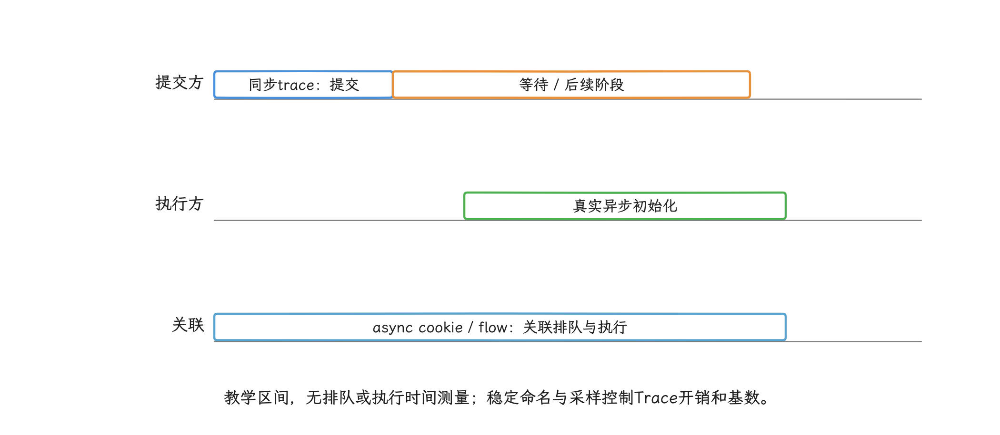

图：同步trace包住真实同步工作；异步提交到完成跨线程时，用受控cookie或flow关联生产者与消费者。

Trace 本身有开销，切片要克制：别给每个小方法都加，单个总切片也定位不了责任。较好的层级是：

1. 启动端到端指标；
2. Application、Provider、Activity、首帧等阶段；
3. 少量可行动的业务或 SDK 分界；
4. 出现回归后再采集方法栈、Binder 或 I/O 细节。

### 6. Perfetto 启动分析实战

#### 6.1 获取一条可复现的 Trace

我们推荐先运行 Macrobenchmark，再打开某次迭代生成的 `.perfetto-trace`，这样启动模式、编译模式和操作脚本与指标结果属于同一个样本。

需要手工捕获时，可以在 Perfetto UI 或设备“系统跟踪”中启用 `sched`、`freq`、`am`、`wm`、`gfx`、`view`、`binder_driver`、`dalvik` 等设备支持的类别，并指定目标应用。这些类别分别提供调度、CPU 频率、Activity/Window、图形、View、Binder 和 ART 等事件；应用自定义 `Trace` 切片还要通过 `atrace_apps` 指定允许采集的包名。

下面的 pbtxt（Protocol Buffer 文本配置）是一份诊断起点，目标包名应替换为被测应用：

```textproto
duration_ms: 15000
buffers {
  size_kb: 65536
  fill_policy: RING_BUFFER
}
data_sources {
  config {
    name: "linux.ftrace"
    ftrace_config {
      ftrace_events: "sched/sched_switch"
      ftrace_events: "sched/sched_wakeup"
      ftrace_events: "power/cpu_frequency"
      ftrace_events: "binder/binder_transaction"
      ftrace_events: "binder/binder_transaction_received"
      atrace_categories: "am"
      atrace_categories: "wm"
      atrace_categories: "gfx"
      atrace_categories: "view"
      atrace_categories: "dalvik"
      atrace_apps: "com.example.app"
    }
  }
}
```

把配置通过 `adb shell perfetto --txt -c - -o /data/misc/perfetto-traces/startup.perfetto-trace` 传入后，在另一终端按明确前置条件启动应用，再 pull Trace。pbtxt 文本模式适合诊断；Perfetto 文档提示它不是面向生产的稳定接口，自动化基准优先使用 Macrobenchmark。

类别和 tracepoint（内核或系统组件预先定义的跟踪事件）受设备内核及版本影响。采集前用 Perfetto UI 或设备支持列表确认，缺少某个事件时不要把它解释为对应工作没有发生。

#### 6.2 先选中 Android App Startups

打开 Trace 后，先找到 **Android App Startups** 派生轨道（Trace Processor 从原始事件算出的轨道），选中目标包的启动 slice，再固定这个时间窗口；它给出的启动区间比手工搜索第一个 `performTraversals` 更可靠。

随后按这条顺序阅读：

1. **system_server（承载 Android 核心系统服务的进程）**：启动请求、进程创建、任务和窗口事件。
2. **应用主线程**：`bindApplication`、Provider/Application、自定义切片、Activity lifecycle。
3. **线程状态**：Running、Runnable、Sleeping、Blocked 以及对应唤醒者。
4. **RenderThread 与 FrameTimeline**：首帧的 CPU/GPU 工作和 deadline。
5. **相关线程/进程**：Binder 对端、I/O、编译、GC（垃圾回收） 或 SDK 工作线程。

平台 slice 名称是诊断实现，不是公开 API。名字在不同 Android/Perfetto 版本间可能变化，自动化查询应优先使用 Trace Processor 标准库和自有稳定切片。

#### 6.3 分解主线程的“运行”和“等待”

看到一段长主线程 slice 后，先展开 thread state：

- **Running**：线程正在 CPU 上运行，继续查看调用栈、类加载或计算。
- **Runnable**：线程可运行但未获 CPU，检查 CPU 竞争、优先级、频率与其他活跃线程。
- **Sleeping**：可能在等待 Binder、futex（内核提供的用户态同步等待机制）、I/O 或条件变量，要沿唤醒关系找生产者。
- **Uninterruptible Sleep**：常与内核 I/O 等待有关，需要结合块设备和文件事件。

“Runnable 低于 70% 就是异常”这类通用判据并不存在：主线程同步等待 5 ms 可能就卡住关键路径，后台线程消耗大量 CPU 也可能让主线程长时间处于 Runnable。我们判断的依据，是关键路径实际经过的时间，以及任务之间的依赖关系。

<!-- gracker-diagram: a222-10-thread-states -->
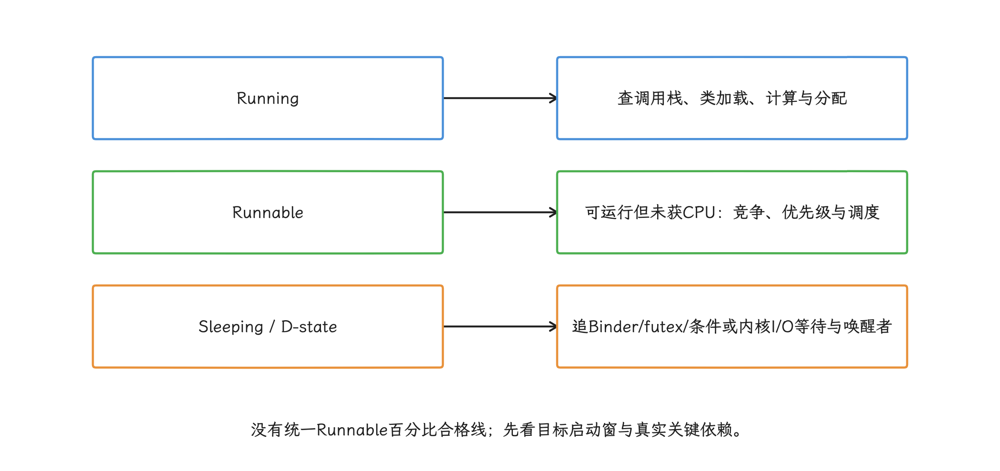

图：端到端slice包含运行和等待，不能把80ms墙时直接计作80ms CPU消耗。

#### 6.4 阅读 bind、Activity 和首帧

`bindApplication` 较长时，依次检查：

- Provider 自动初始化；
- Application attach/onCreate 自定义切片；
- 类加载、验证、静态初始化；
- GC、锁等待和 Binder；
- 主线程文件 I/O；
- 同期后台线程的 CPU/I/O 竞争。

Activity 阶段较长时，检查 View inflate 或 Compose 初始 composition、图片/字体、同步状态恢复和首屏数据绑定。单看 `Activity.onCreate()` 总时间不够，应该把可以动手改的业务环节标出来。

首帧阶段同时观察主线程 `Choreographer#doFrame`/traversal、RenderThread 和 FrameTimeline。`performTraversals` 结束只代表主线程 traversal 告一段落，TTID 终点要看系统记录；第一次同名 slice 也未必属于目标窗口，先核对时间再下结论。

#### 6.5 用标准库批量列出启动

本轮固定 Trace Processor v57.2 核对 `android.startup.startups` 模块；标准库与 Android 版本独立发布。标准库是随 `trace_processor` 版本发布的一组 PerfettoSQL 表、视图和函数。下面的查询用于列出目标包在一条 Trace 中的启动类型和持续时间：

```sql
INCLUDE PERFETTO MODULE android.startup.startups;

SELECT
  startup_id,
  package,
  startup_type,
  dur / 1e6 AS duration_ms
FROM android_startups
WHERE package = 'com.example.app'
ORDER BY ts;
```

这个查询使用派生启动表，不依赖 `bindApplication` 等裸 slice 是否存在。结果是 Trace Processor 对启动窗口的解析，仍应与 Macrobenchmark 报告和界面中的目标启动核对。

下面的查询用于查看目标启动窗口内耗时较长的主线程 slice：

```sql
INCLUDE PERFETTO MODULE android.startup.startups;

SELECT
  s.startup_id,
  s.slice_name,
  s.slice_dur / 1e6 AS duration_ms
FROM android_thread_slices_for_all_startups AS s
JOIN android_startups AS a USING (startup_id)
WHERE a.package = 'com.example.app'
  AND s.is_main_thread
  AND s.slice_dur >= 5e6
ORDER BY s.startup_id, s.slice_dur DESC;
```

5 ms 只是查询过滤器，不是性能合格线。v57.2 该视图按 slice 的起点是否落在启动窗内选择，`slice_dur` 保留原始整段时长，不会裁到启动结束点，也会保留嵌套 slice；不能把这些值相加当作窗口 CPU 时间或去重后的关键路径。当前标准库文档已把 `android_thread_slices_for_all_startups` 标为底层视图、建议避免直接使用；上面的查询适合固定 `trace_processor_shell` 版本后的临时排查。长期 CI 应优先采用 `android_slices_for_startup_and_slice_name(...)`、`android_startup_opinionated_breakdown` 等公开函数或表，并为查询 schema（列名与类型约定）编写测试。

<!-- gracker-diagram: a222-11-sql-window-meaning -->
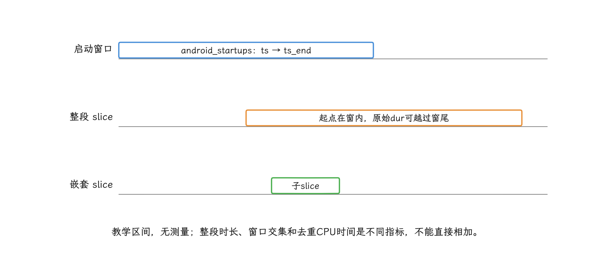

图：v57.2低层视图slice.ts BETWEEN启动起止，返回整段slice.dur；5ms仅查询过滤条件。

### 7. ClassLoader（按名称查找并装入类定义的加载器）、编译状态与 DEX 布局

#### 7.1 类首次使用仍可能进入启动关键路径

应用类通常由 ClassLoader 按需加载：首次主动使用一个类时，运行时可能要查找定义、加载、验证、解析，并在需要时执行 `<clinit>`（类的静态初始化方法）。安装期 AOT（提前编译）、运行时缓存或已有编译产物能减少其中一部分工作，但静态初始化中的应用代码仍会执行。

启动阶段要关注：

- 反射或 ServiceLoader 扫描大量类；
- 一个入口触发长依赖链的类初始化；
- `<clinit>` 读取文件、创建线程或加载 native library；
- 多个 SDK 同时加载重复的框架与序列化类型；
- 编译条件不同导致解释执行、JIT（运行时即时编译） 或 AOT 路径不同。

`ApplicationLoaders` 的缓存属于进程内状态，冷启动意味着旧应用进程不存在，这份缓存指望不上。多次冷启动越来越快，更可能来自 Linux page cache（内核保留的文件页缓存）、ART 编译产物、应用磁盘缓存、设备频率或数据状态变化，所以基准必须控制编译与缓存条件。

#### 7.2 Baseline Profile 与 Startup Profile 分工

两类 profile 解决的问题不同：

- **Baseline Profile**向 ART 提供关键类和方法，帮助安装/后台优化时进行 AOT 编译，减少关键路径上的解释与 JIT。
- **Startup Profile**面向 DEX 布局，把启动所需代码组织到主 DEX 的相邻区域；读取相邻数据所需的文件页更集中，这就是这里的读取局部性。

Baseline Profile 跳过不了业务初始化，也消除不了磁盘、Binder、锁或网络等待；Startup Profile 影响的也只是 DEX 文件组织和读取局部性，把类放到文件前面并不会让它们自动进入 CPU cache。收益要用固定编译模式的启动基准验证。

<!-- gracker-diagram: a222-12-profiles-and-caches -->
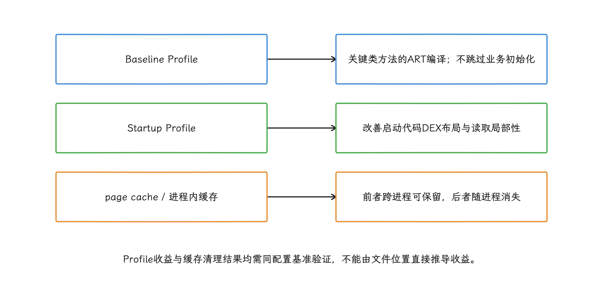

图：冷启动前置条件与编译模式分别控制；代码排到文件前部不保证自动位于CPU cache。

两者的实践统一见 [Baseline Profile 与 Startup Profile 实战](04-baseline-startup-cloud-profile.md)。启动期 ART/GC 行为见 [ART GC 启动期开销与分配治理](07-art-gc-startup-allocation-governance.md)。

### 8. 从 Trace 到修复的判断顺序

面对一条慢启动样本，我们可以按以下顺序推进：

1. 确认启动类型、入口、编译模式、设备状态和 TTID/TTFD。
2. 选中 Android App Startups 时间窗，判断延迟位于系统、bind、Activity 还是首帧。
3. 查看主线程是 Running、Runnable 还是等待，并追到依赖线程或 Binder 对端。
4. 用自定义切片、调用栈、I/O 或 GC 数据缩小到可修改代码。
5. 判断工作是否属于首屏必要条件；能移除就移除，能按需就按需，必须保留才考虑并发和局部优化。
6. 运行同配置 A/B Macrobenchmark，并检查 TTID、TTFD、帧和功能正确性。
7. 在小流量发布的线上数据中，按入口、设备、版本和启动类型确认回归消失。

启动优化的目标不止于更早撤掉 SplashScreen：用户要的是更快看到可理解、可操作且状态正确的内容，所以 TTID、TTFD 和关键页面帧要一起看。

## 启动类型、时间点与线上指标

上一节把启动拆成了可测阶段；这一节我们换到监控系统一侧，看数据怎样稳定采集：冷、温、热启动和版本要分层，TTID 与 TTFD 也要分开。

### 为什么启动监控需要独立设计

启动监控要回答两个问题：改动发布后，用户启动体验是否变差；出现变化后，怎样定位到版本、入口、设备和初始化任务。

只在 `Application.onCreate()` 入口与出口记录时间，覆盖的只是中间一小段：系统收到启动请求、创建进程、调用 `bindApplication`、安装 ContentProvider、显示首帧，都落在这个区间之外，首屏核心内容何时可用同样读不出来。完整方案需要三类数据互相校准：

| 数据 | 回答的问题 | 典型来源 |
| --- | --- | --- |
| 平台启动记录 | 系统何时收到请求、进程属于冷启动/温启动/热启动、由什么原因与组件触发 | Android 15+ `ApplicationStartInfo`、Logcat（系统日志）、Perfetto |
| 应用阶段事件 | 哪个 Provider、初始化任务、页面或数据依赖消耗时间 | 单调时钟事件、自定义 trace（时间线标记） |
| 用户体验指标 | 第一帧何时显示，核心内容何时可交互 | TTID、`reportFullyDrawn()` 对应的 TTFD、业务 ready（业务就绪点） |

三种启动状态走过的代码不同，线上必须分开统计。

三类工具各管一段：线上监控发现耗时分布的变化，Macrobenchmark 在固定设备和条件下重复对比，Perfetto 解释一次启动里线程、Binder、I/O 和调度层面发生了什么。线上 P90（90% 的样本不超过的耗时） 曲线要还原单次启动，还得回到时间线；反过来，一次时间线也撑不起全量用户的耗时分布。

### 1. 先固定测量契约

我们先把测量契约固定下来。这里的“测量契约”指一项指标固定不变的定义：起点、终点、适用启动类型、缺失条件和失败样本处理方式都要写清；名称相同而起止不同的数据，放进同一条曲线只会污染结论。

#### 1.1 TTID、TTFD 与业务 ready

TTID 是 Time to Initial Display，即从启动请求到首次显示；TTFD 是 Time to Full Display，即从启动请求到 App 声明主要内容已完整可用。它们都是 Android 平台定义的指标，“业务 ready”则是团队为某个页面定义的可用条件。

| 指标 | 起点 | 终点 | 平台语义 | 使用方式 |
| --- | --- | --- | --- | --- |
| TTID | 系统收到启动请求 | Activity 窗口第一帧绘制并显示 | Android framework（平台框架）自动测量 | 判断用户何时看到应用 UI |
| TTFD | 系统收到启动请求 | 应用调用 `reportFullyDrawn()`，且不早于 TTID | 由应用声明“核心 UI 已完整绘制并可用” | 判断首屏何时达到约定的可用状态 |
| `content_ready` | 与 TTID/TTFD 相同的启动记录，或明确的应用起点 | 首屏关键数据和交互状态满足产品约定 | 应用自定义 | 解释 TTFD，支持无法直接读取系统 TTFD 的版本 |
| `app_on_create_cost` | `Application.onCreate()` 方法入口 | 方法返回前 | 应用局部阶段 | 只解释 App 初始化，不能称为总启动耗时 |

TTID 只说明第一帧出现，骨架屏、空列表或不可点击的占位页也可能已经有 TTID。TTFD 则要我们给每个首屏入口定义“可用”：例如首页主导航可操作且首批必要数据已展示，支付页已完成本地安全状态检查，拍摄页预览已可用。广告、推荐流后续分页和不影响首个操作的后台刷新，通常都要留在 TTFD 之外。

`Activity.reportFullyDrawn()` 是一次性启动信号。平台的 `Activity` 实现由内部标记 `mDoReportFullyDrawn` 控制：第一次有效调用经 `ActivityClient` 报给系统，后续调用被忽略。若调用发生在系统确认第一帧之前，平台会把 TTFD 记为 TTID；过早上报会让两个值相同，丢掉“内容完成”的区分能力。

#### 1.2 使用同一种时钟

耗时计算使用单调时钟，即只向前推进、不受用户改时间或时区变化影响的计时源。平台的 `ApplicationStartInfo` 系统时间戳，在 Activity launch、fork、bindApplication、首帧和 fully drawn 路径中都取自 `SystemClock.uptimeNanos()`；我们通过 `ActivityManager.addStartInfoTimestamp()` 写入同一启动记录的自定义点时，也要用同一时基。App 自有遥测里计算同设备会话耗时，可以另用 `SystemClock.elapsedRealtimeNanos()`，只是它和平台启动记录里的 `uptimeNanos()` 节点属于不同时基，直接相减得到的数没有意义。`System.nanoTime()` 只保证用于计算同一运行环境中的时间差，绝对起点没有稳定含义。

`System.currentTimeMillis()` 是 UTC epoch 墙钟时间，可因用户改时或校时跳变，不适合测量启动区间；单独改变显示时区并不会改变这个 epoch 值。墙钟用于事件日期与发布对齐，不等同于真实经过的单调时长。一个事件可以同时保存：

<!-- gracker-diagram: a222-13-clock-domains -->
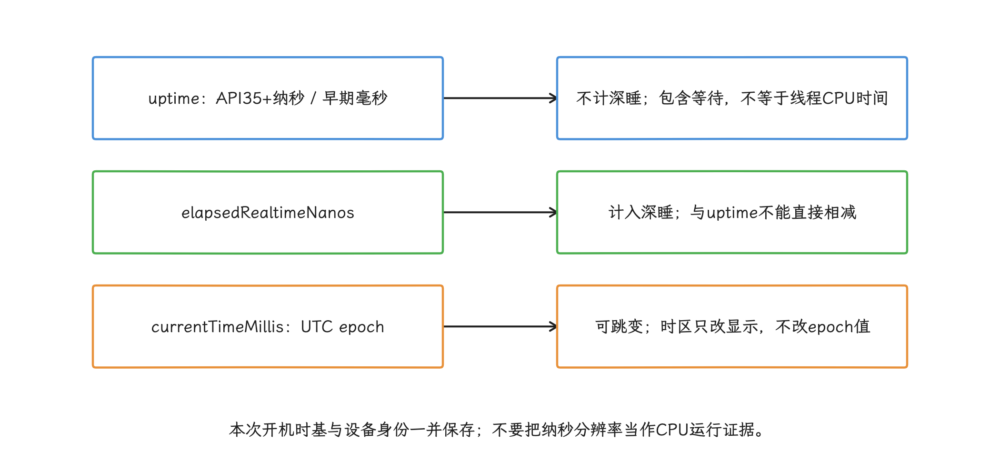

图：ApplicationStartInfo固定系统路径使用uptimeNanos；跨设备不相减单调时钟，墙钟只做事件对齐。

- `event_wall_ms`：用于版本发布、灰度放量和配置变更对齐；
- `event_elapsed_ns`：用于同一台设备本次启动内的阶段耗时；
- `duration_ms`：端侧完成起止点检查后生成，服务端不跨设备相减单调时钟。

#### 1.3 启动样本的身份

同一设备可能由桌面图标、deep link（直接打开特定页面的链接）、通知、桌面小组件 Widget、Service、Broadcast 或 Provider 启动；多进程 App 还会产生多个进程启动记录。每条样本至少携带：

| 维度 | 建议字段 |
| --- | --- |
| 构建 | versionName、versionCode、渠道、构建 ID、监控 schema（字段结构与解释规则）版本 |
| 启动 | cold/warm/hot、入口枚举、首屏路由、是否新任务 |
| 进程 | processName、pid、主/远程进程角色 |
| 安装状态 | 首次安装后启动、升级后启动、普通启动、数据库迁移版本 |
| 设备 | Android 版本、ABI（应用二进制使用的 CPU 指令集）、RAM 内存档位、SoC（片上系统）/机型分组、低电量与过热状态 |
| 编译与配置 | Baseline Profile（预先告知 ART 启动热路径的配置）状态、实验组、远程配置版本 |
| 结果 | TTID、TTFD、content ready、超时、退出或上报缺失 |

入口 URL、Intent extras（附加参数）、用户 ID 和页面原始参数要留在端上。路由、设备和任务名应转换成有限的受控枚举；确需用哈希关联事件时，应使用服务端可轮换密钥生成的伪匿名标识，并评估它是否仍属于个人数据——普通哈希当不成匿名化。更完整的采集规则见 [性能指标采集与上报](../ch26-observability/01-app-observability-performance-collection.md)。

<!-- gracker-diagram: a222-14-sample-identity -->
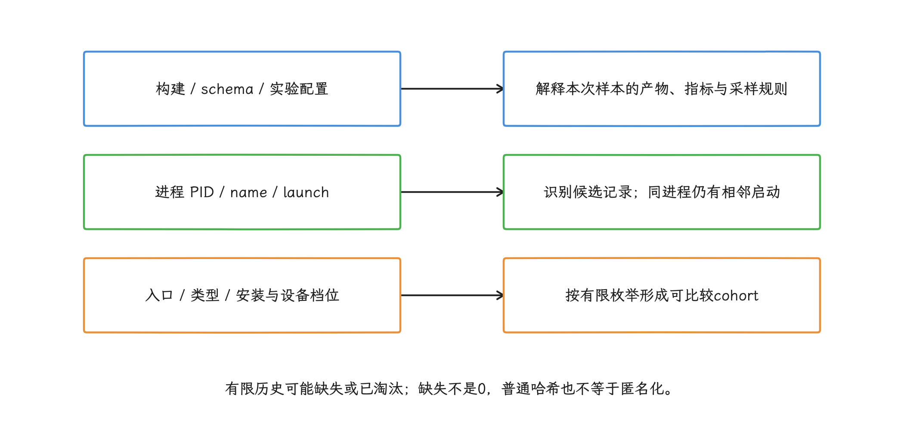

图：原始URI、extras和用户参数不进入Trace名称；当前PID候选仍需按本地会话与入口验证。

### 2. 端侧埋点怎样放

#### 2.1 最早的埋点点位

埋点想放得早，就会碰到启动路径本身的约束：ContentProvider 会在 `Application.onCreate()` 之前安装，若为了“尽早监控”新增自动初始化 Provider，监控 SDK 的类加载和初始化也会随之进入每次冷启动的关键路径。已有 Provider 即使负责记录最早入口，也只应保存一个时间戳和必要身份；序列化、压缩、网络发送与扩展设备信息都应延后。

推荐点位如下：

| 点位 | 位置 | 能说明什么 | 不能说明什么 |
| --- | --- | --- | --- |
| `process_observed` | 已有的最早轻量入口或 `Application.attachBaseContext()` | App 代码能看到进程的时间 | 系统启动请求与 fork（从 Zygote 派生进程）的精确时间 |
| `application_on_create_enter/exit` | `Application.onCreate()` | Application 阶段代码耗时 | Provider 和系统进程创建耗时 |
| `activity_create/start/resume` | 入口 Activity 生命周期 | 页面创建路径和生命周期等待 | 第一帧已显示 |
| 初始化 task 事件 | 启动任务执行器 | 任务从开始到结束的耗时、线程和依赖 | CPU 消耗或锁等待原因，除非再配 trace |
| `content_ready` | 首屏状态机（页面从加载、成功、失败等状态间转换的规则） | 核心数据和交互就绪 | SurfaceFlinger（负责屏幕图层合成的系统服务）已完成显示 |
| `fully_drawn_reported` | `reportFullyDrawn()` 调用处 | 应用声明的 TTFD 边界 | 每次页面恢复的完成时间 |

`onResume()` 只表示生命周期走到前台，本身说明不了首帧显示。`ViewTreeObserver.OnPreDrawListener` 发生在即将绘制之前，`Choreographer.FrameCallback` 是 UI 帧调度回调，两个时点都证明不了 SurfaceFlinger 已经把像素显示到屏幕。App 可以把它们当作自定义近似点，但事件名要写成 `pre_draw` 或 `frame_callback`，别冒充平台 TTID。

<!-- gracker-diagram: a222-15-instrumentation-boundaries -->
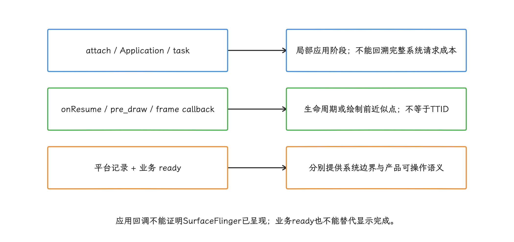

图：为监控新增重型Provider会进入自己的冷启动关键路径；首帧前仅记录必要身份和时间点。

#### 2.2 准确上报 fully drawn

在多处直接调用 `reportFullyDrawn()`，很容易由最早完成的模块提前上报。`ComponentActivity` 的 `FullyDrawnReporter` 可以登记多个 reporter（“尚未就绪”的占位计数）；所有 reporter 都释放后，它才在下一动画帧调用平台 API。至少使用一次 `addReporter()` 或 `reportWhenComplete()`，这个协调器才会代为上报。

下面的 ViewModel（跨配置变化保存页面状态的 Jetpack 组件）示例用于等待首屏核心数据完成，再由 `FullyDrawnReporter` 安排上报：

```kotlin
class HomeActivity : ComponentActivity() {
    override fun onCreate(savedInstanceState: Bundle?) {
        super.onCreate(savedInstanceState)
        setContentView(R.layout.activity_home)

        lifecycleScope.launch {
            fullyDrawnReporter.reportWhenComplete {
                viewModel.uiState
                    .filterIsInstance<HomeUiState.Ready>()
                    .first()
            }
        }
    }
}
```

`reportWhenComplete` 会在挂起任务执行期间持有一个 reporter，等到 `Ready` 后释放；全部 reporter 都释放后，`FullyDrawnReporter` 在下一动画帧调用 `reportFullyDrawn()`。这里仅演示正常等到 `Ready` 的路径。固定 Activity 1.11.0 的 `reportWhenComplete()` 在 `finally` 中调用 `removeReporter()`，异常或取消也会释放计数；它协调的是任务结束，不会验证页面成功或是否形成可操作错误态。生产代码应先把成功、合法空态、离线和可恢复错误归一为可报告的终态，再配合 UI 提交/布局条件；未形成终态的失败不能靠释放 reporter 伪装成完成。一直加载、退出与缺失仍要单独统计。

Jetpack Compose 首屏可以把同一条 ready 规则放进 `ReportDrawnWhen`；它会在条件为 `true` 前延迟 fully drawn 上报：

```kotlin
@Composable
fun HomeRoute(state: HomeUiState) {
    ReportDrawnWhen {
        state is HomeUiState.Ready
    }

    HomeScreen(state)
}
```

这个条件应表示用户已能完成首个核心操作。示例约定 `Ready` 包含已提交的合法空态与可操作降级态；不要额外使用 `isNotEmpty()` 排除合法空列表。若业务模型单独定义 Empty/Error/Offline，也应把可操作终态纳入同一条规则。

<!-- gracker-diagram: a222-07-ready-contract -->
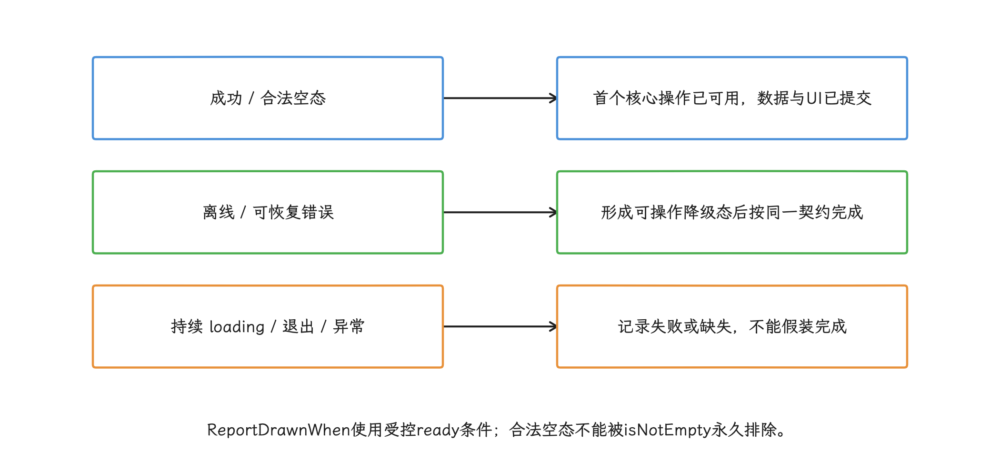

图：reportWhenComplete在finally释放reporter，异常或取消也会释放；计数为零本身不证明业务成功。

#### 2.3 慢任务的时间线记录

每个启动任务应记录受控的任务名、调度线程、依赖、开始/结束、结果和是否位于首帧前。对高频短任务，记录动作本身可能比任务还耗时，可以只保留汇总计数，或只在被抽中的慢启动诊断样本里记录细节。

自定义 trace 与统计事件分工如下：

- 统计事件保留每次启动的稳定字段与耗时，用于计算全体样本的分布；
- `Trace.beginSection()` / `Trace.endSection()` 或 AndroidX Tracing 在系统时间线上标记阶段，用于在 Perfetto 中对齐主线程、Binder、I/O 和调度。

标记阶段时，section 必须严格配对，名称集合要有上限；不上传任意类名、SQL、URL 或用户内容作为 trace 名。若把用户输入或 URL 拼进名称，会产生近乎无限的不同值，使存储和聚合失控。

采集器自身要轻量：首帧前不创建大线程池、不扫描完整设备信息、不同步写日志文件。启动事件先写入内存队列或受控的小型本地记录，首帧后批量编码；网络发送交给既有后台上报机制。

### 3. `ApplicationStartInfo` 与系统启动记录

应用侧埋点补齐了阶段细节，起点和分类仍要靠系统记录。`ApplicationStartInfo` 由 Android 15 引入，是一份系统逐步补全的进程启动记录，App 可通过 `ActivityManager` 查询。到 Android 17 / API 37，这组 API 能给出 App 自己难以准确记录的系统侧信息：

- `getProcessName()`、PID（进程编号） 与 UID（Linux 用户身份）；
- `getReason()`：启动 Activity、Service、Provider、Broadcast、Job、Push、闹钟、备份等触发原因；
- `getStartType()`：cold、warm、hot；
- `getStartupState()`：记录仍在启动、发生错误或已经画出首帧；
- `getStartupTimestamps()`：launch、fork、bindApplication、Application.onCreate、first frame、fully drawn 等单调时间戳；
- `getStartComponent()`：Android 16（API 36）加入，用于区分 Activity、Service、Broadcast 和 Provider。
- `getLaunchMode()`、`wasForceStopped()` 与去除 extras 的启动 Intent：用于补充 Activity 任务和进程状态；原始 Intent、URI 与 referrer（来源页面）默认不进入遥测。

`reason` 与 `start component` 各说各的事：前者是触发原因，后者说明哪类组件引发进程创建。原因枚举对不上 Activity、Service、Broadcast、Provider 四大组件分类，Android 16 起判断组件类型要用 `getStartComponent()`。

#### 3.1 Android 15、16、17 的能力范围

这组 API 的主体在 Android 15 已经提供。本文用 Android 17 的源码核对实现，核对的是实现行为；各项能力的归属仍按引入版本算，Android 15 已有的不算 17 的新增功能。

| 能力 | API 35 / Android 15 | API 36 / Android 16 | API 37 / Android 17 |
| --- | --- | --- | --- |
| `ApplicationStartInfo`、历史查询、首帧完成监听 | 加入 | 保留 | 保留 |
| 8 个系统时间戳、21–30 开发者时间戳 | 加入 | 保留 | 保留 |
| `getLaunchMode()`、`wasForceStopped()`、去除 extras 的启动 Intent | 加入 | 保留 | 保留 |
| `getStartComponent()` 与组件常量 | 无 | 加入 | 保留 |

API 35 没有 `getStartComponent()`，调用前必须检查系统版本。官方文档还注明，Service 启动的 `LAUNCH` 时间戳在 Android 16（Baklava / API 36）及更早版本可能不准确；Android 17 不在这个已知限制范围内。

<!-- gracker-diagram: a222-16-api-version-boundaries -->
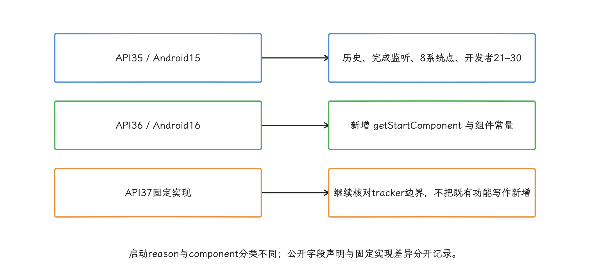

图：Service LAUNCH在API36及以下可能不准确；API35类型与调用仍需实际版本判断，注解本身不是运行guard。

#### 3.2 记录形成与状态

system_server 中的 `AppStartInfoTracker` 先建立启动记录，随后由进程创建、应用绑定、首帧和 fully drawn 等路径逐步补入字段。App 通过 `ActivityManager` 读到的是某一时刻的记录副本，也就是快照；它不会自动更新，也不包含线程调度、Binder 和 I/O 的完整时间线。

| `getStartupState()` | 含义 | 可依赖的节点 |
| --- | --- | --- |
| `STARTUP_STATE_STARTED` | 启动仍在进行 | `LAUNCH` |
| `STARTUP_STATE_ERROR` | 启动失败，记录不会继续完整化 | 只使用已经存在的节点 |
| `STARTUP_STATE_FIRST_FRAME_DRAWN` | Activity 已走到首帧 | `LAUNCH`、`BIND_APPLICATION`、`APPLICATION_ONCREATE`、`FIRST_FRAME` |

平台没有 `FULLY_DRAWN` 状态，fully drawn 只是依赖 App 调用 `reportFullyDrawn()` 的可选时间戳；完成监听里的“complete”指记录进入 `FIRST_FRAME_DRAWN`，TTFD 是否完成要看后续的 `FULLY_DRAWN` 时间戳。固定 tracker 的完成触发点在加入 `FIRST_FRAME` 时，纯 Service、Broadcast 或 Provider 启动若没有 Activity 首帧，就不能依赖它；反过来，没等到回调也说明不了启动失败。

八个系统时间戳的常量编号只是编号，发生顺序要看实际时间值：

<!-- gracker-diagram: a222-17-record-lifecycle -->
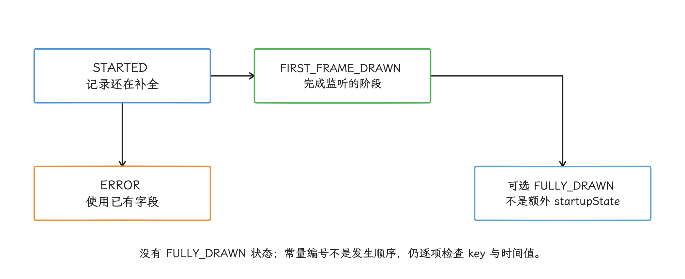

图：FIRST_FRAME_DRAWN公开契约提供相应系统点；FULLY_DRAWN依赖应用报告，副本还可能缺失该点。

| 时间戳 | 语义与限制 |
| --- | --- |
| `LAUNCH` | 系统组件启动起点，不一定是桌面图标点击 |
| `FORK` | 可选的进程 fork 节点，不表示进程初始化完成 |
| `BIND_APPLICATION` | 系统调用应用绑定的节点 |
| `APPLICATION_ONCREATE` | 调用 `Application.onCreate()` 前的节点 |
| `FIRST_FRAME` | 首帧绘制，不单独证明 SurfaceFlinger 已呈现或页面可交互 |
| `FULLY_DRAWN` | 应用定义并上报的完成边界，始终可能缺失 |
| `INITIAL_RENDERTHREAD_FRAME` | 可选的初始 RenderThread（负责部分渲染工作的线程）帧 |
| `SURFACEFLINGER_COMPOSITION_COMPLETE` | 可选的合成完成节点，仍不等于业务 ready |

#### 3.3 时间戳的缺失与逐项判断

首帧完成状态保证可获得 `LAUNCH`、`BIND_APPLICATION`、`APPLICATION_ONCREATE` 和 `FIRST_FRAME`，其余时间戳要逐项判断。`FULLY_DRAWN` 依赖 App 调用 `reportFullyDrawn()`，任何版本都要按“可能缺失”处理。`addApplicationStartInfoCompletionListener()` 在首帧完成时异步回调，不等待 fully drawn，所以回调里的快照经常没有 `FULLY_DRAWN`；我们要拿 TTFD 时，得在上报后重新查询历史记录、取新副本。

跨版本还有一个限制要记下：官方 API 文档说明，Service 触发的 `START_TIMESTAMP_LAUNCH` 在 Android 16 及以下可能不准确。本书的 Android 17 基线已越过这个限制；但分析 Android 15–16 存量设备时仍要标记该样本，精确的 Service 启动回归要换用别的数据。

#### 3.4 读取当前进程的正确记录

`getHistoricalProcessStartReasons(maxNum)` 返回保存在有限容量历史队列中的启动记录，也可能包含尚未完成的记录。读取前要检查 `getStartupState()`，读取时间戳 Map 时也要检查 key 是否存在；“字段尚未写入”是缺失，跟数值 0 是两回事，混用会算出错误的区间。

历史列表还会混入同一 App 近期的其他进程或相邻启动。选择当前记录时至少按 PID、进程名过滤，再按 `LAUNCH` 取最新项；列表顺序保证不了第 0 项恰好是当前这次启动。

```kotlin
@RequiresApi(35)
fun latestCurrentProcessStart(
    activityManager: ActivityManager,
    maxRecords: Int = 16,
): ApplicationStartInfo? {
    require(maxRecords > 0)
    return activityManager
        .getHistoricalProcessStartReasons(maxRecords)
        .asSequence()
        .filter { info ->
            info.pid == Process.myPid() &&
                info.processName == Application.getProcessName()
        }
        .maxByOrNull { info ->
            info.startupTimestamps[
                ApplicationStartInfo.START_TIMESTAMP_LAUNCH
            ] ?: Long.MIN_VALUE
        }
}
```

生产采集还应核对 launch 时间与当前本地启动会话；同一 PID/进程名可以有相邻的 Activity 启动，PID 也可在进程结束后复用。过滤得到的只是候选，不自动证明就是当前入口。需要 `FULLY_DRAWN` 时，在业务条件满足并调用 `reportFullyDrawn()` 后重新查询；首帧回调中的旧副本通常没有这个节点。

#### 3.5 把业务点写进平台启动记录

API 35 起，`ActivityManager.addStartInfoTimestamp()` 允许 App 使用 21～30 的保留 key 添加自定义单调时间戳。它可以向系统启动记录提交 `route_resolved`（路由决定完成）之类业务点，但不能把 API 正常返回当作已写入当前 PID 记录的证明。固定 AMS 按包名与 UID 寻找容器，tracker 再取 `mInfos.get(0)` 最新项，未按调用 PID 指定目标；并发多进程或相邻启动时需回读核对记录身份，并保留应用自己的原始业务事件。

这里存在公开契约与 Android 17 r1 实现的差异。当前 `ActivityManager` API 文档写明：相同 key 会覆盖旧值，只有在 `reportFullyDrawn()` 之后添加的时间戳才会被丢弃；但 `android-17.0.0_r1` 的 `AppStartInfoTracker` 会拒绝重复 key，并在记录进入 `FIRST_FRAME_DRAWN` 后拒绝开发者 key。

<!-- gracker-diagram: a222-19-timestamp-submission -->
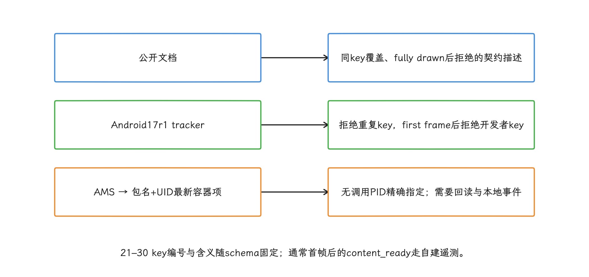

图：每个会话每key首帧前只提交一次；API正常返回不证明已接受，也不证明写到了当前入口记录。

把某个版本的内部 tracker 行为当成长期 API 保证是靠不住的，兼容两种行为的写法是：每个开发者 key 在首帧前只写一次，回读时若该 key 缺失就按缺失处理。通常发生在首帧后的 `content_ready` 继续走应用遥测（App 自己采集并上报的事件），约定的完成时点交给 `reportFullyDrawn()` 表达。

下面的代码注册首帧完成监听，并用保留区第一个 key 写入首帧前的路由决策完成点：

```kotlin
@RequiresApi(35)
class PlatformStartInfoCollector(
    private val activityManager: ActivityManager,
    private val callbackExecutor: Executor,
) {
    companion object {
        const val TIMESTAMP_ROUTE_RESOLVED =
            ApplicationStartInfo
                .START_TIMESTAMP_RESERVED_RANGE_DEVELOPER_START
    }

    // 每个本地启动会话使用一个实例；这些状态不跨会话复用。
    private val registered = java.util.concurrent.atomic.AtomicBoolean()
    private val routeSubmitted = java.util.concurrent.atomic.AtomicBoolean()
    private val deliveredLaunches =
        java.util.concurrent.ConcurrentHashMap.newKeySet<Long>()

    fun register(
        onFirstFrameCandidate: (ApplicationStartInfo) -> Unit,
    ) {
        if (!registered.compareAndSet(false, true)) return

        fun deliver(info: ApplicationStartInfo) {
            if (info.pid != Process.myPid() ||
                info.processName != Application.getProcessName() ||
                info.startupState !=
                    ApplicationStartInfo.STARTUP_STATE_FIRST_FRAME_DRAWN
            ) return
            val launchNs = info.startupTimestamps[
                ApplicationStartInfo.START_TIMESTAMP_LAUNCH
            ] ?: return
            if (deliveredLaunches.add(launchNs)) {
                onFirstFrameCandidate(info) // 外层仍核对本地会话与入口。
            }
        }

        activityManager.addApplicationStartInfoCompletionListener(
            callbackExecutor,
        ) { info -> deliver(info) }

        // 注册后查询，补充已完成记录；与异步回调按 launch 去重。
        latestCurrentProcessRecord()?.let { info ->
            callbackExecutor.execute { deliver(info) }
        }
    }

    fun markRouteResolved() {
        if (!routeSubmitted.compareAndSet(false, true)) return
        activityManager.addStartInfoTimestamp(
            TIMESTAMP_ROUTE_RESOLVED,
            SystemClock.uptimeNanos(),
        ) // 正常返回仍可能被 tracker 忽略；需要回读确认。
    }

    fun latestCurrentProcessRecord(): ApplicationStartInfo? =
        latestCurrentProcessStart(activityManager, maxRecords = 16)
}
```

公开契约称已完成的记录会立即投递到指定 Executor；但固定 Android 17 r1 的 tracker 登记路径只按 UID 保存回调，没有补发已完成记录的分支，完成分发也以 real UID 为键。示例因此过滤 PID/进程名/状态，注册后读取历史候选并去重。一次回读仍可能太早，同 UID 其他进程还可能先消耗这次监听；生产应在受控业务里程碑有限次回读，始终保留应用事件作为后备。监听与回读结果均只复制必要字段交采集队列，采集异常由上层处理，不进入首帧关键路径。历史列表覆盖 App 近期多个进程启动，取记录要像示例那样按当前 PID 和进程名过滤，生产代码还应核对最新 launch 时间与当前启动会话。业务 key 的编号和含义要随监控 schema 固定，避免不同版本把同一个 key 解释成不同事件。

<!-- gracker-diagram: a222-18-callback-history-race -->
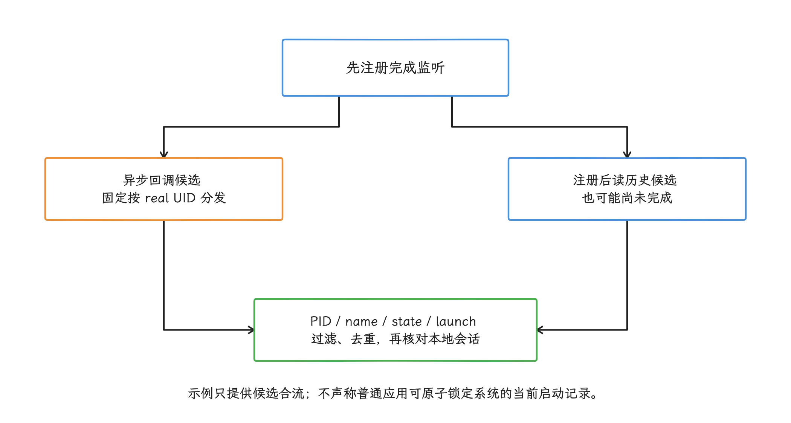

图：固定登记路径未见已完成回放，UID其他进程可先消费监听；一次回读也不保证补齐，生产在里程碑有限刷新。

`ApplicationStartInfo` 适合校准系统起点和启动分类，Android 10–14 仍需兼容自建埋点。完整 API 设计见[ApplicationStartInfo](../ch26-observability/07-application-start-info.md)。

#### 3.6 阶段耗时的缺失与乱序处理

不要把缺失 key 补成 0，也不要按常量编号排序。只有起止节点都存在且终点不早于起点时，区间才有效：

```kotlin
@RequiresApi(35)
fun startupDurationMs(
    info: ApplicationStartInfo,
    fromKey: Int,
    toKey: Int,
): Double? {
    val startNs = info.startupTimestamps[fromKey] ?: return null
    val endNs = info.startupTimestamps[toKey] ?: return null
    if (startNs < 0L || endNs < startNs) return null
    return (endNs - startNs) / 1_000_000.0
}
```

采集端应保留原始节点、字段是否存在以及 `startupState`。这样即使 schema 调整或后续发现平台差异，服务端仍能重新计算区间，无须依赖端侧已经算好的单一耗时。

<!-- gracker-diagram: a222-20-duration-validity -->
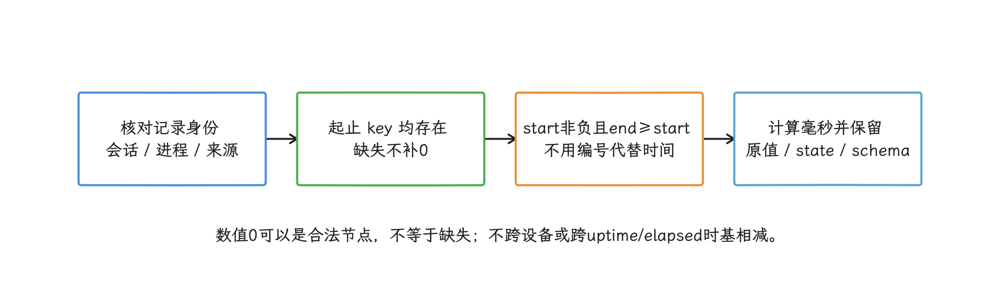

图：startupDurationMs对缺失或非法顺序返回null；原始节点保留，便于修订schema后重新计算。

### 4. 线上聚合与分位数解读

我们先看分布形态。启动耗时通常呈右偏长尾分布：多数样本集中在较短区间，少数慢样本向更长耗时方向拖出一条“尾巴”。低端设备、升级迁移、磁盘繁忙、首次读取配置和编译状态都会制造这类慢样本。均值容易被少数极慢值拉高，也可能被大量热启动样本稀释。

常用分位数回答不同问题：

| 分位数 | 解释 | 使用提醒 |
| --- | --- | --- |
| P50 | 一半样本不超过该耗时 | 观察主路径和整体平移 |
| P75 | 较慢但仍常见的样本 | 观察普通长尾是否扩大 |
| P90/P95 | 慢启动群体 | 适合作为版本门禁候选指标 |
| P99 | 极端尾部 | 需要较大样本量，易受异常设备与数据质量影响 |

分位数必须从同一 cohort（版本、启动类型等条件一致的一组样本）的原始数据或可合并分布摘要计算：每台设备先算 P90 再把各设备 P90 求平均，或把每日 P90 平均成周 P90，都会失真。数据量大时可用直方图，或 t-digest、KLL 这类近似分位数摘要；无论选哪种，都要固定直方图区间边界或算法版本，并保留样本数、最小值、最大值和缺失率。

<!-- gracker-diagram: a222-21-quantile-merge -->
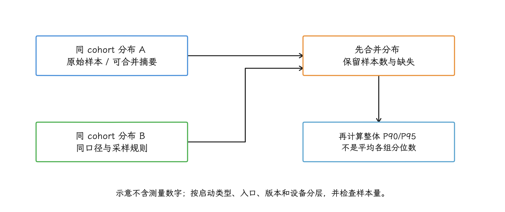

图：固定直方图区间或摘要算法版本，再合并同cohort分布；设备与每日P90平均都不能还原总体P90。

#### 4.1 先分组，再看分位数

同样一条分位数曲线，混进不同条件的样本就会失真；看分位数之前，最低限度要按以下维度拆分：

- cold、warm、hot；
- 首屏路由与入口来源；
- 普通启动、首次安装启动、升级后启动；
- App 版本、实验组与远程配置版本；
- Android 版本、ABI、设备性能档位；
- 主进程与远程进程；
- Profile 安装/编译状态能够可靠获得时，单独分组。

分组过细会让每组样本太少。看板应支持从“版本 × 启动类型”逐级查看页面和设备，告警只选择样本量足够、含义长期稳定的 cohort。

#### 4.2 把缺失和退出当成结果

TTFD 上报容易出现幸存者偏差，即只看到了成功完成启动的会话：启动期间退出、崩溃、ANR（Application Not Responding，应用无响应）、进程被杀或长期 loading（一直停留在加载态） 的会话都没有 TTFD 数值。只统计成功上报的样本，等于把慢到中途放弃的会话排除在曲线之外，严重问题反而可能让 TTFD 曲线看起来更好。

每个窗口应同时展示：

<!-- gracker-diagram: a222-22-completion-denominators -->
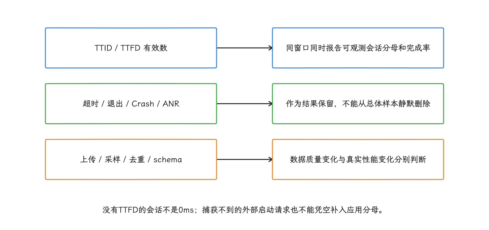

图：失败和放弃会让可见成功样本曲线变好；诊断样本数也不能当作全部启动分母。

- 启动请求或可观测会话数；
- TTID 有效样本数；
- TTFD 有效样本数与完成率；
- fully drawn 超时数；
- 首屏前崩溃、ANR、主动退出和进程死亡；
- 采样率、上传成功率、去重率与 schema 版本。

采样策略也要进入总样本数的解释。普通样本可以做稳定随机采样，慢样本与失败样本可以提高诊断采样率；后者被采到的概率更高，两类数据直接混算总体分位数会带偏结果。用于告警的指标数据和用于定位的高采样诊断数据应分开保存；若必须合并，应按每类样本被采中的概率加权。

<!-- gracker-diagram: a222-23-sampling-bias -->
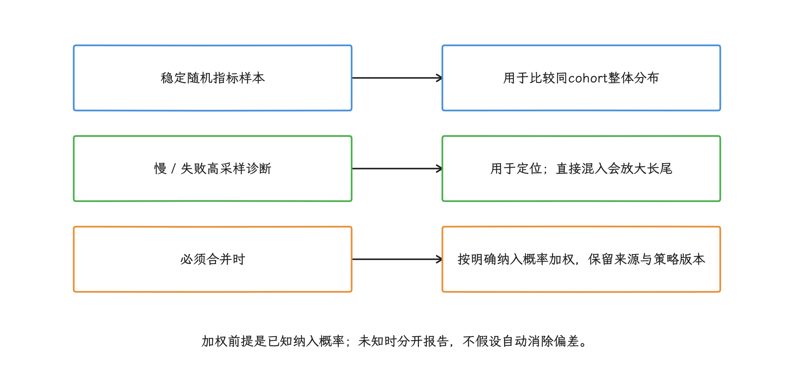

图：采样率变化会改变观察到的分布；一次Trace解释单个样本，不能替代线上总体曲线。

### 5. 回归检测与归因

分位数看板回答“变没变慢”；发布拦截还要再回答一层：这次变化是真回归，还是日常噪声。固定写死“P90 上升 15% 就拦截发布”，会在基线很低、样本很少或日常波动明显时产生误报。发布门槛应同时考虑增加了多少毫秒、相对增幅、样本量和统计不确定性。

一条可执行的规则可以写成：

```text
同 cohort、同统计窗口：
  样本量达到该指标的最低要求
  AND P90 绝对增量超过产品预算
  AND P90 相对增量超过历史噪声带
  AND 差异的置信区间不跨过“无影响”边界
  AND 连续两个窗口成立
=> 暂停灰度并进入归因
```

这段规则中的“预算”是产品允许增加的毫秒数，“历史噪声带”是指标在没有代码变化时通常波动的范围。高流量版本可以用 bootstrap（从现有样本反复有放回抽样）估计置信区间（变化可能落入的范围）；低流量灰度可先看中位数、MAD（各样本与中位数偏差的中位数）、样本明细和线下 benchmark，避免把样本不足的 P99 当成发布结论。实验统计细节见 [性能实验统计](../ch26-observability/04-ab-testing-regression.md)。

<!-- gracker-diagram: a222-24-regression-evidence -->
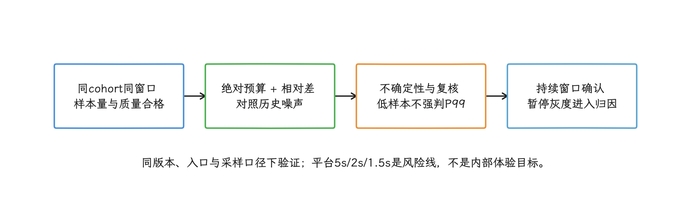

图：这是工程规则示例；阈值来自产品预算和实验模型，置信区间与连续窗口不是通用固定常量。

#### 5.1 归因顺序

发现回归后，我们按以下顺序缩小范围：

1. 核对 schema、采样率、TTFD 完成率与启动类型占比，排除测量变化。
2. 对齐灰度开始、构建发布时间、远程配置、服务端接口和实验开关。
3. 按入口、页面、设备档位、Android 版本、ABI、安装状态分组。
4. 比较初始化 task 出现率和耗时，检查是否新增 Provider、SDK 或主线程 I/O。
5. 在可复现设备上运行同编译模式的 Macrobenchmark，并打开 Perfetto。
6. 把长耗时区间映射到具体提交和模块所有者，修复后按同一 cohort 回看。

常见信号可以这样解释：

| 现象 | 优先检查 |
| --- | --- |
| `LAUNCH -> FORK` 变长 | 系统负载、进程创建竞争，以及是否集中在特定设备或 ROM（厂商系统版本） |
| `BIND_APPLICATION -> APPLICATION_ONCREATE` 变长 | Provider、类加载、Instrumentation（测试或监控注入层）与应用绑定阶段 |
| Application 阶段变长 | 新 SDK、同步 I/O、锁、线程池和任务依赖 |
| TTID 变长但 Application 稳定 | Activity 创建、布局/Compose 首次 composition（根据状态生成 UI 树）、资源加载与首帧调度 |
| TTID 稳定但 TTFD 变长 | 首屏数据、数据库、网络、缓存和 ready 条件 |
| TTFD 数值变好但完成率下降 | 超时、退出、崩溃或上报丢失造成幸存者偏差 |
| 只在升级后启动变慢 | 数据库迁移、缓存重建、Profile/编译状态和版本迁移任务 |

`ApplicationStartInfo` 的系统节点用来确定区间，应用 task 事件说明责任模块，Perfetto 用来确认线程当时在运行、睡眠、I/O 还是锁等待。后两层凑不齐时，单凭一个长区间还定不了根因。

### 6. Android Vitals 怎样对标

自建监控之外还有一个现成的外部基准：Google Play Android Vitals 使用 TTID 判断 excessive startup，即启动耗时达到平台定义的“过慢”范围。当前 [Android vitals 专页](https://developer.android.com/google/play/vitals/launch-time)公开阈值为：

| 启动类型 | excessive 阈值 |
| --- | --- |
| cold | 5 秒及以上 |
| warm | 2 秒及以上 |
| hot | 1.5 秒及以上 |

这些数值是 Play 用来识别明显过慢启动的风险线，距理想体验还有距离；团队内部预算通常要更严格，并按核心入口、设备档位和用户任务设置。Google 的性能测量总览还提供更积极的目标参考，但统一的毫秒数承诺要建立在对页面复杂度、设备和编译条件的具体分析上。

Vitals 与自建监控应同时保留：

| 维度 | Android Vitals | 自建监控 |
| --- | --- | --- |
| 分发覆盖 | 满足 Play 采集条件的发布用户 | 可覆盖灰度、内测和非 Play 渠道 |
| 核心口径 | 平台 TTID 与 excessive 比例 | TTID 近似/平台校准、TTFD、业务 ready、任务阶段 |
| 维度 | Play 提供的版本与设备等维度 | 页面、入口、实验、任务和业务状态 |
| 时效 | 适合版本趋势与外部质量观察 | 可接入团队的发布流程，提供更快告警 |
| 主要用途 | 外部质量基线 | 发布门禁与内部归因 |

两边数据不一致时，检查版本覆盖、启动类型、统计窗口、渠道、设备分布、采样条件和 TTFD 完成率。不要通过乘一个固定系数把自建 TTID“换算”为 Vitals。

Android Vitals 的专项限制和 Play Console 使用方式见[Android Vitals 与 Play Console](../ch26-observability/08-android-vitals-play-console-quality.md)。

### 7. 线下与线上怎样互证

一条启动问题从发现到验收，我们建议保留四层证据：

<!-- gracker-diagram: a222-25-evidence-layers -->
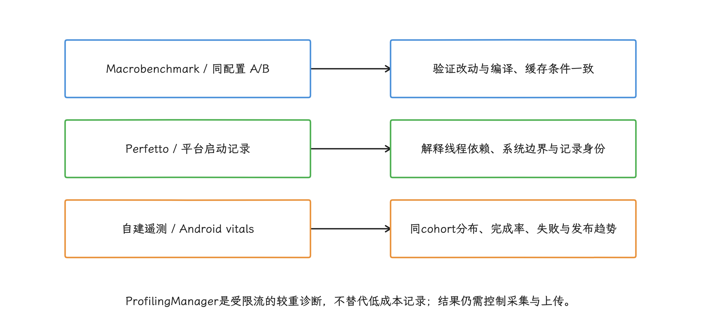

图：修复回到同口径验证；不能用固定系数把应用近似TTID换算成Play Vitals。

| 层级 | 工具 | 产物 |
| --- | --- | --- |
| 发布前回归 | Macrobenchmark `StartupTimingMetric`（启动时间测量项） | 固定设备、启动模式、编译模式和重复次数下的 TTID/TTFD 分布 |
| 单次诊断 | Perfetto / Android Studio Profiler | Android App Startups、主线程、RenderThread、Binder、I/O 与调度时间线 |
| 平台校准 | `ApplicationStartInfo` | 系统起点、启动类型、原因、组件与阶段时间戳 |
| 线上验证 | 自建监控 + Android Vitals | 同版本、同启动类型样本组的分位数、完成率、失败率和长期趋势 |

Macrobenchmark 必须记录 `StartupMode`、`CompilationMode`、设备、温度、电量和重复次数。固定 Macrobenchmark 1.4.1 的 `StartupMode.COLD` 在每轮 setup 中依次执行用户 setup、`dropShaderCache()`、`killProcess()` 与 `dropKernelPageCache()`；不能把它描述为默认保留内核页缓存。API 31+ 走平台清缓存路径，失败会抛异常；旧版非 root 设备可能只记录失败日志，必须在报告中保存库版本、设备能力与清理结果。单纯手动杀进程也不等于清掉页缓存，这与基准库的完整 COLD 协议应分开。Baseline Profile 实验还要区分 Profile 是否安装，避免把编译差异误归给业务代码。

<!-- gracker-diagram: a222-08-cold-cache-protocol -->
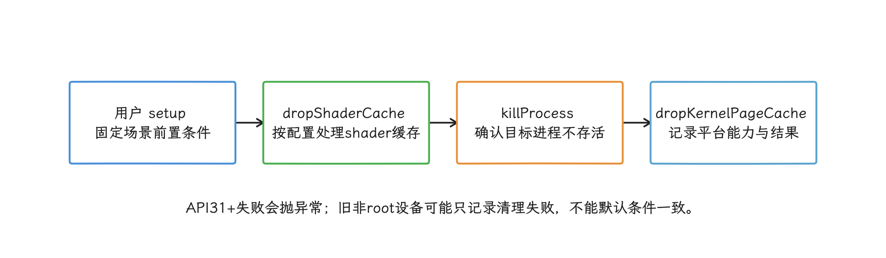

图：源码在每轮COLD setup中执行这些步骤；仅手动杀进程与完整库协议不同。

Perfetto 中先找 Android App Startups 派生轨道（Trace Processor 根据原始事件计算出的分析结果），再与 App 的自定义 trace 对齐。我们在时间线上看到一个任务从开始到结束持续 80 ms 时，先别急着按 80 ms 记 CPU 成本——线程可能在等待 Binder、锁、I/O 或 CPU 调度，实际占用要由对应时间线证明。下面的 PerfettoSQL 会加载官方 `android.startup.startups` 标准库模块，列出 trace 中识别出的启动；`dur / 1e6` 把纳秒转换成毫秒。取得目标 `startup_id` 后，再查询对应线程、Binder、I/O、GC 和帧事件：

```sql
INCLUDE PERFETTO MODULE android.startup.startups;

SELECT startup_id, package, startup_type, dur / 1e6 AS duration_ms
FROM android_startups
ORDER BY ts;
```

Android 15+ 还可用 `ProfilingManager` 请求 system trace 或 stack sampling（定期采集线程调用栈）。请求会被系统限流，也不保证每次执行；结果会写入 App 数据目录，并按平台规则做脱敏。它比读取 `ApplicationStartInfo` 成本高，只适合问题版本或受控样本，还要限制采集频率、设备开销和上传范围。官方也建议大多数 App 优先使用能正确构造参数的 AndroidX 高层封装。

### 8. 用同一份模板记录复盘

复盘时，我们把现象、证据、假设、改动和结果分开，避免把一次“同时发生”写成因果关系。下面的最小模板可直接用于 PR（Pull Request，代码合并请求） 或性能专项。模板里的 commit 是代码提交标识，release variant 是用于发布的构建变体，R8 是 Android 代码优化与压缩工具，owner 是后续事项负责人；这些工程字段保留原名，便于和构建系统、代码仓库对照。

```markdown
# <入口 / 问题> 启动优化复盘

## 1. 范围
- App commit / versionCode、release variant、R8、编译模式：
- 设备 / Android / RAM / ABI / 温度与电量：
- 入口 / 账号 / 数据 / 网络、cold / warm / hot 定义：
- 统计窗口、样本量、采样率：

## 2. 用户症状
- TTID / TTFD 的 P50、P90 与完成率：
- 首屏前 ANR / Crash / 退出、受影响 cohort：

## 3. 证据
- ApplicationStartInfo 区间、Macrobenchmark、Perfetto：
- task / Provider / manifest、首次出现的版本或配置：

## 4. 根因假设
- 假设、支持证据、反证、仍未知：

## 5. 单变量改动
- 改动、目标区间、风险、灰度与回滚开关：

## 6. 验证
- 线下 before / after 分布：
- 线上同 cohort 的 TTID / TTFD / frame / ANR / Crash / 业务护栏：
- 结果是否超过历史噪声与产品预算：

## 7. 后续
- 门禁、owner、截止时间、回滚条件：
```

若写不出一条能推翻当前假设的证据，结论多半还停留在猜测。“单变量改动”指一次验证尽量只改变一个待检验因素；当代码、Profile、服务端配置和样本结构同时改变时，结果只说明整个版本组合变了，收益归不到其中单项头上。

### 检查清单

- [ ] TTID、TTFD、content ready 和 Application 局部耗时各有独立名称与起止定义。
- [ ] 耗时使用单调时钟，墙钟只用于事件对齐。
- [ ] 没有为监控新增自动初始化 Provider 或首帧前重型 SDK。
- [ ] `onResume`、pre-draw 与 frame callback 没有被命名成平台 TTID。
- [ ] 每个首屏入口都定义了可测试的 fully drawn 条件和超时/降级。
- [ ] TTFD 缺失、启动中退出、崩溃与 ANR 进入分母和数据质量看板。
- [ ] cold/warm/hot、安装状态、入口和设备 cohort 分开统计。
- [ ] 分位数从可合并分布计算，没有平均客户端或每日分位数。
- [ ] 告警同时检查绝对差、相对差、样本量、不确定性和连续窗口。
- [ ] Android 15–16 Service 启动的 `LAUNCH` 时间戳限制已标记。
- [ ] `ApplicationStartInfo` completion callback 没有被当成 fully drawn callback。
- [ ] Vitals 阈值只作外部风险线，内部预算由产品基线确定。
- [ ] Macrobenchmark、Perfetto、平台时间戳和线上样本可以按同一启动入口互相对齐。

## 小结

启动分析先把系统请求、进程创建、Provider/Application、Activity 和首帧放进同一条时间线，再根据线程运行/等待状态与业务切片定位关键路径。启动监控则依赖一份稳定的测量契约：平台 TTID 告诉我们第一帧何时显示，`reportFullyDrawn()` 给出约定的首屏可用时点，`ApplicationStartInfo` 补齐 Android 15+ 的系统起点、启动分类和触发原因，App 事件负责解释任务与业务状态。服务端再按条件一致的样本组计算分位数、完成率和失败率，用绝对预算与统计不确定性共同判断是否变慢。

当一条告警能够回答“哪个版本、哪种启动、哪个入口、哪类设备、哪个阶段开始变慢”，启动监控才具备工程价值。

## 参考资料

- [profileable 元素](https://developer.android.com/guide/topics/manifest/profileable-element)、[SystemClock](https://developer.android.com/reference/android/os/SystemClock)、[System](https://developer.android.com/reference/java/lang/System)。
- [Benchmark 1.4.1 源码包](https://dl.google.com/dl/android/maven2/androidx/benchmark/benchmark-macro/1.4.1/benchmark-macro-1.4.1-sources.jar)、[Activity 1.11.0 源码包](https://dl.google.com/dl/android/maven2/androidx/activity/activity/1.11.0/activity-1.11.0-sources.jar)、[Perfetto v57.2 startup 模块](https://raw.githubusercontent.com/google/perfetto/v57.2/src/trace_processor/perfetto_sql/stdlib/android/startup/startups.sql)。
- [Android 17 AMS 启动时间戳入口](https://android.googlesource.com/platform/frameworks/base/+/refs/tags/android-17.0.0_r1/services/core/java/com/android/server/am/ActivityManagerService.java)、[Android vitals 启动风险线](https://developer.android.com/google/play/vitals/launch-time)。
- [Android 应用启动时间](https://developer.android.com/topic/performance/vitals/launch-time)
- [启动分析与优化](https://developer.android.com/topic/performance/appstartup/analysis-optimization)
- [Macrobenchmark 概览](https://developer.android.com/topic/performance/benchmarking/macrobenchmark-overview)
- [`StartupTimingMetric` API](https://developer.android.com/reference/androidx/benchmark/macro/StartupTimingMetric)
- [`ViewTreeObserver.registerFrameCommitCallback`](https://developer.android.com/reference/android/view/ViewTreeObserver)
- [Perfetto ATrace 数据源](https://perfetto.dev/docs/data-sources/atrace)
- [PerfettoSQL 标准库](https://perfetto.dev/docs/analysis/stdlib-docs)
- [AOSP Android 17 `ActivityThread`](https://android.googlesource.com/platform/frameworks/base/+/refs/tags/android-17.0.0_r1/core/java/android/app/ActivityThread.java)
- [AOSP Android 17 `ViewRootImpl`](https://android.googlesource.com/platform/frameworks/base/+/refs/tags/android-17.0.0_r1/core/java/android/view/ViewRootImpl.java)

- [Android 17 `ApplicationStartInfo.java`](https://android.googlesource.com/platform/frameworks/base/+/refs/tags/android-17.0.0_r1/core/java/android/app/ApplicationStartInfo.java)：启动原因、类型、组件、状态和系统/开发者时间戳。
- [Android 17 `ActivityManager.java`](https://android.googlesource.com/platform/frameworks/base/+/refs/tags/android-17.0.0_r1/core/java/android/app/ActivityManager.java)：历史启动记录、首帧完成监听与 `addStartInfoTimestamp()`。
- [Android 17 `Activity.java`](https://android.googlesource.com/platform/frameworks/base/+/refs/tags/android-17.0.0_r1/core/java/android/app/Activity.java)：`reportFullyDrawn()` 的一次性上报与首帧边界。
- [Android 17 `AppStartInfoTracker.java`](https://android.googlesource.com/platform/frameworks/base/+/refs/tags/android-17.0.0_r1/services/core/java/com/android/server/am/AppStartInfoTracker.java)：启动记录补全、完成回调和时间戳接受条件。
- [App startup time](https://developer.android.com/topic/performance/vitals/launch-time)：TTID、TTFD、fully drawn 与 Android Vitals 阈值。
- [App startup analysis and optimization](https://developer.android.com/topic/performance/appstartup/analysis-optimization)：Macrobenchmark、Perfetto 与启动区间分析。
- [`ApplicationStartInfo` API reference](https://developer.android.com/reference/android/app/ApplicationStartInfo)：字段可用性、时间戳和跨版本限制。
- [`ActivityManager` API reference](https://developer.android.com/reference/android/app/ActivityManager)：启动记录查询、completion listener 与自定义时间戳。
- [`Activity.reportFullyDrawn()` API reference](https://developer.android.com/reference/android/app/Activity#reportFullyDrawn())：调用语义及过早、过晚上报的影响。
- [`FullyDrawnReporter` API reference](https://developer.android.com/reference/androidx/activity/FullyDrawnReporter)：多条件 fully drawn 协调。
- [Macrobenchmark overview](https://developer.android.com/topic/performance/benchmarking/macrobenchmark-overview)：启动基准测试和 `StartupTimingMetric`。
- [`ProfilingManager` API reference](https://developer.android.com/reference/android/os/ProfilingManager)：采集类型、回调、限流和结果交付规则。
- [PerfettoSQL `android.startup.startups`](https://perfetto.dev/docs/analysis/stdlib-docs#android-startup-startups)：`android_startups` 表的字段和启动分析函数。
