# 启动任务编排、延迟初始化与并发调度

启动任务应按首帧依赖、线程要求和可延迟性组成有向无环图。延迟初始化减少首帧前工作，并发调度缩短无依赖任务的墙钟时间，但线程池竞争和错误依赖会抵消收益。

> 源码基线：Android 17 / API 37，AOSP `android-17.0.0_r1`，内核 `android17-6.18-2026-06_r6`；Jetpack App Startup 固定 1.2.0，Alpha 固定提交 `04fe7f22c469de66fed98c341334c954dfabafb2`。设备可能使用其他内核分支。

## 任务依赖、关键路径与失败策略

### 范围

21.1 节解决了怎样测量启动；测量之后，我们要把必须执行的初始化工作建成一张可验证的任务图，在满足依赖、线程和故障处理要求的前提下缩短关键路径。任务图以初始化任务为节点、等待关系为边；所有边都有方向、图里没有循环依赖时，它就是一张 DAG（Directed Acyclic Graph，有向无环图）。

`ApplicationStartInfo` 的准确分析见 [启动监控与度量](01-app-startup-path-monitoring.md)。

### 1. 编排前先删任务

启动框架没法把不必要的工作变便宜。TTID（Time to Initial Display） 是首帧首次显示所需时间，TTFD（Time to Full Display） 是应用达到开发者定义的完整可用状态所需时间。拿到初始化清单后，我们先逐项回答：

- 当前进程是否需要它？
- 当前入口是否需要它？
- 第一帧之前是否必须完成？
- TTFD 之前是否必须完成？
- 失败时能否显示降级界面？
- 能否在功能首用、用户同意或空闲阶段再初始化？

按完成时点可以把任务分成四个阶段：

| 阶段 | 完成边界 | 典型内容 |
| --- | --- | --- |
| `PRE_APP` | `Application.onCreate()` 之前 | 少量由 Provider 强制触发的初始化 |
| `PRE_FIRST_FRAME` | TTID 之前 | 首屏渲染不可缺少的同步状态 |
| `PRE_FULLY_DRAWN` | TTFD 之前 | 首要操作所需的数据和能力 |
| `DEFERRED` | 页面可用之后 | 二级功能、预取、非必要 SDK |

`PRE_APP` 是被组件生命周期强制出来的阶段，拿来追求“更早”只会把重活提前。[`ActivityThread.handleBindApplication()`](https://android.googlesource.com/platform/frameworks/base/+/refs/tags/android-17.0.0_r1/core/java/android/app/ActivityThread.java)在普通应用绑定且存在待安装 Provider 时，先安装 Provider，再调用 `Application.onCreate()`；放进 Provider 的重活会直接进入更早的主线程关键路径。 `restrictedBackupMode` 会跳过这段 Provider 安装；空 Provider 列表也不安装，不能把普通顺序写成所有入口都执行的强制流程。

启动任务只应包含“初始化完成”可以清晰定义的工作。长期轮询、常驻连接和周期任务属于运行期调度，启动任务只负责把它们配置并启动到约定状态，别让启动 DAG 一直挂着等它们。


### 2. 用 DAG 表达依赖

#### 2.1 节点契约

先看节点。节点就是一个可以独立判断就绪、执行和完成的任务，一个可调度节点至少要声明：

| 字段 | 含义 |
| --- | --- |
| `id` | 稳定且唯一的标识，用于依赖和观测 |
| `process` | 允许执行的进程 |
| `phase` | TTID、TTFD 或延后阶段 |
| `dependencies` | 硬依赖与软依赖 |
| `executionContext` | Main 主线程、CPU 计算池、I/O 阻塞池或供应商指定线程 |
| `run` | 任务逻辑及完成信号 |
| `failurePolicy` | 失败、降级、跳过后继或终止启动 |
| `timeoutPolicy` | 超时后的协作取消与替代结果 |
| `traceName` | 固定、取值数量有限的诊断名称，不能拼接用户 ID 或动态 URL |

下面的接口说明任务完成必须带结果，光返回“已提交异步工作”不算完成：

```kotlin
interface StartupTask<T> {
    val id: String
    val process: String
    val phase: StartupPhase
    val dependencies: Set<Dependency>
    val executionContext: ExecutionContext

    suspend fun run(scope: StartupScope): TaskResult<T>
}

sealed interface TaskResult<out T> {
    data class Success<T>(val value: T) : TaskResult<T>
    data class Degraded<T>(val fallback: T, val cause: Throwable) : TaskResult<T>
    data class Failed(val cause: Throwable) : TaskResult<Nothing>
}
```

这里用 `suspend` 表达逻辑完成点：真正挂起时可释放承载线程，但 `suspend` 关键字不会自动切线程，内部阻塞调用仍占用线程；只有成功、降级或失败结果产生后才算结束。框架也可以用 Guava `ListenableFuture`、Java `CompletionStage` 或带完成回调的接口实现同一契约。所以后继的等待条件，是前驱产生允许传播的最终状态。某个 SDK 的 `startAsync()` 返回，多半只说明异步请求提交了出去，它是否已可供后继使用还是未知数。

#### 2.2 边的语义

边表示任务之间的等待关系，约定 `A → B` 表示 B 等待 A。依赖分三种：

- **硬依赖**：A 成功或给出满足契约的备用结果后，B 才能运行；缺少 A 时，B 没有可用结果。
- **软依赖**：B 希望在 A 之后运行；A 失败时，B 有不依赖 A 的执行路径。
- **顺序约束**：两者不共享结果，只因线程安全或供应商契约需要排序。

“A 超时就当作完成”会破坏硬依赖语义。更安全的做法是把超时映射成 `Degraded` 或 `Failed`，由 B 的契约决定接下来怎么走。

条件任务的跳过发生在构图阶段：移除节点后，我们要重新检查所有后继，确认每条硬依赖仍有结果提供者、确认是否存在备用节点，以及每个必需结束节点的依赖仍能满足。任务图可以有多个互不依赖的根节点，整张图不要求只有一个连通分量。


#### 2.3 构图阶段的输入校验

在任何任务执行前，我们先做这些检查：

- 重复 ID 和不存在的依赖；
- 自依赖与环；
- 被禁用的节点仍被硬依赖；
- Main 任务阻塞等待后台工作线程，而该工作线程又要回到 Main 才能完成；
- 当前进程不允许的节点；
- 阶段倒挂，例如首帧任务硬依赖 `DEFERRED` 阶段的延后任务；
- 多个节点写同一非线程安全状态却没有顺序约束。

环检测有两条现成路径。DFS（深度优先搜索）把当前递归路径中的节点标成 `GRAY`，再次遇到 `GRAY` 节点就是有环；Kahn 拓扑排序反复移除入度为 0、没有未完成前驱的节点，处理结束后仍有节点剩下，同样说明图中有环。错误信息应输出完整环路径，例如 `A → B → C → A`，方便配置和模块负责人定位。


### 3. 关键路径决定理论下界

#### 3.1 最长依赖链

图构建并通过校验后，我们来看它能快到什么程度。在一个不考虑资源竞争的 DAG 中，结束节点的最早完成时间由最长依赖路径决定。这条累计耗时最长、直接限制结束时间的依赖链就是关键路径：

```text
Logger(8 ms) ─→ Crash(20 ms) ─┐
                               ├→ HomeState(15 ms) → FirstFrame
Device(12 ms) → Config(10 ms) ┘
```

这些时长仅为教学假设，不是设备测量。上例两条前驱路径分别是 28 ms 和 22 ms，忽略资源竞争且 FirstFrame 节点额外成本按零计算时，汇合后的理论关键路径是 43 ms。缩短不在关键路径上的任务，第一帧结束时间可能纹丝不动——这个时间由上面那条链决定。

<!-- gracker-diagram: a223-04-critical-path-model -->
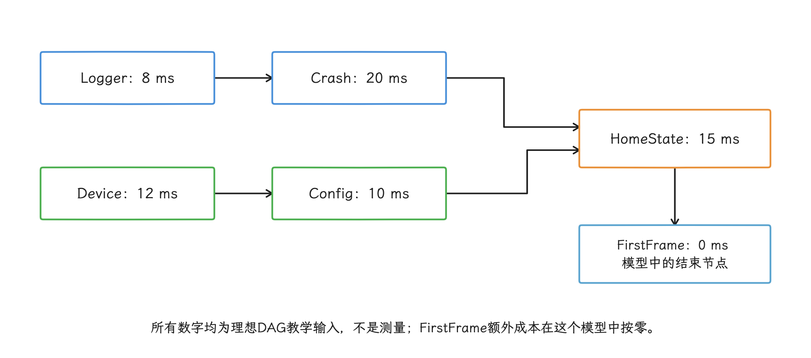

图：教学假设：max(8+20,12+10)+15+0=43ms；真机还需加入排队、竞争和实际帧成本。

当然，这只是理论模型，真机上的完成时间还要叠加这些因素：

- 就绪任务先在 executor（负责排队并用工作线程执行任务的执行器） 队列里排队；
- CPU 核心、频率、热状态和其他进程竞争；
- 多个任务争用磁盘、Binder（Android 的进程间调用机制） 进程间调用、类加载锁或同一连接池；
- Main 与负责部分 UI 渲染工作的 RenderThread 被后台初始化抢占；
- GC（垃圾回收） 和大量对象分配；
- 任务时长会随缓存、网络和入口变化。

所以关键路径要用每次 Trace 的真实开始/结束和依赖关系重建，代码评审里估出来的耗时写死下来没有意义。P50 是样本中位数，P95 表示 95% 的样本不超过该值；典型启动和长尾启动的瓶颈不同，二者的关键路径也可能不同，我们要分开重建。

#### 3.2 优先级只影响已经就绪的任务

优先级的作用范围有限：它只在多个任务同时就绪、争用同一执行资源时决定谁先运行，越不过依赖关系。

需要区分三种概念：

1. **业务阶段**：TTID 前、TTFD 前、延后。
2. **executor（限制线程数与排队方式的执行器） 排队优先级**：同一队列中先取哪个任务。
3. **Linux 线程 nice 值**：线程被内核调度时的 CPU 权重；数值越小，CPU 调度优先级越高。

把三者压成一个 `priority` 整数，“让高优任务在后台队列靠前”和“调高线程 nice”就混成了同一个操作；框架 API 应该分开建模。


### 4. 失败、超时和取消属于任务协议

#### 4.1 超时之后的底层操作

图跑起来之后，超时和失败就要靠任务协议兜住。Java/Kotlin 的超时通常只让等待方停止等待，底层网络、Binder、文件 I/O 或供应商线程可能还在跑。`Future.cancel(true)` 和线程 interrupt（Java 线程的协作式中断信号） 也只是协作取消信号：任务代码要检查取消状态、响应中断或调用底层取消 API，工作才会真正停下来。

每个可超时任务，我们要能回答：

<!-- gracker-diagram: a223-06-timeout-late-result -->
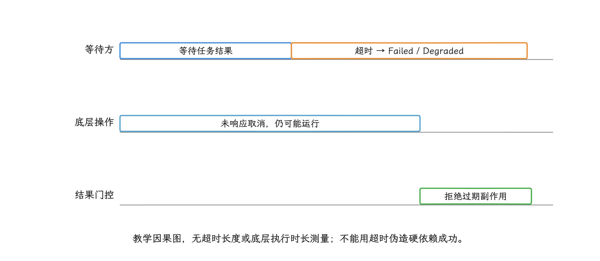

图：取消需要底层API和任务代码协作；晚到结果、重试并发与共享状态都必须受会话/代际门控。

- 超时后能否取消底层操作？
- 晚到结果是否还允许写共享状态？
- 重试会不会与旧请求并发？
- 后继使用什么备用值？
- 下一次启动能否安全重试？

不要为每个任务临时创建一个线程，再用 `CountDownLatch.await(timeout)` 包住它。`CountDownLatch` 只让当前线程等计数归零；这种写法让 executor 的工作线程空等另一个线程，线程数和栈内存都上去了，被包裹的任务却停不下来。

#### 4.2 失败传播

建议至少支持这些策略：

| 策略 | 行为 |
| --- | --- |
| `FAIL_GRAPH` | 终止依赖该结果的关键路径，展示可恢复错误 |
| `USE_FALLBACK` | 产出类型一致的本地或默认备用结果 |
| `SKIP_DEPENDENTS` | 跳过所有无法满足硬依赖的后继 |
| `CONTINUE_SOFT` | 仅软依赖继续，记录能力缺失 |

框架要保存原始异常、任务 ID、进程、线程和已运行时长。捕获 `Throwable` 后无条件继续，会把 `OutOfMemoryError` 这类进程级风险盖住，后继也会在半初始化状态里运行。

#### 4.3 幂等与重入

初始化任务可能因配置变化、进程恢复、失败重试或测试而重复执行。幂等指重复执行不会叠加新的副作用；重入指上一次调用尚未结束、再次进入时行为仍然明确。一个理想任务应该：

- 多次调用返回同一有效状态；
- 部分失败后能清理临时资源；
- 注册监听器时能成对注销；
- 不把“对象已创建”误当作“初始化已完成”；
- 并发调用由单一状态机合并。

供应商 SDK 若不支持重入，适配层应把并发请求合并成串行调用，用状态机明确记录“未开始、进行中、成功、降级或失败”，别让多个业务模块各自初始化一遍。

### 5. App Startup：同步依赖图

#### 5.1 1.2.0 的执行模型

[Jetpack App Startup](https://developer.android.com/topic/libraries/app-startup) 用一个 `InitializationProvider` 发现 Manifest `<meta-data>` 中声明的 `Initializer`。这里的 `<meta-data>` 是写在 Provider 下的键值配置，key 为初始化器类名，value 为 `androidx.startup`。截至 2026-10-25，[1.2.0](https://developer.android.com/jetpack/androidx/releases/startup) 仍是最新稳定版；其 `AppInitializer` 会：

1. 读取 Provider 的 metadata，找到值为 `androidx.startup` 的类名；
2. 通过反射，按运行期类名查找并创建 `Initializer`；
3. 深度优先初始化 `dependencies()`；
4. 用 `initializing` 集合检测环；
5. 调用 `create(context)` 并缓存结果；
6. 用 AndroidX Trace 为发现过程和每个 Initializer 记录系统性能轨迹区间。

自动初始化发生在 `InitializationProvider.onCreate()`，也就是主线程安装 Provider 的阶段；`create()` 不会被自动移到后台线程，它和 Binder 线程回调也没有关系。

下面的初始化器声明 Logger 依赖本地配置：

```kotlin
class LoggerInitializer : Initializer<Logger> {
    override fun create(context: Context): Logger {
        return Logger.create(context)
    }

    override fun dependencies(): List<Class<out Initializer<*>>> {
        return listOf(LocalConfigInitializer::class.java)
    }
}
```

App Startup 会先完成 `LocalConfigInitializer.create()`，再调用 `LoggerInitializer.create()`。`create()` 必须同步返回可用实例；内部若只是提交了异步任务，依赖顺序对逻辑就绪就没有保证。


#### 5.2 适用范围与限制

App Startup 适合：

- 合并多个自动初始化 Provider；
- 用静态、同步依赖表达少量必要初始化；
- 提供可手动触发的惰性初始化入口；
- 让库与应用通过 Manifest Merger，把各个库和应用模块的 Manifest 声明合并进最终安装包。

它没有任务优先级、内建超时、取消、异步结果或运行期改图；每个由 Manifest 自动发现并立即执行的 eager initializer（由 Manifest 自动发现并立即执行的初始化器），都实打实占用 Provider 启动阶段的主线程时间。

需要惰性初始化时，从最终 Manifest 删除对应 `<meta-data>`，再在需要处调用 `AppInitializer.initializeComponent()`。删除某个根 initializer 只会去掉从该根触发的自动遍历：若其依赖自身仍有 metadata，或仍被其他 eager initializer 依赖，该依赖仍会提前初始化。手动初始化会同步初始化尚未完成的依赖。要移出启动路径，必须检查所有剩余入口和依赖路径。

<!-- gracker-diagram: a223-08-remaining-eager-roots -->
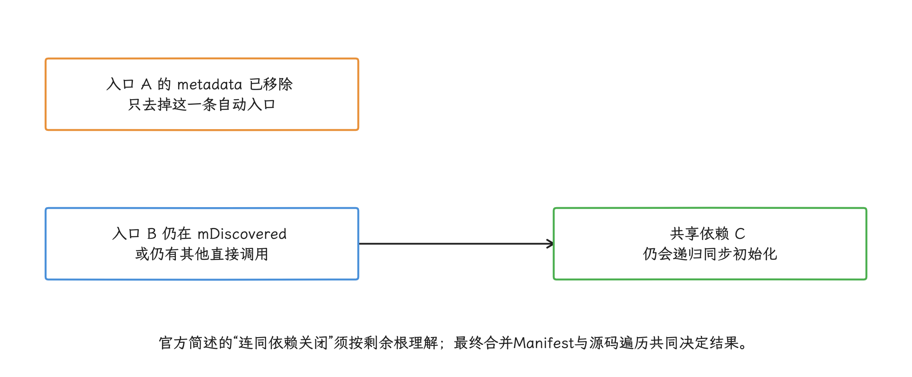

图：应核对所有剩余metadata、dependencies和手动调用；只要另有路径，目标仍可能提前运行。

#### 5.3 多进程边界

`AppInitializer` 是进程内单例：同一进程的内存里只有一个实例，不同进程各自持有一份。`InitializationProvider` 是否运行由 Manifest 的 `android:process` 决定：

- 未声明 `android:process` 时，Provider 属于应用默认进程；
- 若应用显式为多个进程声明不同 Provider，相关进程各有自己的单例和结果；
- 一个默认 Provider 不会因为应用存在四个子进程就自动执行四次。

1.2.0 修复了 Provider 定义在子进程时的 metadata 查找问题，说明库支持显式的多进程 Provider 配置；initializer 默认并不会复制到每个进程，最终行为以合并后的 Manifest 为准。

要在命名进程里跑独立的初始化图，应使用单独的 `InitializationProvider` 子类、唯一的 authority 和只属于该进程的 metadata。authority 是系统定位 ContentProvider 的唯一名称，通常以应用 ID 为前缀，避免与其他 Provider 冲突：

```kotlin
class WorkerInitializationProvider : InitializationProvider()
```

```xml
<provider
    android:name=".WorkerInitializationProvider"
    android:authorities="${applicationId}.androidx-startup.worker"
    android:exported="false"
    android:process=":worker">

    <meta-data
        android:name="com.example.worker.WorkerInitializer"
        android:value="androidx.startup" />
</provider>
```

这会在 `:worker` 命名的私有应用进程形成独立的 `AppInitializer`、依赖遍历和结果缓存，与默认进程不共享“已初始化”状态。跨进程的完成关系要走 Binder IPC、可查询的 Provider 或持久状态去明确传递，画成一条只在内存中生效的 DAG 边是行不通的。


#### 5.4 发现、遍历与动态特性边界

App Startup 1.2.0 的 Manifest 发现过程先读取当前 `InitializationProvider` 的 `ProviderInfo.metaData`，只接受 value 等于 `androidx.startup` 标记的条目，再对 key 调 `Class.forName()`，按完整类名加载实现了 `Initializer` 的类；发现结束后才进入依赖初始化。

初始化算法是进程内的深度优先遍历：

1. 节点进入递归路径时加入 `initializing` 集合；
2. 先递归执行 `dependencies()`；
3. 依赖完成后同步调用当前节点的 `create()`；
4. 返回值写入 `mInitialized`，当前进程后续请求直接复用；
5. 路径再次遇到同一类时抛出循环依赖异常。

这套算法对同层无依赖节点的顺序没有稳定保证，metadata 与集合的遍历顺序都不是业务契约；有先后要求就写进 `dependencies()`。`isEagerlyInitialized()` 回答的只是“节点是否来自 manifest 主动发现”，组件健康、异步准备完成、跨进程可用，这些它一概说明不了。

主动发现会在 Provider 阶段直接加载 initializer 类。动态特性模块是按需下载、可能尚未安装的应用功能模块；metadata 若指向其中的类，`Class.forName()` 找不到时会抛出异常，被 App Startup 包装成 `StartupException`，进程可能在 `Application.onCreate()` 之前就终止了。

可选模块的桥接 initializer 应留在基础模块，或等模块安装完成后从明确的业务入口手动初始化——ClassLoader 可不会自动跳过缺失的类。

App Startup 会为发现过程和每个 initializer 创建 Trace section，也就是 trace 里带开始和结束时间的区间。我们排查时要把这些都看一遍：合并后的 Manifest、每个进程的 Provider、`Startup`/initializer 区间、主线程 I/O/Binder/锁，以及首个消费者的延迟。`create()` 区间结束只证明同步方法返回了，内部提交的异步工作还需要自己的完成事件。

### 6. Alpha 固定提交的能力与局限

#### 6.1 固定提交中的行为

Alpha 的选定提交 `04fe7f2` 日期为 2018-12-14；本轮 2026-10-25 核对仓库 HEAD 仍指向这一提交，下面的结论只对这份固定源码有效。它提供：

- `Project.Builder.add(task).after(predecessors)` 构建任务图；
- `Task(name, true)` 通过 Main `Handler` 执行；
- 后台 Task 使用 `AlphaConfig` 的共享 `ExecutorService`；
- `MAIN_PROCESS_MODE`、`SECONDARY_PROCESS_MODE`、`ALL_PROCESS_MODE` 和精确进程名选图；
- 任务耗时记录与 Project 完成回调。

下面的写法与该提交的 Builder 和 Manager 签名一致：

```java
Task config = new LocalConfigTask();
Task logger = new LoggerTask();

Project project = new Project.Builder()
        .setProjectName("app-init")
        .add(config)
        .add(logger).after(config)
        .create();

AlphaManager manager = AlphaManager.getInstance(appContext);
manager.addProject(project, AlphaManager.MAIN_PROCESS_MODE);
manager.start();
```

`addProject()` 返回 `void`，没法和 `start()` 链在一起；`after(config)` 表示 Logger 等待 Config。

#### 6.2 源码中需要补强的部分

采用 Alpha 时至少核对这些实现事实：


- 默认 executor 的核心线程数和最大线程数都是 `availableProcessors()（运行时报告的可用逻辑处理器数）`；队列是无界 `LinkedBlockingQueue`，所有后台任务共用一池。任务可以一直入队，线程数也就停在核心线程数，最大线程数永远不会触发额外扩容。
- `Task.run()` 返回后立刻标记完成并通知后继，不支持异步完成信号。
- 用户 `run()` 外层没有 `try/finally`；异常会阻止完成通知，后继可能永远不启动。
- `waitUntilFinish()` 与 Main Task 同时使用会死锁，源码注释已经警告。
- Alpha 的 execute priority 用于后继通知列表，也用于 Manager 的附加任务列表排序；它不等于全局 executor 优先队列，普通 FIFO 队列里已经提交的任务不会因此重新排序。
- `Task` 耗时用 `System.currentTimeMillis()` 相减，可能受墙钟校时影响；新维护分支应以同一单调时基记录区间，并分别记录排队与执行阶段。
- 状态机把非 IDLE 的重复 `start()` 报告为可能存在循环，但没有在执行前输出完整环路径。
- 没有内建的类型化结果、取消和单任务超时协议。

这些问题否定不了 DAG 思想本身，只是说明该仓库更适合当源码参考，或作为团队自己维护分支的起点。直接引入前，我们要评估 target API 37、构建工具、并发安全、维护责任和依赖供应链。

### 7. 什么时候需要自研

任务数决定不了选型。十个带异步完成、跨进程和复杂失败语义的任务，可能比一百个同步任务更需要专用框架。

自研通常由这些需求触发：

- 异步结果必须成为依赖图的一等状态，让调度器能够直接等待、传播和观测，而非把“已提交”当成“已完成”；
- 需要类型化的失败、降级、超时和协作取消；
- 每个进程使用不同任务图；
- 编译期聚合多模块声明，由代码生成或构建插件收集各模块任务，并在构建阶段检查图；
- 需要基于真实 Trace 重建关键路径；
- 远程实验只能在受控白名单内改变阶段或开关；
- 连续多次在启动早期崩溃、形成 crash loop（应用连续多次在启动早期崩溃） 后，要进入只保留必要任务的安全图；
- 现有库的生命周期、维护或供应链风险不可接受。

自研的成本包括调度状态机、可观测性、故障注入、并发测试、进程测试和长期兼容；如果需求只是统一几个同步 initializer，App Startup 更简单。

一个最小架构应包含构图校验器和调度器。下图的 Graph Validator 负责检查依赖图，Scheduler 负责判断任务何时、在哪个执行器上运行：

```text
声明层 → Graph Validator → Scheduler → Main / CPU / I/O executors
             │                │
             ├─ 环与契约检查   ├─ 结果、超时、取消
             └─ 进程/阶段校验  └─ Trace 与指标
```

声明层要把住入口：业务直接拿到 executor、绕过调度器提交任务的口子应该关掉。所有任务都经过调度器，框架才能完整记录排队时间、运行时间和依赖状态，退出或降级时的行为也才一致。


### 8. 异步初始化与 executor 策略

#### 8.1 Main 是 Looper，不是线程池

Main 线程由 Looper 循环取出消息执行，不像线程池那样有多个 worker（线程池中实际取任务执行的工作线程）。Main 任务通过当前调用或 `Handler`/协程调度器排队。`post()` 只表示入队，执行时间取决于前方消息、同步屏障和 frame callback：同步屏障会暂时挡住普通同步消息，让绘制所需的异步消息先通过；frame callback 则是随屏幕刷新节奏执行的帧回调。把十个任务从 `Application.onCreate()` 改成十次 `mainHandler.post()`，可能只是把成本移动到首帧附近。

Main 线程上禁止：

- 等待 worker 的 `CountDownLatch`、`Future.get()` 或阻塞式 `await`；
- 让 worker 依赖 Main 回调后完成，形成反向等待；
- 在 rejection handler（线程池无法接收任务时调用的拒绝处理器）中执行原本要去后台的任务；
- 用 SplashScreen 无限覆盖尚未结束的初始化。

必须在 Main 调用但可拆分的 API，应只把很短的状态切换留在 Main，准备工作在 worker 完成后通过非阻塞状态机继续。

#### 8.2 CPU 任务

CPU 并发不是 `availableProcessors() + 1` 的固定公式。`availableProcessors()` 只报告当前可用逻辑处理器数量；大小核性能、调频、温度、RenderThread 竞争和设备负载，它一个都表达不了。

CPU executor 应：

- 使用有限并发和有界队列；
- 把首帧关键计算与延后预计算分开；
- 避免多个库各建一个“按核数”线程池造成过度并发；
- 在低、中、高设备档位用 Perfetto 检查 Main/RenderThread 处于 Runnable（已可运行但仍在等待 CPU）状态的时长；
- 记录从提交到开始执行的排队时间，以及任务自身的运行时间。

线程更多只会在有可用 CPU 时提高并行度。首帧期间把所有核心占满，可能让 Main 与 RenderThread 更慢。

#### 8.3 I/O 任务

I/O 任务会阻塞，线程数却要有个上限。启动时大量并发读会放大：

- 存储队列和 page fault（所需内存页尚未驻留，系统必须从文件或交换区载入）；
- 数据库锁与连接池等待；
- Binder 服务排队；
- TLS 加密握手、DNS 域名解析和服务端限流；
- 每个线程的栈内存。

磁盘、数据库、Binder 和网络最好按资源设置并发上限，避免一个慢域名占满所有 worker。网络配置同样要挡在首帧硬依赖之外；使用上一份已验证缓存或本地默认值更稳妥。

#### 8.4 队列与拒绝策略

[`ThreadPoolExecutor`](https://developer.android.com/reference/java/util/concurrent/ThreadPoolExecutor) 在核心线程都忙时先尝试入队。无界 `LinkedBlockingQueue` 会让线程数停在核心线程数，`maximumPoolSize` 不再发挥扩容作用，同时允许积压无限增长。

有界队列便于限制资源，但拒绝策略必须符合启动语义。`CallerRunsPolicy` 会让提交任务的线程直接执行被拒任务；若调用者是 Main，后台重活就会回到 UI 线程。因此：

- 关键任务被拒应记录并走明确降级或失败路径；
- 延后任务可以丢弃、合并或稍后重试；
- 主线程提交禁止使用会执行重活的 caller-runs；
- 同一 key 的预热任务应去重，避免队列重复。

#### 8.5 线程优先级

[`Process.setThreadPriority()`](https://developer.android.com/reference/android/os/Process) 可以设置当前线程的 Linux nice 值，范围通常是 -20 到 19，数值越小，CPU 调度优先级越高；它不改变 DAG 依赖，也不保证 I/O 顺序。

低紧迫度 worker 可使用 `THREAD_PRIORITY_BACKGROUND`，但首帧关键 worker 是否保留默认优先级要通过 Trace 验证。盲目提升后台线程会抢占 Main 和 RenderThread。

由 `java.lang.Thread` 创建的子线程不会继承创建线程的这项优先级设置；由原生代码创建的线程则可能继承，也可能不继承。不要依赖继承行为，线程工厂应显式命名线程，并让每个 worker 在自己的执行入口设置允许的优先级。

### 9. 多进程任务图

#### 9.1 每个进程只构建自己的图

`Application.getProcessName()` 从 API 28 已公开，本文 Android 10+ 范围均可用。应先获取当前进程名并选择进程配置，再实例化任务，避免子进程加载主进程 initializer 类及其静态依赖。

| 进程 | 常见必要任务 | 不应默认加载 |
| --- | --- | --- |
| 主进程 | UI、首屏状态、核心观测 | push 专用连接、独立下载器 |
| `:push` | 消息解析、最小存储与上报 | UI、图片、广告、主页数据 |
| `:web` | WebView 所需配置 | 主进程全部 SDK |
| 隔离/远端服务 | 服务契约所需能力 | 宿主业务单例 |

隔离进程通常权限和可访问组件更少，远端服务则运行在不同于调用方的进程。跨进程依赖在进程内的 DAG 边上表达不了，要走 Binder/Provider 等明确协议，并定义 `Ready`（可正常服务）、`Degraded`（只能提供备用能力）、`Dead`（进程或连接已失效）、超时和版本不兼容等状态。主进程首帧尽量不阻塞等待子进程启动。

#### 9.2 Provider 与 App Startup

检查合并后的 Manifest 中每个 Provider 的进程。某个库若把 `InitializationProvider` 显式放到子进程，该进程会有独立 App Startup 图；默认 Provider 只属于默认进程。

不要在 `Initializer.create()` 里加载全量模块后再用 `if (processName...)` 跳过，这时类加载和静态初始化可能已经发生。更好的方式是：

- 不在该进程声明 initializer；
- 该进程使用专用 Provider/graph；
- 或在更早、依赖更少的入口选择专用实现类。

### 10. 动态配置与 A/B 实验

#### 10.1 远程配置只能调整已知安全空间

启动不等当次网络配置：客户端使用上一轮持久化且校验通过的配置；缺失、过期或解析失败时回到内置图。

远程配置建议只允许：

- 开关一个已有且可独立禁用的任务；
- 在预定义 phase 集合中选择；
- 在安全范围内调整 executor 排队优先级；
- 选择客户端内置的完整图版本。

远程数据里不该出现类名、任意依赖边或可执行代码。客户端应验证配置来源与内容是否被篡改，并按 schema（字段结构定义） 校验字段名、类型、必填项和取值范围；还要检查客户端版本，设置有效期与一键回退。

#### 10.2 客户端验证

启用配置前检查：

1. 图版本与当前应用版本兼容。
2. 所有 task ID 来自本地白名单。
3. 硬依赖存在且没有被禁用。
4. 图无环、phase 合法、进程匹配。
5. 关键功能保留可用路径。
6. 配置未过期，实验分组稳定。

校验失败只上报低基数错误码和图版本，不执行部分配置。默认图要随客户端一起经过功能与性能测试。


#### 10.3 实验指标

实验同时观察：

- 冷/温/热启动 TTID 与 TTFD 分布；
- 每个任务的排队、运行、结果和关键路径；
- 启动 crash、ANR、进程异常退出；
- 首屏错误、降级率和关键操作成功率；
- CPU、内存、线程、I/O 与首帧 FrameTimeline（每帧预期与实际时间线）；
- 按入口、设备档位、系统版本和进程分组的长尾。

样本量和持续时间由基线波动、最小可检测差异（实验有足够把握识别的最小效果）、分流比例和业务周期决定，套用“一周且 p < 0.05”的统一模板是行不通的。`p < 0.05` 只是一种统计显著性门槛，改动有没有业务价值，要看主指标和护栏指标。

实验前要定义主指标、护栏指标和停止条件：主指标判断启动是否变快，护栏指标确保 crash、ANR、首屏成功率等没有恶化。还要避免在多个分位和设备分组中反复挑选看起来有利的结果。

#### 10.4 crash loop 与回退

启动图变更可能在监控 SDK 启动前崩溃。应用应通过一条不依赖动态任务图的内置路径，保存很小的启动状态：

- 本次图版本；
- 进入启动与成功到达可用态的标记；
- 连续失败计数和过期时间；
- 安全图版本。

检测到连续早期失败时，下一次启动使用内置安全图并禁用实验配置。状态写入本身要轻量，并采用原子替换或等价事务：既别让进程在写到一半时留下解析不了的数据，也别给主线程 I/O 添明显负担。

<!-- gracker-diagram: a223-13-early-failure-safe-graph -->
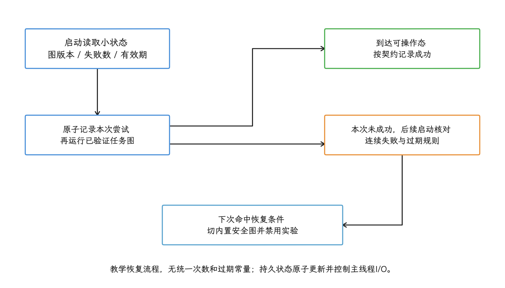

图：状态路径不依赖实验DAG；正常退出、超时和状态过期不能不加区分地计成崩溃。

### 11. 可观测性：测量排队和结果

每个任务至少记录：

| 时间/状态 | 用途 |
| --- | --- |
| graph ready | 图验证完成 |
| task ready | 依赖已经满足 |
| task start | executor 开始运行 |
| task finish | 逻辑结果产生 |
| outcome | success/degraded/failed/cancelled/timeout |
| thread/process | 解释调度与进程路径 |

`task start - task ready` 是从依赖就绪到实际开始的调度等待（若还需门控，也包含门控等待）；`task finish - task start` 是任务逻辑区间的墙钟时长，可能包含挂起、阻塞与再次等待 CPU，并不等于线程实际 CPU 时间。若要单独量 executor 排队，应另记 submit/enqueue 时间。只记录运行时间，executor 饱和和优先级反转就会漏掉；优先级反转指高优先级任务在等低优先级任务持有的锁或资源，结果反而落在后面。

使用 `androidx.tracing` 给任务增加名称稳定的时间区间，并把依赖关系与 Task ID 一同保存在本地基准结果中。线上指标控制采样率和标签种类，不把动态 URL、用户 ID 或异常全文作为标签，以免产生近乎无限的指标组合。

<!-- gracker-diagram: a223-14-task-time-boundaries -->
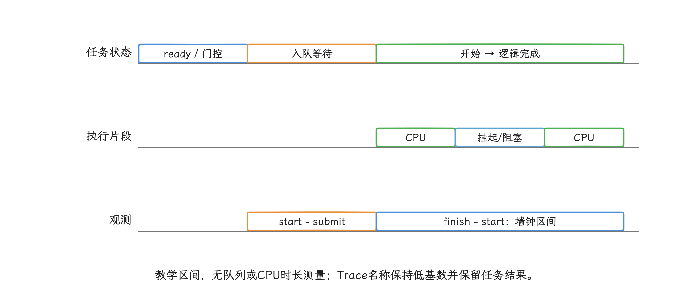

图：ready到start可能含门控；executor队列等待从submit计起，逻辑区间仍含等待，不能直接当CPU时间。

验证优化时使用与 21.1 相同配置的 Macrobenchmark：

1. A/B 产物只改变任务图或 executor 策略。
2. 编译模式、入口、数据、设备和温度条件一致。
3. 同时比较 TTID、TTFD、FrameTimeline 与任务图关键路径。
4. 打开回归样本 Trace，确认收益来自预期任务，而非首屏内容减少。
5. 先只向很小比例的用户发布，在扩大范围前确认稳定性和功能护栏。

`ApplicationStartInfo` 适合补充历史启动类型、原因和系统时间戳。不过完成监听也好、历史记录也好，都改变不了正在发生的这次启动；当前进程的 DAG 选择，依据是已知入口、进程和本地安全配置。

### 12. 选型结论

| 需求 | App Startup 1.2.0 | Alpha `04fe7f2` | 自研 |
| --- | --- | --- | --- |
| 合并自动 Provider | 适合 | 不负责 | 可实现，但收益有限 |
| 同步静态依赖 | 适合 | 支持 | 支持 |
| worker 并发 | 不支持 | 支持单共享池 | 可按契约实现 |
| 异步完成信号 | 不支持 | 不支持 | 可实现 |
| 类型化失败/降级 | 不支持 | 不支持 | 可实现 |
| 超时/取消 | 不支持 | 无内建协议 | 可实现 |
| 多进程选图 | 依赖 Manifest | 内建模式 | 可实现 |
| 动态安全配置 | 不支持 | 本地 Builder/XML | 可实现受控版本 |
| 维护责任 | AndroidX | 团队需接管旧代码风险 | 团队完全负责 |

推荐从需求出发：

- 少量必须在启动阶段立即执行的同步组件，用 App Startup，并移除不必要的自动 initializer。
- 需要简单的后台任务 DAG，且团队愿意维护自己的源码分支，可以参考 Alpha 的图模型，同时补齐结果、异常、环检测和 executor。
- 需要异步结果、复杂失败、多进程和安全实验时，再建设自研框架。

无论选哪一种，收益都来自减少首屏工作、缩短真实关键路径和控制资源竞争。框架名称本身不会改善 TTID。

### 诊断与验证清单

- [ ] 每个任务有维护负责人（owner）、进程、阶段、线程和完成定义。
- [ ] 硬依赖、软依赖、失败和降级语义明确。
- [ ] 构图阶段检查缺失节点、环、phase 与进程。
- [ ] Main 不阻塞等待 worker，worker 不反向依赖 Main。
- [ ] 异步 API 的逻辑完成点进入任务状态。
- [ ] 超时不会把硬依赖伪装成成功。
- [ ] executor 有界，并记录排队与运行时间。
- [ ] `CallerRunsPolicy` 不会把后台重活带回 Main。
- [ ] 每个进程只构建所需图，Provider 归属已核对。
- [ ] 远程配置来自本地白名单，失败回到内置图。
- [ ] 具备早期 crash 安全图和回退演练。
- [ ] Macrobenchmark 同时验证 TTID、TTFD、帧与功能。

## 首帧边界、懒加载与触发时机

任务图确定后，我们就可以把非首帧必需的工作移出关键路径；延迟任务仍要明确首次使用时的线程和失败处理。

### 范围

延迟初始化的目标是减少启动关键区间内的工作，同时保证任务在使用前完成、失败时可恢复。关键区间指从系统收到启动请求到 App 第一帧的 TTID，以及到主要内容可用的 TTFD。把 `Application.onCreate()` 中的代码统一移进线程池，改变的只是执行线程；让一批任务在首帧后同时开始，还会制造新的 CPU 和 I/O 竞争。

这一节讨论五件事：

- 如何判断任务能否延后；
- 如何识别“首帧已经提交”；
- `IdleHandler` 能提供什么信号；
- 首次使用和动态 Feature（按需交付的功能模块）怎样管理状态；
- 进程退出、失败、多进程和资源竞争如何处理。

前半篇已经建立启动依赖图；Provider 治理见 [ContentProvider 启动治理](03-contentprovider-multiprocess-startup.md)。

### 1. 异步、延迟与懒加载的区别

| 手段 | 改变什么 | 没有解决什么 |
| --- | --- | --- |
| 异步执行 | 执行线程 | 任务仍可能与启动争 CPU、I/O、Binder 跨进程通信或锁 |
| 首帧后执行 | 开始时机 | 工作总量没有减少，后续帧仍可能受影响 |
| 首次使用 | 触发条件 | 用户第一次进入功能时可能等待 |
| 按需交付 | 安装包中是否已有代码/资源 | 需要下载、安装、失败和渠道处理 |
| 持久后台任务 | 进程退出后仍可调度 | 不能保证某个精确帧后立即开始 |

“从主线程移到后台”消除的只是主线程上的直接执行时间。后台任务若占满 CPU 性能核、触发大量 page fault、争用同一数据库，或把结果同步回主线程，TTID、TTFD 或前几帧照样被拖慢。


### 2. 先给初始化任务分级

#### 2.1 分级前的问题清单

拿到清单后，我们先逐项回答：

1. 不执行时，首个 Activity 能否画出正确第一帧？
2. 不执行时，主要内容能否在 TTFD 前达到可用状态？
3. 哪个用户动作会首次需要它？
4. 失败后能否跳过、重试或显示降级页？
5. 任务依赖进程、Activity、账户还是某个动态功能模块的生命周期？
6. 它消耗主线程、CPU、I/O、Binder、网络还是内存？
7. 多个触发者同时到达时，是否会重复初始化？
8. 另一个进程是否也需要独立初始化？

只按“耗时是否超过 10 ms”分类，会漏掉依赖与失败语义：一个 1 ms 的首屏路由状态未必能延后，一次 100 ms 的低频编辑器加载反倒可以留到用户进编辑页那一刻。

#### 2.2 四档执行时机

| 时机 | 适合任务 | 验收重点 |
| --- | --- | --- |
| TTID 前 | 首屏主题、同步路由所需的最小本地状态、首帧必需依赖 | TTID、正确性、StrictMode |
| 首帧提交后 | 用户很快会用到，但不参与第一帧的进程级准备 | 前几帧、TTFD、CPU/磁盘竞争 |
| 首次使用 | 低频第三方 SDK、二级页面、可恢复功能 | 首次点击时延、失败率、取消 |
| 持久后台 | 可延后且需要跨进程存活的同步、上传、维护任务 | 约束、功耗、重试、幂等 |

这里的 StrictMode 是用于发现主线程磁盘、网络等违规访问的开发期诊断工具；“幂等”表示同一任务重复执行仍得到可接受的同一业务结果。

“后台空闲”也不是稳定的业务截止时间。任务若必须在用户十秒后点击前准备好，就要声明 deadline（必须完成的最晚业务时点），也就是必须完成的最晚业务时点，并在靠近入口时预触发；把一切都押在一次时机不确定的 IdleHandler 上，是靠不住的。

### 3. 首帧后执行

#### 3.1 首帧提交的判定信号

`setContentView()` 后调用 `view.post { ... }`，只说明 Runnable（可执行任务） 进入了主线程消息队列，第一帧是否已经提交，它证明不了。`Traversal` 是 View 系统执行测量、布局和绘制的一帧任务；同步屏障会暂时拦住普通同步消息，让显示相关的异步消息先运行。队列中已有的消息、屏障和 Traversal 调度都会影响这个 Runnable 的执行位置。

适用版本从 API 29 开始。硬件渲染窗口可以用 `ViewTreeObserver.registerFrameCommitCallback()` 观察当前渲染内容是否已提交到 swap chain——等待显示的一组图形缓冲区。下面的回调只负责打开调度门，让后续任务可以开始，初始化本身不在回调里执行：

```kotlin
val root = findViewById<View>(android.R.id.content)

root.viewTreeObserver.registerFrameCommitCallback {
    startupScheduler.openGate(Trigger.AFTER_FIRST_FRAME_COMMITTED)
}
```

这个信号针对注册后参与提交的帧，注册太晚就只能观察后续帧。回调表示帧已进入 swap chain，显示系统是否已把它 present 到物理屏幕，它并不保证；软件渲染时该 API 还不会回调。所以我们把它用在性能调度上，业务正确性要有独立条件。若应用允许软件渲染，要提供独立的保守触发，或把任务改成首次使用时再执行。


#### 3.2 首帧后队列的限流

首帧后队列至少要控制：

- 同时运行的 CPU 任务数；
- I/O 任务是否访问同一文件、数据库或 mmap（文件到内存的映射） 区域；
- 主线程回调是否分散到多个帧；
- Activity 退出后，页面级任务是否取消；
- 进程级任务是否只触发一次；
- 前台出现 jank（可感知的卡顿帧）、thermal（设备发热或降频） 或低电量信号时，能否暂停非必要预热。

任务应声明资源类型和 deadline。调度器再根据设备与运行状态安排执行；项目自定的 `maxCostMs` 只是成本估计，不是系统保证的空闲预算。

#### 3.3 首帧后任务的 TTFD 约束

从 TTID 前移走的任务可能延长 TTFD。首帧后任务应区分：

- TTFD 必需：主要内容和主要交互依赖；
- 入口预热：只降低未来第一次点击成本；
- 无用户时限：日志上传、索引维护等。

只有第一类进入 TTFD 完成条件。`reportFullyDrawn()` 用来通知系统“主要内容已绘制且可用”，其余任务别挡住这个调用，也别在 TTFD 前集中占用资源。

### 4. 首次使用：共享一次初始化结果

#### 4.1 统一入口的加载状态

首次使用的判断别散落成多处 `if (!initialized) init()`，统一入口要能表达这些状态：

- `NotLoaded`：尚未加载；
- `Loading`：正在加载；
- `Ready`：结果可用；
- `Failed`：加载失败，并保留失败原因。

下面的示例用互斥保证同一时刻只有一个 loader（执行初始化的函数） 运行，并把成功结果共享给同一进程内的后续调用者；显式重试或取消后的再次调用，仍可能重新执行 loader：

```kotlin
sealed interface LoadState {
    data object NotLoaded : LoadState
    data object Loading : LoadState
    data object Ready : LoadState
    data class Failed(val cause: Throwable) : LoadState
}

class FeatureGate<T : Any>(
    private val timeout: Duration,
    private val loader: suspend () -> T,
) {
    @Volatile
    private var instance: T? = null

    private val mutex = Mutex()
    private val _state = MutableStateFlow<LoadState>(LoadState.NotLoaded)
    val state: StateFlow<LoadState> = _state.asStateFlow()

    suspend fun getOrLoad(): T {
        instance?.let { return it }
        (_state.value as? LoadState.Failed)?.let { throw it.cause }

        return mutex.withLock {
            instance?.let { return it }
            (_state.value as? LoadState.Failed)?.let { throw it.cause }
            _state.value = LoadState.Loading

            try {
                withTimeout(timeout) { loader() }.also {
                    instance = it
                    _state.value = LoadState.Ready
                }
            } catch (cancelled: CancellationException) {
                _state.value = LoadState.NotLoaded
                throw cancelled
            } catch (failure: Exception) {
                _state.value = LoadState.Failed(failure)
                throw failure
            }
        }
    }

    suspend fun retry(): T {
        mutex.withLock {
            if (_state.value is LoadState.Failed) {
                _state.value = LoadState.NotLoaded
            }
        }
        return getOrLoad()
    }
}
```

loader 要自行选择 `Dispatchers.IO`、受控 CPU dispatcher（协程的执行线程配置） 或主线程，统一入口别替它猜线程。超时值应来自功能允许的最长等待时间和设备实验，不宜写成全项目共用常量。

<!-- gracker-diagram: a223-17-feature-gate-state -->
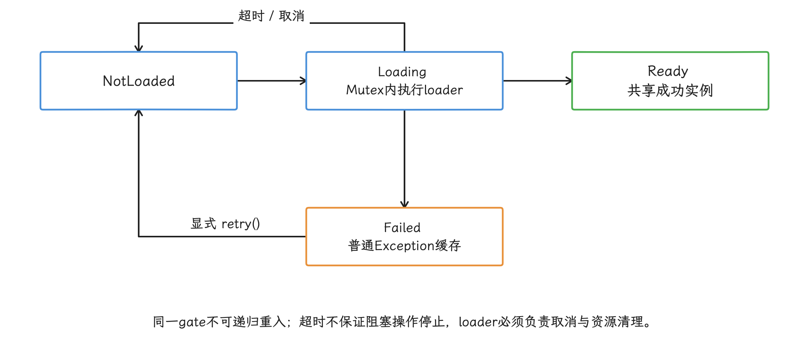

图：原示例TimeoutCancellationException被CancellationException分支处理：恢复NotLoaded，后续getOrLoad可重新执行。

这个示例在调用者的协程里执行 loader。页面级初始化可以随页面取消；进程级初始化应由 application scope（与应用进程同寿命的作用域）——与 App 进程同生命周期的 `CoroutineScope`——发起，避免第一个 Activity 销毁时把所有等待者一起取消。普通 `Exception` 会缓存为 `Failed`，只有显式 `retry()` 才重新尝试；`withTimeout` 的 `TimeoutCancellationException` 属于 `CancellationException`，和外部取消一样会恢复 `NotLoaded`，后续 `getOrLoad()` 可以再次执行 loader，并不要求先 `retry()`。loader 不得递归调用同一个 gate（Mutex 不可重入），资源需在取消/超时路径清理，尤其不能丢失刚创建的 Closeable；生产实现还要加入逐步延长等待时间的退避策略和重试次数上限。

#### 4.2 预触发的位置

预触发的目标是利用用户即将进入功能前的自然间隔。例如：

- 进入“发布”页后预热拍摄模块；
- 详情页出现编辑权限后准备编辑器；
- 用户打开支付确认页后准备非敏感展示资源。

预触发仍要可取消。hover（鼠标或触控笔指针悬停）、滚动经过或一次曝光，都不该变成不可取消的重型初始化。

### 5. `IdleHandler` 的准确语义

#### 5.1 idle 信号的语义

`Looper` 是线程持续从 `MessageQueue` 取消息并执行的循环。[`MessageQueue.IdleHandler`](https://developer.android.com/reference/android/os/MessageQueue.IdleHandler)会在所属 Looper 没有可立即分发的消息、准备等待更多消息时收到 `queueIdle()`。即使队列里仍有未来时间点才到期的消息，它也可能被调用。

返回值含义：

- `false`：本次调用后移除；
- `true`：以后进入 idle 状态时仍可调用。

但它说明不了下面这些事：

- CPU 利用率低；
- RenderThread 或 GPU 空闲；
- 下一次输入或 VSync（屏幕垂直同步信号）很远；
- 系统给了固定执行预算；
- 设备适合做预解压或大对象构建。

#### 5.2 Android 17 的两条实现路径

Android 17 的 [`CombinedDeliMessageQueue/MessageQueue.java`](https://android.googlesource.com/platform/frameworks/base/+/refs/tags/android-17.0.0_r1/core/java/android/os/CombinedDeliMessageQueue/MessageQueue.java)同时包含 legacy 与 DeliQueue 分支。DeliQueue 是 Android 17 新的并发消息队列实现。`USE_NEW_MESSAGEQUEUE` 由 `@EnabledAfter(targetSdkVersion = BAKLAVA)` 标注，因此面向 Android 17、`targetSdkVersion >= 37` 的应用默认进入 DeliQueue；开发者选项或 `adb am compat` 仍可临时切换这项兼容变更。官方说明见 [Android 17 MessageQueue 行为变更](https://developer.android.com/about/versions/17/changes/messagequeue)。

两条路径的 IdleHandler 外部语义保持一致：

| 路径 | idle 判断 | handler 集合 |
| --- | --- | --- |
| legacy | 队列为空或头消息尚未到期 | 在 `synchronized(this)` 对象锁内复制列表 |
| DeliQueue | `looperCheckIsIdle()` 检查可投递消息 | `mIdleHandlersLock` 下复制列表 |

官方把 DeliQueue 称为无锁 MessageQueue，说的是核心消息数据结构；源码仍用 `mIdleHandlersLock` 保护 IdleHandler 列表，由此推不出“类内每项操作都无锁”。IdleHandler 回调仍在 Looper 线程执行，回调期间到达的新消息要等它返回。旧实现可对照 [`LegacyMessageQueue/MessageQueue.java`](https://android.googlesource.com/platform/frameworks/base/+/refs/tags/android-17.0.0_r1/core/java/android/os/LegacyMessageQueue/MessageQueue.java)，更多结构见 [MessageQueue 与 DeliQueue](../../part1-fundamentals/ch01-architecture/08-messagequeue-lock-contention.md)。

不要用反射读取 `MessageQueue` 私有字段。DeliQueue 为兼容二进制仍保留 `mMessages`，但该字段固定为 `null`，旧式队列探测会失效。Android 17 官方指南当前要求相关测试环境至少升级到 Espresso 3.7.0 或 Robolectric 4.17，并把 Robolectric 的 `LEGACY` Looper 模式迁到 `PAUSED`。


#### 5.3 作为一次性信号使用

下面的 IdleHandler 只通知调度器“主队列曾进入 idle”，不在主线程执行预热：

```kotlin
Looper.getMainLooper().queue.addIdleHandler {
    startupScheduler.signal(Trigger.MAIN_QUEUE_IDLE)
    false
}
```

调度器收到信号后仍要检查首帧状态、页面可见性、任务 deadline 和资源冲突。返回 `false` 避免每次 idle 都重复触发。


这些写法应禁止：

- 在 `queueIdle()` 读取数据库或文件；
- 在回调中解析大 JSON、创建大量对象或加载 native 库；
- 返回 `true` 轮询业务状态；
- 每个 SDK 各自注册 IdleHandler；
- 把一次 idle 当成进程持续低负载。

`/proc/stat` 和 `/proc/<pid>/stat` 是内核导出的系统级与进程级统计文件。CPU 采样受时间窗口和设备差异影响，反映的只是历史占用；主线程 deadline、I/O 队列、GPU、thermal 或马上到来的输入，它都照看不到。专用调度器应组合多项运行信号并在目标设备上验证，单个 CPU 百分比不足以作为任务开关。

### 6. Jetpack App Startup 的手动初始化

App Startup 默认通过库提供的 `InitializationProvider` 发现并运行 initializer，也就是实现 `Initializer` 接口的组件初始化器。发现依据来自 Manifest 的 `<meta-data>`。若组件不需要在进程启动时运行，必须先从合并后的 Manifest 移除对应声明；合并后的 Manifest 是 App 与各依赖清单合成后的最终结果。

下面从 Provider 中移除一个 initializer 的 `<meta-data>`：

```xml
<provider
    android:name="androidx.startup.InitializationProvider"
    android:authorities="${applicationId}.androidx-startup"
    android:exported="false"
    tools:node="merge">

    <meta-data
        android:name="com.example.AnalyticsInitializer"
        tools:node="remove" />
</provider>
```

`tools:node="remove"` 会连同依赖库 Manifest 合并进来的 `<meta-data>` 一起处理。只从自己源码里删一行，证明不了最终 Manifest 已经移除自动初始化。

需要时再通过 `AppInitializer` 执行组件及其依赖：

```kotlin
val analytics = AppInitializer.getInstance(context)
    .initializeComponent(AnalyticsInitializer::class.java)
```

调用前要确认该组件没有通过另一个 Manifest initializer 的依赖关系提前运行。移除一个 metadata 不会屏蔽该类本身或它的依赖：其他剩余根、依赖边或直接调用仍可触发它们；需要检查整张图，确认所有启动期路径均已移除。

`AppInitializer` 负责发现组件、按依赖顺序执行并缓存结果，不替应用选择线程、deadline 或失败界面。第三方 SDK 如果还有自己的 Provider 或其他自动初始化开关，也要单独处理。

### 7. 按需 Feature 与 native 库

#### 7.1 交付状态机

Play Feature Delivery 的 on-demand module（按需下载的动态功能模块） 是按需下载的动态功能模块，不会保证随 base module 一起安装；base module 是首次安装时始终存在的基础模块。`startInstall()` 成功只会返回安装 session（本次安装会话） ID，表示请求已被平台接受；模块装没装上，从返回值看不出来。应用需要监听 session 状态，并处理：

- 等待与下载；
- 需要用户确认；
- 安装完成；
- 网络、存储、Play 能力或内部错误；
- 取消；
- Activity 重建和进程退出后的状态恢复。

访问代码和资源前要再次检查 `installedModules`。为让基础 `Context` 和动态模块中的 Activity 访问新安装的代码与资源，应按官方接入方式启用 SplitCompat；已有的 `Context` 或 Activity 还可能需要刷新或重建。

<!-- gracker-diagram: a223-20-on-demand-install -->
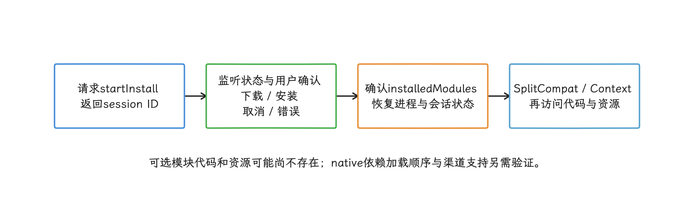

图：deferredInstall是不可跟踪进度的尽力请求，立即要用的功能需显式加载态和失败恢复。

`deferredInstall()` 是后台尽力而为的请求，完成时间没有保证，进度也跟踪不了。功能有明确使用 deadline 时，别只依赖 deferred install。

#### 7.2 外部组件与 base module

`exported` 组件允许其他应用或系统通过 Intent 调用。可选模块中的 Activity、Service 或 Receiver 可能在模块尚未安装时就被外部调用，因此官方文档要求这类组件留在 base module，别放进 optional module。

需要外部入口时，在 base module 放一个轻量 proxy（代理组件）：


1. 校验 Intent 和权限；
2. 检查模块是否安装；
3. 已安装则转发到内部组件；
4. 未安装则启动下载或返回可恢复错误。

通知、shortcut（桌面快捷方式） 和系统 UI 立即需要的资源也应留在 base。新模块的 Manifest 条目不会立即被平台采用，系统组件在一段时间内也可能访问不到新资源。

#### 7.3 `.so` 加载失败的处理

`.so` 是 Android 使用的 native 共享库文件。“`System.loadLibrary()` 失败后从自定义压缩包解压，再 `System.load()`”会让应用自行处理 ABI（CPU 架构对应的二进制接口） 选择、依赖顺序、更新原子性、文件权限、完整性、存储空间和并发加载。这里的更新原子性指切换版本时要么完整成功、要么完整失败，半套文件是不允许出现的。

低频 native 能力优先随 on-demand feature module 交付，并按官方说明处理 SplitCompat 和 native loader（负责装载 `.so` 的组件）。当前 Play Feature Delivery 文档建议用 ReLinker 加载可选模块中的 native 库；如果使用 `System.loadLibrary()`，还要显式处理模块内依赖库的加载顺序。若业务不经 Google Play 分发，要为对应渠道设计受支持的交付方案，别假设 Play 路径适用于所有安装来源。

### 8. 何时使用 WorkManager

进程内的首帧后预热适合 application scope 和受控 executor。WorkManager 是面向可靠持久任务的 Jetpack 调度器，任务可以跨 App 重启和设备重启重新调度。以下情况更适合使用它：

- 用户离开前台后仍应继续；
- 进程被杀或设备重启后需要重调度；
- 需要网络、充电、空闲或存储约束；
- 需要唯一任务、退避重试或任务链。

WorkManager 的调度时机不是精确的“首帧后 500 ms”。不要用它准备马上要点击的功能，也不要为了延迟初始化创建大量没有持久化价值的 `WorkRequest`（一次或周期任务请求）。

任务必须幂等。WorkManager 可以重试或重新调度；若业务只允许产生一次效果，还要用唯一工作、数据库事务或服务端幂等键去重。

### 9. 任务契约与兜底

延迟任务至少声明这些字段：

```yaml
task_id: preload_secondary_route
trigger: AFTER_FIRST_FRAME | FIRST_USE | MAIN_QUEUE_IDLE | PERSISTENT_WORK
scope: PROCESS | ACTIVITY | ACCOUNT | FEATURE
dependencies: [base_config, account_state]
resource: MAIN | IO | CPU | BINDER | NETWORK
deadline: before_feature_entry
failure: SKIP | RETRY | DEGRADE
idempotency_key: account_and_app_version
```

这些字段用于回答任务何时触发、由谁持有、与谁争资源、失败后怎样继续。schema 可以按项目实现，字段含义应保持稳定，并写入 trace 或日志。

#### 9.1 主要风险

| 风险 | 常见原因 | 处理 |
| --- | --- | --- |
| 首次使用卡顿 | loader 太晚或没有预触发 | 靠近入口预触发，提供加载态和取消 |
| 重复初始化 | 多入口、重建、多线程同时触发 | 共享状态入口、互斥、幂等键 |
| 永久未初始化 | 只依赖一次 idle 或一次页面回调 | deadline 触发和首次使用兜底 |
| Activity 泄漏 | 进程级任务持有 Activity/View | 使用不绑定页面的 application context，明确生命周期范围 |
| 取消传播错误 | 页面退出取消了进程级共享加载 | 按任务所有者选择对应的 `CoroutineScope` |
| 多进程不一致 | 每个进程有独立静态状态 | 每进程初始化或通过受控 IPC（进程间通信）协调 |
| 成本后移 | TTID 下降，TTFD/首次点击变慢 | 三个区间一起验收 |
| 资源冲突 | 首帧后任务并发抢 CPU/I/O/Binder | 统一队列、并发上限、暂停机制 |
| 失败风暴 | 自动重试没有退避和上限 | 逐步延长重试间隔；连续失败后暂停自动重试；保留用户触发入口 |

### 10. 验证方法

#### 10.1 本地与实验室

每次移动任务后，至少验证下列场景。cold start 表示进程尚不存在，warm start 表示进程仍在但 Activity 需要创建，hot start 表示目标 Activity 已存在并回到前台：

1. cold/warm/hot 启动的 TTID、TTFD；
2. 首帧后直到启动任务稳定期间的 FrameTimeline 和 runnable 排队竞争；
3. 首次进入目标功能的等待、取消、失败和重试；
4. Activity 重建、后台切回和进程重启；
5. 多进程各自的初始化状态；
6. 离线、慢网、低存储和低内存；
7. 不同设备性能档位、刷新率和 thermal 状态；
8. 动态 Feature 的本地安装、用户确认和错误模拟。

性能对照要保持代码、数据、编译模式和入口一致，比较范围别只盯住 `Application.onCreate()`——延迟任务的成本已经移到后续区间了。

#### 10.2 Trace 与线上指标

每项任务记录：

- `task_id`、trigger 和 scope；
- 排队、开始、结束时间；
- 执行线程与资源类型；
- 成功、取消、超时、失败原因；
- 首次使用是否等待；
- 策略版本和 App 版本。

Perfetto 用时间线确认主线程、CPU、I/O、Binder 与帧的关系；Android Vitals 汇总线上设备的启动耗时分布；业务指标记录首次入口成功率。验收时要同时查看三组结果，避免一处变快却把成本移到另一处。

### 诊断与验证清单

- [ ] 每项任务已区分异步、首帧后、首次使用、按需交付和持久后台。
- [ ] TTID 前只保留首帧正确性必需工作。
- [ ] 首帧信号有明确语义，不用普通 `Handler.post` 猜测。
- [ ] 首帧后任务有并发限制、deadline、暂停和取消策略。
- [ ] 首次使用由共享状态入口管理互斥、超时和失败。
- [ ] IdleHandler 只做有界检查或发送信号。
- [ ] 没有用 CPU 百分比代替 UI/系统资源状态。
- [ ] App Startup 自动 `<meta-data>` 已从合并后的 Manifest 验证移除。
- [ ] Dynamic Feature 已处理下载、确认、安装、失败和进程恢复。
- [ ] optional module（非必装模块）没有 exported 组件。
- [ ] 没有自建 `.so` 失败解压加载链路。
- [ ] 需要跨进程存活的任务使用合适的持久调度。
- [ ] TTID、TTFD、首次使用、帧、功耗和异常一起验收。

## 线程池容量、并发度与调度开销

剩余的独立任务可以并发执行，但并发度要受 CPU 核心、I/O、锁和其他启动线程限制；线程加得多，启动未必更短。

启动优化经常把“移到后台线程”和“缩短启动”写成同一件事。任务离开主线程后，仍要竞争 CPU、存储、Binder、内存带宽（单位时间内存可传输的数据量）和锁；主线程若在等它的结果，排队时间照样进入启动关键路径。

我们给出的每个调度结论，都要能回答四个问题：任务契约是什么——它是否必须完成、能否丢弃或重试；用哪个执行器；允许多少任务同时运行；调用方在哪里等待。结论还要有队列指标与 Perfetto 系统 trace 支撑。

线程、锁与协程的基础机制分别见 [§1.1 线程模型](../../part1-fundamentals/ch01-architecture/01-android-architecture-process-threading.md) 和 [§8.4 协程性能](../../part2-performance/ch08-responsiveness/04-coroutine-performance.md)。以下只讨论启动场景中的任务编排和资源竞争。

### 1. 并发优化先看启动关键路径

并发优化的起点仍是启动任务图：节点代表工作，单向边代表依赖。完整启动指标从系统启动请求开始；应用内部 DAG 只能覆盖其中可观测的任务段。沿任务依赖走到首帧或 fully drawn 的最长路径，是这张任务图对相应指标的关键路径——首帧对应 TTID，fully drawn 表示应用声明主要内容已经可用，对应 TTFD。

一项后台任务对启动时间的贡献可以拆成四段：

`完成时刻 = 提交时刻 + executor 排队 + 执行期间的 CPU 时间 + 执行期间的 Runnable 等待 + 阻塞/挂起等非 CPU 等待`

这是互不重叠区间的归因示意，不是直接相加嵌套 trace 或不同线程的 CPU 时间。提交前的依赖等待另从 task ready/依赖完成点记录。

只统计任务函数自身的运行时间，线程池排队、Runnable 等待、锁竞争、同步 Binder 和主线程等待就都被漏掉了；我们做并发调优时，要把这几段分开看。

启动任务按契约分类，比按代码所在模块分类更可靠：

| 任务类型 | 例子 | 主要约束 | 常见执行位置 |
|---|---|---|---|
| 首帧必需、主线程亲和 | View 创建、资源主题应用、窗口操作 | Android UI 线程规则；“主线程亲和”表示只能或应当在主线程执行 | 主线程，缩短同步工作 |
| 首帧必需、CPU 计算 | 小规模配置解析、状态归并 | CPU 容量、热状态、依赖顺序 | 有界计算调度器 |
| 首帧必需、阻塞调用 | 磁盘读取、同步数据库、同步 Binder | 外部服务与设备延迟 | 有界阻塞调度器，并评估能否取消依赖 |
| 首帧后可做 | 缓存预热、非当前页 SDK、统计准备 | 生命周期、功耗、与首帧竞争 | 首帧后由应用作用域调度 |
| 需要跨进程存活 | 可重试上传、持久同步 | 系统配额、约束、重试语义 | WorkManager，由系统协助持久调度 |
| 回调式异步 API | OkHttp `enqueue()`、异步数据库或系统回调 | API 自有线程与并发限制 | 保留原调度器，把回调安全转换成可挂起调用 |

“I/O 任务不消耗 CPU”这个假设并不成立。网络和文件路径上仍可能有协议处理、内存复制、校验、解压、反序列化、加密和 Binder 调用。分类要看阻塞行为与资源占用，而不是函数名里有没有 `read` 或 `load`。

并行化只对互相独立、且并行后没有把共享资源压满的任务有效。A、B 可以同时执行，但 C 要等 A 和 B 都完成，开始时间仍由较慢的那条分支决定；A、B 若同时争用存储或 CPU，各自还可能变慢。

### 2. `ThreadPoolExecutor` 的队列决定扩容时机

#### 2.1 `execute()` 的三段决策

`ThreadPoolExecutor` 是 JDK 提供的通用线程池执行器，Android 17 用的是 libcore 里的 OpenJDK 实现。核心线程数、最大线程数、任务队列和拒绝策略共同决定它何时建线程、何时排队。下面的伪代码呈现 `execute()` 的决策顺序，省略了运行状态重检和并发控制细节。

```text
if workerCount < corePoolSize:
    tryAddCoreWorker(task)
else if workQueue.offer(task):
    recheckPoolState()
else if workerCount < maximumPoolSize:
    tryAddNonCoreWorker(task)
else:
    reject(task)
```

这段顺序解释了一个常见现象：核心线程都忙时，执行器先调 `workQueue.offer()`，入队失败才尝试创建非核心线程。用不限容量的 `LinkedBlockingQueue` 时，执行器几乎不会因为积压走到 `maximumPoolSize`，调大 `maximumPoolSize` 往往就没有效果。

<!-- gracker-diagram: a223-23-executor-admission -->
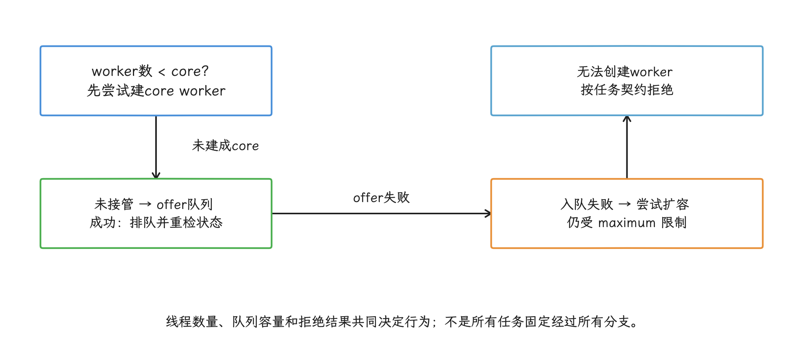

图：决策图省略并发重试与状态重检；无界队列通常不会走到非核心扩容，调大maximum无效。

#### 2.2 队列是延迟和过载策略

| 队列 | 行为 | 适用边界 | 主要风险 |
|---|---|---|---|
| 无界队列 | 核心线程忙后持续排队 | 生产速率受控、任务必须保留、已有外部背压（下游忙时能让上游减慢提交） | 延迟与内存占用缺少上界，`maximumPoolSize` 很少参与 |
| 有界队列 | 队列满后扩到最大线程数，再拒绝 | 需要给排队和内存设上限 | 容量过小会频繁拒绝，过大又会隐藏过载 |
| `SynchronousQueue` | 不保存任务，提交者必须把任务直接交给空闲或新线程 | 极短突发、线程上限和拒绝语义清楚 | 阻塞任务容易迅速打满线程上限 |
| 优先级队列 | 由业务优先级选择任务 | 任务可稳定排序且能处理饥饿 | 默认通常无界；“饥饿”指低优先级旧任务长期等不到执行 |

队列容量别拍脑袋定在“64 看起来够用”。压测里记录到达速率、服务时间和允许排队时长，再按突发流量预留余量。Little 定律 `L = λW` 描述稳定系统中“平均在途任务数 = 平均到达速率 × 平均停留时间”：`L` 是正在排队或执行的平均任务数，`λ` 是每秒到达任务数，`W` 是任务从进入系统到离开的平均秒数。它替代不了突发测试，也给启动阶段生成不出一个通用常量。

#### 2.3 拒绝策略属于正确性设计

执行器饱和时，拒绝策略决定数据会不会丢、调用线程会不会被阻塞、错误是否会被发现：

- `AbortPolicy` 抛出 `RejectedExecutionException`，适合静默丢失不可接受、调用方能够降级或重试的任务。
- `CallerRunsPolicy` 在 executor 尚未关闭时由提交线程执行任务，借此减慢生产者；若提交者是主线程，后台工作会回到启动关键路径。executor 已关闭时，该策略直接丢弃任务，不会抛异常。
- `DiscardPolicy` 和 `DiscardOldestPolicy` 只适合允许丢弃、合并或由新状态覆盖旧状态的任务，还要记录丢弃原因。
- 自定义策略必须定义关闭期间与过载期间的差异，避免把 executor 已关闭误判成瞬时拥塞。

拒绝次数的报警阈值别统一设成“大于零就报”。主动丢弃的遥测事件和必须执行的配置加载，对拒绝的容忍度完全不同，监控规则要绑定任务契约。


#### 2.4 同池等待会造成饥饿

有一个容易漏掉的故障：池里的每个工作线程都往同一个有界池提交子任务，然后同步等待子任务；所有 worker 被父任务占住，子任务只能在队列里干等，系统就可能永久停住。

修复方向包括取消同步等待、用结构化并发让父任务挂起、把依赖关系交给调度器，或为有明确隔离需求的资源单开执行器。结构化并发要求父任务管理子任务的生命周期、取消和异常。单纯扩大池只是把故障往后推，循环等待关系本身还在。

<!-- gracker-diagram: a223-25-same-pool-starvation -->
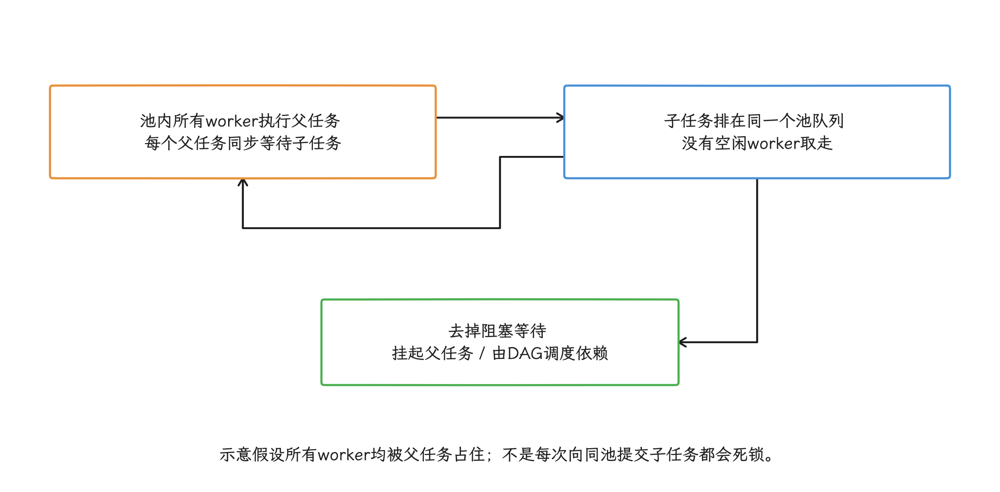

图：扩大池只推迟触发条件；结构化并发必须真正挂起等待，不能把Future.get换个函数名。

### 3. 并行度由任务和设备共同决定

#### 3.1 CPU 密集任务

`Runtime.getRuntime().availableProcessors()` 只能给出当前运行时可见的处理器数量。大小核的性能差异、当前 cpuset（调度器允许该任务使用的 CPU 集合）、前后台状态、系统负载、温度限制和其他进程竞争，它都表达不了。

CPU 密集池可以从“接近可用处理器数量”的候选区间开始做实验，把核数直接固化成所有设备的答案是不行的。启动阶段还要给主线程、RenderThread、Binder 和 GC 留出运行机会。比较可靠的流程是：

1. 用低端、中端和高端代表设备固定 release APK（启用正式优化的非调试安装包）、数据集与启动模式；
2. 分别测试几个小范围并行度；
3. 同时比较 TTID/TTFD、任务队列等待、Runnable 时间、温升与功耗；
4. 选择尾延迟稳定、且不会压缩 UI 调度空间的最小并行度。尾延迟指 P90、P95、P99 等较慢样本，而非平均值。

任务粒度同样影响结果。几十微秒的小任务若每次都入队，调度、对象分配和同步成本可能超过计算本身；过大的任务又会长时间占住 worker。任务切分有没有缩短关键路径，要从 trace 里确认，单看 CPU 利用率会误判。

#### 3.2 阻塞任务

阻塞线程在等待磁盘、socket、Binder 或锁时不占用 CPU，但仍占据一个 Java/内核线程、栈地址空间和调度数据结构。阻塞池因此可以比 CPU 计算池容纳更多并发任务，上限则受连接池、数据库并发、文件系统、服务端配额和进程内存约束。

底层 API 若已提供异步回调，就别再包一层阻塞 executor。多出来的线程只是在等原 API 的结果，取消、超时和 trace 关联反而更复杂。OkHttp、Room、图片加载库这些组件通常自带执行器，接入前先盘点它们的线程和并发配置。

#### 3.3 隔离用于控制干扰

计算与阻塞任务对并行度和过载的需求不同，可以分开调度。但“每类任务一个线程池”会制造大量长期存活线程，CPU、存储和内存带宽也并不会因此变成私有资源。

看到下面这些信号，再引入独立执行器：

- 某类长阻塞任务反复让低延迟任务排队；
- 某个串行资源要求严格顺序，例如单文件写入；
- 第三方 SDK 遵守不了应用的取消和优先级规则；
- 出于安全隔离，任务要与普通业务分开执行上下文。

其余场景可以复用少量受管理的执行器，再用有界队列、`limitedParallelism`（限制某个协程调度器视图的并行片段数）、`Semaphore`（凭许可数限制同时在途的任务）或业务级合并控制单类任务的并发。

### 4. Android 17 上的优先级和 CPU 选择

#### 4.1 `Process` 优先级对应 Linux nice

Android 的 `android.os.Process` 常量使用 Linux nice 值，数值越小，普通调度中的相对权重通常越高。它与 Java 的 `Thread.MIN_PRIORITY` 到 `MAX_PRIORITY` 不是同一套数值。Android 17 源码中：

- `THREAD_PRIORITY_DEFAULT = 0`；
- `THREAD_PRIORITY_BACKGROUND = 10`，正数代表较低的调度权重；
- `THREAD_PRIORITY_FOREGROUND = -2`；
- display、video、audio 等负值常量服务于特定系统场景，普通应用别借它们抢占 UI 或媒体线程。

这里要区分 Java 优先级与 Android nice：固定 libcore `Thread` 构造器继承父线程缓存的 Java `priority`，再据此生成新线程的 niceness；它不会直接继承父线程经 `Process.setThreadPriority()` 改过的 nice。原生创建线程的继承另受平台路径影响，调度组也应按实际策略核对。因此 worker 仍应在自己的入口设置允许的 Android nice，不能把两套数值和继承语义混用。下面的 `ThreadFactory` 给受管理的 worker 统一命名并设置优先级。


```kotlin
import android.os.Process
import java.util.concurrent.ThreadFactory
import java.util.concurrent.atomic.AtomicInteger

class AndroidThreadFactory(
    private val namePrefix: String,
    private val androidNice: Int
) : ThreadFactory {
    private val sequence = AtomicInteger()

    override fun newThread(task: Runnable): Thread {
        val threadName = "$namePrefix-${sequence.incrementAndGet()}"
        return Thread(
            {
                Process.setThreadPriority(androidNice)
                task.run()
            },
            threadName
        )
    }
}
```

`Process.setThreadPriority()` 由 worker 自己执行，设置的是当前工作线程。后台预取可以用 `THREAD_PRIORITY_BACKGROUND`；首屏依赖任务是否适合默认优先级，要看它与主线程、RenderThread 的竞争结果。普通 worker 提升到 display 或 audio 优先级是禁区。

#### 4.2 内核调度不只看 nice

在 `android17-6.18-2026-06_r6` 中，普通线程进入 fair 调度类，即 Linux 为普通任务提供的公平调度路径。`fair.c` 使用 EEVDF（Earliest Eligible Virtual Deadline First）：先筛选应该获得运行时间的任务，再从中选择虚拟截止时间最早的任务。nice 能改变调度权重，但给不出“某线程在指定毫秒内获得 CPU”这样的承诺。

Android 还用 cgroup（control group，内核资源分组） 和 task profile（系统预设的一组线程资源策略） 管理进程、线程所属的调度组。CPU 选择受 cpuset、uclamp（给任务利用率估计设置上下界）、CPU 容量、当前负载、能耗模型和热限制影响，设备厂商还可以调整配置。应用层的一个 nice 数值覆盖不了这些条件。

所以优先级表达的是“这类工作相对更能等待”，表达不了必须完成的时间点。首帧依赖还是要缩短工作量、取消非必需依赖，并在代表设备上检查尾延迟。

#### 4.3 不把业务线程固定到大核

通过 JNI（Java 与 native C/C++ 代码的调用接口） 调 `sched_setaffinity()` 把工作线程固定到所谓大核，会绕过调度器对负载、能耗、温度和前后台状态的动态判断；不同 SoC（片上系统）的 CPU 拓扑与在线状态也不一致。应用退到后台后仍保留不合适的亲和性，可能限制系统迁移与能耗优化。实际可运行集合还受在线 CPU 与 cpuset 约束；请求集合与允许集合没有交集时，`sched_setaffinity()` 可返回 `EINVAL`，不能描述成调用成功后必然留下一个“无核可用”的线程。实验代码也必须检查返回值与实际 mask。

CPU 亲和性可以用于实验室归因，比如判断某段计算是否受核容量影响；生产应用把硬绑核当通用启动优化就不合适了。trace 若显示关键线程长期在不合适的 CPU 上等待，应同时检查任务优先级、进程状态、Runnable 竞争、设备温度与厂商调度配置。


### 5. 每个线程都有内存和生命周期成本

#### 5.1 ART（Android Runtime） 不采用“每线程固定 1 MB”的模型

ART 在创建 Java 线程时还要准备 native stack，也就是运行 C/C++、JNI 和部分运行时代码所需的调用栈。`art/runtime/thread.cc` 在 `Thread::CreateNativeThread()` 中调用 `FixStackSize()`，这段源码会：

1. 在调用者传入零时使用运行时默认栈大小；
2. 无条件增加 1 MB，源码注释说明这是为了兼容依赖旧 Dalvik/bionic 较大 native stack 的应用；
3. 加入栈溢出保护区与运行时保留区；
4. 满足 `PTHREAD_STACK_MIN`，并向系统页大小取整。

所以，`new Thread(..., stackSize)` 的参数推不出线程最终的栈映射大小。栈地址空间的保留量、已提交页和 RSS（当前常驻物理内存）要分开看：虚拟地址区间再大，也未必有同样大小的物理内存常驻下来。


也别想通过 PLT hook（拦截动态链接函数调用） 统一改写 `pthread_attr_setstacksize()`。Java、JNI、解释器和 sanitizer（内存、线程等错误检测插桩） 构建的栈需求各不相同，过小的栈会把偶发深调用变成难复现的崩溃。线程数量过多时，先减少无所有者线程、重复线程池和空闲 worker，再评估少数明确的 native 线程要不要调整。

#### 5.2 所有者负责关闭和取消

每个自建执行器都要有所有者、创建时机和关闭时机。常驻进程级执行器可以交给 application scope 管理；页面级任务应随 `ViewModel` 或 Lifecycle 取消；测试和动态功能卸载还要显式 `shutdown()`，避免 ClassLoader、Activity 或大对象被任务闭包长期引用——闭包就是任务代码连同它捕获的变量形成的对象。

线程“泄漏”常见的表现包括：

- 周期任务使用固定频率调度，页面销毁后仍继续提交；
- executor 没有关闭，核心线程长期等待队列；
- 阻塞调用忽略 interrupt，取消请求结束不了它；
- 任务闭包持有 Activity、View 或大缓存；
- 第三方 SDK 多次初始化，每次创建一组线程。

`Thread.getAllStackTraces()` 会遍历并抓取大量 Java 栈，生产环境高频调用会制造额外开销，也覆盖不全只运行 native 代码、没有对应 Java `Thread` 对象的线程；它适合受控诊断。日常盘点可以结合 Perfetto、bugreport（系统诊断报告）、`/proc/self/task（当前进程的内核线程目录）` 和库配置完成。

### 6. 协程仍运行在线程调度器上

#### 6.1 `Dispatchers.Default` 与 `Dispatchers.IO`

本文按 kotlinx.coroutines 1.11.0 的公开契约讨论。在 JVM/Android 目标上，`Dispatchers.Default` 面向 CPU 计算，`Dispatchers.IO` 面向阻塞 I/O。协程挂起会保存当前执行位置，并释放当时承载它的实际工作线程；普通阻塞调用仍会占住 worker。

`Dispatchers.IO` 的默认阻塞并行度是 64 与处理器数量两者中的较大值，也可以由 `kotlinx.coroutines.io.parallelism` 调整。这个值限制的是同时执行的阻塞任务数，既不是进程中严格存活的线程总数，也不是应用应该追求的线程数。`IO` 与 `Default` 共享线程和调度资源，从 `Default` 切到 `IO` 时，实现还可能在同一个 worker 上继续执行。

`Dispatchers.IO.limitedParallelism(n)` 的视图具有弹性，各个视图的并行度总和不受 `Dispatchers.IO` 默认 64 限制。为多个 SDK 分别创建很大的 view，峰值时仍可能出现大量阻塞 worker；这些视图共享底层线程与调度资源，没有获得彼此隔离的私有线程池。

#### 6.2 `limitedParallelism` 控制执行片段

`limitedParallelism(n)` 返回底层 dispatcher 的一个轻量视图，没有私有线程集合，不需要关闭，也不保证稳定线程身份。它限制同时执行的协程片段数量；协程挂起后，其他协程可以进入同一个 view。

这使它适合约束 CPU 工作或实现“挂起点之间串行执行”。`limitedParallelism(1)` 会为这些执行片段建立顺序关系，但拿它当覆盖整个挂起函数的互斥锁是不行的：一个协程挂起后，另一个协程可以进入同一视图。要限制数据库连接、socket 请求或解码器实例等资源的在途数量，用 `Semaphore`；要保护共享可变状态，用 `Mutex`（协程可挂起的互斥锁）。这些资源约束从 dispatcher 名称上推断不出来。

<!-- gracker-diagram: a223-29-dispatcher-vs-inflight -->
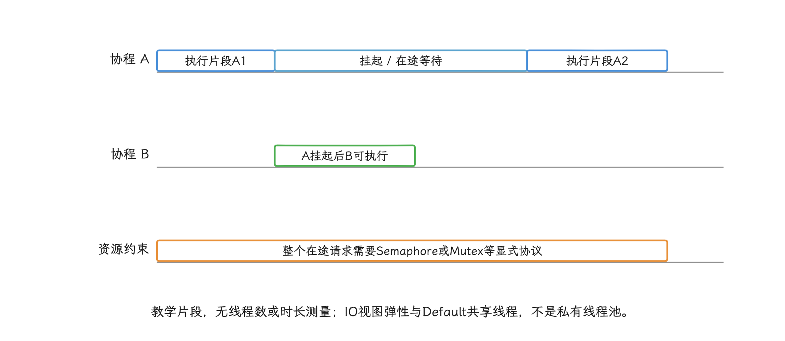

图：limitedParallelism(1)保证片段串行与相应happens-before；A挂起时B仍可进入，不能当覆盖挂起函数的锁。

#### 6.3 用结构化并发表达依赖

下面的通用函数用于并行读取两个互不依赖的启动输入。父协程取消时，两个子任务都会收到取消；函数返回前也不会留下脱离所有者的工作。

```kotlin
import kotlinx.coroutines.CoroutineDispatcher
import kotlinx.coroutines.async
import kotlinx.coroutines.coroutineScope

suspend fun <A, B> loadStartupInputs(
    dispatcher: CoroutineDispatcher,
    loadA: suspend () -> A,
    loadB: suspend () -> B
): Pair<A, B> = coroutineScope {
    val a = async(dispatcher) { loadA() }
    val b = async(dispatcher) { loadB() }
    a.await() to b.await()
}
```

这段代码表达的只是依赖和取消关系，两个任务是否真的在不同线程上运行，它并不承诺。`loadA` 或 `loadB` 若调用了不可中断的阻塞 API，协程取消也立刻释放不了底层线程，仍要为该 API 配置超时或改用可取消接口。

<!-- gracker-diagram: a223-30-structured-inputs -->
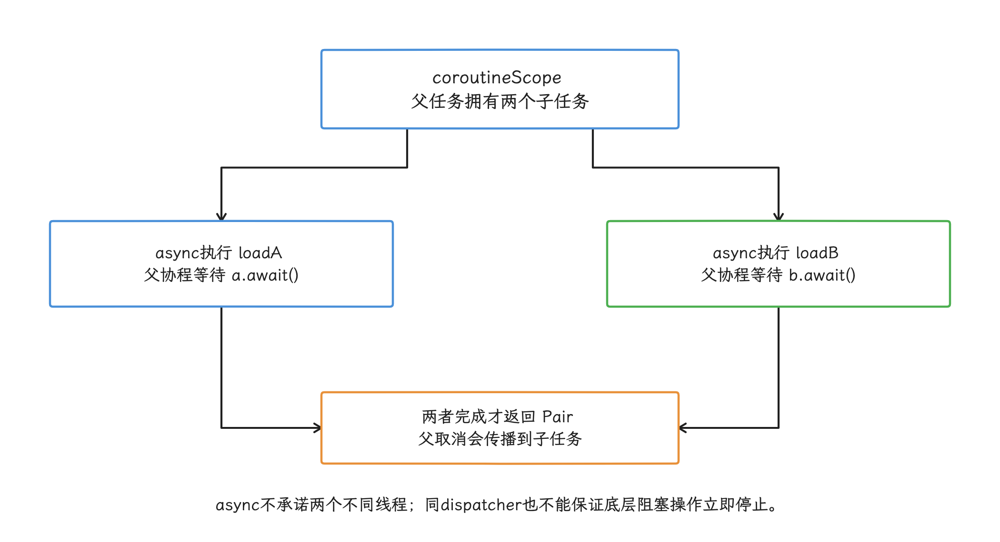

图：loadStartupInputs返回前等待两个输入；子任务失败会取消同scope的兄弟任务，阻塞API仍需协作取消。

`GlobalScope` 不适合启动任务：它创建的协程不隶属于任何调用页面或启动会话，测试、错误传播和取消都难以交回所有者。应用级工作应注入明确的 `CoroutineScope`，页面工作使用 `viewModelScope` 或合适的 Lifecycle scope。

### 7. App Startup 和 WorkManager 解决不同问题

#### 7.1 App Startup 负责发现和依赖顺序

App Startup 1.2.0 只负责发现和依赖顺序：它按 `dependencies()` 先初始化依赖，`AppInitializer` 同步调用 `create()`，不会自动并行依赖图，也不会自动把工作移出主线程。

合并多个 provider 能减少组件发现成本，但 initializer 里的阻塞工作未必因此离开了启动关键路径。非首帧必需组件应移除自动初始化元数据，在明确的业务时机手动初始化；首帧必需组件则要让 `create()` 保持短小，后续可异步的部分交给有所有者的调度器。Provider 约束详见 [21.3 ContentProvider 与多进程启动治理](03-contentprovider-multiprocess-startup.md)。

#### 7.2 WorkManager 用于需要持久执行的工作

WorkManager 面向应用离开可见状态后仍需执行、需要约束或重试的任务，由 JobScheduler（系统持久作业调度服务）、系统配额、进程状态和设备条件统一管理。想靠它保证某个启动任务立刻完成，是用错了工具。

截至 2026-10-25，稳定版为 WorkManager 2.12.0；它也不是一个固定“最多 16 个线程”的池。`Worker.doWork()` 跑在 `Configuration.Builder.setExecutor()` 指定的 executor 上；task executor 处理 WorkManager 自身的记账与调度，和业务 worker 是两回事。`CoroutineWorker.doWork()` 默认使用 `Dispatchers.Default`，WorkManager 2.10.0 起可以用 `setWorkerCoroutineContext()` 配置其协程上下文；按当前 `Configuration.Builder` 契约，只要没设置 worker coroutine context，`setExecutor()` 提供的 executor 也会转换成 dispatcher 供 `CoroutineWorker` 使用。方法内部仍可用 `withContext()` 为某一段阻塞调用挑更合适的 dispatcher。 2.12.0 固定源码在两项配置都未提供时，把普通 Worker executor 设为 `Dispatchers.Default.limitedParallelism(max(1, min(availableProcessors() - 1, 4))).asExecutor()`，内部 task executor 默认也来自 Default；这些是共享调度器视图，不是各自独占线程池。它们仍不同于默认直接使用 Default 的 CoroutineWorker。


若只是想把 WorkManager 自身移出启动路径，可以移除默认 initializer，让 `Application` 实现 `Configuration.Provider`，首次需要时再调 `WorkManager.getInstance(Context)`。这个动作只挪动了 WorkManager 的初始化时机，已入队的持久任务还是持久任务，不会变成应用进程内的即时启动任务。

### 8. 线程治理从“谁创建、谁负责”开始

#### 8.1 建立执行资源清单

线程治理表至少记录这些字段：

| 字段 | 用途 |
|---|---|
| owner | 所有者：谁创建、谁关闭、异常交给谁 |
| task contract | 任务契约：CPU、阻塞、串行、持久或主线程亲和 |
| pool/dispatcher | 具体执行资源及共享关系 |
| concurrency limit | 并发上限及来源：CPU、连接池、数据库或业务顺序 |
| queue/rejection | 队列上限、过载时丢弃或降级方式 |
| priority | Android nice 值及依据 |
| observability | 可观测信息：线程名前缀、trace 名、指标标签 |

盘点时应覆盖直接 `Thread`、`Executors`、`HandlerThread`、Rx scheduler、自建 coroutine dispatcher、JNI `pthread_create`，以及 SDK 内部执行器。线程名要稳定、低基数并带上 owner，例如 `image-decode-2`——低基数指名称模板有限，用户 ID、URL 这类高变化值别进线程名。这样 Perfetto、ANR trace（无响应时保存的线程栈） 和 tombstone（native 崩溃诊断文件） 才能对应到组件。

字节码插桩可以在构建时改写已编译代码，用来发现匿名线程、补命名或记录创建堆栈。但不要把所有 `Executors.new*` 调用静默重定向到一个全局池：原池的顺序、拒绝、ThreadLocal（每个线程独立保存的变量） 和关闭语义可能都不同，强行替换会引入饥饿或死锁。

#### 8.2 指标覆盖排队、执行和取消

线程池至少观测：

- 提交量、完成量、取消量和拒绝量；
- 队列长度，以及任务排队时间的分位数；
- 执行时间与端到端时间的分位数；
- `activeCount`、`poolSize`、`largestPoolSize` 和完成任务数；
- 新建线程次数、线程退出次数与存活时长；
- 任务异常类型，以及 executor shutdown 后的提交；
- 启动窗口内 worker 的 Running、Runnable、Sleeping（等待定时器或事件） 和 blocked 分布。

固定的“线程数大于 200”或“队列超过 80%”跨应用复用不了。阈值应来自进程基线、设备档位、任务 SLO（Service Level Objective，可接受的延迟或成功率目标） 和队列语义；一次版本变化若同时推高线程数、RSS（Resident Set Size，当前常驻物理内存）、Runnable 时间与 TTID 尾延迟，才算形成较强的回归依据。

### 9. 用 Perfetto 区分排队和 CPU 竞争

启动并发问题适合按以下顺序分析：

1. 在 Android App Startups 轨道选择 TTID 或 TTFD 区间，固定分析窗口；
2. 查看主线程是 Running（正在 CPU 上执行）、Runnable、Sleeping 还是阻塞在锁/Binder 上；
3. 找到启动 worker，区分“线程池队列里还没有对应 slice（带起止时间的 trace 片段）”和“线程已经 Runnable 但没获得 CPU”；
4. 对齐 RenderThread、Binder、GC、磁盘与 CPU frequency（处理器当时的运行频率），判断后台任务有没有挤压首帧；
5. 用低基数业务 trace 标记任务提交、开始和结束，计算 queue wait（排队时间）、run time（执行时间） 与 end-to-end（从提交到完成的总时间）；
6. 在相同 APK、设备状态和数据集下改变一个并行度参数，比较多轮分布。

线程总 CPU 时间下降，启动未必更快——任务可能只是等得更久了。CPU 利用率升高同样说明不了优化成功：TTID 尾延迟、功耗或首帧掉帧一旦变差，这些新增并发就没有服务到当前目标。


线上持续采样要控制成本。任务计数、直方图（把数值按区间汇总的分布统计）和低频线程数量比周期性抓取所有 Java 栈更适合常驻；完整栈、Perfetto 和 `/proc` 明细留给诊断构建、触发式采样或用户授权的问题复现。

### 10. Android 17 的两个版本边界

#### 10.1 `AsyncTask` 只做遗留迁移

`AsyncTask` 自 API 30 起废弃。源码中的默认 executor 仍是 `SERIAL_EXECUTOR`；显式 `THREAD_POOL_EXECUTOR` 使用 `corePoolSize = 1`、`maximumPoolSize = 20`、`SynchronousQueue`，拒绝后再交给 5 线程、无界队列的 backup executor（兜底执行器）。`doInBackground()` 入口还会把当前线程设成 `THREAD_PRIORITY_BACKGROUND`。

这些数字属于 framework 遗留实现，别当成应用线程池的模板。维护旧代码时应确认 `execute()` 与 `executeOnExecutor()` 的顺序差异，随后迁到有生命周期和取消语义的协程，或任务契约明确的 executor 上。

#### 10.2 虚拟线程尚不能作为 Android 17 基线

`android-17.0.0_r1` 的 libcore 已引入 OpenJDK 21 风格的 `Thread.Builder`、`ofVirtual()` 和 `startVirtualThread()` 源码，并包含 Android 自己的 `VirtualThreadContext` 路径。不过，`api/current.txt` 把这些入口标成了 `@FlaggedApi(com.android.libcore.virtual_thread_api_v1)`——`FlaggedApi` 表示 API 受平台功能开关控制，直接当作所有 Android 17 设备都可用的 SDK 契约是不行的。运行实现还要检查 ART 的 `virtual_thread_impl_v1` flag。

截至本轮核对，Android 公共参考文档仍没有列出 `ofVirtual()` 与 `startVirtualThread()`；`Thread.isVirtual()` 的文档也仍写明 Android 尚未实现虚拟线程并返回 `false`。源码、flag 和公开契约没有对齐出一条可供普通应用依赖的一致路径，所以应用不要把虚拟线程用于生产启动路径，也别通过反射绕过 SDK 边界去探测内部实现。

即使后续版本提供了稳定的虚拟线程，它们降低的也只是大量阻塞任务占用平台线程的成本，CPU 密集任务的可用算力并不会因此提高。资源并发、超时、取消和启动关键路径仍要单独设计。


### 诊断与验证清单

- 是否先画出 TTID/TTFD 的任务依赖图，再决定哪些节点可以并行？
- 是否同时记录 queue wait、run time、依赖等待和端到端时间？
- 是否理解无界队列会让 `maximumPoolSize` 很少参与扩容？
- 是否为每类任务定义队列上限、拒绝语义、取消和所有者？
- 是否避免把 `availableProcessors()`、64 个 I/O worker 或固定队列容量当成通用答案？
- 是否检查 OkHttp、Room、图片库和 SDK 已有执行器，避免重复套池？
- 是否使用 `Process.THREAD_PRIORITY_BACKGROUND = 10`，并避免给普通 worker 设置 display/audio 优先级？
- 是否让内核根据 cpuset、uclamp、容量、能耗和热状态选择 CPU，而非在生产环境硬绑大核？
- 是否区分线程栈虚拟地址保留与 RSS，并避免统一缩小 pthread 栈？
- 是否理解 `Dispatchers.IO` 与 `Default` 共享资源，且 `IO.limitedParallelism` view 具有弹性？
- 是否用 `Semaphore` 或 `Mutex` 表达资源约束，而非把 `limitedParallelism(1)` 当作通用锁？
- 是否让 App Startup initializer 保持同步路径短小，并只把持久任务交给 WorkManager？
- 是否把 `AsyncTask` 和 flag 控制的虚拟线程视为版本边界，而非新代码模板？
- 是否用 release-like 构建和 Perfetto 验证并发变化对 TTID/TTFD 尾延迟、帧和功耗的影响？

## 小结

启动优化的顺序是：先由任务契约和依赖图决定“哪些工作必须发生”，再由首帧后、首次使用或持久任务决定“何时发生”，最后才用有界执行器和协程调度解决“怎样并发”。把完成信号、失败、取消、进程归属和资源上限统一建模，我们才能缩短 TTID/TTFD；否则只是把工作从主线程挪到另一个照样争用启动资源的位置。

## 参考资料

- [AOSP Android 17 `ActivityThread`](https://android.googlesource.com/platform/frameworks/base/+/refs/tags/android-17.0.0_r1/core/java/android/app/ActivityThread.java)
- [Jetpack App Startup 指南](https://developer.android.com/topic/libraries/app-startup)
- [Jetpack Startup 1.2.0 发布说明](https://developer.android.com/jetpack/androidx/releases/startup)
- [Jetpack Startup 1.2.0 源码包](https://dl.google.com/dl/android/maven2/androidx/startup/startup-runtime/1.2.0/startup-runtime-1.2.0-sources.jar)
- [Alibaba Alpha 固定提交](https://github.com/alibaba/alpha/tree/04fe7f22c469de66fed98c341334c954dfabafb2)
- [`ThreadPoolExecutor` 队列与拒绝策略](https://developer.android.com/reference/java/util/concurrent/ThreadPoolExecutor)
- [Android 线程性能指南](https://developer.android.com/topic/performance/threads)
- [`android.os.Process` 线程优先级](https://developer.android.com/reference/android/os/Process)

- [Android Developers：App startup best practices](https://developer.android.com/topic/performance/appstartup/best-practices)
- [Android Developers：App startup time](https://developer.android.com/topic/performance/vitals/launch-time)
- [Android Developers：App Startup](https://developer.android.com/topic/libraries/app-startup)
- [Android Developers：`MessageQueue.IdleHandler`](https://developer.android.com/reference/android/os/MessageQueue.IdleHandler)
- [Android Developers：`registerFrameCommitCallback`](https://developer.android.com/reference/android/view/ViewTreeObserver#registerFrameCommitCallback%28java.lang.Runnable%29)
- [Android 17：MessageQueue 行为变更](https://developer.android.com/about/versions/17/changes/messagequeue)
- [Android Developers：Play Feature Delivery](https://developer.android.com/guide/playcore/feature-delivery)
- [Android Developers：on-demand delivery](https://developer.android.com/guide/playcore/feature-delivery/on-demand)
- [Android Developers：WorkManager task scheduling](https://developer.android.com/develop/background-work/background-tasks/persistent)
- [AOSP Android 17：Combined Deli MessageQueue](https://android.googlesource.com/platform/frameworks/base/+/refs/tags/android-17.0.0_r1/core/java/android/os/CombinedDeliMessageQueue/MessageQueue.java)
- [AOSP Android 17：Legacy MessageQueue](https://android.googlesource.com/platform/frameworks/base/+/refs/tags/android-17.0.0_r1/core/java/android/os/LegacyMessageQueue/MessageQueue.java)

- [AOSP Android 17 `ThreadPoolExecutor`](https://android.googlesource.com/platform/libcore/+/refs/tags/android-17.0.0_r1/ojluni/src/main/java/java/util/concurrent/ThreadPoolExecutor.java)
- [AOSP Android 17 `Process`](https://android.googlesource.com/platform/frameworks/base/+/refs/tags/android-17.0.0_r1/core/java/android/os/Process.java)
- [AOSP Android 17 ART `Thread::FixStackSize`](https://android.googlesource.com/platform/art/+/refs/tags/android-17.0.0_r1/runtime/thread.cc)
- [AOSP Android 17 `AsyncTask`](https://android.googlesource.com/platform/frameworks/base/+/refs/tags/android-17.0.0_r1/core/java/android/os/AsyncTask.java)
- [AOSP Android 17 `Thread`](https://android.googlesource.com/platform/libcore/+/refs/tags/android-17.0.0_r1/ojluni/src/main/java/java/lang/Thread.java)
- [AOSP Android 17 libcore public API surface](https://android.googlesource.com/platform/libcore/+/refs/tags/android-17.0.0_r1/api/current.txt)
- [Android `Thread` 公共 API](https://developer.android.com/reference/java/lang/Thread)
- [Android 17 kernel `fair.c`](https://android.googlesource.com/kernel/common/+/refs/tags/android17-6.18-2026-06_r6/kernel/sched/fair.c)
- [Android cgroup and task profile](https://source.android.com/docs/core/perf/cgroups)
- [Android process and thread overview](https://developer.android.com/guide/components/processes-and-threads)
- [Android threading performance](https://developer.android.com/topic/performance/threads)
- [Kotlin `Dispatchers.IO`](https://kotlinlang.org/api/kotlinx.coroutines/kotlinx-coroutines-core/kotlinx.coroutines/-dispatchers/-i-o.html)
- [Kotlin `limitedParallelism`](https://kotlinlang.org/api/kotlinx.coroutines/kotlinx-coroutines-core/kotlinx.coroutines/-coroutine-dispatcher/limited-parallelism.html)
- [Jetpack App Startup](https://developer.android.com/topic/libraries/app-startup)
- [WorkManager persistent work](https://developer.android.com/develop/background-work/background-tasks/persistent)
- [WorkManager `CoroutineWorker` threading](https://developer.android.com/develop/background-work/background-tasks/persistent/threading/coroutineworker)
- [WorkManager `Configuration.Builder`](https://developer.android.com/reference/androidx/work/Configuration.Builder)
- [WorkManager releases](https://developer.android.com/jetpack/androidx/releases/work)
- [WorkManager 按需初始化](https://developer.android.com/develop/background-work/background-tasks/persistent/configuration/custom-configuration)
- [Android system tracing overview](https://developer.android.com/topic/performance/tracing)
- [Android startup analysis and optimization](https://developer.android.com/topic/performance/appstartup/analysis-optimization)
- [21.3 ContentProvider 与多进程启动治理](03-contentprovider-multiprocess-startup.md)
- [§21.1 启动性能监控](01-app-startup-path-monitoring.md)
- [Linux sched_setaffinity：允许集合与 EINVAL](https://man7.org/linux/man-pages/man2/sched_setaffinity.2.html)
- [Kotlin withTimeout：协作取消、超时异常与资源归还](https://kotlinlang.org/api/kotlinx.coroutines/kotlinx-coroutines-core/kotlinx.coroutines/with-timeout.html)
- [WorkManager 2.12.0 固定源码包](https://dl.google.com/dl/android/maven2/androidx/work/work-runtime/2.12.0/work-runtime-2.12.0-sources.jar)
