# ContentProvider 与多进程启动治理

ContentProvider 会在 Application.onCreate 之前安装，多进程组件又可能在每个进程重复执行初始化——这两件事都会把成本悄悄塞进启动路径。我们分两条线治理：Provider 一侧核对安装顺序、权限、依赖和最终 Manifest；多进程一侧为每个进程建立独立初始化清单，并把跨进程能力设计成可超时、可重连的异步接口。

> 源码基线：AOSP `android-17.0.0_r1`，Android 17 / API 37；App Startup 固定到 1.2.0，即 2026-10-25 查证时的最新稳定版。

## Provider 安装顺序、依赖与延迟方案

### 范围

在本文关心的场景里，ContentProvider 常见于两类用途：通过 `content://` URI 提供结构化数据，或借系统自动创建组件的时机完成“零代码接入”初始化。我们聚焦后一类及其启动成本；数据增删改查、承载部分游标结果的 `CursorWindow`，以及 Provider 响应超时引发的 ANR（应用无响应），都放到本文之外。

### 1. Provider 为什么早于 `Application.onCreate()`

#### 1.1 进程绑定时的调用顺序

我们先看应用进程主线程在 [`ActivityThread.handleBindApplication()`](https://android.googlesource.com/platform/frameworks/base/+/refs/tags/android-17.0.0_r1/core/java/android/app/ActivityThread.java) 中的关键顺序：

```text
创建并 attach Application
        ↓
installContentProviders(app, data.providers)
        ↓
Instrumentation.onCreate(...)
        ↓
Instrumentation.callApplicationOnCreate(app)
```

图中的 attach，指把新建的 `Application` 绑定到进程 `Context` 等运行环境；`bindApplication` 则是系统把应用信息、组件和 `Application` 绑定到新进程的整个启动阶段。`data.providers` 是 `system_server`（运行 Android 核心系统服务的进程）为当前进程准备的 Provider 列表，ActivityManager 等核心服务就运行在这个进程里。至于 Provider 属于哪个进程，由最终 Manifest 中的 `android:process` 决定，未声明时属于应用默认进程。 这是普通绑定且存在 Provider 列表时的路径：`restrictedBackupMode` 会跳过安装，空列表也不安装；后续动态获取 Provider 还可能发生额外安装，不能说应用全部 Provider 永远只在这个时点创建。

`installContentProviders()` 对列表逐个调用 `installProvider()`。本地 Provider 的关键路径是：

<!-- gracker-diagram: a224-01-bind-install-order -->
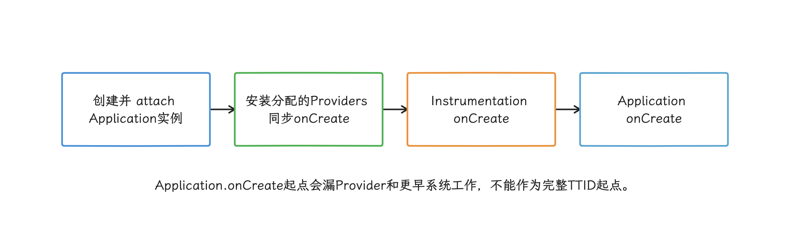

图：仅普通绑定且列表非空执行Provider段；restrictedBackupMode跳过，动态获取还可能后续安装。

1. 通过应用的 `AppComponentFactory` 实例化 Provider 类，这个工厂负责替系统创建应用组件；
2. 调用 `ContentProvider.attachInfo(...)`；
3. `attachInfo(...)` 内设置权限、authority 等信息——authority 是 `content://` URI 中定位 Provider 的唯一名称；
4. 在承载该 Provider 的进程主线程调用 `ContentProvider.onCreate()`；
5. 把已安装的 `ContentProviderHolder` 汇总起来，一次调用 `publishContentProviders(...)` 发布给 `system_server`；holder 是框架传递 Provider 信息和 Binder 接口的记录对象。

Provider 多时，类加载、实例化、`attachInfo()` 和各自 `onCreate()` 的成本确实会累加；发布环节却是批量的：系统把当前批次的 holder 放进列表，一次 `publishContentProviders()` 调用就全部发布。如果分析里写成“每个 Provider 都单独发起一次发布 Binder 调用”，那就与实现不符了。

<!-- gracker-diagram: a224-02-batch-publish -->
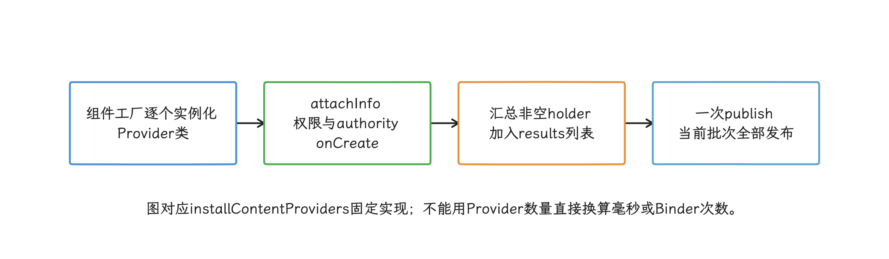

图：Provider类加载和同步入口逐个累积；publishContentProviders不是每个Provider各发一次。

#### 1.2 初始化顺序

同一进程中、未启用 `android:multiprocess` 的 Provider 可以用 `android:initOrder` 声明相对实例化顺序，数值高的先初始化。这个属性能声明的只有静态先后关系，再多的它管不了：

- `onCreate()` 依旧同步执行；
- 初始化的完成、失败与降级，无从表达；
- 跨进程依赖不在它的管辖范围内；
- 各 Provider 自身的工作量也压不短；
- Manifest 中元素的书写顺序同样当不成依赖契约。

要表达完整的任务依赖，应使用 App Startup 的同步依赖图，或 [启动框架设计与任务编排](02-startup-task-lazy-concurrency.md)中的显式任务框架。

#### 1.3 App 埋点为什么容易漏掉

很多项目从 `Application.onCreate()` 第一行开始计时，而 Provider 已经在此之前完成。这类埋点看到的只有 Application 阶段，解释不了完整的 `bindApplication`。

启动基线应以 Macrobenchmark 自动化基准测试得到的端到端 TTID（App 第一帧时间）/TTFD（主要内容可用时间） 为主——TTID 表示首帧首次显示所需时间，TTFD 表示应用达到完整可用状态所需时间——再结合 Perfetto 系统 Trace 的 Android App Startups 区间和自定义 slice 做分解；slice 是 Trace 上带开始、结束时间的命名区间，正好用来拆分自有 Provider。

### 2. 启动成本从哪里来

Provider 框架本身只占成本的一部分。我们把一次自动初始化拆成四层来看：

| 层次 | 常见工作 | 需要的证据 |
| --- | --- | --- |
| 组件固定成本 | 类加载、构造、`attachInfo()`、authority 注册 | 框架/应用主线程 Trace |
| `onCreate()` 负载 | 文件、数据库、反射、SDK 初始化、原生 `.so` 库加载 | 自定义 slice、方法栈、I/O |
| 资源竞争 | 后台工作线程争用 CPU/I/O、锁、Binder 等待、垃圾回收 | 调度事件、线程状态、Binder、GC |
| 进程成本 | 远端 Provider 触发承载进程启动与发布 | `system_server` 和两个应用进程的 Trace |

对照这四层时，有几个容易误判的地方：

- `onCreate()` 本身很快，它创建的后台工作线程仍可能与首帧争用资源。
- trace 里看到某个 Provider 类，只是找到了入口；成本还要进到供应商或业务实现里看。
- 删除一个 Provider 后 TTID 下降，不足以证明固定组件成本很高——也可能是它的业务初始化一起被删掉了。
- 远端 Provider 不会随主进程启动自动出现在主进程；主进程同步访问其 authority 时，才可能触发承载进程创建，并等待 Provider 发布。

到这里，Provider 数量只是我们排查的起点；要换算成毫秒，还得靠后面的测量。

<!-- gracker-diagram: a224-03-provider-cost-layers -->
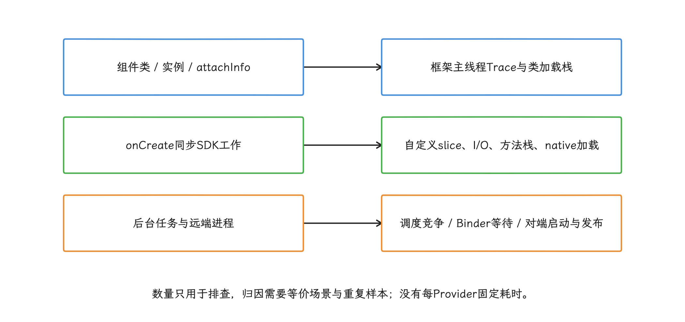

图：删除入口的收益可能来自一并删除的业务工作；同步入口很短也可能留下后台竞争。

### 3. 从 release Manifest 建立清单

#### 3.1 检查最终合并结果

源码里的 Manifest 只是原料，安装包里的才是最终结果：build type（如 debug/release）与 product flavor（如 free/paid 产品配置）组合成 build variant（构建变体）；依赖库、渠道配置和构建时替换的 Manifest placeholder，都可能让最终组件与源码声明不同。

Android Gradle Plugin（AGP）的合并决策报告位于模块的 `build/outputs/logs/manifest-merger-<variant>-report.txt`，Android Studio 的 Merged Manifest 视图也能定位某个 Provider 来自哪个依赖。准备发布的每个构建变体都要检查，只看 debug 是不够的。

下面的脚本读取一个文本形式的 merged Manifest，列出 Provider 的主要属性：

```python
from pathlib import Path
from sys import argv
from xml.etree import ElementTree as ET

ANDROID = "{http://schemas.android.com/apk/res/android}"
manifest = Path(argv[1])
root = ET.parse(manifest).getroot()
application = root.find("application")

for provider in application.findall("provider"):
    value = lambda name: provider.get(f"{ANDROID}{name}")
    print(
        value("name"),
        f"authorities={value('authorities')}",
        f"process={value('process') or '<application-default>'}",
        f"initOrder={value('initOrder') or '0'}",
        f"enabled={value('enabled')}",
        f"exported={value('exported')}",
        f"directBootAware={value('directBootAware')}",
        sep="\t",
    )
```

脚本的输入应是构建工具生成的可读 XML；APK 里编译后的二进制 XML，这个脚本解析不了。中间产物路径会随 AGP 变化，应从当前构建输出或 Android Studio 获取，避免把某个 AGP 版本的 `intermediates` 路径写死在工具中。

<!-- gracker-diagram: a224-04-manifest-provenance -->
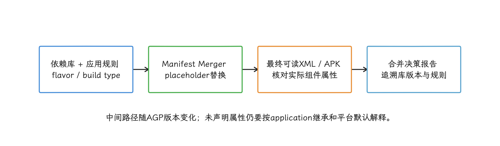

图：脚本读取文本XML，不能直接解析APK二进制Manifest；每个发布构建变体独立核对。

#### 3.2 每个 Provider 要记录什么

| 字段 | 核对内容 |
| --- | --- |
| 身份 | 类名、authority、来源依赖坐标（如 `group:name:version`）、精确版本 |
| 构建 | 出现在哪些构建变体、由哪条 Manifest 合并规则引入 |
| 进程 | `android:process` 与 `<application android:process>` 的合并结果 |
| 顺序 | `initOrder` 及是否存在静态依赖 |
| 生命周期 | enabled、directBootAware、是否会在用户解锁前运行 |
| 安全 | 是否对外暴露、整体读写权限、临时 URI 授权、分路径权限 |
| 工作 | `onCreate()` 同步工作、后台任务、注册项、磁盘和网络 |
| 必要性 | TTID 前、TTFD 前、功能首用或未使用 |
| 运维 | 显式初始化 API、停止/禁用、回退和供应商联系人 |

如果同一 SDK 带来多个 Provider，要按业务能力归组，避免只删表面入口却留下另一个自动入口。

### 4. 如何测量 Provider 成本

#### 4.1 自有 Provider

自有 Provider 可以直接用稳定名称包住 `onCreate()`；下面的代码只观测同步入口：

```kotlin
class AppInitProvider : ContentProvider() {
    override fun onCreate(): Boolean {
        return trace("startup/AppInitProvider") {
            installMinimalState(requireNotNull(context))
            true
        }
    }

    // 本例仅作初始化入口，不对外提供数据接口。
    override fun query(
        uri: Uri, projection: Array<out String>?,
        selection: String?, selectionArgs: Array<out String>?,
        sortOrder: String?,
    ): Cursor? = throw UnsupportedOperationException()

    override fun getType(uri: Uri): String? = null
    override fun insert(uri: Uri, values: ContentValues?): Uri? =
        throw UnsupportedOperationException()
    override fun delete(
        uri: Uri, selection: String?, selectionArgs: Array<out String>?,
    ): Int = throw UnsupportedOperationException()
    override fun update(
        uri: Uri, values: ContentValues?, selection: String?,
        selectionArgs: Array<out String>?,
    ): Int = throw UnsupportedOperationException()
}
```

这个 slice 的持续时间就是同步 `onCreate()` 时间。若 `installMinimalState()` 只提交后台任务，必须继续记录该任务的排队、运行和逻辑完成时间——Provider slice 走完，初始化未必就绪。

开发阶段还可用 StrictMode 检测自有代码在主线程发生的磁盘或网络访问。它擅长抓违规操作；生产环境的耗时指标不归它管，原生代码或供应商内部的访问也未必都在覆盖之内。

#### 4.2 第三方 Provider

闭源 Provider 加不了切片时，我们改用组合证据：

1. 从合并后的 Manifest 和合并报告锁定类与来源版本。
2. 在 Perfetto 的 `bindApplication` 窗口看主线程栈、I/O、Binder 和类加载。
3. 生成一对 release 构建产物，唯一差异是是否保留该 Provider 自动入口。
4. 在移除自动入口的产物中，于等价场景显式初始化同一 SDK，分开测量“组件固定成本”和“SDK 业务成本”。
5. 重复冷启动，比较分布和 Trace，不用单次差值。

如果供应商不允许关闭自动初始化，应要求其提供诊断构建、Trace 或源码说明。通过反射跳过私有方法，依赖的是未公开实现，SDK 升级后很容易失效——这种风险要挡在启动关键路径之外。

<!-- gracker-diagram: a224-05-equivalent-provider-ab -->
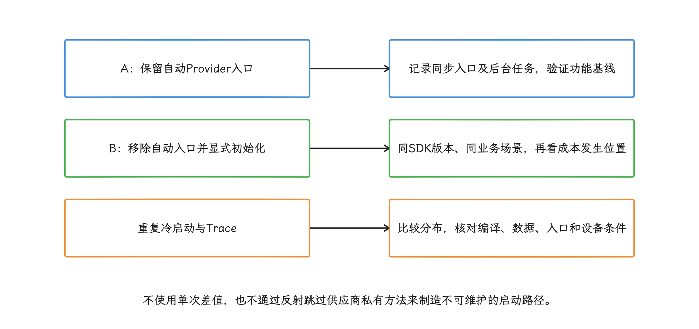

图：完全删除SDK与仅更换入口不是同一实验；闭源库用合并报告、栈与对照构建组合归因。

#### 4.3 观察跨进程等待

主进程通过 `ContentResolver` 获取远端 authority 时，`ActivityThread` 可能向 `system_server` 请求 Provider，并等承载进程完成发布。诊断这段等待，我们要同时看：

- 调用进程的 Binder/等待状态；
- `system_server` 的 Provider 获取和进程启动；
- 承载进程的进程绑定、Provider `onCreate()` 和发布；
- 超时、死亡与重试。

调用方线程若是 Main 线程，这段等待会直接进入 UI 关键路径——把 Provider 挪进远端进程，并不会让这次同步访问自动变快。

<!-- gracker-diagram: a224-06-remote-provider-wait -->
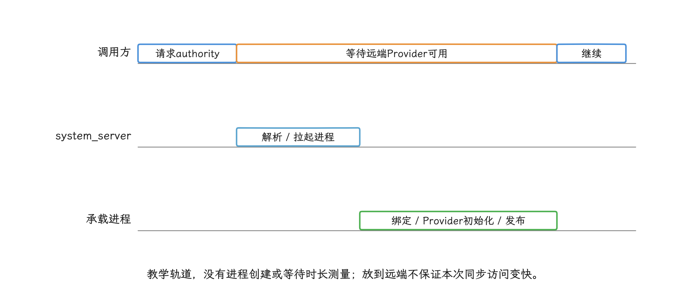

图：已缓存或已运行的Provider可走快路径；触发冷启动时，Main同步等待仍属于UI关键路径。

### 5. 按用户可见时机分类

预算要先定下来：别给 Provider 统一规定 5 ms 或 50 ms。准入预算应从应用的 TTID/TTFD SLO、当前余量、设备档位和入口推导。SLO（Service Level Objective，服务目标）是团队承诺持续满足的可测指标，例如“某类设备冷启动 P95 不超过 1.5 秒”；P95 表示 95% 的启动样本不超过该值。

| 类别 | 判断 | 处理 |
| --- | --- | --- |
| 未使用 | 业务没有调用且组件仅由依赖默认注入 | 移除，并做功能/构建回归 |
| TTID 前必要 | 首个应用帧缺少它就无法正确生成 | 只保留最小同步状态，设置明确失败路径 |
| TTFD 前必要 | 第一帧可先出现，主要操作仍需等待 | 移出 Provider，进入任务图 |
| 功能首用 | 分享、地图、支付、广告等特定入口才需要 | 单次按需初始化 |
| 延后维护 | 日志整理、上传、预取等 | 在页面可用后按资源预算调度 |

“崩溃监控 SDK 必须最早”“远程配置必须首帧前”这类结论也要拆开看：崩溃捕获、历史日志整理、符号上传可以处于不同阶段；远程配置通常可以先读取上一次保存且校验通过的本地快照。

分类完成后，每个任务都要有维护负责人（owner）、完成条件、失败结果和验证场景。这些契约缺了任何一项，挪出 Provider 就只是把隐式时序问题挪了个地方。

<!-- gracker-diagram: a224-07-necessity-and-owner -->
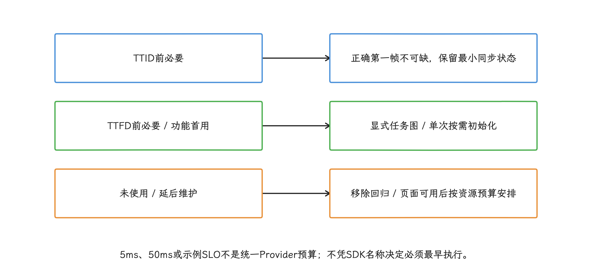

图：崩溃捕获、历史日志整理、符号上传可以处于不同阶段；每个任务都有owner和失败结果。

### 6. 从 Manifest 删除自动入口

#### 6.1 优先使用供应商开关

供应商若提供官方的 Manifest placeholder 或 Gradle 开关，应优先使用。placeholder 是构建时才替换成具体值的占位符；官方开关通常会同时调整 Provider、metadata 和 SDK 内部状态。

没有开关时，可以在高优先级应用 Manifest 中使用合并标记，也就是 `tools:` 命名空间下控制 Manifest Merger 行为的指令。下面的规则按 Provider 类名移除下游库声明：

```xml
<manifest
    xmlns:android="http://schemas.android.com/apk/res/android"
    xmlns:tools="http://schemas.android.com/tools">

    <application>
        <provider
            android:name="com.vendor.sdk.AutoInitProvider"
            tools:node="remove" />
    </application>
</manifest>
```

Manifest Merger 对 `<provider>` 的匹配键是 `android:name`。如果只想影响某个库，可在确认合并来源后使用 `tools:selector`，把标记限定到指定库包名；无论使用哪种方式，都要检查最终结果。

#### 6.2 删除后的验证

至少验证：

- release、debug、渠道和动态特性模块等相关构建变体；
- 合并后的 Manifest 和合并报告已无目标节点；
- SDK 显式初始化只执行一次；
- deep link（从网页或其他应用直达指定页面）、推送、后台任务、登录、分享、支付等入口；
- 用户同意、拒绝、撤回与无网路径；
- Direct Boot（用户首次解锁前运行）、备份恢复、升级安装和进程重建；
- Java 混淆映射文件、原生崩溃符号文件和监控仍可用。

若 Provider 对外提供 `content://` URI，删除它改变的就是对外 API 和数据共享方式，这已经超出普通性能优化的范畴：还要检查调用方、权限、临时 URI 访问授权和历史数据迁移。

`tools:node="remove"` 只改变合并结果，不会阻止供应商以后换类名或新增另一个 Provider。SDK 升级必须重新做 Manifest 差异。

<!-- gracker-diagram: a224-08-remove-entry-verify -->
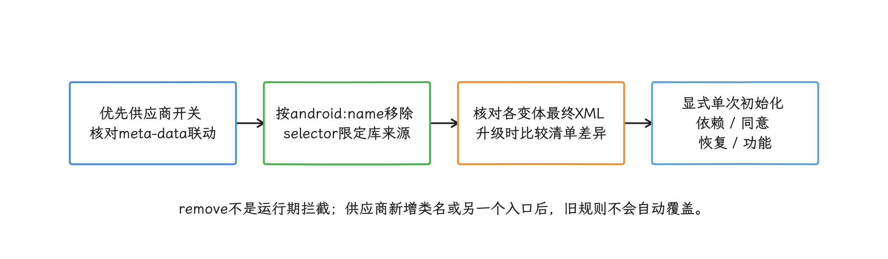

图：对外提供content URI的Provider删除属于接口迁移，权限、调用者和数据迁移也要评估。

### 7. 显式初始化的状态机

按需初始化至少包含这些状态：

```text
NotStarted → Initializing → Ready
                   ├──────→ Degraded
                   └──────→ Failed
```

五个状态按字面理解即可：`NotStarted` 尚未启动，`Initializing` 正在初始化，`Ready` 能力可用，`Degraded` 只剩约定的备用能力，`Failed` 是本次初始化失败。并发调用要共享同一个 `Initializing` 结果，避免重复启动；协程调用者可以挂起等待而不占住线程，其他调用者注册回调即可；Main 线程上则要避开锁和 `Future.get()` 这类阻塞等待。

<!-- gracker-diagram: a224-09-explicit-init-results -->
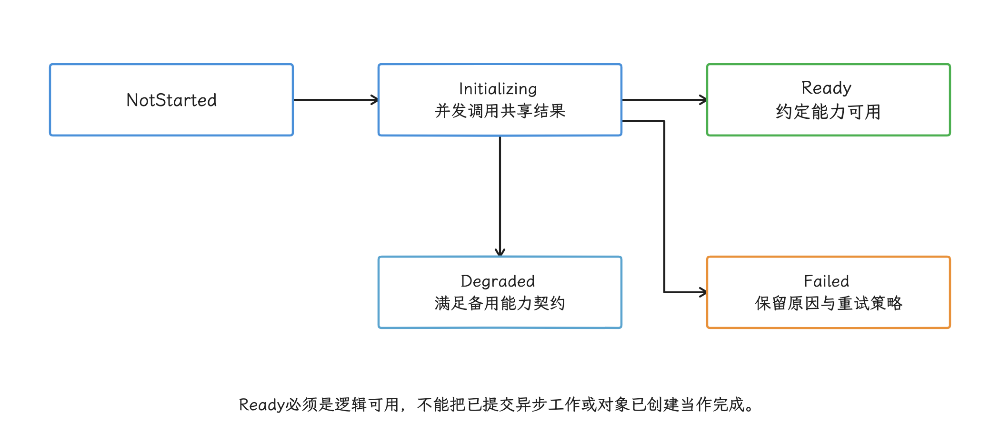

图：Main不阻塞等待锁或Future；线程、SDK异步完成、超时、晚到结果与同意撤回均有独立协议。

状态机还要定义：

- SDK 是否要求在 Main 线程调用；
- 异步回调何时代表逻辑可用；
- 超时是否能协作取消，即任务是否会响应中断、取消标记或底层取消 API；
- 晚到结果是否允许写状态；
- 失败是否缓存、何时重试；
- 用户撤回同意后如何停止与清理；
- 进程重建后如何恢复。

至于执行线程，要按 SDK 的线程契约来定：有些 SDK 明确要求在 Main 线程调用，有些初始化同时包含 Main 注册和后台准备，遇到后一种情况，应拆成有依赖的两个任务再分别调度。

### 8. “首帧后”的观测点

我们先明确两个常见时机的语义。`OnPreDrawListener` 在视图树即将绘制时执行，`View.post()` 只是把一段 `Runnable` 工作放进 Main 消息队列——两者都证明不了该帧已经提交给渲染系统。

下面这套做法从 API 29 开始适用。硬件渲染页面可以用 `registerFrameCommitCallback()` 等下一帧提交到 swap chain 后再触发延后任务；swap chain 是渲染系统轮换使用、等待显示的一组图像缓冲区：

```kotlin
val root = window.decorView

root.doOnPreDraw {
    if (root.isHardwareAccelerated) {
        root.viewTreeObserver.registerFrameCommitCallback {
            root.post {
                startupScheduler.start(StartupPhase.DEFERRED)
            }
        }
    } else {
        root.post {
            startupScheduler.start(StartupPhase.DEFERRED)
        }
    }
}
```

`doOnPreDraw` 在本轮绘制前注册回调。硬件路径的回调表示帧已提交到 swap chain，至于像素是否真的上了屏，它管不到；软件渲染的备用分支在本轮 onPreDraw 返回且 traversal 正常继续的前提下，将工作入队到当前遍历调用栈之后，但不证明该帧成功提交或显示——traversal 是本轮测量、布局和绘制组成的界面遍历过程。生产代码还需处理 Activity 销毁、重复注册和取消。

<!-- gracker-diagram: a224-10-commit-and-fallback -->
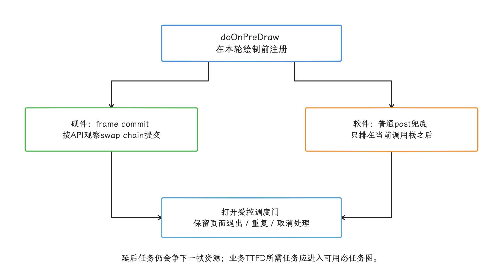

图：onPreDraw本身是绘制前；软件post不证明本轮成功绘制，硬件commit也不证明像素已经物理显示。

延后任务可能与下一帧交互争用 CPU/I/O。调度之后，我们仍要用 FrameTimeline 的逐帧期限与卡顿数据、TTID/TTFD 和真实交互场景验证。若任务是“主要内容可用”的必要条件，它属于 TTFD 图，别放进 `DEFERRED`。

### 9. App Startup 1.2.0 的作用与限制

#### 9.1 减少的入口与留下的成本

[Jetpack App Startup](https://developer.android.com/topic/libraries/app-startup) 让多个组件共享一个 `InitializationProvider`，并用 `Initializer.dependencies()` 声明顺序。相比每个 SDK 各带一个 Provider，它减少了 Provider 类、实例和 `onCreate()` 入口，也让依赖关系集中。[1.2.0 发布说明](https://developer.android.com/jetpack/androidx/releases/startup) 显示它截至 2026-10-25 仍是最新稳定版。

App Startup 仍基于 ContentProvider。Manifest 发现过程和所有 `Initializer.create()` 在 Provider 安装阶段同步运行，不会自动进入后台线程，也不会删除 SDK 内部的磁盘、锁或网络成本。

1.2.0 `AppInitializer` 的核心行为是：

- 从 `InitializationProvider` 的 Manifest metadata 键值配置中发现入口 initializer（组件初始化器）；
- 通过反射按运行期类名构造 initializer；
- 深度优先执行依赖；
- 用 `initializing` 集合检测环；
- 缓存已经初始化的结果；
- 给发现过程和 initializer 增加 Trace 时间区间。

#### 9.2 自动初始化

下面的 initializer 声明 CrashClient 依赖 Logger：

```kotlin
class CrashInitializer : Initializer<CrashClient> {
    override fun create(context: Context): CrashClient {
        return CrashClient.install(context.applicationContext)
    }

    override fun dependencies(): List<Class<out Initializer<*>>> {
        return listOf(LoggerInitializer::class.java)
    }
}
```

`LoggerInitializer.create()` 完成后，App Startup 才调用 `CrashInitializer.create()`。两个方法都要同步返回可用结果；内部若只提交异步任务，依赖图就无从知道何时就绪。

<!-- gracker-diagram: a224-11-startup-synchronous-deps -->
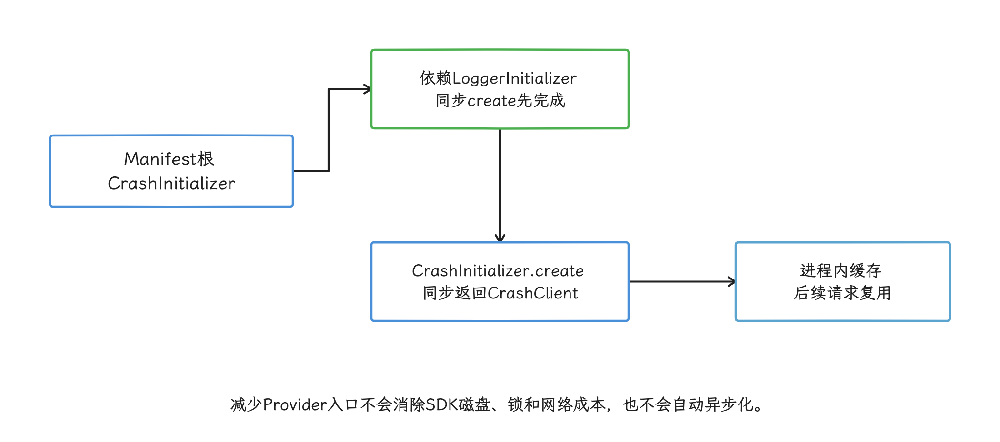

图：依赖节点无需重复metadata；手动初始化同样要满足调用线程契约，其他剩余根仍可提前触发共享依赖。

Manifest 只需要声明初始化图的入口节点：

```xml
<provider
    android:name="androidx.startup.InitializationProvider"
    android:authorities="${applicationId}.androidx-startup"
    android:exported="false"
    tools:node="merge">
    <meta-data
        android:name="com.example.CrashInitializer"
        android:value="androidx.startup" />
</provider>
```

依赖节点由 `dependencies()` 发现，不必重复写 metadata。添加前要确认原 SDK Provider 已按官方方式删除，避免两条入口重复初始化。

#### 9.3 手动初始化

不需要在 Provider 阶段自动执行的 initializer，应从最终 Manifest 删除对应 metadata：

```xml
<provider
    android:name="androidx.startup.InitializationProvider"
    android:authorities="${applicationId}.androidx-startup"
    android:exported="false"
    tools:node="merge">
    <meta-data
        android:name="com.example.ShareInitializer"
        tools:node="remove" />
</provider>
```

需要时显式触发该组件：

```kotlin
val shareClient = AppInitializer.getInstance(context)
    .initializeComponent(ShareInitializer::class.java)
```

`initializeComponent()` 会在调用线程同步初始化该组件及尚未完成的依赖。调用方必须满足所有 initializer 的线程契约——改成手动调用，这条要求一点没有放松。

官方文档还指出，关闭某个组件的自动初始化，也会关闭只由它带入的依赖。若另一个自动入口仍依赖其中某个节点，该节点仍会在启动时执行。迁移时应画出完整依赖图，核对每个入口。

### 10. 多进程与 Direct Boot

#### 10.1 Provider 属于承载进程

最终 Manifest 决定 Provider 在哪个承载进程创建。每个进程都有自己的一份 Java heap（对象内存区）、类静态字段和 App Startup 单例：

- 默认 Provider 只随应用默认进程安装；
- `android:process=":push"` 的 Provider 在私有 `:push` 进程运行；
- 显式把 InitializationProvider 声明到多个进程，会形成多份独立初始化结果；
- 一个进程也读不到另一个进程的静态 `initialized` 布尔值。

进程选择应尽量在 Manifest 或构图阶段完成；拖到 initializer 内部才按进程名提前返回就晚了，此前类加载和静态字段初始化已经可能发生。

#### 10.2 Direct Boot

[`android:directBootAware="true"`](https://developer.android.com/privacy-and-security/direct-boot) 允许 Provider 在设备重启后、用户首次解锁前运行。此时只能访问 device-protected storage（设备保护存储）和其他支持 Direct Boot 的能力；默认的 credential-encrypted storage（凭据加密存储） 要等用户解锁后才可用。该属性适用于闹钟、短信等确有解锁前需求的组件——当作普通的“提前初始化”开关来用，或者在设备保护存储里随意保存口令、认证令牌，都属于误用。

<!-- gracker-diagram: a224-12-direct-boot-storage -->
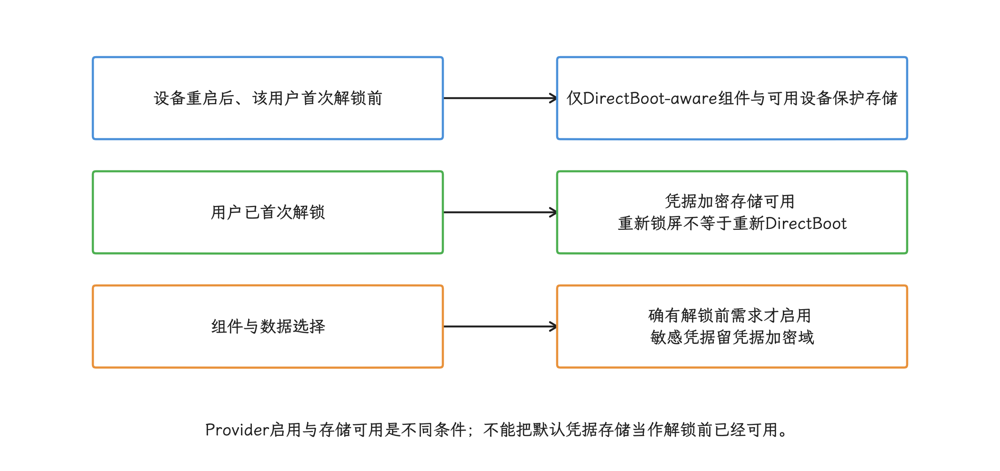

图：directBootAware不是通用提前初始化开关；依赖也必须具备解锁前安全和可用的路径。

#### 10.3 `multiprocess` 与同 UID（Linux 用户 ID，Android 用它隔离应用身份） 多实例

Manifest 的 `android:multiprocess="true"` 允许系统在同一 UID（Linux 用户 ID）的其他进程中本地创建 Provider 实例，通常对应应用自己的子进程；Android 就是用 UID (Linux 用户身份) 隔离应用身份的。[`ContentProviderRecord.canRunHere()`](https://android.googlesource.com/platform/frameworks/base/+/refs/tags/android-17.0.0_r1/services/core/java/com/android/server/am/ContentProviderRecord.java) 的条件是“`multiprocess` 为真或声明进程名与当前进程相同”，并且 Provider UID 等于当前进程 UID；不同 UID 的外部应用仍通过 Binder 访问承载进程中的实例。

本地实例可以省去应用自身进程间的部分 Binder 调用，代价是复制对象、缓存和连接，还要各实例自己解决状态一致性。它的适用面很窄，不该当作通用启动优化；迁移前要核对旧应用是否依赖这项少见行为，并在目标 API 37 设备上验证。

<!-- gracker-diagram: a224-13-local-provider-eligibility -->
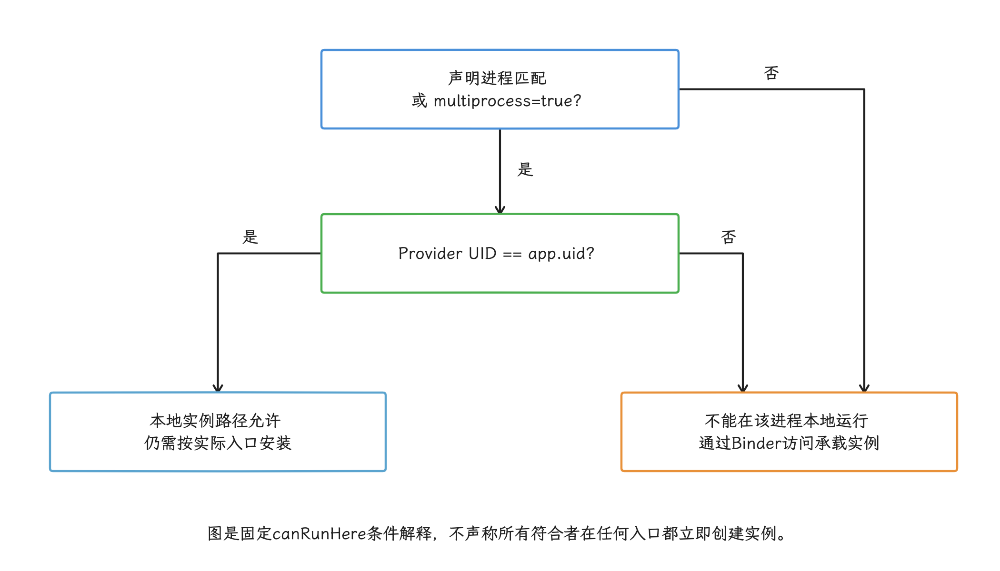

图：本地复制会增加缓存、连接和一致性成本；multiprocess=true不是跨UID共享本地实例。

### 11. 性能改动下的 Provider 安全

性能改动收尾前，我们还要从安全角度把保留或迁移的 Provider 逐项过一遍：

- authority 是否唯一且使用 applicationId 前缀；
- `android:exported` 是否显式符合共享需求，也就是是否允许其他应用访问；
- 整个 Provider 的读写权限，以及只约束部分 URI 路径的 path permission；
- 临时 URI 访问授权的授予和撤回；
- 组件是否只在必要用户/进程启用；
- `call()`、`openFile()` 和批处理接口是否暴露越权操作，例如绕过查询权限读取文件或执行管理命令。

将外部 Provider 改成应用进程内单例，或把远端 Provider 改到主进程，都可能同时牵动安全、故障隔离和内存成本。这类迁移需要单独设计，TTID 只是其中一个视角。

<!-- gracker-diagram: a224-14-provider-security-surface -->
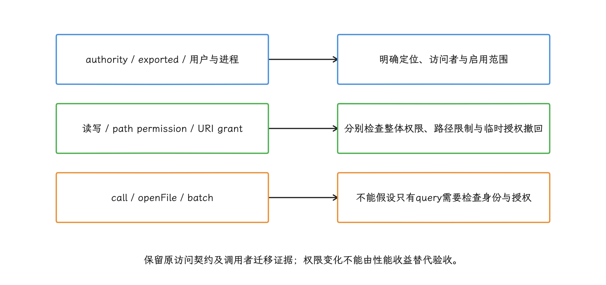

图：远端变本地或Provider变单例需单独评估接口、安全和故障隔离，不能只比较TTID。

### 12. 验收标准

| 验收项 | 需要的证据 |
| --- | --- |
| 组件清单 | 每个 release Provider 有来源、版本、进程、用途和维护负责人 |
| Manifest | 所有目标构建变体的合并结果和差异 |
| 启动 | 冷启动 TTID/TTFD 分布与回归样本 Trace |
| Provider 阶段 | 进程绑定阶段的同步成本、后台任务竞争和跨进程等待 |
| 功能 | 各入口、同意状态、无网、升级、进程重建 |
| 多进程 | 每个进程只执行必要图，跨进程失败可降级 |
| 安全 | `exported`、权限、authority 和临时 URI 授权复核 |
| 运维 | 显式初始化、禁用、回退和 SDK 升级检查 |

完成治理后，报告应能回答：

1. 哪些 Provider 仍会在 TTID 之前自动执行？
2. 每个 `onCreate()` 同步做了什么？
3. 哪些初始化被移到 TTFD 或功能首用？
4. 失败、超时和进程死亡如何降级？
5. SDK 升级新增 Provider 时如何被发现？

Provider 数量减少只是实现层面的变化；用户可见启动、功能正确性和安全性都要能重复验证，验收才算过关。

## 进程拓扑、重复初始化与共享状态

主进程的 Provider 优化完成后，我们还要检查远程 Service、WebView 或独立业务进程有没有重复加载 SDK、线程池和缓存。

多进程可以隔离崩溃、内存峰值和重型 native（C/C++ 等本地代码） 模块，代价是新增一整套进程运行时、初始化链路和 IPC（Inter-Process Communication，进程间通信）成本。这是一项架构取舍，代替不了主进程自身的启动治理。

App 可以控制的部分包括：是否拆进程、何时启动、每个进程初始化什么、调用方怎样等待远程能力，以及如何验证收益。进程优先级与回收规则见 [进程模型](../../part1-fundamentals/ch01-architecture/01-android-architecture-process-threading.md)，冷启动分段与 TTID、TTFD 见 [启动分析](01-app-startup-path-monitoring.md)，后台任务约束见 [后台执行限制](../../part1-fundamentals/ch05-cpu-power/03-background-jobs-hibernation.md)。

### 1. 先确认拆进程的目的

在 Manifest 中给组件设置 `android:process=":worker"`，会让它运行在一个私有远程进程中，进程名由应用包名和 `:worker` 拼接而成。这个进程通常仍使用应用的 UID 和权限，但拥有独立的 ART（Android Runtime） 实例、Java/Kotlin 堆、native 堆、静态字段、线程、ClassLoader 类加载状态和 Binder 线程池——主进程里的单例不会自动出现在远程进程，远程进程修改的内存对象也不会同步回来。

拆进程要有明确目标。常见的合理目标包括：

- 隔离 WebView 宿主、地图、音视频、图片处理或插件运行时的 native 崩溃与内存峰值；
- 让需要独立生命周期的组件脱离主进程，但仍遵守后台启动和前台服务限制；
- 在 32 位设备上减轻单个进程的虚拟地址空间压力；
- 把需要处理不可信输入、且权限需求很少的 Service 放进 isolated process。

普通私有进程与 isolated process 的语义不同：

| 形式 | manifest 示例 | 身份与权限 | 适用场景 |
| --- | --- | --- | --- |
| 应用私有远程进程 | `android:process=":worker"` | 通常沿用应用 UID、权限和数据目录访问能力 | WebView 宿主、播放、上传、插件容器等应用内能力 |
| isolated service | `android:isolatedProcess="true"` | 使用隔离 UID，没有自身应用权限；只能通过 Service API 与外界通信 | 处理不可信输入、需要更小权限面的计算服务 |

反过来，多进程自身也有固定成本：

<!-- gracker-diagram: a224-15-process-isolation-cost -->
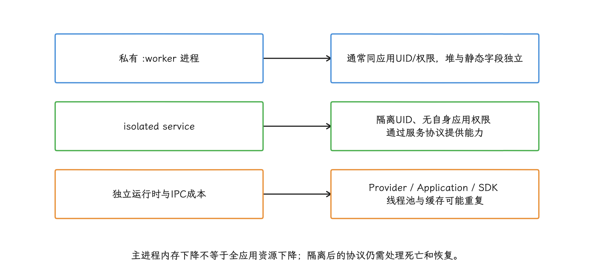

图：WebView宿主拆进程与Chromium renderer隔离是不同层面；多个WebView可能共享renderer。

- 系统要创建进程并绑定应用；
- 每个进程都要建立自己的运行时和堆；
- 该进程中的 Provider、`Application` 和目标组件需要初始化；
- 数据交换改走 Binder、Provider、文件或数据库；
- 系统可能随时回收远程进程，客户端必须恢复连接和请求状态。

WebView 在多进程模式下会把网页内容放进 renderer process（Chromium 渲染进程），多个 WebView 还可能共享同一个 renderer。把 WebView 宿主 Activity 或 Service 放进应用远程进程，新增的是宿主侧 WebView、业务代码和部分 native 状态的隔离，并没有再增加一层 renderer 隔离。

评估拆分时，我们应同时测量主进程峰值、远程进程峰值和全应用 PSS（Proportional Set Size），只看主进程数字变小是不够的。

### 2. 应用进程的启动链路

系统需要运行一个尚无进程可用的组件时，system_server 会请求 Zygote 创建应用进程——system_server 运行着 Android 核心系统服务；Zygote 预加载了通用框架代码，靠 fork（用写时复制派生子进程，修改内存页时才生成私有副本）快速派生 App 进程。`ZygoteProcess.startViaZygote()` 负责整理参数，并通过 Zygote socket（进程间通信端点）发送创建请求。

新进程随后进入 `ActivityThread` 的应用绑定流程；`ActivityThread` 是 App 进程接收组件与生命周期调度的核心类，上一部分讲的 Provider 安装顺序就发生在这一步。

相关链路可以压缩成下面几步：

```text
组件请求
  -> system_server 判断目标进程尚未运行
  -> ZygoteProcess.startViaZygote()
  -> Zygote fork 应用进程
  -> ActivityThread.handleBindApplication()
       -> 创建 Application
       -> 安装分配给该进程的 ContentProvider
       -> 调用 Application.onCreate()
  -> 创建目标 Activity / Service / Receiver / Provider 客户端能力
```

这段链路里有两处容易混淆的地方，我们分开说清。

<!-- gracker-diagram: a224-16-component-process-start -->
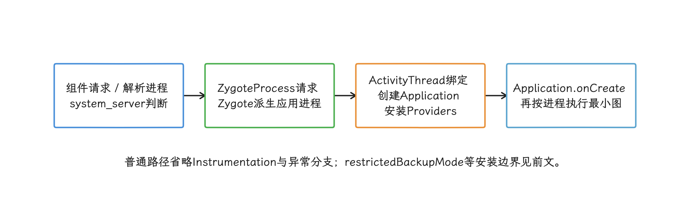

图：只安装分配给该进程的Provider；Application内进程分支撤销不了已经执行的自动入口。

第一，Provider 按 Manifest 声明的进程归属安装。系统不会把应用里的所有 Provider 安装到每一个进程；默认进程 Provider 属于主进程，声明了 `android:process=":worker"` 的 Provider 属于对应远程进程。一个进程只要分配到了自动初始化 Provider，系统就会在该进程的 `Application.onCreate()` 之前创建并调用它们。

第二，在 `Application.onCreate()` 中按进程名分支，只能约束分支之后的工作；已经执行的 Provider 初始化，事后撤销不回来。第三方 SDK 通过 Provider 或 AndroidX App Startup 自动初始化时，需要同时检查 Manifest 进程归属、initializer 依赖和自动初始化开关。

这也解释了同步等待对首屏的影响：访问远程 Provider，或调用异步 `bindService()` 后再同步等连接，都可能触发远程进程冷启动。等待成本要按返回边界拆开：Provider 获取可等待进程创建、安装与发布，但该批次发布发生在 `Application.onCreate()` 之前，不能说每次 Provider 获取都必须等它完成；Service 连接还可能包含 Application 与目标 Service 的创建和绑定准备。

### 3. 给每个进程定义最小初始化集

给进程划分角色，我们直接用一个现成 API：`Application.getProcessName()` 从 Android 9（API 28）开始提供，本文覆盖的 Android 10～17 均可直接使用。它比读取 `/proc` 伪文件或枚举运行进程更简单，也避开了系统实现与权限条件差异带来的误判。

下面的代码假设 `<application>` 的默认进程名就是包名；若自定义了 application 级 `android:process`，主角色映射也要使用解析后的默认进程名。它把当前进程映射成稳定角色，让每个进程只初始化自己的能力：

```kotlin
enum class ProcessRole {
    MAIN,
    WEB,
    UPLOAD,
    OTHER,
}

private fun Application.processRole(): ProcessRole {
    val current = Application.getProcessName()
    return when (current) {
        packageName -> ProcessRole.MAIN
        "$packageName:web" -> ProcessRole.WEB
        "$packageName:upload" -> ProcessRole.UPLOAD
        else -> ProcessRole.OTHER
    }
}

class App : Application() {
    override fun onCreate() {
        super.onCreate()

        when (processRole()) {
            ProcessRole.MAIN -> initMainProcess()
            ProcessRole.WEB -> initWebProcess()
            ProcessRole.UPLOAD -> initUploadProcess()
            ProcessRole.OTHER -> initMinimalProcess()
        }
    }
}
```

这段分支管得住日志、线程池、业务 SDK、native 库和缓存等 `Application` 阶段工作，管不住 Provider 阶段；每个自动初始化 Provider 仍要检查 `android:process`，AndroidX App Startup initializer 还要检查依赖关系，并判断是否改为手动初始化。

初始化清单可以按以下原则收缩：

<!-- gracker-diagram: a224-17-role-before-class-use -->
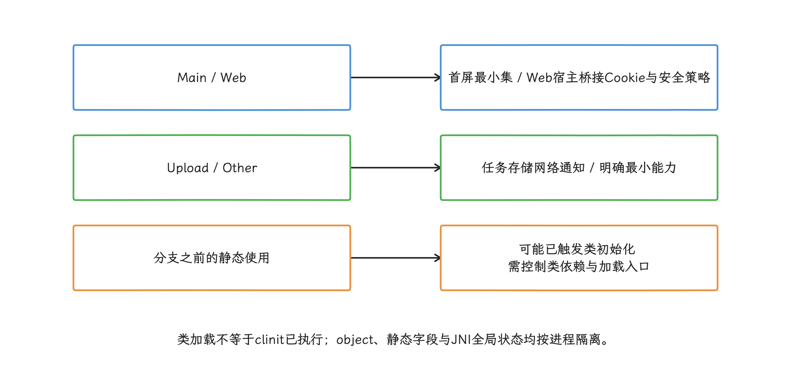

图：getProcessName从API28可用；packageName识别Main的示例假设application默认进程名未改写。

- 主进程只保留首屏展示、路由、安全校验和首屏必需数据；
- Web 进程只准备 Web 宿主所需的桥接、Cookie 或安全策略，不复制整套主进程 SDK；
- 上传进程只准备任务数据库、网络栈和通知能力，不创建图片 UI、页面路由或主进程业务线程池；
- 所有进程共用的日志与崩溃采集也要有进程预算，别以“公共基础设施”为由，让每个进程都跑完整线程和周期任务。

静态状态同样受进程隔离影响。Kotlin `object`、Java 静态字段和 JNI 全局状态都是每进程独立；类加载与类初始化是两个阶段，通常是首次主动使用触发静态初始化（例如 `<clinit>`），不能把所有加载都当作已执行初始化。JNI 全局状态还与相应 native 库的装载/初始化路径有关。进程分支前若已主动使用这些类，重工作就可能提前发生，应通过懒加载或显式入口控制。

### 4. 控制远程进程的拉起时机

Android 没有面向普通应用的通用“只创建进程、暂不运行组件”接口。启动 Activity、`startService()`、`bindService()`、访问远程 Provider、接收广播或运行调度任务，都可能创建进程；每种入口同时受对应组件和后台执行规则约束。

可以按用户路径把拉起时机分成四档：

| 时机 | 判断标准 | 建议 |
| --- | --- | --- |
| 首屏前 | 缺少远程结果就无法展示可交互首屏 | 缩小协议和初始化集；优先采用异步协议、deadline（最晚完成时点）和降级路径，并把等待计入 TTID/TTFD |
| 首帧后 | 首屏不依赖，但用户很快可能进入相关功能 | 等首帧完成后再绑定或发送轻量探测，观察是否与主线程争抢 CPU、I/O |
| 临近入口 | 已出现页面曝光、Tab 切换或点击前置动作 | 用明确的产品信号拉起，过期后取消，不做长期无条件预热 |
| 系统调度 | 上传、同步、清理等不依赖当前页面 | 交给 WorkManager、JobScheduler 或符合规则的前台服务 |

“首帧后执行”仍可能影响启动：低端设备上，新进程会与主进程竞争 CPU、存储 I/O、页缓存（内存中暂存的文件数据）和内存。预热实验至少要比较以下三组：

1. 不预热，用户进入功能时冷启动；
2. 首帧后立即预热；
3. 临近功能入口再预热。

比较指标应包括主进程 TTID/TTFD、远程能力 ready（协议已经可以接受请求的时点）、用户进入功能后的等待、全应用 PSS (Proportional Set Size，按比例分摊共享页后的内存)、低内存回收次数和失败率。只有用户等待时间的下降盖得住资源与稳定性代价，这份预热才值得保留。

<!-- gracker-diagram: a224-18-prewarm-tradeoff -->
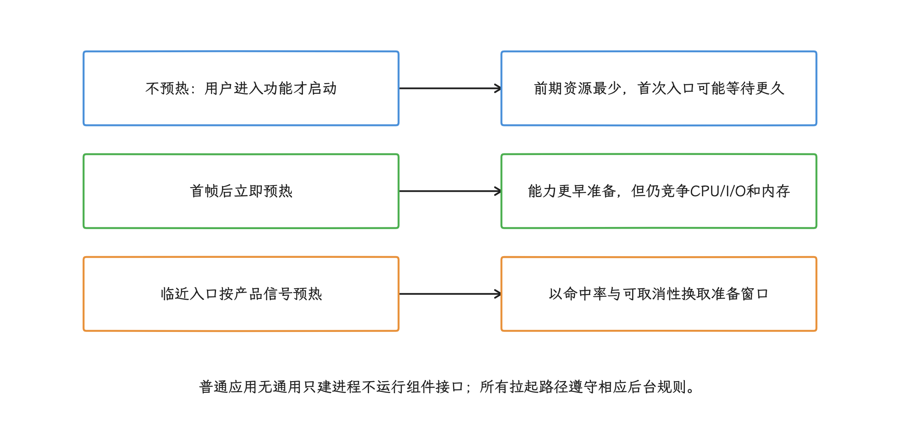

图：同场景比较TTID/TTFD、remote ready、首次功能等待、PSS、回收与失败；无通用提前量。

### 5. 把 Binder ready 建模为异步能力

设计跨进程调用时，我们把“远程能力 ready”建模成一个异步对象。同步 Binder 调用会阻塞客户端调用线程，直到服务端返回或调用失败；跨进程事务通常由服务端 Binder 线程池执行，多个客户端可能并发进入同一实现，所以服务端状态要满足线程安全。跨进程 `oneway` 不等待服务端业务完成；同一 Binder 节点的异步事务串行分发，但多个发送线程仍须由协议定义业务顺序，不同节点也可并行。本地 AIDL 调用仍可能直接在调用线程同步执行，`oneway` 不会自动把它排到后台；“已返回”也不表示业务已经完成——结果、超时和取消仍需由协议定义。

远程服务随时可能消失，连接状态至少要区分连接中、可用、断开和失败，并处理 Binder 所在进程死亡。

下面的示例展示一个最小连接状态机。业务协程可以异步等待 ready；主线程上，`CountDownLatch`（让线程等待计数归零的同步器）、自旋（循环检查状态并持续占用 CPU）和无限期同步调用都要避开：

```kotlin
sealed interface RemoteState {
    data object Disconnected : RemoteState
    data object Connecting : RemoteState
    data class Ready(
        val service: IWorkerService,
        val binder: IBinder,
    ) : RemoteState
    data class Failed(val cause: Throwable?) : RemoteState
}

// 每次 bind 生命周期创建一个实例；使用默认 Main ServiceConnection 回调。
class WorkerConnection : ServiceConnection {
    private data class Registration(
        val generation: Long,
        val binder: IBinder,
        val recipient: IBinder.DeathRecipient,
    )

    private val lock = Any()
    private var generation = 0L
    private var registration: Registration? = null
    private var closed = false
    private val _state =
        MutableStateFlow<RemoteState>(RemoteState.Disconnected)
    val state: StateFlow<RemoteState> = _state.asStateFlow()

    private fun requireMain() = check(
        Looper.myLooper() === Looper.getMainLooper(),
    )

    fun markConnecting() {
        requireMain()
        synchronized(lock) {
            check(!closed)
            _state.value = RemoteState.Connecting
        }
    }

    private fun unlinkCurrentLocked() {
        val old = registration ?: return
        registration = null
        old.binder.unlinkToDeath(old.recipient, 0)
    }

    override fun onServiceConnected(name: ComponentName, binder: IBinder) {
        requireMain()
        synchronized(lock) {
            if (closed) return
            unlinkCurrentLocked()
            val nextGeneration = ++generation
            val recipient = IBinder.DeathRecipient {
                synchronized(lock) {
                    val current = registration
                    if (!closed && current?.generation == nextGeneration &&
                        current.binder === binder
                    ) {
                        registration = null // 已死亡，不需再 unlink。
                        _state.value = RemoteState.Disconnected
                    }
                }
            }
            val next = Registration(nextGeneration, binder, recipient)
            registration = next
            try {
                binder.linkToDeath(recipient, 0)
                if (registration === next) {
                    _state.value = RemoteState.Ready(
                        IWorkerService.Stub.asInterface(binder), binder,
                    )
                }
            } catch (error: RemoteException) {
                if (registration === next) {
                    registration = null
                    _state.value = RemoteState.Disconnected
                }
            }
        }
    }

    private fun updateFromMain(next: RemoteState, retire: Boolean = false) {
        requireMain()
        synchronized(lock) {
            if (closed) return
            if (retire) closed = true
            unlinkCurrentLocked()
            _state.value = next
        }
    }

    override fun onServiceDisconnected(name: ComponentName) =
        updateFromMain(RemoteState.Disconnected)

    override fun onBindingDied(name: ComponentName) = updateFromMain(
        RemoteState.Failed(IllegalStateException("Binding died; rebind required")),
        retire = true,
    )

    override fun onNullBinding(name: ComponentName) =
        updateFromMain(RemoteState.Failed(null), retire = true)

    fun markBindFailed(cause: Throwable) =
        updateFromMain(RemoteState.Failed(cause), retire = true)

    // 调用方在 Main 上先 release，再按绑定契约 unbind；新绑定用新实例。
    fun release() = updateFromMain(
        RemoteState.Failed(CancellationException("Connection released")),
        retire = true,
    )

    suspend fun awaitReady(timeoutMillis: Long): IWorkerService {
        require(timeoutMillis > 0)
        return withTimeout(timeoutMillis) {
            when (val next = state.first {
                it is RemoteState.Ready || it is RemoteState.Failed
            }) {
                is RemoteState.Ready -> next.service
                is RemoteState.Failed -> throw (next.cause
                    ?: IllegalStateException("Service returned a null binding"))
                else -> error("Unexpected state")
            }
        }
    }
}
```

这个示例只管理连接状态，不代办 Context 的绑定资源：调用者在 Main 上调用 `markConnecting()` 并执行 bind，拒绝或异常时调用 `markBindFailed()`；结束时先 `release()`，再按 Context 契约解绑，下一次 bind 创建新实例。这里固定使用默认的 Main 回调；若选择自定义 Executor，应先把 ServiceConnection 回调串行化并相应调整线程契约。`onServiceDisconnected()` 后原绑定仍有效，系统可再次连接；`onBindingDied()` 不会自动恢复，必须解绑后按需重绑；`onNullBinding()` 也要解绑。更换或结束一个仍存活 Binder 时解除旧死亡监听；Binder 已死亡时无需再 unlink。

死亡回调可能在 Binder 线程到达。示例同时比较捕获的 generation 和 Binder 身份，发布 Ready 与死亡检查共用同一把短锁，旧 Binder 的晚到通知不会清掉新连接。锁内不执行业务 AIDL；即使 `awaitReady()` 返回，远端仍可能下一刻死亡，实际请求也要处理 RemoteException、取消和幂等重试。

<!-- gracker-diagram: a224-19-binder-generation-race -->
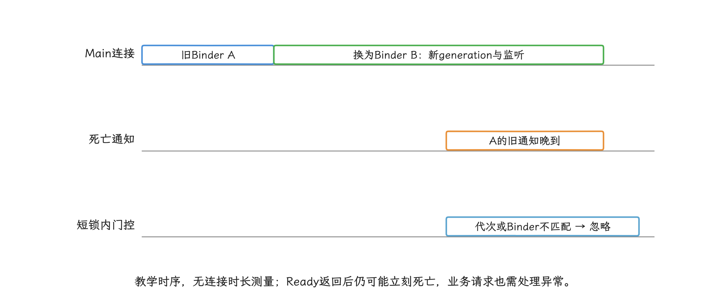

图：每次绑定实例有独立关闭状态；更换存活Binder先unlink旧监听，注册/Ready发布/死亡检查共用短锁。

状态更新之外，重工作要切到受控协程或执行器上，因为远程事务可能包含磁盘、网络或重计算。AIDL（Android Interface Definition Language）用于声明跨进程接口；客户端应把同步 AIDL 调用放到允许阻塞的调度器，并给业务请求单独设置超时：

```kotlin
suspend fun transcode(
    connection: WorkerConnection,
    request: TranscodeRequest,
): TranscodeResult = withTimeout(3_000) {
    withContext(Dispatchers.IO) {
        connection.awaitReady(timeoutMillis = 1_000)
            .transcode(request)
    }
}
```

这里的 1秒/3秒仅是代码示例策略，不是平台预算或性能测量。内层超时约束连接等待，外层超时为调用方协程设置业务 deadline。但同步 Binder 一旦进入阻塞，`withTimeout` 拦不下正在执行的事务，这段代码也就给不出严格的墙钟时间上限（从调用开始计算的实际耗时）。需要硬超时的耗时协议，应改成异步请求加回调，并提供请求 ID、显式 `cancel(requestId)` 和服务端 deadline；服务端还要让重复请求可安全重试。

<!-- gracker-diagram: a224-20-blocking-binder-timeout -->
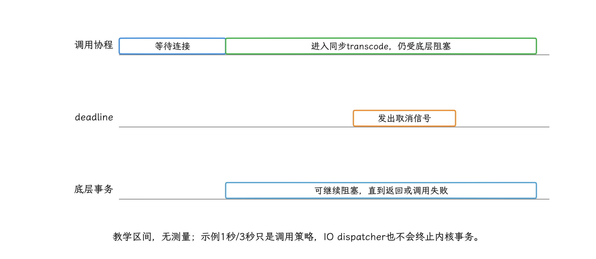

图：需要严格可控耗时的协议改为异步请求/回调、请求ID、服务端deadline和cancel；还需幂等重试。

如果首屏允许降级，超时后应返回本地占位、稍后重试或跳过非核心能力。不要在主线程用同步 Binder、文件锁或数据库锁把远程冷启动串到首帧之前。

### 6. 跨进程状态要有唯一所有者

`Context.MODE_MULTI_PROCESS` 从 API 23 起已废弃。`Context` 文档明确说明，它协调跨进程 `SharedPreferences` 并不可靠：不同进程各自缓存数据，并发修改也没有可依赖的冲突合并规则。

跨进程状态应明确唯一写入者和一致性协议：

- 小型查询或受控写入可以由一个 Provider 统一管理，让其他进程通过 IPC 访问唯一的数据实现；
- 高频、强类型调用可以使用 AIDL，并在服务端串行化关键状态；
- 大对象使用文件、数据库、共享内存或文件描述符传递，Binder 只传请求 ID、状态等控制信息，避免占满事务缓冲区；
- 配置变更携带 `version` 或 `generation`（状态代次），客户端重连时重新拉取快照；
- 一次性事件携带请求 ID，避免进程死亡后的重复提交产生副作用。

数据库能被多个进程打开，和业务事务已经具备一致性保证是两回事。我们需要核对所用数据库库的多进程能力、WAL（Write-Ahead Logging）与锁行为、数据失效通知和迁移时序。数据库升级只能有一个受控入口；schema（数据库结构） 准备完成前，其他进程应停在带超时的等待状态，由这个入口完成迁移。

<!-- gracker-diagram: a224-21-single-state-owner -->
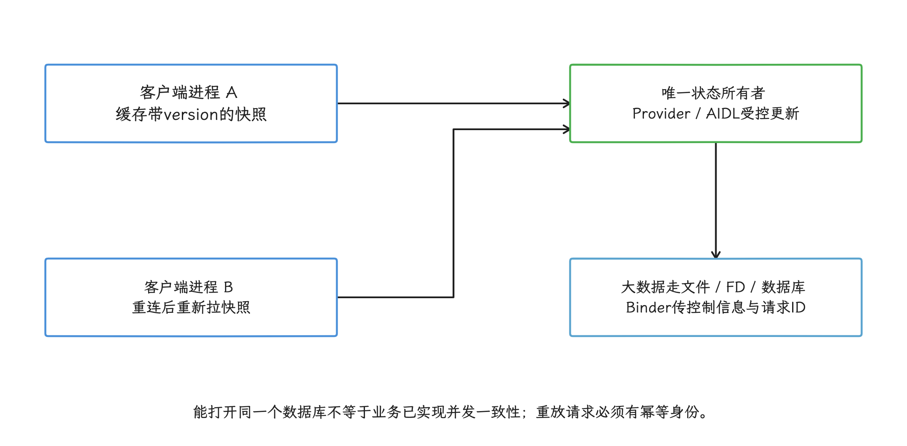

图：SharedPreferences MODE_MULTI_PROCESS不可靠；数据库迁移入口、WAL锁和失效通知仍要独立核对。

### 7. 面向进程死亡的恢复设计

这一节我们按最坏情况设计：远程进程可能因内存压力、组件生命周期结束、崩溃或系统策略而消失。生产环境的清理逻辑别指望 `Application.onTerminate()`：官方 API 文档明确说明，量产设备结束进程时不会调用这个方法，也不会执行其他应用清理代码。

绑定关系、正在运行的前台服务和用户可感知组件会影响系统对进程重要性的判断；进程寿命的最终裁决权仍在系统手里。前台服务只适合用户能够感知的持续任务，并要声明正确的服务类型、权限和通知；从后台启动时还要满足对应版本的豁免条件。空 Service、循环广播、主辅进程互相启动和没有业务意义的前台服务会增加功耗与内存，也可能触发系统限制。

更可靠的恢复路径包含：

- 客户端监听 Binder 死亡，清掉旧代理并按当前页面需求决定是否重连；
- 服务端把必要状态持久化，让请求具备幂等键或可恢复检查点（中断后可继续的位置）；
- 客户端保存可序列化、可重建的请求描述，不保存只能由旧进程内存解释的对象引用；
- 连接失败、初始化失败和业务失败使用不同错误码，分别制定逐步延长重试间隔的退避、降级和用户提示；
- 不再有页面或任务需要服务时及时解绑，让系统回收空闲进程。

如果一次冷启动很贵，应优先减少远程进程初始化量、缩短协议握手和缓存可复用产物。是否在首帧后预热，应由命中率和资源数据决定。

<!-- gracker-diagram: a224-22-death-and-recovery -->
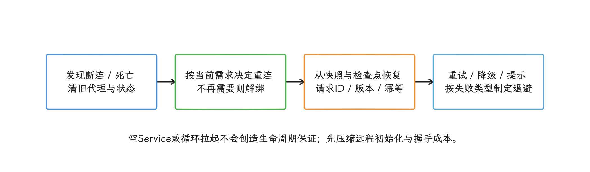

图：onServiceDisconnected保留绑定；onBindingDied必须重新绑定；生产进程结束不依赖onTerminate清理。

### 8. 多进程的观测方法

观测多进程，要先接受一个事实：没有 Activity 的远程服务进程不绘制应用界面，也就没有有意义的 TTID/TTFD。所以主进程继续观察 TTID、TTFD 和首帧前同步等待；远程进程则定义自己的 `binder_ready`、`provider_ready` 或首个业务结果时间，并写清每个时点代表的可用能力。

解释“为什么创建进程”，系统有现成数据。Android 15（API 35）加入 `ApplicationStartInfo`，可以读取进程名、启动原因和启动时间戳；Android 16（API 36）又加入 `getStartComponent()`，用于区分 Activity、Service、Broadcast 和 ContentProvider。`getReason()` 给出 launcher、Job、Push 等更细的触发原因，组件类型则要看 `getStartComponent()`。`ActivityManager.getHistoricalProcessStartReasons()` 从 API 35 已公开，Android 17 继续支持；它读取按时间倒序保存的近期记录，可能含未完成启动，也可能因数量上限或历史淘汰而缺失。候选记录还需核对 PID、processName、LAUNCH 与本地启动代次，不能把第一条直接当本次请求。

这些数据回答的是“为什么创建进程”；初始化各阶段有多耗时，仍要靠应用自己的 trace 和埋点。

每次远程进程启动建议至少记录：

| 维度 | 字段 | 诊断目的 |
| --- | --- | --- |
| 身份 | processName、pid（进程 ID）、versionName、启动代次 | 区分多次重启与版本差异 |
| 原因 | `ApplicationStartInfo.reason`、start component、业务入口 | 找出意外 Provider、广播或后台任务拉起 |
| 阶段 | Application 入口/出口、Provider、自定义 SDK、binder ready | 找出远程冷启动的长任务 |
| 主进程影响 | 首帧前 IPC 次数、同步等待、超时与降级 | 判断是否把远程成本传回主线程 |
| 资源 | PSS、RSS、Java/native heap、线程、FD（文件描述符） | 衡量拆分和预热的常驻代价 |
| 稳定性 | `binderDied`、重绑、崩溃、请求重放、失败率 | 验证进程死亡后的恢复质量 |

PSS 会按共享进程数分摊共享内存页，适合估算多个进程合计对系统内存的压力；RSS（Resident Set Size）包含该进程映射的全部共享页，适合观察单进程驻留趋势，并不等于对象分配量；直接相加多个进程的 RSS (Resident Set Size，常驻内存大小) 会重复计算共享页。报告“多进程节省内存”时，要说明用的是哪一种统计口径。

<!-- gracker-diagram: a224-23-memory-and-readiness-metrics -->
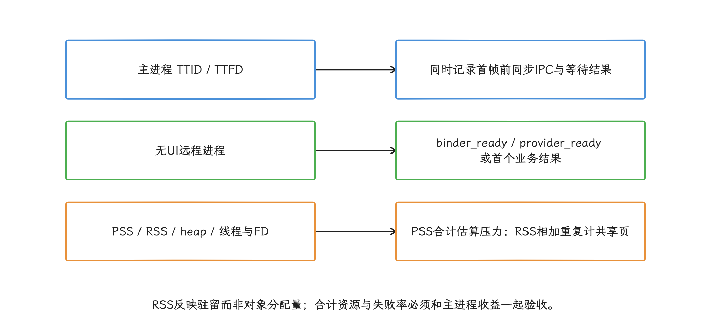

图：按进程身份、启动代次、入口与版本记录；历史启动记录需PID/name/LAUNCH与本地会话核对。

本地排查可以先用下面的命令确认进程、内存和长期存活情况：

```bash
adb shell dumpsys activity processes
adb shell dumpsys meminfo com.example.app
adb shell dumpsys procstats --hours 3
```

第一条查看当前进程与组件状态，第二条分项显示应用内存，第三条读取 `procstats`（系统长期记录的进程状态与内存统计） 长期记录的进程状态与内存统计。不同 Android 版本与设备厂商的 `dumpsys` 文本格式可能变化，自动化采集更适合使用稳定 API、Perfetto 数据源，或只解析明确支持的系统版本。

Perfetto 是系统级时间线分析工具。分析时我们把主进程和远程进程放在同一时间轴上，关注进程创建、`bindApplication`、Provider 初始化、自定义 trace、Binder 阻塞、I/O 和 CPU 竞争。一次优化至少要回答三个问题：主进程首帧有没有改善，远程能力可用时间有没有变慢，合计资源与失败率是否可以接受。

### 检查清单

- [ ] 每个远程组件的 `android:process` 都有明确理由。
- [ ] 普通远程进程与 isolated process（隔离 UID、无自身权限）的权限假设已分别验证。
- [ ] Provider 的进程归属和自动初始化项已检查。
- [ ] `Application.getProcessName()` 分支覆盖所有已声明进程。
- [ ] 每个进程只创建本进程需要的 SDK、线程池和 native 状态。
- [ ] 首帧前没有无上限的同步 Binder、Provider 或锁等待。
- [ ] Binder 客户端处理超时、死亡、重绑、取消和请求幂等。
- [ ] 跨进程状态有唯一所有者，没有依赖 `MODE_MULTI_PROCESS`。
- [ ] 远程进程可被回收，恢复路径不依赖 `onTerminate()`。
- [ ] 预热实验同时比较命中率、TTID/TTFD、remote ready（远程能力可用时点）、PSS 和失败率。
- [ ] PSS/RSS 的统计口径和聚合方法已在报告中说明。
- [ ] `ApplicationStartInfo`、应用 trace 与线上埋点能解释进程启动原因和阶段。

## 小结

Provider 治理先从最终 Manifest 建立清单，再按 TTID、TTFD 与功能首用划分必要性；删除自动入口后，必须用显式状态机补齐依赖、失败、安全和回归验证——单看 Provider 数量下降，说明不了治理是否有效。

多进程优化再按“确认隔离目标 → 明确组件归属 → 压缩每个进程的初始化集 → 设计可超时、可取消、可重连的异步协议”推进。源码时序把一条规则摆得很清楚：属于该进程的 Provider 先于 `Application.onCreate()` 执行，因此进程名分支和 Provider 治理都要检查。验收时我们同时观察主进程首帧、远程能力 ready、全应用内存与进程死亡恢复，才能判断这次拆分是否值得。

## 参考资料

- [AOSP Android 17 `ActivityThread`](https://android.googlesource.com/platform/frameworks/base/+/refs/tags/android-17.0.0_r1/core/java/android/app/ActivityThread.java)
- [AOSP Android 17 `ContentProvider`](https://android.googlesource.com/platform/frameworks/base/+/refs/tags/android-17.0.0_r1/core/java/android/content/ContentProvider.java)
- [AOSP Android 17 `ContentProviderRecord`](https://android.googlesource.com/platform/frameworks/base/+/refs/tags/android-17.0.0_r1/services/core/java/com/android/server/am/ContentProviderRecord.java)
- [Android `<provider>` manifest 元素](https://developer.android.com/guide/topics/manifest/provider-element)
- [Manifest 合并规则](https://developer.android.com/build/manage-manifests)
- [Direct Boot 指南](https://developer.android.com/privacy-and-security/direct-boot)
- [Jetpack App Startup](https://developer.android.com/topic/libraries/app-startup)
- [Jetpack App Startup 发布说明](https://developer.android.com/jetpack/androidx/releases/startup)
- [Jetpack Startup 1.2.0 源码包](https://dl.google.com/dl/android/maven2/androidx/startup/startup-runtime/1.2.0/startup-runtime-1.2.0-sources.jar)
- [`ViewTreeObserver.registerFrameCommitCallback`](https://developer.android.com/reference/android/view/ViewTreeObserver)

- [Android 17 `ActivityThread.java`](https://android.googlesource.com/platform/frameworks/base/+/refs/tags/android-17.0.0_r1/core/java/android/app/ActivityThread.java)：`handleBindApplication()`、`installContentProviders()` 与 `callApplicationOnCreate()` 的调用顺序。
- [Android 17 `ZygoteProcess.java`](https://android.googlesource.com/platform/frameworks/base/+/refs/tags/android-17.0.0_r1/core/java/android/os/ZygoteProcess.java)：`startViaZygote()` 与 Zygote 请求路径。
- [Android 17 `Context.java`](https://android.googlesource.com/platform/frameworks/base/+/refs/tags/android-17.0.0_r1/core/java/android/content/Context.java)：`MODE_MULTI_PROCESS` 的废弃说明与跨进程限制。
- [Processes and threads overview](https://developer.android.com/guide/components/processes-and-threads)：组件进程、Binder 线程与 Provider 调用规则。
- [`Application` API reference](https://developer.android.com/reference/android/app/Application)：`getProcessName()` 与 `onCreate()` 生命周期边界。
- [Bound services overview](https://developer.android.com/develop/background-work/services/bound-services)：绑定生命周期与跨进程服务调用。
- [`ServiceConnection` API reference](https://developer.android.com/reference/android/content/ServiceConnection)：断连、binding 失效和重新绑定要求。
- [`IBinder` API reference](https://developer.android.com/reference/android/os/IBinder)：同步事务、`linkToDeath()` 与死亡通知。
- [`ApplicationStartInfo` API reference](https://developer.android.com/reference/android/app/ApplicationStartInfo)：启动原因、进程名、组件和时间戳。
- [Memory management overview](https://developer.android.com/topic/performance/memory-management)：PSS、RSS 与 Android 内存统计口径。
- [Handle WebView termination](https://developer.android.com/develop/ui/views/layout/webapps/handle-termination)：renderer process 退出与宿主恢复边界。
- [App Startup](https://developer.android.com/topic/libraries/app-startup)：initializer 依赖、自动初始化和手动初始化。
- [App startup time](https://developer.android.com/topic/performance/vitals/launch-time)：TTID、TTFD 与启动测量边界。
- [Binder threading](https://source.android.com/docs/core/architecture/ipc/binder-threading)：异步节点串行、并发与本地调用边界。
- [Java 类初始化边界](https://docs.oracle.com/javase/specs/jls/se21/html/jls-12.html#jls-12.4)：加载与首次主动使用并非同一步骤。
