# Splash Screen 与感知启动速度

用户点击图标后，App 自己的首帧通常还没有准备好。Starting Window（起始窗口）是系统在这段空档显示的临时画面；Android 12 引入的 SplashScreen API 统一了它的样式与交接方式，AndroidX 兼容库再把主要接入方式带到 API 21。首帧之后还可以用骨架屏（按内容结构预留的占位界面）和退出动画减少视觉跳变。本文说明这些工具的用法、版本边界和 Perfetto 分析方法。

系统侧由 `ActivityTaskManagerService`（活动与任务管理服务，简称 ATMS）判断是否需要 Starting Window，再由 WM Shell（WindowManager Shell，负责起始表面和窗口过渡等工作的系统组件）创建具体画面。TaskSnapshot 则是系统保存的任务界面快照。

## 范围

这里的“感知启动速度”指用户从点击图标到看见稳定反馈、再到内容可用的主观感受。Splash Screen 可以提前给出连续的视觉反馈，却不会缩短进程创建、主线程初始化、I/O 或首屏布局本身；把启动画面多留几秒，也不会改善这些执行时间。

平台源码锚点为 Android 17 / API 37 / `android-17.0.0_r1`，App 侧兼容实现以 AndroidX `core-splashscreen:1.2.0` 为参考。系统侧 Starting Window 的完整机制见 1.19 节 [WindowManager](../../part1-fundamentals/ch01-architecture/19-display-windowmanager-architecture.md)，本文只处理 App 侧的配置、迁移、内容交接与效果验证。

## 1. 先区分三种画面

启动期间可能连续出现三类画面。第一类是系统在 App 窗口可显示前临时展示的 starting surface（起始表面），它不一定是带品牌图标的 Splash。TTID（Time to Initial Display）结束于 App 第一帧，TTFD（Time to Full Display）结束于主要内容可见且可交互时：

| 画面 | 创建者 | 出现阶段 | 主要职责 |
| --- | --- | --- | --- |
| starting surface | system_server 决策，WM Shell 绘制 | App 窗口可显示前 | 立即反馈、遮住进程与首帧准备 |
| App 第一帧 | App 主窗口 | TTID | 给出可识别的应用结构 |
| 完整内容 | App 主窗口 | TTFD | 主要内容可见并可交互 |

Android 17 可以按启动条件在这些形态之间选择：

- Splash Screen；
- 纯色 Splash Screen；
- legacy Splash Screen（沿用旧主题行为的兼容类型）；
- TaskSnapshot（任务上次可见界面的快照）；
- windowless starting surface（直接挂到任务表面、没有传统 Starting Window 容器的实现）；
- 不创建 starting window（源码类型为 `none`）。

选择哪个形态，还取决于启动类型。冷启动表示 App 进程尚不存在；warm start 表示进程还在，但目标 Activity 尚未创建或需要重建；hot start 则是进程和目标 Activity 都在，只需把它带回前台。TaskSnapshot 常用于已有任务切回前台且快照兼容的情况，Splash 常见于冷启动、新任务或 warm start。hot start 不会重复显示 Splash。

<!-- gracker-diagram: a226-02-launch-type -->
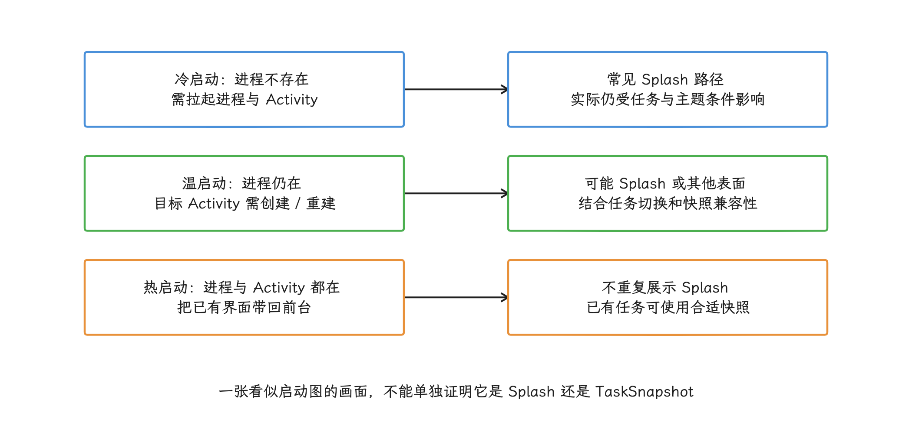

图：冷温热描述进程与 Activity 状态，具体 surface 还受 system_server 参数和 Shell 算法决定。

“点击图标后看见了一张图”还不足以判断系统走了哪条路径；要解释 Perfetto trace（系统与应用事件的时间线记录），先确认启动类型和 starting window 类型。

<!-- gracker-diagram: a226-01-three-surfaces -->
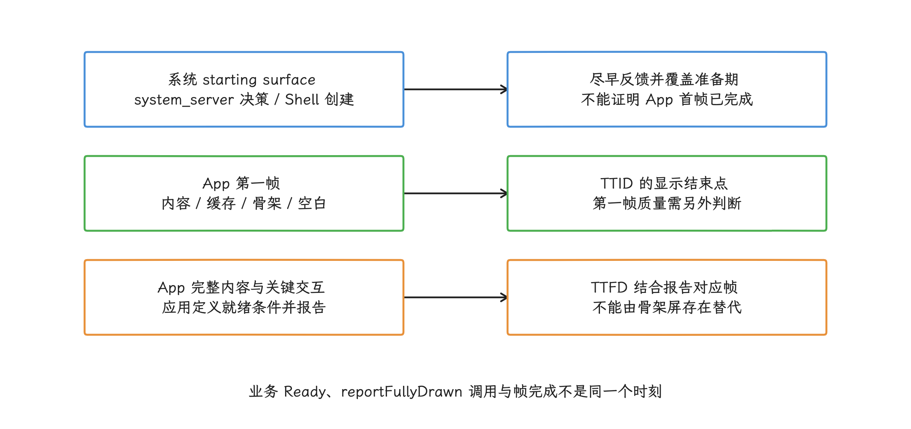

图：画面创建者与证据不同；系统反馈更早，不表示 App 初始化或内容加载已经更快。

## 2. Android 17 的系统链路

### 2.1 system_server 负责条件和数据

Android 17 的 `ActivityRecord` 是 system_server 内部保存 Activity 运行状态的记录对象。[`ActivityRecord.addStartingWindow()`](https://android.googlesource.com/platform/frameworks/base/+/refs/tags/android-17.0.0_r1/services/core/java/com/android/server/wm/ActivityRecord.java)会检查：

- 当前显示是否允许创建 starting window；
- App 主窗口是否已经绘制；
- 是否有可用且兼容的 TaskSnapshot；
- 这是新任务、任务切换、进程已运行还是 Activity 已创建；
- 启动主题是否允许 starting window。

选择 Splash 路径后，`ActivityRecord` 创建保存主题和类型参数的 `SplashScreenStartingData`。[`SplashScreenStartingData`](https://android.googlesource.com/platform/frameworks/base/+/refs/tags/android-17.0.0_r1/services/core/java/com/android/server/wm/SplashScreenStartingData.java)再调用 [`StartingSurfaceController.createSplashScreenStartingSurface()`](https://android.googlesource.com/platform/frameworks/base/+/refs/tags/android-17.0.0_r1/services/core/java/com/android/server/wm/StartingSurfaceController.java)，通过 TaskOrganizer 这条任务管理接口把创建请求交给 Shell。

### 2.2 WM Shell 负责类型细化和绘制

下面是 Android 17 上的主要调用关系。向下的箭头表示请求继续交给下一层，末端分支是负责创建不同表面的组件：

```text
ActivityRecord.addStartingWindow()
  ├─ SnapshotStartingData
  └─ SplashScreenStartingData
       ↓
StartingSurfaceController
       ↓ TaskOrganizer
StartingWindowController
       ↓ StartingWindowTypeAlgorithm
StartingSurfaceDrawer
       ├─ SplashscreenWindowCreator
       ├─ SnapshotWindowCreator
       └─ Windowless*Creator
```

[`PhoneStartingWindowTypeAlgorithm`](https://android.googlesource.com/platform/frameworks/base/+/refs/tags/android-17.0.0_r1/libs/WindowManager/Shell/src/com/android/wm/shell/startingsurface/phone/PhoneStartingWindowTypeAlgorithm.java)根据 system_server 传来的参数，在 snapshot、不同 Splash 类型、windowless 和 none 之间给出建议。选中后，[`StartingWindowController`](https://android.googlesource.com/platform/frameworks/base/+/refs/tags/android-17.0.0_r1/libs/WindowManager/Shell/src/com/android/wm/shell/startingsurface/StartingWindowController.java)接收 TaskOrganizer 回调，[`StartingSurfaceDrawer`](https://android.googlesource.com/platform/frameworks/base/+/refs/tags/android-17.0.0_r1/libs/WindowManager/Shell/src/com/android/wm/shell/startingsurface/StartingSurfaceDrawer.java)再交给对应的创建器（源码中的 `creator`）。

<!-- gracker-diagram: a226-04-type-algorithm -->
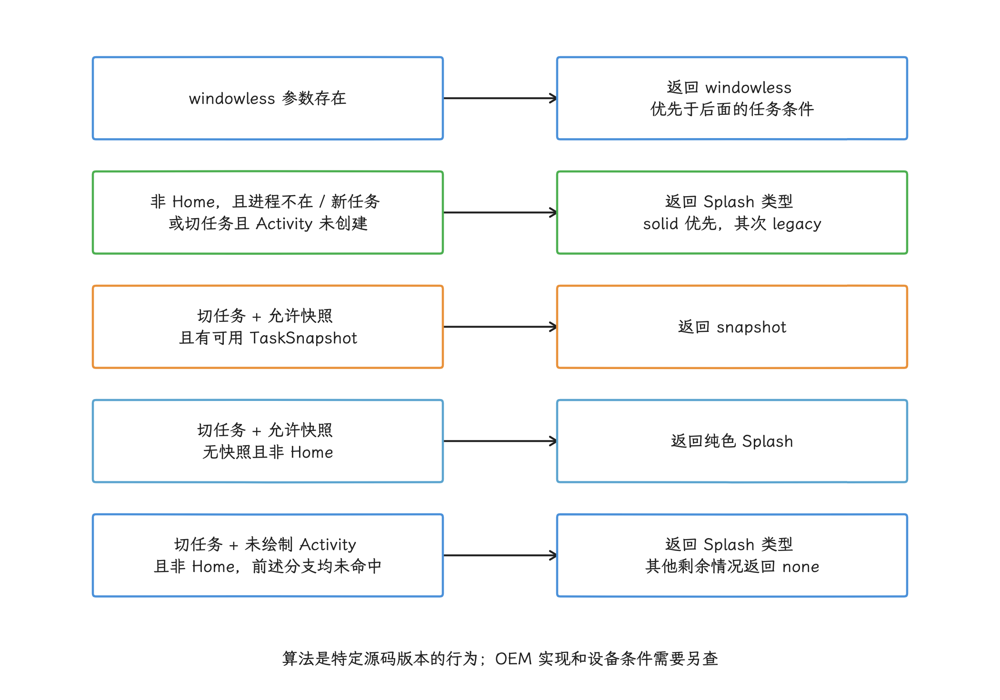

图：按 PhoneStartingWindowTypeAlgorithm 的返回顺序简化；输入的快照兼容性由更早系统判断提供。

这条链路说明两个边界：

1. Splash 由系统在 App 第一帧前创建，不需要 App 进程先 `inflate`（从 XML 创建 View 树）一张启动页。
2. App 主题只是输入之一，最终类型还受任务、进程、snapshot、窗口状态和系统策略影响。

<!-- gracker-diagram: a226-03-system-shell -->
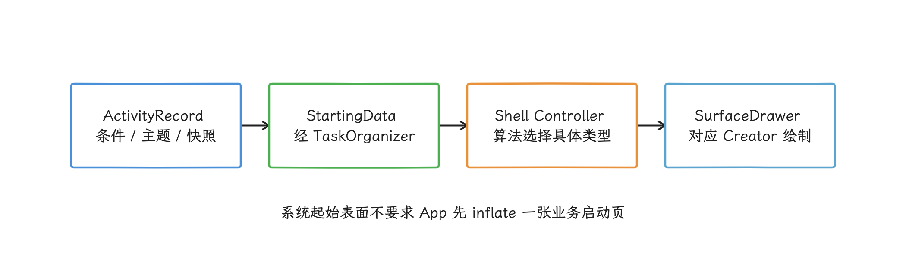

图：system_server 传递条件和数据，Shell 根据类型创建 Splash、Snapshot 或 windowless 表面。

### 2.3 移除与退出动画

App 内容可以显示时，system_server 请求 Shell 移除 starting window。若应用注册了退出动画，系统可以把 `SplashScreenView` 复制一份交给 App 继续播放。Android 17 的 [`SplashscreenWindowCreator`](https://android.googlesource.com/platform/frameworks/base/+/refs/tags/android-17.0.0_r1/libs/WindowManager/Shell/src/com/android/wm/shell/startingsurface/SplashscreenWindowCreator.java)包含视图复制、窗口移除和 `SurfaceControlViewHost` 释放路径；这里的 host 是跨进程承载动画图标 View 的容器。

不要把“App 已提交第一帧”“starting window 已移除”“退出动画已完成”视为同一个时间点。自定义动画会在 App 内容已经准备显示后继续覆盖它一段时间。

<!-- gracker-diagram: a226-15-exit-overlap -->
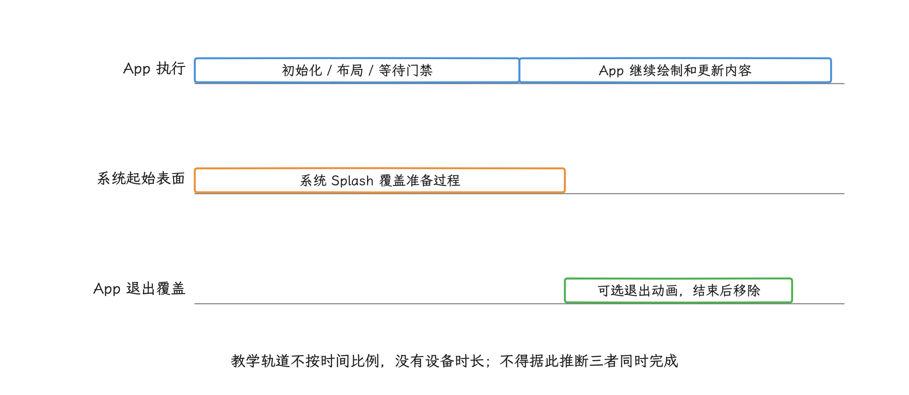

图：图示一种允许的重叠关系；退出回调只表示可移除，实际首帧和表面移除点应从 Trace 与录屏确认。

## 3. AndroidX SplashScreen 接入

### 3.1 版本边界

截至 2026-08-14，`androidx.core:core-splashscreen:1.2.0` 仍是稳定版。它的兼容边界如下：

| 系统版本 | 实现方式 | 重要差异 |
| --- | --- | --- |
| API 21～22 | AndroidX 兼容主题与 App 侧控制 | 支持背景；启动早期没有兼容 Splash 图标 |
| API 23～30 | AndroidX 模拟 Android 12 行为 | 支持静态图标；不支持启动图标 AVD（AnimatedVectorDrawable，可动画矢量图）动画 |
| API 31～37 | 委托平台 SplashScreen API | 系统 Splash、图标动画和平台退出交接 |

兼容库的 `minSdk` 是 21，启动早期就能显示图标的兼容能力从 API 23 才开始。测试范围至少要覆盖 API 21/22、23～30、31 和当前目标 API，不能只在 Android 17 模拟器上验收。

<!-- gracker-diagram: a226-05-compat-and-build -->
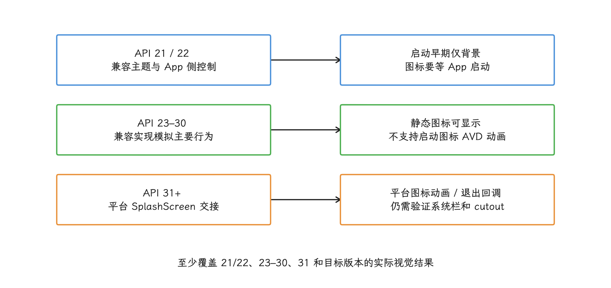

图：运行下限 API21 与构建要求分开：本 AAR 要求 compileSdk≥35、AGP≥8.6.0。

### 3.2 添加依赖

下面在应用模块引入 `core-splashscreen:1.2.0`。该版本 AAR 的构建元数据要求 `compileSdk` 至少为 35、Android Gradle Plugin 至少为 8.6.0；其 Manifest 声明的运行下限仍是 API 21。构建工具要求与运行系统下限要分别检查：

```kotlin
dependencies {
    implementation("androidx.core:core-splashscreen:1.2.0")
}
```

升级版本时要同时回归浅色/深色主题、状态栏和导航栏、display cutout（刘海或挖孔区域）、退出动画以及低版本图标裁剪。AndroidX 1.2.0 包含 cutout、系统栏主题和图标资源读取等相关修复。

### 3.3 配置 starting theme

starting theme 是写在 Manifest 启动入口上的临时主题。下面的配置给出单色背景、启动图标，以及 Splash 结束后切换到的正常主题：

```xml
<!-- res/values/themes.xml -->
<style name="Theme.App.Starting" parent="Theme.SplashScreen">
    <item name="windowSplashScreenBackground">@color/launch_background</item>
    <item name="windowSplashScreenAnimatedIcon">@drawable/ic_splash</item>
    <item name="windowSplashScreenAnimationDuration">600</item>
    <item name="postSplashScreenTheme">@style/Theme.App</item>
</style>
```

这里有四个容易误解的点：

- 背景应是单一、不透明的颜色，并在 `values-night` 提供对应资源；
- 图标会按 adaptive icon（可由系统套用不同形状蒙版的自适应图标）的安全区域裁剪，四周必须保留余量；
- `windowSplashScreenAnimationDuration` 只描述图标动画时长，不控制 Splash 在屏幕上停留多久；Android 13（API 33）起，平台会直接从 AVD 推断时长；
- `postSplashScreenTheme` 应指向 Activity 的正常主题。若不使用它，就必须在 `onCreate()` 前自行调用 `setTheme()`，两种方式只能有一套清晰的主题切换责任。

<!-- gracker-diagram: a226-06-theme-handoff -->
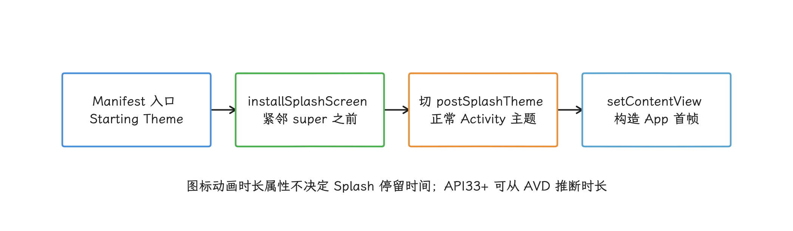

图：启动主题提供背景和图标，兼容库安装时切换到正常主题；主题切换责任要明确。

`windowSplashScreenBrandingImage` 可以把品牌图片放在底部，官方设计规范不建议使用。品牌信息优先放在中央图标、颜色和进入内容后的界面中。

<!-- gracker-diagram: a226-07-icon-mask -->
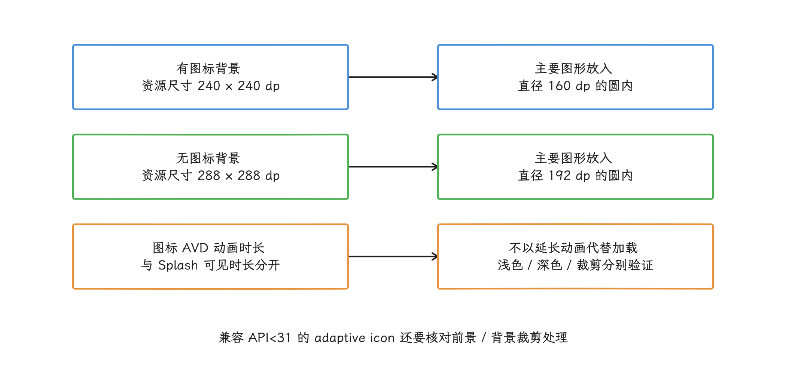

图：圆外内容会被蒙版裁剪；尺寸来自官方规范，图中没有设备性能或动画测量值。

### 3.4 覆盖每个外部启动入口

下面把 starting theme 配给 launcher Activity：

```xml
<activity
    android:name=".MainActivity"
    android:exported="true"
    android:theme="@style/Theme.App.Starting">
    <intent-filter>
        <action android:name="android.intent.action.MAIN" />
        <category android:name="android.intent.category.LAUNCHER" />
    </intent-filter>
</activity>
```

如果通知、deep link（自定义 scheme 或 URI 链接）或 App Link（经验证、可直接打开 App 的 HTTP(S) 链接）能在冷进程中直接启动另一 Activity，该入口也要配置 starting theme，并在 `super.onCreate()` 前调用 `installSplashScreen()`。只验证桌面图标会漏掉这些路径。

<!-- gracker-diagram: a226-08-external-entry -->
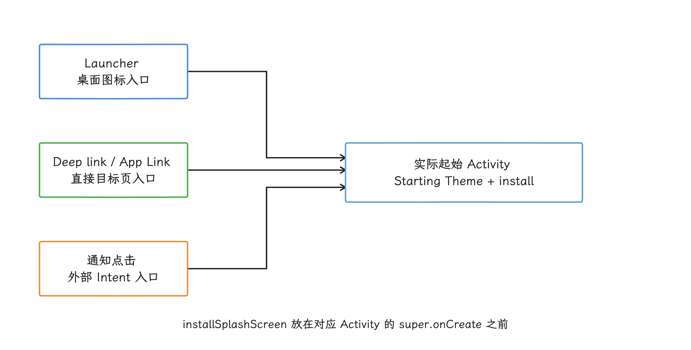

图：每条外部路由都可能在冷进程中直接进入不同 Activity；仅桌面入口接入会漏测其他路径。

### 3.5 在 `super.onCreate()` 前安装

下面展示启动 Activity 的最小接入顺序：

```kotlin
class MainActivity : ComponentActivity() {
    override fun onCreate(savedInstanceState: Bundle?) {
        val splashScreen = installSplashScreen()
        super.onCreate(savedInstanceState)

        setContentView(R.layout.activity_main)
    }
}
```

`installSplashScreen()` 必须紧挨在 `super.onCreate()` 之前调用。AndroidX 会读取 starting theme、切换 `postSplashScreenTheme`，并在不同 API 上安装相应的平台或兼容实现。返回的 `splashScreen` 对象用于设置保持条件或退出动画；没有这两类定制时，无须继续操作它。

## 4. `KeepOnScreenCondition` 只等待短时本地状态

### 4.1 回调运行在主线程

`KeepOnScreenCondition.shouldKeepOnScreen()` 会在 Activity 每次请求绘制前于主线程调用。它可能在一秒内执行多次，所以回调只能读取内存里已有的状态，不能执行：

- 文件或数据库读取；
- Binder 跨进程调用；
- JSON 文本解析；
- 等锁或调用会阻塞当前线程的 `Future.get()`；
- 网络请求；
- 广告 SDK 初始化。

下面是启动 Activity 的接入节选，`MainViewModel` 负责跨配置变更保留页面状态，并异步读取少量本地数据。注册条件前先取得 `launchState` 引用；`StateFlow` 是可观察的状态流，绘制回调只读取它当前保存在内存中的 `value`：

```kotlin
class MainActivity : ComponentActivity() {
    private val viewModel: MainViewModel by viewModels()

    override fun onCreate(savedInstanceState: Bundle?) {
        val splashScreen = installSplashScreen()
        super.onCreate(savedInstanceState)

        val launchState = viewModel.launchState
        splashScreen.setKeepOnScreenCondition {
            launchState.value == LaunchState.LoadingLocal
        }

        setContentView(R.layout.activity_main)
    }
}

enum class LaunchState {
    LoadingLocal,
    Ready,
    RecoverableError,
}
```

`by viewModels()` 是惰性委托，第一次访问时可能创建 ViewModel。这里的首次访问发生在 `onCreate()` 中，条件回调只使用已取得的状态引用。ViewModel 构造过程仍须保持轻量，文件读取等初始化工作要异步执行，避免阻塞 `onCreate()`。

异步任务必须有失败和超时出口，把 `LoadingLocal` 转成 `Ready` 或 `RecoverableError`。若状态一直不变化，Splash 会持续挡住 Activity，页面也不会开始绘制。

<!-- gracker-diagram: a226-09-keep-condition -->
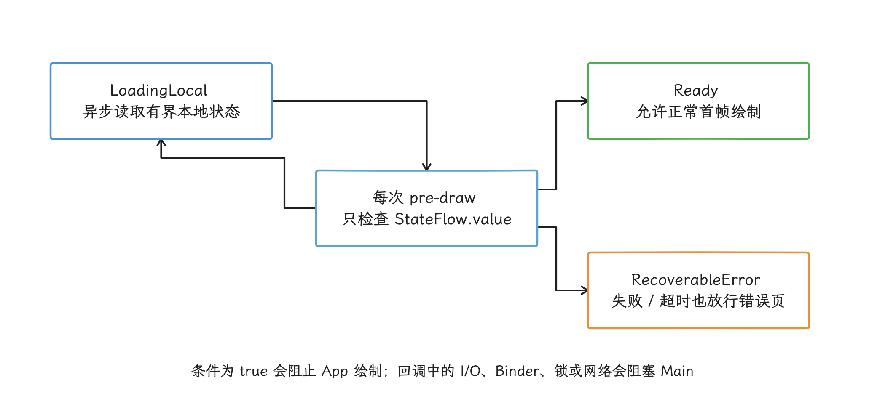

图：状态变更由异步任务负责；门禁回调只读内存，失败和超时必须离开 LoadingLocal。

### 4.2 哪些内容可以等

适合短暂等待的内容通常是：

- 本地主题或账户路由；
- 已缓存的登录态；
- 很小的本地配置；
- 决定首个导航目的地的持久化状态。

网络首页、远程配置、图片、推荐流和广告都没有可保证的完成时限。对这些数据，应尽快显示 App 第一帧，再用缓存、占位或错误态继续加载。官方迁移指南也建议：时长不确定的网络加载应在退出 Splash 后显示 placeholder（占位界面）。

`KeepOnScreenCondition` 会推迟 Activity 的绘制请求。它适合避免极短的路由闪烁，不要用它把启动过程延长成一段品牌动画。

## 5. 退出动画

注册 `setOnExitAnimationListener` 后，回调会在 UI 线程执行，应用也要负责移除 `provider`。回调拿到的 `provider` 是 `SplashScreenViewProvider`，即退出动画所用视图的包装对象，与 `ContentProvider` 无关。下面的注册代码放在 `ComponentActivity.onCreate()` 中，用短淡出连接 Splash 和已准备好的首屏，并处理取消与销毁；`DefaultLifecycleObserver` 需要 Lifecycle 2.4.0 或更高版本：

```kotlin
import android.animation.Animator
import android.animation.AnimatorListenerAdapter
import androidx.lifecycle.DefaultLifecycleObserver
import androidx.lifecycle.LifecycleOwner

// Register inside ComponentActivity.onCreate().
splashScreen.setOnExitAnimationListener { provider ->
    val animator = provider.view.animate()
        .alpha(0f)
        .setDuration(160L)
    var removed = false
    lateinit var destroyObserver: DefaultLifecycleObserver

    fun removeSplash() {
        if (removed) return
        removed = true
        animator.setListener(null)
        lifecycle.removeObserver(destroyObserver)
        provider.remove()
    }

    destroyObserver = object : DefaultLifecycleObserver {
        override fun onDestroy(owner: LifecycleOwner) {
            animator.setListener(null)
            animator.cancel()
            removeSplash()
        }
    }
    animator.setListener(object : AnimatorListenerAdapter() {
        override fun onAnimationEnd(animation: Animator) {
            removeSplash()
        }

        override fun onAnimationCancel(animation: Animator) {
            removeSplash()
        }
    })
    lifecycle.addObserver(destroyObserver)
    animator.start()
}
```

正常结束、动画取消和 Activity 销毁都调用同一个幂等清理函数，移除 Splash View 并注销监听。销毁路径先取消动画，再显式清理；系统动画缩放关闭、动画立即结束时也会执行结束回调。`ViewPropertyAnimator.withEndAction` 在动画取消时不会执行，因此不能单独用它保证 `provider.remove()`。

退出动画有三条约束：

- 内容首帧必须已经在 Splash 下方稳定，避免退出后立即跳布局；
- 时长要用设备实测决定，不能把 200 ms 或 300 ms 当成通用标准；
- 低端机、系统动画缩放关闭和减少动态效果的无障碍偏好下也要有合理行为。

动画只改变画面交接。若主线程仍在执行长任务，动画结束后照样会掉帧或无响应。

<!-- gracker-diagram: a226-10-exit-cleanup -->
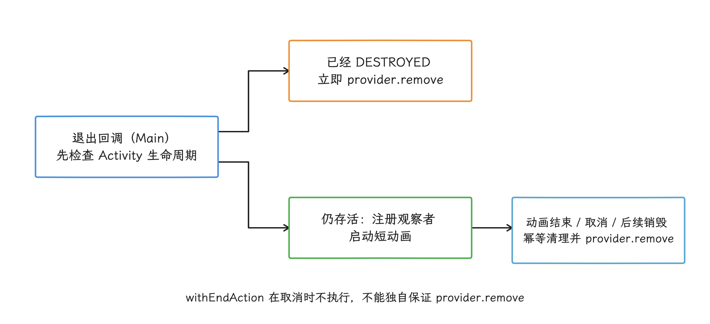

图：晚到回调不能依赖已经结束的生命周期补发 onDestroy；所有清理分支均在主线程处理。

## 6. 从旧方案迁移

### 6.1 旧 `windowBackground`

Android 11 及更早版本常在启动主题的 `android:windowBackground` 中放一个 layer-list，也就是把多个 Drawable 依次叠加的资源。Android 12+ 会在 cold/warm start 显示系统 Splash；旧的复杂 `windowBackground` 可能被系统默认 Splash 替换，外观不再等同于旧设备。

迁移时：

1. 把颜色和图标转到 `Theme.SplashScreen` 属性；
2. 设置 `postSplashScreenTheme`；
3. 给每个可能直接成为起始 Activity 的外部入口调用 `installSplashScreen()`；
4. 在 API 21～37 验证主题、图标、系统栏和切换帧；
5. 删除不再使用的旧 layer-list，避免两套启动视觉继续漂移。

### 6.2 专用 `SplashActivity`

Android 12+ 会先显示系统 Splash，再启动旧 `SplashActivity`，容易连续出现两次启动画面。专用 Activity 还会增加一轮生命周期、窗口创建和页面跳转。

路由判断（根据登录态、链接参数等条件决定首个页面）最好放进单 Activity，或直接启动目标 Activity。若路由 Activity 暂时不能移除，官方迁移方案允许它保持 Splash、立即跳到下一 Activity 并结束自己；这只适合作为迁移期间的方案，路由判断必须同步、快速且没有网络等待。

开屏广告属于业务页面，不应伪装成系统 Splash。需要展示时，应在系统 Splash 退出后进入可度量、可跳过、失败可恢复的广告页面。

<!-- gracker-diagram: a226-11-migration -->
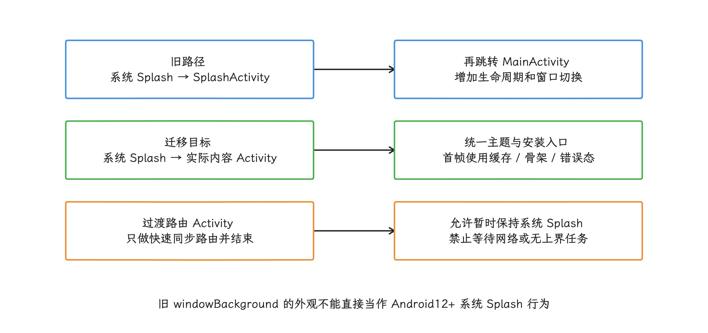

图：迁移按实际外部入口验证，业务开屏广告应有独立的跳过、度量与失败恢复机制。

## 7. Splash 后如何交接内容

### 7.1 首帧要稳定，也要尽快

App 第一帧至少应具备：

- 与最终页面一致的背景和系统栏颜色；
- 稳定的顶部栏、导航和主要内容边界；
- 可识别的缓存内容或占位；
- 明确的加载、空数据和失败状态；
- 不会在数据返回后大幅位移的布局。

骨架屏应贴近最终内容结构。占位项数量、宽高和间距如果与结果差异很大，数据回来时会产生明显 layout shift，也就是已有元素突然改变位置或尺寸。

### 7.2 优先显示缓存，再异步刷新

可复用内容的推荐顺序是：

1. 读取有边界的本地快照；
2. 绘制首屏和缓存时间；
3. 发起异步刷新；
4. 以稳定过渡替换变化区域；
5. 保留失败重试入口。

没有缓存时显示骨架或空态，不要让 Splash 等网络。

<!-- gracker-diagram: a226-12-cache-to-content -->
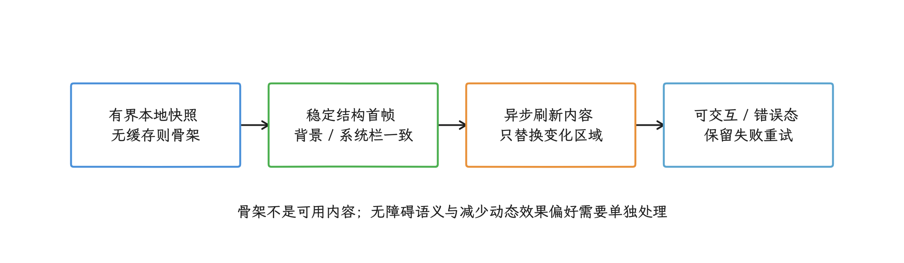

图：占位数量、尺寸和间距贴近真实内容；网络加载在 App 首帧后继续，不让 Splash 等待。

骨架元素不应被无障碍服务当成真实按钮或正文；shimmer（在占位块上移动的高光）也要控制面积和时长，并尊重减少动态效果的偏好。

### 7.3 不要在后台线程普通 inflate View

`LayoutInflater.inflate()` 会读取 XML 并创建 View 树。普通 `LayoutInflater` 和多数 View 构造、主题解析、Drawable 状态都按主线程 UI 模型设计。把完整页面放到 worker（后台工作线程）中 inflate，再缓存 View 树并挂到 Activity，可能引入主题错误、线程约束和生命周期泄漏，也可能拿到错误的 `Context`（资源与主题环境）或不匹配的 `LayoutParams`（父容器使用的布局参数）。

若 Trace 显示 inflate 是主成本，优先：

- 减少层级和首帧节点；
- 用 `ViewStub` 这个按需展开的轻量占位 View 延迟非首屏区域；
- 拆分首帧必需和后续内容；
- 检查自定义 View 构造与资源读取；
- 在适用场景评估 AndroidX `AsyncLayoutInflater` 等异步 inflate 工具，并针对具体布局验证它们的限制。

可以在后台准备不可变数据、解析结果或图片，但 View 创建和挂载仍应遵守 UI 线程与生命周期边界。

<!-- gracker-diagram: a226-13-ui-thread-boundary -->
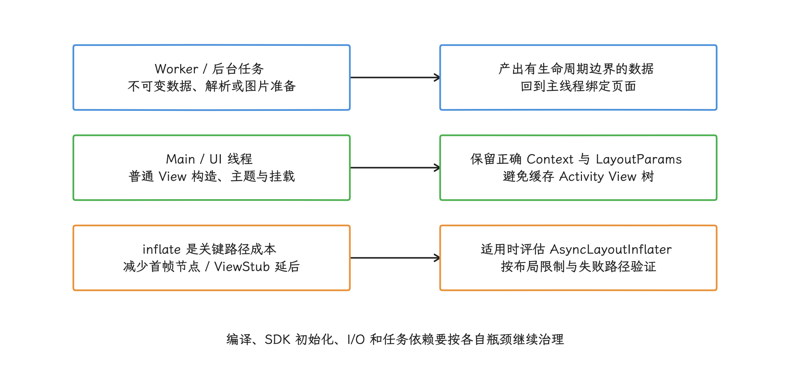

图：把普通 LayoutInflater 整页移到后台并缓存，不是通用的启动优化方案。

### 7.4 编译与初始化问题另行处理

Splash 不解决 JIT（Just-In-Time，运行时即时编译）预热、第三方 SDK 初始化或启动任务依赖。对应方法见：

- [Baseline Profile 实战](04-baseline-startup-cloud-profile.md)；
- [启动任务编排](02-startup-task-lazy-concurrency.md)；
- [延迟初始化](02-startup-task-lazy-concurrency.md)；
- [启动完整路径分析](01-app-startup-path-monitoring.md)。

不要给 Baseline Profile 写固定“提升 10%～30%”之类承诺。收益取决于规则覆盖、代码路径、编译状态和瓶颈类型，必须用目标产物与设备测量。

## 8. TTID、TTFD 与感知时间

### 8.1 三个时间不能互换

| 指标 | 结束点 | 能回答的问题 |
| --- | --- | --- |
| starting surface 首见时间 | 用户看见系统反馈 | 点击后是否快速得到视觉响应 |
| TTID | App 第一帧完成 | App 多久开始显示自己的 UI |
| TTFD | App 调用 `reportFullyDrawn()` | 主要内容多久达到可用状态 |

starting surface 首见时间通常来自录屏或 trace，是分析主观感受时的观察点，并非 Android vitals 的标准启动指标。Splash 显示得早，不会自动缩短 TTID。骨架屏可以形成更稳定的第一帧，却不等于内容已可用；TTFD 包含 TTID，要等主要内容与关键交互都就绪后上报。

下面在页面状态达到可用条件后上报 TTFD：

```kotlin
lifecycleScope.launch {
    viewModel.screenState
        .filter { it.primaryContentReady && it.primaryActionsEnabled }
        .first()

    reportFullyDrawn()
}
```

这段代码的“可用”条件要由具体页面定义。若自定义 Splash 退出动画仍遮住内容并阻止交互，也应把动画结束纳入可用条件。

如果在系统检测到 TTID 前调用 `reportFullyDrawn()`，系统会把 TTFD 记为 TTID。这样的数据不能说明异步内容已经完成。

<!-- gracker-diagram: a226-14-startup-metrics -->
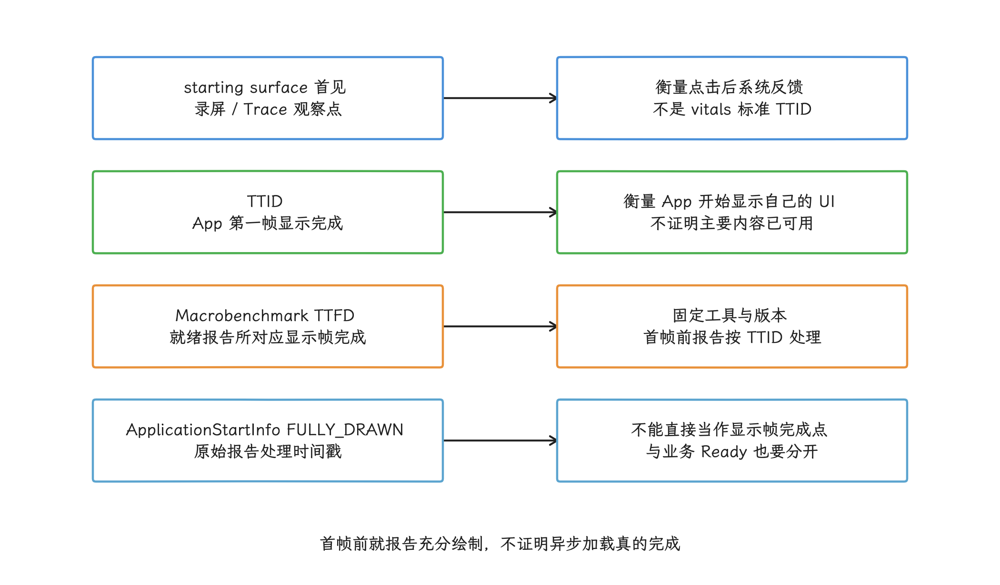

图：自定义退出动画还遮挡内容与交互时，应把它的完成条件纳入实际可用状态。

### 8.2 需要同时观察什么

至少同时记录：

- cold/warm/hot 启动类型；
- launcher、deep link、通知等入口；
- TTID 与 TTFD 的 p50/p95，即中位数和 95 分位数；
- Splash 保持时间与退出动画时间；
- 第一帧是内容、缓存、骨架还是空白；
- 首屏 FrameTimeline（每帧预期与实际时间线）和 Jank（用户可感知的卡顿帧）；
- 设备档位、刷新率和系统版本；
- 失败、离线、慢网和登录态分支。

感知评价可以补充录屏盲测或受控实验，但不能替代 TTID/TTFD 和 trace。更长的动画可能让画面更连续，也可能推迟操作；两种结果都要测。

## 9. Perfetto 定位

优先使用 Perfetto 的 Android App Startups 派生区间确定启动边界。派生区间是 Perfetto 根据底层事件汇总出的启动时间段，便于继续定位内部耗时。随后分三个执行主体检查：

| 执行主体 | 观察内容 |
| --- | --- |
| system_server | Activity/Task 状态、starting window 请求、窗口可见与绘制状态 |
| WM Shell / SystemUI | starting surface 类型、创建、copy、退出与移除 |
| App | `bindApplication`、`ActivityThread`、生命周期、首帧、`reportFullyDrawn()`、自定义动画 |

AOSP 中可以搜索 `addStartingWindow`、`removeStartingWindow`、`SplashscreenWindowCreator` 和 `reportDrawFinished`，但 Perfetto slice（时间轴上的一段事件区间）名称会随版本、trace 配置和实现变化。源码方法名不保证会在每台设备的 trace 中原样出现。

建议给业务门禁增加短而稳定的自定义 trace：

- `launch.route.local_state`；
- `launch.first_content_model`；
- `launch.primary_content_ready`；
- `launch.splash_exit`。

这些名称应保持固定，不要把用户 ID、页面 ID 等动态值拼进名称；需要记录动态信息时，把它放进 trace 参数，避免产生大量无法聚合的名称。

Trace 解释顺序是：

1. starting surface 是否及时出现，类型是否符合该启动；
2. App 主线程为什么还没有提交第一帧；
3. 第一帧到主要内容可用之间在等什么；
4. 自定义退出动画是否遮住已可用内容；
5. 慢路径来自 CPU、I/O、Binder、锁、调度还是渲染。

更完整的启动度量见 [启动优化策略](../../part2-performance/ch08-responsiveness/03-launch-optimization.md)。

<!-- gracker-diagram: a226-16-perfetto-actors -->
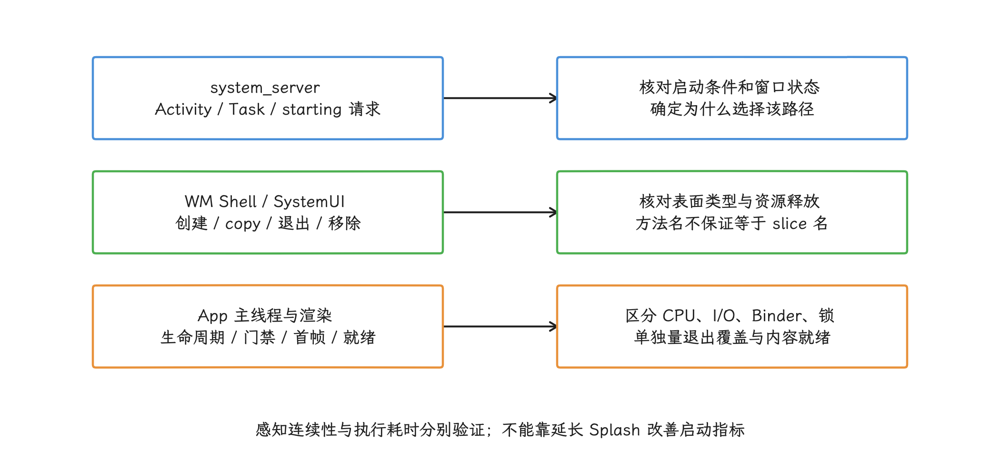

图：先固定启动类型与入口，再对照系统、Shell 和 App 时间线；自定义 trace 名保持短且稳定。

## 10. 检查清单

- [ ] 平台锚点为 Android 17 / API 37 / `android-17.0.0_r1`。
- [ ] 已区分 Splash、TaskSnapshot、windowless（无传统窗口容器）和 none（不创建）。
- [ ] AndroidX 版本与 APK/AAB 构建产物中的依赖可追溯。
- [ ] API 21/22、23～30、31 和 37 均有启动截图或录屏。
- [ ] 浅色/深色、系统栏、cutout（刘海或挖孔区域）和图标 mask（蒙版裁剪）已验证。
- [ ] 所有外部启动入口都配置 starting theme 并安装 SplashScreen。
- [ ] `installSplashScreen()` 位于 `super.onCreate()` 之前。
- [ ] `KeepOnScreenCondition` 只读取内存状态，且有失败/超时出口。
- [ ] Splash 不等待网络、广告或无上界任务。
- [ ] 自定义退出动画保证调用 `provider.remove()`。
- [ ] 第一帧、缓存、骨架、失败态之间没有明显布局跳变。
- [ ] 没有在 worker（后台工作线程）中用普通 `LayoutInflater` 构造并缓存 Activity View 树。
- [ ] `reportFullyDrawn()` 对应主要内容可见且可交互。
- [ ] TTID、TTFD、首屏帧和 Splash 覆盖时间分别记录。

## 小结

Splash Screen 负责把系统 starting surface 平稳交接给应用首帧，骨架和缓存内容负责把首帧继续过渡到可交互状态。它们改善的是反馈与连续性，不会缩短初始化本身；因此要把 Splash 覆盖、TTID、TTFD 和首屏帧分开测量，外部入口、失败路径和低版本兼容行为都要有明确的退出与降级方式。

## 参考资料

- [Splash screens](https://developer.android.com/develop/ui/views/launch/splash-screen)
- [迁移到 Android 12+ SplashScreen](https://developer.android.com/develop/ui/views/launch/splash-screen/migrate)
- [AndroidX Core release notes](https://developer.android.com/jetpack/androidx/releases/core#core-splashscreen_1.2.0)
- [`SplashScreen` AndroidX API](https://developer.android.com/reference/androidx/core/splashscreen/SplashScreen)
- [`KeepOnScreenCondition` API](https://developer.android.com/reference/androidx/core/splashscreen/SplashScreen.KeepOnScreenCondition)
- [`SplashScreenViewProvider` API](https://developer.android.com/reference/androidx/core/splashscreen/SplashScreenViewProvider)
- [`core-splashscreen:1.2.0` AAR：Manifest 与构建元数据](https://dl.google.com/dl/android/maven2/androidx/core/core-splashscreen/1.2.0/core-splashscreen-1.2.0.aar)
- [`ComponentActivity.viewModels()` API](https://developer.android.com/reference/kotlin/androidx/activity/package-summary)
- [`ViewPropertyAnimator.withEndAction()` API](https://developer.android.com/reference/android/view/ViewPropertyAnimator#withEndAction(java.lang.Runnable))
- [`Animator.cancel()` API](https://developer.android.com/reference/android/animation/Animator#cancel())
- [`DefaultLifecycleObserver` API](https://developer.android.com/reference/androidx/lifecycle/DefaultLifecycleObserver)
- [App startup time：TTID 与 TTFD](https://developer.android.com/topic/performance/vitals/launch-time)
- [AOSP Android 17 `ActivityRecord`](https://android.googlesource.com/platform/frameworks/base/+/refs/tags/android-17.0.0_r1/services/core/java/com/android/server/wm/ActivityRecord.java)
- [AOSP Android 17 `StartingSurfaceController`](https://android.googlesource.com/platform/frameworks/base/+/refs/tags/android-17.0.0_r1/services/core/java/com/android/server/wm/StartingSurfaceController.java)
- [AOSP Android 17 `SplashScreenStartingData`](https://android.googlesource.com/platform/frameworks/base/+/refs/tags/android-17.0.0_r1/services/core/java/com/android/server/wm/SplashScreenStartingData.java)
- [AOSP Android 17 `PhoneStartingWindowTypeAlgorithm`](https://android.googlesource.com/platform/frameworks/base/+/refs/tags/android-17.0.0_r1/libs/WindowManager/Shell/src/com/android/wm/shell/startingsurface/phone/PhoneStartingWindowTypeAlgorithm.java)
- [AOSP Android 17 `StartingWindowController`](https://android.googlesource.com/platform/frameworks/base/+/refs/tags/android-17.0.0_r1/libs/WindowManager/Shell/src/com/android/wm/shell/startingsurface/StartingWindowController.java)
- [AOSP Android 17 `StartingSurfaceDrawer`](https://android.googlesource.com/platform/frameworks/base/+/refs/tags/android-17.0.0_r1/libs/WindowManager/Shell/src/com/android/wm/shell/startingsurface/StartingSurfaceDrawer.java)
- [AOSP Android 17 `SplashscreenWindowCreator`](https://android.googlesource.com/platform/frameworks/base/+/refs/tags/android-17.0.0_r1/libs/WindowManager/Shell/src/com/android/wm/shell/startingsurface/SplashscreenWindowCreator.java)
