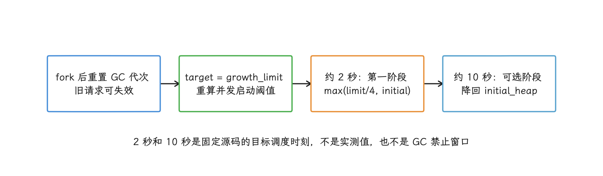
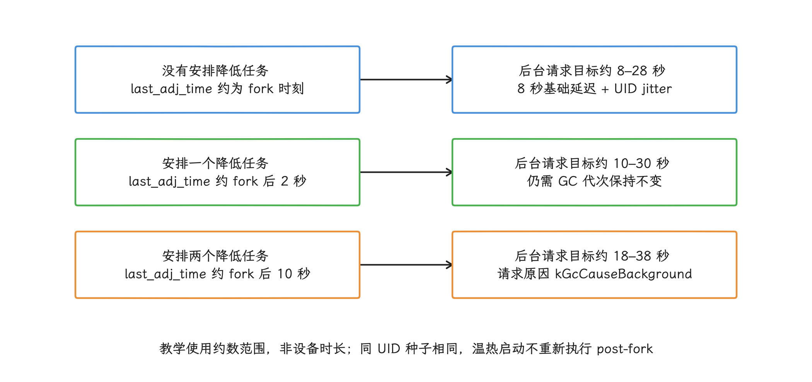
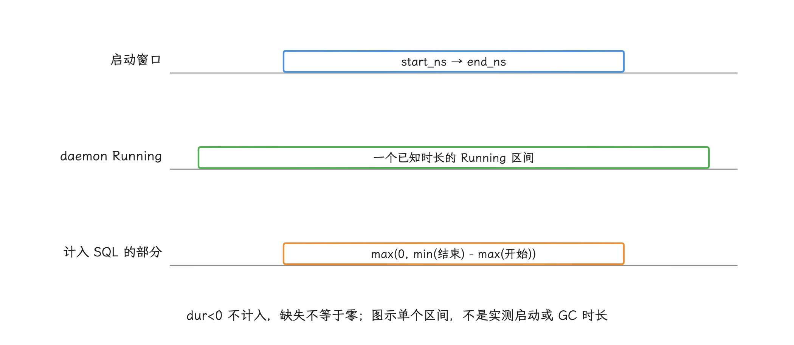
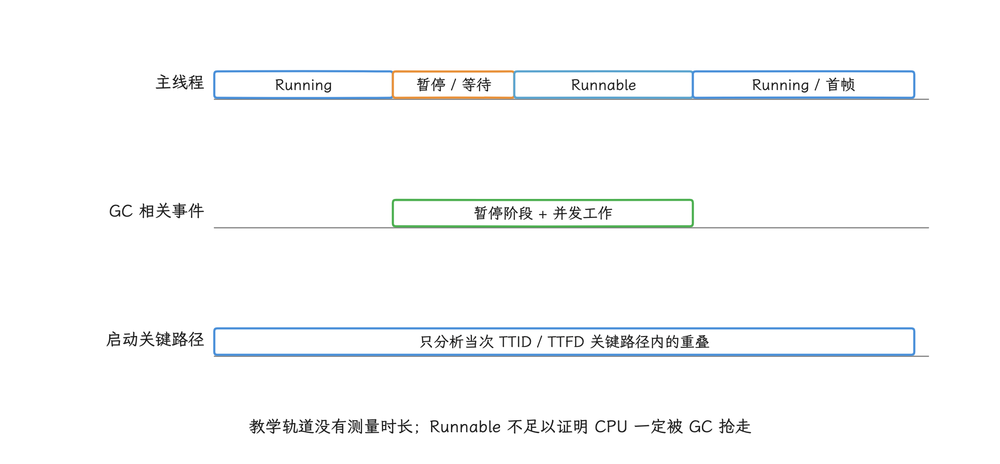
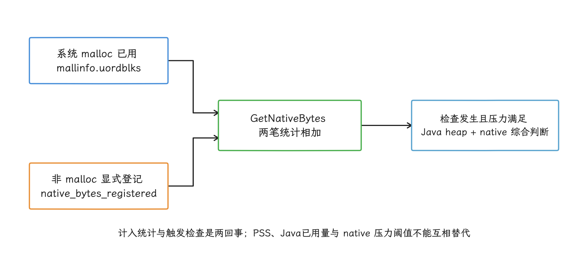
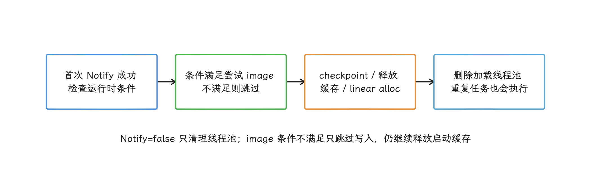

# ART GC（Garbage Collection，垃圾回收） 启动期开销与分配治理

ART 负责执行 Android 字节码，也管理进程内存放 Java/Kotlin 对象的 Java heap。GC 找出已经不可达的对象并回收它们占用的空间；对第三方 App 来说，受支持的“暂停 ART GC”接口并不存在。所以本文说的 GC 抑制，指的是降低启动阶段的分配速率和存活对象规模，让 ART 更少达到 GC 触发条件。

> 源码基线：AOSP `android-17.0.0_r1`。

App 进程从 Zygote（预先加载公共 framework 代码的系统进程） fork 出来之后，ART 会暂时放宽 Java heap 的启动期阈值，但首帧前仍可能发生 GC：分配逼近 growth limit（Java heap 允许增长的上限）、显式 GC 请求、ART 统计到的 native allocation（原生内存分配） 压力、进程状态变化，都是常见触发原因。我们排查时要找的是具体的分配点和 GC cause（触发原因）；阻塞 `HeapTaskDaemon` 只会破坏运行时调度。

对象分配与 GC 治理见 [23.1 Java Heap、GC 与 Compose 内存分配](../ch23-memory-practice/01-java-heap-gc-compose-allocation.md)，启动任务治理见 [21.2 启动任务编排、延迟初始化与并发调度](02-startup-task-lazy-concurrency.md)。

## GC 对启动性能的影响路径

做启动分析时，我们关心的是 GC 从哪几条路径把成本加到启动上。现代 ART 的大部分回收工作已经可以与 mutator 并发执行；mutator 指运行 App 代码、分配或读写对象的线程。即便如此，并发 GC 仍会通过三条路径影响启动：

1. **短暂停顿**：并发收集器仍有需要挂起 mutator 的阶段。这类暂停一旦落在主线程关键路径上，会直接推高 TTID（首次显示时间） 或 TTFD（主要内容完整可用时间）。
2. **分配线程等待**：分配失败，或分配线程必须等正在运行的 GC 结束时，主线程可能阻塞；`heap.cc` 用 `kGcCauseForAlloc` 标记这类“为完成分配而触发的 GC”。
3. **共享资源竞争**：`HeapTaskDaemon` 执行标记、扫描、复制或整理时，要消耗 CPU、内存带宽和 CPU cache（处理器缓存）。主线程即使没有被挂起，也可能因资源竞争只拿到更少的运行时间。

`HeapTaskDaemon` 是 ART 执行堆任务的后台守护线程。除了回收，它还负责前后台状态切换时的 collector（回收器） transition（前后台状态变化时切换回收策略）、heap trim（尝试把空闲页归还系统），以及启动完成清理。所以在 Perfetto 里看到它 Running（正在 CPU 上执行），只说明这个线程当时正在 CPU 上执行；要判断 GC 是否拖慢了启动，我们还得把具体的 ART slice（时间线上的一段事件）、主线程状态和对象分配记录放进同一时间窗里对照。


## HeapTaskDaemon 的调度链

我们顺着调用链，看 Java 侧的常驻后台线程和 ART native（C++ 运行时） 任务队列是怎么衔接的：

```text
Daemons.HeapTaskDaemon.runInternal()
  ├─ VMRuntime.startHeapTaskProcessor()
  └─ VMRuntime.runHeapTasks()
       └─ TaskProcessor::RunAllTasks()
            └─ GetTask() → HeapTask::Run()
```

先看队列本身：`TaskProcessor` 用 `multiset` 保存任务，`multiset` 是有序容器、允许出现相同的排序键，排队就按排序键 `target_run_time` 来；这个键以 `NanoTime()` 单调时钟为基准，正是任务的目标执行时间。

守护线程怎么等，由队首任务决定：队列为空时在 condition variable（条件变量） 上等待，队首任务还没到期就按目标时间定时等待。`AddTask()` 每次插入都会发一次 signal（唤醒信号） 唤醒；新任务的目标时间更早时，daemon 会重新检查队首。


排进这个队列的常见任务包括：

| 任务 | 源码职责 | 与启动分析的关系 |
|---|---|---|
| `ConcurrentGCTask` | 调用 `Heap::ConcurrentGC()` | 要结合 GC cause、暂停与 Running 时间分析 |
| `CollectorTransitionTask` | 处理前后台进程状态对应的 collector 切换 | 可能出现在进程状态变化附近，不能算作分配触发的 GC |
| `HeapTrimTask` | 尝试把不用的 heap 页归还系统 | 应识别为 trim slice，不能计入 GC 的 CPU 时间 |
| `ReduceTargetFootprintTask` | 延后降低 post-fork 的 target footprint；该值是 ART 当前期望的 heap 规模，不等于硬上限 `growth_limit_` | 属于 Android 17 的启动期阈值调整 |
| `TriggerPostForkCCGcTask` | 长时间没有发生 GC 时，以 `kGcCauseBackground` 请求一次并发 GC | 用于回收启动阶段留下的无用对象；类名中的 `CC` 不能单独证明设备当前使用哪一种 collector |
| `StartupCompletedTask` | 首次执行时通知 runtime 启动结束，清理 startup dex cache（启动期类/方法查找缓存）和 linear alloc（ART 启动期元数据分配区），满足条件时还会尝试写 runtime app image | 由 framework/runtime 触发，不是第三方 App 的 GC 开关 |

我们最关心的 `ConcurrentGCTask` 入队时直接用当前 `NanoTime()` 作目标时间，相当于一进队就具备执行资格。前面即使已经排着延时的 `ReduceTargetFootprintTask` 或 post-fork GC 请求，它照样能排到更早的位置；至于何时拿到 CPU，仍取决于线程调度。


## post-fork 启动期策略

看完队列怎么排，我们再看 ART 在进程 fork 之后对 heap 做了哪些安排：关键源码入口是 `Heap::PostForkChildAction()`，处理分四步：

1. 把 `gcs_completed_` 计数加一，让在 Zygote 中或 fork 后极早期按旧 GC 编号排队的请求失效；这一步只改请求是否过期的判据，回收本身尚未执行。
2. 把 `target_footprint_` 暂时提高到 `growth_limit_`，再重算 `concurrent_start_bytes_`（并发 GC 的启动阈值）。源码注释写明的目的，就是减少 App launch 期间的 GC。
3. 若 `initial_heap_size_ < growth_limit_`，2 秒后先把 target footprint 降到 `max(growth_limit / 4, initial_heap_size)`；该值仍高于初始 heap 时，再过 8 秒降到 `initial_heap_size`，第二次降低的目标时间约为 fork 后 10 秒。这期间已经完成过 GC、或任务执行时已有 collector（实际执行的回收器类型） 在运行，降低任务就保持目标值不动。
4. 随后安排 `TriggerPostForkCCGcTask`。它的目标时间取决于前面安排了几个降低任务：零个、一个、两个分别约为 fork 后 8—28 秒、10—30 秒和 18—38 秒；这个区间来自固定的 8 秒延迟，加上按 UID（系统分配给 App 的用户标识） 生成的 0—19,999 ms jitter（确定性的错峰伪随机量）。任务执行时如果 GC 编号仍与 fork 后相同，才请求一次后台并发 GC。

读到这里，容易把这两秒理解成“GC 被关掉了”。源码里实际发生的，只是放宽 target footprint、让 fork 前后的旧请求失效，collector 和 `TaskProcessor` 都照常工作：启动分配一旦触及阈值、发生 allocation failure（对象分配失败）、收到其他 GC 请求或遇到进程状态变化，GC 照样可能发生。

<!-- gracker-diagram: a228-04-postfork-threshold -->


图：initial<limit 才安排首降，first>initial 才安排二降；执行还需 GC 代次未变、无 collector 且当前目标更高。

这套策略只作用于新 fork 出来的进程。温启动和热启动复用已有进程，跳过了 `PostForkChildAction()`；多进程 App 的每个新进程各有一套 heap 与 post-fork 状态。冷、温、热启动的判定见 [21.1 App 启动路径、监控与度量](01-app-startup-path-monitoring.md)。

<!-- gracker-diagram: a228-05-postfork-gc-jitter -->


图：jitter 范围为 0–19,999 ms，按 UID 确定；任务到期后也只是按条件请求并发 GC。

## 用 Perfetto 建立因果证据

前面两节看的是 GC 任务怎么排队、ART 在 fork 后怎么放宽阈值；要把 GC 和启动变慢连成因果，我们主要靠 Perfetto，Android 的系统级时间线追踪工具。采集配置至少要包含 scheduler 事件（`sched_switch`、`sched_wakeup`）、CPU frequency/idle（频率与空闲状态），以及 `am`、`view`、`dalvik` 等 atrace 类别，并为目标包启用 App trace。可用的 atrace 类别随系统版本变化，采集前先在 Perfetto UI 或命令行里确认设备支持哪些；官方 Perfetto UI 录制流程要求 Android 11（API 30）及更高版本，本章覆盖的 Android 8—10 要用 `record_android_trace` 等命令行流程。配置方法见 [Recording system traces](https://perfetto.dev/docs/getting-started/system-tracing) 和 [CPU scheduling events](https://perfetto.dev/docs/data-sources/cpu-scheduling)。

拿到 trace 后，我们先标出四个时间点：进程创建、`bindApplication`（framework 绑定新 App 进程并开始初始化）、首帧显示与充分绘制报告。记录 TTID/TTFD 所用工具与版本后，再看 GC 是否与启动关键路径重叠；业务就绪报告与工具识别的显示帧结束点要分别对齐。

推荐按下面的顺序判断：

1. 在 App 进程中找到 `HeapTaskDaemon`，确认它在启动窗口内是否 Running。
2. 查看同一窗口的 ART/GC slice，区分 concurrent GC（并发回收）、blocking GC（调用线程要等它结束）、trim 与其他 heap task。
3. 检查主线程在重叠区间是 Running、Runnable（就绪但在等 CPU）、Sleeping，还是卡在 suspend/wait slice。长时间 Runnable 更支持 CPU 竞争的解释；要坐实竞争来自 GC，还得把明确的 GC 等待区间、线程状态或调用栈与当次 GC 对齐，光凭 daemon Running 或主线程 Runnable 还下不了这个结论。
4. 对照 TTID/TTFD，确认事件落在关键路径上；首帧之后发生的 GC，解释不了 TTID 变慢。
5. 再用对象分配记录定位制造短命对象或保留大量对象的代码。

下面的 Perfetto SQL 统计一个已知启动窗口内 `HeapTaskDaemon` 的 scheduler Running 时间。`thread_state` 记录线程调度状态，`utid`/`upid` 是 trace 内部的线程/进程标识。运行前要把 `VALUES` 中的两个数字替换为该次 trace 的纳秒时间戳，并把包名改成目标进程名。

```sql
WITH bounds(start_ns, end_ns) AS (
  VALUES (123000000000, 126000000000)
)
SELECT
  p.upid AS process_upid,
  p.name AS process_name,
  SUM(
    MAX(
      0,
      MIN(ts.ts + ts.dur, b.end_ns) - MAX(ts.ts, b.start_ns)
    )
  ) / 1e6 AS running_ms
FROM thread_state ts
JOIN thread t USING (utid)
JOIN process p USING (upid)
CROSS JOIN bounds b
WHERE p.name = 'com.example.app'
  AND t.name = 'HeapTaskDaemon'
  AND ts.state = 'Running'
  AND ts.dur >= 0
  AND ts.ts < b.end_ns
  AND ts.ts + ts.dur > b.start_ns
GROUP BY p.upid, p.name;
```

这条查询统计的是已知非负时长的 Running 区间与启动窗口的交集，并按 trace 内的 `upid` 区分同名进程的不同生命周期；`dur < 0` 的未定时长区间落在统计之外。所以 Trace 截断或调度事件丢失时，这个已观测总量可能偏低；查不到匹配行时，把它当成零之前先回 trace 确认。它回答的是 daemon 已观测的 CPU 时间；想进一步区分具体是哪个 heap task，要看对应的 slice 和采集完整性。字段定义见 [`thread_state` 表](https://perfetto.dev/docs/analysis/sql-tables#thread_state)。若目标是 `:remote` 等子进程，把包名换成对应进程名。

至于“超过启动窗口 10% 就要抑制”这样适用于所有 App 的阈值，现实中并不存在；判断依据应是同一设备、同一构建和同一启动入口的 A/B 单变量对照结果。

<!-- gracker-diagram: a228-07-running-intersection -->


图：SQL 以 utid/upid 关联线程和进程，并按 upid 拆分同名进程生命周期；统计的是 daemon CPU 时间。

Logcat 中的 ART GC 行可以补充 cause、freed bytes（回收字节数）、heap 大小、pause 和 total duration。`Heap::LogGC()` 默认只保证记录符合条件的显式或慢 GC，快速的普通 GC 可能不打印；日志为空时，启动期间是否发生过 GC，要回到 trace 确认。

<!-- gracker-diagram: a228-06-gc-causal-tracks -->


图：示意暂停与竞争可能出现在同一 GC 过程的不同时段；要用对应等待证据和调度数据判断具体原因。

## 从 GC 事件追到分配调用栈

Perfetto 负责确认时序和关键路径；查对象类型与分配调用栈，我们换用 Java/Kotlin Allocation Recording（对象分配记录）。当前 Android Studio 要求使用 debuggable 构建：Full 模式记录每次分配，分配密集时会明显拖慢 App；Sampled 模式按间隔采样。两种模式都用于归因；发布性能结论交给下面第一轮的 release 采集。详细限制见 [Record Java/Kotlin allocations](https://developer.android.com/studio/profile/record-java-kotlin-allocations)。

Android 8（API 26）及更高版本的分配分析器还可能把部分分析工具开销显示为 App 的 native 内存。这部分增长来自工具本身，归因时要把它与应用自己的分配分开；比较原生内存占用时，应另外保留一份未开启分配记录的采集结果。

建议做两轮采集：

- **release/profileable system trace**：用发布构建或允许性能分析的 release-like 构建复现 TTID/TTFD，确认 GC、主线程与 CPU 调度关系；
- **debuggable allocation recording**：只截取 `ContentProvider`、`Application.onCreate()`、首个 Activity 和首屏构建窗口，按 allocated bytes（分配字节数）、allocation count（分配次数） 和 Remaining Size 排序。

Android Studio 的 Remaining Size 是所选时间段内“分配大小减去已释放大小”，适合寻找采集结束时仍未释放的对象。整棵对象引用图的 retained size（移除某个对象后可一起释放的总大小）超出了它的范围，判断泄漏或完整保留关系，要结合 heap dump（堆快照） 和引用链。


具体排查时，我们把对象分成三类：

| 类型 | 典型信号 | 处理方向 |
|---|---|---|
| 大量短命对象 | allocation count 高，GC 后 Remaining Size 低 | 去掉临时集合、字符串和包装对象，减少重复解析 |
| 大量启动后仍存活对象 | Remaining Size 高 | 检查全局缓存、SDK、DI graph（依赖注入创建的对象关系）、图片和首屏模型 |
| 单个或少量大对象 | byte[]、Bitmap、大数组占比高 | 延后加载、降低尺寸、流式处理或按需映射 |

把工作移到后台线程，可以省下主线程的 CPU 时间；但 Java heap 由进程内线程共享，后台线程仍在同一个 heap 里分配，并发 GC 和内存带宽竞争也就仍由整个进程承担。


## 可发布应用的治理顺序

trace 和分配记录都拿到手之后，我们按下面的顺序治理：先移出首帧前用不到的对象图，再降低分配率、控制存活对象，同时检查 native 内存与编译条件。

### 1. 移出首帧前不需要的对象图

对每个启动任务记录两件事：“首帧前是否必须完成”和“会保留多少对象”。分析、推送、广告、搜索索引、二级页面模型这类与初始显示无关的任务，应延迟到首帧后、首次使用时或后台调度。延迟初始化的生命周期与线程安全策略见 [21.2 启动任务编排、延迟初始化与并发调度](02-startup-task-lazy-concurrency.md)。

延后的任务还要错峰：全部挤进首帧后的同一个回调，只会把 GC 和卡顿从 TTID 挪到首次交互。

### 2. 降低瞬时分配率

启动热区常见的可修复模式包括：

- 多次把同一 JSON/XML 解析成临时树；
- `map/filter/flatMap` 链在大集合上创建多层临时对象；
- 字符串拼接、正则、格式化和日志参数在 release 启动路径频繁执行；
- 未预估容量的 `ArrayList`、`HashMap` 和 buffer 反复扩容；
- 依赖注入或反射扫描一次性构造大量 provider/metadata；
- Compose/View 首屏重复创建等价 model、span、shape 或 listener。

优化时先按 allocated bytes 与调用次数排序。单个对象“小”容易被忽略，但高频小对象累计的总分配量同样会推动 GC。

首帧之后同理：RecyclerView 滑动、Activity 转场和 Compose 重组期间，也要从每帧分配量入手。GC suppression 治理的始终是分配；“暂停 collector”这条路为什么走不通，下文会说明。

### 3. 控制存活对象和 cache

分配率之外，另一头是存活对象。短命对象影响分配速率，长命对象抬高 live set（一次 GC 时仍能从引用链访问到的对象集合）；live set 越大，GC 需要扫描的对象通常越多，留给后续分配的 heap 空间也越少。

启动期缓存要预先定好容量、逐出规则和生命周期。对象池只适合已经测出高频构造、且重置成本可控的对象；随意池化会扩大 live set、增加状态错误，还可能让 GC 更慢。业务缓存的容量与冷热分段见 [4.4 App 内存优化与诊断](../../part1-fundamentals/ch04-memory/04-app-memory-optimization.md#业务缓存的容量与冷热分段)，CPU 硬件缓存与数据局部性见 [5.8 CPU Cache 友好代码与数据布局优化](../../part1-fundamentals/ch05-cpu-power/08-cpu-cache-friendly-code-data-layout.md)。


### 4. 同时检查 native 与 graphics memory

native 侧的压力统计把两笔账加在一起：系统 malloc 已用字节数，加上显式登记的字节数。`Heap::GetNativeBytes()` 把 `mallinfo().uordblks` 与 `native_bytes_registered_` 相加，所以 native SDK 走系统 malloc 分配的内存即使没有逐笔登记，也可能参与 GC 压力判断。Bitmap、字体和解码器的占用，同样要按实际分配与记账路径检查；自行 `mmap` 的区域、文件页缓存和 graphics buffer（图形缓冲区） 能否纳入统计，取决于具体的分配与登记方式，从进程 PSS 推算不出结果。

`RegisterNativeAllocation()` 按字节补记 malloc 统计覆盖不到的非 malloc 分配，同时将登记次数计数加一；该次数触及 `kNotifyNativeInterval` 周期，或单次登记字节数超过 `kCheckImmediatelyThreshold` 时，才会调用 `CheckGCForNative()`。前者按次数检查，不是累计登记字节阈值；`NotifyNativeAllocations()` 也会触发检查。检查把原生内存计数与 Java 堆占用放在一起判断压力，满足条件时以 `kGcCauseForNativeAlloc` 请求或执行 GC。统计范围和检查时机是两回事：原生内存增长之后，回收要等检查发生、条件满足才会到来。


Java heap 看起来不大时，我们仍要查看进程 PSS（按共享比例折算的驻留内存）、native heap、graphics 分类和对应调用栈——这些数据衡量的是进程总内存压力，和 ART heap 的触发阈值是两回事。`Runtime.totalMemory() - freeMemory()` 只给出 Java heap 的一个瞬时近似值，代表不了进程总内存，跨设备统一的百分比告警也不适合用它来设。

<!-- gracker-diagram: a228-11-native-accounting -->


图：系统 malloc 未逐笔注册也可能参与压力；自行 mmap、图形与文件页是否覆盖，取决于分配和登记路径。

### 5. 保持编译状态与实验条件一致

比较 GC 优化前后，先把编译状态钉死：Baseline Profile 会改变启动 CPU 时间和分配时序，Startup Profile 会改变 DEX 文件中的代码排列和读取局部性。要固定的变量是 APK、compiler filter（ART 实际采用的编译强度）、安装来源、设备温度、账号数据和启动类型，否则容易把编译差异解释成 GC 收益。Profile 与编译状态的核查方法见 [21.4 Baseline、Startup 与 Cloud Profile 编译优化](04-baseline-startup-cloud-profile.md)。

## 不应采用的“GC 抑制”方案

我们把三类方案逐个过一遍，说清各自的问题出在哪里。

### Hook `ConcurrentGCTask::Run`

`libart.so` 是 ART 的 native 运行时库。替换它的 vtable（C++ 虚函数分发表）条目，或做 inline hook（改写入口跳到自定义代码），等于直接修改系统运行时实现，而 Android 对此没有兼容或正确性保证。具体风险包括：

- `ConcurrentGCTask`、vtable 布局、符号可见性和调用约定都属于 ART 内部 ABI（二进制调用约定），系统升级可以改变它们；
- C++ 非静态成员函数调用包含隐含的 `this` 对象指针，误按普通 `void(Thread*)` 函数调用会让寄存器或参数错位；
- vtable 所在页可能受只读映射、RELRO（重定位后只读保护）、CFI（控制流完整性检查）和其他平台加固机制保护；
- 在 `Run()` 中 sleep 会占住 `HeapTaskDaemon`，连 trim、transition、startup cleanup 等任务也被延迟；
- heap 达到分配上限时，mutator 仍可能执行 blocking GC（让调用线程等待的回收），回收后仍无法分配则会遇到 OOM（OutOfMemoryError）；
- ART 可通过 Mainline 独立于整机系统版本更新，同一 Android API 级别也不能保证内部符号和布局一致。

这种 Hook 不应进入生产 App，也不适合做成“失败就降级”的优化开关：它影响的是内存安全和 runtime 正确性，失败后果可能是随机崩溃、heap corruption（堆元数据或对象关系被破坏）或 OOM（OutOfMemoryError，内存不足错误）。

### 反射调用 `VMRuntime`

`VMRuntime.registerSensitiveThread()` 的 native 实现调用 `Thread::SetJitSensitiveThread()`，给当前线程设置 JIT（Just-In-Time，运行时即时编译） sensitive 标记；`ActivityThread.handleBindApplication()` 已为 UI 线程调用过它。这个标记与“优先分配”“提高 heap 配额”“减少 GC 阻塞”都不相干。

`requestConcurrentGC()`、`setTargetHeapUtilization()` 和 `notifyStartupCompleted()` 都是 hidden 或 module-only API，不能作为第三方 SDK 的受支持接口；反射调用还会受到非 SDK 接口限制，绕过限制也不产生兼容与正确性契约。

`notifyStartupCompleted()` 只是把一个立即执行的 `StartupCompletedTask` 放进 heap 任务队列。任务首次生效时释放 startup dex cache/linear alloc；只有在非 debuggable、没有 AOT（Ahead-Of-Time，提前编译） 机器码且没有可用 App Image 等条件同时满足时，它才会尝试写 runtime app image（运行时类元数据快照）。它不是供 App 自选时机的 GC 控制器。

<!-- gracker-diagram: a228-13-startup-completed -->


图：image 尝试在释放启动缓存之前；写入条件包括非 debuggable、无 AOT 代码且没有可用 App Image。

### 在首帧后主动调用 `System.gc()`

`System.gc()` 向 runtime 发出显式回收请求，ART 可以忽略或调整；被执行的请求可能引入暂停以及 CPU/内存带宽竞争。只有 trace 和对照实验都证明某个无交互窗口的请求能改善后续关键路径，才有继续评估的依据；常规 App 应避免在首帧后、页面切换或滑动开始前调用它。


## 实验设计与发布判断

一项 GC 启动优化在发布前至少要回答四个问题：

1. 启动窗口是否发生了 GC，cause 和 collector 是什么？
2. GC 与 TTID/TTFD 关键路径重叠了多少？
3. 哪些调用栈贡献了分配量与 live set？
4. 修复后是 GC 减少了，还是业务工作量、编译状态或缓存条件变了？

建议保留下面的实验对照表：

| 组别 | 变量 | 观察 |
|---|---|---|
| 原始组 | 当前 release（发布构建） | GC 次数/重叠、HeapTaskDaemon Running、TTID/TTFD、峰值内存 |
| 分配修复组 | 只改目标分配点 | 同一编译状态下 GC 和分位值是否改善 |
| 延迟任务组 | 只移动非首帧任务 | TTID 改善后，首交互和首帧后是否出现反弹 |
| 低内存设备组 | 同一构建、受控内存压力 | blocking GC、OOM、进程退出和长尾是否恶化 |

线上没有通用的 GC CPU、heap 使用率或 pause 告警阈值，阈值应来自应用自身按设备档位建立的基线。我们至少联合观察：

- TTID、TTFD 与 P50/P90/P99（分别有 50%、90%、99% 的样本不超过的耗时分位值）；
- 启动阶段 Java allocated bytes、Allocation Recording 的 Remaining Size，以及 heap dump 的 retained/live bytes 实验室基线；
- GC 与关键路径重叠时长；
- 启动后首个交互的慢帧；
- 低内存/OOM 相关退出、崩溃和 ANR（应用无响应）；
- 新进程冷启动与复用进程启动的分布。

## Android 8—17 的版本差异

Android Studio 官方文档说明：Android 7.1 及更低版本最多保留 65,535 条分配记录，Android 8 及更高版本没有这一实际限制。这说的是记录数量，debuggable 要求和采集开销仍然存在。ART 内部 heap 策略会随系统版本与 Mainline 模块演进，把 Android 8 的某个实现细节直接外推到 Android 17 并不可靠。

把前面几节关于启动期 GC 的结论收拢在一起：

- post-fork 阶段先放宽 heap 阈值，再分阶段降低；
- 2 秒不是 GC 全局冻结窗口；
- `ConcurrentGCTask` 可以作为立即任务插入队列；
- UI 线程已由 framework 登记为 JIT sensitive thread；
- 普通 App 没有受支持的 ART GC 暂停 API。

OEM（设备厂商） 和 ART Mainline 更新可以调整 collector、flags（运行时开关）和 heap 参数。应用侧稳定可用的策略，是控制分配量、缩小 live set、减少首帧前任务，并用 trace 验证效果。

## 排查清单

1. 分开采集新进程冷启动与复用进程启动。
2. 在 Perfetto 中把启动边界、GC slice、HeapTaskDaemon 和主线程状态放到同一时间窗里对照。
3. 不把 HeapTaskDaemon 的所有 Running 时间都记为 GC。
4. 用 Allocation Recording 找对象类型和调用栈，采集期间的耗时只用于归因。
5. 区分短命分配、live set 与大对象。
6. 检查 Java、native、graphics 和 Bitmap，不只看 `Runtime` heap。
7. 固定 compiler filter、安装来源和设备条件做 A/B。
8. 禁止 libart Hook、隐藏 VMRuntime 调用和无证据的 `System.gc()`。
9. 回归首帧后首交互、低内存设备与多进程启动。

## 小结

系统在进程 post-fork 阶段暂时放宽堆目标，以减少启动期 GC，同时没有向应用提供关闭回收器的契约。因此启动治理的路径是：先用 Perfetto 证明 GC 与关键路径重叠，再用分配记录找到短命对象、live set 和大对象的来源，最后通过减少首帧前对象图、降低分配率和控制缓存验证收益。Hook ART、反射隐藏接口或主动 `System.gc()`，都替代不了这条证据链。

## 参考资料

- [`Heap::PostForkChildAction()` 与 heap tasks](https://android.googlesource.com/platform/art/+/refs/tags/android-17.0.0_r1/runtime/gc/heap.cc)
- [`TaskProcessor`](https://android.googlesource.com/platform/art/+/refs/tags/android-17.0.0_r1/runtime/gc/task_processor.cc)
- [`task_processor.h`](https://android.googlesource.com/platform/art/+/refs/tags/android-17.0.0_r1/runtime/gc/task_processor.h)
- [`StartupCompletedTask`](https://android.googlesource.com/platform/art/+/refs/tags/android-17.0.0_r1/runtime/startup_completed_task.cc)
- [`VMRuntime.java`](https://android.googlesource.com/platform/libcore/+/refs/tags/android-17.0.0_r1/libart/src/main/java/dalvik/system/VMRuntime.java)
- [`Daemons.java`](https://android.googlesource.com/platform/libcore/+/refs/tags/android-17.0.0_r1/libart/src/main/java/java/lang/Daemons.java)
- [`ActivityThread.handleBindApplication()`](https://android.googlesource.com/platform/frameworks/base/+/refs/tags/android-17.0.0_r1/core/java/android/app/ActivityThread.java)
- [Overview of memory management](https://developer.android.com/topic/performance/memory-overview)
- [Record Java/Kotlin allocations](https://developer.android.com/studio/profile/record-java-kotlin-allocations)
- [Recording system traces with Perfetto](https://perfetto.dev/docs/getting-started/system-tracing)
- [Perfetto CPU scheduling events](https://perfetto.dev/docs/data-sources/cpu-scheduling)
- [`dalvik_system_VMRuntime.cc`](https://android.googlesource.com/platform/art/+/refs/tags/android-17.0.0_r1/runtime/native/dalvik_system_VMRuntime.cc)
