# View 布局与自定义绘制优化

布局慢的时候，我们手里往往只有一张 Perfetto trace 和一堆互相纠缠的机制：View 体系的递归测量、`LayoutInflater` 的对象创建、`requestLayout()` 沿父链的传播、绘制失效的重录范围。本文把这些机制、对应的页面改造、代码选型和 trace 验收方法放到同一帧时间线里讲——trace 是 Perfetto 这类工具记录的线程与渲染时间线，deadline 则是一帧按时完成提交的截止点。目标很具体：减少首帧、页面切换和高频更新里的主线程 Measure / Layout / Draw 工作，为同一帧的输入、业务逻辑和渲染提交留出预算。

> 源码基线：AOSP `android-17.0.0_r1`（API 37）。本文核对 framework View 机制，不将某一内核分支当作 App 布局行为的统一契约。

版本边界：一般 View 布局与绘制机制覆盖 API 21–37；`FrameMetrics` 从 API 24 提供，公开 `RenderNode` 示例仅用于 API 29+，FrameTimeline 取证从 Android 12 / API 31 起使用。低版本须按可用 API 选择测量与绘制路径。

整条链路是这样接起来的。`ViewRootImpl` 通过 `Choreographer` 安排一轮 Traversal（遍历 View 树的一轮工作），按“哪些阶段需要重新执行”的脏标记决定要不要 Measure、Layout 和 Draw；硬件加速路径随后通过 `syncAndDrawFrame()` 同步 RenderNode 绘制节点树，把剩下的工作交给 RenderThread。所以布局变快只说明 App 主线程少做了工作；图形 buffer 有没有被 SurfaceFlinger（系统合成服务） 按时选中并送往显示，要沿后面的链路继续查。

<!-- gracker-diagram: a232-01-frame-pipeline -->
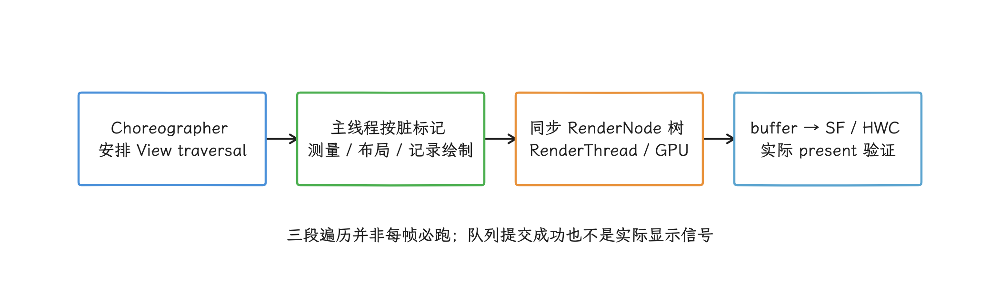

图：布局更快证明主线程阶段减少；是否按时上屏，还要沿同一帧检查图形和显示后段。

View 侧的性能工作分两条线：布局侧减少层级、无效遍历和过度绘制；自定义 View 再控制对象分配、Path/Bitmap 复用、invalidate 范围和绘制算法。我们先走布局这条线，两条线最后都要放回同一帧时间线里验证。

## 层级、inflate、测量与布局失效

### 布局层级对渲染性能的影响

布局优化要从一帧里发生了什么看起。子 View 的 `requestLayout()` 沿父链传播到 `ViewRootImpl` 后，根节点设置 `mLayoutRequested` 并安排一次 Traversal；已有 traversal（一次 View 树遍历） 尚未执行时，重复的调度请求会被合并。

合并之后，一帧仍可能布局两次：View 在首轮 layout 期间留下有效的 `requestLayout()` 时，可以在同一帧再执行一轮 measure/layout；第二轮期间再次提出的请求才会延后。再往里看 `performTraversals()` 这一层，它按窗口和 View 树状态决定要不要调用 `performMeasure()`、`performLayout()` 与 `performDraw()`，三段工作并不每帧固定执行。

<!-- gracker-diagram: a232-02-layout-request-passes -->
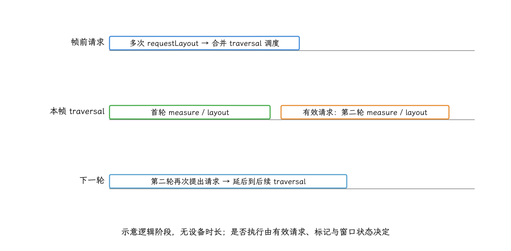

图：首轮 layout 中留下有效请求可再执行一轮 measure/layout；第二轮产生的请求再安排后续处理。

Measure 是递归过程：父容器通过 `MeasureSpec` 告诉子节点尺寸是精确值、上限还是未指定，子节点报告测量结果，父容器再据此确定自己的尺寸；Layout 随后为各子节点分配位置。所以节点越多、嵌套越深、父容器规则越复杂，主线程执行的代码通常越多，多轮测量还会进一步放大这部分成本。判断要不要动手优化时，我们看的仍是当前页面的调用次数、单节点工作量和 FrameTimeline（记录每帧目标与实际时间的系统轨道） deadline。

<!-- gracker-diagram: a232-03-measure-contract -->
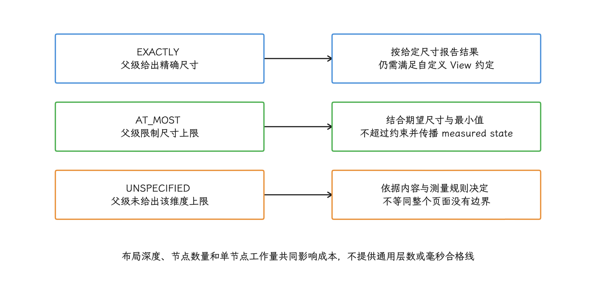

图：父容器生成子 MeasureSpec，读取子 measured size/state，再决定自身大小与摆放；重复测量须按调用证据判断。

布局层级不只涉及深度。更常见的成本来自三类结构：

- **重复测量的容器**：`RelativeLayout`、带 `layout_weight` 的 `LinearLayout`、复杂约束容器都可能让子 View 被测量多次。层级一深，重复测量会沿树放大。
- **高频出现的列表项**：单个 item（列表条目） 的成本可能很小，但列表首屏会同时 inflate 多个，滑动中又频繁创建和绑定，累计起来仍可能造成连续掉帧。
- **提前创建的低频内容**：`View.GONE` 的子节点躲得过测量，通常也躲得过绘制，唯独躲不过 inflate：`ViewGroup.measureChildren()` 会跳过它，但对象与整棵子树在首帧前就已创建，父容器仍要遍历并检查状态，自定义容器还可以另立测量规则。大块低频内容更适合延迟创建。

判断一个布局要不要优化，看的是 trace 里的时间与调用次数。`performMeasure()` 和 `performLayout()` 在 framework trace 里分别是 `measure`、`layout` 两个切片名；`FrameMetrics.LAYOUT_MEASURE_DURATION` 合并报告本帧中被标记需要更新的 View 树部分所花的测量与布局时间。“3～5 ms 即异常”这类阈值并不跨刷新率通用，我们要把这两段放回 FrameTimeline 的 deadline、同场景分位数和完整 `Choreographer#doFrame` 里判断。

<!-- gracker-diagram: a232-04-hierarchy-costs -->
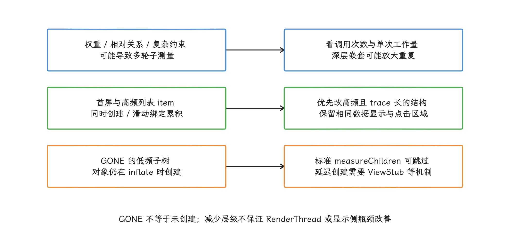

图：Layout Inspector 解释结构，Perfetto 与完整帧指标决定收益；父容器自定义规则仍可能不同。

反过来，如果慢帧主要耗在 `performDraw()`、UI 等待 RenderThread、RenderThread 的 `dequeueBuffer` / `queueBuffer`、GPU 工作队列或显示侧，压平布局的收益会很小。`queueBuffer()` 按时只说明 Producer（内容生产者） 把一块 buffer 提交进了队列；要确认这帧确实按时上了屏，还要核对 `BufferTX - <layerName>` 这类 buffer 事务切片、latch（SurfaceFlinger 选定本帧 buffer）、FrameTimeline actual slice（实际完成轨道） 和 present timing（呈现时间）。

工程上建议按这个顺序处理：

1. **先改首屏和高频列表 item**：启动首帧、页面切换、RecyclerView item 的收益最稳定。
2. **再改被多处复用的公共布局**：标题栏、卡片、空态页、错误页一旦优化，多个页面同时受益。
3. **低频深层布局按证据处理**：设置页、二级弹窗这类入口少的页面，除非线上 trace 证明它们造成卡顿。

### ConstraintLayout vs 传统布局的性能对比

压平层级最常用的工具是 `ConstraintLayout`，它的价值是用约束关系减少嵌套。一个“图标 + 标题 + 副标题 + 操作按钮”的卡片，用多层 `LinearLayout` / `RelativeLayout` 组合，常见结果是 3～5 层；改成 `ConstraintLayout` 后，子 View 可以直接挂在同一个父容器下，Measure/Layout 的遍历路径更短。

Google 在 2017 年用注册表单页面做过公开测试：传统 `RelativeLayout` 嵌套版本在 20 秒 Systrace 窗口中出现 80 次 expensive measure/layout alerts——当时工具按启发式阈值给出的高成本测量/布局警告；改成扁平的 `ConstraintLayout` 后警告明显减少，`FrameMetrics.LAYOUT_MEASURE_DURATION` 平均耗时下降约 40%。测试环境是 Nexus 5X、Android 8.0 和 ConstraintLayout 1.0.2，约 40% 是 100 帧的平均结果。

这个实验支持的是“压平该页面层级有收益”，换到自己的项目里还要重新测：设备、AndroidX 版本、布局复杂度和刷新率都会改变结果。

<!-- gracker-diagram: a232-05-constraint-evidence -->
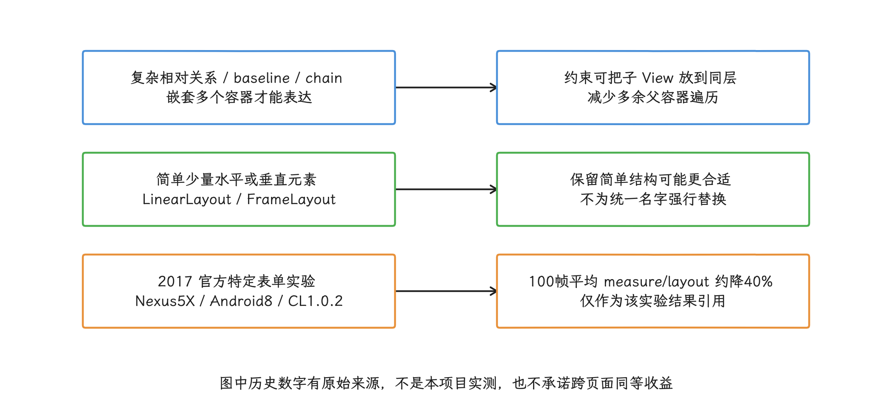

图：现代 AndroidX、设备与页面都要重新测量；列表 item 比较完整帧与布局分布。

选型时用三条规则：

- **复杂相对关系用 `ConstraintLayout`**：多个 View 需要互相对齐、文字基线对齐、比例约束、Barrier（由多个 View 边界算出的虚拟参考线）或 Chain（把一组 View 按链式规则排列）时，它通常比嵌套容器更合适。
- **简单线性结构继续用 `LinearLayout` / `FrameLayout`**：2-3 个子 View 的水平或垂直排列，不必为了“统一技术栈”改成 `ConstraintLayout`。
- **列表 item 要实测**：item 很简单时，约束求解器计算约束关系的固定开销可能抵消层级收益；item 很复杂时，扁平化更容易带来改善。用 Macrobenchmark（端到端场景基准）、Perfetto 或 `FrameMetrics.LAYOUT_MEASURE_DURATION` 对比两版。

动手迁移时，从“层级深、存在重复测量且复用多”的布局开始。Layout Inspector 能帮我们定位冗余父节点和多层相对关系，不过层数本身没有合格线。对公共卡片、列表 item 或首屏头部区域做一版等价布局，再用同一设备、同一数据量、同一操作路径抓 trace，等 Measure / Layout 分位数和完整帧指标都改善后再推广。

### ViewStub、merge、include 的正确使用

`ViewStub`、`<merge>`、`<include>` 各解决一个不同的问题，混用会让布局更难维护。先约定两个词：inflate 指解析 XML、创建 View 对象并设置属性，attach 指把 View 加入父容器。

| 工具 | 解决的问题 | 适合场景 | 常见风险 |
|------|------------|----------|----------|
| `ViewStub` | 延迟创建低频 View 树 | 空态、错误态、权限说明、调试面板 | 首次显示会发生同步 inflate，不能在动画关键帧里触发 |
| `<merge>` | 减少被 include 或自定义 View 内部的多余根容器 | 自定义组合 View、公共标题栏、卡片根布局 | 必须依赖外部父容器提供布局参数，单独预览和复用受限 |
| `<include>` | 复用 XML 布局 | 多页面共用 header/footer/状态区 | 只复用结构，不减少运行时 inflate 成本；要降层级通常要配合 `<merge>` |

`ViewStub` 适合“大概率不显示”的内容。错误页、空态页、折叠的高级筛选区，如果直接写在主布局里，首帧就会执行 inflate 和对象创建；换成 `ViewStub` 后，首帧只创建一个轻量占位符。首次需要显示时再调用 `inflate()`，拿到真实根 View 后缓存引用，后续切换只改 `visibility`。

`ViewStub` 调用 `inflate()` 后会被新 View 替换，原 stub 随之从树里移除，后续展示都复用替换结果。以下代码缓存替换后的 View，避免每次显示都查找并创建：

<!-- gracker-diagram: a232-06-viewstub-replacement -->
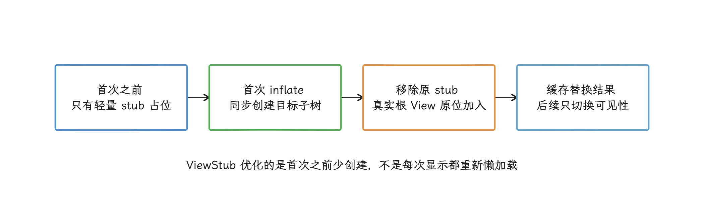

图：首次显示仍要支付 inflate 成本；Fragment 字段缓存必须在 onDestroyView 清空。

```kotlin
private var errorPanel: View? = null

fun showError(root: View) {
    val panel = errorPanel ?: root.findViewById<ViewStub>(R.id.stub_error_panel)
        .inflate()
        .also { errorPanel = it }

    panel.isVisible = true
}
```

这段代码只验证一件事：`ViewStub` 的收益来自“首次之前不创建”。一旦创建完成，它和普通 View 没区别，后续应该复用缓存引用。若引用保存在 Fragment 字段中，要在 `onDestroyView()` 清空，避免旧 View 树跨越视图生命周期。

`<merge>` 适合去掉组合 View 内部的壳。自定义 `TitleBar : FrameLayout` 如果 inflate 一个根节点也是 `FrameLayout` 的 XML，就会得到两层容器。把 XML 根换成 `<merge>`，子 View 会直接挂到 `TitleBar` 上，减少一次容器遍历。下面的 XML 只表达待合入父容器的两个子节点：

```xml
<merge xmlns:android="http://schemas.android.com/apk/res/android">
    <ImageButton
        android:id="@+id/back"
        android:layout_width="48dp"
        android:layout_height="48dp" />

    <TextView
        android:id="@+id/title"
        android:layout_width="wrap_content"
        android:layout_height="wrap_content" />
</merge>
```

`<merge>` 没有可独立返回的根 View，只能在 inflater 已得到父容器并且 `attachToRoot=true` 时使用。调用 `inflate(resource, parent, false)` 加载 `<merge>` 根布局会抛出 `InflateException`，因此它不适用于需要先构建、稍后再 attach 的预加载方案。

`<include>` 更偏工程复用。它不会自动让布局更快，`LayoutInflater.parseInclude()` 仍要解析被 include 的资源并创建 View。被 include 的布局可以用 `<merge>` 去掉冗余根容器，也可以把 `<include>` 放进 `ViewStub` 指向的低频子树；是否有收益取决于运行时少创建、少测量了什么。

<!-- gracker-diagram: a232-07-merge-include -->
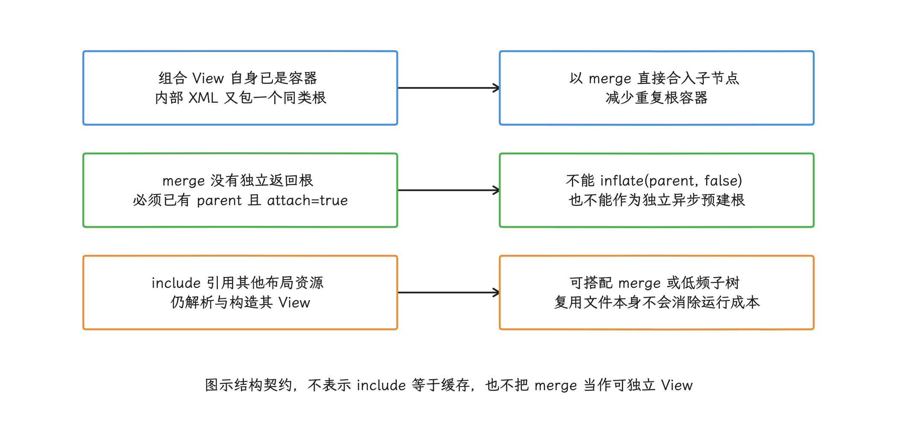

图：正确的父容器还负责生成 LayoutParams；结构简化需保持尺寸、主题和布局关系一致。

### `LayoutInflater` 的构造成本与构造器缓存

布局 XML 经 AAPT2 编译成 binary XML（编译后的二进制 XML），但运行时仍要读取节点与属性、创建对象并组装 View 树，省掉的只是文本解析这一小段。把整段工作笼统称为“XML 解析”，会漏掉主题、资源和业务构造器的成本。我们按三段拆开看一次 `inflate()`：

1. `Resources.getLayout()` 提供解析器，inflater 读取 `AttributeSet`，处理 `android:theme`、`<include>`、`<merge>`、`<tag>` 等特殊标签，并让父容器生成 `LayoutParams`；
2. `createViewFromTag()` 在已设置 `Factory2` 时调用它，否则才调用 `Factory`；结果仍为空时再尝试 private factory，之后才进入 `onCreateView()` 或按完整类名构造。不是 `Factory2` 返回空后还必定调用普通 `Factory`；AppCompat 的控件替换、Context 包装和 tint 也在这条 Factory 路径中；
3. `rInflateChildren()` 递归创建子节点、生成布局参数、加入父容器，并在子树完成后调用 `onFinishInflate()`。

`LayoutInflater` 的进程级构造器表可以省掉重复的类查找，省不掉的是后面这些：`Constructor.newInstance()`、View 构造函数、style、字体、Drawable 和自定义初始化。首次进入页面还可能包含类加载。所以我们比较冷启动与预热后的 trace 时要分开看，先定位主要耗时再谈优化，别先入为主认定是反射。

<!-- gracker-diagram: a232-08-inflater-factories -->
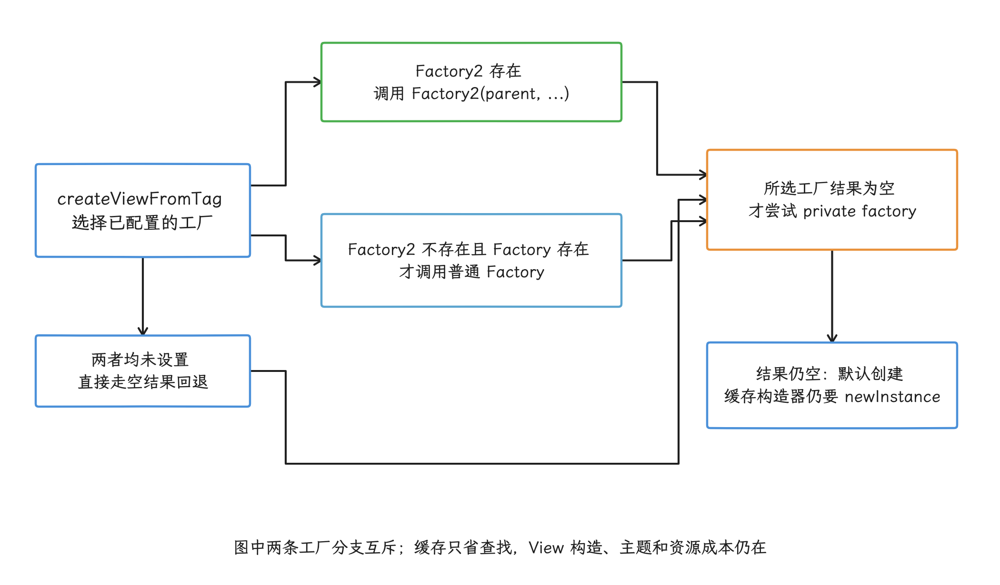

图：工厂返回 View 时直接使用，不继续回退；Factory2 返回空不会必定再调用普通 Factory。

传入的 `root` 还决定 XML 根节点能否获得正确的父容器布局参数：

| 调用形态 | 返回值 | 已加入 `root` | 根节点 `LayoutParams` |
| --- | --- | ---: | --- |
| `inflate(res, root, true)` | `root` | 是 | 由 `root.generateLayoutParams()` 生成 |
| `inflate(res, root, false)` | XML 根 View | 否 | 仍由 `root.generateLayoutParams()` 生成 |
| `inflate(res, null, false)` | XML 根 View | 否 | 缺少父容器上下文，之后可能需要修正 |

所以“先传 `null`，稍后再 `addView()`”并不等价于传入真实 parent；而 `<merge>` 因为没有独立根节点，只能在已有 parent 且 `attachToRoot=true` 时展开。

<!-- gracker-diagram: a232-09-parent-layoutparams -->
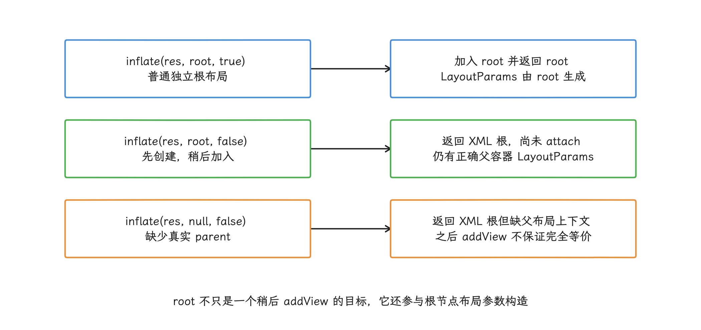

图：merge 是例外：没有独立根返回，只允许非空 parent 且 attach=true。

### 布局预加载与异步 Inflate

布局预加载转移的是创建时间，解析、构造和绑定成本本身仍然存在。这种转移要换来收益，前提是未来使用概率较高、可以安全缓存，并且预加载不挤占输入或当前帧。

可选方案分三类：

- **主线程空闲预加载**：在 `Looper.myQueue().addIdleHandler` 或页面稳定后的延迟任务里 inflate 下一步大概率会用到的布局。IdleHandler 是消息队列暂时空闲时执行的回调，仍运行在主线程；执行期间到达的新消息只能排队等它做完，所以任务必须够短，并带页面销毁、配置变化和用户转向时的取消条件。
- **受控复用**：RecyclerView 的 `RecycledViewPool` 具有清晰的回收协议。普通 View 不宜随意放入全局对象池；预创建 View 必须保持未 attach 状态，且 Context、主题、配置和旧数据都与使用点一致。
- **`AsyncLayoutInflater`**：尝试把 XML 解析和 View 构造放到后台线程，完成后再 attach。适合复杂但不需要立刻展示的布局；不满足后台构造条件时会回退到 UI 线程。

用 `AsyncLayoutInflater` 之前，先把它的适用条件写清楚。构造 `AsyncLayoutInflater` 和调用 `inflate()` 都应在 UI 线程；后台 inflate 要求父容器的 `generateLayoutParams(AttributeSet)` 线程安全，被创建的 View 在构造过程里也要避开 `Handler` 创建和 `Looper.myLooper()` 调用。它仍不支持直接设置 `LayoutInflater.Factory` / `Factory2`，也不支持包含 fragment 的布局；好在 AndroidX 1.1.0 可以在构造时传入 `AsyncLayoutFactory`，AppCompat 场景用 `AsyncAppCompatFactory` 就能正确创建 AppCompat View。碰到只能在 UI 线程构建的布局，AndroidX 会回退到 UI 线程 inflate——功能可以继续，只是这一次的解析和构造仍留在 UI 线程。

不传 callback executor（指定完成回调在哪个执行器运行） 的默认重载会在 UI 线程执行完成回调，而且返回的 View 尚未加入 `parent`。下面的接入在回调中完成 attach 和绑定：

```kotlin
private var filterInflateGeneration = 0L

// UI 线程调用；Fragment 应传入本次 viewLifecycleOwner。
fun requestFilterPanel(context: Context, parent: ViewGroup, owner: LifecycleOwner) {
    val generation = ++filterInflateGeneration
    AsyncLayoutInflater(context).inflate(R.layout.panel_filter, parent) { view, _, targetParent ->
        if (owner.lifecycle.currentState == Lifecycle.State.DESTROYED ||
            generation != filterInflateGeneration || targetParent !== parent) {
            return@inflate
        }
        parent.addView(view)
        bindFilterPanel(view)
    }
}

// UI 线程调用：页面转向或不再需要结果时，使在途结果失效。
fun discardPendingFilterPanel() {
    filterInflateGeneration++
}
```

这里的 generation 只丢弃过期结果，不会中断已经排队或执行中的 inflate；1.1.0 未提供取消请求的公开方法。Fragment 应使用本次 View 的 owner，避免 Fragment 仍存活却给已销毁的旧 View 树添加内容。示例的状态读写和失效操作都限定在 UI 线程。

`bindFilterPanel()` 与 `addView()` 仍在主线程执行。异步 inflate 只迁移了布局解析和 View 构造的一部分成本；数据绑定、图片解码和网络请求需要按各自线程约束另行安排。AndroidX 1.1.0 还提供 callback executor 重载；回调落在后台线程时，调用 `addView()` 和修改 View 前要切回 UI 线程。

<!-- gracker-diagram: a232-10-async-inflate-tracks -->
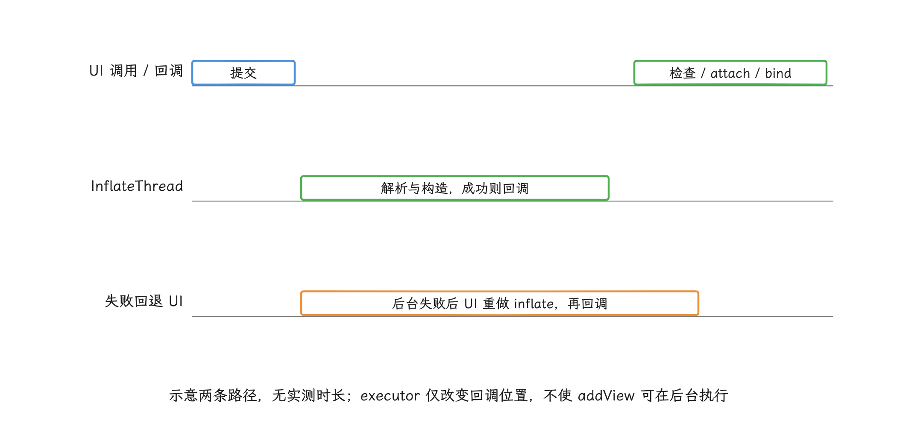

图：默认回调走 UI 线程，返回 View 未 attach；后台 RuntimeException 导致 UI 线程重做 inflate。

验收时我们对比使用前后的 trace：使用前，`Activity.onCreate()` 或点击事件后方有较长的 `inflate` 区间；使用后，这段区间应移到后台线程，主线程只保留较短的 `addView` / bind 区间。主线程仍出现完整 `inflate`，可能是布局触发了回退；主线程只剩 bind 却依然超时，说明瓶颈已经转到回调工作。还要记录预加载未使用比例与被丢弃结果数，避免为低命中投入更多 CPU 和内存。1.1.0 只有一个 InflateThread，内部队列容量为 10，入队使用阻塞 `put()`；UI 线程批量提交把队列填满时，`inflate()` 本身也可能等待。限制预取窗口，不能把它理解成无限并行或永不阻塞的 API。实现见 [1.1.0 源码归档](https://dl.google.com/dl/android/maven2/androidx/asynclayoutinflater/asynclayoutinflater/1.1.0/asynclayoutinflater-1.1.0-sources.jar)。

<!-- gracker-diagram: a232-11-async-backpressure -->
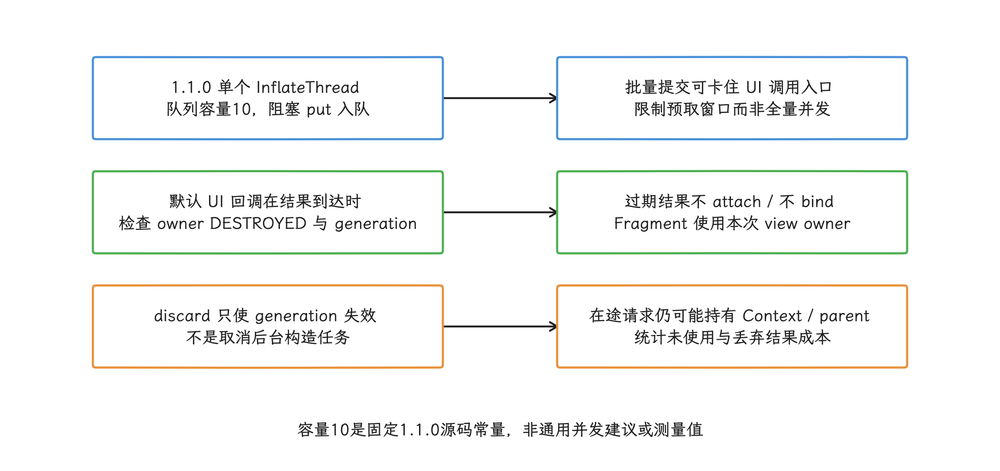

图：入口构造与 inflate 都在 UI 线程；布局必须满足线程安全条件，页面转向时明确使旧结果失效。

### `ViewTreeObserver` 布局回调的观察范围

`ViewRootImpl.performTraversals()` 会在本轮发生 layout，或全局属性需要重新计算时调用 `dispatchOnGlobalLayout()`。所以 `OnGlobalLayoutListener` 告诉我们的，只是 View 树的全局布局状态处理到了这一点；至于某个 `View.layout()` 是否刚执行完、buffer 有没有被 SurfaceFlinger 选中显示，要回到 trace 里核对。

回调要按它实际观察的范围使用：

- 只关心一个 View 的位置或尺寸时，优先用 `View.OnLayoutChangeListener` 或 AndroidX `doOnLayout`；
- 一次性 global listener 在条件满足后立即移除，回调内避免 I/O、同步 Binder、整树扫描和无条件 `requestLayout()`；
- `OnPreDrawListener.onPreDraw()` 返回 `false` 会取消当前 draw 并重新调度，条件长期不满足会形成连续取消；
- 首帧显示用 API 31+ FrameTimeline 等实际显示证据或启动度量判断；`reportFullyDrawn()` 是业务充分绘制报告，不能当作首帧已上屏的物理信号。`OnGlobalLayoutListener` 的回调结束也不等于显示终点。

`getViewTreeObserver()` 返回的对象也要看生命周期：未 attach 的 View 使用 floating observer，attach 时 listener 会合并到窗口 observer，旧对象随后失效，跨整个 View 生命周期保存同一个引用并不可靠。长期持有引用时要检查 `isAlive()`，移除 listener 时重新取得当前 observer 更稳妥。

<!-- gracker-diagram: a232-12-layout-observers -->
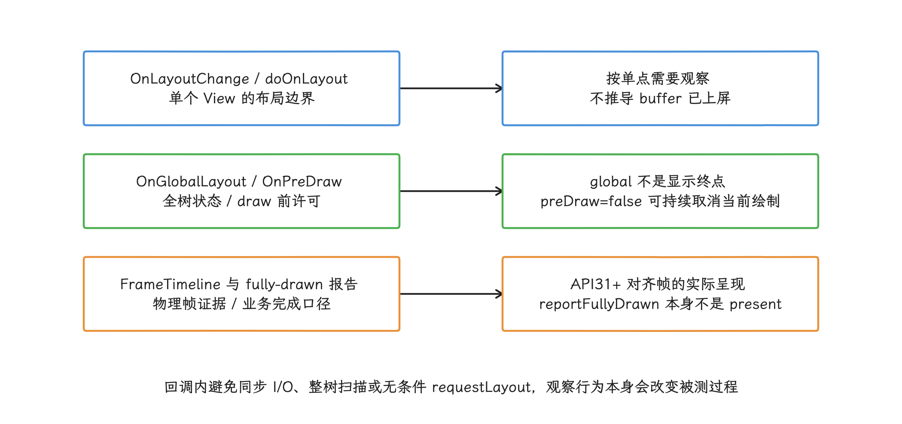

图：floating observer attach 后会合并并失效；移除时重新取当前存活 observer，避免跨生命周期缓存。

### Compose 与 View 混合布局的性能陷阱

View/Compose 混合场景里，我们要同时盯着两套体系：`ComposeView` 放进 View 树后，既要参与父 View 的 Measure / Layout，又有自己的 Composition、Layout、Drawing 阶段——Composition 根据状态构建或更新 Compose 节点，Layout 测量并放置节点，Drawing 记录绘制内容。

出图路径上，普通 `ComposeView` 和不创建独立 Surface 的 `AndroidView` 仍可以沿宿主 `ViewRootImpl → RenderThread → App Window` 的标准路径出图；但 Compose 由 AndroidX 独立发布，运行时和编译器行为跟着项目依赖的版本走，Android 17 platform tag 在这里给不出答案，要按项目实际依赖的版本来核对。

常见风险有三类：

- **RecyclerView item 里嵌套 `ComposeView`**：item 复用、Composition 生命周期、状态清理都要处理。滑动慢帧可能来自 ViewHolder（列表条目容器）创建，也可能来自 Compose 首次组合。
- **Compose 页面里嵌入复杂 Android View**：`AndroidView` 承载 WebView、地图或播放器时，View 自身的 measure/layout 和生命周期成本仍然存在。组件还可能拥有 Chromium 渲染线程、`SurfaceView` 或 `TextureView` 输入，届时只看宿主 App Window 不足以解释内容生产成本。
- **状态跨边界传播过宽**：View 层一次数据刷新导致整个 `ComposeView` 重新组合，或者 Compose 状态变化触发外层 View `requestLayout()`，都会让本应局部处理的变化波及更大的页面范围。

混合方案要少留交界、理清生命周期，trace 也要分开看。Perfetto 里先确认慢帧落在 framework 的 `measure` / `layout`，Compose runtime / drawing，还是独立 Producer 与 Surface，再决定改 View 结构、Compose 状态读取或子组件管线。trace 还没指到谁身上时，先别急着归因给 Compose 或 View。

<!-- gracker-diagram: a232-13-interop-surface -->
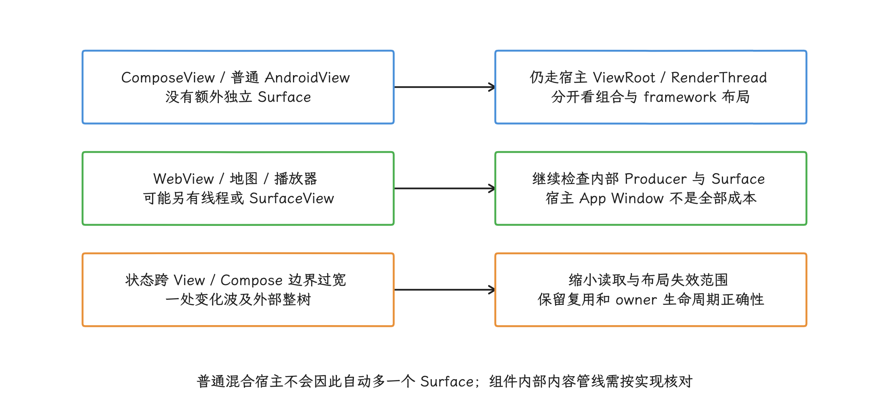

图：Android17 platform tag 不定义 AndroidX Compose 行为；归因需记录项目实际库版本。

### 验收清单

布局优化完成后，用同一台设备、同一份数据、同一条操作路径验证。至少检查这些项目：

- `Choreographer#doFrame` 中 `measure` / `layout` 的 P50、P90、P95 以及调用次数是否下降（P95 指按耗时排序后 95% 的样本不超过该值）。
- `FrameMetrics.LAYOUT_MEASURE_DURATION` 和 FrameTimeline overrun（超过该帧 deadline 的时长）是否同时改善；单看最小值说明不了问题。
- 首帧、页面切换或列表交互的用户可感知耗时是否下降。
- Layout Inspector 中冗余父节点和重复测量结构是否减少；节点总数只作为解释材料。
- 低 RAM 设备和高刷新率设备上是否同时通过。120 Hz 的名义 VSync 间隔约为 8.33 ms，当前帧仍应以 FrameTimeline 给出的 deadline 为准。
- 若 App 侧按时完成，继续核对 RenderThread、`queueBuffer`、`BufferTX`、latch 与 present，避免把显示侧延迟记到布局。
- 视觉一致性、无障碍层级、点击热区没有被改坏。

布局优化的完成标准，是关键帧里的主线程测量与布局成本下降，同时完整帧指标和用户体验没有退化。布局切片只回答 App 主线程这一段；帧有没有及时上屏，还要沿标准 HWUI（Android 硬件加速 UI 渲染器） 路径检查到 present——这条界线前文已经划过，验收时同样适用。

### 源码与文档

- [Android 17 `ViewRootImpl.java`](https://android.googlesource.com/platform/frameworks/base/+/android-17.0.0_r1/core/java/android/view/ViewRootImpl.java)：`requestLayout()`、Traversal、`measure` / `layout` trace 与 HWUI 交接。
- [Android 17 `LayoutInflater.java`](https://android.googlesource.com/platform/frameworks/base/+/android-17.0.0_r1/core/java/android/view/LayoutInflater.java)：`inflate` trace、`<include>` 与 `<merge>` 解析约束。
- [Android 17 `ViewStub.java`](https://android.googlesource.com/platform/frameworks/base/+/android-17.0.0_r1/core/java/android/view/ViewStub.java)：占位 View 被替换和首次 inflate 的行为。
- [Android 17 `FrameMetrics.java`](https://android.googlesource.com/platform/frameworks/base/+/android-17.0.0_r1/core/java/android/view/FrameMetrics.java)：`LAYOUT_MEASURE_DURATION` 的统计语义。
- [Performance and view hierarchies](https://developer.android.com/topic/performance/rendering/optimizing-view-hierarchies)：重复测量、层级诊断与布局压平。
- [ConstraintLayout performance experiment](https://android-developers.googleblog.com/2017/08/understanding-performance-benefits-of.html)：2017 年实验条件与 Measure / Layout 结果。
- [`AsyncLayoutInflater` API](https://developer.android.com/reference/androidx/asynclayoutinflater/view/AsyncLayoutInflater)：后台构建条件、回退、attach 和 callback executor 边界。
- [AsyncLayoutInflater releases](https://developer.android.com/jetpack/androidx/releases/asynclayoutinflater)：1.1.0 稳定版、`AsyncLayoutFactory` 与 callback executor 更新。


## 绘制分配、缓存与局部刷新

布局成本稳定后，自定义绘制继续检查 onDraw 中的分配、离屏层、复杂路径和无效区域。缓存只适合内容变化较少的部分。

优化自定义 View，要顺着状态变化触发的整条渲染路径看。一次变化可能只触发 draw（绘制），也可能通过 `requestLayout()` 连带 measure（测量）和 layout（摆放）；UI 线程把绘制命令记进 DisplayList（绘制命令记录） 之后，这一帧何时上屏就交给了后面的线程和显示系统。

普通自定义 View 没有独立 Surface，走应用窗口的标准 HWUI 路径。整条管道是：`Choreographer#doFrame` 驱动一次 traversal，UI 线程更新 RenderNode（保存 View 绘制记录和变换属性的渲染节点）及其 DisplayList，`HardwareRenderer.syncAndDrawFrame()` 把树状态交给 RenderThread，BLAST BufferQueue 提交图形缓冲区，SurfaceFlinger 完成合成，HWC（Hardware Composer，硬件合成器） 参与显示，最终得到实际显示时间。我们在 Perfetto 里看到的每一个慢帧，都可以沿这条管道分段认领。显示后段可结合 [Android View 标准渲染链路](../../part2-performance/ch13-rendering-pipelines/01-android-view-pipeline-analysis.md) 阅读。

### 测量、摆放、绘制：按触发条件判断成本

`onMeasure()`、`onLayout()` 与 `onDraw()` 没有固定的优化优先级。应先用性能 trace（时间轴）判断哪一段执行过多或单次过长：

| 回调 | 常见触发条件 | 应避免的工作 |
| --- | --- | --- |
| `onMeasure()` | `requestLayout()`、父约束变化、挂载到窗口、窗口或配置变化 | I/O、重复解析文本、没有次数上限的多轮子 View 测量 |
| `onLayout()` | 布局请求，或 View 边界变化后仍需重新摆放 | 分配临时坐标对象、重复计算测量阶段已有的几何关系 |
| `onDraw()` | 绘制内容失效、动画、父级绘制或 DisplayList 需要重录 | 对象分配、同步 I/O、每帧重建不变的 Path / Shader |

`MeasureSpec` 把父容器给出的尺寸和模式编码在一个整数中，三种模式分别是固定尺寸的 `EXACTLY`、给出上限的 `AT_MOST` 和不提供父级上限的 `UNSPECIFIED`。同一组 `MeasureSpec` 在没有强制布局标记时可能命中 `View.measure()` 的缓存，`onMeasure()` 就会跳过。

常规路径中的 `requestLayout()` 会清空当前 View 的测量缓存，设置内部标记 `PFLAG_FORCE_LAYOUT` 与 `PFLAG_INVALIDATED`，并向尚未请求布局的父级传播。若调用发生在布局过程中，`ViewRootImpl.requestLayoutDuringLayout()` 会决定本轮接受还是延后处理——一次调用离一次完整遍历还有距离，最终哪些分支重新测量、摆放和绘制，还取决于标记、约束与窗口状态。

#### `onMeasure()` 缓存的完整输入

测量缓存的判断不止宽度一项：高度 `MeasureSpec`、内边距、数据版本、字体、语言与地区设置、布局方向、子 View 可见性和外边距都可能改变结果。缓存适合保存纯计算得到的几何结果，同时要照常走 `setMeasuredDimension()` 并尊重父容器约束。

下面的示例用两个 `MeasureSpec` 和显式内容版本保护缓存。`computeGeometry()` 只做 CPU 计算，不修改 View 树。

```java
private int mLastWidthSpec = Integer.MIN_VALUE;
private int mLastHeightSpec = Integer.MIN_VALUE;
private int mLastContentVersion = -1;
private int mLastPaddingLeft = Integer.MIN_VALUE;
private int mLastPaddingTop = Integer.MIN_VALUE;
private int mLastPaddingRight = Integer.MIN_VALUE;
private int mLastPaddingBottom = Integer.MIN_VALUE;
private int mContentVersion;
private int mDesiredWidth;
private int mDesiredHeight;

@Override
protected void onMeasure(int widthMeasureSpec, int heightMeasureSpec) {
    if (widthMeasureSpec != mLastWidthSpec
            || heightMeasureSpec != mLastHeightSpec
            || mContentVersion != mLastContentVersion
            || getPaddingLeft() != mLastPaddingLeft
            || getPaddingTop() != mLastPaddingTop
            || getPaddingRight() != mLastPaddingRight
            || getPaddingBottom() != mLastPaddingBottom) {
        computeGeometry(widthMeasureSpec, heightMeasureSpec);
        mLastWidthSpec = widthMeasureSpec;
        mLastHeightSpec = heightMeasureSpec;
        mLastContentVersion = mContentVersion;
        mLastPaddingLeft = getPaddingLeft();
        mLastPaddingTop = getPaddingTop();
        mLastPaddingRight = getPaddingRight();
        mLastPaddingBottom = getPaddingBottom();
    }

    setMeasuredDimension(
            resolveSizeAndState(mDesiredWidth, widthMeasureSpec, 0),
            resolveSizeAndState(mDesiredHeight, heightMeasureSpec, 0));
}
```

数据、字体、语言与地区设置或布局方向发生变化，并且会影响期望尺寸时，更新 `mContentVersion` 后调用 `requestLayout()`；只改颜色的场合保持测量版本不变。自定义 `ViewGroup` 还要为每个子 View 生成正确的 `MeasureSpec`、合并 measured state（子 View 报告的尺寸状态），并处理内边距、外边距和最小尺寸，这些契约都要照做，缓存跳不过去。

<!-- gracker-diagram: a232-14-measure-cache-inputs -->
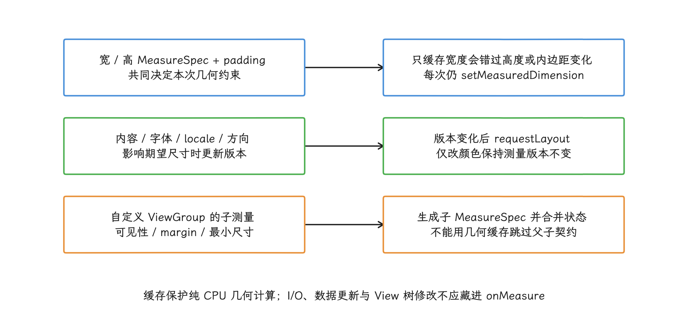

图：View.measure 本身也会按标记与 MeasureSpec 使用缓存；常规 requestLayout 会清缓存并设置强制布局。

#### `onLayout()` 的输入与坐标缓存

`changed` 表示当前 View 的 bounds（`left`、`top`、`right`、`bottom` 四条边界）相对上次是否变化。子 View 的测量尺寸、可见性、外边距、布局方向或业务排序变化时，即使父 View 的边界没变，子 View 位置也可能要更新。测量或几何计算阶段应产出一份与完整输入绑定的坐标缓存，`onLayout()` 只读取这份缓存。

若 trace 显示同一帧发生多轮测量与摆放，要查调用栈和请求源。常见原因包括在 `onLayout()` 中再次调用 `requestLayout()`、父子约束互相依赖、权重或 `wrap_content` 协商，以及 Adapter 更新时同时改变布局参数。

<!-- gracker-diagram: a232-15-layout-changed -->
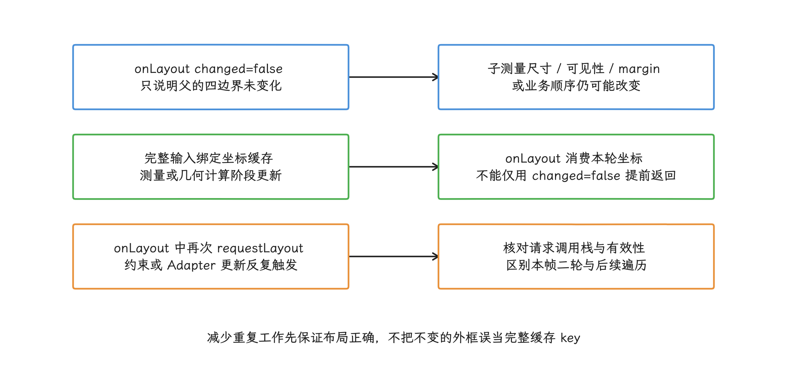

图：坐标依赖布局方向与子内容，不只父宽高；波形 bounds 缓存也需处理固定外框下的 padding 变化。

### `onDraw()`：移除热路径分配

硬件加速时，UI 线程把 View 的绘制命令记录到 RenderNode 的 DisplayList，RenderThread 消费这些命令并准备窗口缓冲区，`onDraw()` 本身仍在 UI 线程执行。内容没有失效的 View 可以复用已有记录；标为 dirty（绘制内容已过期）的节点才需要重录。

热路径分配的代价是分配器工作、缓存扰动和 GC 负载。少量分配未必产生可见卡顿，结论要由 allocation recording（对象分配记录）、GC 轨道和帧时间共同证明；移除可避免的逐帧分配也要以测量为准，一个对象数量阈值替不了它。

下面是波形 View 的结构节选：它在构造阶段创建绘制对象，在尺寸或数据变化时更新几何，`onDraw()` 只提交绘制命令；`rebuildWavePath()`、`drawGrid()` 等业务辅助方法没有展开。

```java
public final class WaveformView extends View {
    private final Paint mGridPaint = new Paint(Paint.ANTI_ALIAS_FLAG);
    private final Paint mWavePaint = new Paint(Paint.ANTI_ALIAS_FLAG);
    private final Path mWavePath = new Path();
    private final RectF mContentBounds = new RectF();

    public WaveformView(Context context, AttributeSet attrs) {
        super(context, attrs);
        mGridPaint.setColor(0x40FFFFFF);
        mWavePaint.setStyle(Paint.Style.STROKE);
        mWavePaint.setStrokeWidth(2f);
    }

    @Override
    protected void onSizeChanged(int w, int h, int oldw, int oldh) {
        super.onSizeChanged(w, h, oldw, oldh);
        updateContentGeometry();
    }

    @Override
    protected void onLayout(boolean changed, int left, int top, int right, int bottom) {
        super.onLayout(changed, left, top, right, bottom);
        // padding 改变时 bounds 未必改变，onSizeChanged 不一定再次调用。
        updateContentGeometry();
    }

    private void updateContentGeometry() {
        float left = getPaddingLeft();
        float top = getPaddingTop();
        float right = Math.max(left, getWidth() - getPaddingRight());
        float bottom = Math.max(top, getHeight() - getPaddingBottom());
        if (mContentBounds.left != left || mContentBounds.top != top
                || mContentBounds.right != right || mContentBounds.bottom != bottom) {
            mContentBounds.set(left, top, right, bottom);
            rebuildWavePath(mWavePath, mContentBounds);
        }
    }

    public void setSamples(float[] samples) {
        copySamplesAndRebuildPath(samples, mWavePath, mContentBounds);
        invalidate();
    }

    @Override
    protected void onDraw(Canvas canvas) {
        drawGrid(canvas, mContentBounds, mGridPaint);
        canvas.drawPath(mWavePath, mWavePaint);
    }
}
```

`setSamples()` 必须在 UI 线程调用，并复制或接管一份稳定数据，避免调用方在绘制期间修改数组。若采样持续高速到达，还要在上游合并更新；主线程每收到一个点就重建整条 Path，仍可能让记录成本超过预算。

`String.format()`、临时 `String`、装箱集合、`new RectF()`、`new Path()`、临时数组和每帧创建的 Shader 都是常见分配源。相应的做法是：文字格式化在数据变化时完成，数组和几何对象复用，不变的 Path 预先算好。还有一类容易漏掉的：持续修改复杂 Path，即使没有 Java 分配，也可能增加 HWUI 的几何处理和 GPU 工作。

`Canvas.save()` / `restore()` 管理的是 Canvas 状态栈，和 Java 对象分配是两回事。嵌套 layer（离屏层）、复杂 clip（裁剪）和 transform（几何变换）仍有执行成本，把状态保存范围限制在需要隔离的绘制段即可。

<!-- gracker-diagram: a232-16-drawing-hot-path -->
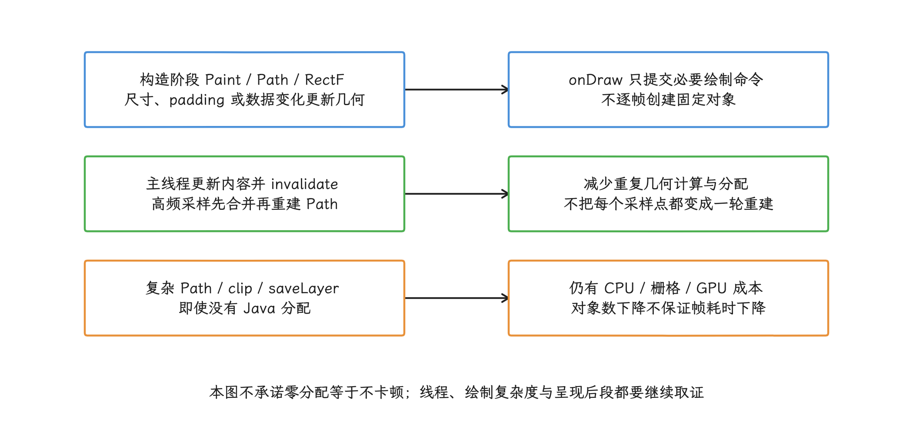

图：分配记录只做归因，再与同一窗口 GC、线程状态和帧指标对齐；Canvas save/restore 是状态栈操作。

### 硬件加速、图层与 `setWillNotDraw`

#### 以当前 Canvas 判断绘制后端

`View.isHardwareAccelerated()` 表示 View 所在窗口启用了硬件加速；当前绘制可能仍使用软件 Canvas，例如把 View 画入 Bitmap。绘制代码需要分支时，应检查 `canvas.isHardwareAccelerated()`。

本文覆盖 API 21–37，需要逐项区分：硬件 Canvas 的 `clipPath()` 从 API 18 支持，`drawPicture()` 从 API 23 支持，`drawVertices()` 从 API 29 支持。API 21–22 不能套用后两项的现代硬件支持结论。兼容性仍要按当前官方表逐项核对，官方表就把 `Paint.setLinearText()` 和 `setMaskFilter()` 标为不支持。这类问题的表现可能是空白、异常或像素错误，系统也不会为所有不支持的调用统一切到软件绘制。

<!-- gracker-diagram: a232-17-canvas-backend -->
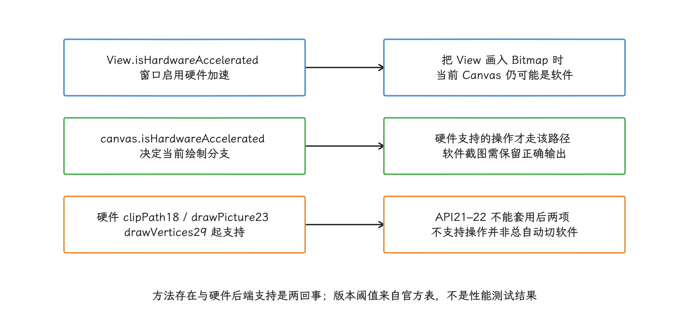

图：Paint.setLinearText / setMaskFilter 的支持按官方表核对，并用真实设备检查像素输出。

#### `LAYER_TYPE_NONE` 与默认 DisplayList 复用

`setLayerType()` 控制单个 View 是否增加离屏图层，不控制整个窗口是否硬件加速。

| 类型 | Android 17 语义 | 合适场景 | 主要代价 |
| --- | --- | --- | --- |
| `LAYER_TYPE_NONE` | 正常使用 View 的 RenderNode / DisplayList，不强制离屏缓冲区 | 默认选择 | 无额外图层；内容失效时仍需重录 |
| `LAYER_TYPE_HARDWARE` | 在硬件加速窗口中渲染到硬件纹理 | 复杂子树的短时 alpha / transform 动画，或明确的合成效果 | GPU 内存、创建图层与内容失效后的重新栅格化 |
| `LAYER_TYPE_SOFTWARE` | 子树由 CPU 绘制到 Bitmap，再参与宿主窗口绘制 | 硬件 Canvas 不支持且已验证的局部兼容路径 | Bitmap 内存、CPU 栅格化、纹理上传 |

窗口未启用硬件加速时，`LAYER_TYPE_HARDWARE` 的行为与 `LAYER_TYPE_SOFTWARE` 相同——想靠它在单个 View 上开启硬件加速是行不通的。

静态 View 在默认模式下已经能复用 DisplayList，没有必要仅因“内容复杂”长期强制硬件图层。硬件图层适合内容保持不变、外层 `alpha` / `translation` / `scale` / `rotation` 持续变化的短时动画。动画同时修改 View 内容并频繁 `invalidate()` 时，图层仍要重新栅格化，收益可能消失。栅格化指把绘制命令转换成像素。

<!-- gracker-diagram: a232-18-displaylist-layers -->
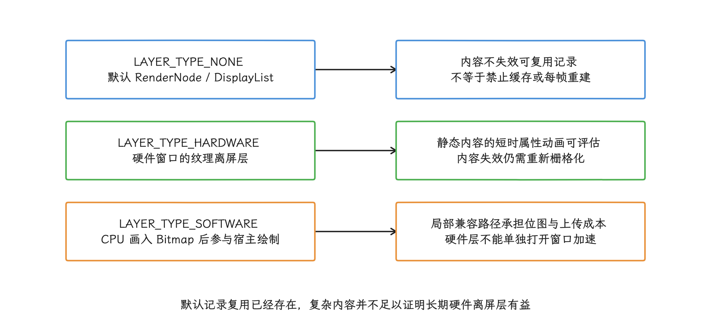

图：图层选择按内容更新频率、面积和内存验证；withLayer 结束或取消后恢复原 layer type。

`ViewPropertyAnimator.withLayer()` 会在动画前启用硬件图层，并在结束后恢复原来的图层类型。先用 trace 确认属性动画的主要成本来自重复栅格化，再考虑下面的局部优化。

```java
view.animate()
        .alpha(0f)
        .translationY(-view.getHeight() / 4f)
        .setDuration(220L)
        .withLayer()
        .start();
```

硬件图层占用的 GPU 资源与 View 面积、像素格式相关，大面积 View 尤其要检查内存和 RenderThread。`hasOverlappingRendering()` 的返回值有前提：View 内容确实没有重叠绘制才可返回 `false`；错误返回会改变透明度合成结果。

#### `setWillNotDraw(true)` 的实际跳过范围

没有自身 `onDraw()` 内容的布局 `ViewGroup` 可设置 `setWillNotDraw(true)`，框架在满足跳绘条件时直接走子节点的 `dispatchDraw()`。背景、前景或默认焦点高亮可能使框架清除 `PFLAG_SKIP_DRAW`，因此不能把它理解成始终跳过所有自身绘制；若新增分隔线、调试标记等自定义 `onDraw()` 内容，应明确设为 `false`。

下面只截取容器设置绘制标记的构造函数。完整的非抽象 `ViewGroup` 还必须实现 `onMeasure()` 和 `onLayout()`，把这两处补齐，这段节选才能编译。

```java
public final class FlowLayout extends ViewGroup {
    public FlowLayout(Context context, AttributeSet attrs) {
        super(context, attrs);
        setWillNotDraw(true);
    }
}
```

给 ViewGroup 设置背景时，框架可能调整绘制标记，`setWillNotDraw(true)` 覆盖不了所有背景行为；增加自身绘制后应明确改为 `false` 并验证结果。

<!-- gracker-diagram: a232-19-will-not-draw -->
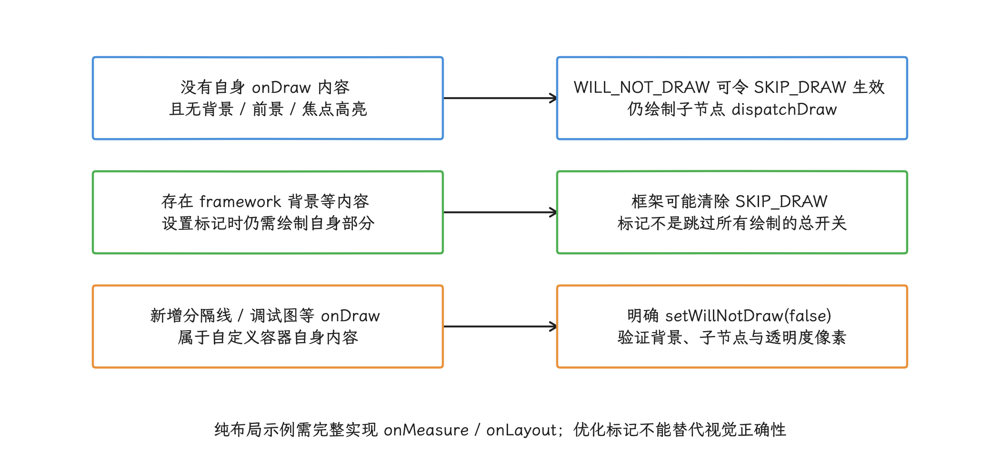

图：hasOverlappingRendering=false 也必须满足内容确实不重叠，否则会改变 alpha 合成结果。

### `invalidate()`、动画刷新与 `requestLayout()`

| API | 调用线程与时机 | 适用变化 | Android 17 边界 |
| --- | --- | --- | --- |
| `invalidate()` | UI 线程，安排后续绘制 | 像素内容、颜色、Path、Drawable | 标记 View 绘制内容失效，并向父级传播重绘区域（damage） |
| `postInvalidateOnAnimation()` | 挂载到窗口（attach）后可从非 UI 线程调用，在下一动画时间步派发 | 与显示帧节奏对齐的自绘动画 | 未 attach 时没有 `AttachInfo`，调用不会安排刷新 |
| `requestLayout()` | UI 线程，向父级传播布局请求 | 期望尺寸、子 View 尺寸或位置 | 清测量缓存，设置强制布局与失效标记，再安排 View 树遍历 |

API 21 起，`invalidate(Rect)` 和四坐标重载传入的 dirty rectangle（调用方指定的局部脏区域）会被忽略，两个公开 API 也已弃用；`View.java` 内部仍会传播重绘区域，并按 RenderNode 更新 DisplayList。所以应用侧应调用无参 `invalidate()`，需要更细的重录粒度时，通过拆分 View 或 RenderNode 来实现。

下面的 setter 区分“只改像素”和“改变尺寸”。

```java
public void setWaveColor(int color) {
    if (mWavePaint.getColor() == color) return;
    mWavePaint.setColor(color);
    invalidate();
}

public void setLabelText(String text) {
    if (Objects.equals(mLabelText, text)) return;
    mLabelText = text;
    mContentVersion++;
    requestLayout();
    invalidate();
}
```

`requestLayout()` 不保证自动补齐所有业务绘制状态，因此尺寸与像素都变化时可以同时调用两者。若文字变化但固定边界与现有基线能容纳新内容，只需重建文字布局并调用 `invalidate()`；是否调用 `requestLayout()` 由尺寸契约决定。

<!-- gracker-diagram: a232-20-invalidate-layout -->
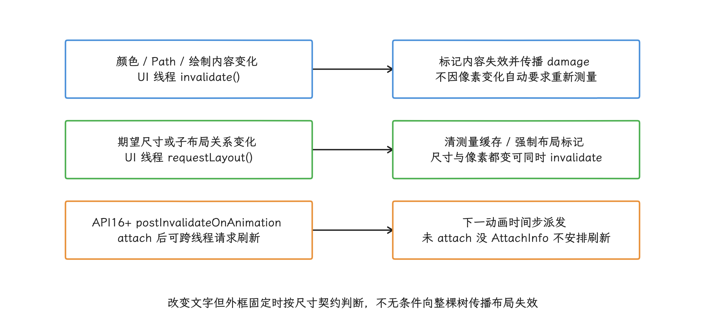

图：API21 起公开 dirty-rectangle 重载不作为精确局部绘制契约；独立更新区域可拆 View 或 RenderNode。

#### 连续动画的运行状态与停止

在 `onDraw()` 中无条件调用 `invalidate()` 会持续请求后续帧，即使 View 不可见或动画已经完成。自绘动画可以使用 `postInvalidateOnAnimation()`，但必须有明确的运行状态，并在 detach、不可见或终止条件到达时停止。

下面的骨架只在动画活跃时请求下一帧。

```java
@Override
protected void onDraw(Canvas canvas) {
    drawFrame(canvas, mProgress);
    if (mRunning) {
        postInvalidateOnAnimation();
    }
}

@Override
protected void onDetachedFromWindow() {
    mRunning = false;
    super.onDetachedFromWindow();
}
```

这段骨架只展示从窗口分离时的停止逻辑。实际组件还要在不可见和业务终止时更新 `mRunning`；若改用 Animator，也要在对应生命周期节点取消动画。

`ValueAnimator` 能提供基于时钟的进度和取消机制，但它的更新回调仍可能每帧触发重绘。我们选择 Animator，图的是它明确的时间模型和生命周期，刷新次数该多少还是多少。

<!-- gracker-diagram: a232-21-animation-stops -->
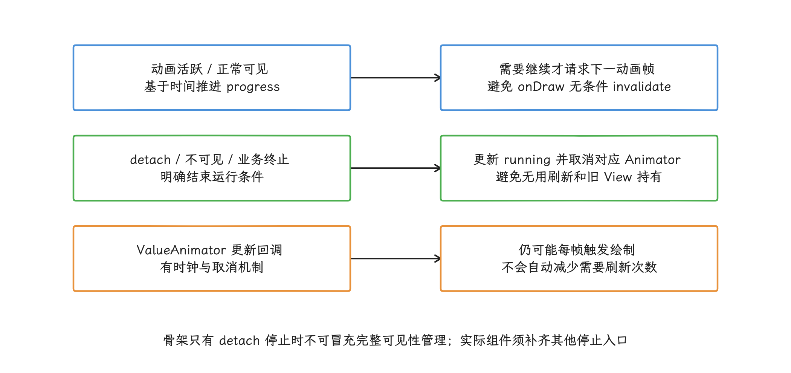

图：postInvalidateOnAnimation 负责对齐帧节奏，状态、数据线程安全和停止条件仍由组件负责。

#### `ViewCompat.postInvalidateOnAnimation()` 的版本位置

平台 `postInvalidateOnAnimation()` 从 API 16 提供。本文适用范围为 Android 5.0—17（API 21–37），可以直接调用平台 API。若这段代码还要共享给 API 15 或更低的项目，可考虑 `ViewCompat.postInvalidateOnAnimation()`，但要先确认项目采用的 AndroidX Core 版本仍支持该 `minSdk`。兼容层的选择不会改变 Android 17 的调度语义。

### 手动 `RenderNode`：按更新频率划分节点

公开 `RenderNode` 从 API 29 提供。每个 View 已经由框架持有一个 RenderNode，手动增加节点适合的是自定义 View 内面积较大、更新频率不同且能独立记录的区域；反过来，小图元很多、每帧全部变化，或软件 Canvas 必须完整支持的场合，额外节点的管理成本可能超过复用收益。

下面是仅用于 API 29+ 的独立实现节选；API 21–28 应路由到不含 `RenderNode` 字段的普通 Canvas 实现，不能只在 `onDraw()` 内判断版本，却先在字段初始化时调用新 API。示例把静态网格和动态波形分成两个节点。节点在字段初始化时创建，硬件 Canvas 走 `drawRenderNode()`，软件 Canvas 直接调用原绘制函数，避免截图或 Bitmap 绘制得到空白。

```java
private final RenderNode mGridNode = new RenderNode("wave-grid");
private final RenderNode mWaveNode = new RenderNode("wave-data");
private boolean mGridDirty = true;
private boolean mWaveDirty = true;

@Override
protected void onSizeChanged(int w, int h, int oldw, int oldh) {
    super.onSizeChanged(w, h, oldw, oldh);
    mGridNode.setPosition(0, 0, w, h);
    mWaveNode.setPosition(0, 0, w, h);
    mGridDirty = true;
    mWaveDirty = true;
}

private void recordGridNode() {
    RecordingCanvas recordingCanvas = mGridNode.beginRecording();
    try {
        drawGrid(recordingCanvas);
    } finally {
        mGridNode.endRecording();
    }
}

private void recordWaveNode() {
    RecordingCanvas recordingCanvas = mWaveNode.beginRecording();
    try {
        drawWave(recordingCanvas);
    } finally {
        mWaveNode.endRecording();
    }
}

@Override
protected void onDraw(Canvas canvas) {
    if (!canvas.isHardwareAccelerated()) {
        drawGrid(canvas);
        drawWave(canvas);
        return;
    }

    if (mGridDirty || !mGridNode.hasDisplayList()) {
        recordGridNode();
        mGridDirty = false;
    }
    if (mWaveDirty || !mWaveNode.hasDisplayList()) {
        recordWaveNode();
        mWaveDirty = false;
    }

    canvas.drawRenderNode(mGridNode);
    canvas.drawRenderNode(mWaveNode);
}
```

内容更新时设置对应的失效标记并调用 `invalidate()`；尺寸变化要更新两个节点的位置。节点长期不再使用时可以调用 `discardDisplayList()` 释放 DisplayList 持有的原生资源。系统发现节点不再被绘制时也可能自动调用该方法，显式释放适合生命周期由业务代码明确控制的节点。

<!-- gracker-diagram: a232-22-rendernode-partition -->
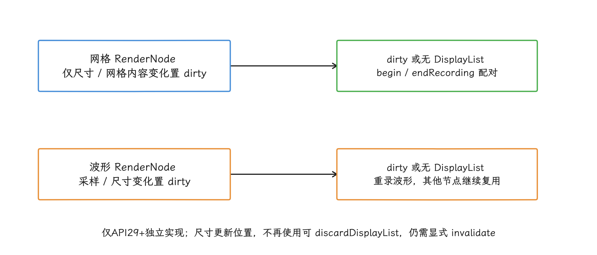

图：硬件 Canvas 最后按相同坐标绘制两个节点；属性变换可单独更新，不必重录内容。

RenderNode 的 `translation`、`scale`、`rotation` 和 `alpha` 属性可以在不重录 DisplayList 的情况下更新。`setUseCompositingLayer(true, paint)` 会强制增加中间合成缓冲区，公开文档推荐保留默认值 `false`。当中间层能降低开销，或 `alpha` 与重叠绘制的组合要求使用中间层时，RenderNode 会自行建立合成层。只有特效要求或测量结果能证明收益时才应强制开启。

<!-- gracker-diagram: a232-23-rendernode-fallback -->
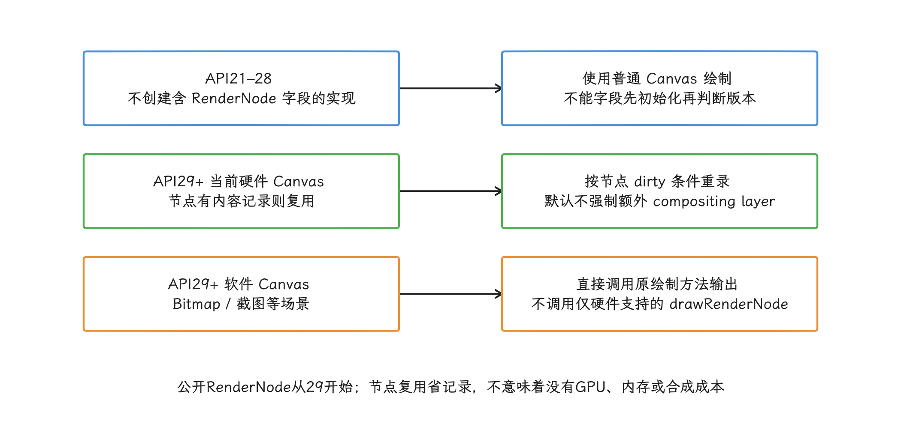

图：setUseCompositingLayer 的默认 false 保留自动策略；强制中间层需特效需求或测量证据。

### Perfetto：区分 UI 记录、RenderThread 与显示出口

系统 trace 并不会自动为每个自定义 View 生成稳定的 `onDraw` slice（有起止时间的工作区间），`debug.hwui.profile` 生成的 Profile HWUI Rendering 柱状图也替代不了 View 级 trace。定位目标 View 时，我们可以用自定义区间（trace section）包住热方法。

下面的埋点代码给 `onDraw()` 添加可在 Perfetto 中搜索的区间，`finally` 保证发生异常时也会关闭 section。

```java
@Override
protected void onDraw(Canvas canvas) {
    Trace.beginSection("WaveformView#onDraw");
    try {
        drawGrid(canvas, mContentBounds, mGridPaint);
        canvas.drawPath(mWavePath, mWavePaint);
    } finally {
        Trace.endSection();
    }
}
```

录制时要让配置收集目标进程的应用 trace section，并启用 `view`、`gfx`、`hwui`、线程调度和 FrameTimeline 数据。Macrobenchmark 会自动收集自定义区间；使用 systrace 命令行时要通过 `-a <package>` 指定应用。FrameTimeline 用于把应用帧与 SurfaceFlinger 的实际显示结果对应起来。性能判断按四段进行：

1. `WaveformView#onDraw` 长：检查应用绘制代码、CPU Bitmap、文字布局、Path 构建和同步等待。
2. UI 记录正常，RenderThread `DrawFrame` 长：先区分 CPU 执行与 runnable 时间，后者表示线程已经就绪但还在等待 CPU。然后检查 `dequeueBuffer`（申请可写缓冲区）、Skia 渲染库 / GPU 工作和 fence（跨 CPU、GPU、显示设备传递完成状态的同步对象）——“GPU 慢”三个字回答不了是哪一段慢。
3. `queueBuffer()` 之前正常，目标图层的 `BufferTX` / latch 晚：检查 BLAST、transaction readiness（事务依赖是否就绪）和 acquire fence（生产者是否已写完缓冲区）；latch 是 SurfaceFlinger 选中并接收本帧缓冲区的动作。
4. 应用与 latch 都按时，actual present（实际显示时间）仍超时：检查 SurfaceFlinger 合成、HWC、Display HAL（显示硬件抽象层）和 present timing。

对象分配要用 allocation recording 找调用栈，再与同一时间窗的 GC、主线程状态和 FrameTimeline 对齐。HeapTaskDaemon 是 Android Runtime 的后台堆任务线程，它出现 GC 工作只说明进程正在回收内存；要判断该帧是不是 `onDraw()` 分配拖慢的，还缺主线程暂停或资源竞争的证据。

<!-- gracker-diagram: a232-24-frame-attribution -->
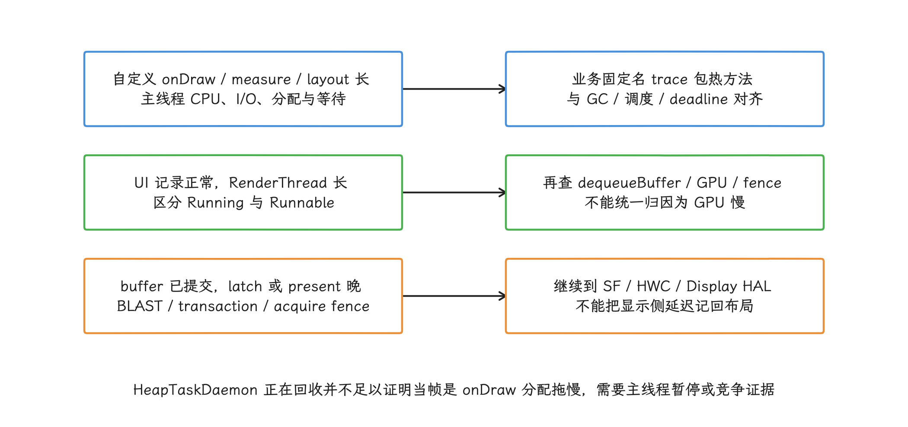

图：queueBuffer 按时只说明提交入队；FrameMetrics 与FrameTimeline等工具需按可用API使用。

### 验收清单

- `onMeasure()` 的昂贵计算是否由完整输入保护，数据只改颜色时有没有误调 `requestLayout()`。
- `onLayout()` 是否依赖子 View 尺寸、可见性、外边距和布局方向，是否在摆放过程中再次请求布局。
- `onDraw()` 是否含临时对象、格式化、同步 I/O、Bitmap CPU 绘制或逐帧重建不变几何。
- 默认 `LAYER_TYPE_NONE` 是否已经满足需求；硬件 / 软件图层是否有明确场景、开启区间和内存证据。
- `setWillNotDraw(true)` 是否只用于没有自身视觉内容的 ViewGroup。
- 自绘动画是否使用显示帧节奏，并在从窗口分离、不可见和终止状态停止。
- 手动 RenderNode 是否让独立更新区域分别记录，并为软件 Canvas 保留正确输出。
- UI 线程、RenderThread、BLAST、SurfaceFlinger、HWC 与 actual present 是否用同一帧证据关联。

## 全文小结

View 优化先分清布局失效和绘制失效：层级、inflate、测量与 `requestLayout()` 决定哪些节点重新布局，绘制分配、缓存和 RenderNode 决定哪些内容需要重新记录。减少其中一段工作后，我们还要沿同一帧检查 RenderThread、缓冲区与实际呈现时间，确认收益没有被图形内存增长或其他阶段的等待抵消。

## 源码与文档

- [Android 17 `View.java`](https://android.googlesource.com/platform/frameworks/base/+/android-17.0.0_r1/core/java/android/view/View.java)：`requestLayout()`、绘制失效、图层类型、`setWillNotDraw()` 与 View RenderNode 更新。
- [Android 17 `ViewRootImpl.java`](https://android.googlesource.com/platform/frameworks/base/+/android-17.0.0_r1/core/java/android/view/ViewRootImpl.java) 与 [`ThreadedRenderer.java`](https://android.googlesource.com/platform/frameworks/base/+/android-17.0.0_r1/core/java/android/view/ThreadedRenderer.java)：View 树遍历、测量 / 摆放 / 绘制与 HWUI 同步入口。
- [Android 17 `RenderNode.java`](https://android.googlesource.com/platform/frameworks/base/+/android-17.0.0_r1/graphics/java/android/graphics/RenderNode.java)、[`RecordingCanvas.java`](https://android.googlesource.com/platform/frameworks/base/+/android-17.0.0_r1/graphics/java/android/graphics/RecordingCanvas.java) 与 [`HardwareRenderer.java`](https://android.googlesource.com/platform/frameworks/base/+/android-17.0.0_r1/graphics/java/android/graphics/HardwareRenderer.java)：DisplayList 记录、节点属性与 UI 到 RenderThread 的边界。
- [Optimize a custom view](https://developer.android.com/develop/ui/views/layout/custom-views/optimizing-view)：热路径、分配和布局遍历的官方建议。
- [Hardware acceleration](https://developer.android.com/topic/performance/hardware-accel)：DisplayList 模型、Canvas API 支持表和 View 图层契约。
- [`View` API](https://developer.android.com/reference/android/view/View) 与 [`RenderNode` API](https://developer.android.com/reference/android/graphics/RenderNode)：dirty rectangle、动画刷新、公开 RenderNode 和软件 Canvas 边界。
- [Slow rendering](https://developer.android.com/topic/performance/vitals/render)、[Perfetto system tracing](https://perfetto.dev/docs/getting-started/system-tracing) 与 [Define custom events](https://developer.android.com/topic/performance/tracing/custom-events)：UI 记录、RenderThread、GC、系统 trace 与应用自定义区间的观测入口。
