# RecyclerView 与 Compose LazyList 性能

RecyclerView 的滑动成本分散在几处：布局状态机、`ViewHolder` 获取与绑定、列表差异、预取下一屏，以及嵌套滑动。优化的起点是把这些成本逐一定位出来，再谈调参。这一篇先把 RecyclerView 1.4.0 的布局、缓存、GapWorker 源码行为和应用写法讲清楚，再与 Compose LazyList 的组合（Composition）和预取模型对照；机制结论和改动收益，最后都要落到同一条慢帧数据上。

> 源码基线：平台行为以 Android 17 / API 37 / AOSP `android-17.0.0_r1` 为准；RecyclerView 是独立发布的 AndroidX 库，本文固定使用 `androidx.recyclerview:recyclerview:1.4.0` 的 `sources.jar`（源码包），平台源码标签里查不到它——截至 2026 年 10 月 25 日，[RecyclerView 发布说明](https://developer.android.com/jetpack/androidx/releases/recyclerview)仍将 1.4.0 列为稳定版。

RecyclerView 的 trace 主要呈现主线程侧的输入、滚动、绑定与 Traversal（View 树的测量（measure）、布局和绘制遍历）；之后还有 RenderThread、图形缓冲区、SurfaceFlinger 与 HWC（硬件合成器）的工作，完整链路见 [2.4 MainThread、RenderThread 与 Hardware Layer](../../part1-fundamentals/ch02-rendering/04-main-render-thread-hardware-layer.md)。

RecyclerView 通过 ViewHolder 复用和预取控制滚动成本，Compose LazyList 通过组合、测量和槽位复用管理可见项。两者都要稳定 item 身份、减少绑定工作并限制预取压力，我们先从 RecyclerView 的布局与缓存状态机看起。

## RecyclerView 布局与缓存状态机

### `dispatchLayout()` 三步与 AutoMeasure

在 Perfetto 里排查列表卡顿时，`RV OnLayout`（测量/布局）、`RV FullInvalidate` 这些切片只是外层入口；RecyclerView 1.4.0 在内部把一次完整布局组织成三个步骤。它们是状态机里的方法，trace 里未必有同名 slice 与之一一对应：

| 内部步骤 | 主要职责 | Trace 解读 |
| --- | --- | --- |
| `dispatchLayoutStep1()` | 处理 Adapter 更新和动画标记，记录 pre-layout 信息；predictive animation 时还会执行预布局 | 位于外层更新或布局 slice 中，没有独立同名轨道 |
| `dispatchLayoutStep2()` | 消费更新，进入最终状态的 `LayoutManager.onLayoutChildren()`；非 `EXACT` 测量时可能执行多次 | 在 `RV OnLayout`、`RV FullInvalidate`、`RV PartialInvalidate` 的调用栈里找 layout、create、bind 和子 View measure |
| `dispatchLayoutStep3()` | 匹配 pre/post-layout 信息，启动 item animation，回收 scrap，恢复焦点并清理状态 | 仍属于外层布局 slice，不能用一条动画 slice 代替整个 step3 |

`RV FullInvalidate` 常覆盖首次布局、数据集整体失效或 add/remove/move 等结构更新；只有 `UPDATE` 的局部变化会先走 `RV PartialInvalidate`，可见 holder 受影响时才进入完整布局。切片名和 step1/2/3 之间没有固定的对应关系，读 trace 时以调用栈为准。

AutoMeasure 还会把成本移到 `onMeasure()`：宽高不都是 `EXACT` 时，测量阶段可以先执行 step1/step2，`onLayout()` 随后只补 step3，或因尺寸变化再次执行 step2；`shouldMeasureTwice()` 为真时还会多一轮。所以 `RV OnLayout` 很短时，布局工作可能被移进了测量阶段，我们仍要检查同一帧 framework 的 `measure` 和调用栈，再判断列表布局的实际轻重。

<!-- gracker-diagram: a233-01-layout-steps -->
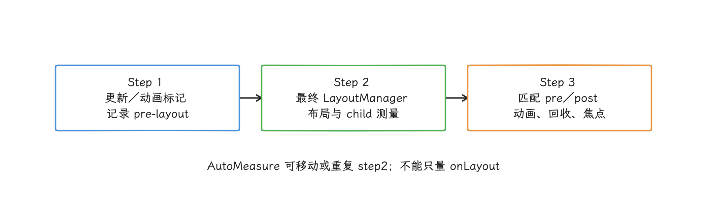

图：非 EXACT 的 AutoMeasure 可先执行 step1/2；外层 trace 名称不与步骤一一对应。

## ViewHolder 复用、绑定与 GapWorker 预取

### ViewHolder 复用与 `viewType` 设计

ViewHolder 设计的目标是让滑动尽量命中缓存，少做反复 `inflate`（解析 XML 并创建 View 树） 和完整绑定。`RecycledViewPool` 可以在多个 RecyclerView 之间共享 ViewHolder，并按 `viewType`（可复用的视图类型）分桶；1.4.0 中每种类型默认最多保留 5 个，应用可用 `setMaxRecycledViews()` 调整。RecyclerView 自身的 `mCachedViews` 会保留仍带绑定状态的 holder：请求大小默认是 2；启用 item prefetch（条目预取）时，实际最大值 `mViewCacheMax` 还会加上 LayoutManager 观察到的预取数量。“2”是请求值，实际总数以 `mViewCacheMax` 为准。

#### 实际的 holder 查找顺序

`tryGetViewHolderForPositionByDeadline()` 的主要查找顺序还包括 changed scrap、hidden child（子 View） 与 stable ID 二次查找：

| 来源 | 参与条件 | 取得后是否可能 bind |
| --- | --- | --- |
| changed scrap | pre-layout 按 position 或 stable ID 查找变化前 holder | 取决于 pre-layout 状态和标记 |
| attached scrap / hidden child / `mCachedViews` | 先按 position 查找，再校验 viewType 与 ID | 有效且未标记 update/invalid 时可直接复用；scrap 也可能重新 bind |
| stable ID 二次查找 | Adapter 开启 stable IDs 时，按 ID 与 viewType 再查 scrap/cache | 状态需要更新时仍会 bind |
| `ViewCacheExtension` | 应用显式提供扩展时 | 由返回 holder 的状态决定 |
| `RecycledViewPool` | 前面都没有兼容 holder | 重置内部状态后通常要 bind |
| 新建 holder | Pool 也未命中且 deadline 允许 | create 后继续 bind |

Attached scrap 只是布局期间暂时分离的 holder，复用它也可能重新 bind。trace 里出现 bind，说明的是当前 holder 需要绑定；它来自哪个缓存层，我们要回到上面的查找顺序确认。

<!-- gracker-diagram: a233-02-holder-lookup -->
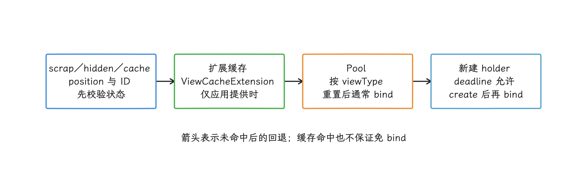

图：查找失败才继续；pre-layout、stable ID 和 holder 标记共同决定是否重新绑定。

`viewType` 应按“ViewHolder 是否能安全交叉复用”来划分：两个 item 的 View 结构和绑定规则相同，只是文案、图片或按钮状态不同，通常应共用同一个类型。若按颜色、角标等业务状态拆出过多类型，回收池会被切成许多小桶——一种类型刚回收的 ViewHolder 服务不了另一种类型，滑动时更容易重新创建。

Perfetto 中的 slice 是带起止时间的轨道条目，下表把代码决策与常见时间片对应起来：

| 设计点 | 推荐写法 | 风险写法 | Perfetto 表现 |
| --- | --- | --- | --- |
| `viewType` | 按兼容的 ViewHolder 结构和绑定规则分组 | 按业务状态、颜色、角标拆类型 | `RV onCreateViewHolder type=...` 在滑动中频繁出现 |
| `onCreateViewHolder()` | 只做 inflate、子 View 查找、一次性对象创建 | 发起请求、解码图片、读取磁盘 | create 时间片在慢帧中持续占据较大比例 |
| `onBindViewHolder()` | 只绑定当前数据，重活交给异步组件 | 每次 bind 都重建复杂对象、重复设置监听 | bind 时间片在慢帧里变长 |
| `RecycledViewPool` | 结构一致的嵌套列表共享回收池 | 每个子列表独立持有池 | 外层滑动时内层列表反复 create |

嵌套横向列表的共享池可以写成下面这样。重点是让 ViewHolder 结构与绑定规则一致的子列表共用同一批对象，再按首屏数量调容量。

```kotlin
private val sharedPool = RecyclerView.RecycledViewPool().apply {
    setMaxRecycledViews(TYPE_CARD, 12)
    setMaxRecycledViews(TYPE_BANNER, 4)
}

fun bindHorizontalList(holder: SectionHolder, items: List<Card>) {
    val list = holder.recyclerView
    if (list.recycledViewPool !== sharedPool) {
        list.setRecycledViewPool(sharedPool)
        (list.layoutManager as? LinearLayoutManager)?.setRecycleChildrenOnDetach(true)
    }
    holder.adapter.submitList(items)
}
```

这段代码把多个子列表的回收池合并到一个对象里。Pool 按整数 `viewType` 分桶，与 Adapter 无关；两个 Adapter 恰好用同一个整数却创建不同布局时，交叉复用会导致类型转换异常、错误绑定或残留状态。`TYPE_CARD` 的容量可按“屏幕上可能同时出现的子列表数 × 每个子列表可见卡片数”估算，再用 Perfetto 验证稳定滑动阶段的 `RV onCreateViewHolder` 是否减少。`setMaxRecycledViews()` 只修改上限，holder 仍然按需创建；容量过大会增加 View、图片和其他绑定资源的内存占用。

<!-- gracker-diagram: a233-03-pool-contract -->
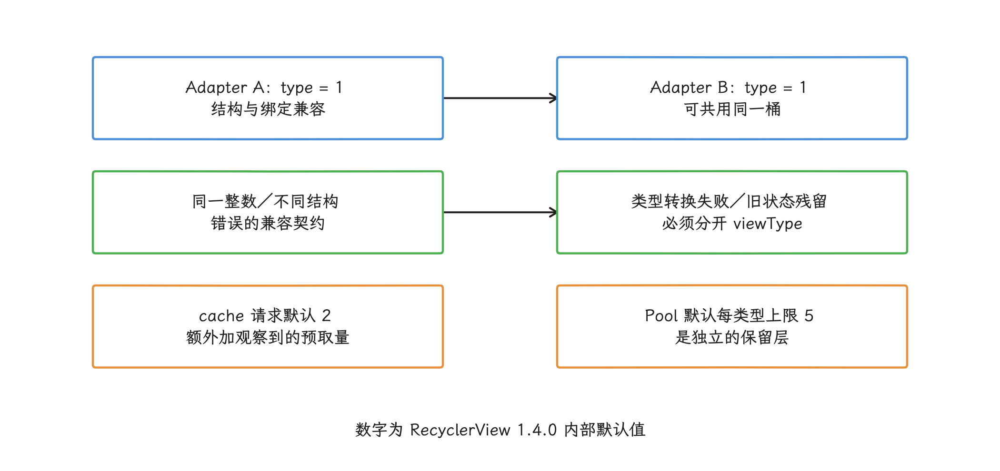

图：容量是上限，增加上限不会预先创建对象；两个默认值不是总缓存量。

`setHasStableIds(true)` 只适合每个 item 都有唯一且稳定业务 ID 的列表：即使条目移动到新位置，`getItemId(position)` 返回的 `long` 也必须保持不变，当前列表中的不同条目之间也不共用 ID。stable ID 帮的是 RecyclerView 在更新和动画期间识别同一个 item；增量更新交给 DiffUtil 做，错误的 `viewType` 设计要单独修。ID 重复或随位置变化，换来的是动画异常、状态串扰和错误复用。

### DiffUtil 与增量更新

整表刷新是列表卡顿的高发来源。`notifyDataSetChanged()` 不区分哪些条目发生了插入、删除或内容变化，LayoutManager 只好重新绑定并布局全部可见 View；启用 stable ID 时，RecyclerView 可以为可见项推导部分结构变化以维持动画，这次完整的重新绑定和重新布局仍然省不掉。`DiffUtil` 则比较两份列表，把插入、删除、移动和内容变化分发成细粒度的 Adapter 更新。

`DiffUtil` 使用 Eugene W. Myers 差分算法寻找把旧列表变成新列表所需的最短插入/删除序列；移动不属于该算法的直接输出，需要再做一次检测。它的预期时间复杂度是 O(N + D²)，其中 N 是列表长度之和，D 是最短编辑序列长度；开启 move detection 后还会增加与新增项、删除项数量相关的扫描成本。`calculateDiff(callback, detectMoves)` 的第二个参数用于控制这轮移动检测。

应用侧通常优先使用 `ListAdapter` 或 `AsyncListDiffer`。`ListAdapter#submitList()` 内部委托 `AsyncListDiffer`：旧、新列表均非空且不是同一实例时，diff 在后台 executor 计算，主线程应用时检查提交代次，过期结果不再分发。相同实例、首次插入和提交 `null` 清空走同步快路径，因此 UI Adapter 的提交入口仍应放在主线程。被新提交取代只会丢弃旧结果，不会停止旧 diff 的 CPU 计算；它的 commit callback 也不保证执行。

<!-- gracker-diagram: a233-05-async-generations -->
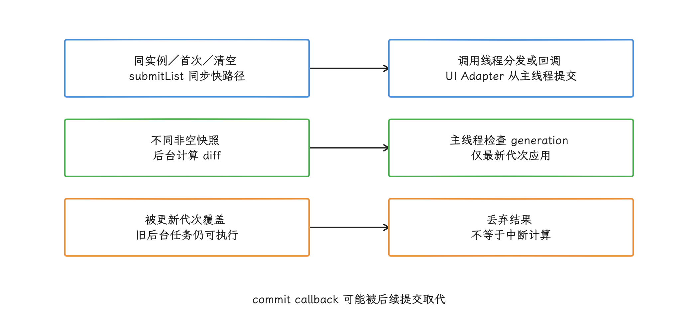

图：异步仅覆盖真正需要比较的新旧快照；提交代次门禁保证结果顺序。

DiffUtil 写得好不好，取决于三个回调：

<!-- gracker-diagram: a233-04-identity-diff -->
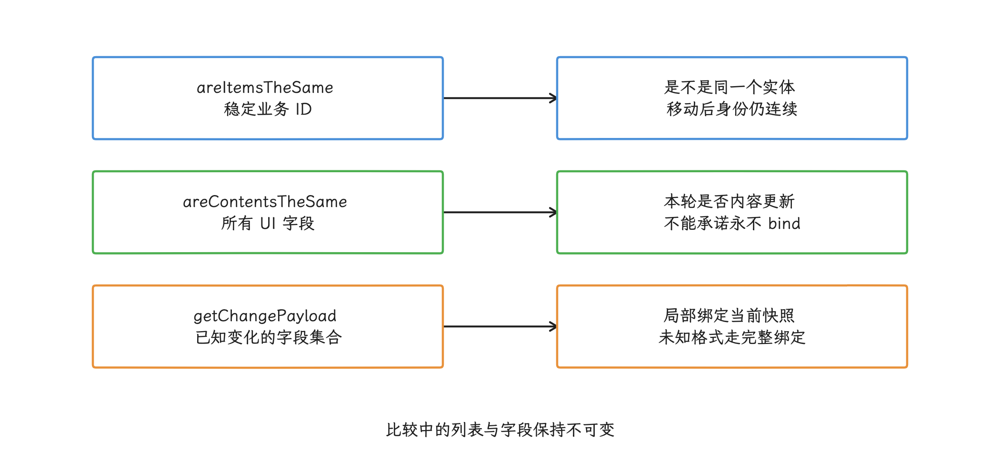

图：相同身份、不同内容才产生 payload；ListAdapter 的差异结果不替代完整绑定契约。

- `areItemsTheSame()`：判断新旧位置是否代表同一个业务对象，通常比较服务端 ID 或本地稳定 ID。
- `areContentsTheSame()`：比较所有会影响当前 UI 的内容；返回 `true` 时，本轮 diff 不为该 item 分发内容变化通知；新进入视口或被回收后取得的 holder 仍可能需要绑定。
- `getChangePayload()`：在身份相同、内容不同的情况下返回变更描述，让 Adapter 只更新受影响的 View。

payload 是一次局部更新携带的“变化说明”。下面的 `Card` 只有 ID、标题和头像三个字段；新增影响 UI 的字段时，要同时扩展 diff 和 payload。`CardHolder.create(parent)` 是项目提供的 ViewHolder 工厂，`bind()` 必须恢复完整状态。同一 item 只改标题时只绑定标题；payload 为空、未知或格式不符时都回退完整绑定。

```kotlin
data class Card(val id: Long, val title: String, val avatarUrl: String)
data class TitleChanged(val title: String)
data class AvatarChanged(val url: String)

class CardDiff : DiffUtil.ItemCallback<Card>() {
    override fun areItemsTheSame(oldItem: Card, newItem: Card): Boolean {
        return oldItem.id == newItem.id
    }

    override fun areContentsTheSame(oldItem: Card, newItem: Card): Boolean {
        return oldItem == newItem
    }

    override fun getChangePayload(oldItem: Card, newItem: Card): Any? {
        val changes = mutableListOf<Any>()
        if (oldItem.title != newItem.title) changes += TitleChanged(newItem.title)
        if (oldItem.avatarUrl != newItem.avatarUrl) changes += AvatarChanged(newItem.avatarUrl)
        return changes.takeIf { it.isNotEmpty() }
    }
}

class CardAdapter : ListAdapter<Card, CardHolder>(CardDiff()) {
    override fun onCreateViewHolder(parent: ViewGroup, viewType: Int): CardHolder =
        CardHolder.create(parent)

    override fun onBindViewHolder(holder: CardHolder, position: Int) {
        holder.bind(getItem(position))
    }

    override fun onBindViewHolder(holder: CardHolder, position: Int, payloads: MutableList<Any>) {
        val changes = payloads.flatMap { (it as? List<*>) ?: listOf(it) }
        if (changes.isEmpty() || changes.any { it !is TitleChanged && it !is AvatarChanged }) {
            onBindViewHolder(holder, position)
            return
        }
        // 多次更新的 payload 可合并；只用它判断字段，值从当前快照读取。
        val item = getItem(position)
        if (changes.any { it is TitleChanged }) holder.bindTitle(item.title)
        if (changes.any { it is AvatarChanged }) holder.bindAvatar(item.avatarUrl)
    }
}
```

这段写法减少的是完整 bind 次数，不会缩短 diff 计算本身。列表中只有标题、点赞数、关注状态这类小字段变化时，payload 往往能缩短主线程绑定时间；如果字段变化会改变 item 尺寸并触发重新测量，还要回到 [22.1 View 布局与自定义绘制优化](01-view-layout-custom-drawing.md) 检查布局成本。

payload 优化的是局部绑定，状态正确性要靠完整绑定兜底：目标 ViewHolder 未 attach（未挂接到当前 RecyclerView） 时，payload 可能被丢弃，所以无 payload 的完整 bind 必须能仅凭当前 item 恢复全部 UI 状态，包括清理旧图片、选中态、监听器和无障碍描述。

<!-- gracker-diagram: a233-06-payload-merge -->
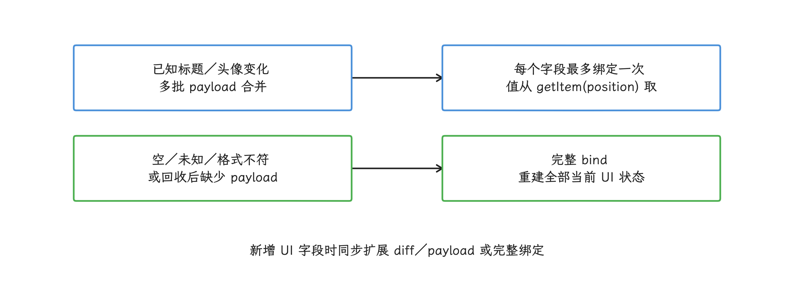

图：局部绑定不依赖中间 payload 的旧值；完整绑定负责消除复用残留。

大列表还有三件事要单独注意：

- 数据源按同一规则排序且 item 不会交换位置时，自行调用 `DiffUtil.calculateDiff(callback, false)` 可以省去 move detection。`ListAdapter` / `AsyncListDiffer` 的标准路径调用单参数重载，默认开启移动检测，`AsyncDifferConfig` 没有关闭开关；若改为自管 diff，还要自行处理提交批次、不可变快照和主线程更新分发。
- `areContentsTheSame()` 不要直接带入与 UI 无关的字段。埋点时间戳、临时曝光状态或调试字段如果参与比较，会让 DiffUtil 把无关变化判成需要更新。
- 提交给 `ListAdapter` / `AsyncListDiffer` 的列表及其参与比较的字段在 diff 期间应视为不可变。`AsyncListDiffer` 对相同 List 实例会直接返回；原地修改旧列表再重复 `submitList()`，既破坏新旧快照，也可能不触发任何更新。应创建新的列表和不可变 item。

### 预取机制与配置

GapWorker 是 RecyclerView 的预取任务：它根据滚动方向收集即将需要的 adapter position（Adapter 位置），并尝试在条目进入视口前取得、创建或绑定 ViewHolder。AndroidX 1.4.0 的滚动路径会调用 `mGapWorker.postFromTraversal()` 记录方向和距离，再通过 `recyclerView.post(this)` 把这个 Runnable 投递到主线程消息队列。GapWorker 跑在主线程上，预取的 create / bind 占的也是主线程时间。

<!-- gracker-diagram: a233-07-gapworker-main -->
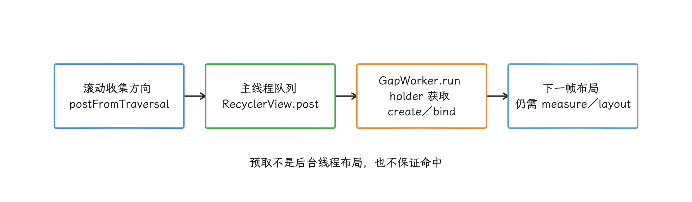

图：预取改变发生时机；排队延迟、创建与绑定成本仍要在同一主线程解释。

`GapWorker.run()` 用最近一次 drawing time（绘制时间） 加刷新周期估算下一帧 deadline（截止时间），再按滚动速度、条目距离和下一帧是否需要来排列任务。普通任务在创建和绑定前分别要过 `willCreateInTime()`、`willBindInTime()` 两道检查：它们根据 Pool 中按 `viewType` 记录的历史耗时，判断预计能否在截止时间前完成。预计下一帧就需要的任务会传入 `FOREVER_NS`，跳过这两道检查，并显示为 `RV Prefetch forced - needed next frame`；“forced”只是绕过了这两个估算分支，工作仍在主线程执行。

<!-- gracker-diagram: a233-08-prefetch-budgets -->
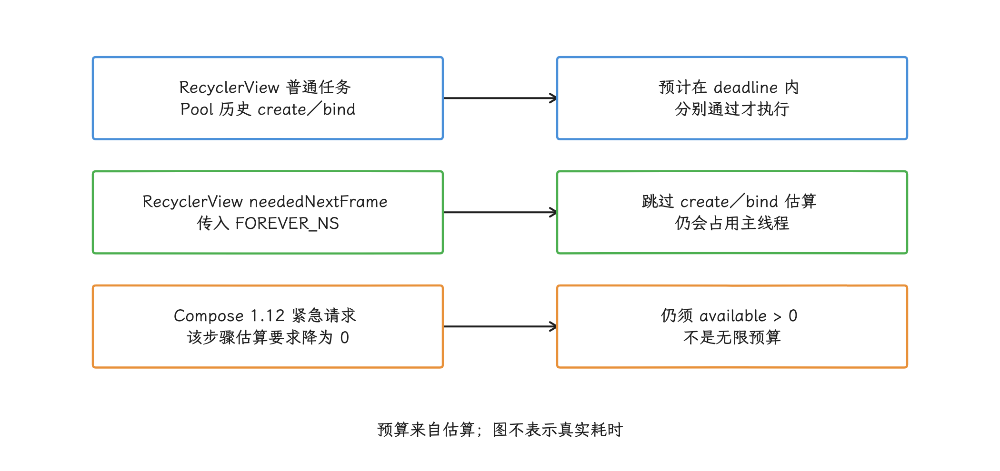

图：RecyclerView 的 forced 与 Compose urgent 有不同门禁，不能从同名含义推导同一调度行为。

`LinearLayoutManager#setInitialPrefetchItemCount()` 只影响嵌套 RecyclerView 首次进入视口前的 initial prefetch（初始预取）数量，非嵌套列表调用它没有效果。该值应接近内层列表首次显示的 item 数；设得更大不会自动提高流畅度，反而会增加不必要的 bind、View 创建和活跃对象。

GapWorker 提前取得 holder，按需执行 create 和 bind；下一帧的 item Measure / Layout 仍由布局阶段自己完成。所以若 trace 中 prefetch 和 bind 都正常，下一帧 `RV OnLayout` 或 framework `measure` / `layout` 仍然很长，我们就要转向 item 尺寸、布局结构和图片结果触发的 `requestLayout()` 去找原因。

共享 Pool 也共享按 `viewType` 统计的 create / bind 运行均值。多个 Adapter 共享同一 Pool 时，除了 ViewHolder 结构要兼容，构造和绑定成本也不宜差异悬殊，否则一个 Adapter 的历史均值会影响另一个 Adapter 的 deadline 判断。

配置建议按这几步做：

1. 横向子列表首次出现时能看到 3 个完整卡片和半个卡片，就从 4 开始测试；不要直接设成整组数据长度。
2. 子列表 item 结构和绑定规则相同，可以先共享 `RecycledViewPool`，再调 `setInitialPrefetchItemCount()`。共享池不是预取生效的前提，但能减少内层列表重复创建 ViewHolder 的机会。
3. bind 中图片加载要交给图片库缓存和异步解码，Adapter 只提交 URL 和占位状态；不要在 bind 里同步解码 Bitmap。
4. 用 Perfetto 看 `RV Prefetch`、`RV Nested Prefetch`、带 `forced - needed next frame` 的预取切片，以及 `RV onCreateViewHolder type=...`、`RV onBindViewHolder type=...` 的相对位置。预取切片出现但下一帧仍然 create，说明目标 position、预算、缓存或 `viewType` 还要继续核对。

`setItemViewCacheSize()` 会增大 `mCachedViews` 的请求值，让刚滑出屏幕的 ViewHolder 保持绑定状态，从而减少短距离回滑时的 bind；代价是持有更多 View、图片引用和 item 状态。Feed 流、瀑布流和长列表别先凭经验调大，应先根据 create、bind、内存与 GC（垃圾回收） 数据判断，并检查 `viewType`、payload 和共享 Pool。

Android 17 对 `targetSdkVersion >= 37` 的应用启用新的 MessageQueue 实现。它可以消除旧队列中的一类入队锁竞争，GapWorker 的 position 收集、排序、create / bind 预算和主线程执行属性都维持原样；具体差异见后文 DeliQueue 小节。

### 嵌套滚动与多 RecyclerView 场景优化

多 RecyclerView 场景常见于首页 Feed、频道页、卡片流和 ViewPager2。性能问题通常来自多层列表在同一帧里同时触发布局、绑定和预取，排查时要落到具体是哪一层触发的。

处理顺序可以固定下来：

- **避免无界测量**：不要把 RecyclerView 放进纵向 `NestedScrollView` 后，再让父容器要求它按全部内容高度测量。RecyclerView 可能一次准备大量 item，回收优势随之消失，行为接近把所有子 View 放进普通 `LinearLayout`。
- **优先合并同向列表**：纵向 RecyclerView 里再放纵向 RecyclerView，会增加触摸分发、NestedScrolling（父子容器协商滚动距离）和测量的复杂度。页面能由单个 RecyclerView 的多种 `viewType` 表达时，可以用 `ConcatAdapter` 把多个 Adapter 串成一个列表。
- **异向嵌套先共享 Pool**：纵向 Feed 里的横向卡片列表，如果 ViewHolder 创建规则兼容，可给内层列表共享 `RecycledViewPool`，再设置 initial prefetch。
- **容器尺寸不受数据影响时声明 fixed size**：`setHasFixedSize(true)` 表示 Adapter 内容变化不会改变 RecyclerView 自身的测量宽高。它不要求每个 item 等高，也不会阻止 item 内部重新 Measure / Layout。RecyclerView 为固定高度或 `match_parent` 时常可使用；若 RecyclerView 自身为 `wrap_content`，增删 item 会改变容器尺寸，就别开启。
- **动画按收益打开**：频繁局部刷新、点赞态变化、倒计时列表中，`DefaultItemAnimator` 的 change animation（内容变更动画）可能带来额外布局和闪烁。可以只关闭这类动画，保留插入、删除或移动动画。

下面这段代码用于“外层纵向 Feed + 内层横向卡片”的基础配置。它声明容器尺寸稳定、共享回收池，并按首次可见卡片数设置 initial prefetch。

```kotlin
fun RecyclerView.configureHorizontalCards(
    sharedPool: RecyclerView.RecycledViewPool,
    visibleCardCount: Int,
) {
    setHasFixedSize(true)
    setRecycledViewPool(sharedPool)
    layoutManager = LinearLayoutManager(context, RecyclerView.HORIZONTAL, false).apply {
        initialPrefetchItemCount = visibleCardCount + 1
        recycleChildrenOnDetach = true
    }
    (itemAnimator as? SimpleItemAnimator)?.supportsChangeAnimations = false
}
```

这段配置把 `visibleCardCount` 定义为“首次出现时完整可见的卡片数”，额外的 1 用来覆盖部分露出或紧邻视口的卡片。它还假设内层 RecyclerView 的自身尺寸由外层卡片确定，Adapter 内容变化不会改变其测量宽高。内层 item 可以有不同宽度或高度，`setHasFixedSize(true)` 也不会掩盖 child 的尺寸变化——它只表示 RecyclerView 处理 Adapter 更新时可以依赖容器尺寸不变。`recycleChildrenOnDetach = true` 会在 LayoutManager 分离时回收当前 child，可能改变图片、播放器或 ComposeView 的资源清理时机，需要随页面生命周期一起验证。

<!-- gracker-diagram: a233-09-nested-bounds -->
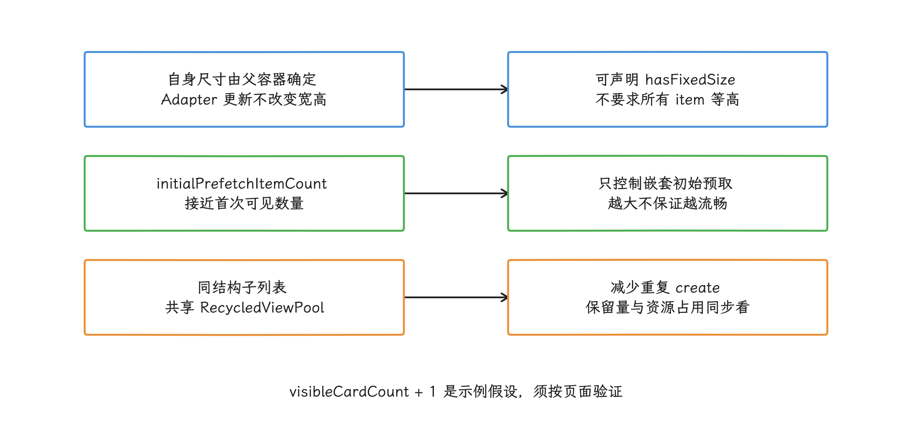

图：容器约束、预取数量与复用池是三个独立条件。

### 变更动画与局部刷新的配合

局部刷新做完后，还要看 ItemAnimator。1.4.0 的 `DefaultItemAnimator.canReuseUpdatedViewHolder(holder, payloads)` 对非空 payload 直接允许复用原 holder，通常不会为这类更新走新旧 holder 的交叉淡入淡出；它仍可能执行移动等动画。空 payload、自定义 ItemAnimator 或其他状态要按实际路径分析，不能把所有 payload 更新都归为双 holder 过渡。点赞、关注、计数器这类高频状态变更，通常只需要文本或图标状态切换，不需要整行 change animation。

<!-- gracker-diagram: a233-10-animation -->
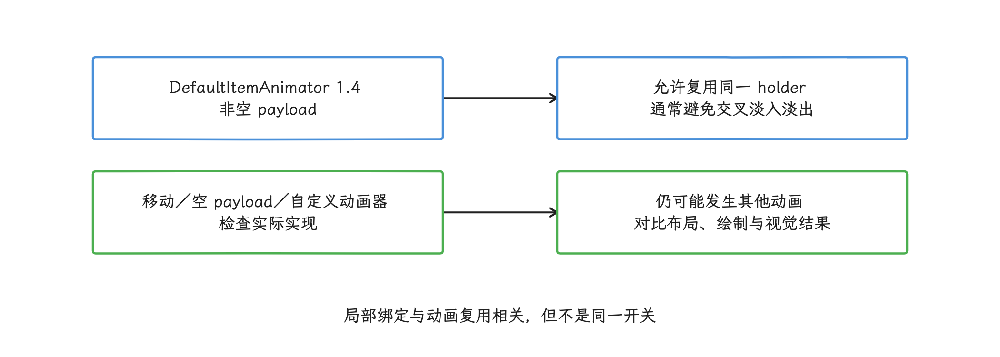

图：是否关闭 change animation 应由实际更新路径与同设备实验决定。

我们在同一台设备上录两段 Perfetto，一段保留 change animation，一段关闭 `supportsChangeAnimations`。如果关闭后 `RV OnLayout`、`RV onBindViewHolder` 和慢帧数量下降，并且交互视觉没有损失，就把关闭范围限定在对应 Adapter 或页面，不要全局一刀切。

### SnapHelper、LayoutManager 与 ItemDecoration 的热路径

扩展组件容易把线性列表的局部工作重新放大成整表工作：

- 自定义 `SnapHelper` 只检查可见或邻近候选项，几何计算要覆盖 `reverseLayout`、RTL、padding、ItemDecoration 和可变尺寸 item；不要在 fling 目标计算中遍历完整数据集或触发新布局。
- 自定义 `LayoutManager` 必须正确处理 Adapter 更新、pre-layout、焦点、无障碍、滚动范围和回收规则。`onLayoutChildren()` 与 fill 路径要避免从头扫描全部数据，prefetch position 和 distance 要从布局几何推导。
- `ItemDecoration.getItemOffsets()` 位于布局计算，`onDraw()` / `onDrawOver()` 位于绘制阶段。这里应避免对象分配、复杂 Path 和整表扫描；缓存要使用稳定输入作为 key，防止 position 移动后复用旧结果。

这三类扩展组件的改动同样要放进同设备的 A/B trace 里验收；动画相关的收益判断见上一节。

### Android 17 的 DeliQueue

Android 17 在 `targetSdkVersion >= 37` 时默认启用无锁 MessageQueue 实现 DeliQueue。旧实现用一个 monitor（Java 对象锁）保护按时间排序的消息链表；DeliQueue 改成让生产者通过 Treiber stack 提交消息——一种用 CAS（Compare-And-Swap，比较并交换）更新栈顶的无锁栈——消费顺序仍由 Looper 独占、按执行时间排序的 min-heap（按执行时间排序的最小堆）维护。它削减的是旧 MessageQueue 的这类锁竞争；`onCreateViewHolder()`、`onBindViewHolder()`、item 测量/布局、图片解码、RenderThread 或 SurfaceFlinger 的耗时，仍要回到各自的路径去优化。

RecyclerView 1.4.0 的 `GapWorker.postFromTraversal()` 仍通过 `RecyclerView.post()` 把预取任务送入主线程队列。从 post 到 `GapWorker.run()` 之间仍可能排着更早到期的消息，也可能遇到长回调或 CPU 调度延迟——无锁入队之后，任务照样要等自己的执行时机。预取自身也只覆盖 holder 获取、create 和 bind，下一帧的测量/布局仍需单独分析。

<!-- gracker-diagram: a233-11-deliqueue -->
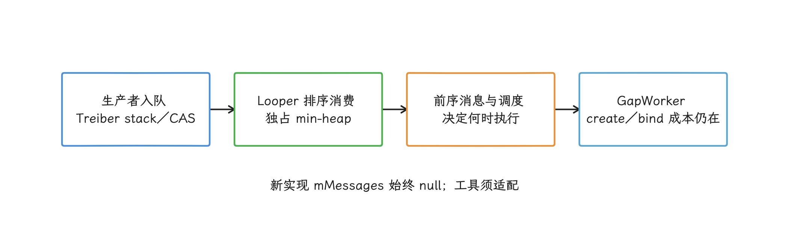

图：Android 17、target 37 默认 DeliQueue 减少旧队列锁竞争，不能消除积压与长回调。

排查时按现象分流：

- 主线程出现指向旧 `MessageQueue` 的 `monitor contention`（等待对象锁） 时，才把队列锁列为候选；切换 `USE_NEW_MESSAGEQUEUE` 后要重启进程，再对同一个 APK 做 A/B 对照。
- `RV Prefetch` 很晚、却没有队列锁等待时，检查前序 Looper 消息、主线程 Runnable 执行时间和 CPU 调度轨道。
- `RV onCreateViewHolder` / `RV onBindViewHolder` 很长时，回到 Pool、payload、图片和数据转换；`RV OnLayout` 很长时，回到约束和布局层级。
- App SurfaceFrame（应用侧帧）按时而 DisplayFrame（显示侧帧）迟到时，继续检查目标 layer、fence（跨处理单元同步信号）、SurfaceFlinger 与 HWC，别把它归到 DeliQueue。

适配 `targetSdkVersion 37` 时，还要清点通过反射读取 `MessageQueue.mMessages` 的测试、监控和调试工具；DeliQueue 只为二进制兼容保留该字段，启用新实现后它始终为 `null`。官方要求升级到 Espresso 3.7.0 或更高版本、Robolectric 4.17 或更高版本，并把 Robolectric 的 `@LooperMode(LEGACY)` 迁移到 `@LooperMode(PAUSED)`。业务侧仍要合并同一 item 的高频结果、限制主线程单次批量消费的工作量，并在页面生命周期结束时取消尚未应用的更新；无锁队列救不了消息堆积。

### RecyclerView vs LazyColumn 性能对比

`LazyColumn` 和 RecyclerView 都围绕可见窗口按需准备 item，也可能因预取，或焦点搜索、动画等 beyond-bounds（越过当前布局边界）访问，准备窗口之外的内容。Compose 的 `key` 为 item 提供跨位置变化仍稳定的身份，`contentType` 则告诉 Lazy 列表哪些 item 具有可兼容的组合结构。它和 RecyclerView 的 `viewType` / Pool 思路相近：类型划分越贴近可复用的 UI 结构，复用越稳定。

两者选型不要用固定结论：

| 页面条件 | 更适合 RecyclerView | 更适合 LazyColumn |
| --- | --- | --- |
| 既有 View 页面 | 已有 Adapter、图片库、曝光、分页和共享 Pool | 为单个 Compose 模块引入 View/Compose 混排成本高 |
| item 类型很多 | Pool、`viewType`、payload 已经调好 | `key`、`contentType` 清晰，item 状态已移到稳定的数据层 |
| 高频局部刷新 | payload 和 ItemAnimator 可细调 | 状态粒度拆得足够细，避免整行重组 |
| 团队能力 | 熟悉 Perfetto + RecyclerView trace | 熟悉 Compose 重组、Layout Inspector、Macrobenchmark |

迁移判断要看同一设备、同一数据集和同一交互脚本。至少对比四组指标：慢帧率、P95 帧耗时（95% 的采样不超过该值）、内存峰值、首屏可交互时间。Compose 写法中不要在 `LazyColumn` 的 `items` 内容里反复排序、过滤或创建大对象；这些工作会随重组重复发生，应按[官方 Compose 性能建议](https://developer.android.com/develop/ui/compose/performance/bestpractices)移到列表外计算，并用 `remember` 或更上游的数据层保存结果。

### RecyclerView 1.4 与自适应刷新率协作

RecyclerView 1.4.0 要求 `compileSdk >= 35`；运行在 API 35 及以上时，它会在 `OverScroller` 驱动的 fling（手指离开后的惯性滑动）和 smooth scroll（程序控制的平滑滚动）路径中调用 `View.setFrameContentVelocity()`，把滚动速度作为平台刷新率策略的输入。面板能力和 Hz 的选择都在系统侧，RecyclerView 起的是上报速度的作用。要判断实际效果，应同时核对 RecyclerView 版本、速度上报、Display 支持范围、系统刷新率决策和帧数据，别把面板切换结果归因给单个 Adapter 参数。

<!-- gracker-diagram: a233-12-velocity -->
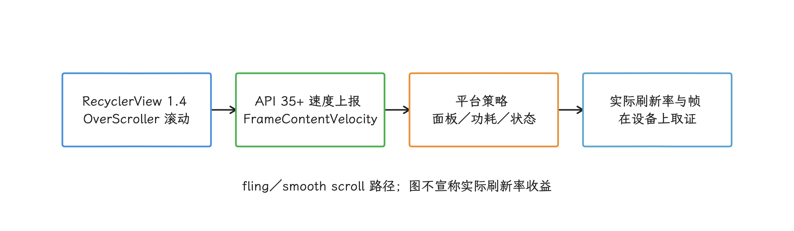

图：compileSdk 至少 35；系统决定最终刷新率，Adapter 参数不能保证固定 Hz。

### 验收清单

RecyclerView 优化完成后，我们至少要跑一次本地 trace 和一次线上指标回看：

- Perfetto 中 `RV onCreateViewHolder type=...` 若在稳定滑动阶段持续出现，回看 Pool、`viewType`、新类型进入窗口和 initial prefetch。
- `RV onBindViewHolder type=...` 应结合完整帧 deadline 与同一帧其他主线程工作判断；如果 bind 耗时的高分位值持续变长，回看 payload、图片加载、文本处理和同步 I/O。
- `RV Prefetch` / `RV Nested Prefetch` 及 forced 变体出现后，核对目标 position 的 create / bind 是否前移，并检查后续关键帧成本；不要只按切片是否存在判断命中。
- 慢帧集中在 `RV OnLayout` 时，回到 22.1 节查 item 布局层级、`requestLayout()` 来源和 change animation。
- UI 线程按时完成后仍有 jank（卡顿），就继续沿显示链往下查：RenderThread、图形缓冲区入队 `queueBuffer`、目标图层的 `BufferTX - <layerName>` 缓冲区事务、SurfaceFlinger 采纳缓冲区的 latch，以及 FrameTimeline 的最终 present 时刻；列表切片解释不了完整显示链。
- 线上按页面、机型、刷新率、列表类型拆指标；只看全局平均值会把低端机和复杂页面的问题稀释掉。

这套检查的目标是把 RecyclerView 问题拆成四类：复用没命中、增量更新没生效、预取没赶上、嵌套布局太重。分类清楚后，优化动作才不会互相抵消。

### 源码与文档

- [RecyclerView 1.4.0 source jar](https://dl.google.com/dl/android/maven2/androidx/recyclerview/recyclerview/1.4.0/recyclerview-1.4.0-sources.jar)：`RecyclerView`、`GapWorker`、`DiffUtil`、`AsyncListDiffer`、`ListAdapter` 与 `LinearLayoutManager` 的固定源码基线。
- [RecyclerView 1.4.0 release notes](https://developer.android.com/jetpack/androidx/releases/recyclerview#recyclerview-1.4.0)：版本变化与 Adaptive Refresh Rate 的支持范围。
- [AndroidX versions](https://developer.android.com/jetpack/androidx/versions)：当前稳定版与预览版总表。
- [`RecyclerView.Adapter`](https://developer.android.com/reference/androidx/recyclerview/widget/RecyclerView.Adapter)：stable ID、整表更新与 payload 的契约。
- [`RecyclerView.setHasFixedSize()`](https://developer.android.com/reference/androidx/recyclerview/widget/RecyclerView#setHasFixedSize(boolean))：RecyclerView 自身尺寸不受 Adapter 内容影响的契约。
- [`DiffUtil`](https://developer.android.com/reference/androidx/recyclerview/widget/DiffUtil)：差异计算、move 检测与回调语义。
- [`AsyncListDiffer`](https://developer.android.com/reference/androidx/recyclerview/widget/AsyncListDiffer)：后台 diff、列表提交与只读当前列表。
- [`LinearLayoutManager.setInitialPrefetchItemCount()`](https://developer.android.com/reference/androidx/recyclerview/widget/LinearLayoutManager#setInitialPrefetchItemCount(int))：嵌套列表 initial prefetch 的范围。
- [Compose lists](https://developer.android.com/develop/ui/compose/lists)：Lazy 列表、key 与 `contentType`。
- [Compose performance best practices](https://developer.android.com/develop/ui/compose/performance/bestpractices)：列表外预计算、`remember` 与重组控制。
- [Android 17 `View.java`](https://android.googlesource.com/platform/frameworks/base/+/android-17.0.0_r1/core/java/android/view/View.java)：`setFrameContentVelocity()` 的平台入口。
- [Android 17 MessageQueue behavior change](https://developer.android.com/about/versions/17/changes/messagequeue)：target SDK 37 的 MessageQueue 边界。
- [Android 17 lock-free MessageQueue internals](https://developer.android.com/blog/posts/under-the-hood-android-17-lock-free-message-queue)：Treiber stack、min-heap 与锁竞争分析。

## LazyList 组合、测量与预取

RecyclerView 的复用单位是 ViewHolder，LazyList 的复用单位跟组合和 key 相关；我们把两边的机制对照着看，迁移时缓存数量和预取参数都要按这边的模型重新评估。

惰性布局（Lazy layout）把数据集总量与同时参与组合的列表项数量分开；单项耗时过长、身份错误、重复测量、同步输入输出或 GPU 过载这些老问题，仍要我们逐项排查。Compose 部分的库基线是 BOM 2026.08.00 对应的 Foundation 1.12.0；Compose Foundation 独立发布，LazyList 的键、复用和预取语义由库版本决定，`targetSdk=37` 改变的只是平台侧行为。

普通 `LazyColumn` 和惰性网格仍通过宿主应用窗口的标准 HWUI 路径生成画面。主线程上的组合、测量、放置（placement）和 `DisplayList` 更新只是前半程，后续还有 `RenderThread`、GPU、图形缓冲区提交、`SurfaceFlinger`、HWC 与送显。完整显示链路见 [13.8 Jetpack Compose 渲染管线：Composition、Layout 与 RenderNode](../../part2-performance/ch13-rendering-pipelines/08-compose-rendering-pipeline.md)，重组基础见 [22.3 Compose 性能、Compiler 与 Modifier.Node 诊断](03-compose-compiler-modifier-diagnostics.md)，列表动画的阶段判断见 [22.7 View、Compose 动画与共享元素性能](07-view-compose-animation-shared-transition.md)。

### 1. LazyLayout 每次滚动会做什么

`LazyColumn`、`LazyRow`、普通网格和交错网格都建立在 `LazyLayout`/`SubcomposeLayout` 一类机制上。DSL（声明列表用的配置语法）描述整个数据集，测量策略只为当前需要的索引请求界面内容。“需要”的范围比可见列表项大：预取项、复用缓存、焦点或无障碍功能要求的 beyond-bounds 项目、粘性项目和动画暂时保留的项目，都可能参与进来。

滚动增量不一定触发一次完整重测。Compose 1.12.0 的 `LazyListState.onScroll()` 会先尝试 `copyWithScrollDeltaWithoutRemeasure()`：

- 可见列表项集合不变、增量没有跨过项目边界、也没有粘性项目等特殊情况时，可以直接更新位置，只请求放置阶段。
- 新项目进入、旧项目离开、首项变化、约束变化或特殊布局条件出现时，会重新测量。
- 重新测量时，`LazyListMeasuredItemProvider` 按索引取得键、`contentType` 和已测量的可放置对象；已有的兼容组合可以复用，缺失或失效的内容才需要执行相应组合。

所以跟踪数据里出现布局区间，离“所有可见项目都重新组合”的结论还差一步确认：我们要分清组合、测量和放置，并核对本帧有没有跨过项目边界。

<!-- gracker-diagram: a233-13-scroll-phases -->
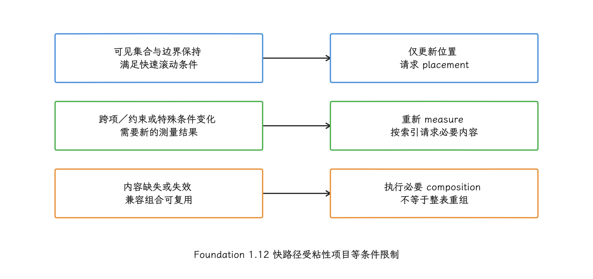

图：按阶段和索引确认成本，而不是用一条 layout 区间推出所有项目重组。

### 2. key 管业务身份

没有提供自定义键时，`LazyLayout` 使用位置生成默认键。显式返回索引也采用位置身份，两者都不能稳定代表业务实体；默认键对象与显式整数键并非同一种键，切换键策略也不应假设身份连续。列表头插入数据后，数字键 `0、1、2...` 仍然存在，但这些位置已经对应不同的业务对象。常见后果包括：

- `remember` 状态可能跟着位置留给另一条数据。
- 内层 LazyRow 的滚动位置、输入状态或动画身份可能错配。
- 原本只需移动位置的项目需要按新参数更新。
- `animateItem()` 拿位置键只能做位置级别的判断，业务实体的新增、删除和移动要靠稳定键才能识别。

准确的说法是“位置键仍然存在，但它对应的业务对象变了”：插入数据后索引键照旧有效，只是指向换了内容，据此推不出“所有项目一律销毁”。

<!-- gracker-diagram: a233-14-keys -->
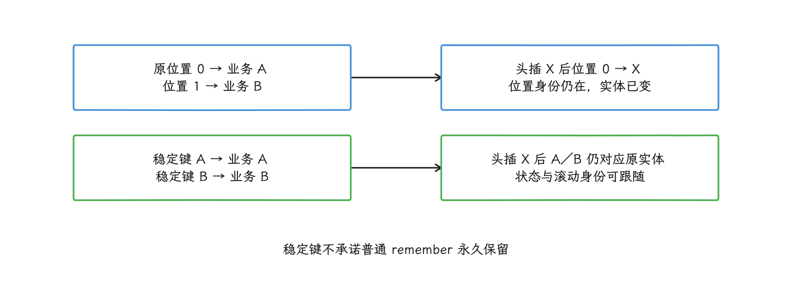

图：稳定、唯一且可保存的业务键用于身份；默认位置键和显式整数键的对象类型不同。

自定义键必须稳定、唯一，并且在 Android 上可由 `Bundle` 保存，才能支持项目内 `rememberSaveable` 的恢复。数据库主键、稳定的 `Long`/`String` ID 或可保存的复合 ID 都是合适的选择；`hashCode()` 可能碰撞，也可能随对象实现变化，做唯一身份并不保险。

下面的列表同时声明业务身份和结构类型。

```kotlin
LazyColumn {
    items(
        items = rows,
        key = { row -> row.id },
        contentType = { row -> row.kind },
    ) { row ->
        when (row) {
            is FeedRow.Article -> ArticleRow(row)
            is FeedRow.Ad -> AdRow(row)
            is FeedRow.Divider -> DividerRow(row)
        }
    }
}
```

`id` 要在同一列表中唯一，`kind` 要反映可组合内容的结构。数据移动时，`LazyLayout` 可以用键查找新索引、维持首个可见项目的业务身份，并让保存状态跟随项目移动。

### 3. contentType 管复用兼容性

业务身份由键负责，`contentType` 管的是另一件事：它告诉 `LazyLayout` 哪些项目的组合结构兼容，可以把滚出后的旧槽位（slot，即可复用的组合位置）交给新项目。默认值 `null` 也是有效类型；未提供时，所有项目都被视为同一兼容类型。

Compose Foundation 1.12.0 的 `LazyLayoutItemReusePolicy` 用 `contentType` 相等判断槽位是否兼容，并为每种类型最多保留 7 个可复用槽位。这个数量属于当前内部实现，会随版本调整，设计时按“结构相近才复用”划分即可。

类型划分应遵循两条约束：

- 文章卡、广告、分隔线、加载行等结构差异明显的项目使用不同类型。
- 同一结构、只有文本或数据不同的项目共用一个类型。

把每个业务 ID 当作 `contentType` 会阻断跨项目复用；把差异很大的结构都留为 `null`，会让 Compose 运行时尝试在不相似的内容之间复用。复用提供的是兼容的槽位，写入新数据时仍可能执行重组。

<!-- gracker-diagram: a233-15-content-type -->
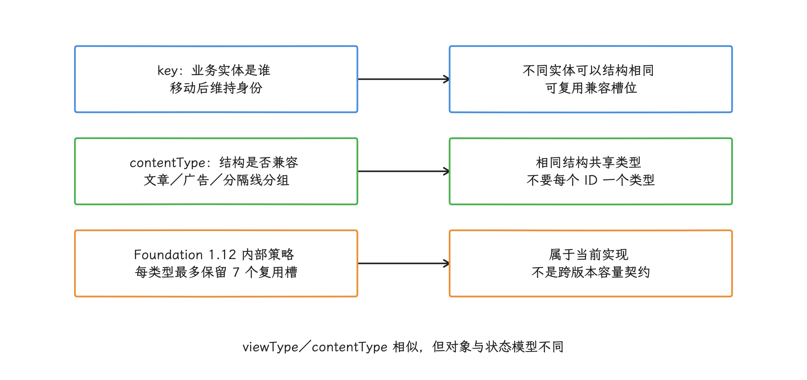

图：null 也是有效 contentType；复用槽位仍要按新参数更新内容。

RecyclerView 的 `viewType` 与 Compose 的 `contentType` 都表达兼容分组，但容器、状态和复用实现不同；两者的内存或帧率表现，要各自测过再下结论。

### 4. 项目状态：remember、rememberSaveable 与数据状态

普通 `remember` 只在对应组合存活时保留。项目滚出后可能暂时处在复用区或缓存区，也可能从组合中移除；一旦移除，普通 `remember` 值就结束生命周期。稳定键保住的是身份，普通 `remember` 的生命周期仍跟着组合走。

<!-- gracker-diagram: a233-16-state-lifetimes -->
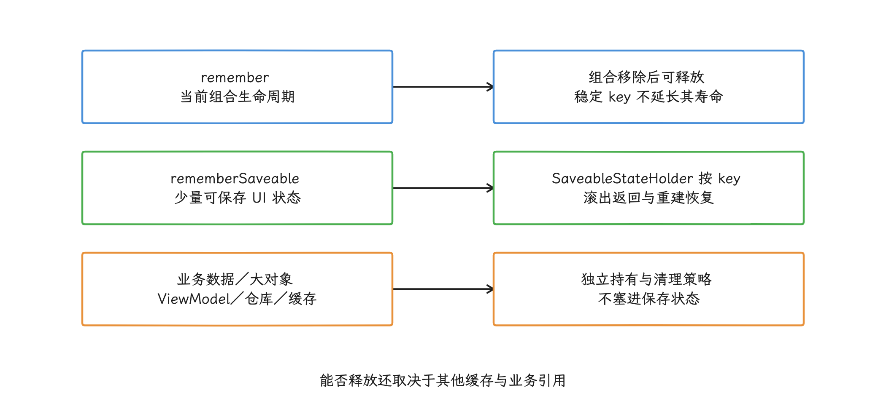

图：嵌套 LazyRow 的可保存滚动状态需要正确的外层业务键。

`LazyLayout` 用 `SaveableStateHolder` 包装项目。键可保存时，`rememberSaveable` 可以在项目滚出又回来时恢复，也能参与 `Activity` 重建后的恢复。需要跨滚动长期保存的少量界面状态可使用它；业务数据和大对象应放在 `ViewModel`、数据仓库或专用缓存中。

嵌套 `LazyRow` 的状态也遵循这条规则：外层项目使用稳定键，内层使用 `rememberLazyListState()`。该状态本身通过 `rememberSaveable` 保存，外层业务身份移动后仍能恢复到对应行。若外层只用位置身份，内层滚动位置可能跟错行。

#### 列表数据更新时缩小无效工作

在页面层收集一份列表 `State` 是常见结构。列表引用更新会让读取它的作用域失效，但 `LazyLayout` 只为当前需要的项目执行内容；强跳过模式（Strong Skipping）还能跳过参数未变且满足比较条件的行。把同一个 `Flow` 分散到每个项目中收集，可能建立大量收集协程，算不上通用优化。

更可靠的做法包括：

- 行模型使用不可变数据，未变化的行尽量复用实例。
- 可组合函数参数只表达当前行需要的数据，避免把整个页面状态传进每一行。
- 回调捕获稳定 ID；用编译器报告和 Layout Inspector 确认哪些行可以跳过。
- 排序、分组、日期格式化等工作放在数据层，或按输入用 `remember` 缓存。
- 项目内容中不要同步执行数据库查询、文件读取和图片解码。

`remember(item.createdAt) { formatter.format(item.createdAt) }` 能避免同一次组合生命周期内重复计算，但项目离开组合后仍会重算。线程安全要看格式化器的实现，`remember` 本身给不了这层保证。

### 5. 高频滚动状态放在合适的观察位置

`LazyListState.layoutInfo` 会在每次滚动或重新测量后更新。`firstVisibleItemScrollOffset` 可随滚动频繁变化，`firstVisibleItemIndex` 只在首个可见项目跨界时变化。我们把这些值直接读在大范围可组合函数里，重组作用域就会跟着扩大。

`derivedStateOf` 适合把高频输入转换成低频布尔值或离散结果；`snapshotFlow` 适合把滚动变化发送给埋点等副作用逻辑。前者控制状态通知频率，后者把 Compose 状态转换成可收集的数据流。

下面的示例让按钮只在阈值变化时重组；每次回到顶部后再次离开，会触发一次副作用回调。若开始收集时已经离开顶部，`snapshotFlow` 的首次 `true` 也会触发回调；它不是只统计用户跨界动作的事件源。

```kotlin
@Composable
fun ScrollSignals(
    listState: LazyListState,
    onLeftTop: () -> Unit,
) {
    val showScrollToTop by remember(listState) {
        derivedStateOf { listState.firstVisibleItemIndex > 0 }
    }
    val currentOnLeftTop by rememberUpdatedState(onLeftTop)

    LaunchedEffect(listState) {
        snapshotFlow { listState.firstVisibleItemIndex > 0 }
            .filter { it }
            .collect { currentOnLeftTop() }
    }

    AnimatedVisibility(showScrollToTop) {
        ScrollToTopButton()
    }
}
```

`derivedStateOf` 的输出只有跨过列表顶部时才改变；`snapshotFlow` 不参与绘制，只驱动回调。若界面需要连续视差，可在 `Modifier.offset { ... }`、绘制回调或 `graphicsLayer` 回调中读取偏移量，把更新延后到布局或绘制阶段。

<!-- gracker-diagram: a233-17-scroll-signals -->
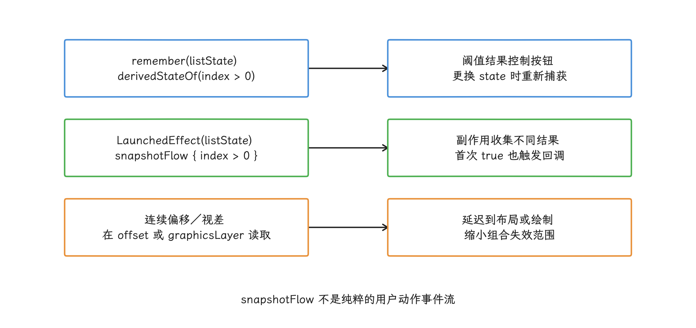

图：布尔阈值、事件统计和连续画面更新有不同观察语义。

### 6. 项目切分与尺寸对首屏的影响

`LazyLayout` 的虚拟化单位是 DSL（用于声明列表结构的配置语法） 中的一个 `item`。一个项目代码块同时生成多个大型组件时，即使只有一部分需要显示，整个代码块也要参与组合和测量；`scrollToItem()` 也只能定位到这个共同索引。分隔线很轻时，我们可以把它与相邻内容放在同一项目；大块内容则应各有索引。

零尺寸或严重低估尺寸的占位内容（placeholder），会让容器误判可见区域（viewport）能容纳很多项目，从而在首轮请求更多内容。异步加载后尺寸突变，又会改变可见范围和滚动位置。图片流应尽早给出宽高比或稳定高度；Paging 占位内容应接近加载后的尺寸。

项目尺寸不必全部相同，需要检查尺寸计算是否稳定：

- 文本、图片比例和约束是否在加载前后大幅跳变。
- `animateContentSize`、展开/收缩与位置动画是否叠加。
- 项目内的 `SubcomposeLayout`、自定义固有尺寸（intrinsic）测量或多次测量是否出现在慢帧。
- 同一帧新进入的复杂项目是否过多。

列表长度达到十万条，同屏组合的部分通常照旧；数据容器、Paging 内存、键到索引的查找、图片缓存和单次更新的差异规模，仍要单独测量。

<!-- gracker-diagram: a233-18-item-size -->
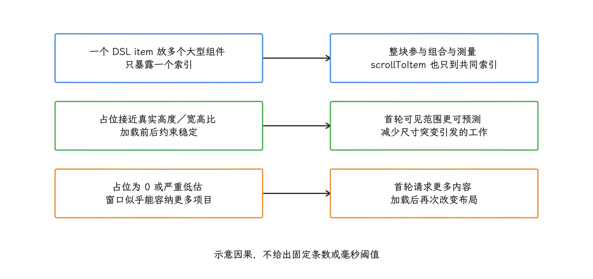

图：项目无需等高，但占位尺寸应代表真实内容；列表总数不能独自决定 UI 成本。

### 7. 预取运行在主线程的剩余时间里

Compose 1.12.0 默认的 `LazyListPrefetchStrategy` 会根据滚动方向请求相邻的下一个项目，执行预组合和预测量；方向改变或目标失效时会取消旧请求。项目接近可见区域时，请求可标为紧急：只要本帧仍有剩余时间就可以执行，不再要求剩余时间超过该步骤的历史平均耗时。

嵌套场景中，父 `LazyLayout` 预取到包含子 LazyList 的项目后，会解析子列表的预取状态。默认内层策略从当前首项开始预组合 2 个子项目，并可依据历史结果调整数量。嵌套预取是尽力而为的：数据或子树在解析后再变化，这轮预取就可能白做。

Android 的 `AndroidPrefetchScheduler` 通过 `View.post` 和 `Choreographer.FrameCallback` 调度请求。它用 `View.drawingTime`、最近一次帧起点和显示刷新周期估算当前帧的剩余时间，把未完成工作留到后续帧。组合与测量都在界面线程执行，“预取”指的是时机，后台线程并不构建界面。

Compose Foundation 1.12.0 中，实验性回退标志 `ComposeFoundationFlags.isPausableCompositionInPrefetchEnabled` 默认是 `true`。启用后，复杂项目的预组合可以多次恢复和暂停，后续有预算时再继续；组合完成后才应用结果并预测量。这样可以缩短单次占用主线程的时间，主线程和内存的总成本还在原地。`ComposeFoundationFlags` 允许应用在遇到回归时临时关闭新路径，官方也把这些标志定义为临时入口，别当成长期依赖。

<!-- gracker-diagram: a233-19-compose-prefetch -->
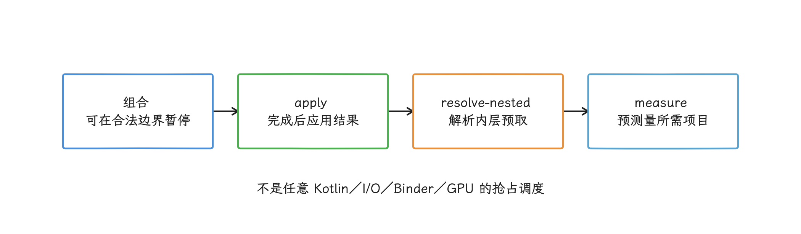

图：Foundation 1.12 可暂停的仅是组合阶段；四段仍在 UI 线程消耗预算。

#### LazyLayoutCacheWindow 的前向与后向窗口

1.12.0 的 `LazyLayoutCacheWindow` 仍标注为实验 API：

- 前向窗口（ahead window）预先准备滚动方向前方的项目。
- 后向窗口（behind window）保留反方向上已经离开可见区域的项目，减少快速回滚时的重建。

窗口既可用 `Dp` 指定，也可按可见区域比例指定。两种形式表达的都是缓存范围，计量单位是距离或比例，与项目个数无关。

下面的示例展示 Dp 窗口的接入方式。

```kotlin
@OptIn(ExperimentalFoundationApi::class)
@Composable
fun CachedFeed(rows: List<FeedRow>) {
    val state = rememberLazyListState(
        cacheWindow = LazyLayoutCacheWindow(
            ahead = 200.dp,
            behind = 100.dp,
        )
    )

    LazyColumn(state = state) {
        items(rows, key = { it.id }) { row ->
            FeedRowContent(row)
        }
    }
}
```

`200.dp/100.dp` 只用于说明 API，不是推荐参数。窗口越大，越可能提前完成组合和测量，也会保留更多组合、图片请求和状态。是否采用及窗口大小，应根据目标设备上的滚动速度、项目成本、内存峰值和 `frameOverrunMs` 决定。

<!-- gracker-diagram: a233-20-cache-window -->
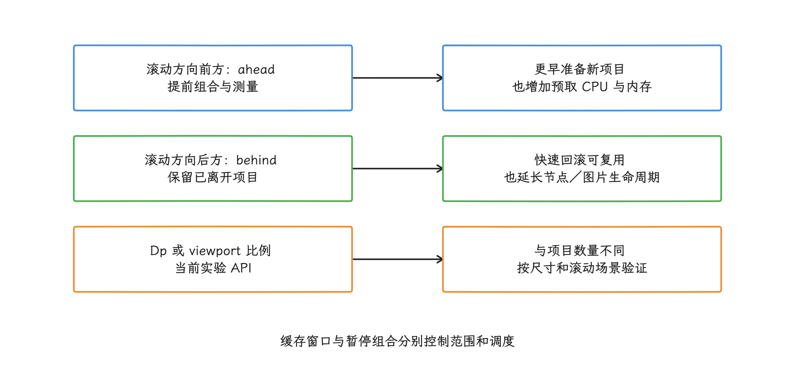

图：窗口随滚动方向解释，示例距离不是通用配置。

### 8. 嵌套滚动先处理约束和轴向

垂直 `LazyColumn` 内放水平 `LazyRow` 是官方支持的常见结构。两个方向的手势、预取和状态仍需分别分析。自定义 `NestedScrollConnection` 要按滚动前/后与惯性滚动前/后的协议报告已消费位移或速度；错误的消费值可能造成位移丢失、父子同时响应或速度突变。

同方向可滚动容器在子项没有有限尺寸时会遇到无限约束，典型例子是在带 `verticalScroll` 的 `Column` 内直接放入没有固定高度的 `LazyColumn`。此结构会抛出 `IllegalStateException`。可选设计包括：

- 合并为一个 LazyColumn，用 `item`、`items`、`stickyHeader` 表达页面段落。
- 子列表确有独立滚动语义时，给它有限高度。
- 父子使用不同滚动方向。

<!-- gracker-diagram: a233-21-nested-constraints -->
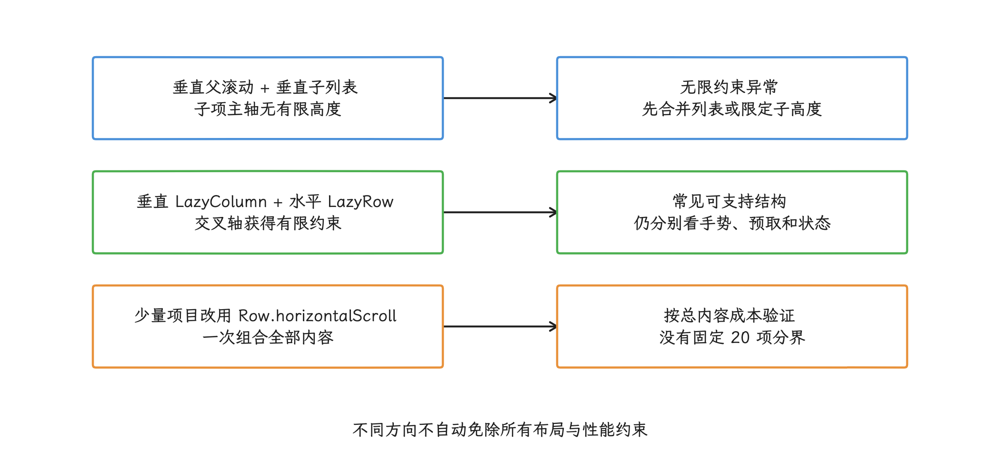

图：轴向与尺寸约束先于 nested-scroll 消费协议；自定义消费必须返回实际消耗。

把 `LazyRow` 换成 `Row.horizontalScroll()` 会一次组合全部子项，适合数据量明确且总内容较少的情况。能否承受取决于项目成本和设备，固定 20 项不是普适分界。

### 9. Paging 3 的数据预取与界面预取

Paging 的 `prefetchDistance` 控制访问列表位置时何时请求更多数据；`LazyLayout` 的预取和缓存窗口控制哪些界面项目提前组合、测量或保留。两者的单位与触发条件不同，参数数值无需相等。

<!-- gracker-diagram: a233-22-paging -->
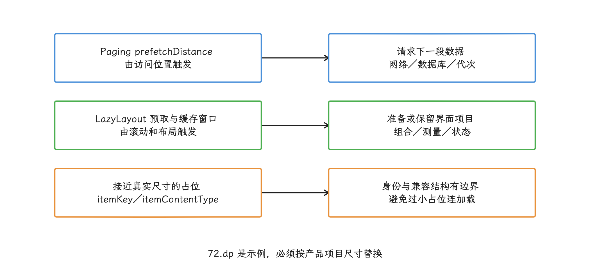

图：数据已加载不代表 UI 已组合；refresh 新代次也不等于十万项全部重组。

下面的接入方式同时提供 Paging 的业务键和内容类型。

```kotlin
val lazyPagingItems = pager.flow.collectAsLazyPagingItems()

LazyColumn {
    items(
        count = lazyPagingItems.itemCount,
        key = lazyPagingItems.itemKey { message -> message.id },
        contentType = lazyPagingItems.itemContentType { "message" },
    ) { index ->
        val message = lazyPagingItems[index]
        if (message == null) {
            MessagePlaceholder(Modifier.height(72.dp))
        } else {
            MessageRow(message)
        }
    }
}
```

`itemKey` 让已加载实体保持身份，`itemContentType` 也为占位内容提供 Paging 定义的兼容处理。`72.dp` 必须换成接近产品项目的尺寸；占位内容过小，`RemoteMediator`（负责远端与本地数据的协调）可能连续加载多页，直到可见区域被填满。

`refresh()` 启动的是新一代 `PagingData` 数据流，十万条尚未进入组合的项目不会因此全部重组；界面成本取决于新的数据快照、当前需要的项目、键/`contentType` 兼容性和加载状态结构。

Paging 路径还要检查：

- `map`、`insertSeparators` 等转换放在 `PagingData` 数据流上，避免在项目函数体中同步执行耗时工作。
- 加载/错误行有独立键和结构类型，动画数量受控。
- 占位内容与真实内容的尺寸接近。
- 数据加载线程、数据库查询和网络耗时与主线程界面跟踪数据分开分析。

### 10. 网格与交错网格

Compose Foundation 1.12.0 包含 `LazyVerticalStaggeredGrid` 和 `LazyHorizontalStaggeredGrid`。普通网格按行（line）组织项目，交错网格按轨道（lane）安排主轴尺寸不同的项目；交错布局由 Foundation 直接提供。

普通网格的跨列数（span）会影响行划分和每个项目的尺寸约束。列数、可用宽度或跨列数变化后，相关可见行需要重新测量。复用兼容性仍由 `contentType` 判断；`(contentType, spanSize)` 组合分组的复用属于未承诺行为，设计时别建立在它之上。

网格页面重点检查：

- `GridCells.Adaptive` 在窗口或折叠状态变化后是否改变列数。
- 自定义跨列数回调是否轻量，跨满整行的标题是否过多。
- 同一行中高度差异是否造成额外空白或频繁尺寸变化。
- 交错网格图片是否提前提供宽高比，避免加载后轨道大幅调整。
- 项目位置动画是否与列数变化同时运行。

大屏、多窗口和桌面模式下，交叉轴尺寸约束可能频繁变化。Android 17 平台决定窗口、VSync、`FrameTimeline` 和 HWUI 行为，网格的行/跨列算法仍由所用 Compose Foundation 版本决定。

<!-- gracker-diagram: a233-23-grid -->
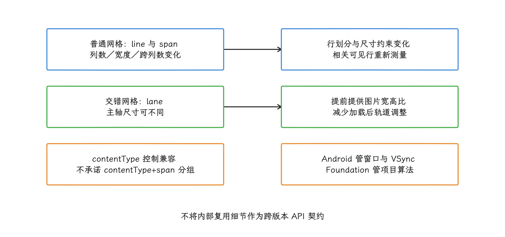

图：窗口和折叠状态会改变约束；项目位置动画可能与列数变化叠加。

### 11. 内存边界

`LazyLayout` 同时持有的内容可能来自多处：

- 当前测量需要的可见项目。
- 按 `contentType` 保留的可复用槽位。
- 尚未消费或取消的预取。
- 缓存窗口中的前向/后向项目。
- 当前被粘性定位、焦点、无障碍、动画或可见区域外操作固定的项目。
- `SaveableStateHolder` 保存的少量项目界面状态。

粘性标题只在候选项成为当前固定标题等需要时参与布局，历史上滚过的标题并不会都留在组合里。项目离开组合后，普通 `remember` 持有的大对象可以释放；图片加载库、业务缓存或 `ViewModel` 中的引用可能继续持有对象，需要分别检查这些缓存。

内存评估应记录稳定的用户流程：冷启动进入列表、连续滚动、反向滚动、刷新和离开页面。比较 Java/Kotlin 堆、原生图形内存、图片缓存和 GC 停顿；对象由谁持有，要靠这些流程前后的对比回答，单次 `Debug.getMemoryInfo()` 快照回答不了。

<!-- gracker-diagram: a233-24-retention -->
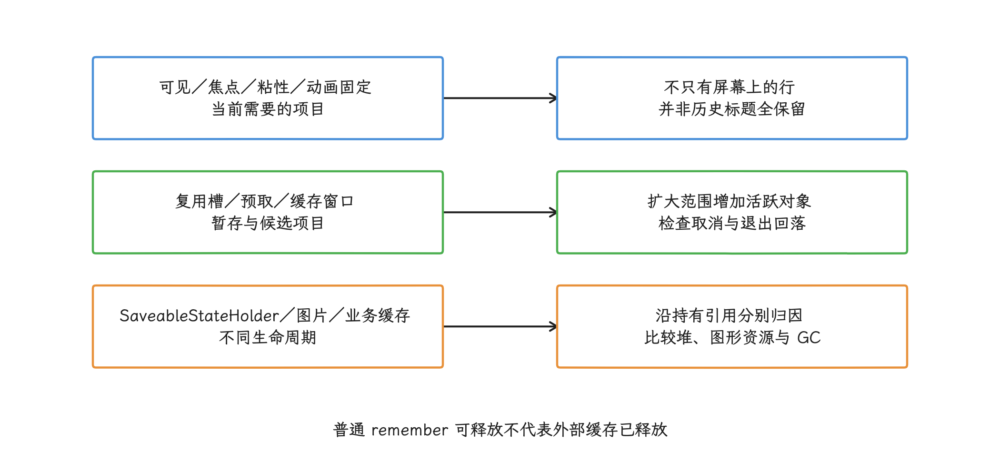

图：连续滚动、反向、刷新与退出的同一流程，才能说明峰值和资源回落。

### 12. 用 Perfetto 和 Macrobenchmark 归因

我们测量时要用 release 构建，开 R8 优化，并标记 profileable、non-debuggable。Debug 版本的编译状态、未优化代码、调试检查和工具连接可能放大惰性布局成本；不能把所有 Debug 执行都视为纯解释执行。

我们按下面的顺序收集数据：

1. Macrobenchmark 用 UI Automator 重复同一次惯性滚动或拖动，采集 `FrameTimingMetric`。
2. API 31 及以上查看 `frameOverrunMs`、`frameDurationCpuMs` 和 `frameCount`。
3. 在 Perfetto 的应用 `FrameTimeline` 中对齐预期/实际时间线，确定哪些帧迟到，以及应用是否按时完成。
4. 查看主线程上的组合、测量、放置、输入输出和 ART/GC 区间。
5. 查看 `RenderThread`、GPU、图形缓冲区入队与 SurfaceFlinger，排查图片、阴影、透明度、模糊或缓冲区反压。
6. 用组合跟踪（Composition tracing）或 Layout Inspector 验证具体项目的组合/跳过范围。

`Choreographer#doFrame` 覆盖的是应用主线程帧回调，GPU 完成和送显要看后面的链路。组合跟踪需要 Compose Runtime 的跟踪支持与 Perfetto `track_event` 数据源，系统侧并没有通用的 `compose-recomposition` atrace 开关；Perfetto 的 `slice` 表记录带起止时间的区间事件，可直接求和的通用 `skipped` 列也不存在。写查询前先确认当前版本产生的区间名称和字段。

<!-- gracker-diagram: a233-25-frame-evidence -->
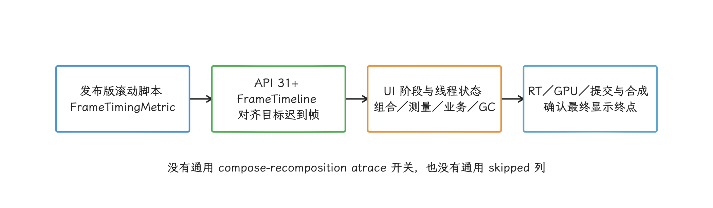

图：doFrame 只覆盖应用主线程帧回调；composition tracing 需要运行时与 track_event 支持。

下面的 PerfettoSQL 用于列出指定交互时间段中的应用卡顿帧。

```sql
SELECT
    a.id AS frame_slice_id,
    a.upid,
    a.ts / 1e6 AS ts_ms,
    a.dur / 1e6 AS actual_dur_ms,
    a.jank_type,
    a.on_time_finish,
    a.present_type,
    a.layer_name
FROM actual_frame_timeline_slice AS a
JOIN process AS p USING (upid)
WHERE p.name = 'com.example.app'
  AND a.dur >= 0
  AND a.ts < $end_ts
  AND a.ts + a.dur > $start_ts
  AND a.jank_type != 'None'
ORDER BY a.ts;
```

`$start_ts/$end_ts` 是待绑定的 SQL 参数，使用跟踪数据的纳秒时间基准；在没有参数绑定的查询环境中，先替换为整数。查询选取与 `[start_ts, end_ts)` 相交的已完成区间，时长仍保留整帧，不裁切到窗口。相同进程名可能对应不同 `upid`，一进程也可能有多个 layer，单窗口归因需继续限定目标 `upid` 与 `layer_name`。`actual_dur_ms` 是应用实际帧时间线区间的时长，结束点取应用 GPU 完成与图形缓冲区入队中较晚的时刻；它不等同于主线程 CPU 时间。

下面的查询用于列出同一时间段内主线程最长的区间事件。

```sql
SELECT
    s.id AS slice_id,
    p.upid,
    s.ts / 1e6 AS ts_ms,
    s.dur / 1e6 AS dur_ms,
    s.name
FROM slice AS s
JOIN thread_track AS tt ON s.track_id = tt.id
JOIN thread AS t ON tt.utid = t.utid
JOIN process AS p ON t.upid = p.upid
WHERE p.name = 'com.example.app'
  AND t.tid = p.pid
  AND s.dur >= 0
  AND s.ts < $end_ts
  AND s.ts + s.dur > $start_ts
ORDER BY s.dur DESC
LIMIT 100;
```

这些是完整区间的 inclusive 墙钟时长，可能包含子区间与线程等待；父子区间不能直接相加，也不能当作 Running CPU 时间。先从结果中识别 Compose、测量、图片、业务跟踪或 GC 相关名称，再回到时间轴核对线程状态。区间名称会随库版本和是否开启组合跟踪而变化，别把固定字符串当成跨版本指标。

<!-- gracker-diagram: a233-26-sql-window -->
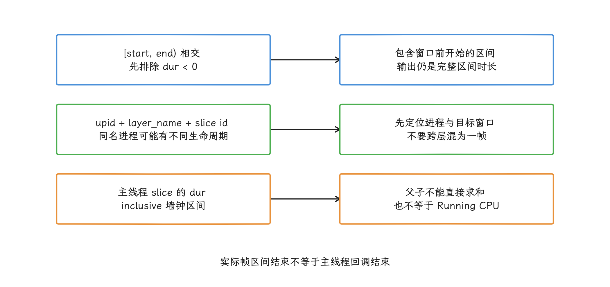

图：纳秒参数必须绑定或替换；先证明时间与身份，再讨论成本。

如果怀疑对象频繁分配和回收，应使用分配记录（allocation recording）或合适的堆分析器（heap profiler）查找分配调用栈；堆大小计数器只能显示存量变化，给不出每次分配的类型与调用点。GC 与卡顿同时出现只说明时间上相关，我们还要找出造成回收压力的对象来源。

### 13. PausableComposition 的适用范围

`PausableComposition` 是 Compose Runtime 提供的可暂停子组合状态机，Foundation 的惰性预取决定是否使用它。它能暂停的只有组合阶段，测量、图片解码、Binder、GPU 或任意 Kotlin 代码都切分不了。Foundation 1.12.0 把一次预取分成组合、应用、嵌套预取和测量四段；其中只有组合阶段能在编译器生成的合法可重启作用域边界暂停。

公开控制流是 `setPausableContent()` → 多次 `resume(shouldPause)` → `apply()`。`shouldPause=true` 只是暂停请求，当前调用可能继续到下一个合法边界；组合完成后，如果已读取的 `State` 在 `apply()` 前发生变化，`isComplete` 也可能恢复为 `false`。`cancel()` 后创建该暂停句柄的组合处于不确定状态，必须丢弃；异常也会让暂停组合失效。普通业务代码直接构造和管理它的场景很少。

<!-- gracker-diagram: a233-27-pausable-machine -->
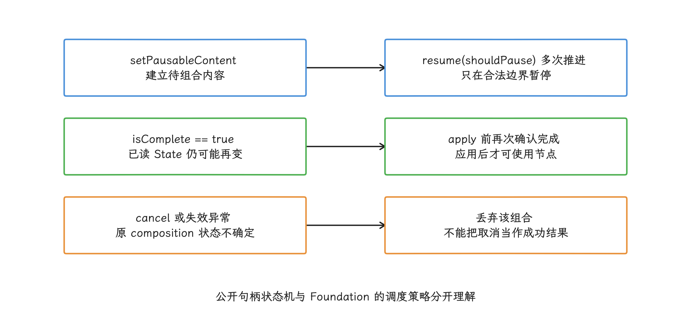

图：暂停请求不会切断任意用户代码；apply 前 State 变化可能使完成状态再次失效。

Android 端预取调度器在主线程消息队列的帧间空隙运行。Foundation 1.12.0 使用 `View.drawingTime`、最近一次帧起点、静态缓存的显示刷新周期，以及历史组合/测量成本判断是否还有预算；它不直接读取 Android 17 `FrameData` 的截止时间。平台首选 `FrameTimeline` 与 Compose 预取预算来自不同数据源，跟踪分析时要分别记录。

<!-- gracker-diagram: a233-28-budget-origin -->
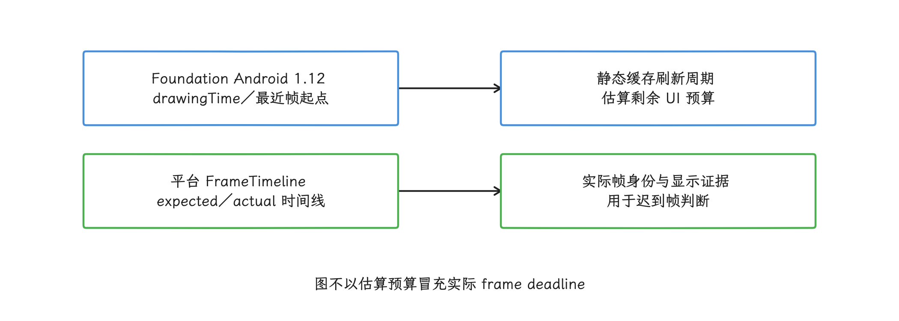

图：调度器没有直接读取 Android 17 FrameData 截止时间；两组数字不能直接互换。

`LazyLayoutCacheWindow` 决定前方准备和后方保留的范围，`PausableComposition` 只改变候选项目的组合调度。扩大前向窗口会增加 CPU 预取，扩大后向窗口会延长节点、状态和图片资源的生命周期。判断回归时，应分别查看 `compose:lazy:prefetch:*` 中的 `compose`、`apply`、`measure` 区间、下一帧启动时间、`FrameTimeline` 超期时间与内存峰值。组合区间变短而应用或测量区间仍然很长，预取仍可能造成卡顿。

业务优化顺序仍是提供稳定键和合适的 `contentType`、移出同步输入输出与复杂转换、稳定项目尺寸，再调整缓存窗口与预取。A/B 实验要记录版本标志、显示刷新率、数据集、构建类型和设备热状态；结论以实验数据为准，“升级到某版 Compose”本身说明不了问题。

### 14. Android 17 与内核边界

平台侧提供的是 `Choreographer`、`FrameTimeline`、HWUI、窗口和系统合成路径。Compose 1.12.0 的 `LazyLayout` 算法打包在应用内；可暂停组合、缓存窗口或新的项目复用策略，都随所用 Compose 版本走，升级 `targetSdk` 单独开启不了它们。

本文用于源码定位的内核参考标签是 `android17-6.18-2026-06_r6`，不代表所有 Android 17 设备的内核版本：调度器、CPU 调频（cpufreq）、热限制（thermal）、内存回收和同步 fence 等待影响主线程、`RenderThread` 或 GPU 驱动任务何时运行；键/`contentType`、项目移除和 `PagingData` 代际则由应用侧代码决定。跟踪数据出现线程可运行但迟迟未获调度、频率或热限制、内存回收或 fence 等待时，再看内核侧数据即可。

<!-- gracker-diagram: a233-29-platform-boundary -->
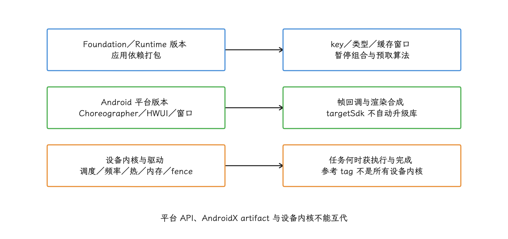

图：先定位证据所在层，再决定升级库、优化主线程还是分析系统调度。

### 15. LazyList 与 RecyclerView 的选型

选型没有脱离页面场景的固定胜者。Compose `LazyLayout` 与 `RecyclerView` 都支持按需创建和复用，状态模型、布局、预取、动画和工具链各有差异；下结论要看当前应用自己的发布版基准测试，公开资料只作参考。

- 新 Compose 页面可优先使用 `LazyLayout`，并建立键/`contentType`、Paging 和 Macrobenchmark 基线。
- 已稳定运行的 `RecyclerView` 页面无需只为统一技术栈而迁移；迁移收益要覆盖互操作、功能回归和性能验证成本。
- `RecyclerView` 项目内大量使用 `ComposeView` 会增加组合生命周期管理；`LazyColumn` 中大量使用 `AndroidView` 也会增加 View 创建、复用和桥接成本。
- 同一页面的两种实现要在相同数据、图片缓存、编译模式、设备温度和交互脚本下比较。

### 16. 版本升级、同版本 A/B 与回退

Pausable Composition 是 Compose Runtime 与 Foundation 的库能力，不由 Android API 级别开启。排查前要确认最终解析出的 Runtime、Foundation 与 UI 版本，而不是只看 BOM 或 version catalog 中声明的版本；三者被传递依赖分别升级或降级时，源码默认值和运行时行为都可能与预期不同。

```bash
./gradlew :app:dependencyInsight \
  --dependency androidx.compose.runtime:runtime \
  --configuration releaseRuntimeClasspath

./gradlew :app:dependencyInsight \
  --dependency androidx.compose.foundation:foundation \
  --configuration releaseRuntimeClasspath

./gradlew :app:dependencyInsight \
  --dependency androidx.compose.ui:ui \
  --configuration releaseRuntimeClasspath
```

`ComposeFoundationFlags.isPausableCompositionInPrefetchEnabled` 是临时的实验性回退入口，默认值曾在 Foundation 补丁版本之间变化。升级时应同时保存解析依赖树、发布说明、当前源码默认值、固定数据与手势的 Macrobenchmark 基线；别拿“某个大版本以后一定开启”代替核对。

出现回归时，优先在**同一 Foundation 版本、同一代码、同一设备**上构建两个独立变体：一个保留默认值，一个在首次使用 Compose 前关闭该标志。下面使用 `attachBaseContext()`，早于通常的 ContentProvider 初始化；仍须检查 Application 的静态/字段初始化及其他更早入口是否已经使用 Compose。Compose 代码加载后再改标志属于未定义行为，所以同一进程运行中也没法动态切换；两组都要冷启动独立进程，并保持 R8、Baseline Profile、数据、图片缓存、刷新率和温度条件一致。发布变体还应按该版本 `ComposeFoundationFlags` 的源码建议，配套固定值的 R8 `-assumevalues` 规则，并核查最终 APK 的分支；单靠运行时赋值不能替代发布构建核验。

<!-- gracker-diagram: a233-30-ab-variants -->
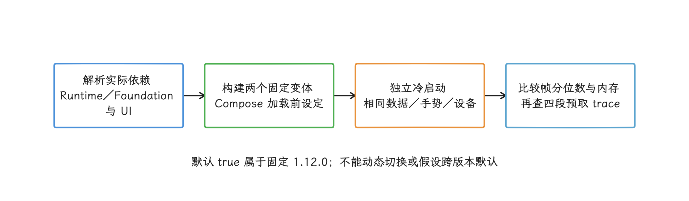

图：FoundationFlags 是临时实验回退入口；发布变体还要核查 R8 固定值规则和最终分支。

```kotlin
@OptIn(ExperimentalFoundationApi::class)
class BenchmarkLegacyPrefetchApp : Application() {
    override fun attachBaseContext(base: Context) {
        ComposeFoundationFlags.isPausableCompositionInPrefetchEnabled = false
        super.attachBaseContext(base)
    }
}
```

判断顺序保持为：先比较 `frameOverrunMs` 的 p50/p90/p95/p99 与内存峰值，再在 Perfetto 中区分 `compose:lazy:prefetch:compose`、`apply`、`resolve-nested` 和 `measure`。只有同版本对照稳定指向可暂停预取，而且短期没有已修复补丁时，才把关闭标志当成生产回退；长期方案仍是升级修复版本、减轻列表项工作或调整缓存窗口，并在回退后重新测量旧的完整组合路径。

### 17. 源码与资料索引

Compose 行为按 BOM 2026.08.00 与 1.12.0 source JAR 复核：

- [Compose BOM 2026.08.00 POM](https://dl.google.com/dl/android/maven2/androidx/compose/compose-bom/2026.08.00/compose-bom-2026.08.00.pom)。
- [`androidx.compose.foundation:foundation:1.12.0` 源码](https://dl.google.com/dl/android/maven2/androidx/compose/foundation/foundation/1.12.0/foundation-1.12.0-sources.jar)：`LazyListState.kt`、`LazyListMeasure.kt`、`LazyListPrefetchStrategy.kt`、`LazyLayout.kt`、`LazyLayoutItemContentFactory.kt`、`LazyLayoutPrefetchState.kt`、网格与交错网格实现。
- [`androidx.compose.foundation:foundation-android:1.12.0` 源码](https://dl.google.com/dl/android/maven2/androidx/compose/foundation/foundation-android/1.12.0/foundation-android-1.12.0-sources.jar)：`PrefetchScheduler.android.kt`。
- [`androidx.compose.runtime:runtime:1.12.0` 源码](https://dl.google.com/dl/android/maven2/androidx/compose/runtime/runtime/1.12.0/runtime-1.12.0-sources.jar)：`PausableComposition.kt`、Snapshot、Composition 与可保存状态的运行时实现。

以下 1.10.0 链接保留为上一轮核验基线：

- [`androidx.compose.foundation:foundation:1.10.0` 源码](https://dl.google.com/dl/android/maven2/androidx/compose/foundation/foundation/1.10.0/foundation-1.10.0-sources.jar)：`LazyListState.kt`、`LazyListMeasure.kt`、`LazyListPrefetchStrategy.kt`、`LazyLayout.kt`、`LazyLayoutItemContentFactory.kt`、`LazyLayoutPrefetchState.kt`、Grid 与 Staggered Grid 实现。
- [`androidx.compose.foundation:foundation-android:1.10.0` 源码](https://dl.google.com/dl/android/maven2/androidx/compose/foundation/foundation-android/1.10.0/foundation-android-1.10.0-sources.jar)：`PrefetchScheduler.android.kt`。
- [`androidx.compose.runtime:runtime:1.10.0` 源码](https://dl.google.com/dl/android/maven2/androidx/compose/runtime/runtime/1.10.0/runtime-1.10.0-sources.jar)：Snapshot、Composition 与 saveable state 的运行时实现。

平台与内核固定基线：

- [Android 17 `Choreographer.java`](https://android.googlesource.com/platform/frameworks/base/+/refs/tags/android-17.0.0_r1/core/java/android/view/Choreographer.java)。
- [`android17-6.18-2026-06_r6` kernel tag](https://android.googlesource.com/kernel/common/+/refs/tags/android17-6.18-2026-06_r6/)。

API、测量和诊断资料：

- [Lazy lists、grids、staggered grids、key、contentType 与 Paging](https://developer.android.com/develop/ui/compose/lists)。
- [Compose 性能实践](https://developer.android.com/develop/ui/compose/performance/bestpractices)。
- [Compose phases 与延后 State 读取](https://developer.android.com/develop/ui/compose/phases)。
- [Paging `LazyPagingItems` API](https://developer.android.com/reference/kotlin/androidx/paging/compose/LazyPagingItems)。
- [Composition tracing](https://developer.android.com/develop/ui/compose/tooling/tracing)。
- [Macrobenchmark FrameTimingMetric](https://developer.android.com/topic/performance/benchmarking/macrobenchmark-metrics)。
- [Perfetto FrameTimeline](https://perfetto.dev/docs/data-sources/frametimeline)。

### 检查清单

- 键是否稳定、唯一、可由 `Bundle` 保存，并代表业务实体？
- `contentType` 是否代表结构兼容性，划分是否过粗或过细？
- 项目离开组合后，普通 `remember` 状态是否允许丢失？需要恢复的状态是否适合 `rememberSaveable`？
- 高频 `layoutInfo`/偏移量读取发生在组合、布局还是绘制阶段？
- 一个 DSL 项目是否包含过多独立内容？
- 占位内容与真实项目的尺寸是否接近？
- 默认预取、嵌套预取或缓存窗口是否增加主线程和内存压力？
- 同方向嵌套滚动是否有有限约束？
- Paging 数据预取与 `LazyLayout` 界面预取是否分别测量？
- 网格的列数、跨列数、轨道和图片比例变化是否造成重新测量？
- 慢帧是否由 `FrameTimeline`、主线程、`RenderThread`/GPU 和系统合成共同证明？

## 全文小结

RecyclerView 的优化单位是 ViewHolder 的创建、绑定、复用与布局，LazyList 则要分别管理项目身份、组合、测量和预取。无论哪一边，我们都先减少可见路径上的无效工作，再决定要不要扩大缓存或预取窗口；扩大保留范围会增加内存占用，也可能占用下一帧需要的主线程时间。迁移与调参要在相同数据、滑动场景和设备上同时验证慢帧、分配与页面退出后的资源回落。
