# Compose 性能、Compiler 与 Modifier.Node 诊断

Compose 性能优化要回答两个问题：哪一段工作错过了本帧 deadline（必须完成提交的截止点），以及哪些状态（能被 Compose 观察的快照状态）或输入让这段工作反复发生。只统计重组次数，容易漏掉 Layout、Drawing、RenderThread（执行渲染命令的专用线程） 和显示系统；只看整帧耗时，又定位不到具体的 Composable。

> 源码基线，复核于 2026-10-25：Android 17 / API 37 / `android-17.0.0_r1`，内核参考标签 `android17-6.18-2026-06_r6`（不代表所有设备的内核）；Compose BOM `2026.08.00`，POM 把 Runtime、Foundation、UI 约束到 `1.12.0`，另保留 BOM `2025.12.00` / Compose `1.10.0` 与 Foundation `1.10.6`，用于 Pausable Composition 的历史变化和复现实验；Compose Compiler 随 Kotlin `2.4.10` Gradle plugin 使用。

普通 `ComposeView` 不会单独创建 Surface，内容仍由当前应用窗口的 HWUI（Android 硬件加速 UI 渲染器）路径输出。我们顺着这条路径走一遍：UI 线程完成 Composition（根据状态生成或更新 UI 树）、Layout（测量与摆放）和 Drawing（记录绘制命令），经 `HardwareRenderer.syncAndDrawFrame()` 交给 RenderThread；随后图形缓冲区经 BLAST BufferQueue 提交、SurfaceFlinger 合成，再交给 HWC（Hardware Composer，硬件合成器）上屏。页面嵌入 `SurfaceView`、`TextureView`、WebView 或视频组件后，还要跟踪这些组件自己的图像生产者（producer）和 Surface layer（合成图层）。完整管线可结合 [Compose 渲染管线架构](../../part2-performance/ch13-rendering-pipelines/08-compose-rendering-pipeline.md) 阅读。

<!-- gracker-diagram: a234-01-window-pipeline -->
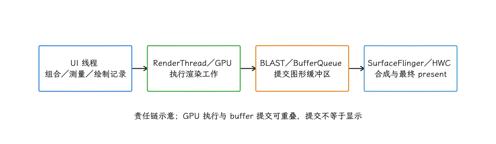

图：普通 ComposeView 共用宿主窗口 HWUI；视频等独立生产者还需追踪自身 layer。

这条窗口链路和 Compose Runtime 的内部结构是两层概念。`SlotTable` 保存组合的 group、key、`remember` 值和调用结构，承载 Compose 测量、摆放与绘制节点的则是 `LayoutNode`。重组只重新执行失效的重启作用域，整页并不会重建；大多数普通 `LayoutNode` 的绘制通常记录到最近的图层边界，并不会各自创建一个 Android `RenderNode`。另外，Strong Skipping（强跳过模式）属于编译器行为，Lazy 预取属于 Foundation 行为，两者都由应用依赖决定，平台源码标签里查不到——这也是基线行把依赖版本一并列出的原因。

我们的排查顺序也是这样：先从状态读取、重组范围、测量和绘制判断责任阶段，再用 Compiler 报告和 Runtime Tracing 解释可跳过性与实际重组；Modifier.Node 则改变修饰符节点的生命周期和更新成本。

## 状态、重组、布局与绘制基线

### 从状态读取阶段控制工作范围

Compose 把 UI 更新分成 Composition、Layout 和 Drawing 三个阶段。状态在哪个阶段被读取，运行时就在哪里记录依赖；状态变化后，工作从对应的重启作用域（restart scope，可被单独标记失效并重新执行的范围）开始。

| 读取位置 | 状态变化后的起点 | 适合的变化 |
| --- | --- | --- |
| Composable 函数体或参数构造 | Composition，结果变化时还会进入 Layout / Drawing | 节点增删、文本内容、布局结构 |
| 测量 / 摆放 lambda | Layout；摆放与测量还有独立的重启作用域 | 位置、约束内尺寸、对齐 |
| draw lambda 或 layer property lambda | Drawing 或图层属性更新 | 颜色、透明度、绘制偏移、缩放 |

这张表给出的是失效（invalidation，状态变化的失效通知）的起点，后续阶段是否执行要看输出有没有变：Composition 的输出没变，Layout 和 Drawing 仍可跳过。另外，`LazyColumn`、`BoxWithConstraints` 和 `SubcomposeLayout` 会在布局过程中决定子内容，“Composition 总在 Layout 之前一次完成”这个简化模型对它们并不成立。

<!-- gracker-diagram: a234-02-read-phases -->
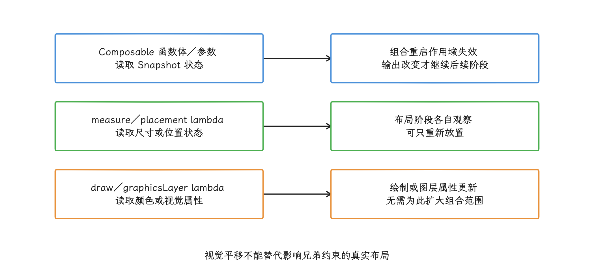

图：阶段表描述失效起点；子组合会把必要的组合安排到测量过程中。

看一个例子：下面的示例把滚动偏移推迟到 placement lambda 中读取，透明度放进 `graphicsLayer` 的属性 lambda，两个高频值都离开了 Composable 函数体。

```kotlin
@Composable
fun ParallaxHeader(
    listState: LazyListState,
    alpha: State<Float>,
) {
    Image(
        painter = painterResource(R.drawable.header),
        contentDescription = null,
        modifier = Modifier
            .offset {
                IntOffset(
                    x = 0,
                    y = listState.firstVisibleItemScrollOffset / 2,
                )
            }
            .graphicsLayer {
                this.alpha = alpha.value
            },
    )
}
```

`offset { ... }` 的状态读取发生在 placement 阶段，`graphicsLayer { ... }` 的读取用于更新图层属性。若位置变化会改变兄弟节点的测量约束，仍应使用能表达该约束关系的布局——视觉平移替代不了布局位置。

状态影响节点数量、文本或语义属性时，Composition 省不掉。这时优化的方向是缩小读取范围：把状态读取封装进 lambda、移到更靠近使用位置的 Composable，或把过大的重组作用域拆成输入清晰的子函数。

### Strong Skipping 与 Stability

#### 跳过条件要分函数和参数

Kotlin 2.0.20 起默认启用 Strong Skipping，本文基线 Kotlin `2.4.10` 已经不用再设置旧选项 `enableStrongSkippingMode`。它改变两项编译结果：

- 所有 restartable（可单独重新执行）的 Composable 默认也可标记为 skippable（参数满足条件时可跳过）；non-restartable（没有独立重启组）函数仍不可跳过，`@NonSkippableComposable` 可以显式禁止跳过。
- Composable 内部创建的 lambda 会自动 memoize。捕获值用作缓存 key：stable 捕获值按 `equals()` 比较，unstable 捕获值按 `===` 比较。`@DontMemoize` 可以让某个 lambda 退出自动缓存。

Stability（稳定性）是编译器对“参数能否可靠比较、属性变化能否被观察”的判定。进入重组时，skippable 函数还要比较本次与上次的参数：`stable` 参数使用 `equals()`，`unstable` 参数使用实例相等 `===`。参数相等拦住的只是父级重组向下传播；函数内部读取的 Snapshot 状态或动态 `CompositionLocal`（沿 Composition 树向下提供的值） 发生变化时，对应重组作用域仍会失效。

Strong Skipping 之后，Stability 依然在起作用：它决定参数采用哪种比较方式，也约束可变对象如何通知 Compose。

<!-- gracker-diagram: a234-03-skipping-rules -->
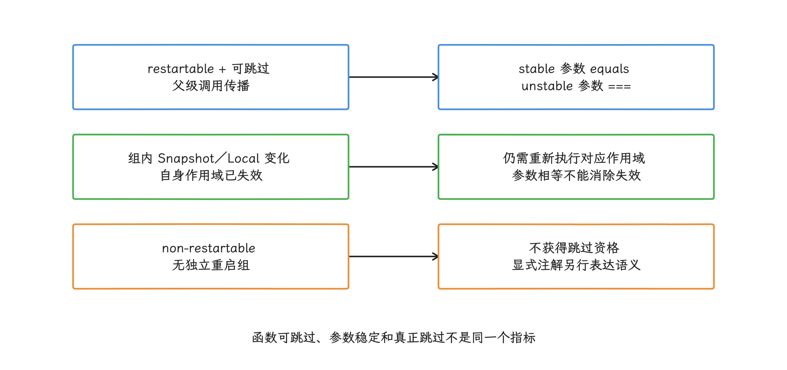

图：Kotlin 2.0.20 起默认强跳过；标签是允许条件，实际跳过需运行时证据。

- 普通 `List`、`Set`、`Map` 接口并不能保证底层不可变。本文 2.3.20 样例被判为已知 unstable，而 2.4.10 新产物中的集合与 `Snack` 出现 runtime / `Uncertain` 分类；应区分已知不稳定与运行时不确定，不能把旧报告标签直接套到当前编译器。同一个可变集合实例原地修改时，实例比较可能让调用被跳过，集合本身也不会发送 Snapshot 通知。稳定类型的 `equals()` 也有成本：为大集合加包装或稳定注解后，结构相等比较可能逐项扫描，未必比实例比较或局部重组便宜，仍须以目标热点测量。
- `SnapshotStateList`、`SnapshotStateMap` 能通知运行时；不可变 UI 数据模型配合新集合实例，则能提供边界清晰的新旧快照。
- `@Stable` 与 `@Immutable` 是开发者向编译器作出的契约。对象含有不可观察的可变字段时，就要避开这两个注解；错误契约可能让 UI 漏掉更新。
- 手写 `remember` lambda 可能包含特定 key 或生命周期语义，升级 Kotlin 后也应对照编译器生成规则和调用方需求逐处确认，再决定去留。

#### 用编译器报告验证推断

编译器报告能回答“这个函数怎样被编译”和“哪个类型被判定为 unstable”；某次卡顿是不是 Stability 引起的，还要靠后面的运行时工具来回答。下面的 Gradle 配置适用于 Kotlin 2.x 的 Compose Compiler Gradle plugin。

```kotlin
composeCompiler {
    reportsDestination = layout.buildDirectory.dir("compose_compiler")
    metricsDestination = layout.buildDirectory.dir("compose_compiler")
}
```

应在 release variant（发布构建变体） 上生成报告。`reportsDestination` 输出 `*-classes.txt`、`*-composables.txt` 和 `*-composables.csv`；`metricsDestination` 另行输出模块统计。Strong Skipping 开启后，`restartable` 函数通常也会显示 `skippable`，所以还要检查参数比较、状态读取位置和现场重组次数；追求“全模块全部 skippable”只会增加错误标注和维护成本。

### `remember`、`derivedStateOf` 与副作用

#### `remember` 的缓存职责

`remember(keys...)` 在 key 相等时复用缓存值，key 变化时丢弃旧值并重新计算。key 表达的是缓存身份，别从业务列表里随手挑字段；输入要能表达一份稳定快照。它适合缓存排序结果、状态容器和创建成本较高的对象。

下面的写法假定 `items` 是不可变列表，数据更新时会提交新实例。

```kotlin
@Composable
fun SortedFeed(items: List<FeedItem>) {
    val sortedItems = remember(items) {
        items.sortedByDescending(FeedItem::timestamp)
    }

    LazyColumn {
        items(
            items = sortedItems,
            key = FeedItem::id,
            contentType = FeedItem::type,
        ) { item ->
            FeedRow(item)
        }
    }
}
```

如果调用方原地修改同一个普通列表，`remember(items)` 不会重新排序，Lazy 列表也拿不到可靠的新旧输入。修复点在数据所有权和可观察性，叠加更多 `remember` 解决不了。

#### `derivedStateOf` 的适用频率场景

`derivedStateOf` 适合把高频输入收敛为低频结果，例如滚动位置持续变化，而按钮只在跨过阈值时切换可见性。它会建立派生状态和依赖跟踪，本身有成本。

下面的示例只在“是否越过首项”改变时更新读取者。

```kotlin
@Composable
fun FeedWithScrollToTop(items: List<FeedItem>) {
    val listState = rememberLazyListState()
    val showScrollToTop by remember {
        derivedStateOf {
            listState.firstVisibleItemIndex > 0
        }
    }

    Box {
        LazyColumn(state = listState) {
            items(items, key = FeedItem::id) { item ->
                FeedRow(item)
            }
        }
        AnimatedVisibility(showScrollToTop) {
            ScrollToTopButton()
        }
    }
}
```

至于字符串拼接、数值乘法这类“输入每次变、输出也每次变”的表达式，直接计算通常更清楚，运行时工作也更少，用不上 `derivedStateOf`。

<!-- gracker-diagram: a234-04-remember-derived -->
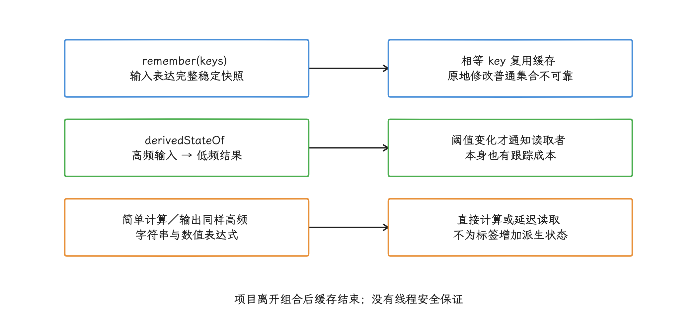

图：remember 管缓存生命周期，derivedStateOf 管结果变化频率；两者不能修复不可观察的可变数据。

#### `rememberCoroutineScope` 面向事件，`produceState` 面向外部数据

`rememberCoroutineScope()` 返回与调用点 Composition 生命周期绑定的 `CoroutineScope`；调用点离开 Composition 后，其中的协程会收到取消信号。它适合点击、拖动结束、Snackbar 等事件回调。不要在 Composable 函数体中直接 `launch`；每次函数执行都可能启动新任务。

`produceState` 用协程把外部数据转成 Compose `State`，其中 producer（产出状态值的协程代码块）负责持续产出。Compose Runtime `1.12.0` 的带 key 重载使用 `remember { mutableStateOf(initialValue) }` 保存结果，并用 `LaunchedEffect(key)` 运行 producer：key 变化会取消旧 producer 并启动新 producer，离开 Composition 也会取消。返回的 `State` 会合并相等值；连续快速写入时，观察者也可能跳过中间值，只读到较新的结果。

下面的示例把用户 ID 和 repository 都作为 producer 的身份输入。

```kotlin
@Composable
fun userProfile(
    userId: String,
    repository: UserRepository,
): State<User?> {
    return produceState(
        initialValue = null,
        userId,
        repository,
    ) {
        value = repository.load(userId)
    }
}
```

缺少 key 会让 producer 继续使用旧输入；塞入每次重组都变化的 key 又会反复取消请求。key 变化也不会自动把同一个 `State` 恢复成 `initialValue`；若切换用户时必须立刻显示“加载中”，要在新的 producer 开头显式赋值。非挂起订阅可在 producer 中注册，并用 `awaitDispose` 解除。

高频且每次都不同的数据仍可能使读取者频繁失效，应在数据源侧采样、聚合，或把仅影响绘制的读取延迟到 Drawing。`snapshotFlow` 负责把 Compose Snapshot 状态转成 Flow；外部高频数据进 UI 状态之前的节流，还得在数据侧自己做。

Strong Skipping 不管理 producer 协程。跳过规则作用于 Composable 调用，协程的启动、取消和异常处理仍由 Effect key 与作用域生命周期决定。

<!-- gracker-diagram: a234-05-producer -->
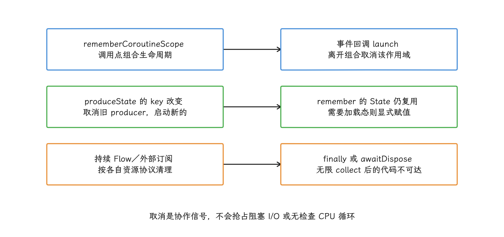

图：结果合并不会自动减少上游解析；节流要放在希望减少的重工作之前。

### Lazy 列表：身份、类型与预取

本节只说明 Lazy 列表会如何影响重组诊断；RecyclerView / LazyList 的完整复用、预取、缓存窗口与同版本 A/B 流程统一由 [22.2 RecyclerView 与 Compose LazyList 性能](02-recyclerview-compose-lazylist.md) 维护。

#### `key` 保持列表项身份，`contentType` 约束复用兼容性

Lazy 列表未提供业务 key 时按位置维护身份；显式使用 index 基本等同于位置身份。列表头部插入或中间删除后，位置身份本身仍可能保留，但同一位置对应了另一业务实体，`remember` / `rememberSaveable` 状态可能跟错数据；不能推导成所有后续组合都销毁。

业务 key 应稳定且唯一。列表项使用 `rememberSaveable` 时，key 还要满足 Android `Bundle` 可保存类型的要求。`contentType` 用于告诉 Lazy 布局哪些列表项的组合结构可以复用；广告、标题、普通卡片结构不同，就应使用不同类型。

构建列表内容时还要避免排序、过滤、日期格式化、同步图片解码和阻塞 I/O。把纯计算移到上游或以不可变输入为 key 缓存，把 I/O 放进数据层和异步加载组件。

#### Pausable Composition 的能力范围

`PausableComposition` 允许尚未提交的 Composition 在运行时定义的安全点暂停，并在之后继续。它仍在原有调度路径上执行，不会把任意 Composable 或协程抢占到后台线程。Compose Runtime `1.10.0` 提供该能力后，Foundation `1.10.0` 在 Lazy 预取中默认打开 `ComposeFoundationFlags.isPausableCompositionInPrefetchEnabled`。当前 Foundation `1.12.0` 源码中的默认值也为 `true`，其预取路径分为四步：

1. Android 端 `AndroidPrefetchScheduler` 通过宿主 View 的 `post()` 在 UI 线程执行请求，并结合绘制时间、`Choreographer` 帧时间与刷新周期估算本帧余量。
2. Lazy prefetch 为目标 index 安排 precompose（提前组合）和 premeasure（提前测量）。普通请求会参考相同 `contentType` 的历史耗时；urgent 请求表示目标即将可见，只要本帧还有时间就会继续尝试。
3. 开关启用时，预组合调用 `PausedComposition.resume(shouldPause)`。暂停请求只在运行时提供的可暂停点生效：回调返回 `true` 后，代码会走到下一个可暂停点再停。
4. 组合完成后单独 `apply()`，把结果提交到 Composition，再按约束执行 premeasure。Pausable Composition 切分的只有 precompose；apply、measure 和已进入可见窗口的同步工作，仍按原有路径一次做完。

这个默认值经历过反复：Foundation `1.10.0` 默认开启，`1.10.6` 因稳定性问题改为默认关闭，`1.12.0` 源码又恢复为默认开启。所以现场行为取决于 Foundation 的精确版本和该版本中的开关值，看“Compose 1.x”这样的大版本号是不够的。`ComposeFoundationFlags` 的源码注释还提醒：调试环境应尽早设置开关，发布环境若要改写默认值需配合 R8；因此本文只用它界定版本默认行为，不把它当作稳定的应用配置 API。本文保留 BOM `2025.12.00` / Foundation `1.10.0` 作为历史复现点。

<!-- gracker-diagram: a234-06-lazy-library -->
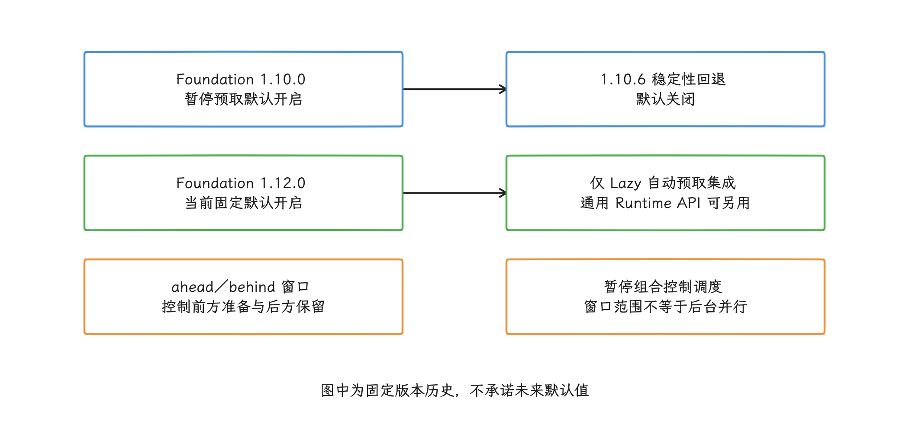

图：不要由 targetSdk 或 Compose 大版本推断开关；现场先查最终依赖树。

这项能力的覆盖面要限定到本文讨论的 Foundation 默认 Lazy 预取路径：它不会自动把普通首帧 Composition、常规重组或非 Lazy 子树切分。Runtime 的公开可暂停子组合 API 可被其他调度器使用，不能据此说该 API 只能用于 Lazy。拆分重组作用域、降低列表项的组合成本、提供稳定 key 和控制状态读取范围，这些手段仍然有效。

#### `LazyLayoutCacheWindow` 同时控制 ahead 与 behind

Foundation `1.12.0` 的 `LazyLayoutCacheWindow` 仍是实验 API。ahead window 是滚动方向前方的准备窗口，behind window 是反方向的保留窗口。窗口越大，precompose、premeasure 和保留节点的成本也越高，“越大越顺”在这里并不成立。

下面的配置只用于展示 API 形态，比例需要在目标页面和目标设备上测量后确定。

```kotlin
@OptIn(ExperimentalFoundationApi::class)
@Composable
fun TunedFeed(items: List<FeedItem>) {
    val listState = rememberLazyListState(
        cacheWindow = LazyLayoutCacheWindow(
            aheadFraction = 0.75f,
            behindFraction = 0.25f,
        ),
    )

    LazyColumn(state = listState) {
        items(
            items = items,
            key = FeedItem::id,
            contentType = FeedItem::type,
        ) { item ->
            FeedRow(item)
        }
    }
}
```

调参时我们同时观察 `compose:lazy:prefetch:compose`、`compose:lazy:prefetch:apply`、`compose:lazy:prefetch:measure` 这些 trace slice（时间轴上的工作片段）、目标列表项首次可见帧的成本和内存峰值。窗口设置有没有收益，要看预取工作是否前移、后续关键帧是否变轻；预取片段增加、关键帧不变或内存明显上升时，多半是窗口过大、命中不准，或列表项的工作仍留在可见帧里。

### 工具：从重组证据走到实际显示

#### Layout Inspector、Composition Tracing 与 Macrobenchmark 分工

- Layout Inspector 的重组与跳过计数适合确认失效范围。Debug 构建和 Inspector 本身会改变耗时，它的时间数据只用于定位范围；发布版本的帧耗时基线，交给列表末尾的 Macrobenchmark。
- Compose compiler report 适合核对 restartable、skippable 和 Stability 推断；运行时哪一帧发生了什么，要看下一项的 Composition Tracing。
- Composition Tracing 能把单个 Composable 记录进 system trace（系统级时间轴）。系统 trace 默认没有这些细粒度工作片段；项目要加入 `androidx.compose.runtime:runtime-tracing`，设备需为 API 30 或更高，终端自定义 Perfetto 配置还要启用 `track_event` 数据源。
- Macrobenchmark 应运行可被性能工具分析（profileable）、不可调试（non-debuggable）、接近发布配置（release-like）的构建，覆盖冷启动、首屏、稳定滚动和主要交互。升级 Compose 后重新采集 Baseline Profile；它记录应用热路径，帮助运行时提前编译关键代码。新旧结果要在相同设备状态、刷新率和数据集下比较。

下面的依赖片段故意保留 BOM `2025.12.00`，用于复现 Compose `1.10.0` 的历史现场；新建当前基线实验时应使用 BOM `2026.08.00`。两种写法都让 BOM 决定 `runtime-tracing` 的版本。

```kotlin
val composeBom = platform("androidx.compose:compose-bom:2025.12.00")
implementation(composeBom)
implementation("androidx.compose.runtime:runtime-tracing")
```

依赖加入后仍要确认被测 APK 保留 tracing 支持，并使用适合性能测量的构建。搜索不到 Composable 名时，先检查自定义 trace 有没有订阅 `track_event` data source；采集配置缺失时切片不会出现，重组本身可能照常发生。

#### Perfetto 按四段定位耗时

1. **Composition**：目标状态写入后，哪些重启作用域被标记失效；函数是否因参数或内部状态重新执行；Lazy 预取是否把目标列表项的 `compose` / `apply` 前移。
2. **Layout 与 Drawing**：Composition 正常时，检查 `measure`（测量）、`placement`（摆放）、`draw`（绘制）、图层更新和 `requestLayout()` / invalidation 的来源。Lazy 列表项在 precompose 后仍可能把 premeasure 或可见布局成本留给后续帧。
3. **HWUI 与 buffer 提交**：UI 线程按时完成后，检查 `syncAndDrawFrame()`、RenderThread `DrawFrame`、`dequeueBuffer`（申请可写缓冲区）、GPU 工作和 `queueBuffer()`（提交完成的缓冲区）。
4. **显示出口**：用目标应用窗口的 FrameTimeline（把应用帧与实际显示结果关联起来的时间线）、`BufferTX - <layerName>` 图层事务片段、latch（SurfaceFlinger 选中并接收该缓冲区）、HWC composition 与 actual present（真正上屏的时间）判断应用提交之后的延迟。

刷新率决定单帧预算，`16.67 ms` 或任意一条固定毫秒线都套不到所有设备上。Compose 工作片段变短也说明不了屏幕更早显示；比较要追到同一帧的 actual present。

### Compose 与 View 互操作

这里只保留互操作对重组和诊断边界的影响；容器所有权、生命周期、状态与复用协议见 [22.6 Compose / View 互操作](06-compose-view-interop.md)。

#### RecyclerView 中的 `ComposeView`

Compose UI `1.12.0` 的默认 `ViewCompositionStrategy` 是 `DisposeOnDetachedFromWindowOrReleasedFromPool`。pooling container 指 RecyclerView 这类会暂存并复用子 View 的容器：View 在容器外时，从窗口 detach（分离） 会销毁 Composition；在容器内时，临时 detach 不会立即销毁，等容器从窗口分离或列表项被复用池淘汰时才释放。

ViewHolder 中应让 `setContent()` 只执行一次，再用可观察状态绑定数据。下面的 `key(model.id)` 会把列表项的身份切换明确告诉 Composition，避免 ViewHolder 复用时把 `remember` 状态带给另一条数据。

```kotlin
class ComposeItemHolder(
    context: Context,
) : RecyclerView.ViewHolder(ComposeView(context)) {
    private val composeView = itemView as ComposeView
    private var model by mutableStateOf<FeedItem?>(null)

    init {
        composeView.setContent {
            model?.let { current ->
                key(current.id) {
                    FeedRow(current)
                }
            }
        }
    }

    fun bind(value: FeedItem) {
        model = value
    }

    fun clear() {
        model = null
    }
}
```

`onViewRecycled()` 里可以清空业务数据和外部资源，`disposeComposition()` 别无条件调用——默认策略保留池内 Composition 正是为了复用。Fragment XML 中的一对一 `ComposeView` 更适合 `DisposeOnViewTreeLifecycleDestroyed`，它会跟随下一次 attach 所在 View tree 的 `LifecycleOwner`（提供生命周期的所有者） 销毁。

#### Lazy 列表中的 `AndroidView`

`AndroidView.factory` 在 UI 线程创建 View，并且对当前实例只调用一次；`update` 会在 factory 后调用，后续还会随其中读取的 `State` 变化而运行。重操作别塞进 `update`，View 属性修改仍应留在 UI 线程。

Lazy 列表中要使用带非空 `onReset` 的重载，才能让兼容的 View 实例参与复用。下面的例子在旧数据解绑、新数据绑定之前清理瞬时状态，并在永久离开 Composition 时释放资源。

```kotlin
LazyColumn {
    items(
        items = charts,
        key = ChartModel::id,
    ) { model ->
        AndroidView(
            factory = { context -> ChartView(context) },
            update = { view -> view.render(model) },
            onReset = { view -> view.resetForReuse() },
            onRelease = { view -> view.release() },
        )
    }
}
```

`onReset` 可能紧接着进入下一次 `update`，也可能先进入暂时停用状态，之后才被释放；清理逻辑应允许重复调用。若嵌入的是 `SurfaceView`、WebView、播放器或相机预览，图形分析还要跟随它自己的 BufferQueue 和 SurfaceFlinger layer，Compose 宿主窗口只是其中一环。

<!-- gracker-diagram: a234-07-interop -->
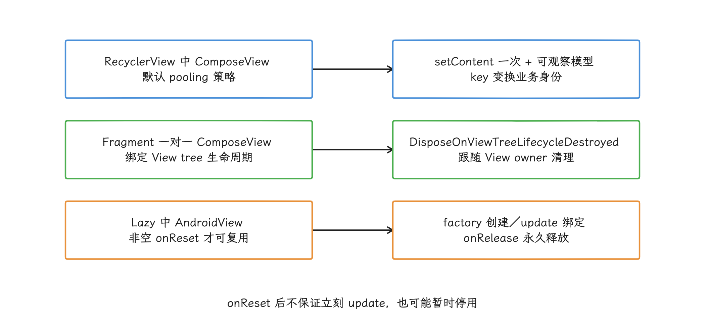

图：临时 detach、复用重置和永久释放不同；不要回收时无条件销毁保留中的组合。

### Effect 与 producer 的生命周期盲区

这一段我们盯住“谁在何时被取消”。`rememberCoroutineScope()` 适合由点击、拖动等事件启动工作；需要随 key 进入、变化和退出自动管理的持续任务，应直接使用 `LaunchedEffect(key)`。把任务从 Effect 转交给 `rememberCoroutineScope()` 保存的作用域，key 变化时就只取消了“启动者”，旧任务还在消费旧数据。Composition 离开时，`Job.cancel()` 只是向协程发出取消信号；阻塞 I/O、不检查取消的 CPU 循环、耗时的 `NonCancellable` 清理和未注销的外部回调都可能拖长退出时间。验证时查看任务的 `finally`、订阅计数和资源所有者；“页面退出后对象还在”只是嫌疑，定案靠这三项。

<!-- gracker-diagram: a234-08-effect-ownership -->
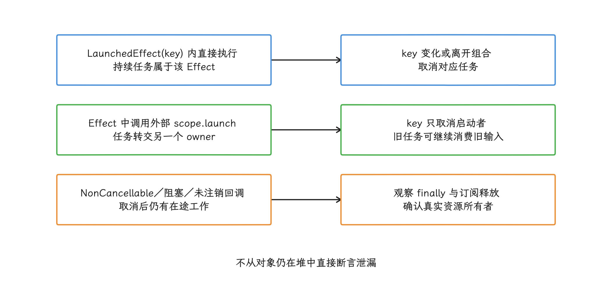

图：强跳过与可暂停组合不改变外部 Job 和回调的生命周期。

`produceState` 由 `remember` 保留的 `MutableState` 和带 key 的 `LaunchedEffect` 组成，这套实现与 key 语义前面已经交代；它的生命周期还留有两个盲区。长期 Flow 依靠 `collect` 自身的取消与 `finally` 结束，无限收集不会自然返回，把 `awaitDispose` 写在它后面就永远执行不到；需要在切换用户或请求时立即显示“加载中”，producer 必须显式赋值，key 变化本身不会把 `State` 重置成 `initialValue`。

`State` 的 conflation（合并更新） 只会过滤相等结果，或让观察者跳过来不及读取的中间值；上游的网络请求、解析和每次赋值一点都不会少。高频源要在数据层按语义选择 `sample`（按周期取样）、`conflate`（消费跟不上时保留较新值）、`distinctUntilChanged`（过滤连续相等值），或做领域聚合。这些操作只影响其下游；若要少做昂贵解析或转换，要把合适的节流放在重工作之前。多个数据源必须共同满足一条业务约束时，应先在 ViewModel 产出一份不可变 `UiState`，别指望两个独立 producer 恰好在同一帧完成。

Strong Skipping 只改变可组合调用和 lambda 的跳过机会；作用域中的 Job、Effect key、状态变更策略（State mutation policy，判断新旧值是否等价）和 producer 取消语义都不受它影响。Pausable Composition 也只切分尚未 apply 的 Composition，已经启动的网络请求、Flow 收集协程和回调不会随它自动暂停。

### 升级与验收

升级 Kotlin 或 Compose 时，先记录解析后的精确依赖。下面的命令用于确认应用模块的 Runtime、Foundation 和 UI 版本；configuration（依赖配置） 名称按项目的构建 variant 调整。

```bash
./gradlew :app:dependencyInsight \
  --dependency androidx.compose.runtime:runtime \
  --configuration releaseRuntimeClasspath

./gradlew :app:dependencyInsight \
  --dependency androidx.compose.foundation:foundation \
  --configuration releaseRuntimeClasspath

./gradlew :app:dependencyInsight \
  --dependency androidx.compose.ui:ui \
  --configuration releaseRuntimeClasspath
```

BOM 只约束它声明的 Compose artifacts（依赖模块），不会自动添加依赖，也管不到 Kotlin plugin。版本确认后再做同机对比，避免把 Kotlin 编译器、Foundation 预取、Baseline Profile 或业务代码的变化混成一个结果。

#### Kotlin 升级时把 classpath 故障与 Compose 诊断分开

Kotlin/Compose 升级验收还应记录第三方 AAR/JAR 的 POM 与 class 签名：`firebase-auth:24.2.0` 的 Google Maven POM 未声明 `org.checkerframework` / `checker-qual`，但其 `classes.jar` 中至少 `FirebaseAuth$IdTokenListener.class`、`FirebaseAuth.class`、`zzbm.class`、`zzca.class` 和 `zzcj.class` 的签名字符串包含 `org/checkerframework/checker/initialization/qual/UnknownInitialization`。[已验证: https://dl.google.com/dl/android/maven2/com/google/firebase/firebase-auth/24.2.0/firebase-auth-24.2.0.pom；已验证: https://dl.google.com/dl/android/maven2/com/google/firebase/firebase-auth/24.2.0/firebase-auth-24.2.0.aar；来源: https://juejin.cn/post/7678586341090803748]

以下 FlutterFire 故障经过来自二手案例记录，本文没有复现其完整构建矩阵，不能据此泛化所有 Kotlin 2.4 项目。在 FlutterFire `firebase_auth 6.6.0` 的 Kotlin 重写中，`FirebaseAuth.IdTokenListener { auth -> ... }` 这类 Java SAM lambda 让 `auth` 参数由 Kotlin 推断；材料记录 Kotlin 2.4 会把缺失注解类导致的 “inferred type is inaccessible” 路径表现为编译错误，而 Kotlin 2.3 主要表现为警告。[来源: https://juejin.cn/post/7678586341090803748]

把这个故障算到 Compose Runtime、Stability 或 `Modifier.Node` 头上是误诊：它是 Kotlin 前端读取依赖 class 元数据时暴露出的 classpath / 发布元数据问题，排查顺序是先锁定 Kotlin、AGP、Firebase 与 FlutterFire 版本，再看报错中的 annotation class、来源 artifact 和 POM 依赖。[来源: https://juejin.cn/post/7678586341090803748；已验证: https://dl.google.com/dl/android/maven2/com/google/firebase/firebase-auth/24.2.0/firebase-auth-24.2.0.pom]

处置时别把 `skippable`、重组次数或 FrameTimeline 当主证据。对这个案例，材料记录的 FlutterFire 侧修复是把 `FirebaseAuth.IdTokenListener` / `AuthStateListener` 的 lambda 参数写成显式 `FirebaseAuth` 类型，并在测试工程覆盖 Kotlin `2.4.10`、AGP `8.11.1`、Gradle `8.14`。[来源: https://juejin.cn/post/7678586341090803748]

<!-- gracker-diagram: a234-09-artifact-classpath -->
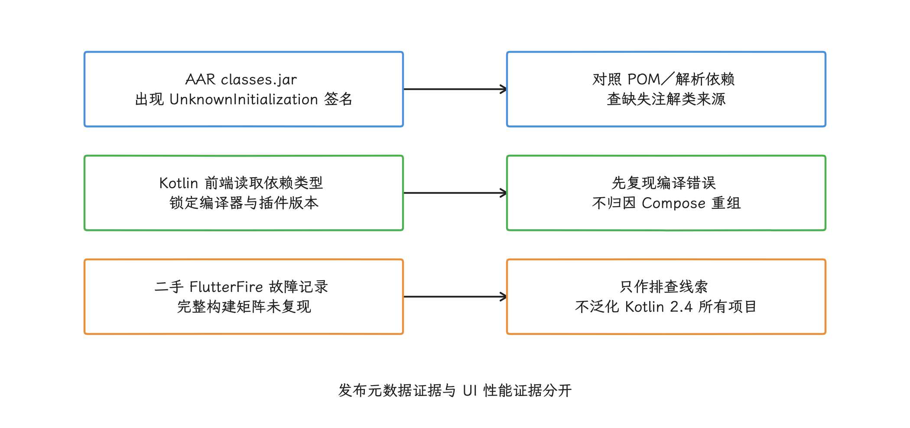

图：本轮直接核对 Firebase Auth 24.2.0 AAR/POM；案例处置还要在目标工程复现。

验收可以按下面的顺序执行：

1. 用 compiler report 确认目标 Composable 的 restartable / skippable 与参数 Stability，不为无性能问题的类型追加注解。
2. 用 Layout Inspector 复现一次状态变化，确认重组和跳过范围符合预期。
3. 用 Macrobenchmark 采集 release-like 构建，比较 FrameTiming、启动、内存和目标交互的分位数，例如中位数与 P95，而非只看平均值。
4. 用 Composition Tracing 关联目标 Composable、Lazy prefetch、Layout、Drawing 与同一帧 `Choreographer#doFrame` 帧回调。
5. 沿 RenderThread、BLAST、SurfaceFlinger、HWC 到 actual present 闭合显示链，区分 App 生产慢与系统显示慢。
6. 升级 Compose 后重新生成并验证应用 Baseline Profile；库自带 profile 覆盖不到业务 Composable 的完整热点路径。

| 现象 | 优先验证 | 常见误判 |
| --- | --- | --- |
| 小状态变化引发大范围重组 | 状态读取位置、重启作用域、参数实例 | 只给所有数据模型加 `@Stable` |
| 动画期间 Composition 持续出现 | 状态是否可延迟到 placement / drawing | 把每次变化都包进 `derivedStateOf` |
| Lazy 滚动进入新列表项时卡顿 | `key`、`contentType`、`compose` / `apply` / `measure` 预取 | 只把缓存窗口调大 |
| `ComposeView` 列表反复创建 | `setContent()` 次数、`ViewCompositionStrategy`、列表项身份 | 每次回收都调用 `disposeComposition()` |
| UI 线程正常仍有卡顿（jank） | RenderThread、缓冲区、SurfaceFlinger、HWC、actual present | 把所有慢帧归到重组 |

这五类现象都要先定位工作发生在哪个阶段，再决定改状态读取、列表身份、预取参数还是显示链；单看重组次数或某一个开关，完成不了验收。

### 源码与文档

- [Compose BOM `2026.08.00` POM](https://dl.google.com/dl/android/maven2/androidx/compose/compose-bom/2026.08.00/compose-bom-2026.08.00.pom)：核对当前 Runtime、Foundation 与 UI 的 `1.12.0` 映射；[BOM mapping](https://developer.android.com/develop/ui/compose/bom/bom-mapping) 用于按 BOM 查询库版本。
- [Compose Runtime 1.12.0 source jar](https://dl.google.com/dl/android/maven2/androidx/compose/runtime/runtime/1.12.0/runtime-1.12.0-sources.jar)、[Compose Foundation 1.12.0 source jar](https://dl.google.com/dl/android/maven2/androidx/compose/foundation/foundation/1.12.0/foundation-1.12.0-sources.jar)、[Foundation Android 1.12.0 source jar](https://dl.google.com/dl/android/maven2/androidx/compose/foundation/foundation-android/1.12.0/foundation-android-1.12.0-sources.jar) 与 [Compose UI Android 1.12.0 source jar](https://dl.google.com/dl/android/maven2/androidx/compose/ui/ui-android/1.12.0/ui-android-1.12.0-sources.jar)：核对当前状态、Lazy 预取、缓存窗口、`ComposeView` 和 `AndroidView` 实现。
- [Kotlin releases](https://kotlinlang.org/docs/releases.html) 与 [Compose compiler options DSL](https://kotlinlang.org/docs/compose-compiler-options.html)：核对 Kotlin `2.4.10`、Strong Skipping 默认行为和编译器选项。
- [Compose BOM `2025.12.00` POM](https://dl.google.com/dl/android/maven2/androidx/compose/compose-bom/2025.12.00/compose-bom-2025.12.00.pom)：核对 Runtime、Foundation 与 UI 的 `1.10.0` 映射。
- [Compose Runtime 1.10.0 source jar](https://dl.google.com/dl/android/maven2/androidx/compose/runtime/runtime/1.10.0/runtime-1.10.0-sources.jar)：`PausableComposition`、`ProduceState`、`DerivedState` 与 Snapshot 状态。
- [Compose Foundation 1.10.0 source jar](https://dl.google.com/dl/android/maven2/androidx/compose/foundation/foundation/1.10.0/foundation-1.10.0-sources.jar) 与 [Android source jar](https://dl.google.com/dl/android/maven2/androidx/compose/foundation/foundation-android/1.10.0/foundation-android-1.10.0-sources.jar)：Lazy 缓存窗口、预取状态与 Android 调度器。
- [Compose UI Android 1.10.0 source jar](https://dl.google.com/dl/android/maven2/androidx/compose/ui/ui-android/1.10.0/ui-android-1.10.0-sources.jar)：`ComposeView`、`ViewCompositionStrategy` 与 `AndroidView`。
- [Strong Skipping](https://developer.android.com/develop/ui/compose/performance/stability/strongskipping)、[Compose phases](https://developer.android.com/develop/ui/compose/phases) 与 [Side-effects](https://developer.android.com/develop/ui/compose/side-effects)：编译器跳过、状态读取阶段和 Effect 契约。
- [Diagnose stability issues](https://developer.android.com/develop/ui/compose/performance/stability/diagnose) 与 [Composition tracing](https://developer.android.com/develop/ui/compose/tooling/tracing)：编译器报告、重组计数与 system trace 配置。
- [Compose Foundation release notes](https://developer.android.com/jetpack/androidx/releases/compose-foundation#1.10.6)：Pausable Composition 开关在 `1.10.6` 的默认值变化。
- [Compose in Views](https://developer.android.com/develop/ui/compose/migrate/interoperability-apis/compose-in-views) 与 [Views in Compose](https://developer.android.com/develop/ui/compose/migrate/interoperability-apis/views-in-compose)：pooling container、Fragment 生命周期和 `AndroidView` 复用。
- [Android 17 `Choreographer.java`](https://android.googlesource.com/platform/frameworks/base/+/android-17.0.0_r1/core/java/android/view/Choreographer.java) 与 [`ViewRootImpl.java`](https://android.googlesource.com/platform/frameworks/base/+/android-17.0.0_r1/core/java/android/view/ViewRootImpl.java)：平台帧调度与 App Window traversal 基线。

## Compiler 稳定性与运行时重组证据

Compiler 报告说明静态稳定性，Runtime Tracing 说明实际执行次数和时间。Compose 性能排查常把三类材料混在一起：编译器生成了什么代码、运行时执行了哪些组合函数、用户看到的帧是否按时显示。这三条线索各答各的问题，谁也顶替不了谁，我们按这个拆法往下展开。

可复现的诊断链路如下：

1. 用 Compose 编译器报告检查稳定性推断、重启组和可跳过性。
2. 用 Layout Inspector 观察目标交互期间的重组与跳过计数。
3. 用 Composition Tracing 在系统跟踪中定位组合函数的执行区间。
4. 用 FrameTimeline 和 Macrobenchmark 判断这些工作是否造成可感知慢帧。

### 版本基线与核查范围

配置、输出格式和运行时行为按以下版本核查：

| 层级 | 固定锚点 | 使用范围 |
| --- | --- | --- |
| Android 平台 | Android 17 / API 37 / `android-17.0.0_r1` | `Choreographer`、`ViewRootImpl`、FrameTimeline、RenderThread、SurfaceFlinger |
| Android 内核 | `android17-6.18-2026-06_r6` | 调度、唤醒和同步栅栏等内核证据 |
| Kotlin / Compose 编译器插件 | 2.4.10 稳定版 | 当前项目配置与插件选项 |
| Compose Runtime / UI / Runtime Tracing | 1.12.0 稳定版 | 重组、运行时跟踪与 UI 执行行为 |
| 报告样本 | Kotlin 2.3.20 | 固定的最小源码、报告文本与 CI 解析器输入 |

Compose 编译器从 Kotlin 2.0 起随 Kotlin 一同发布，`org.jetbrains.kotlin.plugin.compose` 的版本必须与 Kotlin 插件一致。Compose 库独立于 Android 平台发布；API 37 不会自动决定项目使用哪个 Compose 版本。当前 BOM `2026.08.00` 将 `runtime-tracing` 与 Runtime 约束为 1.12.0。

文中的 2.3.20 代码块和报告输出是一组固定实验样本，保留它们才能逐字复现 CSV、JSON 和标签解释；复现本文工具链基线时，应把 Kotlin 与 Compose 插件同时设为 2.4.10。[Kotlin 发布记录](https://kotlinlang.org/docs/releases.html)已列出 2026-10-08 发布的 2.4.21，该版本不在本文的报告与源码核查范围内。2.3.20 与 2.4.10 的 `BuildMetrics.kt` 使用相同的 CSV 表头和模块 JSON 键，但 CI 仍要记录编译器版本与 `featureFlags`，因为字段相同，代码生成行为仍可能有差别。

### 一、先分清四层证据

| 证据 | 能回答的问题 | 不能据此断言的结论 |
| --- | --- | --- |
| `classes.txt`、`composables.txt`、CSV | 编译器如何推断类型稳定性；函数是否生成重启组、是否允许跳过 | 某函数在设备上重组了多少次；一次重组耗时多少 |
| `module.json` | 当前编译任务的模块级代码生成统计和功能开关 | 页面是否流畅；某个函数是否是热点 |
| Layout Inspector | 连接期间，界面节点观察到的重组与跳过计数 | 发布构建的精确耗时；线上用户的慢帧比例 |
| Composition Tracing、FrameTimeline | 组合函数何时执行、执行多久；帧是否错过截止时间 | 类型为什么被判为 `unstable`；改动后代码生成是否发生变化 |

我们把三个层次分开看：“`unstable` 数量下降”属于静态证据，“重组次数下降”属于运行时证据，“慢帧下降”才对应用户结果。优化结论至少应包含一项静态证据和一项运行时证据。

<!-- gracker-diagram: a234-10-evidence -->
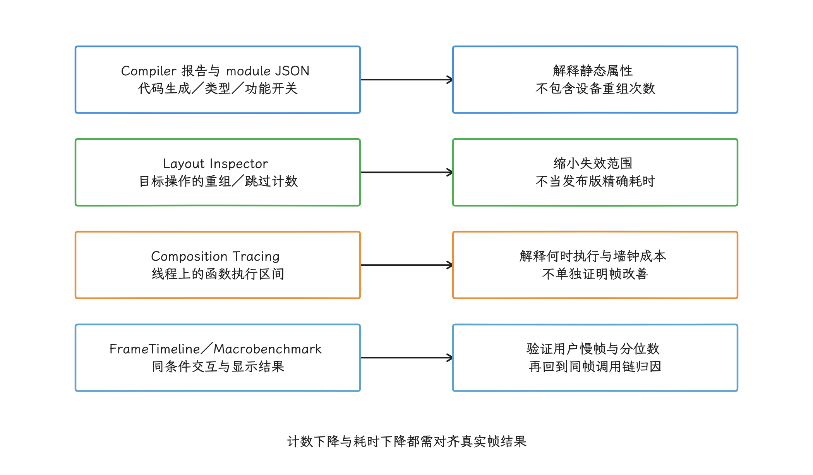

图：把静态标签、运行时执行和最终帧结果关联起来，不能相互替代。

### 二、按 Kotlin 2.3.20 生成编译器报告

#### 1. 用固定版本复现报告样本

复现报告样本时，我们把根项目配置里的 Kotlin 与 Compose 编译器插件都固定为 2.3.20；复现本文工具链基线时，再把两处版本一同改为 2.4.10。

```kotlin
plugins {
    id("org.jetbrains.kotlin.android") version "2.3.20" apply false
    id("org.jetbrains.kotlin.plugin.compose") version "2.3.20" apply false
}
```

这两行的要点是版本必须相同，2.3.20 只是本文的样本固定值。项目若通过版本目录管理插件，Kotlin Android 插件和 Compose 插件也应引用同一个 Kotlin 版本。

下面的模块配置用于启用 Compose 编译器报告，并把报告与模块指标分开存放。

```kotlin
plugins {
    id("com.android.application")
    id("org.jetbrains.kotlin.android")
    id("org.jetbrains.kotlin.plugin.compose")
}

composeCompiler {
    reportsDestination =
        layout.buildDirectory.dir("compose_compiler/reports")
    metricsDestination =
        layout.buildDirectory.dir("compose_compiler/metrics")
}
```

`reportsDestination` 生成函数和类型级报告，`metricsDestination` 生成模块级 JSON。旧文章中常见的自定义 `-P composeCompilerReportsDestination=...`，只有在项目脚本主动读取该属性时才有效；Compose 插件没有提供这个通用 Gradle 参数。

#### 2. 固定构建变体和编译输入

官方诊断文档建议使用发布构建生成报告。团队基线还应固定 Kotlin 版本、Compose 插件配置、模块、构建变体、代码压缩设置和源码提交；这些输入一致，得到的数量才可比。

下面的命令用于重新编译应用模块的 Release 变体，也就是准备发布时使用的构建配置。

```bash
./gradlew :app:clean :app:assembleRelease
```

`clean` 可避免把旧编译任务留下的报告误当成本次结果。大型工程可以清理目标模块的输出目录并执行对应编译任务，无须每次清空全仓库缓存。

下面的命令用于确认实际生成的文件，别靠假定固定的变体子目录。

```bash
find app/build/compose_compiler -type f -print | sort
```

Kotlin Gradle 插件会按编译目标（target）和编译单元（compilation）组织部分指标目录，多模块工程也会产生不同文件前缀。CI 应从构建产物中发现文件，再按模块和变体归档。

<!-- gracker-diagram: a234-11-report-generation -->
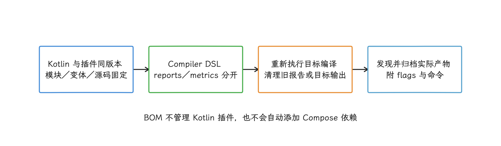

图：Kotlin 2.3.20 是固定样例，2.4.10 是本篇工具链基线；不以目录猜测代替产物发现。

#### 3. Kotlin 2.3.20 样本的输出文件

`reportsDestination` 会生成这些文件：

| 文件 | 内容 |
| --- | --- |
| `*-classes.txt` | 类型及属性的稳定性推断 |
| `*-composables.txt` | 组合函数标签、参数稳定性、组与调用信息 |
| `*-composables.csv` | 便于机器处理的组合函数表 |
| `*-composables.log` | 仅在编译器记录相关日志消息时出现 |

`metricsDestination` 产生 `*-module.json`。Kotlin 2.3.20 的 JSON 包含 `totalComposables`、`skippableComposables`、`restartableComposables`、各类参数和类统计，以及本次编译的 `featureFlags`。这个字段记录各项编译器功能开关是否启用，是解释其他数字的必要条件。

Kotlin 2.4.10 的 `BuildMetrics.kt` 仍输出相同的 CSV 表头和模块 JSON 键，本文的解析器可以读取这两个版本。2.4.10 同时修正了 Compose 稳定性推断：部分过去报告为 `stable` 的类会改为运行时稳定性或 `Uncertain`。解析器可复用，旧基线数值不可沿用；升级后重新生成报告、解释标签变化，再更新 CI 基线。

### 三、用固定样本读懂报告标签

#### 1. 测试源码

下面的最小样例用于同时覆盖稳定参数、不稳定集合、显式禁止跳过和非 `Unit` 返回值。

```kotlin
package lab

import androidx.compose.runtime.Composable
import androidx.compose.runtime.NonSkippableComposable

data class Snack(
    val id: Long,
    val tags: Set<String>,
)

@Composable
fun StableParameters(
    count: Int,
    title: String,
) {
}

@Composable
fun UnstableList(
    snacks: List<Snack>,
    onClick: (Long) -> Unit,
) {
    if (snacks.isNotEmpty()) {
        StableParameters(
            count = snacks.size,
            title = snacks.first().id.toString(),
        )
        onClick(snacks.first().id)
    }
}

@NonSkippableComposable
@Composable
fun ExplicitlyNonSkippable(
    count: Int,
) {
}

@Composable
fun NonUnitResult(
    count: Int,
): Int = count
```

`Set` 和 `List` 的声明类型说明不了底层实现不可变。下列输出固定来自 2.3.20，其中 `Snack` 和 `snacks` 被判为已知不稳定；2.4.10 的运行时不确定分类见后面的实际对照。函数类型由编译器按稳定类型处理。

#### 2. `composables.txt` 的实测输出

Kotlin 2.3.20 在默认功能开关下为上述样例生成以下关键记录。

```text
restartable skippable fun lab.StableParameters(
  unused stable count: Int
  unused stable title: String
)
restartable skippable fun lab.UnstableList(
  unstable snacks: List<Snack>
  stable onClick: Function1<Long, Unit>
)
restartable fun lab.ExplicitlyNonSkippable(
  unused stable count: Int
)
fun lab.NonUnitResult(
  stable count: Int
): Int
```

各标签应逐项解读：

- `restartable`：编译器为该函数建立可独立重新执行的组合组；组是 Compose 记录调用身份和状态读取的运行时单元。
- `skippable`：父级重组调用到这里时，运行时允许在参数满足比较规则后跳过函数体。
- `stable`、`unstable`：参数类型的编译期稳定性分类。
- `unused`：参数没有被该函数生成的组合逻辑读取。
- 没有 `restartable`：该函数没有自己的重启组，谈不上独立重启。非 `Unit` 返回值就是一种常见原因。

`UnstableList` 同时出现 `unstable snacks` 和 `skippable` 并不矛盾：Strong Skipping 从 Kotlin 2.0.20 起默认启用，所有可重启组合函数都能生成跳过逻辑，参数稳定性只决定运行时采用哪种比较方式。这项规则在当前 Kotlin 2.4.10 中仍然成立。

`ExplicitlyNonSkippable` 仍是 `restartable`，但 `@NonSkippableComposable` 阻止编译器为它生成 `skippable` 标签。报告中不存在 `@NonSkippableOptIn` 这一注解。

<!-- gracker-diagram: a234-12-report-tags -->
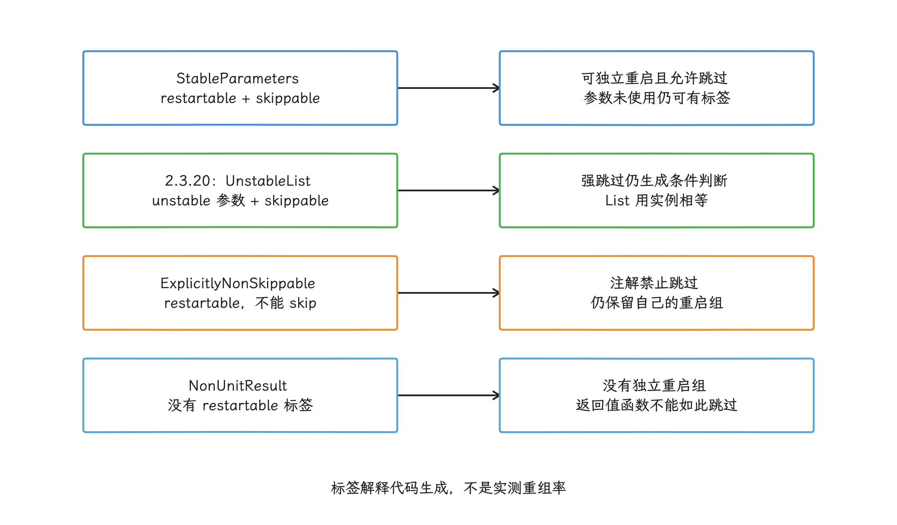

图：四个样例在两个固定编译器中保持重启／跳过标签；集合与类稳定性分类有差异，不能称报告逐字相同。

#### 3. `classes.txt` 的实测输出

同一 Kotlin 2.3.20 编译任务对 `Snack` 产生以下记录。

```text
unstable class lab.Snack {
  stable val id: Long
  unstable val tags: Set<String>
  <runtime stability> = Unstable
}
```

`val` 固定的是引用本身，引用指向的对象仍可能被修改。`Set<String>` 是接口，运行时对象仍可能是可变集合，所以编译器证明不了它不可变。

2026-10-25 以同一最小源码、默认功能开关和各自同版本标准库重新编译，Kotlin 2.4.10 的实际类报告为：

```text
runtime class lab.Snack {
  stable val id: Long
  runtime val tags: Set<String>
  <runtime stability> = Uncertain(Set)
}
```

函数报告中的 `snacks` 行变成 `snacks: List<Snack>`，没有静态 `stable` / `unstable` 前缀；`UnstableList` 这个示例函数名不代表当前推断结果。模块的 `inferredUnstableClasses` 从 1 变为 0，`inferredUncertainClasses` 从 0 变为 1。CSV 表头、模块字段和四项默认 `featureFlags` 保持一致，四个函数的 restartable / skippable 标签也保持不变。生成字节码对该参数包含按稳定性位选择 `changed()` 或 `changedInstance()` 的分支，因此不应对所有 2.4.10 集合统一声称“必定引用比较”。分类变了也不代表普通可变集合突然具有 Snapshot 通知能力。

<!-- gracker-diagram: a234-35-report-version-diff -->
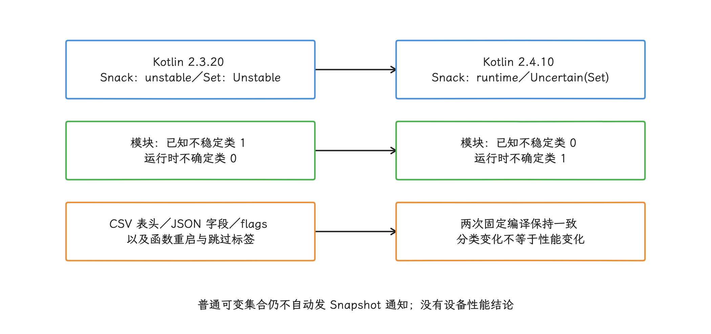

图：实测报告按编译器与同版本标准库归档；2.4.10 该 List 参数的比较代码包含运行时稳定性分支。

#### 4. CSV 与模块 JSON 的准确含义

Kotlin 2.3.20 的 CSV 表头如下。

```text
package,name,composable,skippable,restartable,readonly,inline,isLambda,hasDefaults,defaultsGroup,groups,calls,
```

布尔列使用 `1` 和 `0`，CSV 没有名为 `params` 的列。表头虽然把第一列命名为 `package`，Kotlin 2.3.20 与 2.4.10 的源码写入的都是 `fn.fqName`，即函数的完全限定名；实测值形如 `lab.UnstableList`。解析脚本若按 `true`、`false`、`params` 或“纯包名”编写，都会得到错误结果。

样例的 `module.json` 记录了以下功能开关。

```json
{
  "featureFlags": {
    "StrongSkipping": true,
    "IntrinsicRemember": true,
    "OptimizeNonSkippingGroups": true,
    "PausableComposition": true
  }
}
```

`featureFlags` 是解释报告不可缺少的构建条件。相同源码关闭 Strong Skipping 后，样例中的 `UnstableList` 会从 `restartable skippable` 变为 `restartable`。CI 比较报告前必须先确认开关一致。

### 四、Strong Skipping 怎样改变诊断方式

#### 1. 稳定参数与不稳定参数使用不同相等规则

运行时决定是否跳过函数时会比较本次和上次参数：

- 稳定参数使用对象相等，即 `equals()`。
- 不稳定参数使用引用相等，即 `===`。
- 父级调用传播到未被自身状态失效的可跳过作用域时，各参数还须满足各自的“未变化”条件；内部读取的 Snapshot 状态已经使该组失效时，不能只凭参数相等跳过。

这组规则带出两个容易漏掉的边界。

在 2.3.20 这个已知不稳定参数样例中，传入内容相同但新创建的 `List`，引用不同，`UnstableList` 仍会重组。2.4.10 的运行时不确定参数还需结合稳定性位与生成代码判断，不能只由集合接口名推断比较分支。每次在调用点执行 `items.map { ... }` 或 `items.toList()`，都可能制造新容器。

把普通 `MutableList` 原地修改后继续传入同一引用，引用比较可能允许跳过；普通集合的修改又不会通知 Snapshot 系统，界面可能保留旧内容。解决方向是不可变 UI 模型、可观察的 Snapshot 状态或明确的新值流转；用虚假的稳定性注解盖住可变对象，只是把问题藏起来。

#### 2. Lambda 会被自动记住

Lambda 是可以作为值传递的函数表达式；它引用外部变量时，这些变量称为捕获值。Strong Skipping 会自动记住组合函数内部的 Lambda，编译器根据捕获值生成近似 `remember(...)` 的逻辑：不稳定捕获使用引用相等，稳定捕获使用对象相等。

少数需要每次创建新 Lambda 的场景可以使用 `@DontMemoize`。需要保持可重启、但每次父级重组都执行函数体的场景可以使用 `@NonSkippableComposable`。两个注解都用于表达明确语义，不适合作为常规性能开关。

<!-- gracker-diagram: a234-13-lambda-captures -->
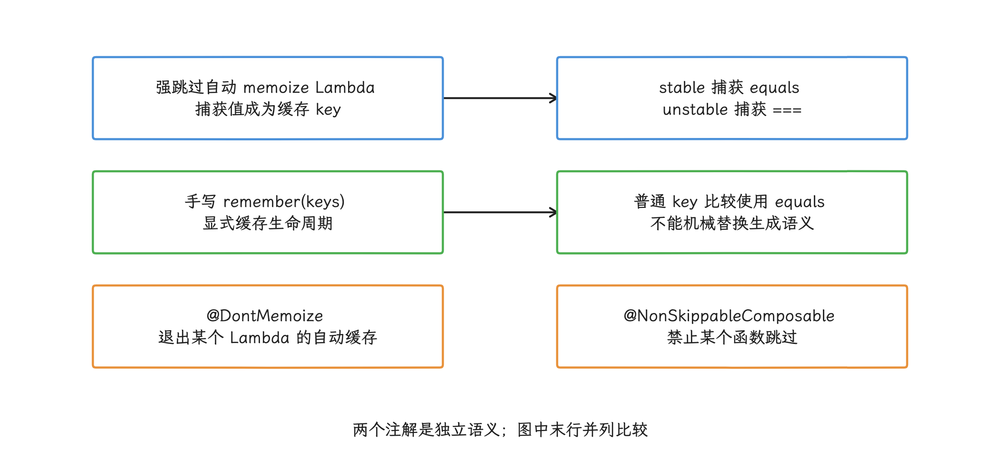

图：Lambda 类型本身按稳定类型处理；捕获对象不稳定不等于函数对象类型不稳定。

#### 3. `skippable` 标签与实际跳过

报告中的 `skippable` 表示“允许跳过”。函数在运行时是否真的被跳过，我们还要逐项核对：

- 对应重启组是否进入本轮重组；
- 参数比较结果；
- 调用位置和组合身份是否保持；
- 读取的 Snapshot 状态是否让该作用域失效；
- 控制流和键值是否改变了组结构。

因此，CSV 中的 `skippable=1` 算不出运行时跳过率，跳过次数需要运行时工具观察。

### 五、稳定性是一项代码契约

#### 1. `@Stable` 的三项要求

类型标记为 `@Stable` 后，开发者向编译器承诺：

1. 同一对实例的 `equals` 结果保持不变。
2. 公共属性发生变化时，Compose 会收到通知。
3. 所有公共属性类型也满足稳定性要求。

`@Immutable` 的承诺更强：实例构造完成后，可观察状态不会变化，公开方法也不会破坏这一假设。注解不会把可变实现改造成可观察状态；违反契约可能导致应当执行的重组被跳过。给类型加注解前，要验证实现符合这些条件。

<!-- gracker-diagram: a234-14-stable-contract -->
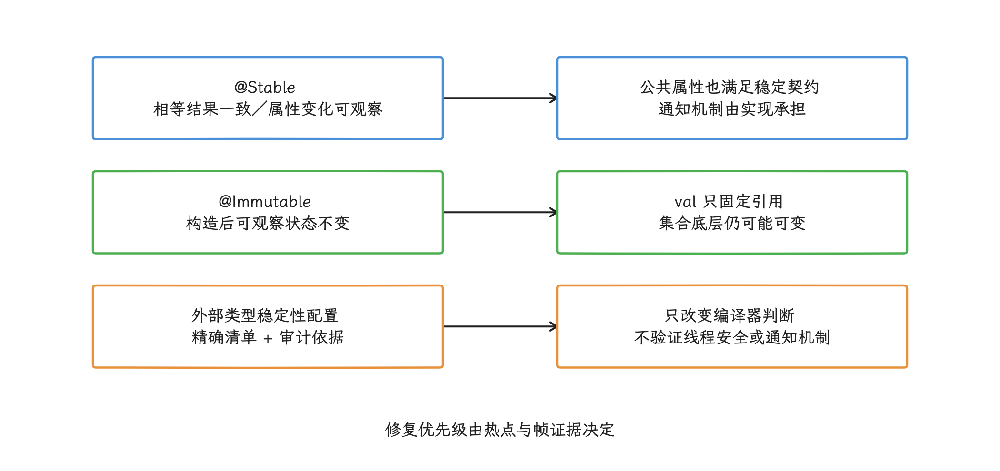

图：大集合的 equals 可能逐项扫描；追求全部 skippable 可能增加成本与错误契约。

#### 2. 集合与跨模块模型

标准库的 `List`、`Set`、`Map` 都是接口，不能证明底层不可变；精确报告可能是已知不稳定，也可能像本篇 2.4.10 样例一样标为运行时不确定，具体按该编译器的产物核对。我们常用的处理方式包括：

- 在 UI 边界转换为持久不可变集合；
- 用满足不可变契约的包装类型承载集合；
- 把变化数据放入 `State`、`SnapshotStateList` 或明确的状态流；
- 在不含 Compose 编译器的模型模块外，再定义 UI 专用模型。

持久不可变集合在更新时返回新实例，旧实例保持不变，适合跨越 UI 边界。外部类型经过团队审计并满足稳定契约后，可以通过稳定性配置文件告知编译器。下面的配置把一份明确的类型清单加入当前模块。

```kotlin
composeCompiler {
    stabilityConfigurationFiles.add(
        rootProject.layout.projectDirectory.file("stability_config.conf")
    )
}
```

`stabilityConfigurationFiles` 是当前复数形式的 API；单数 `stabilityConfigurationFile` 已弃用。配置文件只改变编译器判断，不会验证第三方类型的线程安全、可变性或通知机制，清单必须附带审计依据。

下面的配置文件条目用于声明一个经过审计的具体类型。

```text
com.example.model.ImmutableFromAnotherModule
```

优先列出精确类型。大范围通配符会把后续新增类型一并视为稳定，代码评审很难发现契约已经失效。

#### 3. 不要追求“全部可跳过”

非 `Unit` 返回值、显式 `@NonSkippableComposable`、不可重启函数和部分内联结构本来就不该生成相同的跳过代码。可跳过性还会增加少量代码体积。

静态检查应关注“与基线相比为什么变化”，避免把“所有组合函数必须 `skippable`”设成门禁。修复优先级由运行时热点、调用频率、参数分配和帧结果共同决定。

### 六、Layout Inspector 观察次数

Android Studio Layout Inspector 可以显示组合节点的重组次数和跳过次数。我们主要用它回答：

- 哪个界面区域在目标交互期间反复重组；
- 状态读取是否放在过高层级；
- 参数身份是否在父层频繁变化；
- 修复前后，同一操作脚本下的计数是否收敛。

使用时固定设备、页面初始状态和交互步骤，每轮采样前重置计数。Inspector 是诊断环境，自带观测开销，计数只用于定位范围；精确耗时交给 profileable 且 non-debuggable 的构建，用系统跟踪和基准测试确认。

计数高也未必是问题：很小的计时文本可以高频重组而成本很低，只执行一次的组合函数也可能同步解析大对象并阻塞一帧。我们把次数与单次成本、作用域大小、帧截止时间放在一起看。

<!-- gracker-diagram: a234-15-inspector-cost -->
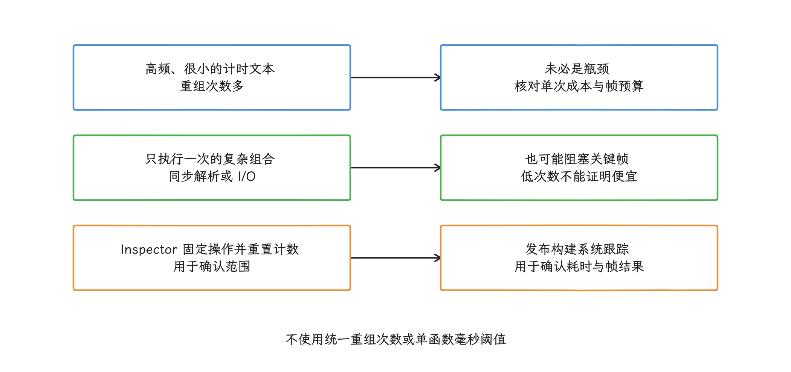

图：Debug 与 Inspector 改变测量环境；同条件发布版数据才支持性能结论。

### 七、Composition Tracing 定位运行时间

#### 1. 加入 Runtime Tracing 依赖

普通系统跟踪默认不包含每个组合函数，我们先把依赖加进来。下面的依赖坐标固定为 1.11.4，用于复现旧实验；它展示的是构件名称，当前推荐版本见下一段。

```kotlin
dependencies {
    implementation("androidx.compose.runtime:runtime-tracing:1.11.4")
}
```

当前项目应使用 `androidx.compose.runtime:runtime-tracing:1.12.0`。若已经导入 Compose BOM `2026.08.00`，依赖可以省略版本号；该 BOM 同样映射到 1.12.0。Composition Tracing 要求采集设备至少为 API 30，Android 17 / API 37 满足这个条件。

Kotlin 2.4.10 的 Compose 插件仍默认注入组合跟踪标记和源码信息。跟踪标记是编译器插入的区间起止调用；项目若显式关闭 `includeTraceMarkers`，即使加入运行时依赖，也不会得到完整的逐函数信息。

#### 2. 使用可分析的构建

下面的 Manifest 片段允许 shell 工具分析关闭调试的 Release 性能构建。

```xml
<application
    android:debuggable="false">
    <profileable android:shell="true" />
</application>
```

`non-debuggable` 保留发布构建的优化与运行方式，`profileable` 则允许 shell 和受信任工具在不打开调试器的情况下采集性能数据。Debug 构建的额外检查、调试器和编译差异都会改变耗时，发布性能结论别建立在它上面。

#### 3. 正确阅读系统跟踪

加入 `runtime-tracing` 后，系统跟踪会显示带函数名、文件和行号信息的组合切片。切片表示线程上从开始标记到结束标记的一段时间。Compose Runtime 1.12.0 源码仍包含 `Recomposer:animation`、`Recomposer:recompose` 等内部区间。

这些名称不是稳定 API。团队查询应先打开当前版本的跟踪数据确认切片名称，再保存针对该版本的查询；`Compose:measure`、`Compose:layout`、`Compose:draw`、`Compose:recompose` 这套切片组合，并不是每个版本都有。

组合函数切片只覆盖组合阶段的相关执行。Compose UI 的测量、布局和绘制属于后续阶段，可能由不同跟踪标记表达。看到某个组合函数耗时长，我们还要检查它是否触发布局、绘制和 RenderThread 工作——四个阶段要分开看，合不成一个“重组耗时”。

1.12.0 的运行时依赖通过 `ComposeTracingInitializer` 安装 `CompositionTracer`，再把编译器传入的 `info` 写入 `PerfettoSdkTrace.beginSection(info)`。函数名来自编译器标记，因此缺少依赖或关闭标记时不会出现逐函数切片。

<!-- gracker-diagram: a234-16-trace-install -->
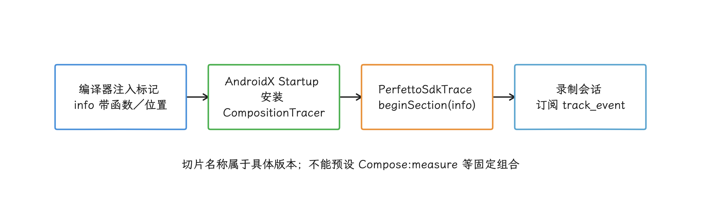

图：API 30+ 按受支持采集方式启用；安装跟踪器只提供写入能力，不代表已录制。

#### 4. 控制采集成本

组合函数名和源码信息会增加 APK 体积，逐函数跟踪也会增加采集数据量。诊断构建应保留与生产一致的优化设置，只增加必要的 `profileable` 与跟踪能力。

从终端启用完整的 Perfetto SDK 跟踪时，还可能需要 `androidx.tracing:tracing-perfetto` 和对应的二进制依赖。官方明确警告不要把 `tracing-perfetto-binary` 发布到生产包。日常排查优先使用 Android Studio System Trace 或 Macrobenchmark 自动采集，减少配置差异。

### 八、把重组放回渲染流水线

我们把一次可见更新放回标准应用窗口路径里看，它大致经过：

```text
vsync-app
  -> Choreographer#doFrame
  -> Compose 重组 / 测量 / 布局 / 绘制记录
  -> RenderThread
  -> BufferQueue / BLAST 提交缓冲
  -> SurfaceFlinger 合成
  -> HWC / 显示控制器
  -> present
```

这条路径用来分清各环节的责任。Compose 的组合优化主要减少应用主线程生成 UI 更新的工作；RenderThread、GPU、SurfaceFlinger 和显示硬件有没有按时完成，要回到各自环节核对。

诊断时可以按以下证据相互核对：

1. FrameTimeline 标出目标交互中的慢帧，并区分 App 与 SurfaceFlinger 侧截止时间。
2. 主线程轨道检查 `Choreographer#doFrame`、`Recomposer:recompose` 和目标组合函数切片。
3. 若应用主线程按时完成，继续检查 RenderThread、GPU、BufferQueue、SurfaceFlinger 和同步栅栏；同步栅栏表示前一项图形工作何时完成。
4. 用同一用户操作的 Macrobenchmark 比较修复前后帧指标。

`queueBuffer` 只说明应用提交了一个缓冲，缓冲有没有显示是另一回事。评估用户结果要看 FrameTimeline 与最终呈现时刻。

内核侧的 `android17-6.18-2026-06_r6` 记录只解释线程为什么没有及时运行、唤醒是否延迟、同步栅栏是否阻塞；Compose 的稳定性标签它不认识，CPU 为什么有一段时间没有调度目标线程，编译器报告也解释不了。跨层结论要用时间戳把两类记录对上。

### 九、从状态写入追到重组作用域

一条可靠的重组因果链应包含：

```text
状态写入
  -> Snapshot 变化被应用
  -> 读取该状态的组合作用域失效
  -> Recomposer 在帧时钟中处理待办工作
  -> 参数比较与跳过判断
  -> 必要的组合函数重新执行
  -> 节点更新可能触发测量、布局或绘制
```

状态写入不保证产生可见重组：等价写入可能被 `SnapshotMutationPolicy` 忽略，没有组合读取者的状态也不会让界面作用域失效。反过来说，把频繁变化的状态读取放在页面根部，会让更大的作用域进入重组判断，哪怕很多子函数随后被跳过。

<!-- gracker-diagram: a234-18-snapshot-invalidation -->
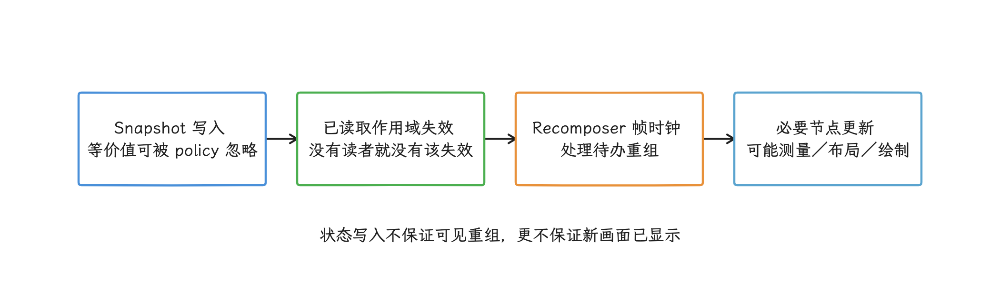

图：父级参数传播还会比较与跳过；已经由自身状态失效的作用域不能只凭参数相等跳过。

我们回到调用点，重点检查：

- 是否在组合期间反复创建集合、包装对象或 Lambda；
- 状态读取能否下移到只需要它的节点；
- Lazy 列表的键值和内容类型是否稳定；
- `remember` 的键值是否准确描述缓存生命周期；
- `derivedStateOf` 是否只在“输入变化频率高于派生结果变化频率”时使用；
- 普通可变对象是否绕过 Snapshot 通知。

报告指出参数类型，Layout Inspector 指出作用域，系统跟踪指出耗时。三类证据摆到一起再改代码，比看到 `unstable` 就添加注解更容易找到实际原因。

### 十、CI 中保存可解释的语义快照

#### 1. 记录原始产物与构建条件

这一节的“语义快照”指某次固定编译产生的原始报告、统计结果和构建条件，与运行时 Snapshot 无关；它让代码评审可以判断标签变化来自业务代码、编译选项还是工具升级。

每个基线至少应保存：

- Kotlin 与 Compose 插件版本；
- Compose Runtime / UI 版本；
- 模块、编译目标、编译单元（compilation）与构建变体；
- `module.json` 的 `featureFlags`；
- 原始 `classes.txt`、`composables.txt`、CSV 和 module JSON；
- 源码提交及生成命令；
- 对应 Macrobenchmark 或系统跟踪样本标识。

只提交一个“unstable 数量”会丢失函数身份、原因和编译开关，后续分不清变化来自业务代码还是工具升级。

#### 2. 严格解析当前格式

下面的 Python 脚本校验 Kotlin 2.3.20 的 CSV 表头和布尔编码，并生成便于代码评审的确定性快照。2.4.10 源码沿用相同字段，因此脚本也能读取当前版本；版本号与功能开关仍需作为独立门禁。

```python
#!/usr/bin/env python3
import argparse
import csv
import json
from pathlib import Path

EXPECTED_HEADER = [
    "package",
    "name",
    "composable",
    "skippable",
    "restartable",
    "readonly",
    "inline",
    "isLambda",
    "hasDefaults",
    "defaultsGroup",
    "groups",
    "calls",
    "",
]

MODULE_KEYS = [
    "skippableComposables",
    "restartableComposables",
    "readonlyComposables",
    "totalComposables",
    "restartGroups",
    "totalGroups",
    "markedStableClasses",
    "inferredStableClasses",
    "inferredUnstableClasses",
    "inferredUncertainClasses",
    "effectivelyStableClasses",
    "totalClasses",
    "memoizedLambdas",
    "totalLambdas",
]

BOOLEAN_COLUMNS = [
    "composable",
    "skippable",
    "restartable",
    "readonly",
    "inline",
    "isLambda",
    "hasDefaults",
    "defaultsGroup",
]


def relative(path: Path, root: Path) -> str:
    return path.resolve().relative_to(root.resolve()).as_posix()


def read_csv(path: Path, root: Path) -> dict:
    with path.open(newline="", encoding="utf-8") as source:
        reader = csv.DictReader(source)
        if reader.fieldnames != EXPECTED_HEADER:
            raise ValueError(
                f"{path}: unsupported CSV header: {reader.fieldnames}"
            )
        rows = list(reader)

    for row in rows:
        if None in row or any(value is None for value in row.values()):
            raise ValueError(f"{path}: malformed CSV row: {row!r}")
        if row[""] != "" or not row["package"] or not row["name"]:
            raise ValueError(f"{path}: invalid identity or trailing field")
        for column in ("groups", "calls"):
            if not row[column].isascii() or not row[column].isdecimal():
                raise ValueError(f"{path}: {column} must be a nonnegative integer")
        for column in BOOLEAN_COLUMNS:
            if row[column] not in {"0", "1"}:
                raise ValueError(
                    f"{path}: {column} must use 0/1, got {row[column]!r}"
                )

    non_skippable_restartable = sorted(
        row["package"]
        for row in rows
        if row["composable"] == "1"
        and row["restartable"] == "1"
        and row["skippable"] == "0"
    )
    return {
        "file": relative(path, root),
        "total_rows": len(rows),
        "skippable": sum(int(row["skippable"]) for row in rows),
        "restartable": sum(int(row["restartable"]) for row in rows),
        "non_skippable_restartable": non_skippable_restartable,
    }


def read_module(path: Path, root: Path) -> dict:
    data = json.loads(path.read_text(encoding="utf-8"))
    missing = [key for key in MODULE_KEYS if key not in data]
    if "featureFlags" not in data:
        missing.append("featureFlags")
    if missing:
        raise ValueError(f"{path}: missing fields: {missing}")
    for key in MODULE_KEYS:
        if type(data[key]) is not int or data[key] < 0:
            raise ValueError(f"{path}: {key} must be a nonnegative integer")
    flags = data["featureFlags"]
    if not isinstance(flags, dict) or not all(
        isinstance(key, str) and type(value) is bool
        for key, value in flags.items()
    ):
        raise ValueError(f"{path}: featureFlags must map names to booleans")
    return {
        "file": relative(path, root),
        "metrics": {key: data[key] for key in MODULE_KEYS},
        "featureFlags": dict(sorted(data["featureFlags"].items())),
    }


def main() -> None:
    parser = argparse.ArgumentParser()
    parser.add_argument("--build-root", type=Path, required=True)
    parser.add_argument("--output", type=Path, required=True)
    args = parser.parse_args()

    root = args.build_root.resolve()
    csv_files = sorted(root.rglob("*-composables.csv"))
    module_files = sorted(root.rglob("*-module.json"))
    if not csv_files or not module_files:
        raise SystemExit("compiler reports or module metrics were not found")

    snapshot = {
        "csv": [read_csv(path, root) for path in csv_files],
        "modules": [read_module(path, root) for path in module_files],
    }
    args.output.write_text(
        json.dumps(snapshot, ensure_ascii=False, indent=2, sort_keys=True)
        + "\n",
        encoding="utf-8",
    )


if __name__ == "__main__":
    main()
```

脚本在表头、行列数、布尔编码或计数类型不符时直接失败，避免 Kotlin 升级或产物损坏后继续生成错误统计。CSV 的函数全名仍不能独自区分所有重载，因此此脚本保留行计数，不能把函数名集合当作完整签名索引。它列出“可重启但不可跳过”的函数供评审，不把这类函数自动判为失败。

<!-- gracker-diagram: a234-19-ci-schema -->
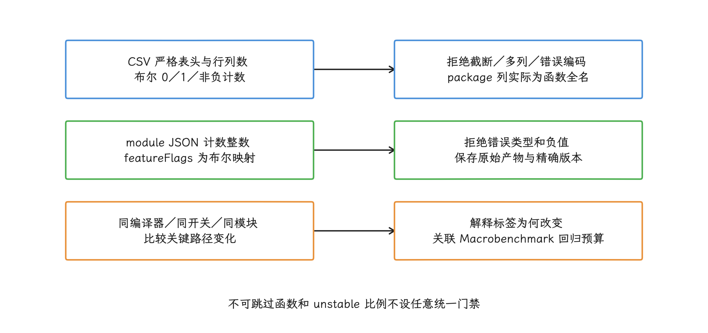

图：字段相同不等于代码生成相同；快照不是运行时 Snapshot，也不是自动性能评分。

下面的命令用于从应用构建目录生成快照。

```bash
python3 tools/compose_metrics_snapshot.py \
  --build-root app/build/compose_compiler \
  --output app/build/compose-compiler-snapshot.json
```

示例假设团队把脚本保存为 `tools/compose_metrics_snapshot.py`。输出仍是诊断产物；是否阻断合入应由项目基线、函数变化原因和运行时回归共同决定。

#### 3. 合理的门禁规则

适合自动阻断的情况包括：

- Kotlin 或 Compose 插件版本变化，但基线没有显式升级；
- `featureFlags` 与基线不一致；
- 报告格式变化而解析器尚未适配；
- 已列入关键路径观察名单的函数发生非预期标签变化；
- Macrobenchmark 的帧指标超过项目在目标设备上建立的回归预算。

不适合使用统一阈值的情况包括：

- 模块中 `unstable` 类型比例超过某个任意百分比；
- 出现任意一个不可跳过函数；
- 单次组合函数切片超过固定的 1 ms 或 8 ms；
- 编译器指标改善，但没有运行时验证。

帧预算受刷新率、设备性能、热状态和同一帧其他工作影响。项目应围绕关键用户旅程（Critical User Journey，CUJ）——冷启动、打开会话和滚动列表——在受控实验中建立各自阈值；适用于所有设备的统一常数并不存在。

### 十一、K2 / Compose Compiler 迁移：先固定构建语义

Kotlin 2.0 起，Compose 编译器随 Kotlin 一同发布，项目应应用与 Kotlin 完全同版本的 `org.jetbrains.kotlin.plugin.compose`。K2 负责 Kotlin 源码的前端解析和语义分析；Compose 编译器插件仍负责改写 `@Composable` 参数、生成组合组、生成记录参数变化的掩码（change mask）、记住 Lambda，并注入跟踪标记。K2 本身不承诺自动改善 Compose UI 的运行时性能。

迁移时应删除旧 `androidx.compose.compiler:compiler` 依赖、`kotlinCompilerExtensionVersion` 和重复的 `freeCompilerArgs` 插件参数，再在 Compose DSL 中配置报告目录、指标目录和稳定性配置文件。Android 17 / targetSdk 37 不决定 Kotlin 或 Compose 编译器版本；AGP 内置 Kotlin 支持、kapt/KSP 注解处理和 Compose Multiplatform 也要分别核对兼容性表。

增量编译性能可用 Gradle Profiler 或可重复脚本分别测量全量构建、无改动构建、单个 Kotlin 文件变更、公共模型变更和资源变更。实验要固定 Gradle、AGP、Kotlin、JDK、守护进程与 JVM 参数、配置缓存、远程缓存和机器负载，并保存构建扫描或任务失效原因。IDE 构建面板里的一次主观感受，证明不了 K2 或 Compose 插件改善了构建速度。

编译成功离运行时性能改善还有一步。迁移前后应使用同一业务代码、Release/R8 设置、Baseline Profile、设备与用户旅程，比较启动时间和帧耗时分位数。编译器报告只能解释代码生成属性，推导不出重组次数或帧截止时间。值类（value class）、Kotlin 元数据、R8、Live Edit 与 kapt 故障属于构建兼容问题，应单独记录，别混入 Compose 帧归因。

<!-- gracker-diagram: a234-20-migration-split -->
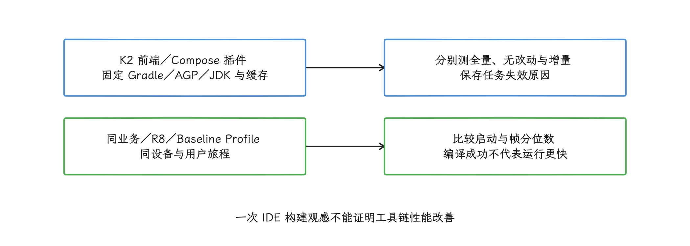

图：Compose 插件随 Kotlin 同版本；AGP 内置 Kotlin、KSP/kapt 和多平台兼容还需分别核对。

### 十二、Runtime Tracing 的采集与解释边界

`runtime-tracing` 通过 AndroidX Startup 安装全局跟踪器，把编译器注入的可组合函数标记送到 Perfetto SDK。激活跟踪器只是让进程具备写入能力，何时收集数据由录制会话（session）决定。终端采集时，目标进程要成功加载匹配的 `tracing-perfetto` 二进制库，跟踪配置还要订阅用于记录应用事件的 `track_event` 数据源；完整渲染调查还需要 FrameTimeline、内核调度事件（ftrace/sched）、图形与 View 事件、RenderThread 和 SurfaceFlinger 数据源。

用于诊断的构建应可被性能工具分析，且不可调试。`tracing-perfetto-binary` 会明显增加体积，只应放进基准测试或诊断变体；通过 adb 广播激活 `TracingReceiver` 需要 `android.permission.DUMP`，普通线上应用拿它当远程开关是行不通的。API 35 及以上的 `ProfilingManager` 可以请求受限且经过隐私删减的系统跟踪，但能否看到逐个可组合函数，仍取决于目标构建是否保留标记、运行时跟踪是否激活——Runtime Tracing 那套配置要求还是要自己满足。

一条可组合函数切片表示同一线程上的同步区间。`dur` 是切片从开始到结束的墙钟时间，既包含线程正在运行（Running）的时间，也包含已经就绪但等待 CPU（Runnable）和阻塞的时间。父切片包含子切片，把所有包含耗时（`inclusive duration`）直接相加会重复计数；分析时按名称、线程和时间筛选候选，再统计出现次数，分别计算包含耗时与扣除直接子切片后的自耗时（`self time`）。切片能证明函数在该时间窗执行过，但回答不了哪个 State 导致失效，也不覆盖布局、绘制、RenderThread 或 GPU 工作。

<!-- gracker-diagram: a234-17-trace-duration -->
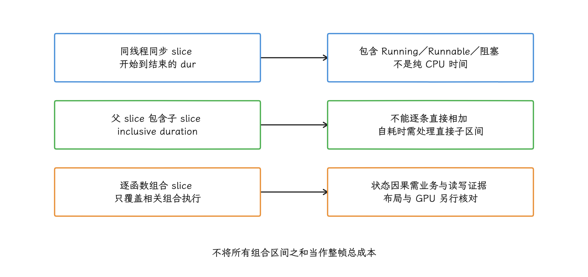

图：先按名称、线程、时间筛选，再统计次数、包含时长和自耗时。

可靠的排查顺序是：先用 FrameTimeline 定位异常帧，在主线程上把组合切片、状态或业务标记、测量、布局和绘制串起来，再检查线程状态、垃圾回收、Binder 与 I/O；UI 线程按时完成的，继续查看 RenderThread、缓冲区、SurfaceFlinger 与最终呈现。线上 APM 用于筛选页面、设备和操作样本组（cohort）。完整跟踪包含源码位置、线程和用户操作时序，采集系统必须设置配额、保留期、访问控制和隐私策略。

### 十三、逐个问题的诊断流程

1. 定义可重复的用户操作，例如打开会话列表并滚动三屏。
2. 用 Macrobenchmark 或 FrameTimeline 确认该操作存在慢帧，并保存设备、温度、刷新率和构建信息。
3. 用 Layout Inspector 缩小反复重组的界面范围。
4. 用 Composition Tracing 找到耗时的组合函数及其调用层级。
5. 查阅 `composables.txt` 和 `classes.txt`，确认函数标签与参数稳定性。
6. 回到调用点检查对象身份、状态读取位置、键值、集合转换和 Lambda 捕获。
7. 只修改一个主要变量，再用相同脚本复测计数、系统跟踪和帧结果。
8. 更新编译器语义快照，并记录变化为何符合预期。

若 FrameTimeline 显示应用侧按时完成，排查就转向 RenderThread、GPU、SurfaceFlinger 和同步栅栏；这时继续修改稳定性，通常动不到合成侧或显示侧的瓶颈。

### 十四、核查清单

#### 编译配置

- [ ] Kotlin Android 插件与 `org.jetbrains.kotlin.plugin.compose` 使用同一版本。
- [ ] 报告由固定的 Release 变体生成。
- [ ] 归档模块、编译目标、编译单元、提交和 `featureFlags`。
- [ ] Kotlin 升级时重新验证 CSV 与 JSON 格式。

#### 静态报告

- [ ] 区分 `restartable`、`skippable` 与参数稳定性。
- [ ] 没有把 `skippable` 当成实际跳过次数。
- [ ] 对集合、跨模块类型和稳定性配置做契约审计。
- [ ] 没有为追求统计数字给可变类型添加虚假注解。

#### 运行时

- [ ] Layout Inspector 使用相同交互脚本和重置后的计数。
- [ ] 系统跟踪来自允许性能分析且关闭调试（non-debuggable）的构建。
- [ ] Composition Tracing 依赖和编译器跟踪标记均已启用。
- [ ] 组合、测量、布局、绘制和提交/显示没有混为一段。

#### 结果验证

- [ ] FrameTimeline 指明慢帧责任侧。
- [ ] Macrobenchmark 覆盖目标用户操作。
- [ ] 修复前后使用相同设备条件与构建设置。
- [ ] CI 门禁比较同版本、同开关、同模块的基线。

### 源码与资料索引

- [Kotlin 发布记录：本文工具链基线 2.4.10](https://kotlinlang.org/docs/releases.html)
- [Kotlin 2.4.10 发行说明](https://github.com/JetBrains/kotlin/releases/tag/v2.4.10)
- [Compose 编译器插件 2.4.10](https://plugins.gradle.org/plugin/org.jetbrains.kotlin.plugin.compose/2.4.10)
- [Diagnose stability issues](https://developer.android.com/develop/ui/compose/performance/stability/diagnose)
- [Fix stability issues](https://developer.android.com/develop/ui/compose/performance/stability/fix)
- [Strong skipping mode](https://developer.android.com/develop/ui/compose/performance/stability/strongskipping)
- [Lifecycle of composables：稳定性契约](https://developer.android.com/develop/ui/compose/lifecycle#skipping)
- [Composition tracing](https://developer.android.com/develop/ui/compose/tooling/tracing)
- [Compose compiler options DSL](https://kotlinlang.org/docs/compose-compiler-options.html)
- [Kotlin 2.4.10 `BuildMetrics.kt`](https://github.com/JetBrains/kotlin/blob/v2.4.10/plugins/compose/compiler-hosted/src/main/java/androidx/compose/compiler/plugins/kotlin/BuildMetrics.kt)
- [Kotlin 2.3.20 `BuildMetrics.kt`](https://github.com/JetBrains/kotlin/blob/v2.3.20/plugins/compose/compiler-hosted/src/main/java/androidx/compose/compiler/plugins/kotlin/BuildMetrics.kt)
- [Firebase Auth 24.2.0 POM](https://dl.google.com/dl/android/maven2/com/google/firebase/firebase-auth/24.2.0/firebase-auth-24.2.0.pom) 与 [AAR](https://dl.google.com/dl/android/maven2/com/google/firebase/firebase-auth/24.2.0/firebase-auth-24.2.0.aar)：核对 `checker-qual` 发布元数据和 `UnknownInitialization` class 签名边界。
- [掘金：Firebase 如何让全球 Android 和 Flutter 开发者集体 Build Fail](https://juejin.cn/post/7678586341090803748)：作为 FlutterFire `firebase_auth 6.6.0`、Firebase Auth `24.2.0` 与 Kotlin 2.4 编译失败案例来源。
- [Compose Runtime 1.12.0 release notes](https://developer.android.com/jetpack/androidx/releases/compose-runtime#1.12.0)
- [Runtime Tracing 1.12.0 sources.jar](https://dl.google.com/dl/android/maven2/androidx/compose/runtime/runtime-tracing/1.12.0/runtime-tracing-1.12.0-sources.jar)
- [Compose Runtime 1.12.0 `Recomposer.kt`](https://android.googlesource.com/platform/frameworks/support/+/963bf914f78b389bdddef0da7f36bee19d897274/compose/runtime/runtime/src/commonMain/kotlin/androidx/compose/runtime/Recomposer.kt)
- [BOM 2026.08.00 POM](https://dl.google.com/dl/android/maven2/androidx/compose/compose-bom/2026.08.00/compose-bom-2026.08.00.pom)
- [Compose Runtime 1.11.4 release notes](https://developer.android.com/jetpack/androidx/releases/compose-runtime#1.11.4)
- [Perfetto FrameTimeline](https://perfetto.dev/docs/data-sources/frametimeline)
- [Android 17 `Choreographer.java`](https://cs.android.com/android/platform/superproject/+/android-17.0.0_r1:frameworks/base/core/java/android/view/Choreographer.java)
- [Android 17 `ViewRootImpl.java`](https://cs.android.com/android/platform/superproject/+/android-17.0.0_r1:frameworks/base/core/java/android/view/ViewRootImpl.java)
- [Android 17 SurfaceFlinger `FrameTimeline.cpp`](https://android.googlesource.com/platform/frameworks/native/+/android-17.0.0_r1/services/surfaceflinger/Scheduler/FrameTimeline.cpp)
- [ProfilingManager API reference](https://developer.android.com/reference/android/os/ProfilingManager) 与 [Android 17 `ProfilingManager.java`](https://android.googlesource.com/platform/packages/modules/Profiling/+/android-17.0.0_r1/framework/java/android/os/ProfilingManager.java)
- [Android common kernel `android17-6.18-2026-06_r6`](https://android.googlesource.com/kernel/common/+/refs/tags/android17-6.18-2026-06_r6/)
- [本知识库：Android 17 FrameTimeline](../../part1-fundamentals/ch02-rendering/12-android17-frametimeline-composition-boundary.md)

当前工具链与运行时结论复核于 2026-10-25。最小源码已分别用 Kotlin/Compose Compiler 2.3.20 与 2.4.10 重新编译，正文的 2.3.20 关键报告与新产物一致，2.4.10 的 CSV 与模块 JSON 字段也已核对；升级 Kotlin 或 Compose 后，仍应重新生成报告并复核字段、功能开关与跟踪名称。

### 常见误判

| 误判 | 准确口径 |
| --- | --- |
| `unstable` 参数使函数一定无法跳过 | Kotlin 2.3.20 与当前 2.4.10 都默认启用 Strong Skipping；可重启函数仍可跳过，不稳定参数用 `===` 比较 |
| `skippable` 证明运行时已经跳过 | 它只表示编译器生成了跳过能力 |
| 编译器 CSV 包含重组次数和参数列表 | Kotlin 2.3.20 CSV 不包含运行时次数，也没有 `params` 列 |
| 同内容的新 `List` 会按元素比较后跳过 | 声明为不稳定参数时比较容器引用，不做逐元素相等判断 |
| 给类加 `@Stable` 就完成优化 | 注解是开发者契约；违反通知或相等约束会造成界面错误 |
| 系统跟踪默认显示每个组合函数 | 需要 `runtime-tracing`、编译器跟踪标记和支持的采集方式 |
| `Compose:measure/layout/draw` 是所有版本固定切片 | 跟踪名称属于具体库实现，应按当前版本的真实数据核对 |
| 重组计数下降就证明帧性能改善 | 仍需 FrameTimeline 或 Macrobenchmark 验证用户结果 |
| 内核调度记录能解释稳定性 | 内核只提供线程运行、唤醒和同步证据，不包含 Compose 类型语义 |

这些误判的共同点是把手头的证据用到了它回答不了的问题上：静态报告代替不了运行时计数，组合切片代替不了整帧结果，内核调度也解释不了类型稳定性。

## Modifier.Node 生命周期与迁移成本

状态读取和重组都理顺之后，Modifier 链仍可能剩下一块成本：节点的创建和更新。Node API 用复用节点来压这部分成本，代价是我们要正确实现 update 和 invalidate。

`Modifier`（修饰符）是一条为 Compose 组件附加布局、绘制、输入等行为的链，`Modifier.Node` 是这条链的底层扩展机制：它把短生命周期的配置对象与可跨重组复用的运行节点分开，适合实现绘制、测量、语义、焦点和输入等行为。这里的“重组”指状态变化后，Compose 重新执行受影响的 `@Composable` 函数。迁移要同时处理节点复用、生命周期和阶段失效，只换接口名称是不够的。

本节源码核对取 Compose UI `1.12.0` 对应的 AndroidX 提交 `963bf914f78b389bdddef0da7f36bee19d897274`。`Modifier.Node` 随 Compose UI 库发布，设备 API 级别和 Linux 内核版本都不提供它；Android 17 与内核标签在这里只是环境说明，节点复用、链更新和自动失效语义，以应用实际依赖的 Compose UI 版本为准。

`Modifier.Node` API 在 Compose UI 1.3.0 加入。当前项目采用 1.12.0 稳定版，因此正文不再用“从某个 Android 版本开始支持”描述它，也不把早期版本的内部实现当成当前契约。

### 1. 先判断是否需要自定义节点

官方文档按需求给出的选择顺序如下：

| 需求 | 合适的实现 |
| --- | --- |
| 只需组合现有 Modifier | 编写普通、非 `@Composable` 的 Modifier 工厂函数并链接现有 Modifier |
| 只需把参数传给现有 Modifier | 继续使用现有 Modifier，不增加 Node |
| 必须读取组合调用点的值，且无法改为节点侧读取 | 谨慎使用 `@Composable` Modifier 工厂函数 |
| 需要新的绘制、测量、语义、焦点或输入行为 | `ModifierNodeElement` + `Modifier.Node` |
| 节点内部需要跨重组状态或附着期任务 | 在 Node 字段与 `coroutineScope` 中管理 |

下面这个工厂只组合已有能力，增加 Node 反而会提高维护成本。

```kotlin
fun Modifier.articleCard(
    background: Color,
    shape: Shape,
): Modifier = this
    .clip(shape)
    .background(background)
    .padding(horizontal = 16.dp, vertical = 12.dp)
```

这段代码没有自定义阶段行为。`clip`、`background` 和 `padding` 已有各自的节点实现，普通工厂还能在组合外创建并复用。

需要新行为时，Node 的主要收益来自运行对象复用和明确的阶段接口。它并不保证每个自定义 Modifier 都更快；高频执行路径是否改善，仍要通过对象分配、帧时间和阶段执行记录确认。

<!-- gracker-diagram: a234-21-node-choice -->
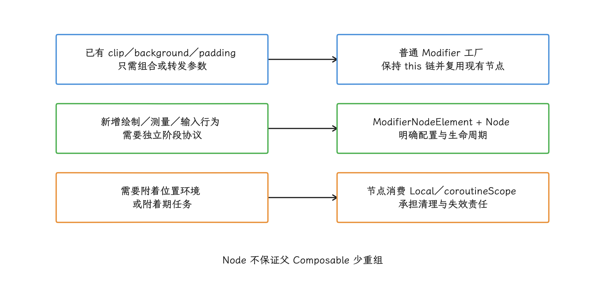

图：避免为使用新 API 增加不必要的自定义行为。

### 2. Element 与 Node 各自保存什么

一个 Node 型 Modifier 包含两类对象：

- `ModifierNodeElement<N>` 是轻量的配置元素，简称 Element。`@Composable` 函数重组时仍可能创建新的 Element。
- `Modifier.Node` 是附着在 `LayoutNode` 上的运行节点，简称 Node。`LayoutNode` 是 Compose 布局树中承载组件测量、放置和绘制信息的内部节点；Node 可以保存状态并跨多次重组复用。

Element 负责 `create()` 与 `update(node)`。Node 通过所实现的接口声明自己参加哪些阶段，例如：

| 节点接口 | 作用 |
| --- | --- |
| `LayoutModifierNode` | 测量与放置 |
| `DrawModifierNode` | 绘制 |
| `SemanticsModifierNode` | 语义与无障碍 |
| `PointerInputModifierNode` | 指针命中与事件分发 |
| `CompositionLocalConsumerModifierNode` | 读取附着位置的 `CompositionLocal` |
| `ObserverModifierNode` | 观察显式 `observeReads` 中的快照读取 |
| `LayoutAwareModifierNode` | 尺寸或放置回调 |

Node 可以同时实现多个接口。运行时会据此计算 `kindSet`——一个位掩码，每一位对应绘制、布局、输入等一种能力。遍历 Modifier 链时，运行时借助它跳过与目标能力无关的链段，并触发对应阶段的自动失效。

<!-- gracker-diagram: a234-22-element-node -->
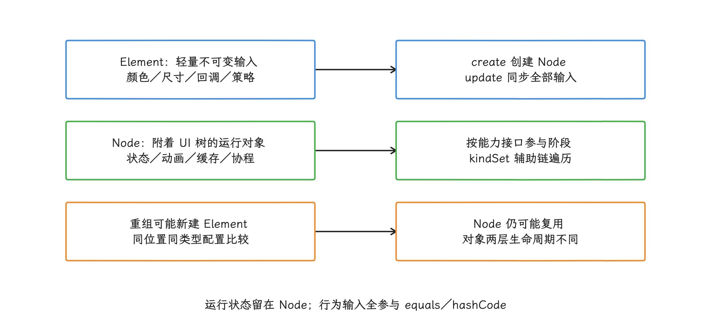

图：NodeChain 管差分，NodeCoordinator 衔接坐标、测量、绘制与命中。

#### 2.1 一个最小、可复用的绘制节点

下面这个圆形绘制节点的结构与 Compose 1.12.0 官方示例一致。

```kotlin
private class CircleNode(
    var color: Color,
) : Modifier.Node(), DrawModifierNode {

    override fun ContentDrawScope.draw() {
        drawCircle(color)
        drawContent()
    }
}

private data class CircleElement(
    val color: Color,
) : ModifierNodeElement<CircleNode>() {

    override fun create(): CircleNode = CircleNode(color)

    override fun update(node: CircleNode) {
        node.color = color
    }

    override fun InspectorInfo.inspectableProperties() {
        name = "circle"
        properties["color"] = color
    }
}

fun Modifier.circle(color: Color): Modifier =
    this then CircleElement(color)
```

`CircleElement` 只保存输入，`CircleNode` 保存当前运行状态。相同位置继续使用 `CircleElement` 时，颜色变化会更新现有 Node；默认自动失效随后安排绘制，无需在这个 `update()` 中再次调用 `invalidateDraw()`。

示例调用了 `drawContent()`，所以链中更内侧的绘制和组件内容仍会执行。如果设计目标是完全替换内容绘制，才应省略它。

### 3. NodeChain 如何决定复用、更新或替换

每个 `LayoutNode` 通过 `NodeChain` 管理自己的 Modifier 节点链，并在链变化时做差分，也就是比较新旧 Element 序列并计算复用、更新、插入和删除动作。`NodeCoordinator` 负责把节点与坐标、绘制、命中及布局流程衔接起来，链的差分仍由 `NodeChain` 完成。

我们对照 Compose UI 1.12.0 的 `NodeChain.actionForModifiers()` 规则：

| 旧 Element 与新 Element | 动作 | Node 结果 |
| --- | --- | --- |
| `prev == next` | 复用 | 沿用 Node，不调用 `update()` |
| 不相等，但运行时类型相同 | 更新 | 沿用 Node，调用新 Element 的 `update(node)` |
| 运行时类型不同 | 替换 | 移除旧 Node，创建新 Node |

等长、类型顺序稳定的链走线性快速路径。出现插入、删除或类型变化后，`NodeChain` 使用修改过的 Myers 差分算法计算结构变化。Myers 算法通过寻找较短的插入、删除序列来对齐新旧列表，作用是减少不必要的节点替换。`LayoutModifierNode` 需要专用的 `LayoutModifierNodeCoordinator`；其他节点会与所在链段共享协调器。

这套规则带来三个实现要求：

1. Element 的 `equals()` 与 `hashCode()` 必须覆盖所有会改变 Node 行为的输入。
2. `update()` 必须把这些输入同步到现有 Node。
3. 不要把会频繁变化的运行状态放进 Element；它应留在 Node，或由节点观察外部状态。

参数型 Element 使用 `data class` 通常最安全。无参数 Element 可以使用单例，并提供稳定的相等与散列语义。错误的 `equals()` 会让运行时错误地跳过 `update()`；遗漏字段则可能让界面保留旧配置。

还要分清一件事：Node 复用说的是 Element 背后的 Node 及其状态被留下来，Element 本身仍可能在每次重组时新建——Modifier 工厂在 Composable 内执行时就是这样。

<!-- gracker-diagram: a234-23-node-reuse -->
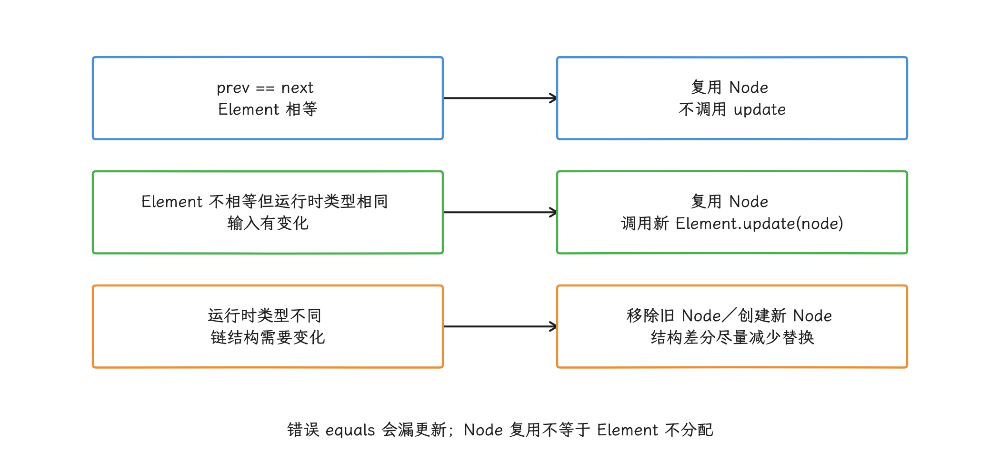

图：等长且类型顺序稳定可走线性快路径；结构变化使用修改过的 Myers 差分。

### 4. update() 与自动失效

失效的意思很直接：把某一阶段的旧结果标记为作废，并安排该阶段重新执行。`Modifier.Node.shouldAutoInvalidate` 默认返回 `true`。同类型 Element 发生更新后，运行时会按 Node 接口自动安排相关工作：

- `LayoutModifierNode`：使测量结果失效；
- `DrawModifierNode`：使绘制结果失效；
- `SemanticsModifierNode`：使语义配置失效；
- `LayoutAwareModifierNode`：按具体回调类型安排测量、放置或位置通知；
- 其他支持自动失效的节点类型：执行各自的失效处理。

所以常规 `update()` 把字段同步完就够了；无条件手动调用 `invalidateDraw()` 或 `invalidateMeasurement()`，等于把运行时已经知道的信息再说一遍。

#### 4.1 何时关闭自动失效

一个 Node 同时实现多个阶段接口，而某些参数只影响其中一个阶段时，可以把 `shouldAutoInvalidate` 设为 `false`，再由 `update()` 精确选择失效范围。这样写的责任更大：遗漏调用会造成 UI 不更新。

`StripeNode` 只参与绘制，用它演示手动失效的完整约束。

```kotlin
private class StripeNode(
    var color: Color,
    var visible: Boolean,
) : Modifier.Node(), DrawModifierNode {

    override val shouldAutoInvalidate: Boolean = false

    override fun ContentDrawScope.draw() {
        drawContent()
        if (visible) {
            drawRect(
                color = color,
                size = Size(width = size.width, height = 2.dp.toPx()),
            )
        }
    }
}

private data class StripeElement(
    val color: Color,
    val visible: Boolean,
) : ModifierNodeElement<StripeNode>() {

    override fun create(): StripeNode = StripeNode(color, visible)

    override fun update(node: StripeNode) {
        val visualChanged =
            node.color != color || node.visible != visible

        node.color = color
        node.visible = visible

        if (visualChanged) {
            node.invalidateDraw()
        }
    }
}

fun Modifier.bottomStripe(
    color: Color,
    visible: Boolean,
): Modifier = this then StripeElement(color, visible)
```

这里关闭自动失效后，`update()` 只在可见结果变化时安排绘制。若节点还实现 `LayoutModifierNode`，尺寸参数变化应调用 `invalidateMeasurement()`；只影响放置逻辑的参数可调用 `invalidatePlacement()`。当前公开 API 中没有 `invalidateLayout()` 这个 `LayoutModifierNode` 扩展函数。

<!-- gracker-diagram: a234-24-invalidate -->
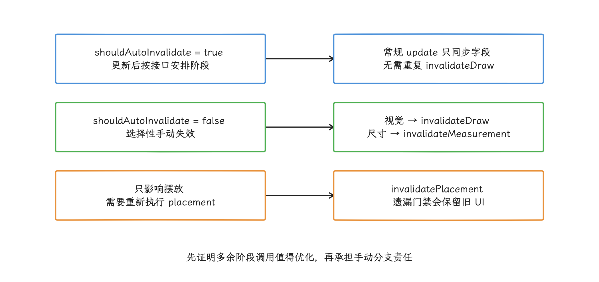

图：关闭开关抑制更新的自动失效；插入和移除的结构失效仍由框架处理。

默认自动失效适合绝大多数业务节点。只有剖析结果表明无效阶段调用值得优化，并且测试能覆盖每个参数分支时，才考虑手动模式。

### 5. 生命周期、协程与可复用内容

Node 有四个生命周期入口需要区分：

- `create()` 创建对象；Node 此时尚未附着。
- `onAttach()` 表示 Node 已进入 UI 树，可以使用附着期 API 和 `coroutineScope`；实现相应消费接口后也可读取 `CompositionLocal`。此时同一轮更新中的其他节点不一定都已处理完，需要观察整棵树的最终状态时，应通过 `sideEffect` 延后执行。
- `onDetach()` 在 Node 离开当前 UI 树前调用；之后节点协程作用域会被取消。
- `onReset()` 在 Node 即将随布局进入复用池时调用，例如采用可复用内容机制的 Lazy 列表项滚出视口。调用发生时 Node 仍处于附着状态，随后才解除附着；未进入复用流程的普通离屏变化则未必触发 `onReset()`。

`onDetach()` 后同一个 Node 仍可能再次附着。`onReset()` 还表示它未来可能服务于语义上不同的数据项，因此焦点、按压、拖拽进度和临时选择等数据项级状态需要清理。

<!-- gracker-diagram: a234-25-node-lifecycle -->
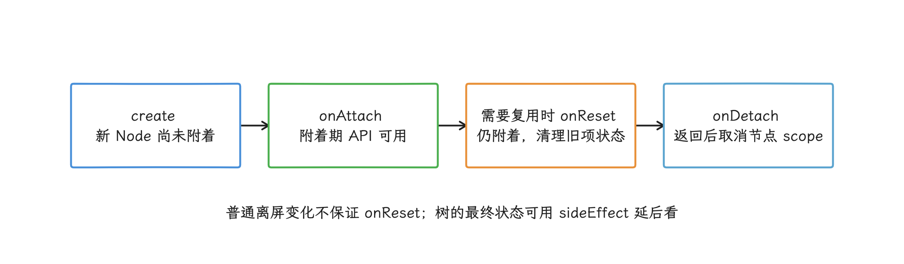

图：onReset 只在相关可复用内容流程出现；同一 Node 之后可以重新附着服务另一实体。

Node 自带的 `coroutineScope` 仅在附着期间可访问。外部作用域无需从 Element 传入；`LaunchedEffect` 留在 Composable 一侧，Node 里调用不了。两个短节点分别展示附着期动画和复用状态清理。

```kotlin
private class EntranceOverlayNode :
    Modifier.Node(), DrawModifierNode {

    private val progress = Animatable(0f)

    override fun onAttach() {
        coroutineScope.launch {
            progress.snapTo(0f)
            progress.animateTo(1f)
        }
    }

    override fun ContentDrawScope.draw() {
        drawContent()
        val alpha = (1f - progress.value) * 0.08f
        if (alpha > 0f) {
            drawRect(Color.Black.copy(alpha = alpha))
        }
    }
}

private class SelectableNode : Modifier.Node() {
    var selected by mutableStateOf(false)

    override fun onReset() {
        selected = false
    }
}
```

`EntranceOverlayNode` 每次附着都在新作用域中重置并启动动画；解除附着后，作用域由 Node 自动取消。`Animatable.value` 在绘制阶段读取，快照变化会使绘制阶段重新执行。`SelectableNode` 则在进入复用流程时清除与旧数据项绑定的选择状态。

<!-- gracker-diagram: a234-26-node-coroutine -->
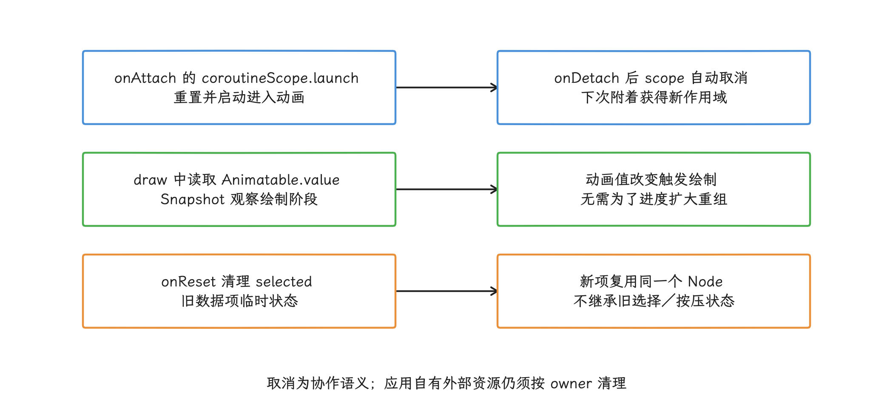

图：生命周期持有动画任务，阶段观察持有更新依赖。

### 6. Modifier.composed 与 @Composable 工厂的准确边界

`Modifier.composed {}` 可以保存实例专属状态。块中的 `remember` 在组合槽位保持不变时会复用；组合槽位是 Compose 在内部用来标识一次 `@Composable` 调用位置及其状态的记录。`composed` 的成本主要来自这些方面：

- `composed` Element 应用到布局前要经过 `Composer.materialize()`，也就是在组合环境中展开成实际 Modifier 链；
- 工厂为每个应用位置进入组合并生成实际 Modifier 链；
- 状态和副作用依赖组合槽位生命周期，而非 Node 的附着与复用生命周期；
- 相比 Node，会增加组合工作和中间对象。

官方文档目前把 `composed {}` 标为“不再推荐”，但重载仍在公开 API 里。维护旧代码时按热点数据安排迁移就好，别把“不推荐”放大成“运行即错误”。

`@Composable` Modifier 工厂也有相似限制。返回值不是 `Unit` 的 Composable 函数没有跳过资格，这种工厂即使输入稳定，也会在调用者重组时执行。它读取的 `CompositionLocal` 值来自工厂调用位置，而普通 Node 工厂可在使用位置读取附着环境。

下面这段代码只用于说明调用位置语义，别当推荐模板抄。

```kotlin
@Composable
fun Modifier.localTint(): Modifier {
    val tint = LocalContentColor.current
    return drawWithContent {
        drawContent()
        drawRect(tint.copy(alpha = 0.08f))
    }
}
```

`LocalContentColor` 在 `localTint()` 被调用的位置解析。如果构造出的 Modifier 被传到另一个具有不同 `CompositionLocalProvider` 的子树，它不会自动改用应用位置的值。需要应用位置语义时，应让 Node 实现 `CompositionLocalConsumerModifierNode`。

<!-- gracker-diagram: a234-27-factory-local -->
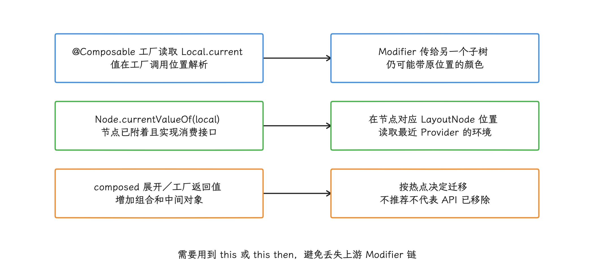

图：普通内置 Modifier 工厂可以组合外复用；自定义 Node 也不能阻止父级重组。

### 7. 在 Node 中读取 CompositionLocal

`CompositionLocal` 是沿 Compose 组件树提供的环境值，例如主题颜色、布局方向或自定义策略。Node 里没有 `CompositionLocal.current` 这条读取路径；实现 `CompositionLocalConsumerModifierNode` 后，可以通过 `currentValueOf(local)` 读取 Node 所附着布局位置的值。

`LocalBackgroundNode` 在绘制阶段读取本地背景色。

```kotlin
private class LocalBackgroundNode :
    Modifier.Node(),
    DrawModifierNode,
    CompositionLocalConsumerModifierNode {

    override fun ContentDrawScope.draw() {
        val color = currentValueOf(LocalArticleBackground)
        drawRect(color)
        drawContent()
    }
}
```

`currentValueOf()` 本身不会像 `CompositionLocal.current` 那样让调用处参与重组。在 `measure()`、`draw()` 等受快照观察的阶段内调用时，Compose 会记录读取依赖；对应 `CompositionLocal` 改变后，该阶段会失效。若同时存在组合读取者、静态 Local 的 Provider 更新或结构变化，仍可能发生组合等其他工作，不能据此保证整棵子树只绘制而不重组。

如果读取发生在这些阶段之外，需要同时实现 `ObserverModifierNode`，并在每次通知后重新进入 `observeReads`。

```kotlin
private class LocalPolicyNode :
    Modifier.Node(),
    CompositionLocalConsumerModifierNode,
    ObserverModifierNode {

    private var policy: ArticlePolicy? = null

    override fun onAttach() {
        readPolicy()
    }

    override fun onObservedReadsChanged() {
        readPolicy()
    }

    override fun onDetach() {
        policy = null
    }

    private fun readPolicy() {
        observeReads {
            policy = currentValueOf(LocalArticlePolicy)
        }
    }
}
```

`observeReads` 的通知是一次性的观察回调。`onObservedReadsChanged()` 必须再次读取，才能继续观察后续变化。`currentValueOf()` 只能在 Node 已附着时调用。

<!-- gracker-diagram: a234-28-local-observation -->
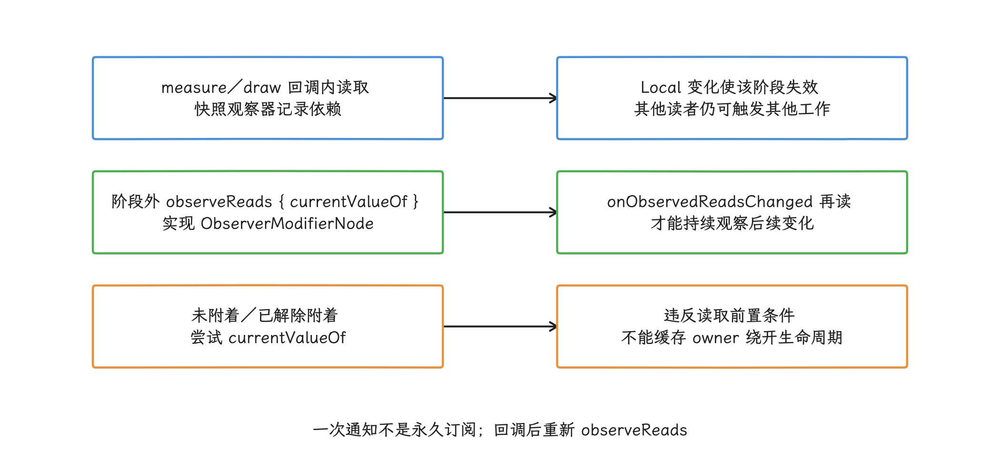

图：读取位置与观察方式都重要；静态 Provider 或结构变化也可能需要组合更新。

### 8. LayoutModifierNode 的复用与测量缓存

`LayoutModifierNode.measure()` 与 `LayoutModifier.measure()` 遵守相同的单子项测量协议：接收父约束、选择传给被包裹内容的约束、取得 `Placeable`，再返回自身尺寸和放置逻辑。

`HorizontalInsetNode` 给内容增加水平方向的内边距，用于展示约束传播。

```kotlin
private class HorizontalInsetNode(
    var inset: Dp,
) : Modifier.Node(), LayoutModifierNode {

    override fun MeasureScope.measure(
        measurable: Measurable,
        constraints: Constraints,
    ): MeasureResult {
        val insetPx = inset.roundToPx()
        val horizontal = Math.multiplyExact(insetPx, 2)
        val childConstraints =
            constraints.offset(horizontal = -horizontal)
        val placeable = measurable.measure(childConstraints)

        val width =
            constraints.constrainWidth(Math.addExact(placeable.width, horizontal))
        val height =
            constraints.constrainHeight(placeable.height)

        return layout(width, height) {
            placeable.placeRelative(insetPx, 0)
        }
    }
}

private data class HorizontalInsetElement(
    val inset: Dp,
) : ModifierNodeElement<HorizontalInsetNode>() {

    override fun create(): HorizontalInsetNode =
        HorizontalInsetNode(inset)

    override fun update(node: HorizontalInsetNode) {
        node.inset = inset
    }
}

fun Modifier.horizontalInset(inset: Dp): Modifier {
    require(inset.value.isFinite() && inset.value >= 0f)
    return this then HorizontalInsetElement(inset)
}
```

默认自动失效会在 `inset` 更新后安排重新测量。示例只接受有限非负 Dp，并用精确整数运算拒绝像素乘加溢出；生产实现还应按产品允许尺寸限制范围，避免无法表示或不合理的测量结果。

这段代码用于解释测量协议。业务仅需水平内边距时，应直接使用 `Modifier.padding(horizontal = inset)`；只有内置 Modifier 表达不了这种布局语义时，才值得保留自定义节点。

<!-- gracker-diagram: a234-29-layout-constraints -->
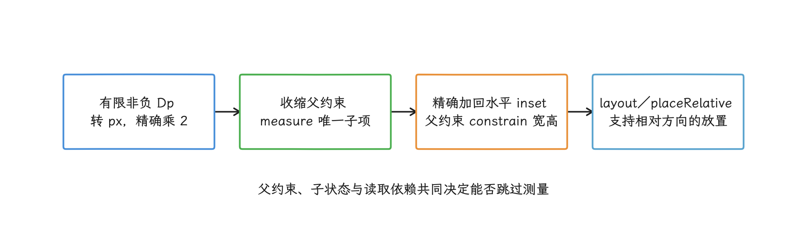

图：乘加溢出直接拒绝；生产还需限定产品尺寸。复用 Node 不承诺缓存上次 MeasureResult。

Node 的持久化可以减少 Node 创建与链结构更新，但“参数不变就复用上次 MeasureResult”这种公开保证，`LayoutModifierNode` 并不提供。是否跳过测量由 `LayoutNode` 的测量状态、父约束、子项状态和读取依赖共同决定——Node 复用与测量缓存是两回事。

`LayoutModifierNode` 已为四种固有尺寸测量方法提供默认实现。固有尺寸查询发生在正式测量前，用于询问组件在给定另一维尺寸时所需的最小或最大宽高；默认实现通过节点的 `measure()` 估算结果。自定义布局若需要不同语义，应覆写对应方法并保持约束一致性；源码没有承诺由 `NodeCoordinator` 为每个 Modifier 单独缓存固有尺寸结果。

<!-- gracker-diagram: a234-30-intrinsics -->
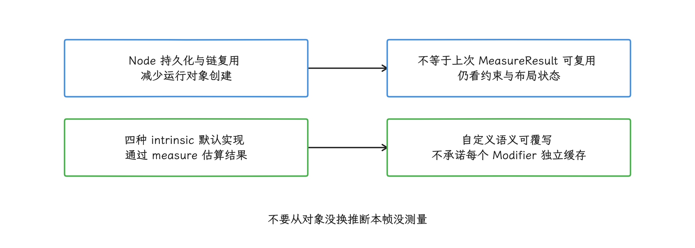

图：固有尺寸查询与正式测量是不同调用场景，仍须保持约束一致性。

### 9. PointerInputModifierNode：在 PointerInputChange 上标记消费

Compose UI 1.12.0 中，接口签名为：

```kotlin
fun onPointerEvent(
    pointerEvent: PointerEvent,
    pass: PointerEventPass,
    bounds: IntSize,
)
```

方法返回 `Unit`。需要消费事件时，对相应的 `PointerInputChange` 调用 `consume()`；Boolean 返回值声明不了消费。

<!-- gracker-diagram: a234-31-pointer-passes -->


图：回调返回 Unit；在相应 PointerInputChange 上 consume 才表达消费，消费不自动终止所有分发。

指针事件依次经过 `Initial`、`Main` 和 `Final` 三个分发阶段，节点可按协作需求选择处理阶段。`PointerObserverNode` 只观察 `Initial` 阶段，并把事件交给调用者。

```kotlin
private class PointerObserverNode(
    var onEvent: (PointerEvent) -> Unit,
) : Modifier.Node(), PointerInputModifierNode {

    override fun onPointerEvent(
        pointerEvent: PointerEvent,
        pass: PointerEventPass,
        bounds: IntSize,
    ) {
        if (pass == PointerEventPass.Initial) {
            onEvent(pointerEvent)
        }
    }

    override fun onCancelPointerInput() = Unit
}

private data class PointerObserverElement(
    val onEvent: (PointerEvent) -> Unit,
) : ModifierNodeElement<PointerObserverNode>() {

    override fun create(): PointerObserverNode =
        PointerObserverNode(onEvent)

    override fun update(node: PointerObserverNode) {
        node.onEvent = onEvent
    }
}
```

直接实现该接口适合能够明确处理三个事件分发阶段、命中路径和消费规则的底层组件。复杂手势继续使用 `Modifier.pointerInput`、`awaitPointerEventScope` 与 Foundation 手势检测器通常更安全。当前 `pointerInput` 本身已经由 `SuspendingPointerInputModifierNode` 支持；挂起式手势让相关协程随输入处理范围一起取消或重启，把它归成应当消除的“协程调度开销”，通常是误诊。

### 10. graphicsLayer 与阶段读取

`Modifier.graphicsLayer { ... }` 的 lambda 版本允许在图层属性配置阶段读取状态。状态变化时可以只更新图层属性，避开组合与布局阶段，适合 `alpha`、`scale`、`translation` 等视觉属性动画。

图层阶段可以直接读取动画值：

```kotlin
val alpha by transition.animateFloat(
    transitionSpec = { tween() },
    label = "article-alpha",
) { visible ->
    if (visible) 1f else 0f
}

Box(
    Modifier.graphicsLayer {
        this.alpha = alpha
    }
)
```

这一模式已经使用 Compose 内部的 Node 实现。业务代码无需为了“使用 Node”再复制内部 `GraphicsLayerModifierNode`。公开 `graphicsLayer` API 还能处理图层创建、属性更新和平台渲染后端适配，通常比自建绘制节点更稳妥。

Node 本身拦不住父 Composable 重组。性能收益来自把状态读取放在需要的阶段、复用运行节点并减少 `materialize()` 展开或节点替换；父级是否重组，仍由 Compose Runtime 的状态读取和跳过规则决定。

<!-- gracker-diagram: a234-32-layer-read -->
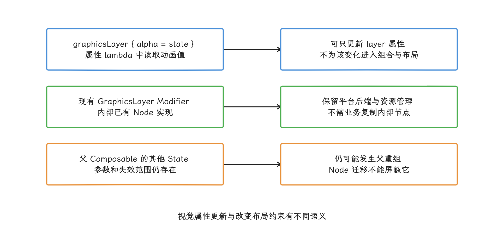

图：把状态读取放在真正需要的阶段，收益由同条件分配与帧证据确认。

### 11. 迁移步骤

#### 11.1 清点旧实现

我们优先检查：

- `Modifier.composed {}` 中存在状态、动画或副作用；
- `@Composable` Modifier 工厂在滚动列表或动画热点中频繁执行；
- 自定义旧式 `DrawModifier`、`LayoutModifier` 或 `PointerInputFilter`；
- Element 的输入频繁变化，且当前实现出现明显分配或链替换；
- 同一行为需要精确管理附着、取消或复用状态。

只组合内置 Modifier 的普通工厂可以保留。低频页面也无需因为 API 更新而强制迁移。

#### 11.2 分开配置与运行状态

迁移时可按下表安排字段：

| 字段 | 放置位置 |
| --- | --- |
| 调用者传入的颜色、尺寸、回调、策略 | Element，并在 `update()` 同步给 Node |
| 按压、拖拽、焦点、动画进度、缓存对象 | Node |
| 只在附着期间运行的任务 | Node 的 `coroutineScope` |
| 与复用数据项绑定的临时状态 | Node，并在 `onReset()` 清理 |
| 应用位置的 CompositionLocal | `CompositionLocalConsumerModifierNode` |

Element 应保持轻量与不可变。Node 中不要保存 Activity、View 或长生命周期对象，除非拥有明确的释放规则。

<!-- gracker-diagram: a234-33-migration-ownership -->
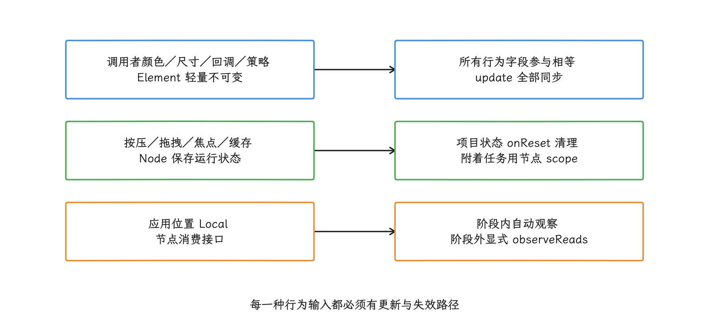

图：先稳定职责与类型，再选默认自动失效；不要为了复用堆叠互斥字段。

#### 11.3 保持 Element 类型稳定

同一链位置在两个不同 Element 子类之间切换会导致 Node 替换。可选行为如果能够由同一个 Element 的参数表达，通常更利于复用；但不要为此制造包含大量互斥字段的通用 Node。类型设计仍应以职责清晰为前提。

#### 11.4 选择失效策略

先使用默认自动失效，确认功能和阶段行为正确。若节点实现多个接口且更新非常频繁，再通过跟踪记录观察是否存在多余测量或绘制。只有证据充分时才关闭自动失效，并为每个输入写出对应的 `invalidateDraw()`、`invalidateMeasurement()`、`invalidatePlacement()` 或语义失效调用。

### 12. 性能验证：测什么，怎样解释

迁移前后要使用同一构建类型、设备状态、操作脚本和样本窗口，至少观察以下四类证据：

| 证据 | 工具 | 可回答的问题 |
| --- | --- | --- |
| 分配记录 | Android Studio Memory Profiler、分配跟踪 | Element、lambda、Node 或手势对象分配是否减少 |
| 主线程阶段 | Perfetto、Compose tracing | 组合（Composition）、测量（Measure）、放置（Layout）、绘制（Draw）的工作是否变化 |
| 用户可见帧表现 | Macrobenchmark、FrameTimingMetric | P50、P90、P95、P99 与超时帧是否改善 |
| 编译器可跳过性 | Compose 编译器报告与指标 | 相关 `@Composable` 函数的稳定性与跳过条件是否合理 |

我们先把预期摆正：Modifier 工厂所在的父函数仍可能重组，Element 也可能重建，“迁移后 Composable 重组次数一定下降”这个预设并不成立。更可靠的预期是：

- 相同 Element 类型保留既有 Node；
- `composed` 的 `materialize()` 展开成本消失；
- Node 内状态不再依赖额外的 Modifier 组合层；
- 参数变化只触发节点声明的阶段；
- 热点路径中的对象分配和阶段耗时有机会下降。

Macrobenchmark 的目标值应由当前产品基线、设备档位和业务场景确定，脱离项目数据的固定百分比没有意义。若帧时间没有改善，也要检查瓶颈是否位于图片解码、文本布局、GPU、Binder、I/O 或其他部分。

<!-- gracker-diagram: a234-34-migration-evidence -->
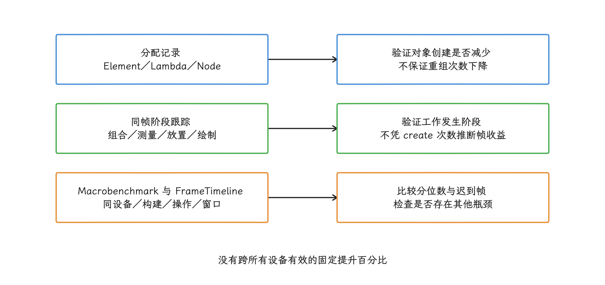

图：Compiler 报告用于解释静态输入与跳过条件，最终性能结论由目标交互数据支持。

#### 12.1 一条实用的源码断言

调试 Element 是否复用时，可以把 Compose 1.12.0 的链动作规则作为断言模型：

```text
equals -> reuse without update
same runtime type, not equals -> reuse node and update
different runtime type -> replace node
```

这段规则适合帮助解释 `create()` 与 `update()` 的调用次数。它属于 Compose UI 内部实现，升级 Compose 后仍应回到目标版本源码复核，别把它当成跨所有未来版本不变的二进制契约。

### 13. Android 17 与多平台边界

Android 17 不改变 `ModifierNodeElement` 的复用协议。它可能通过平台输入、窗口、渲染、无障碍或硬件加速行为影响具体组件，但这些影响要在对应 Android API 章节单独验证。

`Modifier.Node` 与主要节点接口位于 Compose UI 的 `commonMain` 源码，因此 Compose Multiplatform 也共享这套抽象。但各平台的渲染后端、输入接入和窗口系统不同，Android 的 HardwareRenderer 行为推不出 iOS、Desktop 或 Web 的帧表现。跨平台项目应在各目标平台分别测量。

Linux 内核锚点 `android17-6.18-2026-06_r6` 不参与 Node 链差分。只有分析调度、频率、GPU 驱动或输入延迟的系统跟踪时，内核版本才进入证据范围。

### 14. 源码导航与核查清单

相关结论以 Compose UI 1.12.0 发布提交为准，关键文件如下。每个条目的主链接指向 1.12.0 源码；括号内保留 1.11.4 的历史链接，便于比较版本差异。

- [`ModifierNodeElement.kt`](https://android.googlesource.com/platform/frameworks/support/+/963bf914f78b389bdddef0da7f36bee19d897274/compose/ui/ui/src/commonMain/kotlin/androidx/compose/ui/node/ModifierNodeElement.kt)：`create()`、`update()`、`equals()` 与 `hashCode()` 要求（[`ModifierNodeElement.kt`](https://android.googlesource.com/platform/frameworks/support/+/854220f44ea8ea80fee824a6c5a045f39bede289/compose/ui/ui/src/commonMain/kotlin/androidx/compose/ui/node/ModifierNodeElement.kt)）
- [`Modifier.kt`](https://android.googlesource.com/platform/frameworks/support/+/963bf914f78b389bdddef0da7f36bee19d897274/compose/ui/ui/src/commonMain/kotlin/androidx/compose/ui/Modifier.kt)：Node 生命周期、`coroutineScope`、`shouldAutoInvalidate`（[`Modifier.kt`](https://android.googlesource.com/platform/frameworks/support/+/854220f44ea8ea80fee824a6c5a045f39bede289/compose/ui/ui/src/commonMain/kotlin/androidx/compose/ui/Modifier.kt)）
- [`NodeChain.kt`](https://android.googlesource.com/platform/frameworks/support/+/963bf914f78b389bdddef0da7f36bee19d897274/compose/ui/ui/src/commonMain/kotlin/androidx/compose/ui/node/NodeChain.kt)：Element 差分、Node 复用和协调器同步（[`NodeChain.kt`](https://android.googlesource.com/platform/frameworks/support/+/854220f44ea8ea80fee824a6c5a045f39bede289/compose/ui/ui/src/commonMain/kotlin/androidx/compose/ui/node/NodeChain.kt)）
- [`NodeKind.kt`](https://android.googlesource.com/platform/frameworks/support/+/963bf914f78b389bdddef0da7f36bee19d897274/compose/ui/ui/src/commonMain/kotlin/androidx/compose/ui/node/NodeKind.kt)：节点类型识别与自动失效（[`NodeKind.kt`](https://android.googlesource.com/platform/frameworks/support/+/854220f44ea8ea80fee824a6c5a045f39bede289/compose/ui/ui/src/commonMain/kotlin/androidx/compose/ui/node/NodeKind.kt)）
- [`LayoutModifierNode.kt`](https://android.googlesource.com/platform/frameworks/support/+/963bf914f78b389bdddef0da7f36bee19d897274/compose/ui/ui/src/commonMain/kotlin/androidx/compose/ui/node/LayoutModifierNode.kt)：测量、固有尺寸默认实现与布局失效 API（[`LayoutModifierNode.kt`](https://android.googlesource.com/platform/frameworks/support/+/854220f44ea8ea80fee824a6c5a045f39bede289/compose/ui/ui/src/commonMain/kotlin/androidx/compose/ui/node/LayoutModifierNode.kt)）
- [`PointerInputModifierNode.kt`](https://android.googlesource.com/platform/frameworks/support/+/963bf914f78b389bdddef0da7f36bee19d897274/compose/ui/ui/src/commonMain/kotlin/androidx/compose/ui/node/PointerInputModifierNode.kt)：事件签名、取消与命中扩展（[`PointerInputModifierNode.kt`](https://android.googlesource.com/platform/frameworks/support/+/854220f44ea8ea80fee824a6c5a045f39bede289/compose/ui/ui/src/commonMain/kotlin/androidx/compose/ui/node/PointerInputModifierNode.kt)）
- [`CompositionLocalConsumerModifierNode.kt`](https://android.googlesource.com/platform/frameworks/support/+/963bf914f78b389bdddef0da7f36bee19d897274/compose/ui/ui/src/commonMain/kotlin/androidx/compose/ui/node/CompositionLocalConsumerModifierNode.kt)：应用位置的 `CompositionLocal` 读取与观察规则（[`CompositionLocalConsumerModifierNode.kt`](https://android.googlesource.com/platform/frameworks/support/+/854220f44ea8ea80fee824a6c5a045f39bede289/compose/ui/ui/src/commonMain/kotlin/androidx/compose/ui/node/CompositionLocalConsumerModifierNode.kt)）
- [`ComposedModifier.kt`](https://android.googlesource.com/platform/frameworks/support/+/963bf914f78b389bdddef0da7f36bee19d897274/compose/ui/ui/src/commonMain/kotlin/androidx/compose/ui/ComposedModifier.kt)：`composed` Element 与 `materialize()` 展开（[`ComposedModifier.kt`](https://android.googlesource.com/platform/frameworks/support/+/854220f44ea8ea80fee824a6c5a045f39bede289/compose/ui/ui/src/commonMain/kotlin/androidx/compose/ui/ComposedModifier.kt)）

版本与用法文档：

- [Compose BOM mapping](https://developer.android.com/develop/ui/compose/bom/bom-mapping)
- [Compose UI release notes](https://developer.android.com/jetpack/androidx/releases/compose-ui)
- [Custom modifiers](https://developer.android.com/develop/ui/compose/custom-modifiers)
- [Modifier.Node API reference](https://developer.android.com/reference/kotlin/androidx/compose/ui/Modifier.Node)

提交迁移代码前，逐项确认：

- Element 的全部行为输入都参与 `equals()` 与 `hashCode()`；
- `update()` 同步了所有 Element 输入；
- 默认自动失效没有被重复手动调用；
- 关闭自动失效后，每类变化都有对应失效调用；
- `currentValueOf()` 只在附着期读取，阶段外读取使用 `observeReads`；
- 附着期任务使用 Node 的 `coroutineScope`；
- 可复用内容的临时状态在 `onReset()` 清理；
- 指针输入通过 `PointerInputChange.consume()` 表达消费；
- 测量逻辑遵守父约束，没有假设 Node 自带 MeasureResult 缓存；
- 性能结论来自迁移前后的同条件数据。

## 全文小结

全篇的线索到这里可以收拢：Compose 性能诊断的起点是状态在组合、布局还是绘制阶段被读取，其次才轮得到“全部可跳过”这类指标。Compiler 报告解释稳定性、重启组和跳过条件，Layout Inspector 与 Runtime Tracing 说明实际执行范围，FrameTimeline 和 Macrobenchmark 才证明用户可见的帧结果。

`Modifier.Node` 是这条链上的运行时扩展点：Element 表达配置，Node 保留运行状态并参与具体阶段。迁移只有在节点复用、失效范围和热路径分配都得到同条件数据支持时才算完成；若 UI 线程已按时提交，还要继续追到 RenderThread、缓冲区、SurfaceFlinger 和 actual present。
