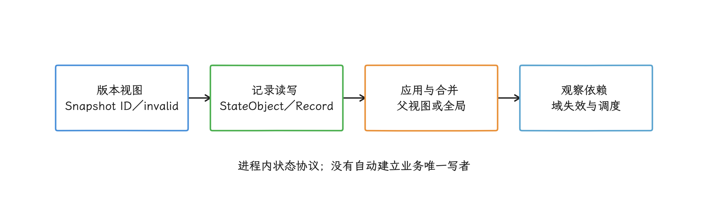
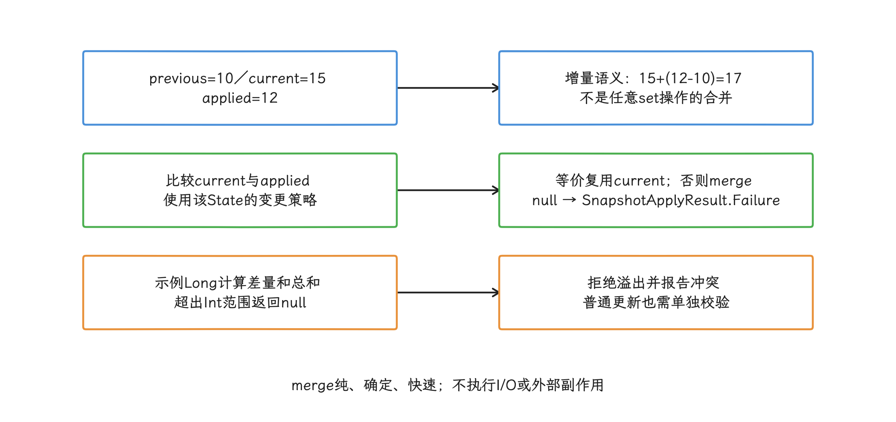
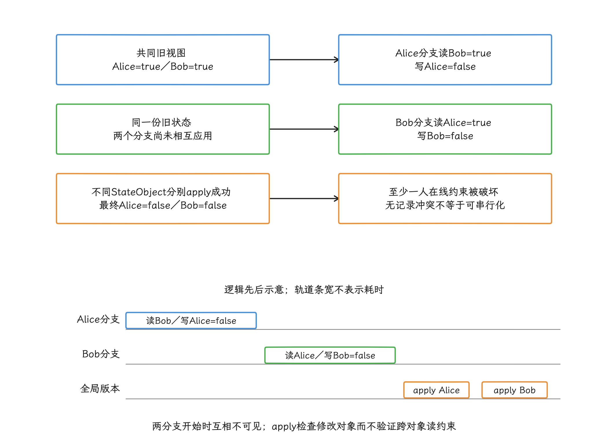
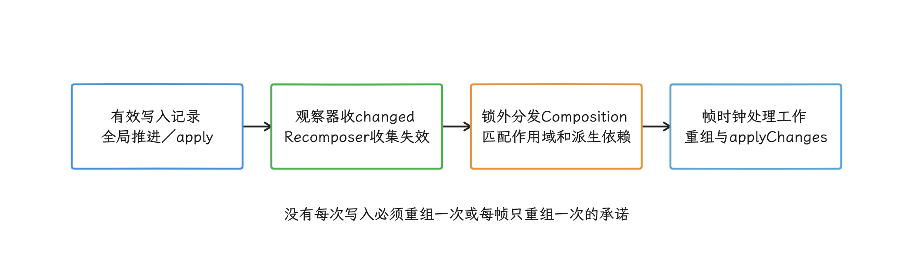
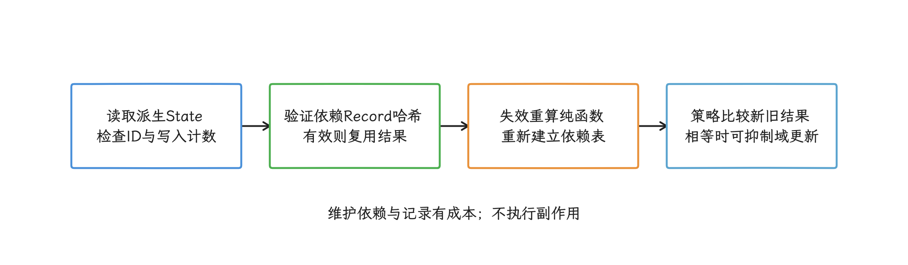
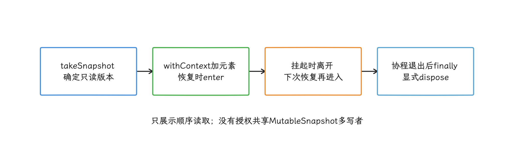
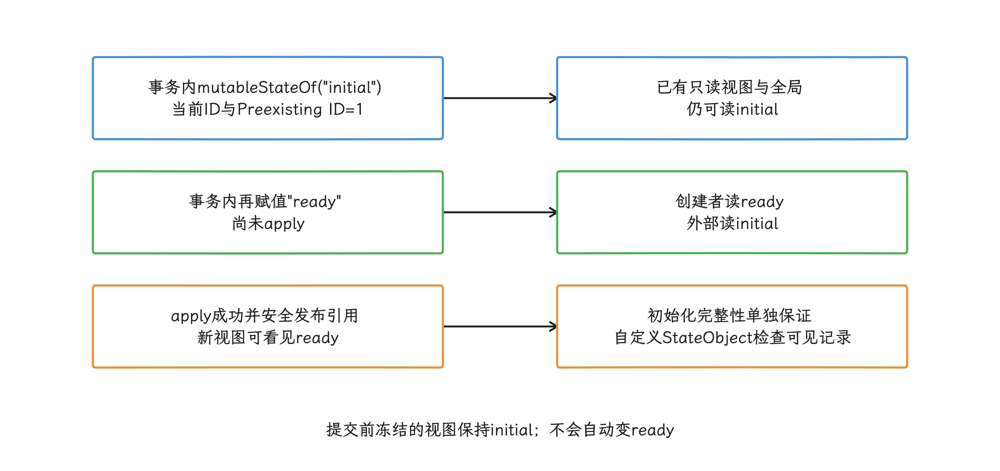
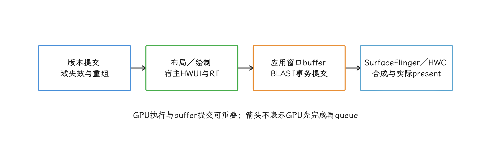

# Compose Snapshot、状态一致性与并发

Snapshot 系统同时支撑 `mutableStateOf`、Snapshot State 集合、Composition 读依赖、Layout/Drawing 观察和 `snapshotFlow`。它管的是进程内的一整套多版本状态协议：版本可见性、写入和通知各占一层。我们若用“状态一变就重组”的回调容器去套它，很多机制都会对不上，所以这一篇按协议本身来讲。

> 源码基线：Android 17 / API 37 / AOSP `android-17.0.0_r1`；内核 `android17-6.18-2026-06_r6`；Compose Runtime `androidx.compose.runtime:runtime-android:1.12.0`（BOM `2026.08.00`）。

这套协议需要回答四个问题：

1. 当前执行上下文能读到哪一个版本；
2. 写入先放在哪条 `StateRecord` 上；
3. 一组修改能否应用到父 Snapshot 或全局状态；
4. 哪些观察域读过这些对象，需要重新执行。

本篇聚焦 Snapshot，同时说明 Recomposer、ComposeView 与业务并发边界。Compose 到显示系统的完整路径见 [§13.8 Jetpack Compose 渲染管线架构](../../part2-performance/ch13-rendering-pipelines/08-compose-rendering-pipeline.md)。

<!-- gracker-diagram: a236-01-protocol -->


图：四层职责相连；从一次 setter 到重组、再到呈现一帧，中间各有距离。

## 1. 固定版本与术语校正

Snapshot 的版本坐标，最容易混的是 Android 平台版本和 Compose Runtime 版本：Snapshot 位于 Jetpack Compose Runtime，Android 平台源码标签（platform tag）里找不到它；同一台 Android 17 设备可以运行不同版本的 Compose，所以源码结论要同时记录 Runtime 版本。

源码分析以 Runtime 1.12.0 的 `runtime` / `runtime-android` 源码 JAR 为准，本文固定的 Compose BOM `2026.08.00` POM 把这两个 Runtime 构件约束为 1.12.0。截至 2026-10-25，Runtime 发行页已列出 1.12.1，并说明相对 1.12.0 无改动；下文逐项核查仍以 1.12.0 构件为准，也不把固定 BOM 称作最新稳定版。BOM 只统一依赖版本，项目还可能通过显式版本、版本目录或其他平台依赖改变结果；我们排查行为时，先查看 Gradle 已解析依赖图，再选择相同版本的源码 JAR。

另一组要先校正的是概念名：这些流传的说法，要映射到 Runtime 1.12.0 的现有实现再使用：

| 常见用语 | Runtime 1.12.0 中的对应关系 |
| --- | --- |
| `snapshotRead` / `snapshotWrite` | 没有以这两个名称统领读写的公开屏障；主要入口是 `StateRecord.readable`、`withCurrent`、`writable` / `overwritable`，以及读/写观察器 |
| `ScopeUpdate` | 编译器生成的可重启组（restart group）通过 `ScopeUpdateScope.updateScope` 保存重启函数；状态依赖保存在 `Composition` 的观察关系表 |
| `dependencyChanged` | 没有给应用调用的同名回调；`derivedStateOf` 通过依赖表、状态记录哈希、变更策略与观察域的条件失效完成检查 |
| `AbandonedSnapshot` | 没有这个类型；未应用的 MutableSnapshot 在内部 `abandon()` 路径中把自己的状态记录标成 `INVALID_SNAPSHOT`，前提是生命周期被正确结束 |
| `ThreadVerifier` | 没有覆盖全部 State 读写的通用检查器；`SnapshotStateObserver.observeReads` 有同线程检查，其他错误由只读 Snapshot、可见性和开放状态校验分别报告 |
| 逐 State 跟踪 | Perfetto 默认没有逐 State 轨道；现有详细跟踪切片包含 `Compose:applyObservers`，它也不代表完整的 apply 耗时 |

全文按这些现有符号讲解，源码入口以表中符号为准，概念名只作背景。

### 1.1 Runtime 1.12.0 的 Snapshot 修复

1.12.0 相对 1.11.4 保持了 Snapshot 公开事务模型不变，同时修正了几个会影响边界行为的问题：

- 状态在创建它的 Snapshot 尚未应用时被另一个并发 Snapshot 修改，apply 观察器不会再漏掉这条通知；
- 创建 `StateStateRecord` 时使用调用方传入的 Snapshot ID，避免把当前线程的 Snapshot ID 错写进状态记录；
- Composition 在销毁时清理待处理观察关系，并修正对 `derivedStateOf` 的跟踪，避免前向写入场景长期保留派生状态；
- 详细跟踪新增 `DisposableEffect` 与 `SideEffect` 生命周期回调切片，已有的 `Compose:applyObservers` 名称仍然存在。

这些变化集中在并发通知、记录归属和生命周期清理；可见性、冲突合并与显式 `dispose()` 的规则，仍按本文的模型理解。

## 2. Snapshot 数据模型

### 2.1 Snapshot 是一份版本视图

我们从最底层的问题看起：一个 Snapshot 里存了什么，读 State 时按什么规则挑版本。`Snapshot` 保存 `snapshotId` 与 `invalid` 集合；一条状态记录要对当前 Snapshot 可见，需要同时满足：

- 状态记录 ID 不等于 `INVALID_SNAPSHOT`；
- 状态记录 ID 小于或等于当前 Snapshot ID；
- 状态记录 ID 不在当前 Snapshot 的 `invalid` 集合中。

同一个 `StateObject` 可以挂接多条状态记录，读取时取满足条件且 ID 最大的一条。于是 Snapshot 创建之后，晚于它产生、又没有其他可见初始记录的版本就留在这份视图之外；创建时还未应用的其他 Snapshot，则被记进 `invalid` 集合。还有一个容易忽略的细节：普通 `MutableState` 在非全局 Snapshot 内创建时还会带一条 `PreexistingSnapshotId = 1` 的初始记录，旧视图仍能读到该初始值，后续修改则继续隔离（见 §9.3）。

`Snapshot.current` 是线程局部状态：`snapshot.enter { ... }` 只在当前线程临时替换它，代码块执行完毕后恢复此前的 Snapshot，其他线程各用各的。


### 2.2 StateObject 管理状态记录链

`StateObject` 的公开协议很小：

- `firstStateRecord` 指向状态记录链的表头；
- `prependStateRecord()` 把新状态记录接到链头；
- `mergeRecords()` 可选地解决并行 Snapshot 的写冲突。

`StateRecord` 保存创建它的 Snapshot ID、下一条状态记录，以及复制或创建记录的方法。状态记录接入链后不能随意移动——读取线程可能正在遍历它；Runtime 会复用那些已不可能被开放 Snapshot 选中的记录，以此降低长期分配量。

下面的伪代码只展示可见状态记录的选择条件，源码中还有额外的清理与重试分支。

```text
candidate = null
for record in state.recordChain:
    if record.id <= snapshot.id
       and record.id !in snapshot.invalid
       and record.id != INVALID_SNAPSHOT:
        candidate = maxBySnapshotId(candidate, record)
return candidate
```

正常读路径直接遍历链表。若另一线程刚推进全局 Snapshot，快路径可能暂时找不到状态记录，此时 Runtime 进入 `sync` 临界区，按新的 `Snapshot.current` 重试。读路径通常不加锁，把它概括成“永远无锁”并不合适。

### 2.3 MutableState 的取值与赋值

顺着记录链，我们再看一次取值和赋值是怎么走上去的。`SnapshotMutableStateImpl.value` 的取值方法走 `next.readable(this)`；在选择状态记录之前，这个 StateObject 会先交给读观察器，建立“对象 → 观察域”的对应关系。

赋值方法先用 `SnapshotMutationPolicy.equivalent()` 判断新旧值：判定相等时写入直接结束；判定不等时，`overwritable` 在 `sync` 内复用或新建一条状态记录，写入新值，再通知写观察器。

`sync` 里的锁只保护 Runtime 的状态记录结构。`state.value++` 是一次读取加一次写入，多个生产者同时执行仍会丢更新，这把锁帮不上忙。


### 2.4 Snapshot State 集合

`SnapshotStateList`、`SnapshotStateMap` 与 `SnapshotStateSet` 也使用 `StateRecord`。以列表为例，状态记录内保存持久化不可变列表（persistent list）、`modification` 与 `structuralChange`：

- 修改先基于当前持久化不可变列表构建新值；
- 提交时检查 `modification` 计数是否仍匹配；
- 竞争导致版本变化时重新计算；
- 迭代器仍可能按集合语义抛出 `ConcurrentModificationException`。

`SnapshotStateList.toList()` 在 Runtime 1.12.0 中是 O(1)：返回当前底层不可变列表，内容变化前通常还是同一实例，快照的只是列表结构，元素另算——元素若持有普通可变字段，其内部变化仍需独立的状态与并发协议。要把列表送入 `snapshotFlow` 时，`toList()` 比手工复制更合适。


## 3. 只读 Snapshot：冻结一份可见版本

有了版本模型，我们就可以动手验证最基本的一条性质：只读 Snapshot 固定创建时刻的版本。`Snapshot.takeSnapshot()` 创建只读视图，它可以携带读观察器，也需要显式调用 `dispose()`。下面的测试证明只读 Snapshot 保留创建时的状态版本。

```kotlin
val title = mutableStateOf("v1")
val frozen = Snapshot.takeSnapshot()

try {
    title.value = "v2"

    check(frozen.enter { title.value } == "v1")
    check(title.value == "v2")
} finally {
    frozen.dispose()
}
```

全局状态已经变成 `v2`，进入 `frozen` 后仍读到 `v1`。在只读 Snapshot 内尝试改变已有 State 的值会抛出 `IllegalStateException`；结构相等策略下赋相同值会提前返回，这次赋值按无效写入处理。`dispose()` 只释放这份视图对旧状态记录的保留需求，全局状态原样不动。

### 3.1 未 dispose 的 Snapshot 会保留旧版本

开放的 Snapshot 会固定自己仍可能读取的版本（源码称为 pinning），状态记录的复用因此受限；Snapshot 存活越久，频繁变化的状态对象越可能积累出一条较长的状态记录链。

释放要靠 `dispose()` 亲手做，垃圾回收（GC）接不了手：源码里没有应用可以依赖的 `AbandonedSnapshot` GC 类型；只有在 MutableSnapshot 被明确结束且尚未 apply 时，内部才走 `abandon()`，把属于它的状态记录 ID 标成 `INVALID_SNAPSHOT`，供后续写入复用。

适合的资源管理规则是：

- `takeSnapshot()`：在 `try/finally` 中调用 `dispose()`；
- `takeMutableSnapshot()`：apply 或放弃后仍调用 `dispose()`；
- 嵌套 Snapshot：每一层独立结束；
- `asContextElement()`：只负责协程恢复时进入或离开 Snapshot，不负责调用 `dispose()`。


## 4. MutableSnapshot：隔离修改与 apply

只读视图回答“读到哪个版本”，可写视图要回答的是“修改何时对外可见”。我们用 `Snapshot.takeMutableSnapshot()` 创建可写视图：传给 `enter` 的代码块所做写入只在该 Snapshot 内可见，`apply()` 成功后才进入父 Snapshot 或全局状态。

apply 的主要步骤是：

1. 取得已修改的 StateObject 集合；
2. 在锁外尝试预计算可合并冲突，缩短 `sync` 覆盖时间；
3. 在 `sync` 内验证 Snapshot 仍开放，检查冲突并合入状态记录；
4. 推进全局 Snapshot 或父 Snapshot；
5. 在锁外调用 apply 观察器；
6. 回到 `sync` 清理或复用不再需要的状态记录。

apply 以已修改对象集合为入口，不会扫描进程里的全部 StateObject；但成本仍难以简写成严格的 `O(changed states)`——每个对象还可能遍历状态记录链、运行自定义合并策略、通知多个观察器，并触发状态记录清理。


### 4.1 冲突使用三方记录判断

同一 StateObject 被当前全局状态和待应用 Snapshot 都改过时，Runtime 会得到三份状态记录：

- `previous`：待应用 Snapshot 修改前读到的版本；
- `current`：父 Snapshot 或全局状态现在的版本；
- `applied`：待应用 Snapshot 写出的版本。

`StateObject.mergeRecords(previous, current, applied)` 返回合并后的状态记录时，apply 可以继续；返回 `null` 时得到 `SnapshotApplyResult.Failure`。`MutableState` 会把这一步委托给它的 `SnapshotMutationPolicy.merge()`。

三个内置变更策略的含义如下：

| 变更策略 | `equivalent` | 默认冲突合并 |
| --- | --- | --- |
| `structuralEqualityPolicy()` | `a == b` | 不合并两个不同值 |
| `referentialEqualityPolicy()` | `a === b` | 不合并两个不同引用 |
| `neverEqualPolicy()` | 永远 false | 同一状态的并行写更容易冲突 |

“两个值相等”能消除无效写或冲突；至于业务上的累加、集合并集或字段级合并，要留给自定义策略定义。

### 4.2 自定义变更策略必须满足领域代数

计数器语义可以表达成“相对旧值增加多少”。下面的变更策略展示 `merge(previous, current, applied)` 的三方合并方式，也只覆盖这一种语义。

```kotlin
fun counterPolicy(): SnapshotMutationPolicy<Int> =
    object : SnapshotMutationPolicy<Int> {
        override fun equivalent(a: Int, b: Int): Boolean = a == b

        override fun merge(
            previous: Int,
            current: Int,
            applied: Int,
        ): Int? {
            val merged = current.toLong() + (applied.toLong() - previous.toLong())
            return merged.takeIf { it in Int.MIN_VALUE.toLong()..Int.MAX_VALUE.toLong() }
                ?.toInt()
        }
    }
```

若一个 Snapshot 从 10 加 2，另一个分支已把全局值从 10 加到 15，合并结果是 17。这个策略只适合增量计数；业务若允许“把计数设置为 0”，同一公式会给出错误语义。示例用 Long 计算差量与总和，超出 Int 范围就返回 `null`，让 apply 明确冲突；普通业务更新本身也要单独检查溢出。`merge()` 必须是纯函数：结果确定、执行快速，外部副作用一概不做。

<!-- gracker-diagram: a236-07-three-way-merge -->


图：合并策略承担业务代数；没有策略能把所有赋值自动解释成累加。

### 4.3 Snapshot 隔离不保证可串行化

Runtime 1.12.0 的 `MutableSnapshot.apply()` 源码注明：当前算法不保证可串行化（serializable）的 Snapshot，也未阻止交叉写入（crossing writes）。两个 Snapshot 读取同一组对象、各自修改不同对象时，已修改对象集合没有交集，双方都能 apply 成功，跨对象约束却可能在这时被破坏。

下面的测试构造一次写偏差（write skew）：两个事务依据同一份旧状态，各自修改不同对象，单独看都合法，合并后却破坏了约束。这里的约束是“至少一名值班者在线”：两个 apply 都成功，业务不变量依然可能失败。

```kotlin
val aliceOnCall = mutableStateOf(true)
val bobOnCall = mutableStateOf(true)

val aliceSnapshot = Snapshot.takeMutableSnapshot()
val bobSnapshot = Snapshot.takeMutableSnapshot()

try {
    aliceSnapshot.enter {
        check(bobOnCall.value)
        aliceOnCall.value = false
    }
    bobSnapshot.enter {
        check(aliceOnCall.value)
        bobOnCall.value = false
    }

    aliceSnapshot.apply().check()
    bobSnapshot.apply().check()

    check(!aliceOnCall.value && !bobOnCall.value)
} finally {
    aliceSnapshot.dispose()
    bobSnapshot.dispose()
}
```

两个分支修改的是不同 StateObject，状态记录级的冲突检查自然放行。跨对象不变量要放进单一不可变状态、`Mutex`、Actor、StateFlow 原子更新或数据库事务里；把多个字段放进 `withMutableSnapshot` 只能让单次提交原子可见，并发写者协议仍要另外定义。

<!-- gracker-diagram: a236-08-write-skew -->


图：这是实际示例的逻辑顺序，没有虚构时长；跨对象读取约束要在写者协议中维护。

## 5. 嵌套 Snapshot 的父子可见性

事务还可以嵌套：在 MutableSnapshot 内调用 `takeMutableSnapshot()` 会创建嵌套的可写 Snapshot。子 Snapshot 的 apply 只把修改合入父 Snapshot，全局状态要等最外层父 Snapshot apply 之后才变化。

| 时点 | 子 Snapshot | 父 Snapshot | 全局状态 |
| --- | --- | --- | --- |
| 子 Snapshot 修改后、apply 前 | 看到子 Snapshot 的新值 | 仍看父 Snapshot 的旧值 | 仍看全局旧值 |
| 子 Snapshot apply 成功 | 已关闭提交阶段 | 看到子 Snapshot 的新值 | 仍看全局旧值 |
| 父 Snapshot apply 成功 | — | 已提交 | 看到合并后的值 |

子 Snapshot 的读/写观察器会按 Runtime 规则与父 Snapshot 的观察器合并。`Snapshot.registerApplyObserver` 面向全局应用：子 Snapshot apply 不会发送这类通知，只有最外层提交时通知才带上嵌套层累计的已修改对象。实验性的工具 API `SnapshotObserver.onApplied()` 则不同，子 Snapshot apply 后也会回调，但此时修改只对父 Snapshot 可见。

父 Snapshot 已 apply 或 dispose 后，仍存活的子 Snapshot 再调用 apply 会失败。父 Snapshot dispose 后，已经创建的只读子 Snapshot 仍可能按 API 契约继续有效，但它自己仍需 dispose。

我们拿嵌套做的，通常是往父事务里放一段可撤销计算；数据库保存点（savepoint）的完整行为它模拟不了，外部 I/O、Binder 调用和文件写入也留在 Snapshot 之外，不随它回滚。


## 6. 从 State 写入到 RecomposeScope

可重启作用域（restart scope）指一段能被 Compose 单独重新执行的组合代码。到这里分工已经清楚：Snapshot 只发布“哪些对象发生过变化”，Composition 决定“哪些可重启作用域读过这些对象”，Recomposer 决定“何时处理这些作用域”。

### 6.1 读依赖怎样建立

Composition 执行时，MutableSnapshot 带有读观察器。我们跟着 `Composition.recordReadOf(value)` 走一遍，它会：

- 取得当前 `RecomposeScopeImpl`；
- 把“值 → 作用域”加入 `observations` 读取关系表；
- 若值是 `StateObjectImpl`，记录它曾被 Composition 读取；
- 若值是派生状态，再登记它的依赖对象与当时结果。

`ScopeUpdateScope.updateScope` 保存由 Compose 编译器生成的重启函数。它让某个可重启组可以重新执行；状态到作用域的索引则由 Composition 的观察关系表管理，二者职责不同。

布局与绘制阶段使用 `SnapshotStateObserver.observeReads()` 建立各自的作用域映射。状态读取发生在哪一阶段，决定失效可以停在哪一阶段；同一状态若也在 Composition 中读取，变化仍会影响 Composition。


### 6.2 写入怎样传播

从 setter 到重组的路径可以分成七步：

1. 变更策略判断新旧值是否等价；
2. 可写状态记录被修改，StateObject 进入当前 Snapshot 的已修改对象集合；
3. 全局 Snapshot 推进或 MutableSnapshot apply；
4. apply 观察器收到变更对象集合；
5. Recomposer 把相关对象放入 `snapshotInvalidations`；对已知从未被 Composition 读取的 `StateObjectImpl`，当前实现会提前过滤；
6. `recordComposerModifications()` 在 `stateLock` 外调用各 Composition 的 `recordModificationsOf()`；
7. Composition 根据读取关系与派生状态映射使目标作用域失效，重组循环在帧时钟调度下执行重组和 `applyChanges()`。

变更对象集合里只有对象身份，没有“字段为什么变化”的业务语义，也推不出重组函数列表——一个对象可以被多个作用域读取，一个作用域也可以读多个对象。

<!-- gracker-diagram: a236-11-recompose-notify -->


图：Recomposer 过滤已知从未被 Composition 读取的对象；其 stateLock 不包住所有重组工作。

### 6.3 SnapshotStateObserver 的边界

`SnapshotStateObserver` 处理 apply 回调与观察线程之间的并发：

- 变更对象集合通过 `AtomicReference` 队列收集；
- 作用域映射在内部锁下检查；
- `onChangedExecutor` 负责派发失效回调；
- “依赖对象 → 派生状态”索引用于条件失效。

类文档明确标注实例不具备通用线程安全性：`observeReads` 检测到同一次观察嵌套跨线程时会抛错，同一个 AndroidComposeView 的测量、布局和绘制应在同一线程执行。内部原子队列只是实现细节，能否把观察器共享给多个布局线程，仍以上述线程契约为准。


## 7. derivedStateOf：依赖缓存与条件失效

缓存派生值是 Snapshot 之上的另一层机制：`derivedStateOf` 创建的 `DerivedSnapshotState` 自身也是 StateObject，它的 `ResultRecord` 保存：

- 上次结果；
- 计算函数读到的 StateObject 与嵌套层级；
- 依赖状态记录组合出的哈希值；
- 上次验证时的 Snapshot ID 与写入计数。

我们读派生值时，Runtime 先检查缓存对当前 Snapshot 是否有效：依赖状态记录没变就复用结果；失效了就在读观察器中重跑计算函数、重建依赖表，并按变更策略判断新旧结果是否等价。

### 7.1 适合“输入频繁、输出低频”的映射

这类映射的典型输入是连续滚动位置，期望输出是“是否离开列表顶部”这样的布尔边界，代码的目的就是让按钮只在布尔边界变化时更新。

```kotlin
val showScrollToTop by remember(listState) {
    derivedStateOf(structuralEqualityPolicy()) {
        listState.firstVisibleItemIndex > 0 ||
            listState.firstVisibleItemScrollOffset > 0
    }
}

AnimatedVisibility(visible = showScrollToTop) {
    ScrollToTopButton()
}
```

滚动索引或偏移会频繁变化，派生结果在列表顶部附近只切换少量次数。显式使用结构相等策略，让相同布尔结果被视为等价。`remember(listState)` 保留同一个派生状态对象，并在列表状态实例替换时重建它。

<!-- gracker-diagram: a236-13-derived-cache -->


图：示例用 remember(listState) 固定派生对象，结构相等策略压缩滚动输入为布尔边界。

### 7.2 缓存也有成本

`derivedStateOf` 要维护依赖表、状态记录哈希、结果记录和条件失效索引，缓存本身有成本。下列场景通常不适合：

- 输入每次变化时，输出也必须变化；
- 计算函数只是廉价的字符串拼接或算术；
- 每次重组都创建一个新的派生状态；
- 计算函数执行 I/O、日志、埋点或修改 State；
- 为了“少读一次 State”而层层嵌套派生状态。

`derivedStateOf { "$firstName $lastName" }` 在名字任一部分变化时都要更新，通常省不下重组，还增加跟踪开销。普通局部计算更清楚。

### 7.3 与 remember、snapshotFlow 的差别

| 工具 | 失效依据 | 结果用途 |
| --- | --- | --- |
| `remember(keys)` | 显式 key 比较 | 在 Composition 中保留对象或计算结果 |
| `derivedStateOf` | 计算函数读取的 Snapshot State | 把高频状态映射为较低频 State |
| `snapshotFlow` | 代码块读取的 Snapshot State，结果按 `equals` 过滤 | 把当前状态送入冷流与副作用管线 |

三者的分工里，冷流（cold Flow）在每次收集时重新执行生产逻辑；`remember` 对计算函数内的任意 State 读取不做自动观察，`derivedStateOf` 会观察；`snapshotFlow` 的代码块在只读 Snapshot 中执行，只能读 State，也可能跳过中间状态。


## 8. withMutableSnapshot 的提交语义

多数场景下，我们可以把前两节的手工流程换成 `Snapshot.withMutableSnapshot`——它是 `takeMutableSnapshot()`、`enter(block)`、`apply().check()` 与 `dispose()` 的安全封装，`block` 是调用方传入的同步代码块。代码块成功返回后尝试 apply；抛出异常时不 apply；发生冲突时抛出 `SnapshotApplyConflictException`。

下面的代码用于把三个局部 State 作为一个可见性单元提交。

```kotlin
fun publish(result: LoadResult) {
    Snapshot.withMutableSnapshot {
        loading.value = false
        data.value = result.data
        error.value = result.error
    }
}
```

apply 前，这三项修改对外部 Snapshot 不可见；apply 成功后，新取得且能看见这次提交的 Snapshot 会同时包含它们，提交前冻结的只读 Snapshot 仍保持旧版本。反过来，在不断推进的全局上下文中分别读取多个字段，提交可能插在两次读取之间——需要一致组合时，应在同一只读 Snapshot 中读取，或改用单个不可变状态。事务本身只到版本提交为止；重组与帧还要经过读取关系匹配与 Recomposer 调度。


使用时遵守四条规则：

- 代码块不能挂起；
- 代码块内避免外部副作用；
- `withMutableSnapshot` 本身不重试；调用方若捕获冲突并重跑整个操作，代码块必须允许重复计算；
- 跨字段业务不变量仍需防止写偏差。

若一份 UI 数据天然共同变化，单个不可变 `UiState` 往往比多个 State 再加事务更易维护。多 State 事务适合组件内部已有独立订阅、又需要共同提交的场景。

## 9. 跨线程访问

### 9.1 全局 State 与某个 MutableSnapshot 是两个层次

State 跨线程读写本身是受支持的：我们可以在工作线程写入全局 Snapshot State，Runtime 会保护状态记录结构并发布变化。但以下能力要应用自己提供：

- 复合读—改—写原子性；
- 多请求结果排序；
- 线程受限对象的访问；
- 多字段可串行化约束。

对单个 MutableSnapshot，源码的状态记录选择按“多个读取者、单个写者”设计，多个线程同时修改同一个 MutableSnapshot 属于用法错误。多个生产者都要写时，给每个操作单独创建 Snapshot 并处理冲突，或在 Snapshot 外使用 StateFlow、Actor、Mutex 等方式确定写入顺序。


### 9.2 enter 不会随协程自动传播

`Snapshot.enter` 修改当前线程的 Snapshot。协程挂起后可能在别的线程恢复，手工跨挂起点保留 enter 区间会破坏配对。只读 Snapshot 需要随单个协程恢复时，可使用 `asContextElement()`。

下面的示例用于让一次顺序执行的后台读取始终进入同一只读 Snapshot。

```kotlin
val snapshot = Snapshot.takeSnapshot()

try {
    withContext(Dispatchers.Default + snapshot.asContextElement()) {
        buildReportFromSnapshotState()
    }
} finally {
    snapshot.dispose()
}
```

这个协程上下文元素在协程恢复时进入 Snapshot、挂起时离开，职责到进出为止：dispose 由调用方负责，多个协程并行修改同一个 MutableSnapshot 仍是禁止用法。

<!-- gracker-diagram: a236-17-coroutine-context -->


图：线程局部 enter 停在本线程；ContextElement 只管协程进出，释放仍归调用方。

### 9.3 状态创建时间也受版本约束

Runtime 1.12.0 的普通 `mutableStateOf` 在非全局 Snapshot 中构造时，会同时创建当前 Snapshot ID 的记录与 `PreexistingSnapshotId = 1` 的初始记录。因此，即使创建者尚未 apply，其他 Snapshot 也能读到该初始值；创建后在事务内写出的新值仍受隔离。判断读取会不会报错，要看有没有可见记录，单凭“State 在未应用事务中创建”这一条下不了结论。

自定义 `StateObject` 若没有对读者可见的初始记录，或使用缺少这种初始化保障的旧实现，才可能在找不到可见记录时报告：

`Reading a state that was created after the snapshot was taken or in a snapshot that has not yet been applied`

初始记录可见只解决“读得到”，业务初始化是另一件事：事务内创建后又赋值的 State 若提前泄露，其他读者可能只看到初始值。需要发布完整初始化结果时，仍在 apply 成功后发布引用，并遵守应用的线程安全发布协议。

<!-- gracker-diagram: a236-18-initial-record -->


图：1.12 的实际记录结构；单凭“新建于事务”推导不出读取必然异常。

### 9.4 Dispatchers.Main 的使用边界

读写纯 Snapshot State 不要求每次切到 `Dispatchers.Main`。下面的对象仍受 Android 线程规则约束：

- View、ComposeView 与 Window；
- Canvas、图形上下文及线程绑定资源；
- 依赖 Looper 的回调；
- 指定协程调度器的 SDK、数据库或 IPC 封装。

`SnapshotStateObserver.observeReads` 会拒绝同一个实例同时在不同线程嵌套观察，AndroidComposeView 的测量、布局和绘制仍应由同一 UI 线程执行。State 允许跨线程，这份许可止步于 State 本身；整条 UI 调用链的线程约束照旧生效。

### 9.5 Compose Multiplatform

Snapshot 的主体位于 Kotlin 多平台的公共源码集（common source set），版本与观察器契约跨目标共享；当前 Snapshot 的线程存储、同步原语、帧时钟和 UI 协程调度器由各目标平台实现。共享代码应围绕不可变状态、单一写者和显式事务编写，避免把 Android 主线程、Looper 或 WindowRecomposer 规则带到其他目标。

## 10. Recomposer、ComposeView 与业务并发边界

我们再看 Recomposer 这一侧。Recomposer 注册 Snapshot apply 观察器，把发生变化的 StateObject 与已知 Composition 的读取依赖相交，再把结果放进待处理集合。它的 `stateLock` 只保护 Composition、失效记录和调度状态；Runtime 在锁内取一批任务，再到锁外执行较重的 Composition 工作，所以这把锁并不覆盖所有 State 写入、重组和 `applyChanges()`。

帧时钟只提供调度节奏；“每次写入各重组一次”“每个显示帧只重组一次”都不成立——一个帧回调开始前的多次写入可以合并，同一次帧回调也可能继续处理新到达的失效。标准 Android `WindowRecomposer` 使用窗口 UI 线程的协程调度器和帧时钟；测试、自建 Recomposer 和多平台宿主可以不同，结论必须从重组循环的协程上下文与创建路径确认。

每个 `ComposeView` 有独立 Composition，却通常沿 View 树查找并共享同一窗口 Recomposer；要出现多个 Recomposer，得有不同 Window/ViewRoot、自定义父级 Composition 上下文或测试基础设施。多个 Composition 仍共享进程内 Snapshot 系统；是否共享线程和帧时钟，要从宿主创建路径确认，ComposeView 数量说明不了问题。


Snapshot 保证版本可见性和可应用的事务，唯一写者的选择留给业务。`state.value++` 仍是读—改—写，多个生产者可能丢更新；搜索、分页和支付结果的代次、取消与重试，交给 `MutableStateFlow.update`、Actor、Mutex、数据库事务或明确的请求协议。多字段天然共同变化时，一份不可变 `UiState` 通常比多个 State 再补事务更清楚。

## 11. Flow、produceState 与 Effect

把 Flow 与 Snapshot 接起来的几个 API，我们按分工排开：`collectAsState*` 把外部 Flow 写入 Compose State，`produceState` 在 Composition 生命周期内运行状态生产代码，`snapshotFlow` 则观察 Snapshot 读取并输出冷流。`produceState` 走普通提交路径，没有额外的批量提交机制；键值改变时会取消旧任务，同一个由 `remember` 保留的 State 仍保持当前值，`initialValue` 只在创建时生效。回调型数据源要用 `awaitDispose` 解除注册，阻塞 I/O 仍应由数据仓库层切到合适的协程调度器。

`snapshotFlow` 在只读 Snapshot 中重新执行读取代码块，并按结果的 `equals` 过滤。它可能跳过中间状态，所以适合观察“当前状态”；要统计每次点击、传感器样本或业务事件，应直接从事件源建立 Channel 或 Flow。两个写者同时执行复合更新的竞争，同样要靠写者协议解决。

Effect 的取消时机要和资源所有者的生命周期保持同步：页面内持续工作用 `LaunchedEffect(key)`，用户事件使用 `rememberCoroutineScope()`，跨页面业务请求放在 ViewModel 或生命周期更长的状态持有者中。Snapshot State 可以跨线程读写；View、Canvas、窗口、Looper 回调和线程绑定 SDK 仍按各自的线程规则使用。


## 12. 性能成本模型

Snapshot 的开销，我们按读、写、apply 逐段拆开看。

### 12.1 读成本

一次 State 读取可能包含：

- 调用当前 Snapshot 的读观察器；
- 遍历状态记录链选择可见版本；
- 快路径失败时进入 `sync` 重试；
- 在 Composition、布局或绘制阶段的作用域映射中登记依赖；
- 派生状态的缓存验证与依赖哈希检查。

活跃 Snapshot 长时间不 dispose，会使频繁变化的对象保留更多状态记录，增加内存与遍历负担。

### 12.2 写成本

一次有效写入可能包含：

- 变更策略的等价判断；
- 在 `sync` 内选取或创建可写状态记录；
- 复制旧状态记录；
- 把 StateObject 加入已修改对象集合；
- 写观察器回调；
- 全局变化通知与后续观察域失效。

在结构相等策略下，写入相等值会提前结束。`neverEqualPolicy()` 会放弃这层过滤，只应在每次赋值都代表有效变化时使用。

### 12.3 apply 成本

apply 的热区来自：

- 已修改对象集合的大小；
- 每个 StateObject 的状态记录链与冲突情况；
- 自定义合并策略；
- apply 观察器数量；
- 变更对象到 Composition 和作用域的映射；
- 旧状态记录的保留与清理。

一个大 `UiState` 与许多小 State 各有代价：

| 设计 | 优点 | 风险 |
| --- | --- | --- |
| 单个不可变 `UiState` | 一次赋值保持字段一致，生产者协议简单 | 任一字段变化都会让读取同一 State 的作用域收到失效 |
| 多个细粒度 State | 观察依赖更细，可把变化限制在局部 | 写入与状态记录数量增加，多字段一致性要额外处理 |
| Snapshot State 集合 | 元素结构变化可观察，持久化不可变底层结构便于生成快照 | 高频小修改仍会产生多轮更新，迭代器有并发修改语义 |

选择依据是读取边界与业务不变量；“State 越少越快”“拆得越细越快”这类统一口诀都靠不住。


## 13. 性能剖析：哪些工具能证明什么

### 13.1 Compose 编译器报告不测 Snapshot 运行时

我们先看编译器报告能证明什么。Compose 编译器报告（Compiler reports）标出可组合函数是否可重启（restartable）、可跳过（skippable），以及参数稳定性（stability）。它能解释某个可重启作用域为何无法跳过；以下运行时数据要从别处取证：

- State 读写次数；
- 状态记录链长度；
- apply 锁等待；
- 变更对象集合大小；
- 一次变化通知了多少个观察器。

编译器结论要与运行时跟踪、重组计数和业务标记配合。详细配置见 [§22.3 Compose Compiler Metrics 与重组诊断](03-compose-compiler-modifier-diagnostics.md)。

### 13.2 Perfetto 中没有默认逐 State 轨道

Runtime 1.12.0 中可见的 Snapshot 详细跟踪切片只有 `Compose:applyObservers`，且要 `ComposeToolingFlags.isVerboseTracingEnabled` 开启才记录；它覆盖观察器调用阶段，冲突检查、状态记录合入和清理都在视野之外。

Composition tracing 通过 `androidx.compose.runtime:runtime-tracing` 暴露可组合函数的源码位置与重组切片。它适合回答“哪个可组合函数在执行”，无法自动显示“哪个 StateObject 的哪次赋值造成这轮失效”。配置与录制见 [§22.3 Compose Runtime Tracing](03-compose-compiler-modifier-diagnostics.md)。

固定的 `compose:snapshot-apply` 名称或固定毫秒阈值都不足为凭：跟踪名称、详细跟踪开关与可见粒度会随 Runtime 版本改变。


### 13.3 实验性工具观察器

Runtime 提供 `Snapshot.observeSnapshots()` 与 `SnapshotObserver`，可观察 Snapshot 的创建、应用和 dispose，并为新 Snapshot 安装读/写观察器。该 API 标注了 `ExperimentalComposeRuntimeApi`，文档说明它会给全部 Snapshot 增加全局开销。

下面的探针只统计已应用变更集合中的对象总数，适合受控的调试构建。

```kotlin
@OptIn(ExperimentalComposeRuntimeApi::class)
fun installSnapshotProbe(totalChanged: AtomicLong): ObserverHandle =
    Snapshot.observeSnapshots(
        object : SnapshotObserver {
            override fun onApplied(
                snapshot: Snapshot,
                changed: Set<Any>,
            ) {
                totalChanged.addAndGet(changed.size.toLong())
            }
        }
    )
```

同一 StateObject 可以出现在子 Snapshot 和外层 Snapshot 的多次 `onApplied` 回调中，所以示例统计的是各次 changed 集合大小之和，与唯一对象数、setter 次数、全局提交次数是不同的量。回调可能从任意线程到达，探针自身必须线程安全。`SnapshotObserver` 回调内不要调用任何 Snapshot API，也不要读取或写入 MutableState。结束测量后调用返回的 `ObserverHandle.dispose()`；生产构建不要常驻。


### 13.4 分层测量

建议把一次性能调查分成四组证据：

1. **状态模型**：写者数量、变更对象、事务大小、派生状态数量；
2. **Composition**：重组与跳过计数、Composition 跟踪、编译器报告；
3. **帧**：Macrobenchmark `FrameTimingMetric`、JankStats 或 FrameTimeline；
4. **显示系统**：`Choreographer#doFrame`、`syncAndDrawFrame`、RenderThread、BufferTX、SurfaceFlinger 实际时间线与呈现时刻。

Snapshot 变化频繁而 UI 线程仍按时，把卡顿归给 Snapshot 就还缺证据；反过来，重组很少也排除不了 Layout、Drawing、RenderThread 或 GPU 的成本。

## 14. 测试 Snapshot 一致性

### 14.1 固定三类断言

写 Snapshot 相关测试时，我们至少覆盖：

- **隔离**：apply 前全局读取看不到修改；
- **原子可见**：在同一个固定读视图内检查多状态组合，提交前后分别保持完整旧值或完整新值；
- **冲突**：同一 StateObject 的并行写按变更策略成功合并或明确失败。

写偏差测试还要覆盖跨对象业务不变量。只测“没有抛异常”会漏掉可串行化约束。


### 14.2 记录一次计算读了哪些 State

测试里我们常要回答“这段计算读了哪些 State”：`Snapshot.takeSnapshot(readObserver = ...)` 可在测试中记录 StateObject 读取，下面的辅助代码用于检查一个纯计算的依赖集合。

```kotlin
fun observedReads(block: () -> Unit): Set<Any> {
    val reads = Collections.newSetFromMap(IdentityHashMap<Any, Boolean>())
    val snapshot = Snapshot.takeSnapshot { reads += it }

    try {
        snapshot.enter(block)
    } finally {
        snapshot.dispose()
    }
    return reads
}
```

读观察器会在发生读取的线程同步执行。按对象身份去重的集合（identity set）避开状态对象自定义的 `equals`，不同对象也就不会被误判成同一个依赖。这个辅助函数适合测试与诊断，高频生产路径不要包它。

`Snapshot.observe(readObserver = { /* 记录对象 */ }, writeObserver = null) { /* 被观察计算 */ }` 添加观察器的同时保持当前隔离版本，内部使用 `TransparentObserverSnapshot` 或可写变体；这两个类型属于内部实现，应用使用公开的 `Snapshot.observe` 即可，内部类名不进依赖。

## 15. Android 17 与内核边界

Snapshot 的责任到进程内为止：Snapshot apply 只改变应用进程内的状态版本，纯 Compose 页面要显示新像素，仍要经过：

`Snapshot / Recomposer → Composition / Layout / Drawing → AndroidComposeView → ViewRootImpl / HWUI → RenderThread → App Window BLASTBufferQueue → SurfaceFlinger → HWC → present`

我们沿这条链往下看：`Choreographer` 驱动应用帧，HWUI 把宿主树交给 RenderThread，BLASTBufferQueue 再把应用窗口缓冲区组织成 SurfaceControl 事务。Snapshot 跟踪结束，缓冲区未必已提交；`queueBuffer()` 返回，显示面板也未必呈现了这一帧——这几个终点要分开看。

<!-- gracker-diagram: a236-25-present-boundary -->


图：Snapshot apply 完成、缓冲区提交与实际呈现是不同终点。

内核侧提供的是调度与频率机制：内核调度应用主线程、RenderThread、Binder 与系统服务线程；CPU 集合控制组（cpuset）限制线程可运行在哪些 CPU 上，利用率钳制（uclamp）为调度器的任务利用率估计设置上下限，进而影响选核和频率决策，CPU 频率框架（cpufreq）负责调整处理器频率。具体设备仍须记录其实际内核、厂商补丁与调度配置。内核不识别 StateObject、状态记录链或 RecomposeScope，所以 Snapshot 锁等待在应用进程内解释，GPU 同步栅栏与呈现延迟沿显示管线解释。

## 16. 全文小结

Compose Snapshot 给应用的是进程内多版本可见性、冲突检测和变更通知；数据库级可串行化事务和唯一写者不在此列，需要时由业务自己建立。正确性审查围绕版本视图、状态记录、`apply()`、资源释放和跨对象不变量展开；跨线程使用时，把“State 可访问”与 View、窗口或线程绑定资源的限制分开对待。

性能分析把 Snapshot 读写、Composition 依赖匹配、布局绘制和最终显示分层取证：编译器报告解释组合跳过条件，`Compose:applyObservers` 覆盖观察器阶段；是否造成可见卡顿，仍要回到目标帧和完整渲染管线判断。

## 17. 审查清单

- [ ] Android 平台、内核与 Compose Runtime 版本分别记录。
- [ ] 每个手工创建的 Snapshot 都有确定的 apply/dispose 路径。
- [ ] 新建 State 的初始记录可见性与业务初始化分开验证；需要完整初始化时在 apply 后安全发布。
- [ ] 同一个 MutableSnapshot 没有多个并发写者。
- [ ] `state.value++` 没有被当作原子操作。
- [ ] 多字段事务之外还处理了写偏差与请求排序。
- [ ] 自定义变更策略的 `merge()` 满足领域规则，且纯、快速、可重试。
- [ ] `derivedStateOf` 用于输入频率高于输出频率的映射，并由 `remember` 保留实例。
- [ ] 读 State 的阶段符合期望的失效粒度。
- [ ] 编译器报告没有被当作 Snapshot 运行时分析器。
- [ ] `Compose:applyObservers` 没有被当作完整 apply 或逐 State 时间。
- [ ] 实验性 Snapshot 观察器只在受控诊断中启用，结束后 dispose 句柄。
- [ ] Compose 之后的 HWUI、BLAST、SurfaceFlinger 与呈现时序继续按层检查。

## 18. 源码与文档索引

| 主题 | 固定来源 | 核查内容 |
| --- | --- | --- |
| 版本 | [AndroidX versions](https://developer.android.com/jetpack/androidx/versions)、[Runtime 1.12.0 发行说明](https://developer.android.com/jetpack/androidx/releases/compose-runtime#1.12.0)、[Compose BOM](https://developer.android.com/develop/ui/compose/bom)、[BOM 2026.08.00 POM](https://dl.google.com/dl/android/maven2/androidx/compose/compose-bom/2026.08.00/compose-bom-2026.08.00.pom) | 固定 Runtime 1.12.0；BOM 2026.08.00 映射 Runtime 1.12.0；1.12.1 发行说明称无改动 |
| Runtime 1.12.0 | [runtime 源码 JAR](https://dl.google.com/dl/android/maven2/androidx/compose/runtime/runtime/1.12.0/runtime-1.12.0-sources.jar)、[runtime-android 源码 JAR](https://dl.google.com/dl/android/maven2/androidx/compose/runtime/runtime-android/1.12.0/runtime-android-1.12.0-sources.jar) | `Snapshot.kt`、`SnapshotState.kt`、`DerivedState.kt`、`Composition.kt`、`Recomposer.kt`、`SnapshotStateObserver.kt` |
| Snapshot API | [Snapshot](https://developer.android.com/reference/kotlin/androidx/compose/runtime/snapshots/Snapshot)、[MutableSnapshot](https://developer.android.com/reference/kotlin/androidx/compose/runtime/snapshots/MutableSnapshot) | 进入、创建、应用、释放、嵌套与冲突 |
| 变更策略 | [SnapshotMutationPolicy](https://developer.android.com/reference/kotlin/androidx/compose/runtime/SnapshotMutationPolicy) | 等价判断与三方合并 |
| State 集合 | [SnapshotStateList](https://developer.android.com/reference/kotlin/androidx/compose/runtime/snapshots/SnapshotStateList) | 持久化不可变底层结构、`toList()` 与集合语义 |
| 派生状态 | [Side-effects: derivedStateOf](https://developer.android.com/develop/ui/compose/side-effects) | 使用场景与额外成本 |
| 工具观察器 | [SnapshotObserver](https://developer.android.com/reference/kotlin/androidx/compose/runtime/snapshots/tooling/SnapshotObserver)、[ComposeToolingFlags](https://developer.android.com/reference/kotlin/androidx/compose/runtime/tooling/ComposeToolingFlags) | 实验性全局观察与详细跟踪 |
| 编译器报告 | [Diagnose stability issues](https://developer.android.com/develop/ui/compose/performance/stability/diagnose) | 可重启、可跳过与参数稳定性的证据边界 |
| Composition 跟踪 | [Composition tracing](https://developer.android.com/develop/ui/compose/tooling/tracing) | runtime-tracing、Perfetto 与构建要求 |
| Android 17 应用帧 | [`Choreographer.java`](https://android.googlesource.com/platform/frameworks/base/+/refs/tags/android-17.0.0_r1/core/java/android/view/Choreographer.java)、[`ThreadedRenderer.java`](https://android.googlesource.com/platform/frameworks/base/+/refs/tags/android-17.0.0_r1/core/java/android/view/ThreadedRenderer.java) | UI 帧到 HWUI 的平台边界 |
| Android 17 窗口提交 | [`BLASTBufferQueue.cpp`](https://android.googlesource.com/platform/frameworks/native/+/refs/tags/android-17.0.0_r1/libs/gui/BLASTBufferQueue.cpp)、[`SurfaceFlinger.cpp`](https://android.googlesource.com/platform/frameworks/native/+/refs/tags/android-17.0.0_r1/services/surfaceflinger/SurfaceFlinger.cpp) | 应用窗口缓冲区到显示系统 |
| Android 17 内核 | [`kernel/sched/core.c`](https://android.googlesource.com/kernel/common/+/refs/tags/android17-6.18-2026-06_r6/kernel/sched/core.c) | 线程调度边界 |

相关章节：[22.3 Compose 性能、Compiler 与 Modifier.Node 诊断](03-compose-compiler-modifier-diagnostics.md)。

### 旧版本参考锚点

以下链接保留用于核对 Compose 1.11.4（含 BOM 2026.06.00）到 1.12.0 的实现差异；正文版本边界仍以文中说明为准。

- [BOM 2026.06.00 POM](https://dl.google.com/dl/android/maven2/androidx/compose/compose-bom/2026.06.00/compose-bom-2026.06.00.pom)
- [runtime sources.jar](https://dl.google.com/dl/android/maven2/androidx/compose/runtime/runtime/1.11.4/runtime-1.11.4-sources.jar)
- [runtime-android sources.jar](https://dl.google.com/dl/android/maven2/androidx/compose/runtime/runtime-android/1.11.4/runtime-android-1.11.4-sources.jar)
