# View、Compose 动画与共享元素性能

动画掉帧可能出现在 UI 线程推进属性值时，也可能出现在 RenderThread（HWUI 的渲染线程） 绘制、窗口缓冲区排队、SurfaceFlinger 合成或显示提交阶段；只看 Animator 回调时长，会漏掉后半段的问题。我们判断一段动画的性能，主要看每帧更新发生在哪个线程、是否触发布局（Layout）、中间图层怎么合成。Compose 动画延续同一原则，SharedTransition 还要在两个内容状态之间匹配元素、同步边界。

> 源码基线：Android 17 / API 37 / `android-17.0.0_r1`；内核 `android17-6.18-2026-06_r6`。

普通 View 动画走应用窗口的标准 HWUI（Android 硬件加速 UI 渲染系统） 路径：

`vsync-app → Choreographer#doFrame → input / animation / insets animation / traversal / commit → HardwareRenderer.syncAndDrawFrame() → RenderThread → BLAST → SurfaceFlinger → HWC（Hardware Composer，硬件合成器） → present`

其中 input、animation、insets animation、traversal 与 commit，分别对应输入、动画、窗口边衬区变化动画（如系统栏或输入法区域变化）、View 树遍历和提交回调；BLAST 负责在应用窗口与 SurfaceFlinger 之间交接缓冲区，present 表示显示系统确认的上屏时刻。

<!-- gracker-diagram: a238-01-window-pipeline -->
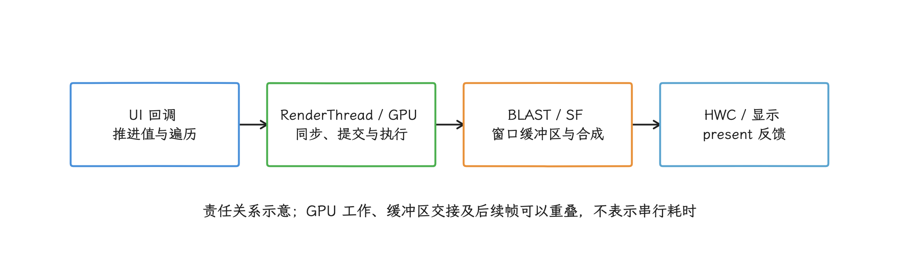

图：动画回调结束只证明前段完成；GPU、窗口缓冲区和显示时刻仍须关联同一帧。

动画 API 的状态推进主要位于 Android 框架和应用进程；内核基线用来解释线程调度、GPU 驱动、fence（跨 CPU、GPU、显示设备传递完成状态的同步对象） 与显示侧现象，拿内核标签推导 Animator 的 Java 语义会走偏。完整显示路径可结合 [Android View 标准渲染路径](../../part2-performance/ch13-rendering-pipelines/01-android-view-pipeline-analysis.md) 阅读。

## 属性更新、布局触发与 RenderThread

### 属性动画与帧动画：先看每帧改变什么

选择动画方案时，我们先把“每帧输入”“是否触发布局”“绘制输入规模”三件事分开评估。

| 模型 | Android 17 中的每帧工作 | 合适场景 | 主要风险 |
| --- | --- | --- | --- |
| `ViewPropertyAnimator` | UI 线程上的一个 `ValueAnimator` 推进一组 View 属性，并合并相应重绘请求 | `alpha`、`translation`、`scale`、`rotation` 等 View 属性组合 | 更新回调做业务计算；目标内容频繁失效；把视觉变换当成布局语义变化 |
| `ObjectAnimator` | `PropertyValuesHolder` 计算值，再经 `Property`、优化调用路径或已解析的 setter（属性写入方法）写入目标 | View 之外的对象属性、自定义属性 | setter 内分配对象、执行 I/O、调用 `requestLayout()` 或触发大范围重绘 |
| 逐帧 Drawable | 到时切换子 Drawable，随后进入绘制 | 小面积、较短、逐帧美术效果 | 解码后像素内存、纹理上传、包体和资源切换 |
| 自绘动画 | 更新进度并使 View 失效，UI 线程按需重录 DisplayList（显示列表） | 图表、波形、进度和业务图形 | 每帧重建几何、分配对象或提交过多绘制命令 |
| Lottie | 推进 composition（解析后的动画模型）中各节点的进度，并绘制矢量、图片、mask（同层路径遮罩）与 matte（由另一图层决定可见区域） | 设计工具导出的矢量动效 | 节点遍历、路径计算、mask / matte、图片和渲染模式 |

`ViewPropertyAnimator.startAnimation()` 创建一个 `ValueAnimator`：更新回调运行在 UI 线程，先算出各属性值并直接更新 View 状态，再把失效请求合并成一次发出。这样分工的结果是：动画回调留在 UI 线程，RenderThread 消费的是更新后的 RenderNode（渲染节点）与 DisplayList 状态。`ViewPropertyAnimator` 的优势正在于此——专用 View 属性接口、组合写法、失效请求合并。

`ObjectAnimator` 的写值路径要看入参：传入 `Property<T, V>` 时可以直接调用 `Property.set()`；传入属性名时，`PropertyValuesHolder` 会解析并缓存 getter（属性读取方法） 与 setter，随后经反射或针对部分数值属性的优化路径写值。无论走哪条，性能判断仍要回到目标 setter 的副作用。

<!-- gracker-diagram: a238-02-property-models -->
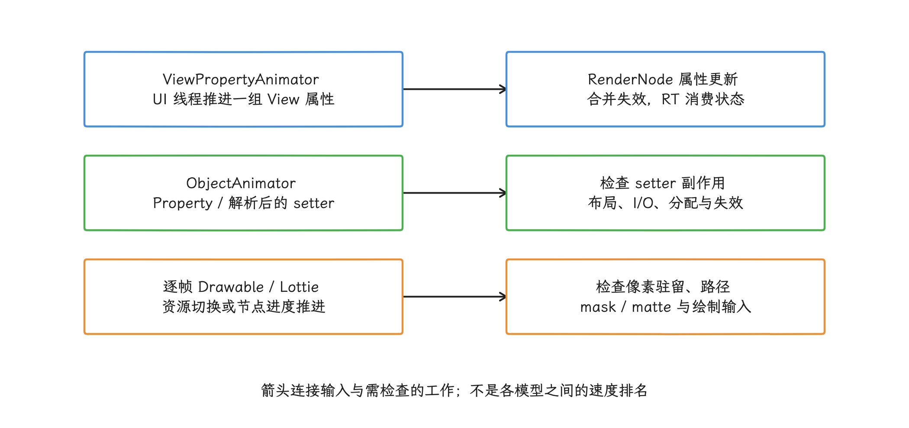

图：同一动画 API 也可能因 setter、内容失效和输入规模而产生不同开销。

#### 变换属性与布局语义

下面的反例在每个动画 tick（进度更新回调）中修改宽度，会持续发起布局请求。

```kotlin
ValueAnimator.ofInt(startWidth, targetWidth).apply {
    addUpdateListener { animator ->
        view.updateLayoutParams {
            width = animator.animatedValue as Int
        }
    }
}.start()
```

`updateLayoutParams` 会把新参数重新设置给 View，并触发 `requestLayout()`。受影响范围由父容器、约束与测量缓存决定，重排可能波及当前 View 之外。

如果这段展开只是视觉上的，布局占位与触摸区域都能保持目标尺寸，我们就可以用变换属性表达同一段视觉过程：

```kotlin
view.pivotX = 0f
view.scaleX = 0f
view.animate()
    .scaleX(1f)
    .start()
```

`scale（缩放）X` 改变的是绘制变换：measured width（测量宽度）、layout bounds（摆放边界）、触摸命中区域和无障碍节点边界都维持原值。反过来，产品要求周围内容随宽度移动、收起后不可点击，或无障碍边界同步变化时，我们就要更新布局和交互状态，并通过 trace（时间轴） 确认参与重排的子树及其耗时——这类几何语义要靠布局更新完成。

<!-- gracker-diagram: a238-03-scale-input-coordinates -->
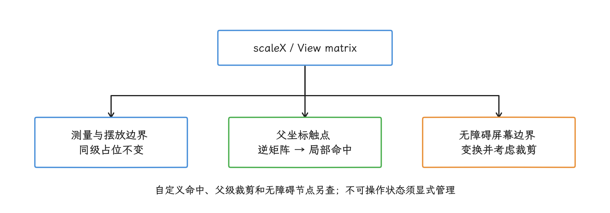

图：标准 View 输入分发会映射变换后的坐标，布局占位则保持原样。

#### `withLayer()` 的适用条件

`withLayer()` 会在下一次动画开始前设置 `LAYER_TYPE_HARDWARE`，结束时恢复调用前的图层类型。它适合的 View 有个共同点：内容复杂，动画期间内容保持不变，外层只做 `alpha`（透明度） 或 transform（几何变换）。一旦 View 内容每帧失效，硬件图层就得跟着更新；大面积图层还会增加 GPU 内存，并带来先把内容画到中间缓冲区的离屏渲染成本。而默认 View 已有 RenderNode (HWUI 的可记录绘制节点) / DisplayList 复用能力，静态内容没有必要长期强制硬件图层。

<!-- gracker-diagram: a238-04-hardware-layer -->
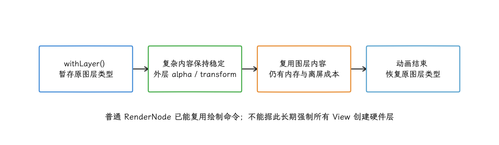

图：内容逐帧失效时，中间层仍要更新；图层收益需要目标设备验证。

#### 逐帧图片按解码后像素估算

假设 30 张互不复用的 1920 × 1080 图片都以 RGBA_8888 常驻，仅像素数据就需要：

`1920 × 1080 × 4 × 30 = 248,832,000 bytes ≈ 237.3 MiB`

这个数字只统计未经额外填充的像素数据；`AnimationDrawable` 的实际驻留内存还要看资源 density（密度） 缩放、采样、Bitmap 复用、硬件位图、Drawable 类型和缓存生命周期，GPU 纹理也可能按绘制时机上传。我们评审时，用目标资源的解码尺寸、内存记录和 GPU 轨迹来验证它。大尺寸长动画通常更适合视频、受控的矢量动画或按需自绘，选型还要比较视觉保真、功耗和启动成本。

<!-- gracker-diagram: a238-05-frame-pixel-budget -->
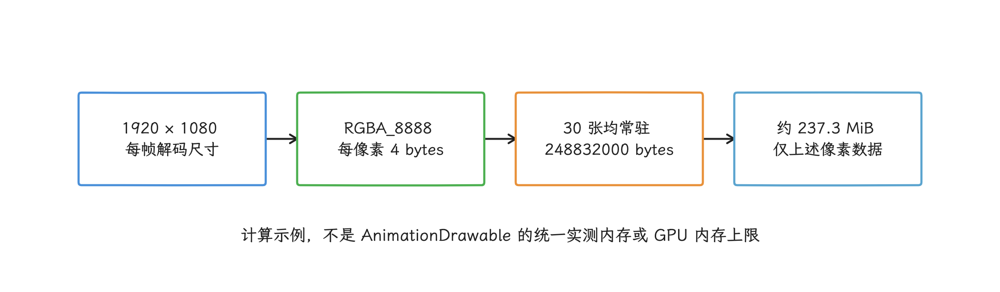

图：这是明确假设下的像素算式；实际驻留、复用、density 和纹理上传另外测量。

### Lottie：以当前稳定版 6.7.1 解释渲染模式

截至 2026-08-14，Maven Central 与上游 GitHub 的 Lottie Android 稳定版都是 `6.7.1`。库版本独立于 Android API 级别；项目升级 Lottie 后，要重新核对 `RenderMode`、缓存和异步更新行为。

`RenderMode.AUTOMATIC` 在 Lottie 6.7.1 中按这些条件选择软件绘制：

- 含 dash pattern（虚线图案）且系统低于 Android 9；
- mask 与 matte 总数超过 4；
- 系统不高于 Android 7.1。

在 Android 10—17 上，第一个和第三个兼容分支不会命中，主要自动切换条件是 mask / matte 总数超过 4。源码注释说明这个阈值只试过少量动画，要求开发者手动比较两种模式；第 5 个 mask 是否更慢、哪种模式更适合目标设备，都要以实测为准。软件模式会把内容绘制到 Lottie 管理的 Bitmap，复杂动画仍可能产生较高的 CPU 与内存成本。

`LottieAnimationView` 的 `cacheComposition`（Compose 生成并维护 UI 树的组合阶段） 默认开启。常规 assets 目录资源、raw 资源和 URL 加载通过 `LottieCompositionFactory` 返回异步任务，编辑器预览分支仍有同步解析。异步加载只把动画模型的解析与构建移出当前调用，播放期间的进度传播、动态属性回调和 Canvas 绘制仍要计入帧成本。

Lottie 6.7.1 还提供 `setPerformanceTrackingEnabled()` 与 `getPerformanceTracker()`，用于观察各图层的渲染时间。`AsyncUpdates` 在该版本被标为实验 API，`AUTOMATIC` 的注释写明当前按禁用处理；节点更新是否离开 UI 线程，要看项目是否显式启用并验证过。

<!-- gracker-diagram: a238-06-lottie-mode -->
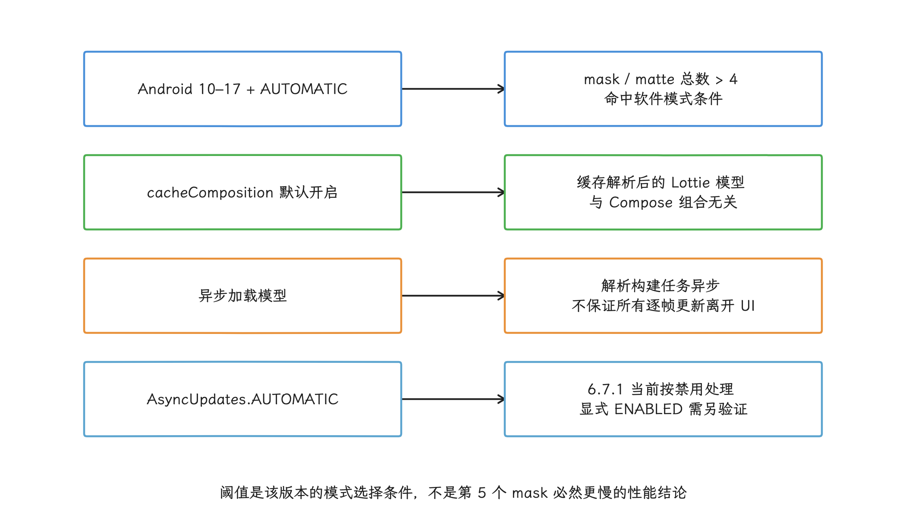

图：渲染模式、模型缓存和节点异步更新是三条独立路径。

我们评审一份 Lottie 资源时，可以按四组输入记录结果：

| 输入 | 要核对的内容 | 验证方法 |
| --- | --- | --- |
| 动画模型（composition） | 图层、路径点、trim path（路径裁切）、表达式或动态回调 | PerformanceTracker、CPU trace、设计稿简化前后对比 |
| 合成效果 | mask、matte、透明叠加和大面积裁剪 | 检查导出 JSON，并比较 `AUTOMATIC`、`HARDWARE`、`SOFTWARE` |
| 图片资源 | 解码尺寸、复用、色彩格式和首次上传 | 内存记录、RenderThread/GPU 轨迹、冷启动与热启动对比 |
| 播放策略 | 同屏数量、循环、可见性和生命周期 | RecyclerView 滚动、页面切后台与长时间功耗测试 |

这四组输入要随同一份动画资源一起记录；之后解释一次资源简化、缓存命中或同屏数量变化带来的差异，我们就回到这四组输入里找原因。

落到 RecyclerView 里，动画应绑定列表项可见性和业务焦点：离屏列表项停止播放，回收时移除动态回调或引用；同屏数量多时，可以给非焦点列表项使用静态帧。首屏动画模型的预加载和缓存要与内存预算一起评估，避免每次绑定数据时重复发起加载。

### RenderEffect：控制输入面积、效果状态与降级

`RenderEffect` 从 API 31 公开。`View.setRenderEffect()` 把效果设置到 View 背后的 RenderNode；RenderNode 状态变化后，View 会触发属性失效，让渲染系统同步新状态。blur（模糊）、shader（着色器） 或多个效果组成的链可能需要中间渲染目标，成本随输入区域、采样范围、像素格式、效果组合和更新频率变化。

我们评审 RenderEffect 时，先记录这一帧处理了多少像素、处理了几次，以及输入是否改变。全屏模糊、滚动容器上的模糊、半径持续变化，以及效果与复杂透明叠加同时出现，这几种情况都要单独测量。到了低性能设备档位和省电模式，降级路径可以关闭效果、缩小作用 View，或改用经过设计确认的静态背景与半透明色块。

视觉只需要几个固定状态时，可以复用已经创建的 RenderEffect。下面的控制器由调用方长期持有，半径来自设计资源或设备分档测试，没有写入通用阈值。

```kotlin
@RequiresApi(Build.VERSION_CODES.S)
class BlurController(
    compactRadiusPx: Float,
    expandedRadiusPx: Float,
) {
    enum class State { OFF, COMPACT, EXPANDED }

    private val compact = RenderEffect.createBlurEffect(
        compactRadiusPx,
        compactRadiusPx,
        Shader.TileMode.CLAMP,
    )
    private val expanded = RenderEffect.createBlurEffect(
        expandedRadiusPx,
        expandedRadiusPx,
        Shader.TileMode.CLAMP,
    )

    fun apply(view: View, state: State) {
        view.setRenderEffect(
            when (state) {
                State.OFF -> null
                State.COMPACT -> compact
                State.EXPANDED -> expanded
            },
        )
    }
}
```

这个示例避免在每帧重复创建相同效果，并保留 `null` 清理路径。半径由视觉目标与实机数据决定，关闭状态直接传 `null`。动画必须连续改变半径时，每帧输入都在变化，这时应缩小 View 的输入面积，并比较关闭效果前后的 FrameTimeline（关联应用、系统合成与显示阶段的帧时间线）、RenderThread、GPU 和功耗差值。

`RenderThread DrawFrame` 变长时，先别急着写成“GPU 慢”：这段时间可能包含 RenderThread 的 CPU 工作、runnable（线程已就绪但仍在等 CPU） 时间、`dequeueBuffer` 等待、驱动调用或 GPU 同步。我们要接着检查线程状态、调度延迟、`dequeueBuffer` / `queueBuffer` 耗时、GPU slice（时间轴上的工作区间） 和 fence；UI 与 RenderThread 都按时而 present 偏晚时，再往下看 BLAST 的缓冲区积压、SurfaceFlinger 的 latch（接收本帧缓冲区）与合成、HWC 和显示反馈。

<!-- gracker-diagram: a238-07-effect-fixed-states -->
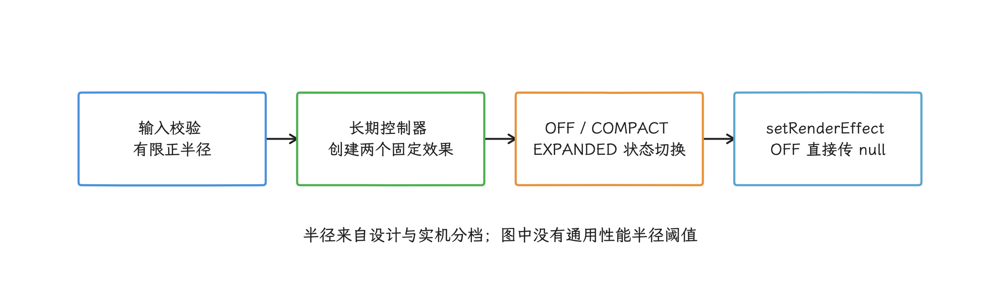

图：固定状态避免重复创建相同效果；连续半径动画仍要逐帧评估输入面积和 GPU 工作。

### 动画与 UI 线程：按显示阶段归因

`Choreographer` 依次执行 input、animation、insets animation、traversal 和 commit 回调。`ValueAnimator`、`ViewPropertyAnimator` 的进度推进以及应用注册的更新回调通常运行在创建它们的 Looper 线程。所以 View 动画应在 UI 线程创建和操作——属性最终写入 RenderNode，UI 线程上的插值、回调和状态更新照旧执行。

一帧动画应沿以下观察点逐段检查：

| 阶段 | Perfetto 观察点 | 可以支持的结论 | 还不能推出的结论 |
| --- | --- | --- | --- |
| UI 线程 | `Choreographer#doFrame`、animation 回调、`performTraversals`、自定义 trace | 回调计算、布局或 DisplayList 重录是否超预算 | GPU 是否已经完成 |
| RenderThread | `syncFrameState`、`DrawFrame`、线程状态、dequeue / queue 耗时 | RenderNode 同步、绘制准备或缓冲区等待位于何处 | 整段 `DrawFrame` 都是 GPU 执行 |
| GPU / 图像生产者 | `GPU slices`（GPU 工作区间）、提交与完成栅栏 | GPU 工作是否跨过应用帧 deadline（截止时间） | 缓冲区是否已经上屏 |
| BLAST / SurfaceFlinger | `BufferTX - <layerName>`、latch（接收缓冲区）、composition（合成）、FrameTimeline | 缓冲区到达、合成和 display frame（显示帧）是否按期 | 屏幕面板的像素响应已经完成 |
| HWC / 显示设备 | composition type（合成类型）、present feedback（上屏反馈）、相关 fence | Android 显示栈观察到的 present 时刻 | 用户已经感知到像素变化 |

这张表的用法是：“某一阶段按时”只能排除该阶段已经观察到的延迟；判断动画是否按期可见，仍要把同一帧从应用回调关联到最终 present。

<!-- gracker-diagram: a238-08-attribution-evidence -->
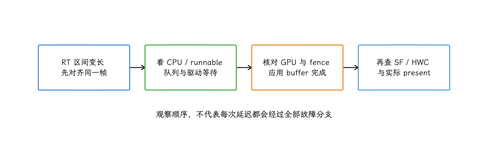

图：RenderThread 区间包含多类工作和等待，不能直接等同 GPU 执行时长。

#### 把不变计算移出更新回调

下面的反例会在每个 tick 遍历数据并重建 Path。

```kotlin
ValueAnimator.ofFloat(0f, 1f).apply {
    addUpdateListener { animator ->
        chartPath.reset()
        rebuildPath(chartPath, data, animator.animatedFraction)
        chartView.invalidate()
    }
}.start()
```

即使这段代码没有产生 Java 对象，路径计算、DisplayList 记录和几何处理仍可能超过帧预算。

输入数据不变时，应先构建稳定采样结果，并只在每帧更新进度。

```kotlin
val samples = buildPathSamples(data)
chartView.setSamples(samples)

ValueAnimator.ofFloat(0f, 1f).apply {
    addUpdateListener { animator ->
        chartView.setProgress(animator.animatedFraction)
    }
}.start()
```

`setSamples()` 只在动画开始前复制数据并建立几何缓存；`setProgress()` 只更新可见区间并调用 `invalidate()`。API 21 起，应用传给 `invalidate(Rect)` 的 dirty rectangle（局部脏区域） 会被忽略，想缩小 View 的重录范围，应把内容分到不同的 View 或 RenderNode。`onDraw()` 的对象复用、刷新和 RenderNode 边界详见 [22.1 自定义 View 性能优化](01-view-layout-custom-drawing.md)。

<!-- gracker-diagram: a238-09-geometry-cache -->
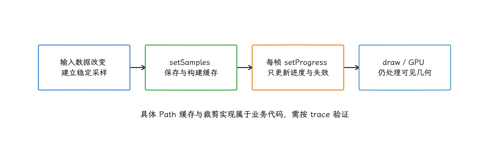

图：预计算减少重复准备，不能把绘制和 GPU 成本一并视为消失。

#### 动画要随可见性停止

页面 `onStop()`、View 从窗口分离或 RecyclerView 列表项回收后，Animator、Lottie、粒子系统和 `postOnAnimation()` 循环都应停止或暂停。恢复时要从业务状态计算进度，避免重复注册回调。生命周期处理既影响帧性能，也影响后台功耗和对象引用。

#### 缓冲区积压恢复

源码中的 buffer stuffing recovery（缓冲区积压恢复）是这样工作的：窗口生产者等待空闲缓冲区超过半个帧周期时，`Choreographer.onWaitForBufferRelease()` 会把当前状态标为 stuffed（已积压）；等待时长来自 `BBQBufferQueueProducer::waitForBufferRelease()`，经渲染器回调与 `ViewRootImpl` 连接到 `Choreographer`。恢复逻辑可以主动延迟一帧，再用 `Negative offset` 调整后续动画的 frame time（动画时间基准），让缓冲区积压有时间下降。

Perfetto 中遇到动画帧间隔异常时，可搜索 `Buffer stuffing recovery`、`buffer stuffed` 和 `Negative offset`，再检查 `dequeueBuffer` 等待、FrameTimeline 的 `Buffer Stuffing`、目标图层的 `BufferTX` 与后续缓冲区积压。出现主动延迟时，应先确认恢复机制的影响，再评估 Animator 计算或 CPU 算力是否不足。`bufferStuffingMultiRecovery`、`bufferStuffingRecoveryThreshold` 等 aconfig（平台功能开关）配置会改变恢复细节，设备行为要以当前构建配置和 trace (按时间记录系统与应用事件的性能轨迹) 为准。

<!-- gracker-diagram: a238-10-stuffing-recovery -->
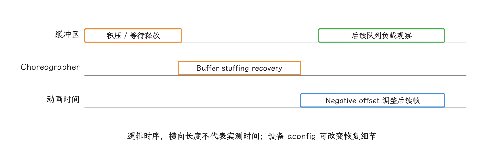

图：恢复机制可能主动延后一帧并调整动画时间，先排除缓冲区积压再归因 Animator。

### AnimatedVectorDrawable：先确认运行线程再优化

`AnimatedVectorDrawable`（AVD）默认使用 `VectorDrawableAnimatorRT`，API 25 起可以在 RenderThread 推进动画。动画尚未启动、却先绘制到软件 Canvas 时，源码会调用 `fallbackOntoUI()` 切到 UI 线程实现；平台内部也保留强制 UI 动画的入口。

`Animatable2.AnimationCallback` 不会让动画退回 UI 线程——RenderThread 动画完成后，结束回调经 Handler 返回 UI 侧，而且可能比 RenderThread 完成晚一帧。因此排查时要在 Perfetto 中分别查看主线程、RenderThread 和 GPU；主线程看不到逐帧更新，说明不了动画是否按期 present，还要结合 GPU 与显示侧确认。

<!-- gracker-diagram: a238-11-avd-fallback -->
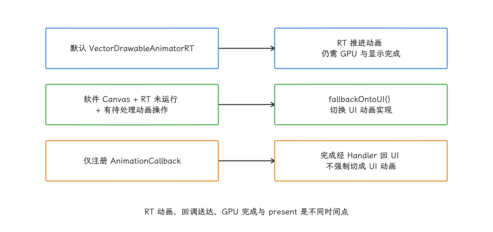

图：软件 Canvas 回退要满足明确分支；结束回调所在的线程也不能代替动画运行线程证据。

AVD 适合路径、颜色和 transform 数量有限的图标动画。路径节点、关键帧和同时播放实例越多，属性插值、矢量绘制与 GPU 覆盖成本越高；退回 UI 线程时还要承担主线程更新与绘制记录。可以从 `Drawable.ConstantState` 创建实例以复用不可变配置，但每个可见控件仍需独立的可变动画状态。列表复用时必须在从窗口分离或回收时停止动画并重置进度，避免不可见 ViewHolder 继续占用帧时钟。

出现版本或设备差异时，建立三组对照：原 AVD、等价静态矢量图、简化路径或关键帧的 AVD。若静态组仍慢，问题就不在动画插值；若主线程组明显改善但 GPU 耗时不变，说明只是移动了 CPU 工作。软件 Canvas、截图和离屏 Bitmap 路径要单独验证，硬件窗口的 RenderThread 结论在这里派不上用场。

### 转场动画：限制捕获范围和目标数量

`TransitionManager.beginDelayedTransition(sceneRoot, transition)` 的执行顺序是：先立即捕获 start values（变化前的属性），再在下一次 pre-draw（绘制前回调）捕获 end values（变化后的属性），最后为有差异的目标创建 Animator。`sceneRoot` 是转场捕获和动画的根容器；范围过大时，遍历、布局影响和候选目标都会增加。具体成本还取决于 Transition 类型，以及 target / exclude（纳入 / 排除目标） 的取舍。

场景根节点应选能容纳目标变化的最小共同父容器，再显式限制 target。下面的例子让筛选面板和结果列表的外框参与转场，同时排除列表项。

```kotlin
val transition = AutoTransition().apply {
    addTarget(filterPanel)
    addTarget(resultList)
    excludeChildren(resultList, true)
}

TransitionManager.beginDelayedTransition(contentContainer, transition)
filterPanel.isVisible = showFilters
```

`resultList` 自身可以随筛选面板展开而移动，RecyclerView 的子 View 不会成为 transition target。`contentContainer` 必须同时包含两个目标；如果页面结构不满足这个前提，应调整 scene root 或改成局部动画。

<!-- gracker-diagram: a238-12-transition-capture -->
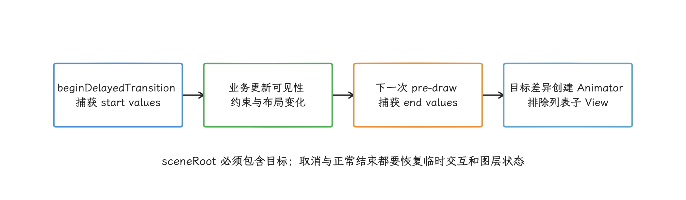

图：最小共同父容器加 target/exclude 限制捕获和动画范围。

常见转场问题可以按触发条件处理：

| 现象 | 检查内容 | 处理方向 |
| --- | --- | --- |
| start / end 捕获很长 | scene root 层级、target 数量、自定义 `capture*Values()` | 缩小根节点，使用 `addTarget()` / `excludeTarget()` |
| View 树遍历连续变长 | 边界、约束、文本和子 View 尺寸是否在变化 | 减少参与重排的子树，预先计算文本与几何 |
| RecyclerView 列表项被创建大量 Animator | 列表是否落在 scene root，子 View 是否被排除 | 排除子 View，或让列表避开该转场 |
| UI 线程按时但画面仍晚 | 大面积 `alpha`、阴影、RenderEffect、缓冲区积压和 SurfaceFlinger / 显示设备 | 沿 RenderThread、GPU、BLAST、SurfaceFlinger、HWC 继续定位 |

转场期间临时启用的图层、点击禁用状态和视觉属性，应在取消与正常结束两条路径都恢复。复杂转场还要验证系统动画缩放、页面快速退出、旋转和多次触发，防止监听器遗漏导致状态残留。

### 扩展：MotionLayout 性能实践

截至 2026-08-14，Google Maven 中 ConstraintLayout 的当前稳定版是 `2.2.2`，本文以该版本为库基线。MotionLayout 属于 AndroidX ConstraintLayout，行为由依赖版本和 `MotionScene` 决定；排查行为差异时先对库版本，再对平台标签。`progress` 是从 0 到 1 的转场进度；MotionLayout 适合用它同时驱动多个 View 的约束、位置、尺寸、透明度和关键帧。

接入时检查三类输入：

1. 只包含 `translation`、`scale`、`rotation` 或 `alpha` 的简单动效，可以先比较属性动画；MotionLayout 更适合需要约束关系和关键帧协同的场景。
2. 尺寸、约束、文本或 ConstraintHelper（如 Barrier、Group 等约束辅助控件）状态随 `progress` 变化时，观察 `performTraversals`、测量 / 摆放次数和每帧参与计算的 View 数量。
3. 复杂首屏或低性能设备要有简化 MotionScene、缩小参与范围或跳过动效的产品方案，并验证无障碍与“减少动态效果”设置。

我们判断 MotionLayout 性能时，先固定 ConstraintLayout 版本、设备刷新率、动画输入和页面数据，再动其他变量。若 UI 线程的摆放时间随 `progress` 稳定升高，就逐项移除尺寸或约束变化，确认哪一组目标造成成本；若 UI 线程按时，则继续检查 RenderThread 和显示后段。

### 上线前检查清单

- 记录 Android 平台、Lottie / ConstraintLayout 等库版本、设备固件、刷新率和测试输入。
- 区分绘制变换与布局几何；同时验证触摸区域、无障碍边界和同级 View 排布。
- 检查 Animator 更新回调、setter 和动态属性回调中是否存在重复计算、对象分配、I/O 或 `requestLayout()`。
- 逐帧图片按解码尺寸估算内存，并用运行时（ART）记录确认驻留与纹理上传。
- Lottie 对比目标资源的三种 RenderMode，记录 mask / matte、图片和同屏播放数量。
- RenderEffect 限制输入区域，复用固定状态，提供 `null` 清理和设备降级。
- 转场使用最小 scene root，并显式配置 target / exclude；验证取消、页面退出和重复触发。
- API 31—37 优先检查 FrameTimeline；API 29—30 结合 UI/RenderThread、BufferQueue、SurfaceFlinger 和显示时序。
- UI 与 RenderThread 都按时，画面仍可能晚于预期 present；继续检查 BLAST、SurfaceFlinger、HWC 和 fence。

## Compose 状态驱动动画与重组范围

View 动画我们按属性和线程判断成本；到了 Compose，还要检查状态读取是否扩大重组和测量范围。

Compose 动画每帧会做多少工作，取决于动画值在哪个阶段读取、哪些阶段因此失效、过渡期间保留多少界面内容，以及应用提交帧后的显示过程。本文的 Compose 库版本基线是 BOM 2026.08.00 对应的 Compose 1.12.0；Compose 独立于 Android 平台发布，行为以库版本为准。

普通 Compose 页面仍由宿主应用窗口的 HWUI 路径生成画面。状态计算，以及部分组合（Composition）、布局和绘制（Draw），都发生在主线程；`RenderThread` 整理硬件绘制命令，GPU 执行命令，BLAST 负责传递图形缓冲区，`SurfaceFlinger` 与 HWC 完成系统合成和送显。完整边界见 [13.8 Jetpack Compose 渲染管线：Composition、Layout 与 RenderNode](../../part2-performance/ch13-rendering-pipelines/08-compose-rendering-pipeline.md)。本文只讨论动画额外增加的工作。

### 1. 用状态读取阶段判断动画成本

`Animatable.value`、`Transition.animate*` 和 `animate*AsState` 返回的动画值都受 Compose 快照（Snapshot）系统观察。失效发生在哪个阶段，取决于动画值在哪里被读取：在哪个阶段读取，值变化时就请求哪个阶段重新执行；同一个值在多个阶段读取，也会建立多处观察关系。

| 动画值的读取位置 | 值变化后的主要工作 | 常见写法 | 判断要点 |
| --- | --- | --- | --- |
| 可组合函数体 | 组合；后续是否进入布局、绘制取决于输出变化 | `Box(Modifier.alpha(alpha))` 中先在函数体读取 `alpha` | 高频值容易让当前重组作用域逐帧执行 |
| 测量或放置回调（lambda） | 布局的相应子阶段，随后绘制 | `Modifier.offset { IntOffset(x, 0) }` | 可跳过组合，但位置或尺寸变化仍有布局成本 |
| 绘制回调 | 绘制 | `drawBehind { drawRect(color) }` | 适合颜色、路径参数和 `Canvas` 内容 |
| `graphicsLayer {}` 回调 | 图层属性更新与绘制提交 | `graphicsLayer { translationX = x }` | 不重组、不重新测量；仍会产生 `RenderThread`/GPU 工作 |

`drawWithCache` 也会观察缓存构建代码中读取的 `State`，依赖变化时会重建缓存。绘制阶段同样保持 Snapshot 读取观察；把高频值延后到绘制回调或图层回调中读取，组合阶段就无需处理这次更新。

<!-- gracker-diagram: a238-13-compose-read-phase -->
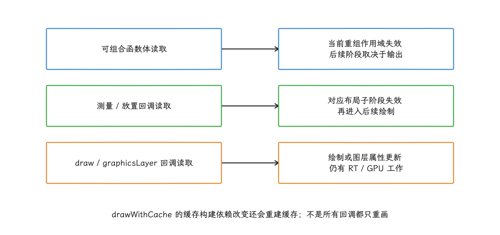

图：延后读取能限制前段失效，但同一值若也在组合中读取，组合观察关系仍存在。

下面的示例用于把透明度动画值延后到图层属性更新。

```kotlin
@Composable
fun FadingPanel(
    visible: Boolean,
    content: @Composable () -> Unit,
) {
    val alpha = remember { Animatable(if (visible) 1f else 0f) }

    LaunchedEffect(visible) {
        alpha.animateTo(if (visible) 1f else 0f)
    }

    Box(
        Modifier.graphicsLayer {
            this.alpha = alpha.value
        }
    ) {
        content()
    }
}
```

这里的 `alpha.value` 只在 `graphicsLayer` 回调中读取，透明度变化停留在图层属性更新这一层，`FadingPanel` 无需逐帧重组或重新布局。不过透明度低于 1 时，图层可能需要中间合成，主线程省下的工作，GPU 那边未必同步变轻；我们应在目标设备上同时观察界面线程、`RenderThread` 和 `FrameTimeline`。

### 2. 动画时钟与帧时间

Compose 1.12.0 的 `AndroidUiFrameClock.withFrameNanos()` 会注册 `Choreographer.FrameCallback`。`Transition` 和 `Animatable` 的逐帧循环，都通过 `withFrameNanos` 一类接口等待下一帧；Android 上也就没有一套脱离 `Choreographer`、按固定间隔自行计时的 Compose 界面时钟。

主线程及时收到回调时，动画按本次帧时间计算已经播放的时长；主线程一旦被阻塞，回调就会延迟，下一次执行看到更大的时间差，动画值随之向前跳。Compose 不会补画所有错过的中间帧，用户通常看到的是画面停顿后直接跳到较后的状态。

<!-- gracker-diagram: a238-14-frame-clock -->
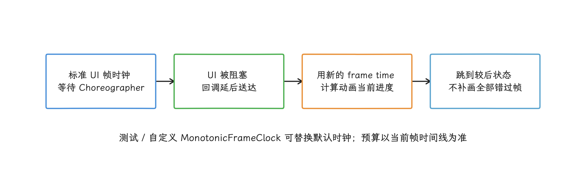

图：帧时间驱动动画进度，doFrame 区间也不包含后续 GPU 和系统送显。

再往下一层，`Choreographer.FrameData` 同时携带候选帧时间线、首选帧时间线、截止时间和预计呈现时间；我们做性能判断，用的是当前帧的截止时间，或 `FrameTimeline` 中的预期/实际结果。16.6 ms、11.1 ms、8.3 ms 只是特定刷新率下的周期换算值，可变刷新率、帧率请求和调度选择都会改变某一帧可用的时间。

Perfetto 里的 `Choreographer#doFrame` slice 覆盖应用主线程回调，不含应用 GPU 完成、图形缓冲区入队后的 SurfaceFlinger 合成和送显。它变长只说明主线程帧回调变长，端到端帧耗时还要关联 GPU 与送显一起看。

### 3. Animatable：互斥动画与手势跟随

`Animatable<T, V>` 内部持有 `AnimationState`，其 `value` 由 `mutableStateOf` 保存，由此拿到数值连续性、取值范围约束、速度信息和互斥控制；至于失效发生在哪个阶段，仍由读取位置决定。

同一个 `Animatable` 启动新的 `animateTo`、`animateDecay`、`snapTo` 或 `stop` 时，`MutatorMutex` 会取消正在运行的变更。新的 `animateTo` 从当前值继续，spring（弹簧动画）还会延续当前速度。取消会以 `CancellationException` 沿协程父子关系传播，需要释放的资源应在 `finally` 中清理。

拖动期间想让手指位置直接跟随时，适合使用 `snapTo`，松手后再用 `animateDecay` 或 `animateTo` 收尾。要是每个触摸采样点都调用 `animateTo`，就会连续取消前一个动画，产生与输入延迟、动画参数和采样频率有关的追赶效果；若产品需要这种柔性跟随，可以保留，只是它仍有逐帧更新和协程取消的成本。

<!-- gracker-diagram: a238-15-animatable-cancellation -->
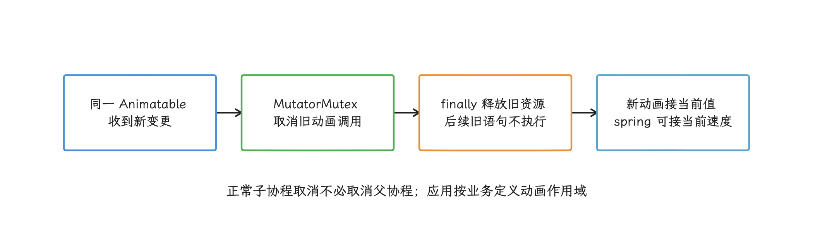

图：拖动可用 snapTo 直接跟随，松手再衰减或收尾；频繁 animateTo 会连续打断。

API 选择可以按控制语义划分：

- 单个或少量数值、协程中顺序控制、手势打断：`Animatable`。
- 一个离散状态协调多项属性：`Transition`。
- 单值随目标自动过渡，且无需等待完成或主动取消：`animate*AsState`。
- 内容进入、退出或替换：`AnimatedVisibility`、`AnimatedContent`。

无关组件各自维护状态迁移，更容易限定生命周期。跨组件共享一个 `Transition` 可以减少对象数，代价是把状态、取消和完成条件耦合在一起，适用范围有限。

### 4. Transition 会参与组合

`updateTransition(targetState)` 是可组合函数。Compose 1.12.0 会在当前位置通过 `remember` 保存一个 `Transition`，随后调用 `animateTo(targetState)`，并用 `DisposableEffect` 处理离开组合时的清理。参数或被观察的 `State` 变化仍可能让相关可组合函数重新执行，`Transition` 给不了“组合永不重启”的保证。

`Transition` 让多个子动画共享状态迁移和帧进度，也支持运行中改变目标。目标变化时，它会更新由起点和终点组成的迁移段（segment）及目标；不同动画参数对中断连续性的处理各不相同，笼统地说“每次切换都从头重启”会看错行为。

是否对快速点击做防抖（debounce）属于交互约束：

- 若每次输入都有效，允许动画重新定向，并检查中断后的连续性。
- 若后端操作或导航只允许一次，按业务状态屏蔽重复输入。
- 若需要观察进入、退出是否结束，使用 `MutableTransitionState.isIdle` 与 `currentState`。

Compose 1.12.0 已弃用接收 `MutableTransitionState` 的 `updateTransition` 重载，应改用 `rememberTransition(transitionState)`；接收普通目标值的 `updateTransition(targetState)` 仍可使用。`MutableTransitionState` 提供可观察的状态迁移入口，本身不会减少每帧工作。

1.12.0 的 `DeferredTransitionState` 与 `mutableTransform` 面向预测性返回等“先手动改变属性、再启动自动过渡”的场景，也不是通用性能开关。

<!-- gracker-diagram: a238-16-transition-coordination -->
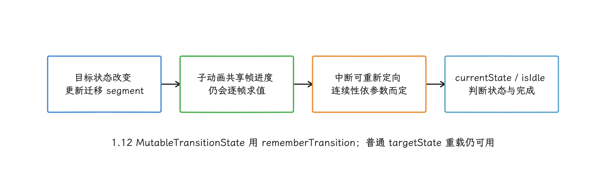

图：Transition 不是免重组开关，DeferredTransitionState 与 mutableTransform 用于手动控制后接自动过渡。

### 5. AnimatedVisibility：尺寸变化和退出内容保留

`AnimatedVisibility` 使用自定义 `Layout` 承载界面内容。普通 `AnimatedVisibility(visible=...)` 重载先测量子项，以最大宽高作为容器尺寸，再把子项放在坐标 `(0, 0)`；Row/Column 作用域重载有各自适配的默认过渡。普通重载的默认进入/退出动画包含展开和收缩，因此容器报告给父布局的尺寸会随动画变化；依赖该尺寸的父容器和同级元素也可能反复测量或放置。

不同过渡类型产生的工作不同：

- 淡入淡出和缩放主要更新图层属性。
- 滑动会改变子项的放置偏移量，不缩小容器报告的尺寸，但仍会执行 `LayoutModifier` 的放置逻辑。
- 展开和收缩会产生尺寸动画。
- 子内容自身的尺寸变化、`animateContentSize` 或自定义布局修饰符还可能增加布局工作。

如果父布局无须跟随内容伸缩，可以给外层稳定约束，并在内部使用淡入淡出、缩放或滑动。裁剪（clip（裁剪））只限制绘制范围，不会阻止尺寸变化传给父布局。

退出时，界面内容会保留到内建进入/退出动画，以及注册在 `AnimatedVisibilityScope.transition` 上的自定义动画全部完成。保留期间有以下生命周期行为：

- 内容仍在组合中，也会响应自己观察的 `State`。
- `LaunchedEffect` 和 `rememberCoroutineScope` 启动的任务尚未因离开组合而取消。
- `DisposableEffect.onDispose` 尚未执行。
- 内容持有的图片、订阅和其他对象仍然存活。

独立创建的 `animate*AsState` 不属于 `AnimatedVisibilityScope.transition`，容器不知道它何时结束，因而可能先移除内容。需要与退出完成同步的自定义动画，应注册到作用域提供的 `transition` 上。

<!-- gracker-diagram: a238-17-retained-exit -->
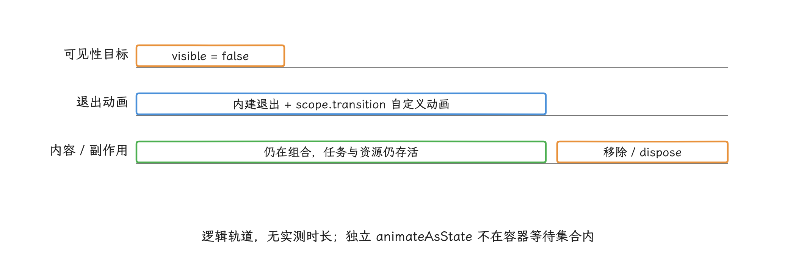

图：可见性目标改变不等于立刻离开组合；退出完成边界要覆盖注册在同一 transition 的动画。

缩短退出时长只能缩短保留窗口，保留多久取决于内容轻重与产品要求。内容很重时，可把昂贵订阅移到更高层统一管理，或在退出开始后停止不再需要的数据更新；这属于业务生命周期设计，`visible=false` 自动完成不了。

### 6. AnimatedContent：过渡期间新旧内容共存

`AnimatedContent` 切换目标时会同时查找新旧状态对应的界面内容。新内容执行进入动画，旧内容执行退出动画；旧内容在退出完成后才从组合中移除。默认 `SizeTransform` 还会为容器尺寸变化创建动画。快速连续切换时，可能同时保留多份尚未退出的内容。

使用 `AnimatedContent` 时要评估：

- 新旧内容同时参与组合、测量和绘制的成本。
- 旧内容在退出期间保留的副作用任务与资源。
- `SizeTransform` 是否让父布局持续变化。
- 目标状态变化频率是否高于用户能够辨认的切换频率。

内容回调必须使用它收到的 `targetState` 参数构建对应内容。`contentKey` 定义哪些目标状态属于同一内容身份；两个目标状态映射到同一个键时，不会触发内容切换动画。它适合过滤“状态对象改变但视觉身份不变”的更新，掩盖不了错误的状态建模。

`AnimatedVisibility` 适合一个内容节点的出现与消失，`AnimatedContent` 适合不同内容身份之间的替换。两者都可能保留退出内容，也都可能触发布局；应按业务语义和跟踪结果选择。

<!-- gracker-diagram: a238-18-animated-content -->
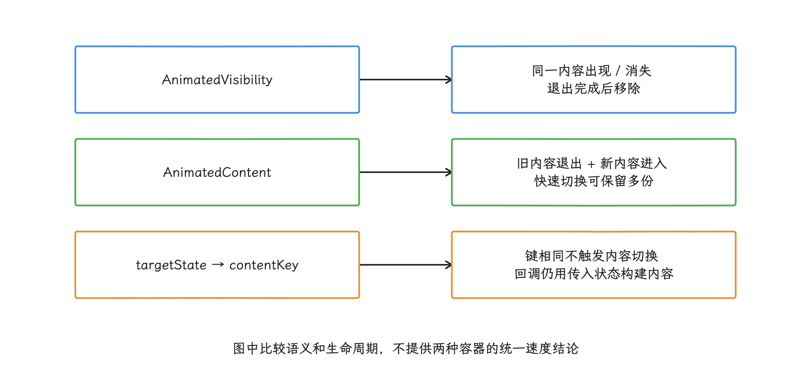

图：内容身份、尺寸动画和退出资源窗口要一起评审。

### 7. produceState、snapshotFlow 与 derivedStateOf

`produceState` 用 `remember { mutableStateOf(initialValue) }` 保存结果，并由 `LaunchedEffect` 启动一个协程来生产状态值，提供无键、单键和多键重载。这里的键是决定协程何时重启的输入，把实现概括成固定的 `LaunchedEffect(Unit)` 会看错重启时机：键改变时，旧协程取消并启动新协程，离开组合时同样取消。对回调式数据源，我们用 `awaitDispose` 注销回调。

返回的 `State` 会合并相等值，写入与当前值相等的结果不会触发重组；不同值若按帧更新，下游仍会按其读取阶段失效。所以 `produceState` 适合把外部异步或订阅式数据转成 Compose `State`，外部数据频率高并不构成误用——判断依据是界面是否需要每个样本，以及读取位置是否合适。

顺着“读取方需要什么”这条线，`snapshotFlow` 把 Snapshot `State` 读取转换成冷流（cold Flow），有人收集时才开始执行，适合驱动埋点、持久化这类副作用；`distinctUntilChanged`、`sample` 或 `debounce` 会改变事件或时间语义，屏幕上的逐帧动画不该交给它驱动。

再往“少通知”的方向走一步就是 `derivedStateOf`：它适合输入变化频繁、输出变化较少的派生结果，例如滚动偏移不断变化，而界面只关心“是否越过阈值”。它根据派生结果的相等性策略决定是否通知读取方；若派生结果每帧都不同，`derivedStateOf` 只会增加观察与计算开销。

<!-- gracker-diagram: a238-19-state-adapters -->
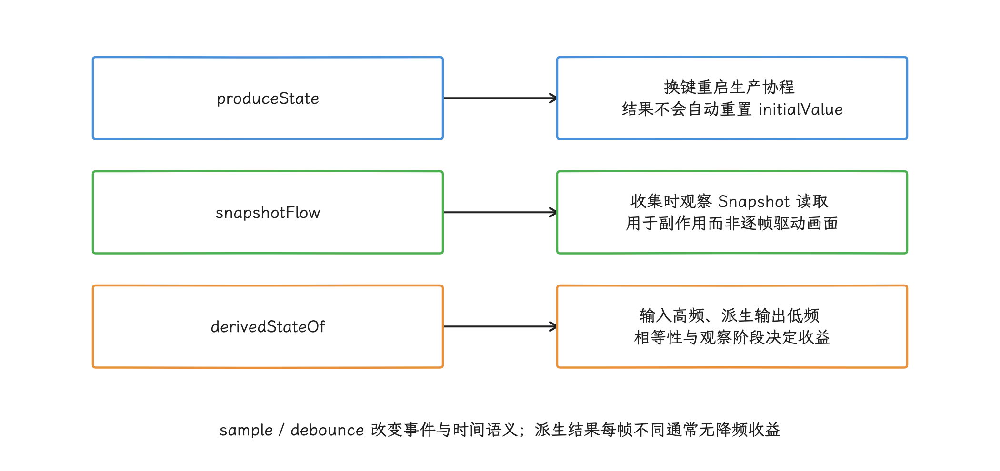

图：高频输入是否需要降频由读取方语义决定，不能仅按 API 名称推断性能。

### 8. 强跳过模式能解决什么

强跳过模式（Strong Skipping）从 Kotlin 2.0.20 起默认启用。启用后，可重启的可组合函数即使带有不稳定参数，也可以被标记为允许跳过；稳定参数仍用对象相等性比较，不稳定参数则用实例相等性比较。编译器还会自动记忆可组合函数内的 lambda，并用它捕获的值作为键。

这些规则减少的是父级重组向子级的传播，以及 lambda 的重复分配；而下面这些行为保持原样，排查时不要指望强跳过模式代劳：

- 可组合函数体直接读取的动画 `State` 变化后，读取作用域仍会失效。
- 布局、绘制或图层回调中的 `State` 读取仍由对应阶段观察。
- 跳过一个可组合函数不会暂停 `LaunchedEffect` 或 `rememberCoroutineScope` 的任务。
- `State` 更新不会因为某个可组合组被跳过而推迟到未来某次组合；对应观察者仍会按 Snapshot 机制收到失效通知。

落实到写法上，较省工作的方式是捕获稳定的 `State` 持有者，在布局、绘制或 `graphicsLayer` 回调内读取其值；如果我们先在可组合函数体中把 `State` 读取成每帧变化的标量，再让回调捕获这个标量，组合阶段就已经建立了高频读取关系。

不要为了动画批量添加 `@NonRestartableComposable`（可组合函数） 等编译器注解。它们会改变重组入口和可跳过性，只有编译器报告、基准数据和明确热点同时支持时才值得调整。

### 9. Lazy 列表中的动画所有权

惰性布局（Lazy layout）决定哪些列表项进入、保留或离开组合，预取和保留策略也由它控制。列表项内部的 `AnimatedVisibility` 只能管理该项仍在组合时的内容退出；列表项一旦离开 `LazyColumn` 的管理范围，它就要求不了外层继续保留退出动画。

列表数据的新增、删除和重排应优先使用稳定且唯一的键，配合 `Modifier.animateItem()`；列表项内部局部区域的显示隐藏再使用 `AnimatedVisibility`。这样可以分别处理数据项身份变化与项内内容可见性。

`rememberInfiniteTransition` 在宿主仍处于组合时持续请求动画帧。在可组合函数体读取它返回的值会触发组合；在绘制或图层回调中读取，才能把更新限定到后续阶段。离屏列表项是否仍在运行，要看惰性布局是否仍保留该项，单看像素是否可见会误判。

大量列表动画的检查项包括：

- 列表项是否有稳定且唯一的键。
- 同屏活跃动画数量是否随滚动或数据更新持续增长。
- 离屏后已无产品价值的无限动画是否及时离开组合。
- 展开/收缩、`animateContentSize` 和列表项位置动画是否叠加触发布局。
- 图片、模糊、阴影和透明度图层是否把瓶颈移到 `RenderThread` 或 GPU。

### 10. 从 Compose 阶段看到显示结果

所以 `graphicsLayer`、绘制回调或跳过组合，改变的只是应用生成帧前半程的工作量；标准 HWUI 页面仍要经过 `RenderThread`、GPU、应用窗口的图形缓冲区提交、SurfaceFlinger 和 HWC。透明度、裁剪、模糊、复杂路径或较大的离屏图层可能减少主线程工作，同时增加 GPU 或内存带宽成本。

`ComposeView` 与 View 动画共用窗口和主线程帧回调；`AndroidView` 同样共用这套帧预算。混合页面应通过同一条 `FrameTimeline` 分析 View 树遍历、Compose 工作、`RenderThread` 和系统合成，单独某个跟踪区间代表不了整帧耗时。

内核侧的调度器、cpufreq 调频（cpufreq）、thermal 热限制（thermal）和 fence wait 会影响线程何时运行或等待；`Animatable`、`Transition` 和内容移除的语义由 Compose 定义。跟踪数据出现线程可运行但迟迟未获调度、频率受限或栅栏等待时，再检查内核侧的依据；单凭动画卡顿，还不足以把责任归给调度器。

### 11. Perfetto、Studio 与线上指标各看什么

排查一次动画卡顿，我们可以按下面的顺序进行：

1. 在发布（release）、可分析（profileable）且不可调试（non-debuggable）的构建上复现固定交互。
2. 用 `FrameTimeline` 对齐预期与实际时间线，确认哪些帧迟到，以及应用是否按时完成。
3. 查看主线程 `Choreographer#doFrame`、Compose 组合跟踪、布局和绘制相关区间。
4. 查看 `RenderThread`、GPU、应用窗口缓冲区入队和 SurfaceFlinger，避免把 GPU 或送显时间算进 `doFrame`。
5. 将慢帧对应到动画状态、目标切换、仍然活跃的内容数量和状态读取阶段。

工具的职责要分开：

- **组合跟踪（Composition tracing）**：在系统跟踪数据中显示可组合函数调用，适合定位重组代码和耗时。
- **Layout Inspector**：显示运行中可组合函数的组合/跳过计数，适合验证重组范围；连接工具本身有开销。
- **Animation Preview**：可以暂停动画、拖动时间轴并检查动画值，适合验证曲线与多动画协调；它不分析真实运行时性能。
- **FrameTimeline**：把应用帧和 SurfaceFlinger 帧的预期/实际时间，以及卡顿类型放在同一时间轴上。
- **JankStats**：给线上帧数据附加页面或交互状态，便于按场景聚合。

`FrameMetrics.ANIMATION_DURATION` 表示一帧中发出动画回调所用的时间。它区分不出“动画帧”和“非动画帧”，也不覆盖整帧。Android 12 及以上更适合关注 `FrameTimeline` 派生的超期时间（overrun）；线上数据还要结合当前界面状态，避免把整页慢帧都归给某个动画。

### 12. 用 Macrobenchmark 建立回归门槛

动画基准要覆盖一次完整、可重复的状态迁移，并让测试知道动画何时结束。测试页面可以在 `MutableTransitionState.isIdle` 变为 `true` 后，暴露一个只供测试识别的语义属性或测试标签（test tag）。

下面的骨架用于采集展开动画的 FrameTimingMetric。

```kotlin
@LargeTest
@RunWith(AndroidJUnit4::class)
class ExpandAnimationBenchmark {
    @get:Rule
    val benchmarkRule = MacrobenchmarkRule()

    @Test
    fun expand() = benchmarkRule.measureRepeated(
        packageName = "com.example.app",
        metrics = listOf(FrameTimingMetric()),
        iterations = 10,
        startupMode = StartupMode.WARM,
        setupBlock = {
            startActivityAndWait()
            device.findObject(By.res("reset_collapsed")).click()
            device.waitForIdle()
        },
    ) {
        device.findObject(By.res("toggle_animation")).click()
        check(
            device.wait(
                Until.hasObject(By.res("animation_idle_expanded")),
                2_000,
            )
        )
    }
}
```

`toggle_animation`、`reset（被复用）_collapsed` 和完成标记需要通过 `testTagAsResourceId` 或真实资源 ID 暴露。完成标记应在目标状态达到且 `Transition` 空闲后出现，避免只测到动画起点。每轮准备阶段都回到同一初始状态，测量区间只包含目标交互。

我们看结果时，应同时关注 `frameOverrunMs` 的 P50/P90/P95/P99、`frameDurationCpuMs` 和 `frameCount`。`frameOverrunMs` 在 API 31 及以上按每帧截止时间计算，能适应高刷新率和可变帧率；`frameDurationCpuMs` 只覆盖界面线程与 `RenderThread` 生成一帧所用的 CPU 时间。`frameCount` 是辅助指标：它变化时，可能表示实现减少或增加了请求帧数量，耗时分位值之外要一并看它。`FrameTimingMetric` 不提供通用的 `jankFrameCount`，按固定 16.6 ms 自行推导卡顿帧数同样站不住。

Baseline Profile（基准配置文件（Baseline Profile））可以让 ART 提前编译关键用户流程覆盖的应用与库代码，减少首次运行时的解释执行和 JIT 成本。GPU 着色器预编译、离屏合成的消除、Snapshot 失效范围，都在它的能力之外。用同一组 Macrobenchmark 对比应用基准配置文件前后的数据，才能判断当前动画是否受编译状态影响。

<!-- gracker-diagram: a238-22-benchmark-protocol -->
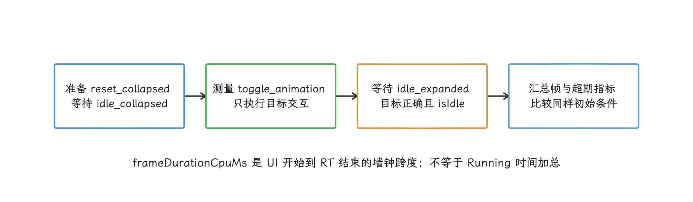

图：UiAutomator 事件空闲不证明 Compose 动画结束，测试标记要同时验证目标和 Transition 空闲。

### 13. 无限动画、VectorConverter 与资源动画

`rememberInfiniteTransition()` 表达“进入组合后持续运行，离开组合后停止”。同一个 `InfiniteTransition` 的子动画共享一条逐帧循环，不会为每个值注册独立 VSync；每个子项仍要维护状态并计算插值。只给组件设置 `alpha = 0f`、移到屏外或用其他内容遮挡，都不会使它离开组合。加载指示、呼吸光和背景粒子不可见且无需继续计时时，应让对应分支移出组合，或由业务状态停止动画。

系统动画时长缩放为 0 时，Compose 会把无限动画推进到目标值并等待缩放恢复，不会继续逐帧更新。产品要验证该目标值能否作为合理的静止画面，并为“减少动态效果”保留易于理解的界面状态。

<!-- gracker-diagram: a238-20-lazy-infinite -->
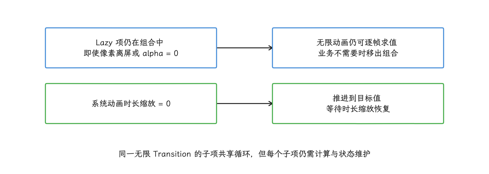

图：alpha 为零或屏外不等于移出组合；列表动画与项内动画按各自身份管理。

一组视觉值若能由同一相位推导，可以只保留一个 `animateFloat()`，在绘制或图层阶段计算颜色、缩放和偏移。`TwoWayConverter<T, V>` 只负责业务值与 `AnimationVector1D`～`4D` 的双向映射；每个维度应对应一个独立变量，并明确单位和有效范围。若 `convertFromVector()` 每帧都会创建复杂对象，应比较改用内置标量动画或单一相位推导后的对象分配量。

Animated Vector XML 使用另一套资源机制：`AnimatedImageVector` 解析矢量图和动画器资源，并按动画进度绘制，不经过 `TwoWayConverter`。资源应按 ID 稳定记忆，避免在动画帧内重复解析；路径节点、关键帧和同时播放数量仍需在目标设备上测量。

### 14. Pager 动画：区分当前页、稳定页和目标页

Pager 把“现在滚到哪了”拆成三个页面值，我们先把它们分开再谈优化。`currentPage` 表示最接近吸附位置的页面，拖动跨过吸附判定点时就会变化，此时滚动未必已经完成；曝光、重资源归属和业务选中这类要等滚动真正停稳的语义，应改看 `settledPage`——它只在滚动和动画停止后更新。`targetPage` 表示本次滚动预计停下的页面，可用于动画目标。计算任意页面到当前吸附位置的距离时，用 `getOffsetDistanceInPages(page)`，别手写公式：`currentPage` 切换时符号容易反转。

页面的透明度、缩放、旋转和平移值应在 `graphicsLayer {}` 中读取，让滚动只更新图层属性；在可组合函数体提前读取 `currentPageOffsetFraction`，会让依赖该值的页面持续重组。延后读取高频状态并不会消除动画成本，裁剪、阴影、透明度和大面积旋转仍可能增加离屏合成与 GPU 带宽。

`beyondViewportPageCount` 表示可见区域两侧额外组合、测量和放置的页面，不包含滚动方向上的内部预取页面；应从默认值开始逐页增加，并同时比较首次进入页面的组合/测量耗时、内存峰值与预取命中率。`visiblePagesInfo` 是随测量频繁更新的结果，和页面生命周期是两回事。视频、地图和 `WebView` 等重资源应由 `settledPage`、可见性和生命周期共同控制。

<!-- gracker-diagram: a238-21-pager-values -->
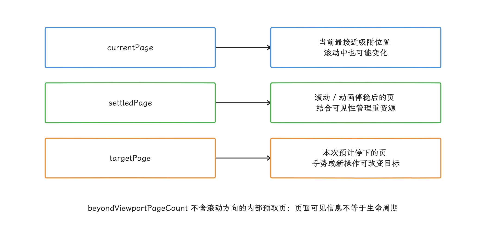

图：页间距离用 getOffsetDistanceInPages，滚动高频状态尽量在图层回调中读取。

同向嵌套的 Pager/惰性容器要明确哪个容器消费嵌套滚动、惯性滚动如何交接，以及子容器到达边界后是否继续滚动父容器。负 `pageSpacing` 产生重叠时，还要验证 `zIndex` 层叠顺序、命中区域、裁剪和无障碍顺序。点击标签页启动的 `animateScrollToPage()` 可能被新手势或新的滚动操作取消；调用返回后，还要根据状态确认目标页是否已经稳定展示。

### 15. 源码与资料索引

Compose 行为按 BOM 2026.08.00 与以下 1.12.0 source JAR 复核：

- [Compose BOM 2026.08.00 POM](https://dl.google.com/dl/android/maven2/androidx/compose/compose-bom/2026.08.00/compose-bom-2026.08.00.pom)。
- [`androidx.compose.animation:animation:1.12.0` 源码](https://dl.google.com/dl/android/maven2/androidx/compose/animation/animation/1.12.0/animation-1.12.0-sources.jar)：`AnimatedVisibility.kt`、`AnimatedContent.kt`。
- [`androidx.compose.animation:animation-core:1.12.0` 源码](https://dl.google.com/dl/android/maven2/androidx/compose/animation/animation-core/1.12.0/animation-core-1.12.0-sources.jar)：`Animatable.kt`、`AnimationState.kt`、`Transition.kt`、`InfiniteTransition.kt`。
- [`androidx.compose.ui:ui-android:1.12.0` 源码](https://dl.google.com/dl/android/maven2/androidx/compose/ui/ui-android/1.12.0/ui-android-1.12.0-sources.jar)：`AndroidUiFrameClock.android.kt`、`AndroidUiDispatcher.android.kt`、图层与绘制修饰符实现。

以下 1.10.0 链接保留为上一轮核验基线：

- [`androidx.compose.animation:animation:1.10.0` 源码](https://dl.google.com/dl/android/maven2/androidx/compose/animation/animation/1.10.0/animation-1.10.0-sources.jar)：`AnimatedVisibility.kt`、`AnimatedContent.kt`。
- [`androidx.compose.animation:animation-core:1.10.0` 源码](https://dl.google.com/dl/android/maven2/androidx/compose/animation/animation-core/1.10.0/animation-core-1.10.0-sources.jar)：`Animatable.kt`、`AnimationState.kt`、`Transition.kt`、`InfiniteTransition.kt`。
- [`androidx.compose.ui:ui-android:1.10.0` 源码](https://dl.google.com/dl/android/maven2/androidx/compose/ui/ui-android/1.10.0/ui-android-1.10.0-sources.jar)：`AndroidUiFrameClock.android.kt`、`AndroidUiDispatcher.android.kt`、图层与绘制修饰符实现。

平台和内核边界按固定标签复核：

- [Android 17 `Choreographer.java`](https://android.googlesource.com/platform/frameworks/base/+/refs/tags/android-17.0.0_r1/core/java/android/view/Choreographer.java)。
- [Android 17 `FrameMetrics.java`](https://android.googlesource.com/platform/frameworks/base/+/refs/tags/android-17.0.0_r1/core/java/android/view/FrameMetrics.java)。
- [`android17-6.18-2026-06_r6` kernel tag](https://android.googlesource.com/kernel/common/+/refs/tags/android17-6.18-2026-06_r6/)。

API 用法、性能工具和测量口径参考：

- [Compose Animation 发布说明](https://developer.android.com/jetpack/androidx/releases/compose-animation)。
- [Compose 动画性能 quick guide](https://developer.android.com/develop/ui/compose/animation/quick-guide)。
- [Compose phases](https://developer.android.com/develop/ui/compose/phases)。
- [Graphics modifiers](https://developer.android.com/develop/ui/compose/graphics/draw/modifiers)。
- [AnimatedVisibility 与 AnimatedContent](https://developer.android.com/develop/ui/compose/animation/composables-modifiers)。
- [Strong Skipping](https://developer.android.com/develop/ui/compose/performance/stability/strongskipping)。
- [Compose side effects 与 produceState](https://developer.android.com/develop/ui/compose/side-effects)。
- [Lazy list item animations](https://developer.android.com/develop/ui/compose/lists)。
- [Compose Pager](https://developer.android.com/develop/ui/compose/layouts/pager)。
- [Composition tracing](https://developer.android.com/develop/ui/compose/tooling/tracing)。
- [Layout Inspector 调试 Compose](https://developer.android.com/develop/ui/compose/tooling/debug)。
- [Animation Preview](https://developer.android.com/develop/ui/compose/tooling/animation-preview)。
- [Perfetto FrameTimeline](https://perfetto.dev/docs/data-sources/frametimeline)。
- [Macrobenchmark FrameTimingMetric](https://developer.android.com/topic/performance/benchmarking/macrobenchmark-metrics)。
- [Compose Baseline Profile](https://developer.android.com/develop/ui/compose/performance/baseline-profiles)。

### 检查清单

- 动画值在哪个阶段读取？是否在更早阶段也被解引用？
- 值变化后需要组合、测量、放置、绘制还是图层属性更新？
- `AnimatedVisibility` 或 `AnimatedContent` 退出期间保留了哪些内容、副作用任务和资源？
- 动画中途改变目标时，是重新定向、取消后续工作，还是由产品层屏蔽输入？
- `produceState` 的键是否完整，外部订阅是否在 `awaitDispose` 中注销？
- `derivedStateOf` 的输出是否比输入低频？
- 惰性列表项的身份变化是否由稳定键和 `animateItem` 管理？
- 帧预算是否来自本帧 `FrameTimeline`，是否同时核对应用、GPU 与送显？
- Android Studio 工具、实验室基准和线上指标是否各自回答了合适的问题？
- 优化是否在发布版、可分析构建和代表性设备上复测？

## SharedTransition 元素匹配、绘制与同步

单个动画的成本讲完之后，我们来看共享元素过渡：它要同时维护起止内容、overlay 绘制和布局坐标，元素匹配失败或重复测量会直接影响连续性。

共享元素过渡会把两个页面中代表同一对象的内容匹配起来，在页面切换时连续改变位置和尺寸。这里我们关注它对组合、布局、绘制和 GPU 的影响。一般 Compose 性能方法见 [22.3 Compose 性能、Compiler 与 Modifier.Node 诊断](03-compose-compiler-modifier-diagnostics.md)，普通动画成本已由本文前两节建立基线。

为便于对照 API 和源码，本文保留几个常用英文词：`key` 是两端内容的匹配标识；`bounds` 是包含位置与尺寸的矩形边界；`entry` 是某个 `key` 在源端或目标端的一条注册记录；`overlay` 是 `SharedTransitionScope` 根节点内用于置顶绘制的覆盖区域。这些词都指 Compose 作用域内的匹配、布局或绘制概念。

### 1. 先界定实现层级

`SharedTransitionLayout` 位于 Compose Animation 的 `commonMain`（多平台公共源码集），元素匹配、Lookahead 布局、图形层和 overlay 都由 AndroidX 实现；本节的源码对照基于 Compose Animation `1.12.0` 与 AndroidX 源码快照 `963bf914f78b389bdddef0da7f36bee19d897274`。Android Framework 与内核里没有名为 SharedTransitionLayout 的专用渲染路径：内容进入 HWUI 后，走的仍是窗口绘制、BufferQueue、SurfaceFlinger 与显示流程。

### 2. API 架构：scope、可见性与 key

`scope` 是一组 API 共享的作用域；这里负责限定哪些内容可以互相匹配。源端（source）指正在退出的内容，目标端（target）指正在进入的内容。

`SharedTransitionLayout` 做两件事：

1. 创建 `SharedTransitionScope`，集中管理 `key` 匹配、`bounds` 动画和过渡是否活跃；
2. 创建一个 `Box` 布局，在根 `Modifier` 中取得当前坐标与 Lookahead 目标坐标，并提供 overlay 绘制入口。

Compose 1.12.0 还提供 `SharedTransitionScope { modifier -> ... }` 这个 Composable 入口。它不额外创建 `Box`，但调用方必须把回调给出的 `Modifier` 放在最上层子节点；该节点还要适合作为 overlay 的最高绘制根。大多数页面使用 `SharedTransitionLayout`，更容易保持正确坐标与 z-order（同一绘制区域中的前后顺序）。

#### 2.1 AnimatedVisibilityScope 告诉系统谁在进入

`sharedElement()` 和 `sharedBounds()` 通常接收 `AnimatedVisibilityScope`，让共享过渡知道哪一端正在进入、哪一端正在退出。这个 scope 来自：

- `AnimatedContent`
- `AnimatedVisibility`
- Navigation 2 的 destination content（导航目的地内容）
- Navigation 3 的 `LocalNavAnimatedContentScope`

`SharedTransitionScope` 根据可见性过渡判断相同 `key` 的哪一端正在变为可见，并用该端的 Lookahead `bounds` 作为目标。只创建相同 `key`、却缺了正确的可见性 scope 时，进入端的判定就不稳定了。

#### 2.2 key 作为匹配身份

`rememberSharedContentState(key)` 在 1.12.0 中通过 `remember(key)` 保存 `SharedContentState`。`remember` 会让该对象跨重组保留；列表和详情页应从同一个业务 ID 派生相同 `key`，例如 `article-image:42`。

Compose 的 `key()` 可以在组合结构移动时保留节点身份，但要缩小重组范围，还是得从稳定参数、延后状态读取、避免每帧在 Composition 中读取动画值这些方面下手。

相同 `key` 通常应同时存在一个退出 `entry` 和一个进入 `entry`。快速连续导航可能短暂产生多条记录，源码会从可见记录中选择目标。若同一个 `key` 出现多个正在进入的内容，匹配结果便不明确。

<!-- gracker-diagram: a238-23-scope-key-visibility -->
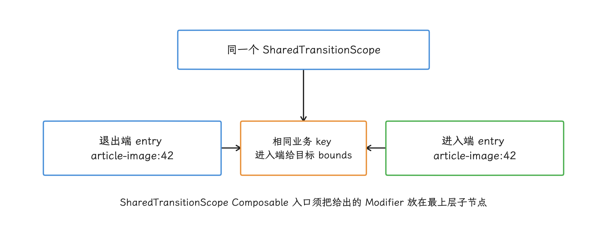

图：相同 key 负责跨端匹配，可见性 scope 负责进入/退出判定；重复进入候选会使匹配不明确。

### 3. 一套可维护的基本写法

这段代码让卡片容器使用 `sharedBounds()`，其中视觉内容相同的图片使用 `sharedElement()`。列表端与详情端必须传入相同的业务 ID。

```kotlin
@Composable
fun ArticleTransitionHost(
    article: ArticleUi,
    expanded: Boolean,
) {
    SharedTransitionLayout {
        AnimatedContent(
            targetState = expanded,
            label = "article-detail",
        ) { isExpanded ->
            ArticleScene(
                article = article,
                expanded = isExpanded,
                animatedVisibilityScope = this@AnimatedContent,
            )
        }
    }
}

@Composable
private fun SharedTransitionScope.ArticleScene(
    article: ArticleUi,
    expanded: Boolean,
    animatedVisibilityScope: AnimatedVisibilityScope,
) {
    Column(
        modifier = Modifier.sharedBounds(
            sharedContentState = rememberSharedContentState(
                key = "article-container:${article.id}",
            ),
            animatedVisibilityScope = animatedVisibilityScope,
            resizeMode = SharedTransitionScope.ResizeMode.scaleToBounds(),
        ),
    ) {
        Image(
            painter = article.painter,
            contentDescription = null,
            modifier = Modifier
                .sharedElement(
                    sharedContentState = rememberSharedContentState(
                        key = "article-image:${article.id}",
                    ),
                    animatedVisibilityScope = animatedVisibilityScope,
                )
                .then(if (expanded) Modifier.fillMaxWidth() else Modifier.size(96.dp)),
        )
        Text(
            text = article.title,
            style = if (expanded) {
                MaterialTheme.typography.headlineMedium
            } else {
                MaterialTheme.typography.titleMedium
            },
        )
    }
}
```

`sharedBounds()` 放在尺寸 `Modifier` 前，让它能用动画 `bounds` 约束后续内容；图片两端的视觉内容相同，因此使用 `sharedElement()`。示例省略了列表与详情的周边布局；我们写生产代码时，还要让图片请求使用一致的内存缓存 `key`，以免目标端重新解码时发生内容跳变。

### 4. Lookahead、approach 与每帧成本

#### 4.1 Lookahead 负责取得目标

`SharedBoundsNode.measure()` 在 Lookahead pass 测量子节点，完成放置后记录目标尺寸和位置。坐标相对 `SharedTransitionScope` 根节点，而不是相对整个 window（应用窗口）。

这带来两个要注意的点：

- `SharedTransitionLayout` 自身在窗口中移动时，目标坐标也会随之移动；
- 滚动容器会被标记为 motion frame of reference（运动参考系），源码借此区分结构位置变化与滚动位移；连续滚动仍可能增加节点放置工作。

`skipToLookaheadPosition()` 可以让节点在过渡期间使用目标位置，但父布局频繁移动时会增加 placement pass，也就是放置阶段的重复遍历。它适合解决明确的目标位置问题，不宜普遍加在每个共享节点上。

#### 4.2 approach 决定重测还是缩放

`sharedElement()` 的子节点会使用动画 `bounds` 生成的固定 constraints（布局给出的宽高限制）重新测量和布局。它与 `RemeasureToBounds` 的成本特征相近：`bounds` 尺寸逐帧变化时，子节点可能逐帧执行 measure/layout（测量与布局）。

`sharedBounds()` 提供两种 resize mode：

| resize mode | 1.12.0 行为 | 适合内容 | 主要成本 |
| --- | --- | --- | --- |
| `scaleToBounds()` | 用 Lookahead constraints 得到稳定的目标布局，过渡期间缩放到动画 `bounds` | `Text`、不适合频繁改变约束的复杂布局 | 图形缩放与可能的裁剪；子节点无需逐帧重排 |
| `RemeasureToBounds` | 用动画 `bounds` 生成的固定 constraints 重新测量子节点 | 背景、宽高比不同的图片、能低成本响应尺寸变化的布局 | 动画期间可能逐帧 measure/layout |

`Text` 在宽度变化时可能重新换行。对它使用 `RemeasureToBounds`，字符排版和父子尺寸可能逐帧改变；官方文档因此优先建议 `scaleToBounds()`。如果图片需要随宽高比持续改变裁剪结果，`RemeasureToBounds` 可能更符合视觉要求，但要实测 CPU 成本。

<!-- gracker-diagram: a238-24-lookahead-approach -->
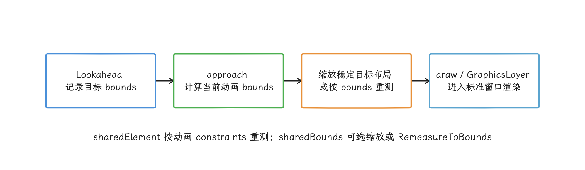

图：Lookahead 与 approach 是布局遍历；不能直接把它们称为两次 GPU 渲染。

#### 4.3 placeholder 决定父布局是否跟随

placeholder 是共享内容过渡时留在原布局中的占位区域。默认的 `PlaceholderSize.ContentSize` 让退出端向父布局报告初始内容尺寸，让进入端报告 Lookahead 目标尺寸；父布局不会跟随每一帧的动画 `bounds` 改变。

`PlaceholderSize.AnimatedSize` 会把动画尺寸报告给父布局。它能让周边内容随共享元素移动，也可能使更大的父子树逐帧重新布局。交互没有这种联动要求时，保留默认值通常更稳定。

<!-- gracker-diagram: a238-25-placeholder -->
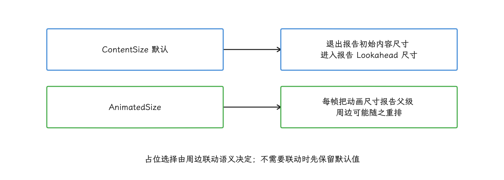

图：子内容如何缩放与父布局看到什么占位尺寸，是两个配置维度。

### 5. sharedElement 与 sharedBounds 的性能边界

两者的选择依据是视觉内容是否相同，不是初始尺寸是否相等。

| 维度 | `sharedElement()` | `sharedBounds()` |
| --- | --- | --- |
| 内容关系 | 两端应是相同视觉内容 | 两端内容可以不同，只共享容器 `bounds` |
| 过渡期间的内容 | 只绘制正在进入的目标内容 | 进入与退出内容通过 enter/exit transition（进入/退出动画）共存 |
| 子节点尺寸处理 | 按动画 `bounds` 重测、重排 | 默认 `scaleToBounds()`，可选逐帧重测 |
| 常见用途 | 跨页主图（hero image）、相同图标、可移动内容 | 卡片到详情、`Text` 样式变化、容器变换 |
| 透明混合 | 通常只有目标内容 | 默认 `fadeIn`/`fadeOut` 可能同时混合两端 |

`sharedBounds()` 可能保留两棵内容子树并同时绘制；alpha 混合区域较大时，GPU 成本会上升。`sharedElement()` 只绘制目标内容，但仍有逐帧 constraints 变化和 `GraphicsLayer` 记录成本。哪一种更快要按内容实测，`Modifier` 类型本身给不出答案。

两者也没有固有的重组范围差异。重组来自各自内容读取的 Compose 可观察状态；`sharedBounds()` 的进入和退出内容同时存活，可能带来更多活跃的 Composition，具体范围仍由调用方的状态结构决定。

<!-- gracker-diagram: a238-26-element-bounds -->
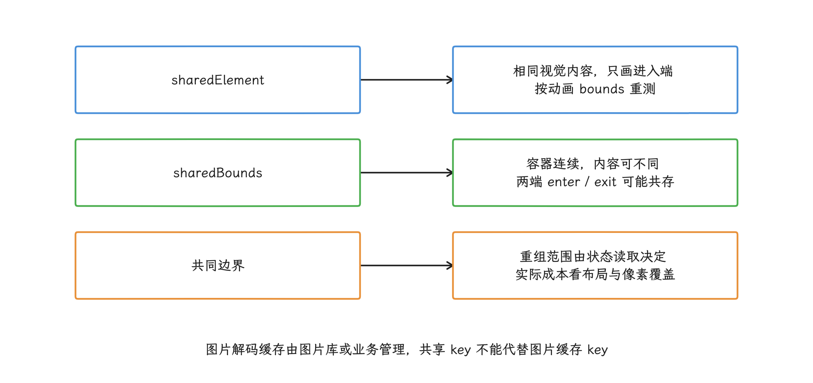

图：不能只凭 Modifier 类型判断速度；两个端点内容与 resize mode 都影响帧成本。

### 6. GraphicsLayer、overlay 与裁剪

#### 6.1 活跃的 overlay entry 按需持有 GraphicsLayer

Compose 1.12.0 不会在 `SharedBoundsNode.onAttach()` 时立刻分配图形层。节点需要在 overlay 中绘制时，才调用 `createGraphicsLayer()`，并在 draw 阶段把子节点的绘制命令记录进去；退出 overlay、节点 detach（从树中分离） 或节点 reset 时会释放该层。

这层资源用于在原位置与 overlay 之间移动绘制结果。它与固定大小的 Bitmap 缓存是两回事，全部内存也照 `width × height × 4` 推导不出来；RenderNode、display list（录制后的绘制命令列表）、离屏纹理和 GPU 侧存储是否出现，取决于图形效果与渲染后端。

应用无需在过渡结束时手工清理图形层。实现会在不再需要 overlay 或节点离开 Composition 时释放它。若使用 caller-managed visibility（由调用方管理可见性），不可见节点可能继续留在树中；官方文档建议在 `isTransitionActive == false` 后移除不可见端。

<!-- gracker-diagram: a238-27-graphics-layer-lifecycle -->
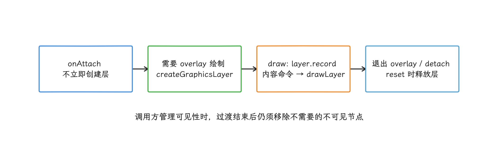

图：内部 GraphicsLayer 用于记录并复用绘制命令，不是把源内容截成 Bitmap。

#### 6.2 overlay 与父级效果

默认情况下，共享内容在 scope overlay 里绘制，不再受原父节点的 clip、alpha 或 scale 影响。视觉上仍需要这些效果时，要把它们明确应用到共享节点或 overlay。

需要圆角或裁剪时，应根据语义选择：

- 把 `clip()` 放在 `sharedElement()` / `sharedBounds()` 后，让裁剪成为图形层内容的一部分；
- 使用 `clipInOverlayDuringTransition` 提供 overlay 坐标系中的 clip path（矢量裁剪路径）；
- 嵌套 `sharedBounds()` 时复用父级裁剪；
- 父级没有裁剪、淡入淡出或缩放等影响时，再考虑 `renderInOverlayDuringTransition = false`。

`zIndexInOverlay` 只控制 scope overlay 内的顺序。Compose 1.12.0 在绘制前按 zIndex 排序 renderer（绘制一条 `entry` 的对象）；活跃 renderer (负责绘制某个 `entry` 的对象) 较多时，排序与逐个 `drawLayer()` 也会增加 CPU/GPU 工作。

#### 6.3 modifier 顺序会改变目标 bounds

共享 `Modifier` 前的尺寸与 padding（内边距） 会参与确定初始和目标 `bounds`；后续 `Modifier` 接收共享节点给出的动画 constraints。列表端与详情端顺序不一致时，位置或尺寸容易在起始帧跳变。

`requiredSize()` 还会覆盖约束，放置位置不同会让父布局观察到不同尺寸。遇到跳变时，应比较两端完整的 `Modifier` 链，再调整动画参数。

<!-- gracker-diagram: a238-28-overlay-clip-order -->
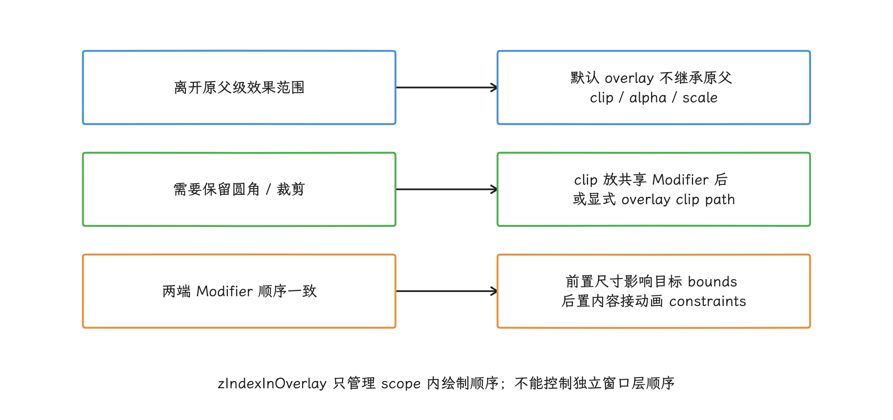

图：先比对两端完整 Modifier 链和 scope overlay 顺序，再修改动画参数。

### 7. 常见性能风险与对应处理

#### 7.1 在 Composition 中读取每帧状态

`BoundsAnimation` 的主要状态在 layout/draw 阶段读取，不要求业务逐帧重组。若业务在大范围 Composable 中读取 transition progress（通常为 0 到 1 的过渡进度），再据此构造颜色、尺寸、图片请求或列表，就会把本可在布局或绘制阶段完成的更新扩大到 Composition。

适合放在 `graphicsLayer {}`、`drawWithContent {}` 或 layout lambda（布局回调）中的值，应延后到对应阶段读取。确需重组时，用 Layout Inspector 的 recomposition count（重组次数）确认范围，不要把所有动画帧都称为“重组风暴”。

#### 7.2 重复添加 graphicsLayer

共享 `Modifier` 已经按需维护内部 `GraphicsLayer`。业务再为同一节点增加多个 `graphicsLayer()`、模糊、阴影、alpha 或离屏 compositing（先画到中间缓冲再合成），可能引入更多 render pass（一次渲染任务）和中间纹理。

只保留有明确视觉用途的层，并在 Perfetto/GPU 工具中验证。无作用的 layer 可以删除；有些属性动画适合在 layer 上更新，所以别把所有 `graphicsLayer()` 一律当成问题。

#### 7.3 大面积 alpha 与 overdraw（同一像素在一帧内被重复绘制）

`sharedBounds()` 默认同时显示进入和退出内容，并用 `fadeIn`/`fadeOut` 过渡。两张全屏图或复杂列表长时间重叠，像素填充（fill rate）和显存带宽压力都会明显上升，overdraw 也随之增加。

可以缩小共享容器范围、减少同时变化的背景层、调整进入/退出动画，或把静态不透明背景放在共享区域外。优化依据是覆盖面积和 GPU duration（GPU 完成该帧所需时间），不是共享 `key` 的数量。

#### 7.4 共享过渡与列表滚动同时进行

列表仍在惯性滚动时启动共享过渡，会同时发生 Lazy layout（只布局可见项及预取项）、图片请求、Lookahead、approach placement 和窗口绘制。motion frame of reference 能处理滚动坐标，却不会消除这些工作。

产品交互允许时，可以结束 fling（松手后的惯性滚动）再切换详情；需要并行时，要保证 item key（列表项身份） 稳定、图片已命中缓存，并减少 `AnimatedSize`、`RemeasureToBounds` 和大面积渐变的叠加。

#### 7.5 动画 spec 的求值成本通常较小

默认 bounds transform 使用中低 stiffness（弹簧刚度）的 spring。spring 的结束时间由收敛条件决定，tween（按时间插值的动画）的 duration（持续时间） 固定；两者逐帧求值的成本通常远小于复杂内容重测、文字排版和 GPU 绘制。

选择 animation spec（动画规格）时，应先满足交互与中断连续性，再观察它让高成本内容活跃了多少帧。缩短 duration 可能减少总工作，也可能增大逐帧变化幅度并造成视觉突兀，别只按“spring 更耗性能”下结论。

### 8. LazyList 中的共享元素

`LazyList` 的难点是源列表项可能在过渡结束前离开 Composition。可靠实现需要同时满足：

- `items(key = ...)` 使用稳定的业务 ID；
- `rememberSharedContentState()` 的 `key` 与详情端一致；
- 源端与目标端位于同一个 `SharedTransitionScope`；
- 目标端完成组合、测量和放置后，系统才能获得有效的 Lookahead `bounds`；
- 两端图片使用一致的图片内存缓存 `key`；
- 使用 caller-managed visibility (由调用方直接传入可见状态的 API) 时，在过渡结束后移除不可见节点。

若点击后立刻替换整个列表树，源 `entry` 可能在目标端获得 `bounds` 前 detach。`AnimatedContent`、Navigation 或官方 `AnimatedVisibility` 示例会让进入和退出内容在过渡窗口内同时存在，应优先选作可见性容器。

<!-- gracker-diagram: a238-29-scroll-source-lifetime -->
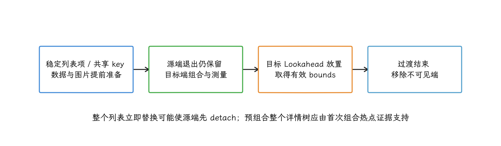

图：惯性滚动、图片请求、Lookahead 与绘制并发时，要分别检查预算和源节点生命周期。

预取应准备数据、图片和目标页面不可避免的昂贵资源。提前组合整个详情树会延长对象生命周期，也可能让未展示页面参与状态观察；只有 trace 证明首次组合是瓶颈时，再设计受控的 precompose（预先组合）。

### 9. Predictive Back

Predictive Back（预测性返回）让用户在返回手势完成前预览目的地。`SharedTransitionLayout` 自身不读取系统 back progress（返回手势进度）；Navigation 或调用方负责把进度送入目的地的 transition，共享元素再从对应的 `AnimatedVisibilityScope` 获得进入、退出状态和目标。

截至 2026 年 8 月，官方给出的集成要求是：

- Navigation 3 各版本支持 Predictive Back；
- Navigation Compose 2 使用 2.8.0 或更高版本；
- Android 15 及以上不再提供 Predictive Back 开发者开关；应用仍需使用受支持的返回 API。`targetSdk >= 35` 时无需把 `enableOnBackInvokedCallback` 设为 `true`，`targetSdk <= 34` 时仍需显式开启；
- Android 14 设备还要在开发者选项中启用 Predictive Back；
- 应用运行在 Android 16 及以上且 `targetSdk >= 36` 时，系统预测性返回动画默认启用；迁移期间仍可按官方说明临时选择退出。

Android 17 沿用这套标准机制，没有独立的 SharedTransitionLayout 帧同步平台 API。手势事件、Compose 过渡状态、Choreographer 与 HWUI 提交，仍要在 Perfetto 中按同一条 FrameTimeline 检查。

#### 9.1 BackHandler 与 PredictiveBackHandler

`BackHandler` 适合处理一次完成的返回动作，不提供连续 progress。需要自定义手势驱动动画时使用 `PredictiveBackHandler`，它提供一串 `BackEventCompat` 事件及 0 到 1 的进度；使用 Navigation 内建 Predictive Back 时，不要再添加会抢先消费同一手势的 handler（回调处理器）。

自定义进度流应更新专门的动画状态，避免每个事件都重建导航图、重发图片请求或重组整页。取消手势时要恢复初始状态，手势完成后再提交返回栈变化。

手势驱动的过渡可以暂停、反向或取消，比固定 tween 更容易暴露源端 detach、重复 `key` 和目标端尚未放置的问题。测试应覆盖完成、取消、快速往返和滚动中返回。

<!-- gracker-diagram: a238-30-predictive-back-flow -->
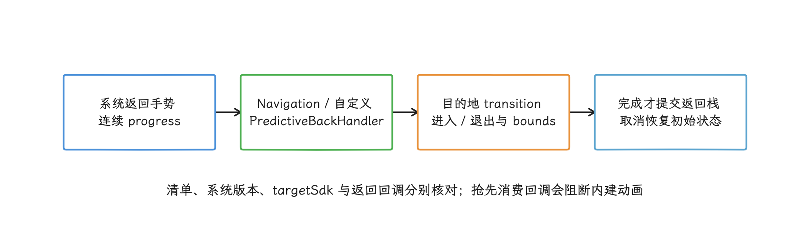

图：SharedTransitionLayout 自身不订阅系统返回进度，完成与取消都要验证匹配和生命周期。

### 10. Perfetto、Layout Inspector 与可视化调试

#### 10.1 源码没有专用 SharedTransition trace 轨道

Compose 1.12.0 的 `SharedTransitionScope.kt`、`SharedContentNode.kt` 与 `SharedElementEntry.kt` 没有为每个 `key` 写入固定的 Perfetto slice，分析时要自己组合观察：

- UI Thread（应用主线程） 上的 Choreographer、Compose recomposition、measure/layout 与 draw；
- RenderThread 的 `DrawFrame`、资源更新和命令提交；
- FrameTimeline 的 expected/actual frame（计划帧与实际帧）；
- GPU completion（GPU 完成时刻） 与 GPU duration (GPU 执行时长)；
- 图片解码、列表预取和其他并行工作；
- 应用为导航开始、目标端首次放置和过渡结束增加的自定义 trace。

如果 approach 阶段的布局耗时变长，我们就结合代码配置确认原因是 `sharedElement()`、`RemeasureToBounds`、`AnimatedSize`，还是业务父布局反复失效；GPU duration 上升时，则检查覆盖面积、alpha、裁剪、阴影和额外的 `graphicsLayer()`。

#### 10.2 Layout Inspector 的适用范围

Compose Layout Inspector 可以检查：

- 两端 `key` 是否一致；
- `Modifier` 顺序；
- 源端与目标端是否同时在树中；
- recomposition count 与 skip count（重组次数与跳过重组次数）；
- 不可见的 caller-managed 节点是否长期保留。

GPU 渲染 pass 数量、`GraphicsLayer` backing 或 SurfaceFlinger composition type（合成类型） 都超出了它的视野。Inspector 本身也会影响运行，正式性能采样应关闭 Inspector，再用 release/profileable（发布版或可分析构建）复测。

#### 10.3 Compose 1.12.0 的视觉调试

Compose Animation 1.12.0 继续提供实验性的 Lookahead animation visual debugging，可显示目标 `bounds`、运动轨迹、匹配数量、未匹配元素和过渡活跃状态。该 API 仍需使用 `ExperimentalLookaheadAnimationVisualDebugApi`，别把它包进正式页面的常驻路径。

这段包装只用于 debug 构建，帮助定位 `key` 匹配和目标位置问题。

```kotlin
@OptIn(ExperimentalLookaheadAnimationVisualDebugApi::class)
@Composable
fun SharedTransitionDebugOverlay(
    enabled: Boolean,
    content: @Composable () -> Unit,
) {
    LookaheadAnimationVisualDebugging(
        isEnabled = enabled,
        isShowKeyLabelEnabled = true,
        content = content,
    )
}
```

可视化会给整个 `content` 子树增加调试绘制，这批数据要和正式帧耗时分开看。用它排除坐标与匹配错误后，应关闭调试再录制 Perfetto。

<!-- gracker-diagram: a238-31-debug-evidence -->
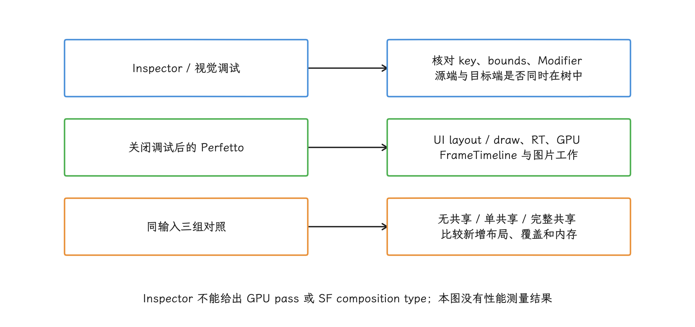

图：共享源码没有为每个 key 固定写 Perfetto slice；业务需要的导航和放置边界应自行埋点。

#### 10.4 建立对照实验

共享过渡评测至少保留三组相同导航：

1. 只有页面进入/退出动画，没有共享 `Modifier`；
2. 只启用一个 `sharedElement()`；
3. 启用完整的 `sharedElement()` / `sharedBounds()` 集合。

三组都要保持相同数据、图片缓存状态、构建类型、动画时长和设备温度。比较 frame deadline miss（未按期完成的帧）、UI Thread layout、RenderThread、GPU duration 和内存峰值，才能判断新增成本来自哪个层级。

### 11. 高级配置的安全边界

#### 11.1 BoundsTransform 只定义 Rect 动画 spec

`BoundsTransform.createAnimationSpec(initialBounds, targetBounds)` 返回 `FiniteAnimationSpec<Rect>`。它能改变 timing（时间控制）、spring 或 keyframes（关键帧），但 API 本身没有沿任意几何 `Path` 移动的参数。

需要曲线路径、旋转或形变时，可以在共享 `bounds` 之外增加受控的 `graphicsLayer` 或绘制类 `Modifier`，也可以使用 caller-managed visibility 驱动视觉属性。过渡结束后，语义节点、点击区域和无障碍焦点都应回到目标布局。

#### 11.2 SharedContentConfig 用于动态启停

1.12.0 的 `rememberSharedContentState(key, config)` 允许通过 `SharedContentConfig` 中的 `SharedContentState.isEnabled`，动态决定某个 `key` 是否参与匹配。导航方向、系统“减少动态效果”偏好或设备降级策略适合放在这里。

启停状态在过渡中变化时要定义清楚：立即取消、保持现有动画，还是等下一次导航生效。默认的 `shouldKeepEnabledForOngoingAnimation` 为 `true`，因此正在进行的动画会完成，禁用结果随后生效。若目标 `entry` 在动画中被移除，还可以通过 `alternativeTargetBoundsInTransitionScopeAfterRemoval` 提供替代终点；默认行为是取消这一组共享过渡。

<!-- gracker-diagram: a238-32-config-boundary -->
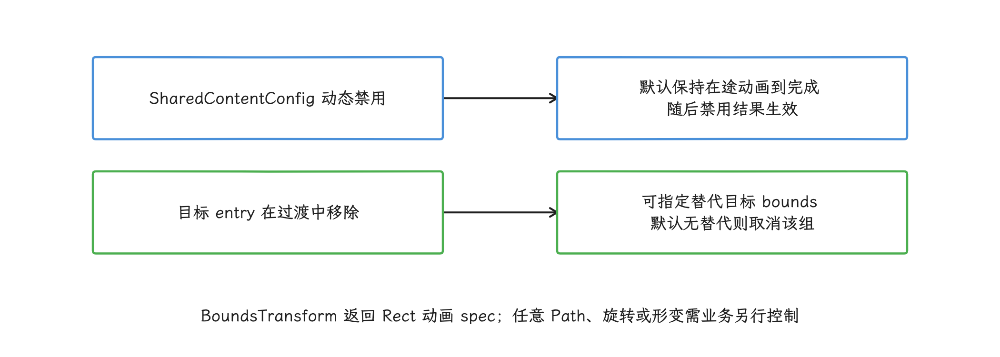

图：动态启停、保持在途动画和目标移除是独立语义，不能用一个 enabled 布尔值概括。

#### 11.3 多步骤过渡

多步骤场景应为每个持续身份使用稳定 `key`，并让每一步只有一个明确的进入端。复用一个 `key` 同时表示多个视觉对象，会让匹配状态机面对多个候选。

如果步骤需要让不同内容连续变形，可以用外层 `sharedBounds()` 保持容器连续性，内部按步骤使用独立的 `sharedElement()`；同时控制 overlay zIndex 与父级裁剪，避免嵌套层互相遮挡。

### 12. View 系统的迁移路径

Compose Shared Transition 只在同一个 `SharedTransitionScope` 内匹配。目前官方明确不支持 View 与 Compose 共享元素互操作，包括 `AndroidView`，以及跨独立 window 的 `Dialog`、`ModalBottomSheet` 等容器。

它也直接替代不了 Activity 之间由 `ActivityOptions.makeSceneTransitionAnimation()` 和 Window Transition 管理的平台共享元素。两者的坐标、生命周期、snapshot（过渡使用的内容快照）、overlay 和 window 边界不同。

迁移可以分三种情况：

| 当前架构 | 建议路径 |
| --- | --- |
| Fragment 目的地中逐页迁移至 Compose | 保留 Fragment Navigation 和 View/Window transition 边界；不要尝试用 `key` 匹配 View 与 Compose 内容 |
| 同一 Compose `NavHost` 内的目的地 | 用 `SharedTransitionLayout` 包住 `NavHost`，传递 `SharedTransitionScope` 与目的地的 `AnimatedContentScope` |
| 已全部迁移到 Compose Navigation | 在 Navigation 2 或 Navigation 3 官方共享元素接口上配置，并同时验证 Predictive Back |

混合期若视觉上需要连续，可以用普通 enter/exit、crossfade（交叉淡入淡出）或业务自定义 snapshot 方案，只是这些方案要自己维护匹配，没有 `SharedTransitionScope` 的自动 `key` 匹配。

### 13. 评审清单

- Compose 版本是否至少使用 1.10 的稳定 Shared Transition API；
- `SharedTransitionLayout` 是否位于源端与目标端的共同祖先；
- 两端是否使用相同且稳定的业务 `key`；
- `sharedElement()` 是否用于相同视觉内容，`sharedBounds()` 是否用于容器变化；
- `Text` 是否优先评估 `scaleToBounds()`；
- 是否误把 Lookahead pass 计作第二次 GPU 渲染；
- 是否误把 `GraphicsLayer` 写成 Bitmap 缓存；
- overlay 裁剪、父级 alpha、scale 与 zIndex 是否符合预期；
- `Modifier` 顺序是否在两端保持一致；
- `AnimatedSize` 或 `RemeasureToBounds` 是否扩大每帧布局范围；
- 大面积 fade、模糊、阴影和额外 `graphicsLayer()` 是否同时存在；
- `LazyList` 源端是否在目标端获得 Lookahead `bounds` 前被移除；
- 图片缓存 `key` 是否与共享内容 `key` 协调；
- Predictive Back 是否由 Navigation 或 `PredictiveBackHandler` 提供连续进度；
- Layout Inspector 与视觉调试是否只用于定位，正式采样是否关闭；
- Perfetto 是否同时查看 UI Thread、RenderThread、FrameTimeline 与 GPU；
- 是否把 Compose overlay 误判为独立 SurfaceFlinger layer。

### 14. SharedTransition 小结

`SharedTransitionLayout` 的性能成本主要来自额外的 Lookahead/approach 布局、活跃 overlay `entry` 按需使用的 `GraphicsLayer`，以及进入与退出内容可能同时绘制。SurfaceFlinger 通常只处理同一个 App Window，瓶颈更可能出现在应用 UI Thread、RenderThread 和 GPU。

`sharedElement()` 与 `sharedBounds()` 的选择取决于内容关系：相同视觉内容用 `sharedElement()`；容器连续但内容变化时用 `sharedBounds()`，再在 `scaleToBounds()` 与 `RemeasureToBounds` 之间选择。元素数量、spring 或 `key()` 脱离具体内容，都单独得不出性能结论。

平台侧没有 SharedTransitionLayout 专属管线。排查时可用可视化与 Layout Inspector 确认 `key`、`bounds` 和 `Modifier`，关闭调试工具后，再用 Perfetto 对比 layout、draw、RenderThread、GPU 与 FrameTimeline。

## 常见误区

### API 版本由 Compose 依赖决定

Shared Transition API 在 Compose Animation 1.7 以实验 API 形式发布，到 1.10 转为稳定 API。截至 2026 年 8 月 15 日，Google Maven 中最新稳定版是 1.12.0；1.13.0-alpha01 属于预览版。1.12.0 继续提供实验性的共享元素可视化调试能力。

这套 API 没有 Android 15 / API 35 的平台门槛。只要应用使用的 Compose 版本及其 Android 最低版本满足要求，就能使用共享元素。Android 15 起取消了 Predictive Back 开发者开关；应用迁移到受支持的返回 API 后可以获得对应系统动画。这与 `SharedTransitionLayout` 的引入版本无关。

### Lookahead pass 不等于第二次 GPU 渲染

`SharedTransitionScope` 内部使用 `LookaheadScope`。这里的 pass 是布局系统对节点树的一次遍历：Lookahead pass 先计算动画结束时的尺寸和坐标，approach pass 再按当前动画 `bounds` 测量或放置节点。两者都属于布局阶段。

一帧仍按 Compose 的布局结果进入绘制。Lookahead 增加的是目标布局计算；是否多次测量、是否记录额外图形层、是否同时绘制进入端与退出端，要看 `Modifier` 和 resize mode（尺寸适配方式）。把 Lookahead 概括成“两次 GPU 绘制”，会混淆 CPU 布局与 GPU 绘制。

### sharedElement 不复用位图

Compose 1.12.0 在需要 overlay 绘制时为共享内容创建 `GraphicsLayer`。`GraphicsLayer` 是记录绘制命令并允许复用这些命令的 Compose 图形层；实现会在 draw 阶段通过 `layer.record { drawContent() }` 记录内容，再以 `drawLayer()` 绘制。它不会把源 Composable 截成 Bitmap 后交给目标端复用。

图片内容是否复用同一个解码结果，由 Coil、Glide 等图片加载库或业务缓存决定。共享元素 `key` 只负责过渡匹配，替代不了图片内存缓存的 `key`。

### overlay 不会创建独立 SurfaceFlinger layer

SharedTransition overlay 是 `SharedTransitionScope` 根节点 draw pass 内的绘制区域。共享内容仍进入同一个 App Window buffer（应用窗口提交的像素缓冲区），SurfaceFlinger 通常只看到宿主窗口的 layer。

共享元素可能增加应用侧的图形层记录、裁剪、缩放、透明混合和过绘制，进而推迟窗口 buffer 完成时间；进入 Compose overlay 不会直接增加 HWC 要合成的窗口 layer 数量。

按生产者与结果位置来判断，App 内部的 GPU 图形层或离屏中间结果仍由宿主窗口消费。只有通过 `SurfaceControl` 独立提交的 buffer，才会自然对应独立的 SurfaceFlinger layer。BufferQueue 的 slot（可循环使用的缓冲槽位）、GraphicBuffer 复用与生产者/消费者模型见 [2.8 BufferQueue、Gralloc 与 Sync Fence](../../part1-fundamentals/ch02-rendering/08-bufferqueue-gralloc-sync-fence.md)。

<!-- gracker-diagram: a238-33-window-boundary -->
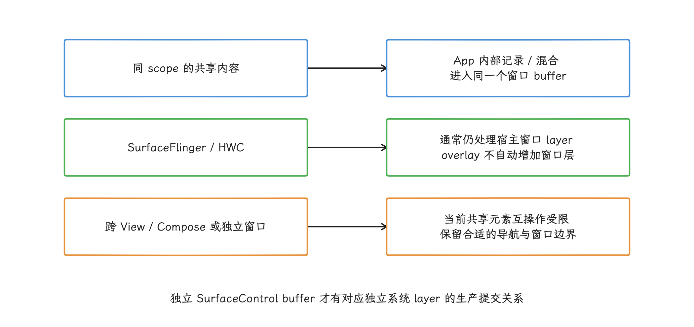

图：额外图形层与混合可能推迟宿主 buffer 完成，不能把 Compose overlay 当独立 SurfaceFlinger layer。

### 没有“最多五个元素”的平台阈值

源码没有 `≤5` 的限制或推荐值。一个简单图标和一个包含大图、模糊、阴影的卡片，成本差距远大于元素数量本身。活跃数量应结合内容复杂度、屏幕覆盖面积、resize mode、设备 GPU 和目标刷新率评估。

## 全文小结

动画优化先确认每一帧改变了什么：View 属性更新是否触发布局，Compose 状态读取是否扩大重组范围，共享元素是否增加测量、图形层记录和混合成本。共享元素匹配成功、动画回调按时执行，也只是前半程；画面是否按时呈现，验收时要关联 UI 线程、RenderThread/GPU、窗口缓冲区与实际显示，并覆盖进入、退出和取消三种路径。

## 参考资料

- [AOSP Android 17 `ViewPropertyAnimator.java`](https://android.googlesource.com/platform/frameworks/base/+/android-17.0.0_r1/core/java/android/view/ViewPropertyAnimator.java)
- [AOSP Android 17 `PropertyValuesHolder.java`](https://android.googlesource.com/platform/frameworks/base/+/android-17.0.0_r1/core/java/android/animation/PropertyValuesHolder.java)
- [AOSP Android 17 `RenderEffect.java`](https://android.googlesource.com/platform/frameworks/base/+/android-17.0.0_r1/graphics/java/android/graphics/RenderEffect.java)
- [AOSP Android 17 `View.java`](https://android.googlesource.com/platform/frameworks/base/+/android-17.0.0_r1/core/java/android/view/View.java)
- [AOSP Android 17 `TransitionManager.java`](https://android.googlesource.com/platform/frameworks/base/+/android-17.0.0_r1/core/java/android/transition/TransitionManager.java)
- [AOSP Android 17 `Choreographer.java`](https://android.googlesource.com/platform/frameworks/base/+/android-17.0.0_r1/core/java/android/view/Choreographer.java)
- [AOSP Android 17 `AnimatedVectorDrawable.java`](https://android.googlesource.com/platform/frameworks/base/+/android-17.0.0_r1/graphics/java/android/graphics/drawable/AnimatedVectorDrawable.java)
- [AOSP Android 17 `ThreadedRenderer.java`](https://android.googlesource.com/platform/frameworks/base/+/android-17.0.0_r1/core/java/android/view/ThreadedRenderer.java)
- [AOSP Android 17 `CanvasContext.cpp`](https://android.googlesource.com/platform/frameworks/base/+/android-17.0.0_r1/libs/hwui/renderthread/CanvasContext.cpp)
- [AOSP Android 17 `BLASTBufferQueue.cpp`](https://android.googlesource.com/platform/frameworks/native/+/android-17.0.0_r1/libs/gui/BLASTBufferQueue.cpp)
- [Lottie 6.7.1 `RenderMode.java`](https://github.com/airbnb/lottie-android/blob/v6.7.1/lottie/src/main/java/com/airbnb/lottie/RenderMode.java)
- [Lottie 6.7.1 `LottieAnimationView.java`](https://github.com/airbnb/lottie-android/blob/v6.7.1/lottie/src/main/java/com/airbnb/lottie/LottieAnimationView.java)
- [Lottie 6.7.1 `AsyncUpdates.java`](https://github.com/airbnb/lottie-android/blob/v6.7.1/lottie/src/main/java/com/airbnb/lottie/AsyncUpdates.java)
- [Lottie Android releases](https://github.com/airbnb/lottie-android/releases)
- [Android 属性动画文档](https://developer.android.com/develop/ui/views/animations/prop-animation)
- [Android Transition 文档](https://developer.android.com/develop/ui/views/animations/transitions)
- [Android MotionLayout 文档](https://developer.android.com/develop/ui/views/animations/motionlayout)
- [ConstraintLayout 2.2.2 POM](https://dl.google.com/dl/android/maven2/androidx/constraintlayout/constraintlayout/2.2.2/constraintlayout-2.2.2.pom)
- [Perfetto FrameTimeline](https://perfetto.dev/docs/data-sources/frametimeline)
- [Android 17 kernel common `android17-6.18-2026-06_r6`](https://android.googlesource.com/kernel/common/+/refs/tags/android17-6.18-2026-06_r6/)

- [Compose Shared element transitions](https://developer.android.com/develop/ui/compose/animation/shared-elements)：scope、`Modifier` 顺序、overlay、限制与 Lazy 示例。
- [Customize shared element transitions](https://developer.android.com/develop/ui/compose/animation/shared-elements/customize)：resize mode、裁剪、zIndex 与动态启停。
- [Navigation with shared elements](https://developer.android.com/develop/ui/compose/animation/shared-elements/navigation)：Navigation 2/3 与 Predictive Back 集成。
- [Compose Animation release notes](https://developer.android.com/jetpack/androidx/releases/compose-animation)：1.7 实验发布、1.10 稳定与后续版本变化。
- [Google Maven：Compose Animation 版本元数据](https://dl.google.com/dl/android/maven2/androidx/compose/animation/animation/maven-metadata.xml)：核对 1.12.0 稳定版与 1.13.0-alpha01 预览版。
- [`SharedTransitionScope.kt`（Compose 1.12.0 源码快照）](https://android.googlesource.com/platform/frameworks/support/+/963bf914f78b389bdddef0da7f36bee19d897274/compose/animation/animation/src/commonMain（Kotlin Multiplatform 的公共源码集）/kotlin/androidx/compose/animation/SharedTransitionScope.kt)：scope、overlay、`key` 匹配和公开 API。
- [`SharedContentNode.kt`（Compose 1.12.0 源码快照）](https://android.googlesource.com/platform/frameworks/support/+/963bf914f78b389bdddef0da7f36bee19d897274/compose/animation/animation/src/commonMain/kotlin/androidx/compose/animation/SharedContentNode.kt)：Lookahead/approach measure、`GraphicsLayer` 记录与释放。
- [`SharedElementEntry.kt`（Compose 1.12.0 源码快照）](https://android.googlesource.com/platform/frameworks/support/+/963bf914f78b389bdddef0da7f36bee19d897274/compose/animation/animation/src/commonMain/kotlin/androidx/compose/animation/SharedElementEntry.kt)：原位/overlay 选择和图形层状态。
- [`SharedTransitionScope.kt`（Compose 1.11.4 源码快照）](https://android.googlesource.com/platform/frameworks/support/+/854220f44ea8ea80fee824a6c5a045f39bede289/compose/animation/animation/src/commonMain/kotlin/androidx/compose/animation/SharedTransitionScope.kt)：保留旧版锚点，便于比较 API 与实现变化。
- [`SharedContentNode.kt`](https://android.googlesource.com/platform/frameworks/support/+/854220f44ea8ea80fee824a6c5a045f39bede289/compose/animation/animation/src/commonMain/kotlin/androidx/compose/animation/SharedContentNode.kt)：保留旧版节点实现锚点。
- [`SharedElementEntry.kt`](https://android.googlesource.com/platform/frameworks/support/+/854220f44ea8ea80fee824a6c5a045f39bede289/compose/animation/animation/src/commonMain/kotlin/androidx/compose/animation/SharedElementEntry.kt)：保留旧版 entry 实现锚点。
- [Predictive Back for Compose](https://developer.android.com/develop/ui/compose/system/predictive-back)：系统行为、Navigation 与自定义 progress。
- [Add support for the predictive back gesture](https://developer.android.com/guide/navigation/custom-back/predictive-back-gesture)：返回 API 迁移、Android 15 开发者开关变化与清单配置。
- [Android 16 behavior changes](https://developer.android.com/about/versions/16/behavior-changes-16)：target API 36 及以上时预测性返回系统动画的默认行为。
- [`Choreographer.java`（`android-17.0.0_r1`）](https://android.googlesource.com/platform/frameworks/base/+/refs/tags/android-17.0.0_r1/core/java/android/view/Choreographer.java)：Android 17 应用帧起点与 FrameTimeline。
- [`ViewRootImpl.java`（`android-17.0.0_r1`）](https://android.googlesource.com/platform/frameworks/base/+/refs/tags/android-17.0.0_r1/core/java/android/view/ViewRootImpl.java)：Compose 宿主窗口进入 HWUI 的平台入口。
- [Android common kernel（`android17-6.18-2026-06_r6`）](https://android.googlesource.com/kernel/common/+/refs/tags/android17-6.18-2026-06_r6/)：内核基线；SharedTransitionLayout 不直接依赖内核 API。
