# 帧率监控与线上卡顿治理

线上出现“滑一下偶尔卡住”时，平均 FPS 很难说明责任在哪。可执行的治理要依次回答四个问题：监控覆盖了渲染路径的哪一段，异常集中在哪类设备和交互状态，代码现场反复出现什么，修复后怎样按同一口径验证。我们按这个顺序展开：先划清每种帧指标的覆盖范围，再过一遍 JankStats、FrameMetrics、系统合成器关联、堆栈采样，最后落到告警和复盘协议；卡顿定义与线下证据流程分别见 7.1 和 7.2。

> 源码基线：AOSP `android-17.0.0_r1`；涉及线程调度与 fence（CPU、GPU 和显示设备之间传递完成状态的同步对象） 语义时，另以 Linux 内核 `android17-6.18-2026-06_r6` 为准。

## 每种帧指标覆盖到哪一段

一个标准 App Window（应用窗口） 的一帧，要经过 VSync（垂直同步信号） → Choreographer（UI 帧调度器） → UI 线程 → RenderThread（HWUI 渲染线程） → BLAST / BufferQueue（窗口缓冲区队列） → SurfaceFlinger（系统合成器），最后由 HWC（硬件合成器） 或 RenderEngine（GPU 合成） 合成、display present（屏幕显示） 上屏。这条流水线上每种监控接口都只覆盖一段：

<!-- gracker-diagram: a241-01-frame-ownership -->
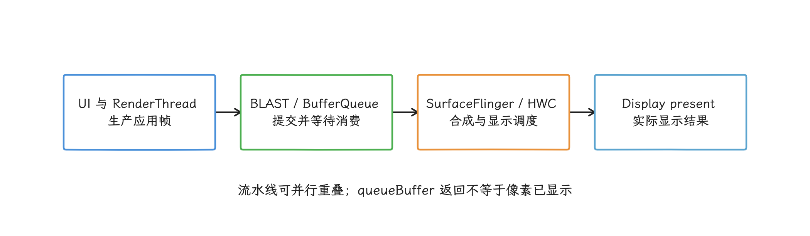

图：FrameMetrics覆盖应用帧生产区间；入队、合成和最终显示要分别取证。

| 观测入口 | 主要覆盖范围 | 能回答什么 | 不能单独证明什么 |
|---|---|---|---|
| `Choreographer.FrameCallback` | 绑定 Looper 上的帧回调与调整后帧时间 | 帧时间序列是否出现成簇空档 | Window 是否产出缓冲区、该缓冲区是否显示 |
| JankStats | 某个 `Window` 的帧时长、jank（卡顿帧）判定和 UI 状态 | 哪个页面、交互状态、版本和设备层级变差 | 独立 Surface 内容是否流畅、系统最终为何没有按期显示 |
| FrameMetrics | Window 一帧的 UI、RenderThread、GPU 与 deadline（应用完成帧的截止时间）等指标 | 应用侧主要耗时阶段、是否超过应用帧预算 | SurfaceFlinger 最终是否按期显示 |
| `SurfaceControl.JankData` | API 36+ 的系统合成器卡顿分类 | 同一 VSync 是应用、合成器还是其他系统组件错过调度 | 具体哪个 Java 方法导致问题 |
| 堆栈与 Perfetto | 代码现场与跨进程时间线 | 阻塞方法、线程调度、fence、latch（接收缓冲区）、composition（合成）和 present（显示） | 单次样本能否代表普遍情况 |

每路指标能回答的问题，由它覆盖的那一段决定。`queueBuffer()` 只说明 producer（缓冲区生产者） 提交了 buffer（缓冲区），接下来 SurfaceFlinger 是否接收、latch、present 都还不一定。FrameMetrics 的 `TOTAL_DURATION` 终点是“应用完成渲染并把帧交给显示子系统”，屏幕面板扫描像素的时间在它之外。

页面里一旦出现 `SurfaceView`、Camera、视频、WebView、Flutter 或游戏引擎，我们还要画清 Surface 拓扑：谁向哪个 Surface 图层提供缓冲区，各图层怎样挂到宿主窗口。

这时宿主 App Window 的指标可能很平稳，独立 producer 的内容却在重复显示旧缓冲区。遇到这类页面，我们要到目标 layer（图层） 上补证据：生产者入队、fence、FrameTimeline（帧时间线） 与显示结果；宿主 Window 的 JankStats 管的是宿主自己这一段。

<!-- gracker-diagram: a241-02-surface-topology -->
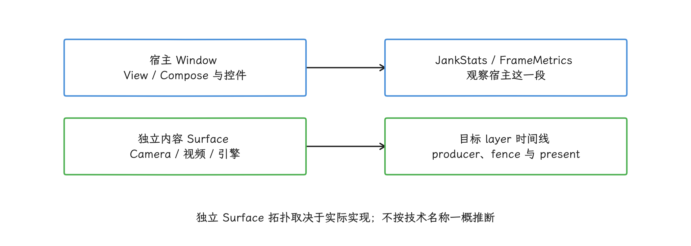

图：先辨认谁向哪一个Surface提供缓冲区，避免用宿主窗口统计替代独立内容流。

## Choreographer.FrameCallback：观察调整后的帧时间

我们先从 `Choreographer` 说起。它接收显示侧的 VSync 时序信号，在绑定的 `Looper`（线程消息循环） 上安排 input（输入）、animation（动画）、traversal（View 测量、布局与绘制）等回调；`postFrameCallback()` 是拿到帧时间的直接入口，注册的是一次性回调，持续采样要在回调里再次注册。

`doFrame(frameTimeNanos)` 的参数使用 `System.nanoTime()` 时间基准，表示经过平台调整的帧开始时间。主线程迟到或执行 buffer-stuffing recovery（缓冲区积压恢复）时，这个值可能重新同步或向前偏移一个刷新周期，所以拿它当方法开始执行的实际时间或帧完成时间都会出错，我们平时只把它当调整后的帧节奏看待；需要动画时间和候选帧时间线时，用 API 33+ 的 `VsyncCallback`。

持续自注册会让 Looper 在每个采样周期多做一段工作，所以线上只把它开在可见、正在交互且命中采样的短窗口里。回调里只写预分配的内存缓冲区，对象图构造、分位数计算、磁盘写入和网络上报都留到回调之外。

下面的探针只记录相邻 `frameTimeNanos` 的差值，“掉了几帧”这类按固定刷新率的换算不在它的职责里；字段名 `callbackIntervalNanos` 对应的就是调整后帧时间之间的间隔，两次方法实际进入的时间差是另一个量。`CadenceRingBuffer` 由业务实现为有容量上限、写满即覆盖或拒绝写入的环形内存缓冲区。

```kotlin
@MainThread
class CallbackCadenceProbe(
    private val ringBuffer: CadenceRingBuffer
) : Choreographer.FrameCallback {
    private val choreographer = Choreographer.getInstance()
    private var lastFrameTimeNanos = 0L
    private var running = false

    fun start() {
        if (running) return
        running = true
        lastFrameTimeNanos = 0L
        choreographer.postFrameCallback(this)
    }

    fun stop() {
        if (!running) return
        running = false
        choreographer.removeFrameCallback(this)
        lastFrameTimeNanos = 0L
    }

    override fun doFrame(frameTimeNanos: Long) {
        if (!running) return

        val previous = lastFrameTimeNanos
        lastFrameTimeNanos = frameTimeNanos
        if (previous != 0L) {
            ringBuffer.offer(
                frameTimeNanos = frameTimeNanos,
                callbackIntervalNanos = frameTimeNanos - previous
            )
        }

        if (running) choreographer.postFrameCallback(this)
    }
}
```

这份数据能回答的，是调整后的帧时间序列出现了空档。自注册回调本身也会申请后续 VSync，观察到的已经是探针参与后的调度节奏。页面没有内容更新时，一串稳定回调后面未必是一串新帧；间隔变大时，CPU 执行、Runnable（等待调度的可运行任务）、锁、Binder 跨进程调用、I/O 等待都在候选之列，要分辨是哪一个，还得配合其他数据。

刷新率本身会变：display mode（显示模式） 切换、应用 frame-rate vote（帧率请求）、内容类型、节能策略都会动它。把构造时读到的 `Display.getRefreshRate()` 当作整个页面停留期的预算，在自适应刷新设备上会错判。所以 API 31+ 我们优先用 FrameMetrics 的 `DEADLINE` 或 JankStats 对当前帧的判定；低版本保留原始分布，和同设备、同场景的基线比。

### API 33+ 用 VsyncCallback 保存帧时间线标识

前面说过，需要动画时间和候选帧时间线时用 `VsyncCallback`。API 33 增加 `Choreographer.VsyncCallback`，一次给出多条候选 `FrameTimeline` 和平台选中的 preferred timeline（首选帧时间线），每条时间线包含 deadline、expected presentation time（预期显示时间） 和 VSync ID（帧标识）。`FrameData` 与其中的 `FrameTimeline` 只在回调期间有效，我们要用哪些基础数值，就当场复制。

下面的代码保存当前 preferred timeline 的四个标量，供诊断窗口与其他帧记录对时。

```kotlin
@RequiresApi(33)
@MainThread
class VsyncTimelineProbe(
    private val ringBuffer: TimelineRingBuffer
) : Choreographer.VsyncCallback {
    private val choreographer = Choreographer.getInstance()
    private var running = false

    fun start() {
        if (running) return
        running = true
        choreographer.postVsyncCallback(this)
    }

    fun stop() {
        if (!running) return
        running = false
        choreographer.removeVsyncCallback(this)
    }

    override fun onVsync(data: Choreographer.FrameData) {
        if (!running) return

        val timeline = data.preferredFrameTimeline
        ringBuffer.offer(
            frameTimeNanos = data.frameTimeNanos,
            deadlineNanos = timeline.deadlineNanos,
            expectedPresentationTimeNanos = timeline.expectedPresentationTimeNanos,
            vsyncId = timeline.vsyncId
        )

        if (running) choreographer.postVsyncCallback(this)
    }
}
```

这里的 `FrameTimeline.deadlineNanos` 是应用需要完成该帧的绝对时间戳，而回调刚开始时还没有完成时间，所以上述探针在 `onVsync()` 内判不了本帧是否超期；`FrameMetrics.DEADLINE` 表示的是可用时长，两者是不同的量。VSync ID 用来关联同一帧的 FrameMetrics、SurfaceFlinger 数据或自建 `SurfaceControl.Transaction`，该帧最终显示与否要看别的证据。

<!-- gracker-diagram: a241-03-callback-probe -->
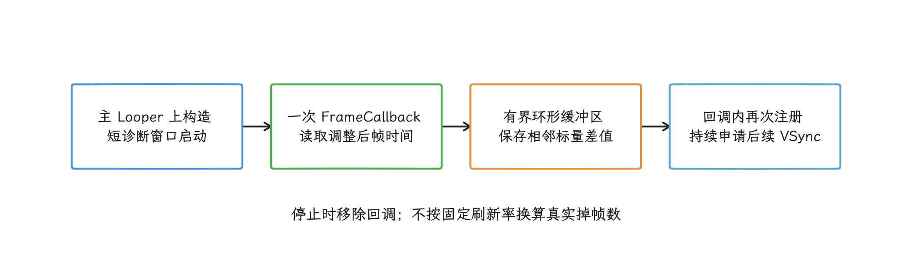

图：探针自注册会参与VSync节奏；时间间隔不等同于新缓冲区数量或实际执行耗时。

<!-- gracker-diagram: a241-04-timeline-scalars -->
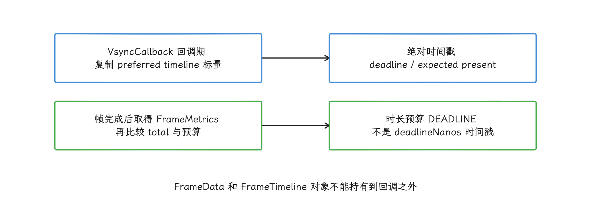

图：回调刚开始时尚无帧完成时间；VSync ID可对齐后续记录，不能当作显示完成证明。

## JankStats：线上默认入口

线上第一层信号源默认用 JankStats：它按 `Window` 跟踪帧，把帧数据和 `PerformanceMetricsState` 里的 UI 状态一起交给监听器；上传、抓栈、生成 Perfetto trace 都要我们自己接。截至 2026-08-14，AndroidX Metrics 的稳定版是 1.0.0。服务端要记录 artifact、API level 与 timing capability，不同实现分支的同名字段先对齐语义，再谈合并基线。

### 发布物下限、实现分桶与字段语义

版本下限以实际发布物为准。`metrics-performance:1.0.0` 的 sources JAR 里仍能看到 `JankStatsApi16Impl`，但稳定 AAR 的 manifest 声明 `minSdkVersion=23`，正常 Gradle 依赖因此从 Android 6 / API 23 开始；类名里的 Api16 只是历史残留，稳定版支持的起点就是 API 23。

2026-08-14 复核发布物校验和：AAR SHA-256 为 `efe2e0d92c7cb2f40c77d337052623fdb631d684ba145881e5a52a664d5614a0`，sources JAR 为 `55c5478b4fde6e1cded38d647e9d995a6d9d08e3b8abd28268b5d5a5c3e700a2`。

稳定 AAR 在当前系统范围内采用四条路径：

| Android 版本 | AndroidX 实现 | 关键行为 |
| --- | --- | --- |
| API 23 | `JankStatsApi16Impl` fallback | 用 pre-draw 和反射的 Choreographer 时间估算，精度低于 FrameMetrics |
| API 24—25 | `JankStatsApi24Impl` | 使用 Window FrameMetrics；帧起点仍来自低版本估算，CPU 字段直接取 `TOTAL_DURATION` |
| API 26—30 | `JankStatsApi26Impl` | 帧起点改用 `INTENDED_VSYNC_TIMESTAMP`，仍没有平台 `DEADLINE` |
| API 31—37 | `JankStatsApi31Impl` | 用 `DEADLINE` 作为 expected duration，并增加 total、CPU 与 overrun 字段 |

Android 17 / API 37 仍走 Api31Impl：JankStats 1.0.0 到这里都没有 API 36/37 专用实现，`FRAME_TIMELINE_VSYNC_ID` 和 `SurfaceControl.JankData` 也都没暴露到 `FrameDataApi31` 里；要区分应用、合成器和其他系统组件的责任，得走后文 API 36+ 的直接关联。

<!-- gracker-diagram: a241-05-jankstats-api-buckets -->
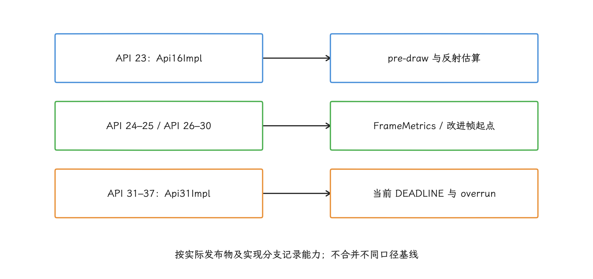

图：发布物minSdk23；历史Api16类名不是稳定AAR的最低系统要求，API36/37没有新增专用分支。

常用字段的含义要分开：

| 类型 | 字段 | 含义 |
|---|---|---|
| `FrameData` | `frameDurationUiNanos` | UI 线程部分，不能代表 RenderThread 或 GPU 总时长 |
| `FrameDataApi24` | `frameDurationCpuNanos` | API 24—30 直接取 `TOTAL_DURATION`；API 31+ 才用 `TOTAL_DURATION - GPU_DURATION + SWAP_BUFFERS_DURATION` 计算非 GPU 部分 |
| `FrameDataApi31` | `frameDurationTotalNanos` | CPU 与 GPU 合计的帧时长 |
| `FrameDataApi31` | `frameOverrunNanos` | 相对 deadline 的超期量；正值表示超期，负值表示提前完成 |
| 所有可用层级 | `isJank` | JankStats 按平台能力与启发式规则得出的卡顿判定 |

`createAndTrack(window)` 是 UI 线程 API，要求 Window 已激活且 DecorView 非空，所以要在 `setContentView()` 之后创建。实例创建后默认就开始跟踪，我们按页面生命周期开关它：不可见时关闭，恢复可见时再启用。Window 要先开硬件加速，AndroidX Metrics 1.0.0 才能记到底层 FrameMetrics 帧时间。

<!-- gracker-diagram: a241-06-duration-not-cpu -->
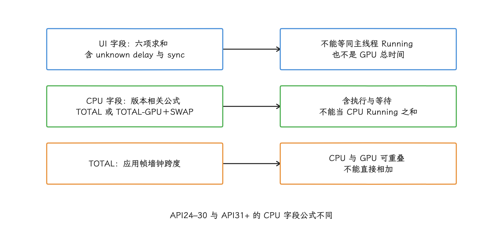

图：字段命名与底层计量边界分开理解，进一步归因必须核对线程调度与GPU证据。

这段接入骨架保留原始 `FrameData` 子类型。监听器收到的对象会被后续帧复用，所以要立即 `copy()`；`frameQueue.offer()` 用有界、非阻塞且线程安全的写入。

```kotlin
class FeedActivity : AppCompatActivity() {
    private lateinit var jankStats: JankStats
    private lateinit var stateHolder: PerformanceMetricsState.Holder

    override fun onCreate(savedInstanceState: Bundle?) {
        super.onCreate(savedInstanceState)
        setContentView(R.layout.activity_feed)

        val content = findViewById<View>(android.R.id.content)
        stateHolder = PerformanceMetricsState.getHolderForHierarchy(content)
        jankStats = JankStats.createAndTrack(window) { volatileFrameData ->
            val snapshot = volatileFrameData.copy()
            frameQueue.offer(
                page = "feed",
                apiLevel = Build.VERSION.SDK_INT,
                frameData = snapshot
            )
        }
    }

    override fun onResume() {
        super.onResume()
        jankStats.isTrackingEnabled = true
    }

    override fun onPause() {
        jankStats.isTrackingEnabled = false
        frameQueue.flushAsync(reason = "activity_paused")
        super.onPause()
    }

    fun onFeedScrollStateChanged(scrollState: Int) {
        val state = stateHolder.state ?: return
        when (scrollState) {
            RecyclerView.SCROLL_STATE_DRAGGING ->
                state.putState("feed_list", "dragging")
            RecyclerView.SCROLL_STATE_SETTLING ->
                state.putState("feed_list", "settling")
            else ->
                state.removeState("feed_list")
        }
    }
}
```

JankStats 的监听线程随 API 层级变化：稳定 AAR 的 API 23 fallback 在 Main/UI 线程，API 24+ 用的是内部 FrameMetrics 线程。所以队列和聚合器要按“回调在任意线程”实现，回调里也别去碰只允许 UI 线程读取的业务对象；页面、组件和交互状态提前写进 `PerformanceMetricsState`，回调只负责复制快照。

<!-- gracker-diagram: a241-07-volatile-frame-copy -->
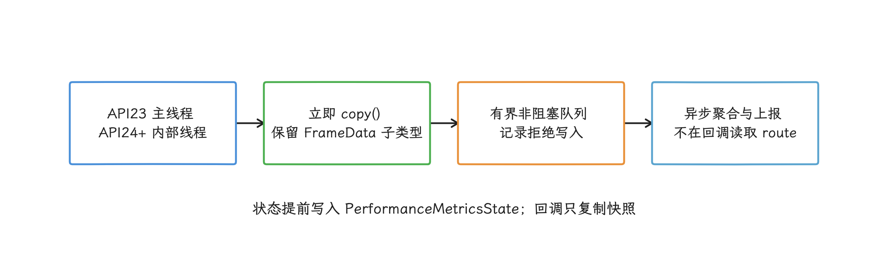

图：回调对象被后续帧复用；线程安全、复制开销与队列拒绝都属于监控质量的一部分。

状态标签用低基数枚举，取值来自数量有限的小集合，例如 `page=feed`、`feed_list=settling`；列表位置、搜索词、URL、订单号和用户输入这类取值发散、还带隐私风险的内容，都留在帧标签之外。每个临时状态都要有对应的 `removeState()`，否则后续帧会一直携带已经失效的业务状态。

### `PerformanceMetricsState` 的时间线与 owner

读状态标签时，我们先记住一点：它自带起止时间，把它当回调到达瞬间的“当前页面变量”来读会出错。`putState()` / `removeState()` 用 `System.nanoTime()` 记录每个 `StateInfo` 的起止时间，JankStats 拿一帧的 `[frameStart, frameEnd]` 与这些区间求交集，`screen=Home`、`interaction=scroll` 表示的就是该状态与这帧时间范围重叠；异步回调到达后再读当前 route，会把转场后的页面误贴到旧帧上。

同一 View hierarchy 只有一个 `PerformanceMetricsState`，同名 key 会覆盖，所以团队要先划清 owner：页面容器负责 `screen`，交互控制器负责 `interaction`，复用组件用 `feed.list_state` 这类带命名空间的 key，并在离开层级时清理；只标记下一帧的短事件交给 `putSingleFrameState()`。

Compose 没有独立采集器，通过 `LocalView.current` 就能找到同一个 hierarchy；Navigation 转场期间的 `screen` 交给 NavHost 或 Activity 统一维护，免得新旧页面同时写同一 key。

<!-- gracker-diagram: a241-08-state-time-intersection -->
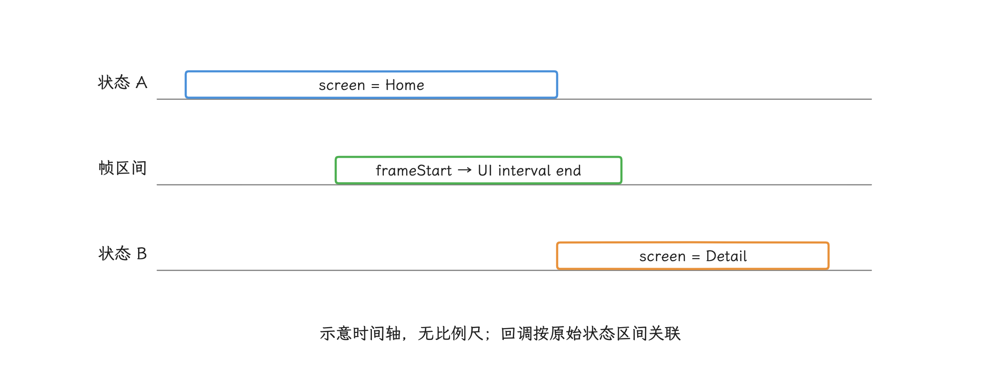

图：状态在时间轴上与帧区间求交；同key多次变化时保留最近加入的一项，延迟回调不能读取当前路由补标签。

### `isJank`、deadline miss 与 frozen frame 的判定差异

JankStats 的默认 `jankHeuristicMultiplier` 是 `2.0f`。API 23—30 根据 `Display.refreshRate` 估算 expected duration，1.0.0 还会把首次结果缓存在进程内，显示模式切换后也不重算；API 31—37 改读当前 `FrameMetrics.DEADLINE`。两条路径最后都用 `frameDurationUiNanos > expectedDuration × multiplier` 生成 `isJank`。

它和 `frameOverrunNanos = frameDurationTotalNanos - DEADLINE` 是两个判断：前者比较 UI 时长与默认两倍预算，后者比较 total 时长与一次预算，同一帧完全可能 `overrun > 0` 而 `isJank == false`。服务端至少分开保存：

- JankStats jank rate：`isJank=true` 帧数 / 同一窗口全部回调帧数；
- deadline miss rate：API 31+ 中 `frameOverrunNanos > 0` 帧数 / 具有 overrun 字段的帧数；
- frozen frame rate：超过约定 duration 阈值的帧数 / 具有该 duration 字段的帧数，并注明用 UI 还是 total duration；
- UI、CPU、total、overrun 各自的 P50、P90、P95、P99，不能只留平均 FPS。

Firebase Performance 的 slow rendering frame 用固定 16 ms，frozen frame 用 700 ms，并明确假定 slow 指标面向 60 Hz，可以当作外部兼容标准引入，但要与 JankStats 默认 `isJank` 分开存，别合成同一个 `slow_rate`。任何 multiplier、阈值或 duration 选择都带上策略/schema 版本；分母要靠同一窗口的全部回调帧，只上报异常帧会丢掉它，比例随之失真。

<!-- gracker-diagram: a241-09-three-rate-definitions -->
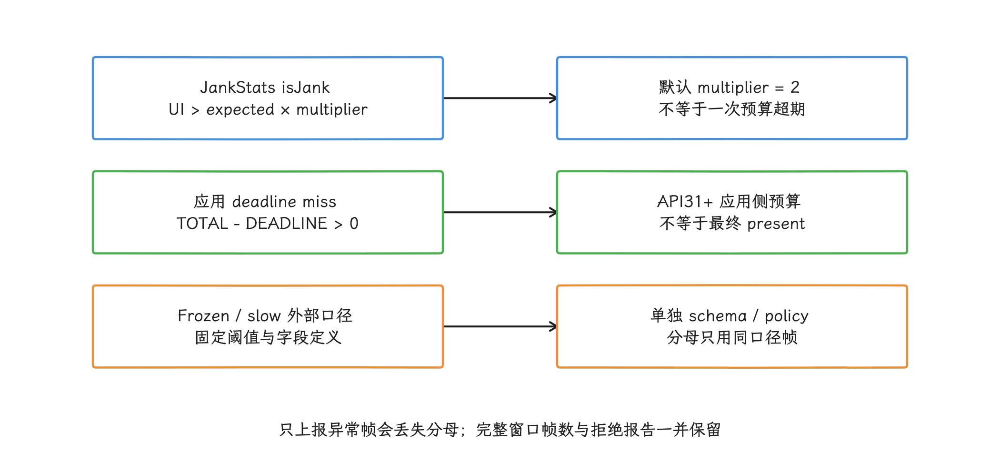

图：UI两倍预算、total一次预算和外部固定阈值是不同指标；不能混成一个slow_rate。

## FrameMetrics：拆分 Window 帧的应用侧阶段

JankStats 已能覆盖多数线上趋势；等某个页面出现可重复的性能退化，我们再按远程配置对少量会话打开 FrameMetrics，补上各阶段耗时和 VSync ID。字段按平台版本分层：

- API 24+ 的阶段字段：`UNKNOWN_DELAY_DURATION`（UI 线程响应前的未知等待）、`INPUT_HANDLING_DURATION`（输入）、`ANIMATION_DURATION`（动画）、`LAYOUT_MEASURE_DURATION`（测量与布局）、`DRAW_DURATION`（绘制）、`SYNC_DURATION`（与 RenderThread 同步）、`COMMAND_ISSUE_DURATION`（向 GPU 发命令）、`SWAP_BUFFERS_DURATION`（提交缓冲区）、`TOTAL_DURATION`（总时长）、`FIRST_DRAW_FRAME`（首帧标记）。
- API 26+：`INTENDED_VSYNC_TIMESTAMP` 与 `VSYNC_TIMESTAMP`。两者不同表示 UI 线程未及时响应原定 VSync。
- API 31+：`GPU_DURATION` 与 `DEADLINE`。`DEADLINE` 是系统给应用产出该帧的总时间预算，单位是时长。
- API 36+：`FRAME_TIMELINE_VSYNC_ID`，用于关联系统合成器的帧时间线。

API 31+ 可计算 `TOTAL_DURATION - DEADLINE`：结果大于零就是应用没命中该帧预算，小于零说明还有余量。`TOTAL_DURATION` 与各阶段可能并行，把它当其他时长字段之和会算错。API 29 / 30 没有 `DEADLINE`，`getMetric()` 对不支持的指标 ID 返回 `-1`；低版本别用固定刷新率伪造“精确 deadline”，改用 JankStats 判定、同场景分布与 Perfetto 复核。

<!-- gracker-diagram: a241-10-metrics-capability -->
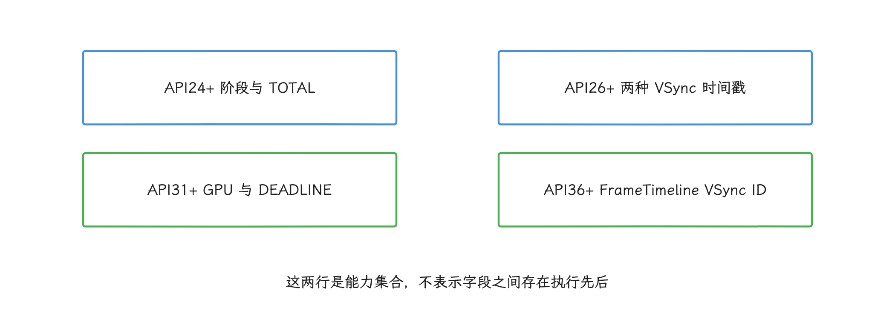

图：不可用字段返回−1，不能补零，也不能在低版本伪造精确DEADLINE。

### 指标的时间范围与并行间隙

UI 线程和 RenderThread 共同填写 `FrameInfo` 时间戳数组，`FrameMetrics` 再按固定起止索引算出公开指标。Window listener 创建 observer 时用 `wait（获取可用缓冲区的等待）ForPresentTime=false`，所以回调到达，说明的是 HWUI 统计已可用；SurfaceFlinger 是否已 latch 这个 buffer、屏幕是否已经 present，我们还要靠后续数据确认。

| 指标 | API | 时间边界或含义 | 常见排查入口 |
| --- | ---: | --- | --- |
| `UNKNOWN_DELAY_DURATION` | 24+ | `INTENDED_VSYNC → HANDLE_INPUT_START` | 前序消息、调度、Binder 或锁让 UI 线程晚启动 |
| `INPUT_HANDLING_DURATION` | 24+ | `HANDLE_INPUT_START → ANIMATION_START` | 输入处理 |
| `ANIMATION_DURATION` | 24+ | `ANIMATION_START → PERFORM_TRAVERSALS_START` | animation callback 与状态更新 |
| `LAYOUT_MEASURE_DURATION` | 24+ | `PERFORM_TRAVERSALS_START → DRAW_START` | measure/layout 与 `requestLayout()` 扩散 |
| `DRAW_DURATION` | 24+ | `DRAW_START → SYNC_QUEUED` | display list 记录与自定义绘制 |
| `SYNC_DURATION` | 24+ | `SYNC_START → ISSUE_DRAW_COMMANDS_START` | RenderNode 同步与 RenderThread 压力 |
| `COMMAND_ISSUE_DURATION` | 24+ | `ISSUE_DRAW_COMMANDS_START → SWAP_BUFFERS` | RenderThread CPU 与驱动命令提交 |
| `SWAP_BUFFERS_DURATION` | 24+ | API 31+ 为 `SWAP_BUFFERS → SWAP_BUFFERS_COMPLETED` | BufferQueue 背压、swap 或消费等待 |
| `TOTAL_DURATION` | 24+ | `INTENDED_VSYNC → FRAME_COMPLETED` | HWUI 生产并提交帧的总区间，不是 present duration |
| `FIRST_DRAW_FRAME` | 24+ | Window visibility-change flag | 启动/导航首帧，和稳态滚动分开 |
| `GPU_DURATION` | 31+ | API 33+ 为 submission complete 到 GPU complete | GPU 工作量或资源争用线索 |
| `DEADLINE` | 31+ | `INTENDED_VSYNC → FRAME_DEADLINE` | 应用产出本帧的预算 |
| `FRAME_TIMELINE_VSYNC_ID` | 36+ | FrameTimeline VSync ID | 与 compositor jank data 关联 |

字段不可用时 `getMetric()` 返回 `-1`，补零会污染数据。阶段可能并行，公开字段之间还有未单列的间隙，所以 `TOTAL_DURATION - sum(stages)` 这个差值没有“其他耗时”的含义。

<!-- gracker-diagram: a241-11-parallel-stage-tracks -->
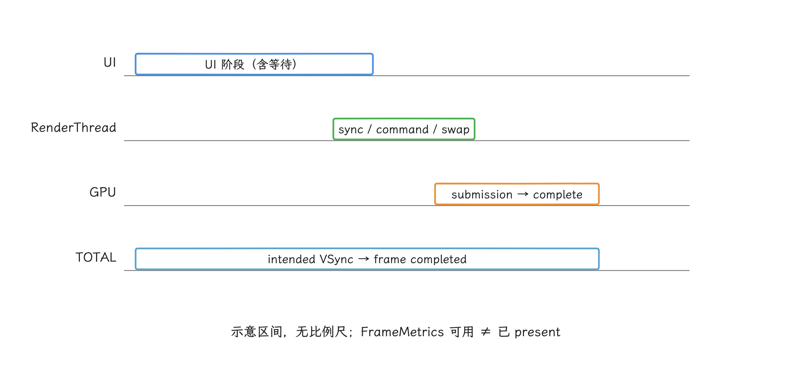

图：FrameMetrics按里程碑取差；UI、RenderThread、GPU可并行且存在未单列间隙，TOTAL减阶段之和不具有固定归因。

GPU 与 swap 的定义同样按 API 分桶：24—30 没有 GPU/deadline，31—32 的 GPU 从 swap 起算，33—35 改从 command submission complete 起算，36—37 再加 VSync ID。跨桶直接比原始值，会把平台定义变化误判成回归。

<!-- gracker-diagram: a241-12-gpu-version-boundaries -->
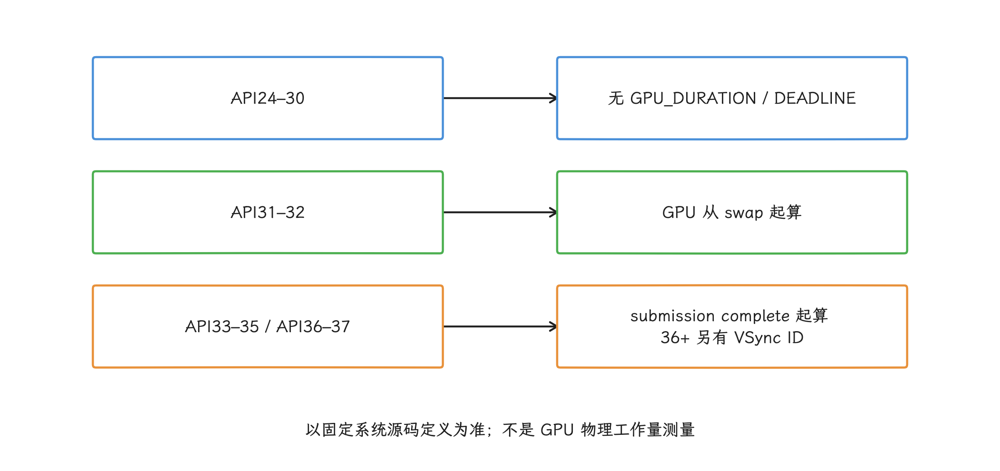

图：平台字段边界变化会改变数值含义；跨系统版本不能直接把原始值差异认作性能回归。

### Window 与独立内容流的覆盖范围

| 页面内容 | FrameMetrics 能看到 | 不能看到 |
| --- | --- | --- |
| 普通 View / 标准 Compose | 宿主 Window 的 UI、RenderThread 与 swap | 具体调用栈、SurfaceFlinger 和最终 present |
| TextureView | 外部 buffer 被 HWUI 采样后的宿主成本 | 外部 producer 自身、第一套 BufferQueue 与输入 fence |
| SurfaceView | 宿主 UI、hole-punch、几何与控制层帧 | 独立内容 Surface 的 producer、BufferQueue 与 layer 帧 |
| Dialog / PopupWindow / 多窗口 | 每个已注册 Window 各自的帧 | 未注册 Window；不同 Window 不会自动合并 |
| 软件渲染 Window | 没有硬件渲染帧统计 | 软件 Canvas 的完整耗时 |

JankStats 在 API 24+ 内部已经注册 FrameMetrics listener。要再直接监听，得先量化双重回调、复制和聚合的开销；常规线上分布留给 JankStats，直接 FrameMetrics 只在分段诊断或 API 36+ compositor join 时对受控样本开启。

<!-- gracker-diagram: a241-13-window-coverage -->
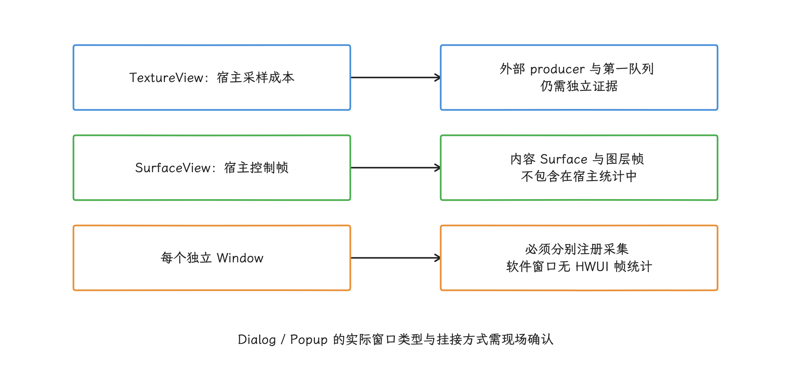

图：采集范围由窗口和内容图层拓扑决定；同时启用JankStats与FrameMetrics应测量额外回调负担。

延迟回调里同样读不到“当前 route”：API 26+ 靠 `INTENDED_VSYNC_TIMESTAMP` 与应用状态区间关联，API 24—25 只做 Window session 级聚合，或者在路由切换时明确结束旧会话。

`Window.OnFrameMetricsAvailableListener` 把回调投递到注册时指定的 `Handler`。回调中的 `FrameMetrics` 会复用，副本要当场构造。第三个参数是上次回调以来丢失的**指标报告数**，数值升高说明监控消费者跟不上；它衡量的是监控链路，和用户侧掉帧数是两个量。

下面的诊断会话让复制和聚合都运行在专用 `HandlerThread`（带消息循环的后台线程）上，省得副本再 `post` 回同一线程。

```kotlin
@RequiresApi(24)
class WindowFrameMetricsSession(
    private val aggregator: FrameMetricsAggregator
) : Closeable {
    private val thread = HandlerThread("window-frame-metrics").apply { start() }
    private val handler = Handler(thread.looper)
    private var window: Window? = null

    private val listener = Window.OnFrameMetricsAvailableListener {
            _, volatileMetrics, droppedReports ->
        val snapshot = FrameMetrics(volatileMetrics)
        aggregator.add(
            metrics = snapshot,
            telemetryReportsDropped = droppedReports
        )
    }

    fun start(target: Window) {
        check(window == null)
        window = target
        target.addOnFrameMetricsAvailableListener(listener, handler)
    }

    override fun close() {
        val target = window ?: return
        window = null
        target.removeOnFrameMetricsAvailableListener(listener)
        handler.post {
            aggregator.flush()
            thread.quitSafely()
        }
    }
}
```

`telemetryReportsDropped` 要独立上报，并进入 coverage（监控报告完整率）计算。数值升高通常意味着监听器或下游聚合过重，样本从这时起已经带偏，之后拿剩余报告推算完整卡顿率，结论站不住。

`FIRST_DRAW_FRAME` 通常不进滚动或动画的卡顿帧分母，但这类帧另有去处：放进 startup / navigation（启动 / 页面导航）首帧分组，交给 21.1 或 26.1 的启动与页面切换指标分析。`TOTAL_DURATION` 只覆盖应用渲染到提交显示子系统的阶段，即使它小于 `DEADLINE`，最终显示时间也要拿系统合成器侧证据来解释。

<!-- gracker-diagram: a241-14-session-cleanup -->
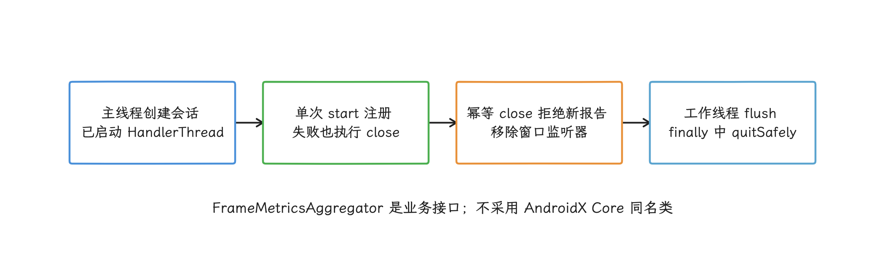

图：从未start也必须close；关闭返回不等于后台线程已经退出，主动舍弃报告另计会话边界。

## API 36+：关联 FrameMetrics 与系统合成器分类

区分应用、合成器和其他系统组件的责任，API 36 起有了直接通道：`Window.getRootSurfaceControl()` 返回的 `AttachedSurfaceControl` 可以注册 `SurfaceControl.OnJankDataListener`，SurfaceFlinger 会异步、批量回传每帧分类。`jankType` 是位掩码，同一帧可能同时命中多个原因：

- `JANK_APPLICATION`：应用错过调度；
- `JANK_COMPOSER`：系统合成器错过调度；
- `JANK_OTHER`：其他系统组件导致；
- `JANK_NONE`：按期完成。

`JankData.getVsyncId()` 用来与 `FrameMetrics.FRAME_TIMELINE_VSYNC_ID` 关联。`scheduledAppFrameTimeNanos` 是系统分配给应用的时长，CPU / GPU 并行时可能大于 display frame interval（显示刷新周期）；`actualAppFrameTimeNanos` 是应用完成该帧实际所用的时长。

<!-- gracker-diagram: a241-15-compositor-join -->
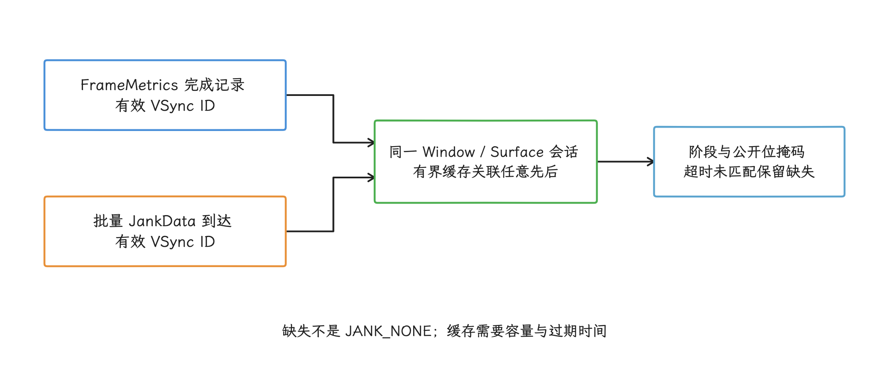

图：应用预算是否超期与合成器分类分开保存；异步数据join要容忍延迟、丢失和会话结束。

下面的会话把系统合成器数据写入有界队列。停止时传入诊断窗口内记录到的有效 VSync ID，可以等该帧的延迟分类送达后再移除监听器；若无需等待，`removeAfter(0)` 会立即移除监听器，并保证不再收到后续回调。

```kotlin
@RequiresApi(36)
class CompositorJankSession(
    window: Window,
    executor: Executor,
    private val sink: CompositorJankSink
) {
    private val registration =
        checkNotNull(window.rootSurfaceControl) {
            "Call after setContentView() while the Window is attached"
        }.registerOnJankDataListener(executor) { batch ->
            batch.forEach { data ->
                sink.offer(
                    vsyncId = data.vsyncId,
                    jankType = data.jankType,
                    scheduledAppTimeNanos = data.scheduledAppFrameTimeNanos,
                    actualAppTimeNanos = data.actualAppFrameTimeNanos
                )
            }
        }

    fun stopAfter(lastVsyncId: Long?) {
        registration.flush()
        registration.removeAfter(lastVsyncId?.takeIf { it > 0L } ?: 0L)
    }
}
```

`flush()` 可能在同一调用路径内就触发回调，所以 `sink` 仍要保证线程安全；注册对象由页面或诊断会话强引用，直到停止完成。

这一组 API 面向标准 App Window。页面里的 SurfaceView、Camera、视频、WebView 渲染进程或游戏引擎可能拥有独立缓冲区图层，宿主 root surface（窗口根 Surface）的分类覆盖不到每条独立内容流。遇到“Window 指标正常、内容仍跳动”，我们要去看目标图层的 producer、BufferQueue、fence、FrameTimeline 和 present-to-present（相邻两次显示）间隔。

<!-- gracker-diagram: a241-16-public-jank-mask -->
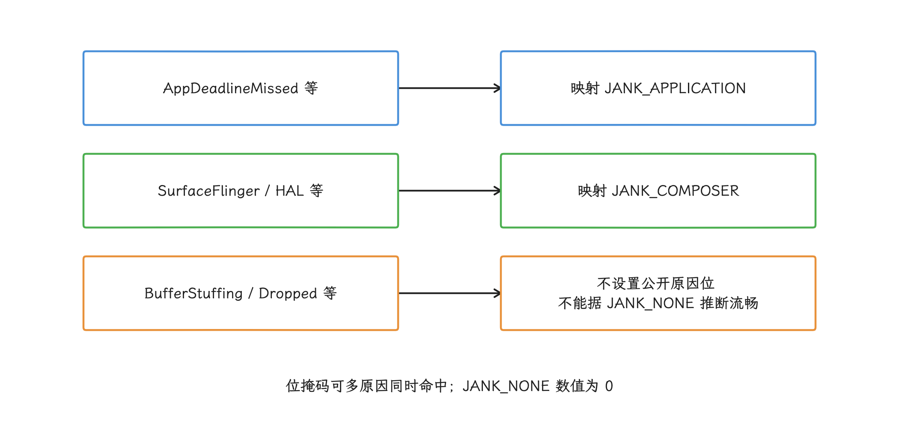

图：公开分类是JNI的简化映射；精细的FrameTimeline原因和最终显示结果仍要回到目标图层核对。

<!-- gracker-diagram: a241-17-listener-stop -->
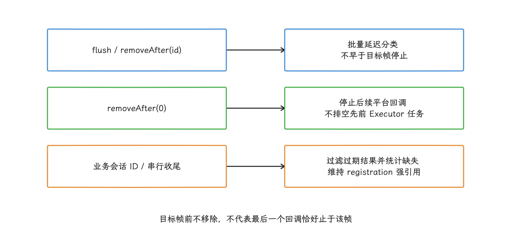

图：页面停止需要处理平台监听和在途业务任务两个边界；flush还可能在调用路径内触发数据投递。

## buffer-stuffing recovery：队列积压后的主动恢复

排查一帧迟到的原因时，buffer-stuffing recovery 是要单独认出来的一类。它实现在 `Choreographer` 里：BLAST producer 等待 buffer release（可复用缓冲区被释放）的时间超过半个 frame interval（刷新周期） 后，`onWaitForBufferRelease()` 会标记 stuffed（队列积压） 状态；后续 `doFrame()` 可以主动延后一帧，减少排队缓冲区，并在恢复期调整动画时间线。

相关 aconfig flag（Android 平台功能配置开关）会影响同一段动画能否多次恢复，以及累计主动延迟是否受 100 ms 上限约束；设备上的实际取值要从 trace 或配置里确认。

所以 Perfetto 里看到 `Buffer stuffing recovery`、`buffer stuffed` 或 `Negative offset` 时，这一帧的迟到可能来自系统为降低队列深度安排的恢复动作。

归因时我们同时检查 `dequeueBuffer` wait、queued buffer（已排队缓冲区）、FrameTimeline 的 `Buffer Stuffing` 分类和恢复后的 backlog（仍未消费的积压）。只看 UI / CPU 时长就把责任归给业务代码，会漏掉“队列已经过深”这个前因。

<!-- gracker-diagram: a241-18-stuffing-recovery -->
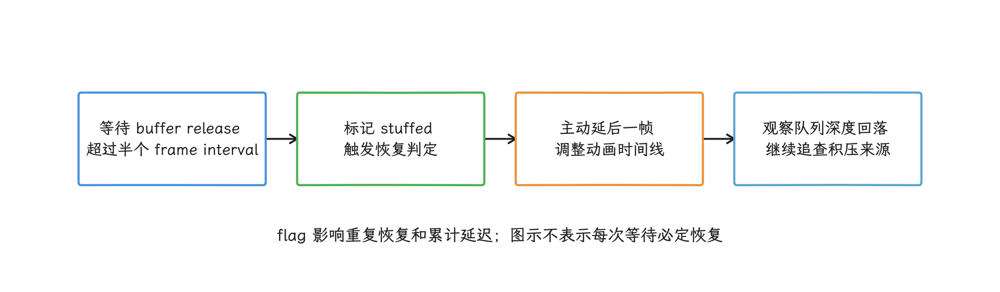

图：恢复动作减少排队延迟，不提升GPU或显示吞吐量；需要区分原始积压和恢复造成的时间线变化。

这个机制只消化排队造成的额外延迟，GPU 和显示吞吐量并不会因此变好。恢复频繁出现时，还要追查 producer 产出节奏、RenderThread / GPU 完成时间、release fence（缓冲区释放栅栏）和 consumer（缓冲区消费者） 的释放速度。

## 线上卡顿堆栈：按策略采样，为指标补代码现场

帧指标告诉我们异常发生在哪个时间段和渲染阶段，Java 堆栈则记录采样瞬间正在执行或等待的方法。常见入口有两类：

- Looper dispatch（消息分发）超时：记录一次主线程 message 的开始、结束和超时样本。`Looper.setMessageLogging()` 只有一个 `Printer` 监听位置，接入前要评估与调试器、其他 SDK 的冲突，卸载时也别误清掉其他组件注册的 `Printer`。
- 慢帧簇触发：JankStats 或 FrameMetrics 在短窗口内连续超期后，从后台线程按间隔读取主线程 Java 栈。这里的“簇”指时间上连续出现的一组慢帧，单个偶发长帧不算。

`Thread.getStackTrace()` 会暂停并遍历目标线程，采得太密反而干扰现场，而且它看到的只是采样瞬间的 Java 栈；原生代码执行、GPU、SurfaceFlinger、fence 和 scheduler（内核调度器）这些原因要靠 Perfetto 或受控的原生性能分析。线上采样要有发布构建开关、会话采样率、两次触发之间的冷却时间、单次样本数、栈深、报告字节数和全局每日配额。

<!-- gracker-diagram: a241-19-stack-trigger-evidence -->
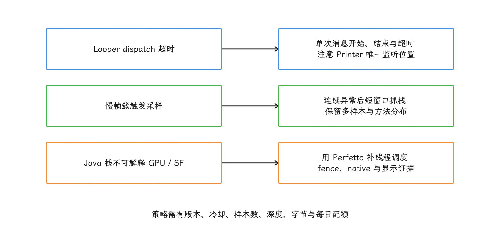

图：采样会干扰目标线程，限制频率与容量；单个栈只是瞬间现场，不能直接认作根因。

下面的采样器不提供通用默认阈值：所有上限都来自带版本号的远程策略，并在 `finally` 中恢复状态；`close()` 负责结束会话持有的执行器。

```kotlin
data class StackSamplingPolicy(
    val windowMillis: Long,
    val intervalMillis: Long,
    val maxSamples: Int,
    val maxDepth: Int
) {
    init {
        require(windowMillis > 0)
        require(intervalMillis > 0)
        require(maxSamples > 0)
        require(maxDepth > 0)
    }
}

class MainThreadStackSampler(
    private val mainThread: Thread,
    private val reporter: (StackSampleBatch) -> Unit
) : Closeable {
    private val executor = Executors.newSingleThreadExecutor()
    private val sampling = AtomicBoolean(false)

    fun sampleWindow(reason: String, policy: StackSamplingPolicy) {
        if (!sampling.compareAndSet(false, true)) return

        executor.execute {
            try {
                val deadline = SystemClock.uptimeMillis() + policy.windowMillis
                val samples = ArrayList<StackSample>(policy.maxSamples)

                while (
                    samples.size < policy.maxSamples &&
                    SystemClock.uptimeMillis() < deadline
                ) {
                    val frames = mainThread.stackTrace
                        .asSequence()
                        .take(policy.maxDepth)
                        .map(StackTraceElement::toString)
                        .toList()

                    samples += StackSample(
                        uptimeMillis = SystemClock.uptimeMillis(),
                        frames = frames
                    )
                    SystemClock.sleep(policy.intervalMillis)
                }

                reporter(StackSampleBatch(reason, samples))
            } finally {
                sampling.set(false)
            }
        }
    }

    override fun close() {
        executor.shutdown()
    }
}
```

端侧按方法序列为连续样本生成稳定签名，也就是不随对象地址等易变信息改变的栈指纹；同一 `app_version + page + ui_state + signature` 只上传少量代表样本。重复命中同一栈，比一次偶发快照更有代表性。多个样本分别落在 Binder proxy（跨进程调用代理）、锁等待和业务方法时，保留分布就好，强行选一个栈当根因会丢信息。

<!-- gracker-diagram: a241-20-sampler-lifecycle -->
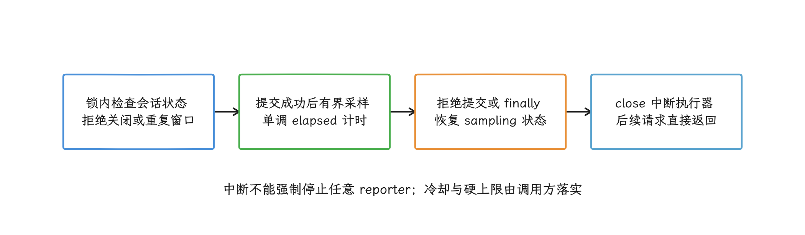

图：任务拒绝不再永久占用sampling，经过时长避免截止时间加法溢出，sleep可被关闭中断。

报告里不带完整 URL、搜索词、聊天内容、订单号、地理位置，也不带任何可还原用户身份的数据。业务状态用枚举；方法名经过代码混淆时，服务端用受控的 mapping file（混淆映射文件）还原。

## 从指标到归因

服务端按“版本 + 设备层级 + 页面 + 交互状态 + Surface 拓扑 + 证据范围”分组。平均 FPS 会把偶发长帧和连续慢帧簇都抹平，所以我们至少保留帧数、卡顿帧数、overrun 分布、最长连续卡顿帧数、阶段分布与监控报告丢失数。

| 现象组合 | 当前证据支持的判断 | 下一步 |
|---|---|---|
| `frameDurationUiNanos`、layout / draw（布局 / 绘制）时长高，重复 Java 栈落在业务代码 | UI 线程工作量或阻塞可疑 | 检查布局、绘制、锁、Binder、I/O 与调用方 |
| UI 时长低，`frameDurationCpuNanos` 高 | RenderThread、原生代码或其他 CPU 阶段可疑 | 核对 DrawFrame、sync（同步）、command issue（向 GPU 发命令）与线程调度 |
| CPU 阶段按时，`GPU_DURATION` 高 | GPU 工作量、驱动、频率或带宽可疑 | 采集 GPU 时间片 / 计数器、频率、thermal（温控状态）与 fence |
| FrameMetrics 超期且 `JANK_APPLICATION` | 系统合成器数据也指向应用错过 deadline | 用同一 VSync ID 关联各阶段和堆栈 |
| FrameMetrics 按时且 `JANK_COMPOSER` | SurfaceFlinger / HWC / 显示侧可疑 | 查看 SurfaceFlinger 调度、合成、HWC 与显示时间 |
| 宿主 Window 正常，独立内容停顿 | 当前 Window 指标覆盖不足 | 找到内容 layer 与 producer，检查独立时间线 |
| `Buffer stuffing recovery` 与队列积压同时出现 | 系统正在主动降低队列深度 | 追查积压来源和 release fence |
| `telemetryReportsDropped` 升高 | 监控消费者过重或队列容量不足 | 降低采样、缩短回调、修复报告完整率后再比较 |

主线程处于等待态时，栈顶只是等待位置。trace 显示线程 Runnable（可运行但等待调度） 却长期拿不到 CPU，我们再去查 `android17-6.18-2026-06_r6` 的 scheduler 证据；`dequeueBuffer` 或缓冲区复用被 fence 阻塞时，查 dma-fence / sync_file 与厂商 GPU、显示驱动。应用层证据指向这些方向后再查内核；从一个 Java 样本直接猜内核原因，是猜不准的。

<!-- gracker-diagram: a241-21-attribution-branches -->
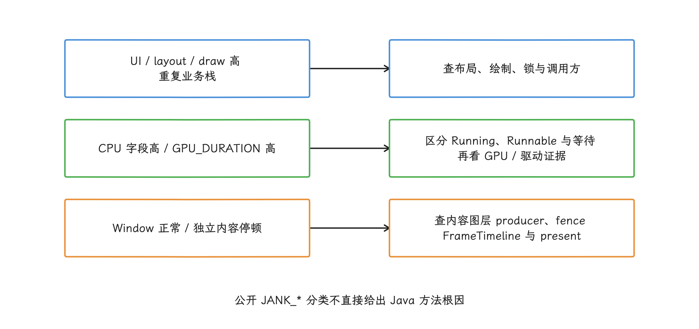

图：墙钟耗时和等待栈只能缩小方向；线程调度、GPU和系统图层证据决定最终解释。

## 自动告警：用策略、基线和置信区间减少误报

推荐的聚合字段如下：

| 字段组 | 字段示例 | 用途 |
|---|---|---|
| 版本 | `app_version`、`build_id`、`api_level` | 判断回归开始点与平台能力 |
| 设备 | `device_tier`、`soc_family`、`os_build`、`thermal_state` | 分离设备层级、芯片系列、系统版本和温控差异 |
| 场景 | `page`、`component`、`ui_state`、`rendering_topology` | 定位页面、组件、交互状态及 Surface 拓扑 |
| 帧分布 | `frame_count`、`jank_count`、`overrun_p50/p90/p99`、`max_jank_streak` | 描述频率、尾部与成簇程度 |
| 严重度 | `severe_overrun_count`、`severity_policy_version` | 使用项目自有、可追溯的严重帧定义 |
| 归因 | `stage_distribution`、`jank_type_mask`、`stack_signature` | 关联应用阶段、合成器分类与代码栈指纹 |
| 质量 | `reports_expected`、`reports_received`、`reports_dropped`、`queue_rejected` | 判断监控是否完整、样本是否可比 |

产品若沿用 Android Vitals 的 frozen frame（冻结帧）名称，就把它当外部指标单独保存；自研监控用不同阈值时，取 `severe_overrun` 这类名字并携带策略版本，免得两个系统同名却统计不同对象。

下面的规则展示告警需要哪些约束，变量由页面和设备层级对应的策略提供。

<!-- gracker-diagram: a241-22-report-completeness -->
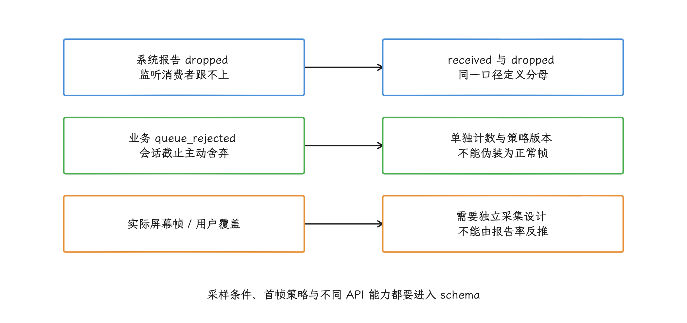

图：监控数据丢失会使剩余样本带偏；报告完整率不能代表屏幕帧覆盖率或用户采样率。

```text
group_by = [app_version, device_tier, page, ui_state, rendering_topology]
sample_users >= policy.min_users
coverage_rate >= policy.min_coverage
lower_confidence_bound(jank_rate - baseline_jank_rate)
    >= policy.min_absolute_regression
relative_jank_rate >= baseline_jank_rate * policy.min_relative_regression
overrun_p99 >= baseline_overrun_p99 + policy.min_p99_regression
```

这条规则同时约束样本量、监控覆盖、绝对退化、相对退化和尾部分布变化。低流量页面用更长的观察窗，或者用贝叶斯 / 分层模型借用同类页面与设备层级的统计信息，高流量首页的瞬时阈值直接搬过去是行不通的。告警命中后，我们附上策略版本、基线窗口、置信区间、问题最集中的设备与状态、jank 类型、阶段分布、栈签名及近期代码变更，负责人才能复现和验收。

<!-- gracker-diagram: a241-23-alert-constraints -->
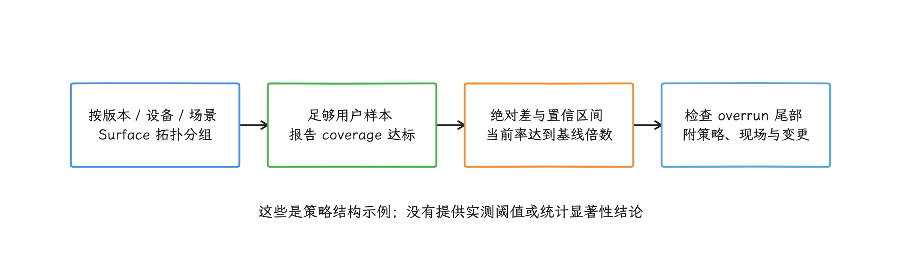

图：相对门槛使用当前jank_rate比较基线倍数；零基线依赖绝对差和置信条件，不能只看比值。

## 端侧接入与验收清单

- 按 Window 创建 JankStats；页面不可见时关闭，恢复可见时启用。
- 在 JankStats 回调内立刻 `copy()`；队列有容量上限、非阻塞，并统计拒绝写入。
- UI 状态使用低基数枚举，状态结束时移除，不采集用户内容。
- API 31+ 用 `TOTAL_DURATION` 与 `DEADLINE` 判断应用侧超期；低版本不伪造精确 deadline。
- FrameMetrics 复制对象后再处理；`dropCountSinceLastInvocation` 记作监控报告丢失。
- API 36+ 通过 VSync ID 关联 FrameMetrics 与 `JankData`，并处理批量、延迟回调。
- 页面含独立 Surface 时登记 `rendering_topology`，为内容 layer 补充对应证据。
- FrameCallback / VsyncCallback 只在短诊断窗口运行，回调只写预分配内存。
- 堆栈采样具有远程开关、版本化策略、冷却时间、大小与隐私限制。
- 告警按版本、设备层级、页面、状态和 Surface 拓扑分组，先检查报告完整率再判断趋势。
- 线下回放至少验证 UI 线程、RenderThread / GPU、系统合成器和独立 Surface 各一个场景。
- trace 中出现 buffer-stuffing recovery 时，把主动恢复和原始积压分开解释。

验收时我们留一组可复核的证据：异常属于哪个 Window 或 Surface、集中在哪组用户和交互状态、应用是否超过 deadline、系统合成器怎样分类、哪一段耗时或代码栈重复出现。这些信息齐了，才能判断由哪个模块处理，并用同一口径验证修复。

## 从监控告警回到一次可复核的渲染复盘

每次线上告警，我们都用同一份复盘字段清单，避免案例只留下零散截图和口头结论。至少保留下列内容：

| 字段 | 必填内容 |
| --- | --- |
| 用户场景 | 页面、操作、数据规模、前后台、窗口模式 |
| 样本条件 | App 源码提交版本（commit）、构建类型、设备 / 系统、刷新率、温控、网络与缓存冷热 |
| 现象 | deadline miss（错过截止时间）分布、JankStats 状态、首个异常时间点 |
| 分层证据 | 主线程、RenderThread / GPU、BufferQueue、SurfaceFlinger / HWC 各自的正常与异常证据 |
| 根因 | 最早偏离预期时间线的对象，以及排除过的相邻候选 |
| 改动 | 只改变的变量、降级与回滚开关 |
| 验收 | 相同脚本下的 P50（中位数）、P90 / P95 / P99（尾部高分位）、慢帧率、内存 / 功耗和视觉正确性 |

大型首页、复杂动画、图片列表和 WebView 的表象各不相同，复盘顺序是一样的：先由线上分组找到稳定场景，用 release-like Macrobenchmark（接近发布构建的自动化性能测试）复现，再在 Perfetto 里从异常 App SurfaceFrame / DisplayFrame（应用帧 / 显示帧）反向定位。一次 trace 只解释一次执行，代替不了线上分布；全局平均 FPS 也证明不了某个局部修复有效。

<!-- gracker-diagram: a241-24-review-evidence-loop -->
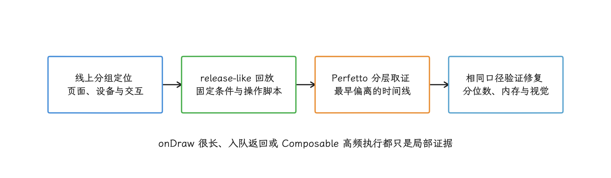

图：一次trace解释一次执行；修复需要同场景指标、边界证据和可重复脚本共同验收。

结论要写清证据覆盖到哪里为止：`onDraw` 很长，只证明 UI 线程录制绘制命令慢；`queueBuffer()` 返回，只证明 producer 已提交缓冲区；某个 Composable 高频执行，说明不了它让帧错过 deadline。复盘关闭前，把修复固化成可重复的自动化操作脚本、JankStats 状态、阈值与负责人，否则案例只是一次性的排障故事。

## 源码与文档索引

### Android 17 / API 37

- [`Choreographer.java`](https://android.googlesource.com/platform/frameworks/base/+/refs/tags/android-17.0.0_r1/core/java/android/view/Choreographer.java)：FrameCallback、VsyncCallback、FrameTimeline 与 buffer-stuffing recovery。
- [`FrameMetrics.java`](https://android.googlesource.com/platform/frameworks/base/+/refs/tags/android-17.0.0_r1/core/java/android/view/FrameMetrics.java)：各阶段时长、`DEADLINE` 与 `FRAME_TIMELINE_VSYNC_ID`。
- [`SurfaceControl.java`](https://android.googlesource.com/platform/frameworks/base/+/refs/tags/android-17.0.0_r1/core/java/android/view/SurfaceControl.java) 与 [`AttachedSurfaceControl.java`](https://android.googlesource.com/platform/frameworks/base/+/refs/tags/android-17.0.0_r1/core/java/android/view/AttachedSurfaceControl.java)：系统合成器卡顿分类与注册接口。
- [AndroidX Metrics 发布记录](https://developer.android.com/jetpack/androidx/releases/metrics)、[JankStats 指南](https://developer.android.com/topic/performance/jankstats)、[JankStats API](https://developer.android.com/reference/androidx/metrics/performance/JankStats) 与 [`FrameDataApi31`](https://developer.android.com/reference/androidx/metrics/performance/FrameDataApi31)：稳定版本、Window 帧、状态、对象复用与 overrun。
- [`Choreographer` API](https://developer.android.com/reference/android/view/Choreographer)、[`FrameData`](https://developer.android.com/reference/android/view/Choreographer.FrameData) 与 [`FrameTimeline`](https://developer.android.com/reference/android/view/Choreographer.FrameTimeline)：回调生命周期、deadline、预期显示时间与 VSync ID。
- [`FrameMetrics` API](https://developer.android.com/reference/android/view/FrameMetrics)、[`OnFrameMetricsAvailableListener`](https://developer.android.com/reference/android/view/Window.OnFrameMetricsAvailableListener)、[`JankData`](https://developer.android.com/reference/android/view/SurfaceControl.JankData)、[`OnJankDataListenerRegistration`](https://developer.android.com/reference/android/view/SurfaceControl.OnJankDataListenerRegistration) 与 [`AttachedSurfaceControl`](https://developer.android.com/reference/android/view/AttachedSurfaceControl)：应用阶段、报告丢失、监听器停止语义和系统合成器分类。
- [Android Vitals 渲染性能](https://developer.android.com/topic/performance/vitals/render)：慢帧与冻结帧的外部统计口径。
- [Perfetto FrameTimeline](https://perfetto.dev/docs/data-sources/frametimeline)：预期 / 实际时间线、SurfaceFrame 与 DisplayFrame 的线下核对方法。

### Linux 内核 `android17-6.18-2026-06_r6`

- [`kernel/sched/core.c`](https://android.googlesource.com/kernel/common/+/refs/tags/android17-6.18-2026-06_r6/kernel/sched/core.c)：UI / RenderThread 处于 Runnable 状态时的调度证据。
- [`drivers/dma-buf/dma-fence.c`](https://android.googlesource.com/kernel/common/+/refs/tags/android17-6.18-2026-06_r6/drivers/dma-buf/dma-fence.c)：GPU、HWC 与缓冲区生命周期相关的 fence 基础实现。
