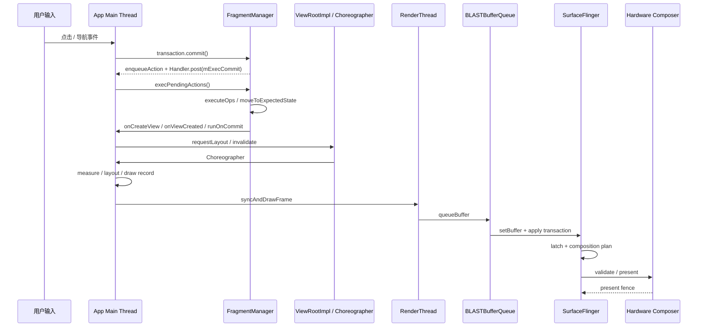
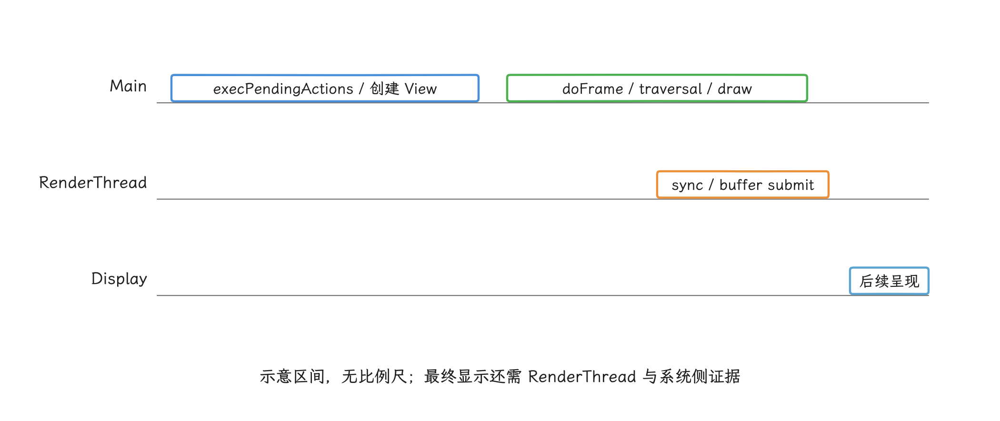
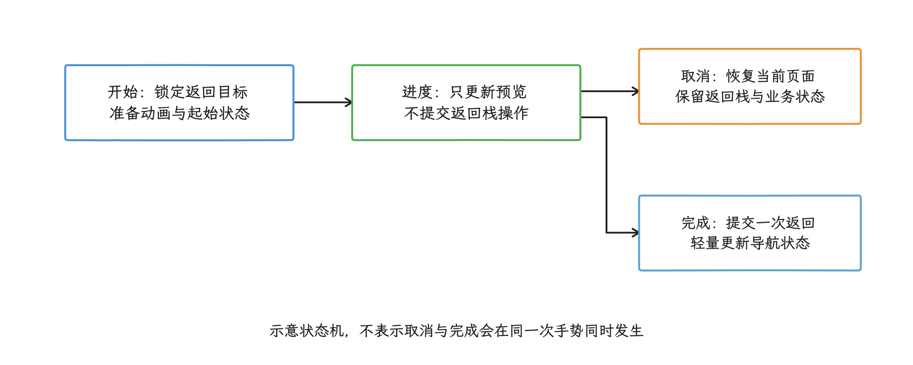
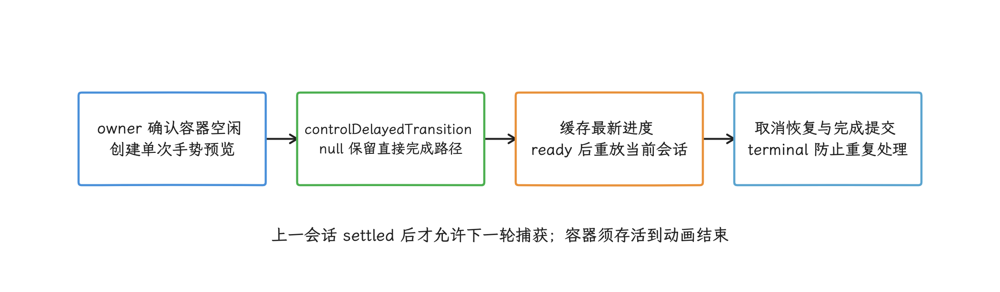
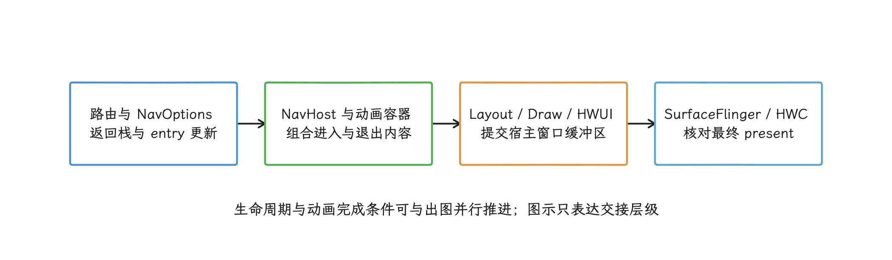
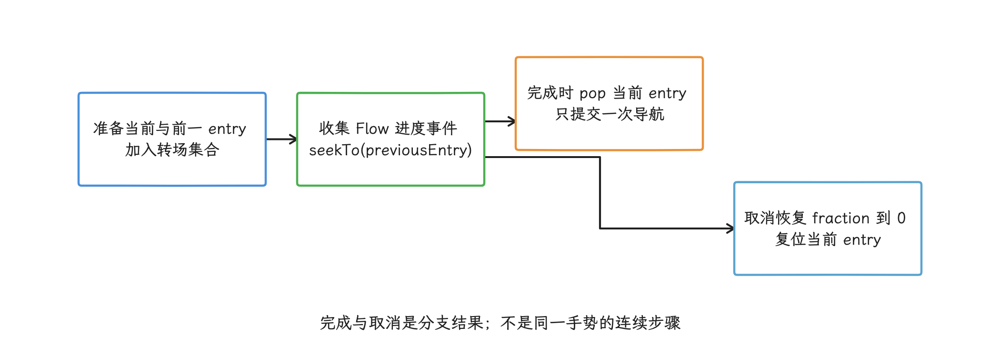

# Fragment、Predictive Back 与 Navigation Compose 页面切换

Fragment 页面切换的性能问题，光看 `commit()` 是找不到的。它成功返回，只说明事务进了 `FragmentManager` 的待执行队列；View 创建、生命周期推进和动画准备，都发生在随后处理队列的 `execPendingActions()` 里。所以我们排查时，要把 Fragment 事务、inflate（解析 XML 并实例化 View）、一轮 View 树 traversal（measure、layout、draw）和帧结果放到同一条 trace 上一起看：Android 12+ 用 FrameTimeline（帧时间线），Android 10/11 则结合 `Choreographer`、RenderThread（渲染线程） 切片和自定义 trace。现代应用的 Fragment 性能排查，应以 AndroidX Fragment 为准；平台 `android.app.Fragment` 已废弃，不再作为新代码的优化对象。


> 源码基线：Fragment 事务实现固定到 AndroidX `androidx-fragment-release` 提交 `f39ca3510efb2347ebfef231e25a3e804922450d`；`Choreographer`、`ViewRootImpl`、HWUI、BLASTBufferQueue 与 SurfaceFlinger 固定到 Android 17 / API 37 的 `android-17.0.0_r1`。AndroidX 独立发布，设备采用哪个 Fragment 版本要看应用依赖，平台标签推不出来。

页面切换从 Fragment 或 Navigation 提交开始，经过生命周期、视图创建、动画和首帧；Predictive Back 在这条链上增加了可取消的进度阶段，要求导航状态和系统返回动画在提交前保持一致。

## Fragment 提交、生命周期与首帧

在 trace 里看到页面切换卡顿时，先要确认时间花在哪一站：提交排队、事务执行、生命周期推进、View 创建，还是 traversal 和首帧。我们从 `commit()` 的语义开始，把这条链一段段对到屏幕上出现的那一帧。

### `commit()` 的排队与执行时机

AndroidX 的 `BackStackRecord` 是 `FragmentTransaction` 的具体实现，三个常用提交方法的分叉点很早：`commit()` 和 `commitAllowingStateLoss()` 走 `commitInternal(..., true)`，把当前事务交给 `FragmentManager.enqueueAction()` 排队；`commitNow()` 跳过待执行队列，直接走 `execSingleAction()`。第四个提交方法 `commitNowAllowingStateLoss()` 同样调用 `execSingleAction()`，只是把 `allowStateLoss` 设为 `true`。下面这段摘录保留前三个分支：

```java
@Override
public int commit() {
    return commitInternal(false, true);
}

@Override
public int commitAllowingStateLoss() {
    return commitInternal(true, true);
}

@Override
public void commitNow() {
    disallowAddToBackStack();
    mManager.execSingleAction(this, false);
}
```

`commitInternal()` 会检查重复提交、分配 back stack index，然后在 `commitAction == true` 时进入 `FragmentManager.enqueueAction()`：

```java
int commitInternal(boolean allowStateLoss, boolean commitAction) {
    if (mCommitted) {
        throw new IllegalStateException("commit already called");
    }
    mCommitted = true;
    if (mAddToBackStack) {
        mIndex = mManager.allocBackStackIndex();
    } else {
        mIndex = -1;
    }
    if (commitAction) {
        mManager.enqueueAction(this, allowStateLoss);
    }
    return mIndex;
}
```

`enqueueAction()` 决定了异步语义：事务被加入 `mPendingActions` 待执行列表后，`scheduleCommit()` 通过宿主 `Handler` 投递 `mExecCommit`：

```java
void enqueueAction(@NonNull OpGenerator action, boolean allowStateLoss) {
    if (!allowStateLoss) {
        if (mHost == null) {
            throw new IllegalStateException("FragmentManager has not been attached to a host.");
        }
        checkStateLoss();
    }
    synchronized (mPendingActions) {
        if (mHost == null) {
            if (allowStateLoss) {
                return;
            }
            throw new IllegalStateException("Activity has been destroyed");
        }
        mPendingActions.add(action);
        scheduleCommit();
    }
}

void scheduleCommit() {
    synchronized (mPendingActions) {
        boolean pendingReady = mPendingActions.size() == 1;
        if (pendingReady) {
            mHost.getHandler().removeCallbacks(mExecCommit);
            mHost.getHandler().post(mExecCommit);
            updateOnBackPressedCallbackEnabled();
        }
    }
}
```

从性能排查看，我们要记住两件事：

- `commit()` 返回得再快，便宜的也只是排队这一步。View 创建、生命周期推进、动画准备和 `SpecialEffectsController` 的动画/过渡处理，都在后面的主线程消息里发生。
- 多次连续 `commit()` 可能被同一个 `execPendingActions()` 批处理。排查 Perfetto 时，除了点击回调里的 `commit()`，还要检查随后主线程消息中的生命周期和 View 创建耗时。

### 提交与强制执行 API 的差异与选择

state loss 指的是：Activity 已保存 Fragment 状态后又修改了界面，进程重建时这次修改可能恢复不回来；它和业务数据丢失是两回事。`AllowingStateLoss` 只表示调用方接受这项恢复风险，宿主销毁后事务也照样可能被丢弃。

| API | 执行方式 | 返回栈 | 状态保存后的行为 | 性能风险 |
|---|---|---|---|---|
| `commit()` | 异步排队，后续主线程消息执行 | 支持 | `isStateSaved()` 后提交会抛异常 | 调用点轻，但后续可能集中执行多笔事务 |
| `commitAllowingStateLoss()` | 异步排队 | 支持 | 可在状态保存后提交；宿主不可用时可能丢弃事务 | UI 状态可能与恢复结果不一致，不能用它规避性能问题 |
| `commitNow()` | 当前主线程同步执行当前事务 | 不支持；源码会 `disallowAddToBackStack()` | 状态保存后提交会抛异常 | 生命周期与 View 创建都进入当前调用栈 |
| `commitNowAllowingStateLoss()` | 当前主线程同步执行当前事务 | 不支持 | 可忽略状态保存检查；宿主未连接或已销毁时直接丢弃 | 同步成本与 `commitNow()` 相同，另有无法恢复或不执行的风险 |
| `executePendingTransactions()` | 调用 `execPendingActions(true)`，随后 `forcePostponedTransactions()` | 执行队列中原有事务，不改变各事务的返回栈属性 | 不检查 `isStateSaved()`；宿主未连接或已销毁时仍会抛异常 | 会把其他模块的待执行事务一起处理，时序影响范围比 `commitNow()` 大 |

`executePendingTransactions()` 属于 `FragmentManager` 的队列执行方法，和四种提交方法放在一张表里只是为了对比。官方文档建议：如果只想同步提交一个不修改返回栈的事务，优先用 `commitNow()`，不要组合使用 `commit()` 与 `executePendingTransactions()`；后者会尝试执行当前所有待执行事务。

工程上可以按这条规则选：需要进入返回栈的页面切换使用 `commit()`；必须同步取得 Fragment View 的小型局部初始化，可以考虑 `commitNow()`；通用导航路径不要调用 `executePendingTransactions()` 来追求同步完成。只有界面恢复时允许缺少这次修改，才考虑两个 `AllowingStateLoss` 变体。


`executePendingTransactions()` 还有两点要单独说明。第一，它传入 `allowStateLoss = true` 执行 `execPendingActions(true)`，处理当前 FragmentManager 的全部待执行事务；此前已被 `commit()` 拒绝的事务，并不会因此重新出现。第二，它会在待执行操作处理完后调用 `forcePostponedTransactions()`，强制启动原本延后的入场过渡。页面切换期间如果 Navigation Component 或其他使用同一 FragmentManager 的模块已经排队，这些工作也会进入当前主线程执行窗口。

### `execPendingActions()`：同一主线程消息中的批处理循环

`mExecCommit` 被 `Handler.post()` 后，主线程会调用 `execPendingActions(true)`。执行前，`ensureExecReady()` 做三类保护：

- 执行标记 `mExecutingActions` 必须已复位，避免在事务处理过程中再次同步执行事务。
- 当前线程必须是宿主 `Handler` 所在线程，否则抛出 “Must be called from main thread of fragment host”。
- 未允许状态丢失（state loss）时执行 `checkStateLoss()`，避免宿主保存状态后继续修改 Fragment 状态。

以下摘录保留三项检查；完整实现还会区分宿主未连接与已销毁，并初始化临时列表：

```java
private void ensureExecReady(boolean allowStateLoss) {
    if (mExecutingActions) {
        throw new IllegalStateException("FragmentManager is already executing transactions");
    }
    if (mHost == null) {
        throw new IllegalStateException("FragmentManager has not been attached to a host.");
    }
    if (Looper.myLooper() != mHost.getHandler().getLooper()) {
        throw new IllegalStateException("Must be called from main thread of fragment host");
    }
    if (!allowStateLoss) {
        checkStateLoss();
    }
}
```

准备完成后，`execPendingActions()` 进入循环：从 `mPendingActions` 取出所有 `OpGenerator`，生成 `BackStackRecord` 列表，再调用 `removeRedundantOperationsAndExecute()`。以下摘录是普通提交路径，省略了预测式返回（predictive back）被新操作中断时对 `mTransitioningOp` 的取消与重新提交：

```java
boolean execPendingActions(boolean allowStateLoss) {
    ensureExecReady(allowStateLoss);

    boolean didSomething = false;
    while (generateOpsForPendingActions(mTmpRecords, mTmpIsPop)) {
        mExecutingActions = true;
        try {
            removeRedundantOperationsAndExecute(mTmpRecords, mTmpIsPop);
        } finally {
            cleanupExec();
        }
        didSomething = true;
    }

    updateOnBackPressedCallbackEnabled();
    doPendingDeferredStart();
    mFragmentStore.burpActive();
    return didSomething;
}
```

`generateOpsForPendingActions()` 会在同步块内遍历当前 FragmentManager 的 `mPendingActions`，再清空列表并移除已投递的 `mExecCommit`。这里我们先建立一个预期：一次点击即使只调用一次 `commit()`，trace 里仍可能出现多个 Fragment 的生命周期推进。因为同一事务可以操作多个 Fragment，同一 FragmentManager 也可能已有其他事务或 Navigation 操作排队。子 FragmentManager 用的是自己的队列，判断它是否参与了同一主线程消息，要继续看调用栈。


排查时，我们别停在“FragmentManager 慢”这个结论上，要把同一个主线程消息包含的具体工作列出来：`onCreate()`、`onCreateView()`、ViewBinding 创建 View、RecyclerView 适配器初始化、首批图片同步解码、`onViewCreated()` 中的同步 I/O，以及子 Fragment 随父生命周期发生的状态推进或同步事务。

### Fragment 事务与一帧渲染的时序

Fragment 事务不属于 `Choreographer#doFrame` 的固定阶段。它是主线程消息队列中的普通工作；事务处理后，新增或变更的 View 才会在后续 traversal 中参与 measure、layout 和 draw。和 [§13.1 Android View 标准管线](../../part2-performance/ch13-rendering-pipelines/01-android-view-pipeline-analysis.md) 合起来看，典型时序是：



先对上图中几个缩写：`BBQ` 是 App 窗口使用的 BLASTBufferQueue，`SF` 是负责系统图层合成的 SurfaceFlinger，`HWC` 是 Hardware Composer（硬件合成器）。标准 HWUI 窗口中，RenderThread 的 `queueBuffer()` 把 buffer（图像缓冲） 和 producer completion fence（生产端完成栅栏）交给 BLAST；App 进程内的 BLAST Consumer 再把缓冲更新写入 `SurfaceControl.Transaction`。这条链上有四个时刻要分开认：`queueBuffer()` 返回、transaction 到达 SF、SF latch（锁存本次要合成的缓冲）、HWC present（送显）。只看到前一个时刻，还证明不了画面已经显示，要一路对到 present fence。


页面切换卡顿经常“不在 `doFrame` 里”，原因就在这里：Fragment 的生命周期和 View 创建可能发生在 `mExecCommit` 对应的主线程消息中。如果这段消息执行 30 ms，下一次 `Choreographer#doFrame` 的开始时间已经被推迟。Perfetto 的 FrameTimeline 可能标出对应帧错过 deadline（帧截止时间），但耗时来源仍在 `doFrame` 前面的 Fragment 消息。

<!-- gracker-diagram: a242-04-message-before-frame -->


图：事务是主线程普通消息；生命周期与View创建可能先占住主线程，使后续doFrame开始推迟。

读 FrameTimeline 时，App `SurfaceFrame` 和 SF `DisplayFrame` 要分开看。Expected Timeline 表示调度器给出的预计时间预算，Actual Timeline 记录该帧经历的时间。App Actual `SurfaceFrame` 的结束时刻取 buffer post（应用把帧交给 SurfaceFlinger） 与 GPU 完成时刻中的较晚者；后续的合成和上屏要由 SF `DisplayFrame` 覆盖。App Actual 超期，能说明应用未按 deadline 交帧；最终显示时间仍要结合 SF Actual、目标 layer 的 latch 和 present fence 判断。

这个观察点只适用于 Android 12 / API 31+。Android 10/11 设备没有 `android.surfaceflinger.frametimeline` 数据源，排查时要退回 `Choreographer#doFrame`、`performTraversals`、RenderThread 切片和业务 trace。

排查时应同时看三段：

- `mExecCommit` 所在主线程消息：看是否有 Fragment 生命周期、View 创建、同步读取配置、数据库或磁盘访问。没有自定义 trace 时，可以打开 Java/Kotlin 调用栈采样，或在关键生命周期加 `Trace.beginSection()`。
- 后续 `Choreographer#doFrame`：看 traversal 内的 measure、layout、draw 是否因为新页面 View 树过重而超时，详见 [§13.1 Android View 标准管线](../../part2-performance/ch13-rendering-pipelines/01-android-view-pipeline-analysis.md)。
- RenderThread / FrameTimeline（Android 12+）：看提交后的 `syncFrameState`、`dequeueBuffer`、GPU 工作或 SurfaceFlinger 合成是否继续增加总延迟；Android 10/11 先看 RenderThread 切片和自定义 trace，详见 [§14.2 Perfetto View 解读](../../part3-tools/ch14-perfetto/02-perfetto-ui-state-tracks.md)。

### `runOnCommit()` 的执行保证

`runOnCommit()` 常被用来“等 Fragment 提交完成后再做事”。它保证的范围比名字听起来窄：只保证事务已经执行；这一帧有没有画完、异步数据有没有加载完，都不在其列。

AndroidX 文档说明，如果事务启用了 reordering（事务重排），`runOnCommit()` 可能在后续事务也执行之后才运行，当前事务中的某些操作也可能因批处理优化被移除。它与 `addToBackStack()` 也是互斥的：Runnable（待执行的任务对象） 写不进返回栈的持久化状态。

性能上要避免两类用法：

- 在 `runOnCommit()` 里继续做耗时工作。这里仍在主线程事务处理尾部，继续创建 View、同步查询或计算大批列表差异，会进一步推迟下一帧。
- 在 `runOnCommit()` 里继续提交事务。同步调用 `commitNow()` 或 `executePendingTransactions()` 会被 `mExecutingActions` 保护拦住；异步 `commit()` 可以重新进入待执行队列，还可能被当前 `execPendingActions()` 的下一轮循环继续取走，延长同一个主线程消息。如果原事务通过 `commitAllowingStateLoss()` 提交，回调里的普通 `commit()` 仍会检查 `isStateSaved()`；`runOnCommit()` 不会继承允许状态丢失的语义。

使用上，我们把 `runOnCommit()` 限定为轻量状态同步，或用于启动不阻塞主线程的异步任务。需要 postponed transition 时，目标 Fragment 应在过渡开始前调用 `postponeEnterTransition()`；依赖的数据、图片或布局（Layout）准备好以后，再从合适的生命周期回调调用 `startPostponedEnterTransition()`，别等到 `runOnCommit()` 才暂停过渡。


`viewLifecycleOwner.lifecycleScope` 只负责把协程生命周期绑定到 Fragment View，默认启动位置仍是主线程。CPU 密集计算和阻塞 I/O 要放到数据层，或明确使用 `Dispatchers.Default` / `Dispatchers.IO`；回到主线程时只提交小批量 UI 状态。需要随可见性启停的数据收集，再配合 `repeatOnLifecycle()`。

### `setReorderingAllowed(true)` 的作用与代价

官方 Fragment transaction 文档建议每个事务使用 `setReorderingAllowed(true)`。这个 API 默认值仍是 `false`，需要显式开启。它不会让单个生命周期回调直接变快；它允许 `FragmentManager` 在一批事务中消除冗余操作，并调整 Fragment 状态变化顺序，让动画和 transition 保持一致。

AndroidX 源码中的注释给了典型例子：事务 A 添加 Fragment A，随后事务 B 用 Fragment B 替换它。允许事务重排时，A 的 `add()` / `remove()` 可以被优化掉，A 可能不会经历完整的 `onCreate()` / `onDestroy()`；多个 `pop` 操作也可能合并执行。省略具体实现后，决策意图可以概括为以下两行注释：

```java
private void removeRedundantOperationsAndExecute(
        ArrayList<BackStackRecord> records,
        ArrayList<Boolean> isRecordPop) {
    // Proximate records that allow reordering are executed together.
    // Redundant operations can be removed before execution.
}
```

这个能力对快速连续导航、`replace` 后又 `pop`、同一 Fragment 容器内多次替换尤其有用；代价是生命周期顺序可能与逐条执行事务时不同。AndroidX `FragmentTransaction.java` 注释说明，新增 Fragment 的 `onCreate()` 可能早于被替换 Fragment 的 `onDestroy()`；`postponeEnterTransition()` 也要求 `setReorderingAllowed(true)`。


工程判断：

- 常规页面导航应显式调用 `setReorderingAllowed(true)`，尤其是带动画、transition 或返回栈的事务。
- 不要在 Fragment 生命周期回调里依赖“旧页面一定先 destroy，新页面才 create”这种顺序假设；共享资源应由明确的生命周期拥有者负责释放。
- 如果事务重排暴露了顺序问题，优先修复生命周期所有权。直接关掉重排还可能影响动画、transition 和冗余事务优化。

### 页面切换的 Perfetto 排查清单

页面切换问题可以按“主线程消息 → traversal → RenderThread → SurfaceFlinger”排查。先确认 CPU 时间花在哪个线程、哪个消息、哪个等待点，再决定是否调整任务范围或优先级。

| 观察点 | Perfetto 中看什么 | 常见根因 | 处理动作 |
|---|---|---|---|
| 点击后的主线程消息 | Java/Kotlin 调用栈、业务自定义 trace、`androidx.fragment` 调用栈 | `execPendingActions()` 批量执行、`onCreateView()` 创建 View 较慢、`onViewCreated()` 同步 I/O | 给生命周期关键点加 trace；同步 I/O 移出首帧；子 Fragment 延后创建 |
| 首次 traversal | `Choreographer#doFrame`、`performTraversals`、measure / layout / draw | 新页面 View 树过深、ConstraintLayout 约束复杂、RecyclerView 首屏绑定耗时 | 减少布局层级；首屏只绑定可见的最少数据；复杂 View 延迟到首帧后 |
| RenderThread | `syncFrameState`、`dequeueBuffer`、GPU 工作 | Bitmap 纹理上传、RenderNode 状态同步耗时，buffer 等待，GPU 绘制压力 | 压缩首屏图片；减少首帧动画和阴影；Android 12+ 参考 [§13.1 Android View 标准管线](../../part2-performance/ch13-rendering-pipelines/01-android-view-pipeline-analysis.md) 的 BLAST / FrameTimeline 分析，Android 10/11 结合 RenderThread 与业务 trace |
| SurfaceFlinger / FrameTimeline（Android 12+） | Actual 晚于 Expected、卡顿分类、SF 合成耗时 | App 提交晚、GPU fence 晚、合成压力高 | 回到 App 主线程和 RenderThread 定位；Android 10/11 先看 `doFrame`、RenderThread 与业务 trace；合成侧再看 HWC 与 layer（图层）数量 |
| Binder / I/O | Binder transaction（跨进程调用）、磁盘读写、SQLite | 页面创建期间同步拉配置、读缓存、跨进程查询 | 预取、缓存、异步化；把首帧必须字段和可延后字段分开 |

`Trace.beginSection()` 建议放在这些位置：导航点击回调、`commit()` 前后、目标 Fragment 的 `onAttach()` / `onCreate()` / `onCreateView()` / `onViewCreated()`、适配器首次提交数据、首屏数据绑定、首帧后任务入口。section 名不要包含取值种类极多的字段，例如用户 ID、订单 ID、URL；这类高基数字段会让同一操作产生大量不同名称，线上难以聚合，Perfetto 中也难按名称过滤。

### 工程治理：把页面切换拆成三段预算

页面切换不要只设一个“打开耗时”。更可控的拆法是三段预算：

1. **事务执行预算**：从点击到 `execPendingActions()` 完成，目标是让 Fragment 生命周期推进和最小 View 树创建尽快结束。
2. **首帧预算**：从 `requestLayout()` / `invalidate()` 到首个可见帧。Android 12+ 用 App `SurfaceFrame` 与 SF `DisplayFrame` 对齐；Android 10/11 用首个 traversal、RenderThread 和自定义 trace 标记近似分段。目标是先把首屏显示出来，复杂内容暂用占位 UI。
3. **首帧后预算**：从第一帧之后到页面可完整交互，用来补数据、启动动画、预加载二级内容；这一段同样要让输入保持响应。

对应到实现策略：


- **页面分段创建**：首屏必须出现的 View 留在 Fragment 根布局；非首屏模块可以用按需展开布局的 `ViewStub`、延后创建的子 Fragment，或等数据就绪后再在主线程创建。复杂列表页只创建首屏必要的列表项，后续内容交给 RecyclerView 预取。
- **异步创建的适用范围**：`AsyncLayoutInflater` 会在后台线程尝试 inflate。如果 View 构造依赖主线程 Looper / Handler，或父容器的布局参数只在主线程生成才安全，失败后仍可能回到 UI 线程重试。1.1.0 已支持显式 `AsyncLayoutFactory`，AppCompat 可使用 `AsyncAppCompatFactory`，因此旧版“不支持 Factory”的结论不再适用于所有用法；要用 trace 确认目标 View 的构造工作是否在 inflate 后台线程执行；1.1.0 的构造队列由共享 `InflateThread` 处理，回调 Executor 只控制完成回调。其有界队列使用阻塞 `put()`，大量集中预创建仍可能让调用方等待，不能把它当作无限容量的后台线程池。详见 [AsyncLayoutInflater 版本说明](https://developer.android.com/jetpack/androidx/releases/asynclayoutinflater)。
- **事务批处理**：同一 Fragment 容器的连续 `replace()` 尽量合入一次事务，并开启 `setReorderingAllowed(true)`。`add()` / `hide()` / `show()` 可以减少重复创建 View，却会保留更多 Fragment、View 和相关资源；只有测得重建成本高且内存、生命周期都可控时才采用。
- **`commitNow()` 的适用范围**：只用于不进返回栈、必须同步完成的小型局部事务。为了立刻取得 Fragment View 而普遍使用 `commitNow()`，通常说明组件初始化接口还需分段；通用导航、返回栈操作和深层子 Fragment 批量创建都不适合这条路径。
- **首帧前后任务切分**：首帧前只在主线程构建最小可见 UI。首屏依赖的网络和数据库读取可以尽早在后台启动，避免等首帧后才增加内容等待；非首屏结果绑定、图片解码提交和批量埋点写入再延后，并遵守 Fragment View 的取消时机。
- **结果通信**：Fragment Result API 适合轻量结果传递；不要为了传结果把页面保活在内存里。共享 ViewModel 只放同一导航图或同一 Activity 范围内的状态，避免无意延长对象生命周期。


线程和 CPU 优先级排在常规页面切换优化后面。《Android 性能优化》的任务调度章节会讨论主线程、RenderThread 优先级和大核绑定，但这些方案依赖设备、权限和厂商策略，风险比布局拆分、任务延后和事务合并更高。

### 如何使用固定版本的 AndroidX 源码

AndroidX 源码版本固定到 `androidx-fragment-release` 分支的提交 `f39ca3510efb2347ebfef231e25a3e804922450d`。这个提交可通过 `android.googlesource.com/platform/frameworks/support` 读取 `FragmentManager.java`、`BackStackRecord.java` 和 `FragmentTransaction.java`，避免 `androidx-main` 分支持续更新后改变本文依据。

固定 commit 之后，Fragment 1.4 到 1.9 的路径也未必条条相同：`commitInternal()`、`enqueueAction()`、`scheduleCommit()`、`execPendingActions()` 可以作为主流程；predictive back 相关的 `mTransitioningOp` 取消和重新提交属于较新版本行为，反推不到 Fragment 1.4 / 1.6。排查线上问题时，要同时记录应用依赖的 `androidx.fragment:fragment` 版本和设备 Android 版本。


### AndroidX Fragment 版本差异

| 版本线 | 与页面切换相关的变化 | 排查含义 |
|---|---|---|
| Fragment 1.4 | 引入 `FragmentStrictMode`；加入 `saveBackStack()` / `restoreBackStack()` / `clearBackStack()` 支持多返回栈；`FragmentManager` 改用 `SavedStateRegistry` 保存状态 | 可用 StrictMode 检查过时 API；保存的多返回栈事务必须开启重排并保持自包含，排查切换成本时要覆盖保存与恢复 |
| Fragment 1.6 | `OnBackStackChangedListener` 增加 `onBackStackChangeStarted()`、`onBackStackChangeCommitted()` 等回调，部分回调时机有调整 | 做导航监控时要标明 Fragment 版本，否则返回栈回调时序可能不一致 |
| Fragment 1.7 | 支持基于 AndroidX Transition 的预测式返回 | 返回手势可能进入可取消的 transition 流程；源码里会出现 `mTransitioningOp` 这类过渡事务路径 |
| Fragment 1.8 | `fragment-compose` 增加 `AndroidFragment` Composable；`onBackStackChangeCancelled()` 的回调时机修复 | Fragment 与 Compose 混用有官方组件入口，但仍要关注生命周期和状态保存成本 |
| Fragment 1.9 稳定线 | `AndroidFragment` 增加 `maxLifecycle`，并支持通过 Jetpack Tracing 写入生命周期 system trace；1.9.0 于 2026-08-12 稳定发布 | 2026-10-25 稳定版为 1.9.1；生命周期时间片仍不能证明事务已完成或帧已显示 |

2026-10-25 复核，Fragment 稳定版为 1.9.1；官方已把 Fragment 标为 maintenance mode（维护模式），只接收关键修复，并建议新 UI 优先使用 Jetpack Compose。已有 Fragment 工程仍需维护事务、生命周期和返回栈的性能证据；这项维护策略也没要求立即重写运行稳定的页面。

现代 AndroidX Fragment 的状态推进主要落在 `FragmentStateManager.moveToExpectedState()` 这一类路径上，旧资料里常见的 `moveToState(Fragment, ...)` 叙述只能作为历史背景。阅读源码或对照 trace 时，应以项目实际依赖的 Fragment 版本为准。

平台 `android.app.Fragment` 与 AndroidX Fragment 的源码路径、生命周期实现和缺陷修复节奏都不同。新代码不要再围绕平台 Fragment 做优化；历史代码迁移时，应把行为差异作为兼容性问题处理，只替换 `import` 是不够的。

### 基于 Fragment 的 Navigation 额外成本

这里的 Navigation 2 指传统的 `NavController` 与导航图 API，本节只讨论由 `FragmentNavigator` 承载 Fragment 目标页面的情况。它仍通过 Fragment 事务切换页面，并处理目标匹配、参数 `Bundle`、返回栈、动画、deep link（深层链接） 和 `NavController` 状态保存。多数场景下这层封装的 CPU 成本较小，主要耗时仍来自目标 Fragment 的 View 创建和首帧渲染。

排查 Navigation 页面切换时，把问题拆成三类：

- **导航图和参数**：目标页面解析、argument（页面参数） 反序列化、deep link 匹配是否增加了点击后主线程消息的耗时。
- **事务和动画**：`FragmentNavigator` 创建事务后是否带动画、shared element transition（共享元素过渡） 和事务重排；动画本身是否触发大量 `invalidate()`。
- **目标页面初始化**：`onCreateView()` / `onViewCreated()` 中是否同步创建复杂 View、提交列表，或注册多个数据观察者后立即收到已有数据。

Fragment 目标页面没有“绕过 FragmentTransaction”的优化捷径。可行的是减少目标页首帧工作、合并导航期间的重复事务，并为 shared element transition 明确指定参与 View，避免整棵 View 树都进入过渡计算。

### Compose 与 Fragment 混用

`ComposeView` 放在 Fragment 里时，销毁策略要与 Fragment View 生命周期绑定。Composition 是 Compose 保存 UI 结构与状态关联的运行时实例。`ViewCompositionStrategy.Default` 当前对应 `DisposeOnDetachedFromWindowOrReleasedFromPool`：普通容器中的 `ComposeView` 离开窗口时会释放 Composition；位于 RecyclerView 这类会复用子 View 的池化容器中时，会在容器离开窗口或该列表项被池丢弃时释放。Fragment View 更适合使用 `DisposeOnViewTreeLifecycleDestroyed`，让 Composition 随 `ViewTreeLifecycleOwner` 销毁。


页面切换性能上，Compose 与 Fragment 混用有三类风险：

- `ComposeView.setContent {}` 保存内容；若 View 已接入窗口，或 UI 1.12.0 已提供可用 `ComposeViewContext`，它会当场请求创建 Composition。首次 attach、显式 `createComposition()` 和 `onMeasure()` 也会尝试确保 Composition 已建立；提前创建必须满足父 CompositionContext / 已 attach 的 context 等前置条件。因此，复杂初次组合可能出现在 Fragment 事务尾部或后续帧，测量点要覆盖到这两处，单看 `onCreateView()` 会漏。Compose 优化细节见 [22.3 Compose 性能、Compiler 与 Modifier.Node 诊断](03-compose-compiler-modifier-diagnostics.md)，时序定义见 [`ComposeView` API](https://developer.android.com/reference/kotlin/androidx/compose/ui/platform/ComposeView)。
- RecyclerView item 中嵌入 `ComposeView` 时，Composition 复用和池化容器语义要与 RecyclerView、Compose UI 版本一起验证；手动 `disposeComposition()` 可能破坏复用，不释放则可能延长状态生命周期。
- Fragment 嵌套 Compose，再嵌 `AndroidView` 或 Fragment，生命周期关系就多了一层。排查时要列出 Activity、Fragment、Fragment View、Compose Composition 与 RecyclerView 回收池分别何时创建和销毁，以及由哪个生命周期拥有者负责清理。

纯 Compose 的新导航图可以评估稳定版 Navigation 3；2026-10-25 的 Navigation 3 稳定版为 1.2.0；本文后半仍固定分析 Navigation 2.9.8，两套实现不能混用结论。仍含 View 或 Fragment 目标页面的迁移工程可以继续使用基于 Fragment 的 Navigation，等页面逐步替换为 Compose 后再规划导航迁移。迁移期可以混用，但不要把 Fragment 当作每个 Compose 子页面的默认容器。Fragment 适合承接既有生命周期、返回栈、权限和多模块划分，无需给每个 Composable 再套一层事务。版本记录见 [Navigation 3 release notes](https://developer.android.com/jetpack/androidx/releases/navigation3)。

### 源码与文档入口

- [`BackStackRecord.java`](https://android.googlesource.com/platform/frameworks/support/+/f39ca3510efb2347ebfef231e25a3e804922450d/fragment/fragment/src/main/java/androidx/fragment/app/BackStackRecord.java)、[`FragmentManager.java`](https://android.googlesource.com/platform/frameworks/support/+/f39ca3510efb2347ebfef231e25a3e804922450d/fragment/fragment/src/main/java/androidx/fragment/app/FragmentManager.java) 与 [`FragmentTransaction.java`](https://android.googlesource.com/platform/frameworks/support/+/f39ca3510efb2347ebfef231e25a3e804922450d/fragment/fragment/src/main/java/androidx/fragment/app/FragmentTransaction.java)：核对固定 AndroidX commit 下的提交、队列、批处理、reordering 与 `runOnCommit()` 语义。
- [Fragment transactions](https://developer.android.com/guide/fragments/transactions) 与 [Fragment release notes](https://developer.android.com/jetpack/androidx/releases/fragment)：核对公开 API 用法、稳定版、预览版和 maintenance mode。
- [Compose in Views](https://developer.android.com/develop/ui/compose/migrate/interoperability-apis/compose-in-views)、[`ComposeView` API](https://developer.android.com/reference/kotlin/androidx/compose/ui/platform/ComposeView)、[Navigation 3](https://developer.android.com/guide/navigation/navigation-3) 与 [Navigation 3 release notes](https://developer.android.com/jetpack/androidx/releases/navigation3)：核对 Fragment View 中 Composition 的创建/销毁时机及纯 Compose 导航的适用条件。
- [UI 1.12.0 ComposeView 源码](https://dl.google.com/android/maven2/androidx/compose/ui/ui-android/1.12.0/ui-android-1.12.0-sources.jar)、[AsyncLayoutInflater 1.1.0 源码](https://dl.google.com/android/maven2/androidx/asynclayoutinflater/asynclayoutinflater/1.1.0/asynclayoutinflater-1.1.0-sources.jar) 与 [Transition 1.7.0 源码](https://dl.google.com/android/maven2/androidx/transition/transition/1.7.0/transition-1.7.0-sources.jar)：创建时机、共享构造线程与有界队列，以及 ready / pending pre-draw 的单次会话边界。
- [Hilt Compose 1.4.0 AAR](https://dl.google.com/android/maven2/androidx/hilt/hilt-lifecycle-viewmodel-compose/1.4.0/hilt-lifecycle-viewmodel-compose-1.4.0.aar)：元数据 minCompileSdk=37、minAGP=9.1.0；与发布说明的 Compose AGP9.2.0 要求分别记录。
- [`Choreographer.java`](https://android.googlesource.com/platform/frameworks/base/+/android-17.0.0_r1/core/java/android/view/Choreographer.java)、[`ViewRootImpl.java`](https://android.googlesource.com/platform/frameworks/base/+/android-17.0.0_r1/core/java/android/view/ViewRootImpl.java) 与 [`ThreadedRenderer.java`](https://android.googlesource.com/platform/frameworks/base/+/android-17.0.0_r1/core/java/android/view/ThreadedRenderer.java)：核对 Android 17 主线程帧调度、traversal 与 HWUI 入口。
- [`BLASTBufferQueue.cpp`](https://android.googlesource.com/platform/frameworks/native/+/android-17.0.0_r1/libs/gui/BLASTBufferQueue.cpp) 与 [`FrameTimeline.cpp`](https://android.googlesource.com/platform/frameworks/native/+/android-17.0.0_r1/services/surfaceflinger/Scheduler/FrameTimeline.cpp)：核对 App Window buffer transaction、SurfaceFrame 和 DisplayFrame 的实现细节；字段解释再对照 [Perfetto FrameTimeline](https://perfetto.dev/docs/data-sources/frametimeline)。

### Fragment 切换小结

Fragment 页面切换有三个主要判断点：`commit()` 只负责排队，事务执行成本出现在 `execPendingActions()`；Fragment 生命周期推进通常发生在普通主线程消息里，可能在 `doFrame` 之前推迟下一帧；`setReorderingAllowed(true)` 通过合并和重排减少冗余操作，但会改变生命周期顺序。

排查时从点击后的主线程消息开始，再检查 Fragment 生命周期、首帧 traversal、RenderThread 和 Android 12+ FrameTimeline。优化顺序与之对应：减少首帧创建、延后非必要内容、批量提交事务、首帧后补充页面。能通过页面结构和任务范围解决的问题，不要交给 `commitNow()` 或线程优先级处理。

## Predictive Back 进度、取消与提交

普通事务完成一次性导航；Predictive Back 则在用户手势期间持续更新并可能取消，提前销毁页面会破坏回退语义。它把“返回”从一次离散事件改成一段可以取消、预览并由进度值驱动的交互，页面切换的性能观察点也随之提前：卡顿不再只发生在 `popBackStack()` 或 `finish()` 之后，手指从屏幕边缘滑动的每一帧都可能暴露主线程、布局、动画和合成成本。系统手势入口见 [3.3 系统手势导航与 Predictive Back](../../part1-fundamentals/ch03-input/03-gesture-navigation-predictive-back.md)，View 一帧的执行顺序见 [§13.1 Android View 标准管线](../../part2-performance/ch13-rendering-pipelines/01-android-view-pipeline-analysis.md)，FragmentTransaction 的提交语义已由本文第一节界定；本节聚焦应用侧的接入、降级和 Perfetto 定位方法。

分析时要分别看每帧计算量、状态读写范围、主线程排队和渲染提交。任务调度会改变响应延迟，因此不要把数据加载、页面销毁和事务提交放进手势进度回调。

平台返回事件分发和窗口动画以 Android 17 / API 37 的 `android-17.0.0_r1` 源码为准；Activity、Fragment、Transition 与 NavigationEvent 都是独立发布的 AndroidX 库，版本结论要分别查阅各自的发布说明，从 Android 平台版本推导不出来。

### 返回事件分发：Android 13 之后多了一段“可预览”的过程

Android 13 引入 `OnBackInvokedDispatcher` / `OnBackInvokedCallback`，提供新的返回完成分发；Android 14 的 `OnBackAnimationCallback` 才把开始、进度和取消事件公开给应用。AndroidX Activity 1.8.0 为 `OnBackPressedCallback` 增加 `handleOnBackStarted()`、`handleOnBackProgressed()`、`handleOnBackCancelled()` 和 `handleOnBackPressed()`，但 Android 13 及更低版本没有平台进度事件，由连续手势进度控制的同类动画跑不起来。

Android 15 起，返回主屏幕、跨任务和跨 Activity 的系统动画不再受开发者选项控制。应用要做好两件事：迁移到受支持的返回 API，并保证当前没有启用中的消费型回调拦截本次返回——消费型回调会接管返回动作，系统就没法继续预览原来的返回目标。对于运行在 Android 16 及更高版本、同时以 API 36 及更高版本为目标的应用，这些系统动画默认启用；旧的 `onBackPressed()` 不再被调用，`KEYCODE_BACK` 也不再作为返回键事件分发。迁移期间可以在应用或 Activity 上设置 `android:enableOnBackInvokedCallback="false"` 临时关闭：系统动画会停用，平台 `OnBackInvokedCallback` 会被忽略，但 AndroidX `OnBackPressedCallback` 的完成回调仍可工作。

这几个入口分别负责不同层次的返回处理：

- `OnBackInvokedCallback`：Android 13+ 的平台完成回调。用 `PRIORITY_DEFAULT` 或 `PRIORITY_OVERLAY` 注册消费型回调后，系统预测式返回（Predictive Back）动画不再运行，应用要自行提供界面反馈并执行返回动作。
- `OnBackAnimationCallback`：Android 14+ 的平台进度接口。它继承 `OnBackInvokedCallback`，增加开始、进度和取消回调；完成仍走 `onBackInvoked()`。
- `OnBackPressedDispatcher`：AndroidX 兼容层，低版本仍能处理返回完成。Activity 1.8.0+ 提供四段式方法，但只有 Android 14+ 能从平台得到连续进度。
- `PredictiveBackHandler`：Compose 入口，来自 `androidx.activity:activity-compose:1.8.0+`。它通过 `Flow<BackEventCompat>` 连续发送手势事件；手势取消时，收集这个异步事件流的协程会收到 `CancellationException`。
- `NavigationEventDispatcher`：面向 Compose、Kotlin Multiplatform（KMP，Kotlin 多平台）和自定义导航容器的底层抽象。Activity 1.12.0 已在 NavigationEvent 之上重写 `OnBackPressed` API；2026-10-25 复核，Activity 稳定版仍为 1.13.0，NavigationEvent 稳定版为 1.2.0。

Android 16 增加 `PRIORITY_SYSTEM_NAVIGATION_OBSERVER`：应用可以观察未被其他消费型回调接管的系统返回，包括系统结束当前 Activity 或返回主屏幕，而不消费返回事件，返回主屏幕的系统动画仍可播放。Android 17 的 `OnBackInvokedDispatcher` 明确写出版本差异：API 36 同时只能注册一个此类回调，API 37 起不再限制数量。多个观察型回调的执行顺序没有保证，因此它们只适合日志或不改变导航结果的收尾工作：拦截返回、负责页面切换都轮不到它们。


### 手势进度回调的每帧成本

预测式返回至少包含四类信号：

<!-- gracker-diagram: a242-13-back-state-machine -->


图：同一轮手势允许取消；数据加载、销毁和事务提交不能塞进每个进度事件。

- 开始：适合创建或取得动画控制对象，并记录起始状态。
- 进度：`progress` 的范围为 `0f..1f`，用于按进度 seek 动画。系统已经把手势距离换算成平滑进度，不要再按“滑动像素 ÷ 屏幕宽度”重复计算。`swipeEdge` 用于区分左右边缘。Android 16 / API 36 还加入帧时间 `frameTimeMillis`，以及代表三键或硬件返回、没有触摸边缘的 `EDGE_NONE`；此时 `touchX`、`touchY` 可能是“不是有效数值”的 `NaN`，拿来计算动画中心会出错。AndroidX Activity 1.11.0 把这些字段带入 `BackEventCompat`。
- 取消：用户取消后，系统仍可能继续发送进度事件，直到 `progress` 平滑退回 `0f`。取消回调无论执行一次还是多次，都应把临时界面状态恢复到起点；清理工作要放在取消回调里做，别指望某次进度事件。
- 完成：手势越过提交阈值后，应用执行返回动作，例如 `popBackStack()`、`finish()` 或更新导航状态。


与会触发测量、布局的参数相比，`translationX`、`alpha`、`scaleX`、`scaleY` 更适合由进度驱动，但大图层的透明度和缩放仍会增加 GPU 或合成压力。Fragment 转场和共享元素转场还可能牵涉 View 层级匹配、Transition 起止状态捕获和目标状态计算。Compose 接入时，进度事件会进入状态系统；读取这个状态的范围太大，手势期间就可能反复执行 Composition 和 Layout。

下面这段 Kotlin 是 View 场景下的最小接入。`handleOnBackProgressed()` 只写不会触发布局的属性，完成回调直接交给负责当前页面的导航对象，避免再次分发同一个返回事件。

```kotlin
fun createPredictiveBackCallback(
    contentView: View,
    onBackCommitted: () -> Unit,
) = object : OnBackPressedCallback(true) {
    override fun handleOnBackStarted(backEvent: BackEventCompat) {
        contentView.animate().cancel()
        contentView.translationX = 0f
        contentView.alpha = 1f
        contentView.scaleX = 1f
        contentView.scaleY = 1f
        contentView.pivotX = when (backEvent.swipeEdge) {
            BackEventCompat.EDGE_LEFT -> 0f
            BackEventCompat.EDGE_RIGHT -> contentView.width.toFloat()
            else -> contentView.width / 2f
        }
    }

    override fun handleOnBackProgressed(backEvent: BackEventCompat) {
        val p = backEvent.progress.let {
            if (it.isFinite()) it.coerceIn(0f, 1f) else 0f
        }
        val direction = when (backEvent.swipeEdge) {
            BackEventCompat.EDGE_LEFT -> 1f
            BackEventCompat.EDGE_RIGHT -> -1f
            else -> 0f
        }
        contentView.translationX = direction * p * contentView.width
        contentView.alpha = 1f - 0.18f * p
        contentView.scaleX = 1f - 0.04f * p
        contentView.scaleY = 1f - 0.04f * p
    }

    override fun handleOnBackCancelled() {
        contentView.animate()
            .translationX(0f)
            .alpha(1f)
            .scaleX(1f)
            .scaleY(1f)
            .setDuration(120L)
            .start()
    }

    override fun handleOnBackPressed() {
        onBackCommitted()
    }
}
```

示例独占一个初始 translation=0、alpha=1、scale=1 的预览容器，其他动画不要同时修改它；若容器原本有变换，需要快照并恢复原值，而不是套用这里的常量。回弹的 120 ms 只是演示参数，须按产品动画与取消测试调整；绑定 Fragment 时用 `viewLifecycleOwner` 注册回调，销毁 View 时取消属性动画并恢复预览。


`onBackCommitted` 应由 FragmentManager、NavController、Navigation 3 返回栈或页面自己的状态机提供。Activity 1.9.0 已加入 Lint 静态检查警告：在 `OnBackPressedCallback`、`BackHandler` 或 `PredictiveBackHandler` 处理期间再次调用 `onBackPressedDispatcher.onBackPressed()`，会破坏预测式返回动画。`EDGE_NONE` 表示事件不是从屏幕边缘手势开始：示例不会产生横向位移，即使收到进度也只会更新透明度和缩放。三键或硬件返回通常没有可连续映射的滑动距离，只做返回完成动作、不提供连续预览即可。

### Fragment / Navigation 手势期间的事务成本

Fragment 1.7.0+ 支持应用内预测式返回，但连续按进度定位动画只在 Android 14 / API 34+ 生效。返回事务使用 `Animator` 或 AndroidX Transition 1.5.0+ 时，FragmentManager 可以按手势进度控制动画，再根据完成或取消提交或回滚；旧的 `Animation` 和平台 `Transition` 不支持这条路径。


项目应明确记录这些版本要求：

| 场景 | 最低版本 | 性能边界 |
| --- | --- | --- |
| `OnBackPressedCallback` 进度 API | Activity 1.8.0+；连续进度需要 Android 14+ | 进度回调内只更新动画状态，不提交导航动作 |
| AndroidX Transition 进度控制 | Transition 1.5.0+，Android 14+ | 用 `controlDelayedTransition()` / `TransitionSeekController` 控制进度 |
| Fragment 预测式返回 | Fragment 1.7.0+，Android 14+ | 返回事务涉及的动画必须全是 `Animator` 或支持按进度控制的 AndroidX Transition |
| Compose `PredictiveBackHandler` | Activity Compose 1.8.0+；连续进度需要 Android 14+ | 进度状态的读写范围要限制在动画层 |
| NavigationEvent | NavigationEvent 1.0+ | 手势状态与导航历史分开观察，避免每帧改导航栈 |

Fragment 的官方发布说明中多次记录预测式返回取消、快速连续返回、空白页和生命周期状态不一致等修复。所以接入时除了看 API 是否存在，还要固定最低 Fragment / Transition 版本，并把取消回滚列入测试用例。

2026-10-25 复核，稳定版为 Activity 1.13.0、Fragment 1.9.1、Transition 1.7.2、NavigationEvent 1.2.0、Navigation 3 1.2.0。本文 Transition 行为示例固定复核 1.7.0 源码，Navigation Compose 固定复核 2.9.8；最低版本表仅表示功能入口出现，后续修复要另查。Activity 1.12.2 曾修复生命周期回调的 `isEnabled` 问题；Fragment 与 Transition 已进入仅维护阶段。项目升级后应重新验证快速取消、连续返回和生命周期变化。

Fragment 页面切换的性能预算可以分成三段：

- 手势开始：我们准备动画控制对象、读取当前 View 尺寸，并确认 FragmentManager 已有可预览的返回目标；上一页的 View 不要在应用回调中手动创建。
- 手势进行：只改动画进度或可由合成阶段处理的属性。不要执行 `commitNow()`、网络请求、数据库读取、图片解码或 WebView 初始化。
- 手势完成：只提交返回动作与轻量状态。生命周期要求同步释放的引用照常清理；磁盘写入、缓存整理和其他阻塞工作交给后台线程，`post` 到下一帧维持不了正确性。

`TransitionManager.controlDelayedTransition()` 的用法与普通 `beginDelayedTransition()` 不同：前者返回可以控制进度的对象，适合把 `BackEvent.progress` 映射到 `currentFraction`；后者启动后由时间驱动，不适合由手势直接定位动画进度。

这段代码只展示如何在同一 View 容器内按进度控制 Transition。FragmentManager 已经接管预测式返回事务时，不要为同一事务再创建一层控制器。

```kotlin
@RequiresApi(34)
@MainThread
class SingleTransitionBackPreview(
    container: ViewGroup,
    private val restoreCurrentState: () -> Unit,
    showPreviousStateForPreview: () -> Unit,
    private val commitPreviousState: () -> Unit,
    private val onSettled: () -> Unit,
) {
    private var terminal = false
    private var settled = false
    private var latestProgress = 0f
    private var controller: TransitionSeekController? = null

    init {
        val transition = TransitionSet()
            .addTransition(Fade(Fade.MODE_OUT))
            .addTransition(ChangeBounds())
            .addTransition(Fade(Fade.MODE_IN))
            .addListener(object : TransitionListenerAdapter() {
                override fun onTransitionEnd(transition: Transition) {
                    settle()
                }
            })
        val active = TransitionManager.controlDelayedTransition(container, transition)
        controller = active
        if (active != null) {
            showPreviousStateForPreview()
            active.addOnReadyListener { ready ->
                if (!terminal) ready.currentFraction = latestProgress
            }
        }
    }

    fun progress(value: Float) {
        if (terminal) return
        latestProgress = value.let {
            if (it.isFinite()) it.coerceIn(0f, 1f) else 0f
        }
        controller?.takeIf { it.isReady }?.currentFraction = latestProgress
    }

    fun cancel() {
        if (terminal) return
        terminal = true
        val active = controller
        if (active != null) {
            active.animateToStart { restoreCurrentState() }
        } else {
            restoreCurrentState()
            settle()
        }
    }

    fun commit() {
        if (terminal) return
        terminal = true
        commitPreviousState()
        val active = controller
        if (active != null) active.animateToEnd() else settle()
    }

    private fun settle() {
        if (settled) return
        settled = true
        controller = null
        onSettled()
    }
}
```

`controlDelayedTransition()` 需要 Android 14+，每次动画只能使用一个控制器，自定义 Transition 也要明确支持按进度控制。设备版本过低、同一容器正在捕获另一个 Transition，或者容器尚未完成布局时，该方法可能返回 `null`。这是单次手势预览会话，不是完整的返回分发器：导航 owner 必须独占容器，把本轮开始、进度、取消、完成映射到同一个实例，并在 `onSettled` 之后的安全 UI 时点才允许下一轮捕获；更快的新手势需要由 owner 等待或整轮采用无预览路径。不要用 `endTransitions()` 后立刻同容器重新 `controlDelayedTransition()` 代替串行化：固定 1.7.0 中，旧 pending pre-draw 监听器可能尚未移除。`animateToStart()` 可在尚未 ready 时排队等待，不能仅清空引用。`commitPreviousState()` 只提交当前容器的语义状态，容器须存活到动画结束；若提交会销毁容器，应改为动画结束后提交。View 销毁时 owner 结束过渡、废弃会话并按生命周期忽略迟到回调；示例不实现 owner 的完整调度。状态回调须轻量、可重复调用。

<!-- gracker-diagram: a242-17-seek-controller-session -->


图：未ready也必须正确收尾，null降级不能吞返回；owner负责串行化容器预览并在View销毁时清理。

这里要重点排查 `showPreviousStateForPreview()`：一旦它触发新的 Fragment View 创建、`RecyclerView` 首屏绑定或图片加载，返回手势一开始就会占满主线程预算。Fragment 1.7+ 已自行控制预测式返回栈动画时，就别再手动创建第二个控制器或额外调用 `popBackStack()`；事务执行时序见本文第一节。

### Compose NavigationEvent：把进度状态限制在动画层

Compose 接入时，我们先确定由谁处理导航，并在手势开始前固定处理器的启用状态；不要等首个进度事件才选择返回目标。Navigation 3 已内建预测式返回时，应使用它提供的返回栈和动画，不再叠加自定义处理器；`PredictiveBackHandler` 适合页面内自定义动画；NavigationEvent 适合自定义导航容器、跨平台组件，或需要独立观察手势状态的场景。官方示例组合使用 `NavigationEventTransitionState.InProgress`、`rememberNavigationEventState()` 和 `NavigationBackHandler()`：`transitionState` 只描述手势是否正在进行及其最新事件，页面历史则由另一组状态描述。

Compose 的性能风险来自状态读取位置。如果顶层导航容器、整页 `Scaffold` 布局或复杂列表读取 `progress`，手指移动就会扩大重组范围；如果只在 `graphicsLayer` 更新块中读取稳定的 State 对象，Compose 可以直接安排图层属性更新，避开组合和布局（Layout）阶段。Compose 的状态读取阶段与排查方法见 [22.3 Compose 性能、Compiler 与 Modifier.Node 诊断](03-compose-compiler-modifier-diagnostics.md)。

这段 Compose 代码接收稳定的 `FloatState` / `State<Int>` 对象，并只在 `graphicsLayer` 更新块中读取它们。调用方应通过 `remember { mutableFloatStateOf(...) }` 等方式把同一 State 实例保留下来。

```kotlin
@Composable
fun PredictiveBackPage(
    progress: FloatState,
    edge: State<Int>,
    content: @Composable () -> Unit,
) {
    Box(
        modifier = Modifier
            .graphicsLayer {
                val p = progress.floatValue.let {
                    if (it.isFinite()) it.coerceIn(0f, 1f) else 0f
                }
                val direction = when (edge.value) {
                    BackEventCompat.EDGE_LEFT -> 1f
                    BackEventCompat.EDGE_RIGHT -> -1f
                    else -> 0f
                }
                translationX = size.width * p * direction
                alpha = 1f - p * 0.18f
                scaleX = 1f - p * 0.04f
                scaleY = 1f - p * 0.04f
            }
    ) {
        content()
    }
}
```

这里的图层更新也有成本：大面积透明度、缩放仍可能增加离屏渲染或 GPU 合成压力；`content()` 内部如果读取同一个进度状态，也会扩大失效范围。先用 Compose tracing 检查组合和布局是否随手势反复出现，再沿 RenderThread、GPU 和 SurfaceFlinger 检查渲染与显示阶段。


取消路径要和完成路径同等测试。`PredictiveBackHandler` 的事件流会在取消时抛出 `CancellationException`；Activity 发布说明还记录过“同一帧禁用后仍处理手势”、回调顺序和生命周期感知回调的 `isEnabled` 状态问题。处理器应一直留在 Composition 中，用 `enabled` 表达是否接管返回，别在条件分支里反复添加和移除。工程测试至少覆盖快速半滑取消、连续返回、返回过程中页面状态变化、空返回栈和配置变更后的返回。

### Perfetto：按输入、主线程、FrameTimeline、RenderThread 四段定位

预测式返回的慢帧通常分四类：输入分发慢、主线程进度回调慢、布局或重组范围扩大、渲染提交或 GPU 完成慢。分析 Perfetto 时，我们要把输入、`Choreographer#doFrame`、FrameTimeline、RenderThread 和 SurfaceFlinger 放在同一时间窗口中观察，只盯主线程轨道是不够的。

| 观察对象 | Perfetto 里看什么 | 典型结论 |
| --- | --- | --- |
| 输入事件 | InputDispatcher / 应用主线程消息间隔 | 手势事件进入应用前已经排队，问题偏系统负载或主线程消息拥塞 |
| 主线程回调 | `handleOnBackProgressed()` 附近的自定义轨迹、`Choreographer#doFrame` | 每帧计算、状态写入、同步 I/O 或锁等待占用预算 |
| View / Compose 布局 | `performTraversals`、Compose 的组合与布局时间片 | 进度变化触发测量、布局或大范围重组 |
| RenderThread | `DrawFrame`、`syncAndDrawFrame`、GPU 提交 | 主线程耗时短但绘制复杂，可能是阴影、模糊、大图层或过多 RenderNode 更新 |
| FrameTimeline（Android 12+） | 应用 `SurfaceFrame` 与 SurfaceFlinger（SF）`DisplayFrame` 的 Expected / Actual、卡顿原因 | 区分应用未在截止时间前产出帧，还是显示侧合成或呈现超时 |
| SurfaceFlinger | 缓冲区事务 `BufferTX`、目标图层采纳（latch）、合成与呈现时间 | 应用侧交帧及时但系统采纳或显示晚，继续查缓冲区、同步栅栏（fence）、GPU 或硬件合成器（HWC） |

FrameTimeline 从 Android 12 起可用。Expected 表示系统为一帧安排的预期时间窗口，Actual 表示这一帧的实际执行记录。应用的 Actual `SurfaceFrame` 结束位置综合了缓冲区提交和 GPU 完成时间，可用于判断应用是否在截止时间前产出；SurfaceFlinger 的 Actual `DisplayFrame` 还覆盖图层采纳、合成与呈现。应用帧按时结束只是第一步，最终显示要对照 SurfaceFlinger 的 `DisplayFrame`、目标图层和呈现时间来确认。

这段代码使用固定的 Trace 区间名，并用计数器保存进度，便于按时间戳比较回调成本和手势位置：

```kotlin
Trace.beginSection("pb_progress")
try {
    Trace.setCounter(
        "pb_progress_percent",
        (backEvent.progress.let {
            if (it.isFinite()) it.coerceIn(0f, 1f) else 0f
        } * 100).toLong(),
    )
    updateBackProperties(backEvent)
} finally {
    Trace.endSection()
}
```

百分比、页面 ID 或 URL 也不要拼进 section 名；否则时间片名称会随动态值不断增多，形成难以聚合的高基数数据。输入进度事件和 Choreographer 帧也是两回事，分析时要按时间戳找到相邻的应用 `SurfaceFrame`，再回到主线程与 RenderThread，判断这次属性更新落入哪一帧。

### 工程接入清单

预测式返回不必一次改完整个导航系统，可以按页面类型分批接入：

1. 清点返回入口：Activity、Fragment、Compose、WebView、Dialog、底部弹窗分别列出当前使用的 `onBackPressed()`、`OnBackPressedCallback`、`BackHandler`、`OnBackInvokedCallback`。
2. 固定依赖：记录 Activity、Fragment、Transition、Navigation / NavigationEvent 的确切版本。新接入优先使用当前稳定版；最低版本只用于解释功能出现的条件。
3. 检查临时关闭项：查看 application 与各 Activity 的 `android:enableOnBackInvokedCallback`。先在返回目标单一的页面移除 `false`，再验证系统动画、自定义回调和低版本回退。
4. 分离埋点和消费：日志用 Android 16+ 的 `PRIORITY_SYSTEM_NAVIGATION_OBSERVER`，或者在页面销毁时记录，别为了打点去注册消费型回调。API 36 还要遵守只能注册一个观察型回调的限制。
5. 压低进度回调成本：只改属性、动画进度或轻量状态；禁止同步 I/O、图片解码、数据库读取、网络请求和新的 Fragment 事务。
6. 控制动画对象生命周期：Transition 配置、Animator、`Animatable` 与 `graphicsLayer` 容器避免每帧重建；`TransitionSeekController` 每次手势创建一个，取消或完成后丢弃。
7. 覆盖取消测试：半滑取消、快速连续返回、返回时切后台、横竖屏切换、空返回栈、进程恢复后返回。
8. 建立 Perfetto 基线：每类页面至少保留一条正常返回轨迹和一条半滑取消轨迹，并记录设备刷新率、Android 版本以及 Activity / Fragment / Compose 版本。

混合栈页面要明确返回优先级：WebView 浏览历史、页面内弹层、Fragment 返回栈和 Activity 结束，同一次手势只交给其中一个处理。优先级不清会造成预览目标与最终返回目标不一致。

### 扩展：WebView 预测式返回

WebView 有自己的 `canGoBack()` / `goBack()` 历史栈。页面里嵌 WebView 时，返回优先级建议写成状态机：

- WebView 可回退：手势开始时固定本次目标为网页历史；进度只驱动 WebView 容器或提示层，完成后调用 `webView.goBack()`，Activity 不出栈。
- WebView 不可回退但页面有弹层：弹层消费返回，手势动画绑定弹层退出。
- 页面无内部返回目标：交给 Fragment / Activity 返回栈。

ahead-of-time dispatch 要求在手势开始前就确定哪个处理器接管返回。官方 WebView codelab 在 `WebViewClient.doUpdateVisitedHistory()` 中用 `webView.canGoBack()` 更新 `OnBackPressedCallback.isEnabled`：有网页历史时由 WebView 回调接管，没有历史时禁用该回调，让外层 Fragment 或 Activity 处理。已有自定义 `WebViewClient` 时，应把这段状态更新并入原实现，不要为了处理返回而覆盖其他导航、证书或资源回调。

`canGoBack()` / `goBack()` 只提供历史判断与完成动作，要一张可按手势进度控制的上一页画面，它们给不了。手势开始后要锁定本轮由 WebView 处理；进度回调只读取这个决定并更新容器或提示层，不反复查询历史、执行 JavaScript 或读取 DOM。取消时只恢复容器，别调用 `goBack()`。


### 扩展：跨 Activity 转场

跨 Activity 和返回主屏幕的动画属于系统转场。Android 15 起，这些动画不再依赖开发者选项；应用要移除根 Activity 上没有必要的消费型回调，并确认清单中没有临时关闭预测式返回。Android 16 增加观察型回调，允许日志在不消费返回的情况下运行；Android 17 则取消 API 36 只能注册一个此类回调的限制。

跨 Activity 自定义动画的风险之一是目标窗口的准备时间。如果返回目标 Activity 先前已被系统销毁，它需要重建复杂 View 树或重新绑定列表；目标内容准备好之前，用户可能看到任务快照或尚未更新的内容。它不是每次跨 Activity 返回都会发生的固定流程，应结合 Activity 生命周期和实际轨迹判断。性能评估仍要包含返回目标 Activity 的首帧，并和 21.x 启动优化、本节前文的 Fragment 事务成本一起分析。

### 扩展：大屏、多窗口与折叠屏

大屏和多窗口下，返回手势的起始边缘、窗口宽度、任务边界和转场幅度都可能变化。动画距离不要写死为手机全屏宽度，应根据当前窗口边界或容器尺寸计算；折叠屏还要考虑铰链区域、分屏比例变化和任务窗口移动。

这类场景的测试范围至少覆盖手机全屏、平板横屏、分屏、桌面窗口和折叠屏展开态。每个场景都要测完成与取消两条路径，因为取消路径更容易暴露状态恢复错误。


### 源码与文档入口

- [`OnBackInvokedDispatcher.java`](https://android.googlesource.com/platform/frameworks/base/+/android-17.0.0_r1/core/java/android/window/OnBackInvokedDispatcher.java)、[`OnBackAnimationCallback.java`](https://android.googlesource.com/platform/frameworks/base/+/android-17.0.0_r1/core/java/android/window/OnBackAnimationCallback.java) 与 [`BackEvent.java`](https://android.googlesource.com/platform/frameworks/base/+/android-17.0.0_r1/core/java/android/window/BackEvent.java)：核对 Android 17 的回调优先级、观察型回调数量差异、进度、起始边缘与帧时间。
- [`WindowOnBackInvokedDispatcher.java`](https://android.googlesource.com/platform/frameworks/base/+/android-17.0.0_r1/core/java/android/window/WindowOnBackInvokedDispatcher.java) 与 [`BackNavigationController.java`](https://android.googlesource.com/platform/frameworks/base/+/android-17.0.0_r1/services/core/java/com/android/server/wm/BackNavigationController.java)：核对窗口侧回调注册、最高优先级回调与 WMS 返回导航的控制范围。
- [Predictive Back 迁移](https://developer.android.com/guide/navigation/custom-back/predictive-back-gesture)、[Android 16 目标版本行为变化](https://developer.android.com/about/versions/16/behavior-changes-16)、[Compose 自定义动画](https://developer.android.com/guide/navigation/custom-back/support-animations) 与 [View / AndroidX Transition 动画](https://developer.android.com/guide/navigation/custom-back/support-animations-views)：核对临时关闭项、回调优先级、目标版本条件与 Android 14+ 进度动画。
- [AndroidX 版本总表](https://developer.android.com/jetpack/androidx/versions)、[Activity](https://developer.android.com/jetpack/androidx/releases/activity)、[Fragment](https://developer.android.com/jetpack/androidx/releases/fragment)、[Transition](https://developer.android.com/jetpack/androidx/releases/transition) 与 [NavigationEvent](https://developer.android.com/jetpack/androidx/releases/navigationevent) 发布说明：核对各库独立的版本号和预测式返回修复。
- [Fragment predictive back 动画](https://developer.android.com/guide/fragments/animate)、[NavigationEvent handle-back](https://developer.android.com/guide/navigation/navigation-event/handle-back)、[Navigation 3](https://developer.android.com/guide/navigation/navigation-3)、[WebView Back codelab](https://codelabs.developers.google.com/handling-gesture-back-navigation) 与 [Perfetto FrameTimeline](https://perfetto.dev/docs/data-sources/frametimeline)：核对受支持的动画类型、Compose 处理器状态、导航责任归属、WebView 回调启用状态与轨迹字段。

### Predictive Back 小结

预测式返回的性能重点是把返回拆成开始、进度、取消和完成四段，并让进度阶段只负责每帧能够完成的动画更新。Fragment、Compose、WebView 和 Activity 混合栈需要同时控制返回优先级、状态恢复和每帧成本。在 Perfetto 中，先按时间戳对应输入、主线程和应用 `SurfaceFrame`，再沿 RenderThread、SurfaceFlinger `DisplayFrame`、目标图层与呈现时间判断慢帧出现在哪个阶段。

## Navigation Compose 状态、过渡与保留

Compose 导航把目的地状态和过渡放进 composition，我们要控制的就是 back stack、saveable state 和动画期间的重组范围。

本文只分析 Navigation 2.x 的 Compose API，也就是由 `NavController`、`NavHost` 和 `NavBackStackEntry` 组成的导航方案。`NavBackStackEntry` 表示返回栈里的一次目的地实例，本文简称 entry；同一个目的地连续入栈，会产生多个 entry。Navigation 3 在 2026-10-25 已有稳定版 1.2.0，它改由应用持有返回栈、`NavDisplay` 根据栈内容显示页面，两套库的状态与生命周期实现不同，把本文结论用到 Navigation 3 前要重新核对。[Navigation 3 发布说明](https://developer.android.com/jetpack/androidx/releases/navigation3#1.2.0)

导航性能光看 `navigate()` 的执行时间是不够的。目标页何时开始组合、转场期间保留几份内容、状态保存多久，以及哪一帧送到显示设备，都会影响用户感受到的速度。本文沿 Navigation 2.9.8 的返回栈、转场和状态恢复实现说明这些行为，并给出可复现的测量方法。

### 1. 版本基线

本文的 Navigation 2.x 基线固定为 `androidx.navigation:navigation-compose:2.9.8`。它是本文固定的行为基线；2026-10-25 当前 2.x 稳定版已为 2.10.2。2.9.8 于 2026 年 4 月 22 日发布，并修复了 `NavHost` 在预测返回期间可能触发空指针异常的竞态。这里的“竞态”指多个异步状态变化的先后顺序不定，某种次序恰好触发错误。类型安全路由从 Navigation 2.8.0 起已经稳定，示例统一使用这套 API。[Navigation 2.9.8 发布说明](https://developer.android.com/jetpack/androidx/releases/navigation#2.9.8)

Navigation 2 已进入维护模式，仍会收到关键修复。新的纯 Compose 项目可以同时评估 Navigation 3；迁移会把 `NavController`/`NavHost` 换成应用持有的返回栈与 `NavDisplay`，只替换依赖版本是不够的。[Navigation 3 指南](https://developer.android.com/guide/navigation/navigation-3)

平台源码固定到 Android 17 / API 37 的 `android-17.0.0_r1`，内核源码固定到 `android17-6.18-2026-06_r6`。需要把三个版本域分开：

- Navigation Compose、Compose 运行时和 Compose 编译器随应用发布，Android 平台源码标签证明不了它们的行为。
- Android 17 提供系统输入、预测返回、负责调度帧回调的 `Choreographer`、HWUI、连接窗口缓冲区与 Surface 事务的 BLAST、系统合成器 `SurfaceFlinger`，以及硬件合成器（Hardware Composer，HWC）等宿主能力。
- 内核源码标签用于解释 CPU 调度和调频观测；`NavController` 的返回栈规则要另查对应库的实现。

Hilt 示例采用 AndroidX Hilt 1.4.0。从 Hilt 1.3.0 起，Compose 的 `hiltViewModel()` 已迁移到 `androidx.hilt:hilt-lifecycle-viewmodel-compose` 依赖和 `androidx.hilt.lifecycle.viewmodel.compose` 包；旧包中的同名函数已经弃用并指向新包。`hilt-lifecycle-viewmodel-compose:1.4.0` 使用 `compileSdk 37`，官方发布说明要求 Compose 场景至少使用 AGP 9.2.0；本次下载的 1.4.0 AAR 元数据实际声明 minAGP=9.1.0、minCompileSdk=37，两份依据不同，工程配置按文档更严格的要求并由完整依赖解析验收；Hilt 1.4.0 还要求 Kotlin Gradle Plugin（KGP）不低于 2.2.0。[Hilt 发布说明](https://developer.android.com/jetpack/androidx/releases/hilt#1.4.0)

源码只能说明生命周期、状态与渲染的行为规律，给不出固定的性能收益。耗时和内存差异都要在目标应用上做基准测试。

### 2. 一次导航跨过哪些阶段

`NavController.navigate()` 返回，只说明控制器已经处理这次导航请求。目标页面还要经历返回栈分发、Composition、Layout、Draw、`RenderThread` 执行绘制（Draw）命令、窗口图形缓冲区提交和显示合成；API 返回时，用户多半还没看到目标页。

<!-- gracker-diagram: a242-21-navigation-stage-chain -->


图：控制器处理、页面内容生成和显示结果分别计量；普通NavHost不会为每个Composable创建Surface。

以普通纯 Compose 页面为例，一次前进导航可以拆成下面几段：

1. 点击回调调用 `navigate()`，`NavController` 根据路由（route）、`NavOptions` 和当前导航图（graph）处理 `popUpTo`、状态恢复或新 entry。
2. `ComposeNavigator.pushWithTransition()` 把离开页和进入页加入正在转场的 entry 集合，进入页的生命周期上限暂时停在 `STARTED`。
3. `NavHost` 收集 `ComposeNavigator.backStack` 与 `NavController.visibleEntries`，用 `SeekableTransitionState` 和 `AnimatedContent` 驱动内容切换。
4. 进入页完成组合、测量、放置与绘制；离开页在转场结束前也可能保留组合并参与绘制。
5. `NavHost` 在动画稳定后调用 `onTransitionComplete()`，进入页才允许升到 `RESUMED`，已经弹出的离开页才允许进入 `DESTROYED`；未请求保存的 entry 随后可以清理 `ViewModelStore`。
6. 宿主窗口继续沿 `Choreographer → ViewRootImpl / Compose 宿主 → HWUI RenderThread → BLAST → SurfaceFlinger → HWC` 生成并合成画面。

`Surface` 是系统管理图形缓冲区队列和合成图层的对象，并不对应某个 Composable。普通 `NavHost` 不会为每个目的地建立独立 `Surface`：进入页和离开页的 Compose 内容写进同一个应用窗口缓冲区，`SurfaceFlinger` 通常只看到宿主窗口这一层。完整显示路径见 [13.8 Jetpack Compose 渲染管线：Composition、Layout 与 RenderNode](../../part2-performance/ch13-rendering-pipelines/08-compose-rendering-pipeline.md)，动画阶段见 [22.7 View、Compose 动画与共享元素性能](07-view-compose-animation-shared-transition.md)。

这条链把问题分成四类：

| 现象 | 优先检查 | 证据 |
|---|---|---|
| 点击后很久才开始切换 | 点击回调、route 编码、主线程阻塞、返回栈操作 | 应用自定义跟踪区间（trace section）、主线程时间片（slice） |
| 转场期间掉帧 | 两页同时组合/布局/绘制、动画属性、GPU 成本 | Compose 组合跟踪、帧时间线（FrameTimeline）、GPU/RenderThread 区间 |
| 页面出现后仍不稳定 | 数据加载、图片解码、列表首次测量、重复执行的副作用 | 页面状态时间点、Compose 跟踪时间片、网络/数据库 trace |
| 返回或切换标签页（Tab）后内存上升 | 保存的返回栈、ViewModel 作用域、`rememberSaveable` 内容 | 堆内存快照、返回栈记录、状态恢复测试 |

先按现象选择证据，再判断时间消耗发生在控制器、页面工作还是显示阶段；后三类问题，只记录 `navigate()` 时长是覆盖不到的。

### 3. 路由只承载定位信息

Navigation 官方建议只传递能定位数据的最小参数，再由目标页从数据源读取当前数据。大对象或 JSON 放进 route 会增加编码、字符串分配、参数解析与已保存状态的体积，还可能在进程重建后得到过期副本。[Navigation Compose 文档](https://developer.android.com/develop/ui/compose/navigation)

Navigation 2.9.8 的类型安全 route 可以这样注册和读取：

```kotlin
@Serializable
data object HomeRoute

@Serializable
data class ProfileRoute(val userId: String)

NavHost(
    navController = navController,
    startDestination = HomeRoute
) {
    composable<HomeRoute> {
        HomeScreen(
            onOpenProfile = { userId ->
                navController.navigate(ProfileRoute(userId))
            }
        )
    }

    composable<ProfileRoute> { entry ->
        val route = entry.toRoute<ProfileRoute>()
        ProfileRouteContent(userId = route.userId)
    }
}
```

`ProfileRoute` 只携带不可变的 `userId`。注册端、调用端和读取端共享同一个 Kotlin 类型，也就能避免手写 path、query 与字符串解析规则逐渐不一致。[类型安全路由文档](https://developer.android.com/guide/navigation/design/type-safety)


页面使用 ViewModel 时，可以直接从 `SavedStateHandle` 还原 route。下面的 ViewModel 在创建时读取 entry 参数，数据查询键也能随已保存参数恢复：

```kotlin
@HiltViewModel
class ProfileViewModel @Inject constructor(
    savedStateHandle: SavedStateHandle,
    repository: ProfileRepository
) : ViewModel() {
    private val route = savedStateHandle.toRoute<ProfileRoute>()

    val uiState: StateFlow<ProfileUiState> =
        repository.observeProfile(route.userId)
            .map { profile -> ProfileUiState.Content(profile) }
            .stateIn(
                scope = viewModelScope,
                started = SharingStarted.WhileSubscribed(5_000),
                initialValue = ProfileUiState.Loading
            )
}
```

`SavedStateHandle.toRoute<T>()` 负责还原导航参数，业务数据仍来自 Repository（仓库层，用于统一访问数据库、网络等数据源）。`SavedStateHandle` 适合 id、筛选项、步骤号等轻量恢复字段；Bitmap、大列表、数据库实体和打开的文件句柄应留在缓存或数据层。

需要临时共享编辑草稿时，可选择父图 ViewModel。需要跨进程恢复时，应把必要字段写入 Room、DataStore 或其他持久化存储。route 只负责导航定位，业务存储的事轮不到它。

### 4. 读取当前目的地时控制失效范围

Navigation Compose 2.9.8 的 `currentBackStackEntryAsState()` 实现只有一行：把 `currentBackStackEntryFlow` 通过 `collectAsState(null)` 转成 Compose `State`。上游 Flow 发出的 entry 只有在 `collectAsState` 产出的 State 值发生不等变化时，才使读取作用域失效；相等值可能被 State 的等值策略抑制，不能把每次 Flow 发值都当作一次重组。

“顶层读取一次”并不会自动让整棵 UI 都执行昂贵重组。Compose 从 `State` 的读取位置安排重组，后续子节点还能依据参数稳定性被跳过。不过，把读取放在包含大量本地计算的宽作用域中，会让这段父级代码每次都重新执行。标题、底栏选中态和目标内容，最好各自在最窄的使用位置读取，或接收已经归一化的值。

`remember(currentRoute) { derivedStateOf { currentRoute.toTopLevelTab() } }` 不适合这里。`derivedStateOf` 只有在读取 Compose `State`，且派生结果比输入更少变化时，才可能减少读取方的无效执行。这里的代码块没有读取 Compose `State`，上游发值次数也就减不下来；route 到 Tab 的映射也很轻，直接计算即可。

底栏可以在自己的作用域收集当前 entry，再用目的地层级（destination hierarchy）判断嵌套图归属：

```kotlin
private enum class TopLevelTab {
    HOME,
    SEARCH,
    ACCOUNT
}

private fun NavDestination?.belongsTo(tab: TopLevelTab): Boolean =
    this?.hierarchy?.any { destination ->
        when (tab) {
            TopLevelTab.HOME -> destination.hasRoute<HomeGraph>()
            TopLevelTab.SEARCH -> destination.hasRoute<SearchGraph>()
            TopLevelTab.ACCOUNT -> destination.hasRoute<AccountGraph>()
        }
    } == true

@Composable
private fun AppBottomBar(
    navController: NavHostController,
    onSelect: (TopLevelTab) -> Unit
) {
    val entry by navController.currentBackStackEntryAsState()
    val destination = entry?.destination

    NavigationBar {
        TopLevelTab.entries.forEach { tab ->
            NavigationBarItem(
                selected = destination.belongsTo(tab),
                onClick = { onSelect(tab) },
                icon = { TopLevelIcon(tab) },
                label = { Text(tab.name) }
            )
        }
    }
}
```

`hierarchy` 从当前目的地开始，逐级检查它所属的父导航图。详情页位于 `HomeGraph` 时，Home 仍保持选中；代码不依赖 route 字符串的内部编码。若底栏项很多，映射又包含较多分支或查询，可先测量，再把结果归一化成稳定枚举。


检查重组时要区分三种信号：


- `State` 发出新值（emission），只说明读取它的重组作用域会被标记为待检查。
- Composable 被调用，表示对应的 restart group（编译器划出的独立重组单元）执行了。
- 子节点被跳过，表示 Compose 判断其输入未变，没有执行该节点的组合代码。

Layout Inspector 的重组/跳过计数和 Compose 编译器报告可以验证后两项。帧成本靠单看 `currentBackStackEntryFlow` 的发值次数是估不出来的。[Compose 稳定性诊断](https://developer.android.com/develop/ui/compose/performance/stability/diagnose)

### 5. NavHost 转场期间会保留多份可见内容

Navigation Compose 2.9.8 的 `NavHost` 同时收集 `ComposeNavigator.backStack` 与 `NavController.visibleEntries`。`visibleEntries` 的公开契约按生命周期排序：

- 正在完成退出动画的 entry 可处于 `CREATED`，其中也可能包含已经从返回栈弹出的 entry。
- 正在进入或被浮动窗口部分覆盖的 entry 可处于 `STARTED`。
- 列表末尾是顶层 entry；只有进入动画完成后，它才可能到 `RESUMED`。

这些状态还只是上限：宿主 Activity 或 Fragment 没到 `RESUMED` 时，任何 entry 都升不到 `RESUMED`。


`AnimatedContent` 以 entry id 作为内容键（content key），用它区分转场前后的页面实例。前进、返回或 `launchSingleTop` 触发转场时，离开页与进入页会暂时共存；快速连续转场还可能同时保留多个正在退出的 entry，不能把内存预算固定按两页计算。各份内容的布局、绘制、副作用与状态观察都值得检查。转场结束后，普通返回栈中被遮住的页面通常已经离开组合，但对应 entry、`ViewModelStore` 或已保存状态仍可能存活。所以组合、返回栈和 ViewModel 的寿命要分别判断。


优化转场时应按成本来源处理：

- 离开页无需继续更新的动画、传感器或高频 `Flow` 数据流，应以 `RESUMED` 为运行条件，或由业务显式暂停。转场期间离开页仍可能处于 `STARTED`，只按 `STARTED` 收集不会停下来。
- 进入页先绘制轻量骨架，图片解码、数据库查询和大列表数据通过异步状态到达。
- `enterTransition`、`exitTransition` 和 `sizeTransform` 会影响组合、布局或绘制；属性动画的成本，要按各自影响的阶段分别评估。
- 两页同时存在时，模糊、阴影、大面积透明度、离屏图层和复杂的 draw modifier 可能同时增加 GPU 工作。

若页面嵌入 `SurfaceView`、`TextureView`、视频或 `WebView`，这些组件可能使用独立 `Surface` 或缓冲区路径，画面生成过程会出现分支。“同一个应用窗口缓冲区”只适用于普通 View/Compose/HWUI 主体。

### 6. 预测返回：手势进度直接控制转场

Android 14 到 Android 17 的系统返回手势由平台和 Activity 返回事件 API 提供进度。Navigation Compose 2.9.8 在 Android 端把 `androidx.activity.compose.PredictiveBackHandler` 接入 `NavHost`：

1. 手势开始时，当前 entry 与前一个 entry 被加入正在转场的集合。
2. 手势更新时，`SeekableTransitionState.seekTo(progress, previousEntry)` 驱动返回动画。
3. 手势完成时，当前 entry 被弹出。
4. 手势取消时，返回事件的 `Flow` 被取消；`NavHost` 退出预测返回模式，把当前动画 fraction 逐步降到 0，再复位到当前 entry。

这段过程会让前一页提前参与组合和绘制。前一页恢复时若同步重建列表、重新发起请求或恢复昂贵资源，拖动过程就可能出现慢帧。2.9.8 已修复一处预测返回竞态，但应用仍需在 Android 14、15、16、17 的真机上覆盖完成、取消、快速反向与连续返回。

<!-- gracker-diagram: a242-27-navhost-predictive-return -->


图：上一页会提前参与组合与绘制，取消路径也必须覆盖昂贵资源恢复与请求去重。

平台手势输入、Activity 返回事件分发器（back dispatcher）、Navigation 动画和 HWUI 画面生成属于不同层。某一层出现修复，其余层有没有问题仍要分别验证。预测返回的专项内容已由本文前一节说明。

### 7. 多返回栈：恢复位置会延长状态寿命

底部栏或导航抽屉常希望每个顶层入口保留自己的子栈。Navigation 提供 `saveState` 与 `restoreState`：切走时保存被弹出目的地的返回栈状态，切回时按 route 恢复。`launchSingleTop` 只有两种情况能避免新增栈层级：普通目的地已经在栈顶，或目标导航图在当前栈中的子层级与预期层级完全一致。[多返回栈文档](https://developer.android.com/guide/navigation/backstack/multi-back-stacks)

官方文档中的顶层导航选项可以封装成这个扩展函数：

```kotlin
fun <T : Any> NavHostController.navigateTopLevel(route: T) {
    navigate(route) {
        popUpTo(graph.findStartDestination().id) {
            saveState = true
        }
        launchSingleTop = true
        restoreState = true
    }
}
```

`saveState = true` 会保存被弹出 entry 的参数与可保存状态，并保留恢复所需的映射；这些 entry 已创建的 `ViewModelStore` 也会继续占用内存，直到返回栈被恢复后再次正常弹出、通过 `clearBackStack()` 清除，或控制器销毁。页面组合不会因此一直留在内存，业务对象也不会自动持久化。进程被杀后，内存中的 ViewModel 不会恢复，只有能写入 `SavedState` 的数据可以随控制器状态重建。


多标签页（Tab）方案需要写清产品规则：

- 再次点当前 Tab，是停留在当前子页、回到该 Tab 根页，还是滚到列表顶部？
- 从 Tab A 的详情页切到 Tab B 后再回来，是恢复详情页，还是恢复 A 的起始页？
- 注销、账号切换或权限失效时，哪些已保存返回栈必须清除？
- 每个 Tab 的 ViewModel、`rememberSaveable` 和缓存可占多少内存？

`launchSingleTop` 顶替不了点击防抖。目标不在栈顶时，连续事件仍可能新增 entry；命中 `launchSingleTop` 条件时，Navigation 也会用新参数重建相应的 entry 对象，因此页面仍可能更新。支付、提交、打开详情等事件应有业务级幂等控制，也就是同一请求重复到达时只允许生效一次；还可以在交互进行中暂时禁用入口。


### 8. ViewModel 作用域跟随 entry

`NavHost` 通过 `LocalOwnersProvider` 把当前 `NavBackStackEntry` 同时提供为三种状态所有者（owner）：`ViewModelStoreOwner` 决定 ViewModel 存在哪个 `ViewModelStore`，`LifecycleOwner` 提供生命周期，`SavedStateRegistryOwner` 管理可写入 `SavedState` 的字段。`SaveableStateHolder` 则按 entry 保存 `rememberSaveable` 状态。所以无参 `hiltViewModel()` 默认取得当前目的地范围内的实例。

登录、下单或开户等多步骤流程适合用父导航图的 entry 共享 ViewModel。下面的写法把流程状态固定到 `CheckoutGraph`，并使用当前子 entry 作为 `remember` 的键：

```kotlin
@Serializable
data object CheckoutGraph

@Serializable
data object AddressRoute

navigation<CheckoutGraph>(
    startDestination = AddressRoute
) {
    composable<AddressRoute> { childEntry ->
        val parentEntry = remember(childEntry) {
            navController.getBackStackEntry<CheckoutGraph>()
        }
        val viewModel: CheckoutViewModel =
            hiltViewModel(viewModelStoreOwner = parentEntry)

        AddressScreen(viewModel)
    }
}
```

`remember(childEntry)` 会在目的地 entry 被替换时，重新查询仍在返回栈内的父导航图。只用 `remember(navController)`，可能在换图、恢复或重新进入流程后继续持有旧的父 entry。`getBackStackEntry<T>()` 要求目标导航图仍在返回栈中，因此应在该图的子目的地内调用。

父导航图以 `saveState = false` 弹出且转场完成后，对应 `ViewModelStore` 才能清理。使用 `saveState = true` 保留流程栈会延长相关状态寿命。把流程 ViewModel 提升到 Activity 级会进一步延长寿命，适用于全局会话状态，不适合只服务一次流程的大对象。


### 9. Lazy 列表：分别检查滚动和点击

我们把两类采样分开看：列表滚动阶段关注列表项的 key、`contentType`、参数稳定性、测量、预取与图片工作；导航点击阶段关注事件重复、route 构造和目标页首帧。混在一起采样，很难判断耗时来自哪一段。

列表项只在点击发生时创建轻量 route：

```kotlin
LazyColumn {
    items(
        items = users,
        key = { user -> user.id },
        contentType = { "user" }
    ) { user ->
        UserRow(
            user = user,
            onClick = {
                navController.navigate(ProfileRoute(user.id))
            }
        )
    }
}
```

稳定 key 用于保持业务对象身份，`contentType` 用于声明哪些列表项可以复用同类组合；二者都不负责阻止重复导航。若 `UserRow` 在滚动时频繁执行，检查列表实例、列表项参数、父级 `State` 读取，以及回调是否捕获了频繁变化的值。Lazy 布局细节见 [22.2 RecyclerView 与 Compose LazyList 性能](02-recyclerview-compose-lazylist.md)。

处理快速连点时，可在业务层只接受一次未完成操作，或在 UI 状态进入 `Navigating` 后暂时禁用按钮。基于 `currentDestination` 的简单判重只能覆盖一部分情况，因为返回栈分发、动画和业务事件可能处在不同时间点。


### 10. 深链：冷启动和页内导航要分开

深链可能同时包含 Activity 冷启动、Intent 分发、URI 匹配、认证、导航图构建、状态恢复、目标页查询和图片加载。只测 `navigate()` 时长会遗漏多数工作。

URI 到 route 的转换应保持纯粹和轻量：

- 校验 URI 的协议（scheme）、主机名（host）、路径（path）与允许的参数。
- 把外部字符串转换为应用内部的类型安全 route。
- 只保留资源 id、筛选项或模式。
- 把认证和数据访问交给独立状态机与 Repository。
- 失败路径返回明确的安全页面，避免在组合期间反复重定向。

冷启动深链与已运行应用内的深链要使用两套场景。前者用 `StartupTimingMetric` 观察 `timeToInitialDisplayMs`（TTID，从启动请求到目标页首帧）和 `timeToFullDisplayMs`（TTFD，从启动请求到完整内容就绪后的首帧）。Compose 页面应在内容就绪条件满足时用 `ReportDrawnWhen` 或 `ReportDrawnAfter` 发出 fully drawn 信号，不要直接调用 Activity 的 `reportFullyDrawn()`。后者用 `FrameTimingMetric` 覆盖导航和转场帧。[Macrobenchmark 指标](https://developer.android.com/topic/performance/benchmarking/macrobenchmark-metrics)


认证跳转还要检查循环：深链目标需要登录时，登录完成后只处理一次待导航 route；旋转、进程恢复或重复 Intent 到来时，同一目标也只压入一次。

### 11. 大屏、多窗格与可访问性

普通手机的 `NavHost` 通常只有一个顶层可交互目的地。Navigation 2.9 允许自定义 Navigator 让目的地实现 `SupportingPane`；这个标记表示当前目的地与前一个目的地并排显示，并共享生命周期，因此同屏窗格（pane）可以同时处于 `RESUMED`。`FloatingWindow` 表示覆盖在其他内容之上的浮动窗口目的地，被它覆盖但仍可见的页面通常保持 `STARTED`。所以，“永远只有一个 `RESUMED` entry”只适用于不含这些特殊目的地的普通栈。

大屏布局同时显示列表与详情时，需要检查：

- 两个窗格是否重复收集同一份高频 `Flow` 数据流。
- 窗口尺寸变化是否触发导航图重建或重复导航。
- 列表选择是否可以更新详情状态，避免每次选择都重建整套导航层。
- 折叠到单窗格后，返回路径和选中项能否一致恢复。
- 预测返回期间两个窗格的动画与焦点是否同步。

TalkBack、键盘和旋钮导航会增加焦点与语义状态恢复要求。减少无意义语义嵌套可以降低遍历成本，但控件角色、状态说明或可操作名称要保留。状态恢复后应验证焦点落在当前可见目的地，避免焦点仍指向退出页。


### 12. 用数据定位导航慢帧

一套可复用的测量用例表应覆盖下面的场景：

页内导航不是启动测试。测量这类操作时，`startupMode` 应留空，并在 `setupBlock` 中把应用带到起点；`COLD` 只用于需要完整创建进程的冷启动。`WARM` 的定义是“进程已存在，但重新创建 Activity”，不要拿它泛指应用已经运行。进程死亡恢复还要专门构造可恢复任务与已保存状态，只设置 `COLD` 是不够的。[StartupMode API](https://developer.android.com/reference/androidx/benchmark/macro/StartupMode)

| 场景 | 准备状态 | 操作 | 主要指标 |
|---|---|---|---|
| 首页到详情 | 应用已运行 | 单次点击、等待转场稳定 | `FrameTimingMetric`、组合/布局/绘制 |
| 详情返回 | 应用已运行 | 返回完成与取消各一组 | `FrameTimingMetric`、预测返回进度、两页工作 |
| Tab 切换 | 应用已运行 | 首次进入、恢复旧栈、重复点当前 Tab | 帧时间、返回栈数量、内存 |
| 冷启动深链 | COLD | Intent 直达目标 | `StartupTimingMetric`、TTID、TTFD |
| 运行中深链 | 应用已运行 | 接收新 Intent | 路由解析、认证、帧时间 |
| 进程死亡恢复 | 专用恢复场景 | 重建任务并恢复状态 | 恢复正确性、TTFD、重复请求 |
| 大屏双窗格 | 应用已运行 | 选择、缩放窗口、返回 | 两个窗格的重组、生命周期、焦点 |

这张表先固定场景范围，再为每类问题选择指标；不同场景的 TTID、帧分布或内存值要分开统计，混成一个“导航耗时”就失去了对照意义。

工具各自回答不同问题：

- **Macrobenchmark `FrameTimingMetric`**：比较导航、返回和 Tab 切换期间的帧分布。使用经过发布优化且允许性能采集的 `release`/`profileable` 构建，并固定编译模式、设备状态、刷新率与测试数据。
- **Macrobenchmark `StartupTimingMetric`**：测冷启动深链的初显与完整绘制；它不适合替代运行中页面切换测量。
- **Perfetto FrameTimeline**：把应用窗口帧（App `SurfaceFrame`）与最终显示帧（`DisplayFrame`）按时间对应起来，识别错过截止时间、延迟呈现、GPU 合成或缓冲区堆积（buffer stuffing）。它描述宿主窗口帧，route 归属要靠应用事件补充。[FrameTimeline 文档](https://perfetto.dev/docs/data-sources/frametimeline)
- **组合跟踪（Composition tracing）**：查看目标页哪些 Composable 在转场窗口内执行，配合 `runtime-tracing` 与系统跟踪使用。[Compose tracing](https://developer.android.com/develop/ui/compose/tooling/tracing)
- **Layout Inspector 与编译器报告**：检查重组/跳过次数和参数稳定性；Debug 构建的计数适合定位，不用于发布性能结论。
- **JankStats**：用 `PerformanceMetricsState` 给帧附加归一化目的地类型、交互类型和转场阶段（如 `profile`，不使用含 userId 的完整 route），线上聚合慢帧时保留页面上下文。[JankStats 文档](https://developer.android.com/topic/performance/jankstats)
- **TestNavHostController**：验证 route、参数、`popUpTo` 和返回栈正确性；它不执行真实窗口出图，导航帧性能要靠真机出图来证明。

可以在跟踪数据中添加三个自定义事件：固定 section 名 `NavRequest`、`DestinationChanged`、`ContentReady` 分别表示请求发出、控制器目的地分发、页面得到可展示状态；目的地类型作为受控低基数状态另存，完整 route / ID 不拼进 section 名。这些名称是应用自行约定的标记，不是 Navigation 自动生成的事件；画面何时显示还要继续与 FrameTimeline 对应。三者能把控制器处理、页面数据与显示提交的时间分开。


### 13. Android 17 显示与内核源码入口

Navigation 请求最终仍要生成并显示一帧。Android 17 的普通 Compose 页面可以沿这些固定源码入口核查：

- [`Choreographer.java`](https://android.googlesource.com/platform/frameworks/base/+/refs/tags/android-17.0.0_r1/core/java/android/view/Choreographer.java) 与 [`ViewRootImpl.java`](https://android.googlesource.com/platform/frameworks/base/+/refs/tags/android-17.0.0_r1/core/java/android/view/ViewRootImpl.java)：垂直同步（VSync）回调、一次视图树测量/布局/绘制调度（Traversal）和窗口绘制入口。
- [`DrawFrameTask.cpp`](https://android.googlesource.com/platform/frameworks/base/+/refs/tags/android-17.0.0_r1/libs/hwui/renderthread/DrawFrameTask.cpp) 与 [`CanvasContext.cpp`](https://android.googlesource.com/platform/frameworks/base/+/refs/tags/android-17.0.0_r1/libs/hwui/renderthread/CanvasContext.cpp)：界面线程与 `RenderThread` 同步、绘制和图形缓冲区交换。
- [`BLASTBufferQueue.cpp`](https://android.googlesource.com/platform/frameworks/native/+/refs/tags/android-17.0.0_r1/libs/gui/BLASTBufferQueue.cpp)、[SurfaceFlinger FrontEnd](https://android.googlesource.com/platform/frameworks/native/+/refs/tags/android-17.0.0_r1/services/surfaceflinger/FrontEnd/) 与 [`HWComposer.cpp`](https://android.googlesource.com/platform/frameworks/native/+/refs/tags/android-17.0.0_r1/services/surfaceflinger/DisplayHardware/HWComposer.cpp)：窗口缓冲区事务、快照与锁存、合成策略和最终呈现。

如果跟踪数据表明线程已处于可运行态却迟迟没获得 CPU，或出现频繁 CPU 迁移、频率响应过慢，再核对固定的内核源码标签：

- [`kernel/sched/core.c`](https://android.googlesource.com/kernel/common/+/refs/tags/android17-6.18-2026-06_r6/kernel/sched/core.c) 与 [`kernel/cgroup/cpuset.c`](https://android.googlesource.com/kernel/common/+/refs/tags/android17-6.18-2026-06_r6/kernel/cgroup/cpuset.c)：调度、`uclamp`（限制任务利用率估计的上下界）与 `cpuset`（限制任务可运行的 CPU 集合）。
- [`kernel/sched/cpufreq_schedutil.c`](https://android.googlesource.com/kernel/common/+/refs/tags/android17-6.18-2026-06_r6/kernel/sched/cpufreq_schedutil.c)：调度器利用率进入 `schedutil` 调频策略的路径。

厂商电源 HAL（Vendor Power HAL）、温控策略、私有调频策略和设备刷新率规则不在 GKI（Generic Kernel Image，通用内核映像）文件里。AOSP/GKI 只能说明可观察机制，某次导航为何迟到，要靠目标设备的跟踪数据来回答。


### 14. 固定来源

| 范围 | 来源 | 使用点 |
|---|---|---|
| Navigation 固定基线 | [Navigation 2.9.8 release notes](https://developer.android.com/jetpack/androidx/releases/navigation#2.9.8) | 固定行为基线及预测返回竞态修复；当前2.x稳定版另查2.10.2 |
| Navigation 3 边界 | [Navigation 3 1.2.0 release notes](https://developer.android.com/jetpack/androidx/releases/navigation3#1.2.0) | 2026-10-25 当前稳定版；与固定 Navigation 2 基线分界 |
| 类型安全 route | [Type safety in Kotlin DSL and Navigation Compose](https://developer.android.com/guide/navigation/design/type-safety) | `composable<T>()`、`toRoute<T>()`、`SavedStateHandle.toRoute<T>()` |
| 多返回栈 | [Support multiple back stacks](https://developer.android.com/guide/navigation/backstack/multi-back-stacks) | `saveState`、`restoreState`、`launchSingleTop` |
| Hilt Compose | [Hilt 1.4.0 release notes](https://developer.android.com/jetpack/androidx/releases/hilt#1.4.0)、[`hilt-lifecycle-viewmodel-compose:1.4.0` sources](https://dl.google.com/dl/android/maven2/androidx/hilt/hilt-lifecycle-viewmodel-compose/1.4.0/hilt-lifecycle-viewmodel-compose-1.4.0-sources.jar) | 新依赖、包名、ViewModel 状态所有者 |
| Navigation Compose 源码 | [`navigation-compose:2.9.8` sources](https://dl.google.com/dl/android/maven2/androidx/navigation/navigation-compose/2.9.8/navigation-compose-2.9.8-sources.jar) | `NavHost`、`currentBackStackEntryAsState()`、`LocalOwnersProvider` |
| Navigation 运行时源码 | [`navigation-runtime:2.9.8` sources](https://dl.google.com/dl/android/maven2/androidx/navigation/navigation-runtime/2.9.8/navigation-runtime-2.9.8-sources.jar) | `visibleEntries`、entry 生命周期、状态保存与恢复 |
| Navigation Common 源码 | [`navigation-common:2.9.8` sources](https://dl.google.com/dl/android/maven2/androidx/navigation/navigation-common/2.9.8/navigation-common-2.9.8-sources.jar) | `NavigatorState` 转场契约 |
| 帧测量 | [Macrobenchmark metrics](https://developer.android.com/topic/performance/benchmarking/macrobenchmark-metrics)、[StartupMode API](https://developer.android.com/reference/androidx/benchmark/macro/StartupMode)、[Perfetto FrameTimeline](https://perfetto.dev/docs/data-sources/frametimeline) | TTID/TTFD、完整绘制信号、启动条件、帧时间、显示截止时间 |
| Compose 诊断 | [Compose tracing](https://developer.android.com/develop/ui/compose/tooling/tracing)、[Stability diagnosis](https://developer.android.com/develop/ui/compose/performance/stability/diagnose) | 组合跟踪时间片、重组与跳过 |

本文对 Navigation 2 行为的判断以 2.9.8 源码 JAR 为准；Android 17 与固定内核源码标签只用于说明宿主帧与调度行为。升级 Navigation 2 后，应重新核对 `NavHost`、entry 生命周期、状态恢复和预测返回实现；迁移到 Navigation 3 时，则要按 `NavDisplay` 和应用自有返回栈重新分析。

### 检查清单

提交导航相关改动前，逐项核查：

- 依赖锁定到已记录的 Navigation、Compose、Kotlin 和 Hilt 版本。
- route 使用类型安全 API，只携带 id、枚举或轻量筛选条件。
- `currentBackStackEntryAsState()` 位于需要导航状态的窄作用域。
- route 到界面模型的轻量映射没有套用无效的 `derivedStateOf`。
- 顶层选中态按目的地层级判断，可覆盖嵌套详情页。
- 转场期间允许进入页和离开页共存，二者都没有在主线程同步执行耗时工作。
- 预测返回覆盖完成、取消、快速反向和连续返回。
- `launchSingleTop` 的使用范围明确，重复业务事件另有幂等保护。
- `saveState` / `restoreState` 的交互规则与内存代价经过测试。
- ViewModel 的状态所有者与当前目的地或父导航图一致，父 entry 查询随子 entry 更新。
- 冷启动深链和运行中深链分开测量。
- 普通 Compose、`SurfaceView`、`TextureView`、视频和 `WebView` 使用各自的画面生成模型。
- TestNavHostController 只负责正确性测试，性能结论来自真实窗口和真机。
- Macrobenchmark、Perfetto、组合跟踪与线上 route 标签可以按时间互相对应。

## 全文小结

无论页面由 Fragment 还是 Navigation Compose 承载，`commit()` 或 `navigate()` 返回所用的时间，都只是切换成本的第一段；事务或返回栈更新之后，还有目标内容创建、转场两端共存、生命周期与状态恢复、布局绘制和窗口显示。Predictive Back 只是把这条链进一步拆成可取消的开始、进度、完成与恢复。

工程上应先固定导航所有者、返回优先级、entry/ViewModel 作用域和转场期间的资源生命周期，再把首帧前工作压到最小可见集合。验收时从点击或返回输入出发，沿主线程消息、Composition/Traversal、RenderThread/GPU、SurfaceFlinger 到 actual present 闭合，并为完成、取消、深链、多栈和进程恢复分别建立用例。
