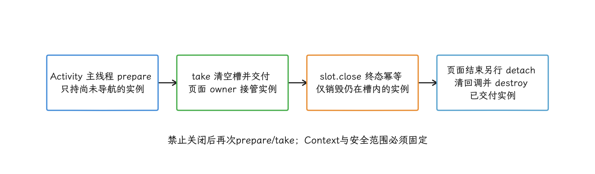
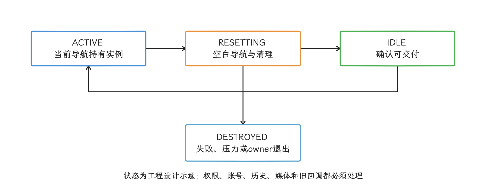
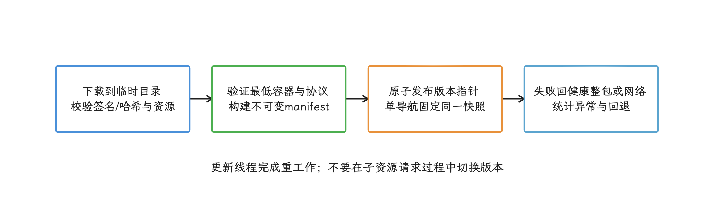
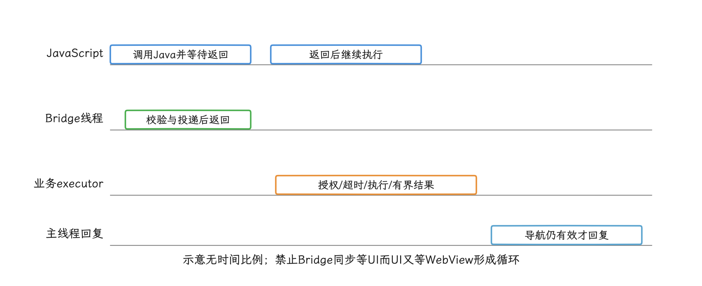
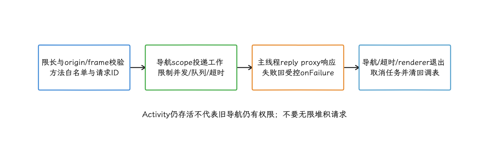
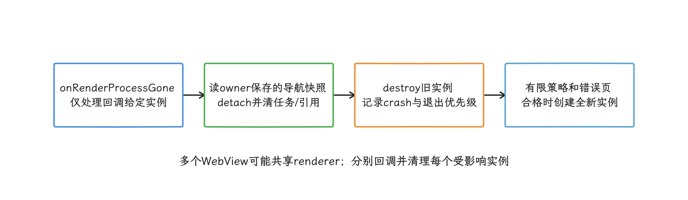

# WebView 性能优化实战

WebView 页面性能由实例初始化、Chromium 渲染、资源加载和页面脚本共同决定，只优化其中一段，瓶颈往往换个位置。这一篇我们按这个思路展开：先按业务可见节点拆开页面打开时间，再依次处理启动初始化（startup）与实例所有权、离线包与缓存、JS Bridge 和页面侧执行，最后沿显示路径与渲染进程生命周期定位卡顿、内存和恢复问题。

> 源码基线：Android 17 / API 37 / AOSP `android-17.0.0_r1`；内核 `android17-6.18-2026-06_r6`；WebView provider（实现包） 由设备上的可更新软件包提供，复现记录还要包含 provider 包名、`versionName` 和 `versionCode`。同为 Android 17 的设备可以安装不同 provider 版本，设备也可能使用其他内核分支。

本文库接口于 2026-10-25 复核到 AndroidX WebKit 1.18.0（2026-10-21 发布）；平台源码标签与可更新 provider 版本分别记录。Chromium 架构入口使用滚动 main，只说明架构角色，设备级实现仍须切到实际 provider revision。

## WebView 优化要同时看四段

页面打开后出现白屏、点了没反应、滚动掉帧或页面重载，我们通常把责任点拆到四段里找：

1. 宿主容器创建与 WebView 启动初始化；
2. 网络、HTTP 缓存、离线资源与页面数据；
3. Blink（Chromium 的网页渲染引擎）中的 JavaScript 执行、样式计算、布局、绘制、光栅化与合成；
4. 宿主 View 树遍历、HWUI（Android 硬件加速 UI 渲染器） 的 WebView functor（WebView 交给 HWUI 的绘制接口）、窗口缓冲区、SurfaceFlinger 系统合成与显示。

为什么要拆开？把所有耗时压成一个“WebView 加载时间”，很难判断改动省下了哪一段。预热能缩短首次 provider 装载，也会提高 App 启动期内存；离线包能省掉网络等待，版本混用时却会制造白屏；WebView 池能省掉实例构造，也可能把旧页面状态带入新页面。每项优化都要带上命中、代价、失败和回退四类指标，方便判断收益落在哪一段。


这条基线怎么用要看内容：框架、HWUI 和显示系统的行为查平台源码；内存回收，以及 dma-buf（设备间共享缓冲区）、fence（跨 CPU、GPU 和显示设备传递完成状态的同步对象）这类基础语义查内核；provider 是实现包，随设备上的可更新软件包变化。平台源码能说明 `WebViewFactory` 怎样选择和加载 provider，对应的 Chromium 源码版本（revision）仍要单独核对。更完整的线程与显示路径见 [13.9 Android 17 WebView 渲染管线](../../part2-performance/ch13-rendering-pipelines/09-webview-rendering.md)。

## 页面打开时间怎样量

### 用业务可用性定义终点

先把“打开”这件事量准，后面每一步优化才有对照。一次 H5（App 内嵌网页）打开过程至少记录下列时间点：

| 时间点 | 含义 | 适合回答的问题 |
|---|---|---|
| `open_requested` | App 原生侧（Native）收到打开页面请求 | 用户等待从何时开始 |
| `container_attached` | WebView 已加入可见容器 | 宿主容器花了多久 |
| `navigation_started` | App 调用 `loadUrl()` 或页面导航开始 | 导航前准备花了多久 |
| `page_commit_visible` | `onPageCommitVisible()` 到达 | 复用实例何时不会再画旧页面 |
| `page_usable_signal` | 页面主动报告首屏数据、事件处理与关键内容就绪 | 用户何时能完成当前业务动作 |
| `usable_visual_state` | 收到页面可用信号后，再通过 `postVisualStateCallback()` 确认对应 DOM（页面节点树）状态可被绘制 | 页面状态何时进入 WebView 绘制序列 |

`onPageFinished()` 只说明 main frame（页面顶层框架）完成加载。Android 官方文档明确指出，它不保证下一帧已经反映当时的 DOM 状态，也说明不了首屏数据和交互处理已经就绪。`onPageCommitVisible()` 的用途更窄：它保证后续绘制不会带出上一次导航的旧内容，适合控制复用 WebView 的显示时机。


`page_usable_signal` 应由页面按业务定义发出。例如商品页可在标题、价格、主图占位和购买按钮事件完成后上报；帮助页可在首屏正文与目录点击就绪后上报。页面侧还可以上报 FCP（首次内容绘制）、LCP（最大内容绘制）、Long Task（网页主线程长任务）与资源时间，但这些指标由可更新 provider 的 Web 能力实现，采集前要在目标 provider 上验证。

`postVisualStateCallback()` 覆盖提交时的 DOM、图像、CSS 动画、WebGL 与 canvas 状态，但不覆盖 `<video>` 状态；成功首绘还有 attach、可见性以及 GONE 时固定宽高等条件。它不提供屏幕已 present 的回执，也不保证提交之后才异步返回的数据已包含在内。

### 使用单调时钟并记录导航身份

采集时间点这件事有两个坑：时钟要选不受用户改时间影响的，回调要能区分是哪一次导航。下面的代码把这两件事一起做了：收集 App 原生侧时间点，并把 provider 身份写进同一条报告。

```kotlin
class H5OpenTiming(
    private val pageKey: String,
    private val navigationId: String
) {
    private val startNs = SystemClock.elapsedRealtimeNanos()
    private val marksNs = ConcurrentHashMap<String, Long>()

    fun mark(name: String, callbackNavigationId: String) {
        if (callbackNavigationId != navigationId) return
        marksNs.putIfAbsent(name, SystemClock.elapsedRealtimeNanos())
    }

    fun snapshot(): H5OpenReport {
        val provider = WebView.getCurrentWebViewPackage()
        val elapsedMs = marksNs.mapValues { (_, valueNs) ->
            TimeUnit.NANOSECONDS.toMillis(valueNs - startNs)
        }
        return H5OpenReport(
            pageKey = pageKey,
            navigationId = navigationId,
            elapsedMs = elapsedMs,
            providerPackage = provider?.packageName,
            providerVersionName = provider?.versionName,
            providerVersionCode = provider?.longVersionCode
        )
    }
}
```

`elapsedRealtimeNanos()` 不受用户改时间或网络校时影响，适合计算进程内耗时。每次需要单独统计的导航创建独立 collector；调用 `mark()` 必须传递回调捕获的 `navigationId`，不要在回调发生时读取可变的“当前 ID”。重定向链是否共享一次业务打开的 ID 由采集协议定义；缺少它时，旧页面的迟到回调可能写进新导航。`WebView.getCurrentWebViewPackage()` 自 API 26 起可用，查询本身不会装载 provider；适用范围最低为 API 29。


报告里我们还要带上页面 bundle（前端构建产物）版本、离线包版本、预热状态、实例来源、网络类型、设备内存档位、前后台状态和错误码。平均值只适合观察趋势；要判定一次发布，至少要看分位数、低内存设备、弱网和各 provider 版本。

## WebView 初始化耗时优化

### 把启动初始化、实例创建和首个页面分开

我们在 trace（时间轴） 里常看到的现象是：第一次使用 WebView 时，主线程同时承担 provider 选择、Java 类加载、原生库装载和 Chromium 启动初始化；这之后才是单个 WebView 的 provider 侧对象创建、渲染进程（renderer）建立、网络请求、解析、光栅化、functor 绘制与窗口提交。各阶段的触发时机随 provider 版本变化，一句话写成“构造 WebView 就创建 renderer 和 GPU 资源”是靠不住的，要分别测量。实验拆分方式如下：

| 阶段 | 对照实验 | 观察证据 |
|---|---|---|
| WebView 启动初始化 | 进程内首次调用与已经完成初始化后的同一路径 | 主线程阻塞位置、provider 与原生库装载 |
| 实例创建 | 启动初始化完成后比较 `WebView(context)` 的首个与后续实例 | 构造耗时、Java / 原生 / 图形内存增量 |
| 导航启动 | 空白实例调用 `loadUrl()` | renderer、网络服务、DNS / TLS、主文档 |
| 页面可用 | 导航开始到页面可用信号 | HTML、CSS、JS、数据、图片与 Bridge |
| 用户看到 | 页面状态到宿主窗口上屏（present） | renderer、functor、HWUI、SurfaceFlinger（SF）/ 硬件合成器（HWC） |

在 Perfetto（Android 系统跟踪工具） 里看到 `CrRendererMain`、raster worker（光栅化工作线程） 或 GPU service（GPU 服务） 线程出现，只说明对应执行域已经活动。线程名会随 provider 改版变化，诊断时还要结合进程关系、slice（时间片）、调用栈与 SurfaceFlinger layer（合成图层）。


### AndroidX WebKit 1.16.0 起稳定的异步启动初始化

启动初始化这段的现成解法是异步启动 API：截至 2026-10-25，AndroidX WebKit 最新稳定版是 1.18.0，异步启动 API 在 1.16.0 进入稳定状态，该版本把 `androidx.webkit:webkit` 的最低支持 SDK 提升到 24。`WebViewCompat.startUpWebView()` 把可以后台执行的启动工作交给指定 executor（任务执行器），provider 支持相应异步模式时，把 UI 工作按配置分段；缺少底层能力时库有兼容回退，不能假定每个 provider 都有相同分段和诊断能力。启动初始化每个进程只发生一次；回调到达前访问其他 `android.webkit` 或 `androidx.webkit` API，UI 线程仍可能等待尚未完成的部分。


下面的代码用于在可控时机启动 WebView，并记录启动初始化是否曾阻塞 UI 线程。

```kotlin
class WebViewBootstrap(
    private val executor: Executor,
    private val metrics: WebViewStartupMetrics
) {
    fun start(
        context: Context,
        onReady: () -> Unit,
        onFailure: (WebViewStartupException) -> Unit
    ) {
        val config = WebViewStartUpConfig.Builder(executor).build()

        WebViewCompat.startUpWebView(
            context.applicationContext,
            config,
            object : WebViewOutcomeReceiver<
                WebViewStartUpResult,
                WebViewStartupException
            > {
                override fun onResult(result: WebViewStartUpResult) {
                    metrics.record(
                        uiBlockingLocations =
                            result.uiThreadBlockingStartUpLocations,
                        backgroundBlockingLocations =
                            result.nonUiThreadBlockingStartUpLocations
                    )
                    onReady()
                }

                override fun onError(error: WebViewStartupException) {
                    onFailure(error)
                }
            }
        )
    }
}
```

回调运行在主线程。正常路径可以等 `onResult()` 后再创建 WebView；异常路径要记录并停止继续访问 WebView API，因为官方文档指出启动失败后，后续调用很可能抛异常或使进程崩溃。`startUpWebView()` 允许多处调用，已经完成时会很快回调，业务层仍应避免无限重试。

`WebViewStartupMetrics` 是业务接口，以上两项应接收可空 `List<StartUpLocation>?`：null 记为“不支持诊断”，空列表才是已支持但未记录到阻塞位置。executor 拒绝提交等同步调用失败及 provider 装载阶段异常也不等于一定经 `onError()` 送达；owner 应提供受控失败状态，避免在未收到成功回调时误判已就绪。


那该在什么时机调用？这取决于页面是不是启动主路径：


- App 启动不依赖 H5：在首屏关键工作结束后、预测用户即将进入 H5 前启动，并尽量等待回调；
- App 启动依赖 H5：可在 `Application.onCreate()` 较早调用，让后台部分与其他启动工作并行；创建 WebView 前仍要减少同一时段的 UI 线程任务；
- H5 使用率很低：保持按需启动，通常比常驻 provider 与 renderer 更省内存。

如果业务只想提前执行后台部分，可用 `setShouldRunUiThreadStartUpTasks(false)` 构建第一次配置；需要 WebView 前再以 `true` 调用一次，完成余下的 UI 线程工作。两次调用之间访问 WebView API，仍会让调用线程等待初始化进度。

老项目里常见的 `WebSettings.getDefaultUserAgent()` 强制预热属于旧式绕行手段：UA（User-Agent） 查询的隐式初始化范围与时序缺少稳定契约，也拿不到启动阻塞位置，当前官方启动指南建议迁移到 `startUpWebView()`。

### 预创建的适用条件与所有权

异步启动解决不了全部问题：如果系统 trace 仍显示单个 WebView 实例创建占用可观的主线程时间，并且目标页面大概率会用上预创建实例，可以评估预创建。预创建实例需要一个明确的所有者：

- 它在 UI 线程创建和销毁；
- 它使用将来展示它的 Activity Context；
- 它只服务同一个 Activity 生命周期和同一个安全域；
- Activity 结束、进程进入内存压力状态或预测失效时销毁。

下面的单槽实现只缓存尚未导航的空白实例，用于说明最小所有权范围。

```kotlin
@MainThread
class ActivityWebViewSlot(
    private val activity: Activity
) : Closeable {
    private var idle: WebView? = null
    private var closed = false

    private fun checkUsable() {
        check(Looper.myLooper() == Looper.getMainLooper())
        check(!closed && !activity.isFinishing && !activity.isDestroyed)
    }

    fun prepare() {
        checkUsable()
        if (idle == null) {
            idle = WebView(activity)
        }
    }

    fun take(): WebView {
        checkUsable()
        return idle.also { idle = null } ?: WebView(activity)
    }

    override fun close() {
        check(Looper.myLooper() == Looper.getMainLooper())
        if (closed) return
        closed = true
        val unused = idle
        idle = null
        unused?.destroy()
    }
}
```

这个实现没有复用加载过页面的实例，也没有跨 Activity 改 Context，两条红线是有意的：用 Application Context 创建后再展示，可能在主题资源、窗口 token（标识所属窗口的令牌）、文件选择、Autofill（自动填充）、弹窗和其他 UI 能力上出问题；用 `MutableContextWrapper` 切换基础 Context，provider 内部保存的所有引用也未必都已更新。只为启动初始化提速时，异步启动比缓存一个不可见 WebView 更容易控制。

`take()` 交付后，实例所有权转移给页面 owner；slot.close 只销毁仍在槽内的空白实例，已交付实例仍由页面在 Activity 退出/renderer 退出时移除并销毁。slot 关闭后不得再次 prepare/take，不能把“槽已关闭”误当作已交付实例也已释放。

<!-- gracker-diagram: a247-08-blank-slot-ownership -->


图：槽的关闭不代表已经交付的页面实例也已销毁。

### WebView 池的状态机与准入

比预创建更进一步的是复用加载过页面的实例。这种实例带有导航历史、页面 JavaScript 状态、Bridge、客户端回调、表单、焦点、滚动位置、媒体、权限请求和 provider 侧资源，直接放回池里会把旧状态带给下一个页面，所以放回之前要经历 `ACTIVE → RESETTING（重置中） → IDLE`（空闲），任何清理失败都转入 `DESTROYED`。这里最容易踩的坑是 `about:blank` 导航：它是异步操作，发起后立即把实例交给下一位调用者，会产生旧页面回调、旧内容短暂显示和历史串页。

<!-- gracker-diagram: a247-09-pool-reset-state-machine -->


图：about:blank发起后不能立即归还；重置和销毁分别定义。

池的准入条件应同时满足：

- 同一个 Activity 或明确的容器所有者；
- 同一账号与同一隐私范围；
- 同一组可信 origin（协议、主机和端口共同定义的网页安全来源）、Bridge 能力和 WebSettings 策略；
- 页面明确支持复用；
- trace 证明复用收益仍然存在；
- 有内存压力收缩与 renderer 退出处理。

池容量没有跨设备通用值，应从空闲实例 PSS（按比例归属进程的物理内存）与图形内存增量、并发打开数量、低内存设备回收率和池命中率推导。支付、第三方登录、用户输入 URL、外部网页、文件上传和权限敏感页面更适合新建实例或交给 Custom Tabs。


归还实例时还要避开几类会影响共享状态的全局操作：

- `clearCache(true)` 会影响共享 profile（WebView 浏览数据空间） 的 HTTP 缓存；
- 清 Cookie 或 Web Storage 会影响同一数据目录下的其他 WebView；
- 替换 `WebViewClient`、`WebChromeClient` 与 Bridge 后，业务持有的协程、回调表和权限请求仍需显式取消；
- `clearHistory()` 只处理历史列表，页面执行环境是否已经清空要另行确认。

### 多进程要先配置数据目录

多进程使用 WebView 的 App，要先解决各进程的数据目录分配。Android P / API 28 起，`WebView.setDataDirectorySuffix()` 用于给同一 App 的不同进程分配独立 WebView 数据目录。调用顺序很严格：它必须早于本进程的任何 WebView 实例，也必须早于其他 `android.webkit` 方法。需要异步启动的进程，应先设置 suffix（目录后缀），再调用 `startUpWebView()`。

最多一个使用 WebView 的进程使用默认目录，其余进程各用唯一 suffix，且 suffix 必须避开路径分隔符。目录分开之后，Cookie、LocalStorage 与缓存也就不会直接共享；确有跨进程登录需求时，要通过受控协议显式同步。大多数 App 更合适的做法是把 WebView 集中在一个进程，并在其他进程尽早调用 `WebView.disableWebView()`，防止 SDK 意外初始化。


## 离线包与资源拦截

### 缓存层各自解决什么

WebView 的缓存与预取，我们按谁来控制拆开看：

| 层级 | 控制者 | 适合内容 | 主要约束 |
|---|---|---|---|
| HTTP 缓存 | provider 与服务器响应头 | 可缓存的 HTML、CSS、JS、图片与接口响应 | 遵守 `Cache-Control`、缓存验证器、`Vary` 与 Cookie 语义 |
| Service Worker / Cache Storage（网页后台脚本 / 网页缓存空间） | 受控网页 | 页面团队可维护的离线与更新策略 | 生命周期、作用域、版本迁移与 provider 支持 |
| APK 静态资源 | App | 协议、帮助、内置说明等固定内容 | 随 App 发版，适合 `WebViewAssetLoader` |
| 动态离线包 | App 与发布系统 | 强控制业务的 HTML、CSS、JS、图片 | 签名、原子切换、同版本资源、灰度与回退 |
| 推测加载（speculative loading） | provider 与 App | 高概率的后续导航 | 网络、CPU、内存、隐私与未命中流量 |

这些缓存层要守住一条底线：命中本地内容时仍保留 HTTP 与 origin（来源） 语义。把任意 URL 映射到本地文件、忽略 MIME（媒体类型）、把多个版本的 HTML 与 JS 混用，都会让“加速”转成安全或一致性问题。


### `shouldInterceptRequest()` 的线程与协议边界

`WebViewClient.shouldInterceptRequest()` 在非 UI 线程回调，且可能并发发生。实现中不得访问 View、等待 UI 线程；解压大包、校验整包这类工作也要离开高频路径，交给更新线程：先完成下载、签名与哈希验证和解压，再用不可变索引原子切换到新版本。

下面的代码只对已经验证并发布的 HTTPS GET 资源返回离线内容。

```kotlin
class SignedOfflineClient(
    private val index: OfflineIndex
) : WebViewClient() {
    override fun shouldInterceptRequest(
        view: WebView,
        request: WebResourceRequest
    ): WebResourceResponse? {
        val url = request.url
        if (request.method != "GET" || url.scheme != "https") {
            return null
        }
        if (request.requestHeaders.keys.any {
                it.equals("Range", ignoreCase = true)
            }) {
            return null
        }

        val entry = index.openVerified(
            url = url,
            isMainFrame = request.isForMainFrame
        ) ?: return null

        return WebResourceResponse(
            entry.mimeType,
            entry.charset,
            200,
            "OK",
            entry.responseHeaders,
            entry.inputStream
        )
    }
}
```

`OfflineIndex` 应绑定一份不可变 manifest（资源清单与校验信息），并区分主文档与子资源。主文档按规范化后的完整 URL 或受控模板匹配；子资源还要核对该 manifest 中的 URL、哈希、MIME、响应头和版本。

`OfflineIndex`、entry 类型是应用自定义契约：必须在更新阶段完成签名/路径穿越防护/资源大小校验，为每次导航固定清单和账号范围，并按 Cookie、授权及 Vary 等响应语义决定是否允许本地命中。仅通过 GET+HTTPS 检查不足以允许用户私有接口或任意同域资源；返回流由 WebView 消费，异常分支由实现关闭尚未交付的流。


这个示例把 Range（字节范围） 请求交回 provider；若离线包需要承载音视频或大文件，必须完整实现字节范围与 `206 Partial Content` 语义。返回 `null` 表示交回 provider 正常加载。

响应头也要按资源返回各自的，页面所需的 CSP（内容安全策略）、缓存与内容类型语义都要保留在内。

该回调还有三个常被漏掉的限制：

- `javascript:`、`blob:`、`file:///android_asset/` 与 `file:///android_res/` 不进入该回调；
- 发生重定向时，只为初始资源 URL 回调，后续重定向 URL 不会再次进入；
- Safe Browsing（安全浏览检查） 默认仍会检查相应 URL。

因此，导航策略还要独立校验可信主文档及受控跳转；主框架白名单也不能替代对子资源、iframe 与 Bridge 权限的校验。拦截器看不到重定向后的每一跳，不能据此声称已完整检查最终来源。


### 静态本地内容使用 `WebViewAssetLoader`

`WebViewAssetLoader` 可以把 APK 的 assets 或 resources 映射到形如 HTTP(S) 的 URL，使页面继续遵守 Same-Origin Policy（同源策略）。它比 `file://` 更适合协议、帮助与内置说明页面。`file://` 与 `data:` 属于 opaque origin（无法与其他来源建立同源关系的不透明来源）；开启 `setAllowFileAccessFromFileURLs(true)` 或 `setAllowUniversalAccessFromFileURLs(true)` 会扩大文件访问风险。

使用默认的 `https://appassets.androidplatform.net/` 时，要划清资源路径与线上 origin 各自的范围；使用自有域名时，要防止本地映射和线上同域资源混在一起。动态离线包仍需自己的签名、版本与回退系统，`WebViewAssetLoader` 不负责这些发布问题。


### 动态离线包的发布协议

一份可回退的离线包至少需要：

1. manifest 标识业务页面、包版本、最低容器版本、资源列表、MIME 与哈希；
2. 下载后验证签名和每个资源的哈希；
3. 在临时目录完成验证与解压，再通过原子指针发布；
4. 单次导航固定一个 manifest snapshot（清单快照），禁止中途切版本；
5. 本地未命中时回网络，校验失败时回上一个健康版本；
6. 监控命中率、校验失败、解析错误、JS 异常、白屏、回退和版本分布。

HTML、JS 与 CSS 必须来自同一兼容集合。只更新主文档或只更新一个 bundle，可能导致 Bridge 协议、chunk（构建分块） 清单或资源哈希对不上。回退单位也应是一整份 manifest。

<!-- gracker-diagram: a247-16-manifest-atomic-publish -->


图：HTML/JS/CSS/Bridge协议需来自兼容集合，回退单位是清单。

### 预连接、预取与预渲染

网络这一段还有一套官方工具是推测加载。AndroidX WebKit 的当前文档把它拆成三类；具体能否使用取决于项目引入的 AndroidX WebKit 版本、API 注解和设备 provider 的 `WebViewFeature` 能力：

- `Profile.preconnect()` 按 origin 提前完成 DNS（域名解析）、TCP/TLS 或支持时的 QUIC 连接准备，资源成本最低，必须从 UI 线程发起；
- 旧实验接口 `Profile.prefetchUrlAsync()` 按 HTTPS URL 获取主 HTML 并写入 profile 的网络缓存，不会一并执行 JS 或拉取 CSS，可以从任意线程发起；
- `WebViewCompat.prerenderUrlAsync()` 绑定具体 WebView，后台创建可激活页面，CPU、内存与网络成本最高。

`prerenderUrlAsync()` 必须从 UI 线程发起。


预取的后台请求会跳过 `shouldInterceptRequest()`；用户导航时，主 HTML 才进入拦截回调。如果此时返回自定义 `WebResourceResponse`，provider 会采用拦截结果并绕过预取缓存。离线包与 provider 预取同时启用时，必须设计清楚谁拥有主文档。

预取匹配也受请求与 profile 状态影响；旧接口文档明确 `loadUrl(url, additionalHttpHeaders)` 的附加头不参与预取匹配，不能仅以 URL 相同就断言认证/业务变体相同。取消是 best effort，仍需统计未命中流量和迟到完成。


2026-10-25 核对 1.18.0 发布源码：`Profile.preconnect()` 仍标 `ExperimentalPreconnect`；旧 `Profile.prefetchUrlAsync()` 已标 `@Deprecated` 且仍为 `ExperimentalUrlPrefetch`。源码推荐的 `PrefetchCache.prefetchUrlAsync()` 也仍实验，其获取入口 `Profile.getPrefetchCache()` 在该发布包中还带 `@RestrictTo(LIBRARY_GROUP)`；即使滚动指南出现该入口，也不能把它当作外部应用的稳定公开 API。迁移需同时核对已发布公共接口、lint、provider feature 和实际 SDK，避免只按方法存在就调用受限接口。带参数的 prerender 配置也需逐个核对注解、灰度与回退。


触发阈值怎么定？固定点击率或固定字节数都靠不住，要由页面转化率、网络类型、未命中流量、服务端 QPS（每秒请求数）、取消率、过期率、内存压力和用户隐私共同决定，并通过远程配置与 A/B 实验调整。预渲染只适合用户高度可能进入且副作用受控的页面；带登录写操作、支付、音视频或敏感权限的页面要单独评估。

## JS Bridge 性能优化

### 明确两侧线程

这里的 Bridge 指 JavaScript 与 App 原生侧之间的通信接口。它在线程上最容易出问题，我们先把两侧的线程规则摆清楚：`addJavascriptInterface()` 暴露的方法虽然运行在该 WebView 的私有后台线程，但调用仍是同步的，JavaScript 要等 Java 方法返回。Bridge 方法里执行磁盘 I/O、数据库等待、网络请求或跨线程 `join()`，会阻塞网页调用方；如果它又同步等待主线程，而主线程正在等待 WebView 相关结果，还可能形成循环等待。

反方向调用也要注意：`evaluateJavascript()` 只能在创建 WebView 的 UI 线程调用，结果回调也在 UI 线程。它是异步 API，用 `CountDownLatch.await()`、`Future.get()` 或阻塞式协程桥接把它改成同步等待是禁止的。

Bridge 的处理步骤更适合保持短小：

<!-- gracker-diagram: a247-20-bridge-sync-and-async -->


图：Java暴露方法运行在私有后台线程，但调用该方法的JavaScript同步等待返回。

1. 校验长度、协议版本、方法名与字段；
2. 生成或读取 `requestId`；
3. 把工作投递到有生命周期的协程或 executor；
4. 立即从 Java 暴露方法返回；
5. 完成后在 UI 线程通过消息通道或安全编码的 JS 回调响应；
6. 页面销毁、导航切换、超时或 renderer 退出时取消未完成请求。

### 优先采用可校验 origin 的消息通道

选 Bridge 通道时还要过安全这一关。`addJavascriptInterface()` 会把对象注入符合页面加载条件的所有 frame（网页框架），而 App 原生侧单看方法调用，无从得知具体调用 frame 的 origin。页面包含第三方 iframe（内嵌框架）时，只校验 main frame URL 保护不了 Bridge。

支持 `WEB_MESSAGE_LISTENER` 的 provider 可以通过 `WebViewCompat.addWebMessageListener()` 指定 origin 规则，并在回调中获得 `sourceOrigin` 与 `isMainFrame`。下面的代码把耗时工作移到传入的协程调度器，并使用 reply proxy（消息回复代理） 返回结果。


```kotlin
@MainThread
fun installAccountBridge(
    webView: WebView,
    scope: CoroutineScope,
    dispatcher: CoroutineDispatcher,
    service: AccountBridgeService,
    onFailure: (Exception) -> Unit
) {
    check(WebViewFeature.isFeatureSupported(WebViewFeature.WEB_MESSAGE_LISTENER))
    val trustedOrigin = Uri.parse("https://h5.example.com")

    WebViewCompat.addWebMessageListener(
        webView,
        "AccountBridge",
        setOf(trustedOrigin.toString()),
        object : WebViewCompat.WebMessageListener {
            override fun onPostMessage(
                view: WebView,
                message: WebMessageCompat,
                sourceOrigin: Uri,
                isMainFrame: Boolean,
                replyProxy: JavaScriptReplyProxy
            ) {
                if (
                    !isMainFrame ||
                    sourceOrigin != trustedOrigin ||
                    message.type != WebMessageCompat.TYPE_STRING
                ) {
                    return
                }
                val raw = message.data ?: return
                if (raw.length > service.maxRequestChars) {
                    return
                }

                scope.launch(dispatcher) {
                    try {
                        val reply = service.handle(raw)
                        withContext(Dispatchers.Main.immediate) {
                            replyProxy.postMessage(reply)
                        }
                    } catch (cancelled: CancellationException) {
                        throw cancelled
                    } catch (failure: Exception) {
                        withContext(Dispatchers.Main.immediate) {
                            onFailure(failure)
                        }
                    }
                }
            }
        }
    )
}
```

origin 规则应写成明确的 HTTPS origin，避免通配符。`scope` 必须按页面导航管理，而不只是 Activity 存活范围；导航切换或页面离开时取消它，防止旧请求回到新导航。长度限制只是入口保护，`service.handle()` 里还要完成协议版本、方法白名单、参数类型、授权、超时、并发/排队上限和响应大小检查。 `onFailure` 在主线程接收异常，必须轻量且自身不抛出；业务应返回固定的受控错误协议或记录失败，不能向页面泄露异常堆栈。

<!-- gracker-diagram: a247-22-bridge-lifecycle-and-failure -->


图：协程取消必须继续传播；服务异常不能直接成为未处理launch崩溃。

当 provider 缺少该特性而必须回退到 `addJavascriptInterface()` 时，只对全内容受控、不会加载第三方 frame 的页面注入。`removeJavascriptInterface()` 要到下一次加载才反映到 JavaScript，不能把调用完成当作当前文档立即失去权限；导航离开可信域前先在原生授权层撤销旧导航能力，并移除接口供后续文档生效；外部链接更适合使用新容器或 Custom Tabs。

### 协议要支持批量、超时和取消

一份可维护的 Bridge 消息封装（envelope）可以包含这些字段：

| 字段 | 用途 |
|---|---|
| `version` | 协议演进和兼容判断 |
| `requestId` | 响应配对、去重与取消 |
| `method` | 进入 App 原生侧方法白名单 |
| `params` | 结构化参数 |
| `deadlineMs` | 调用方允许的等待时间 |
| `traceId` | 串接页面、App 原生侧与服务端日志 |

页面获取用户、设备、网络、主题与实验配置时，优先一次批量请求。埋点也应分批提交，并在页面隐藏或达到上限时 flush（立即提交）。调用次数减少后，序列化、线程切换和回调调度都会下降；单包仍要受大小限制，避免把大图片、文件或超长 JSON 经字符串 Bridge 传输。

每个方法记录调用量、排队时间、执行时间、响应大小、失败码、超时和取消原因。只记录总平均耗时，会漏掉某个高频小调用造成的累计调度成本。


### `evaluateJavascript()` 只负责异步执行

下面的辅助函数用 JSON 字符串编码参数，避免把未转义内容直接拼进脚本。

```kotlin
@MainThread
fun WebView.resolveBridgeCall(
    requestId: String,
    payload: String,
    onEvaluated: (String?) -> Unit
) {
    val script = buildString {
        append("window.__nativeResolve(")
        append(JSONObject.quote(requestId))
        append(',')
        append(JSONObject.quote(payload))
        append(')')
    }
    evaluateJavascript(script, onEvaluated)
}
```

用这个辅助函数时注意：`onEvaluated` 收到的是 JavaScript 表达式结果的编码形式，页面业务响应本身要另行配对：业务通常依靠 `requestId` 完成响应配对；页面已销毁或导航身份变化时直接丢弃。脚本函数名也要固定在受控协议中，页面传入任意 JavaScript 代码是不接受的。


## 页面侧需要一起治理

前面几段都是 App 原生侧的事，但原生侧优化只能缩短容器、缓存和通信部分，页面仍要控制解析、执行、布局、绘制与资源：

- 主文档尽快给出可读骨架，关键 CSS 避免被非关键资源阻塞；
- JS bundle 按路由和功能拆分，非首屏任务延后，长任务拆成可调度的小段；
- 服务端或页面缓存直接提供首屏数据时，要处理过期与一致性；
- 图片按显示尺寸与设备能力下发，使用响应式资源，减少解码和 GPU 纹理压力；
- 滚动中合并样式读写，减少强制同步布局；动画评估 `transform`（几何变换）、`opacity`（透明度） 与合成层数量；
- App 原生侧运行时信息批量提供，避免页面启动阶段循环调用 Bridge；
- 页面通过 `PerformanceObserver`、资源时间和业务 mark（时间标记） 上报可用性，并带 bundle 与容器版本。

资源预算应按页面类型制定。资讯正文、商品详情和活动页的 DOM、JS、图片与交互目标不同，统一的固定阈值会把合理页面误报，也会放过高端机上暂时不明显的问题。预算由线上分位数、低端机 trace 和发布回归共同校准。


## WebView 卡顿要沿显示路径定位

### 普通网页主体通常进入宿主窗口

滚动掉帧时，我们要先知道网页内容走的是哪条显示路径。标准硬件加速路径可以概括为：

1. renderer 侧执行 JavaScript、样式计算、布局和绘制，并准备 compositor frame（合成器帧）与光栅化资源；
2. provider 的 browser（浏览器进程）/ GPU 侧把结果交给宿主 WebView；
3. App 主线程在 View 树遍历中记录 WebView functor 与绘制范围；
4. HWUI RenderThread 执行 DrawFn，把网页内容与其他 View 合入 App 窗口缓冲区；
5. 窗口缓冲区经 BLAST / BufferQueue（窗口缓冲区队列） 交给 SurfaceFlinger，再由 CompositionEngine（合成引擎） / HWC 送显。

这是内容与提交职责关系，不是每帧严格串行的五段：宿主主线程可能先记录 functor，而 renderer 后续才产生新帧；HWUI draw 再消费届时可用内容。GPU Service、Network Service 在 Chromium WebView 架构中运行于宿主进程内，不能因名称含 GPU 就预设有独立 GPU 进程；实际 PID 与 provider revision 需取证。


普通 DOM 图层、CSS transform、canvas 和图片通常不会逐个成为 SurfaceFlinger layer。视频、受保护内容、provider overlay（叠加层） 或 `WebChromeClient.onShowCustomView()` 托管的全屏媒体可能增加独立 Surface / `SurfaceControl` layer。所以看到额外 layer 时，先核对所有者、父节点、缓冲区与 transaction（合成事务），再下结论。

窗口关闭硬件加速、目标 Canvas 为软件 Canvas，或 provider 的硬件绘制请求执行失败时，WebView 可能进入软件绘制路径。该结论需要 Canvas 加速状态、调用栈、provider 日志和 GPU / DrawFn trace 共同支持；设备性能较低或某段 CSS 很复杂，只能作为排查线索。

### Perfetto 证据表

| 现象 | 优先检查 | 后续证据 |
|---|---|---|
| `loadUrl()` 前主线程长时间阻塞 | WebView 启动初始化或实例构造 | 启动阻塞位置、provider 装载、原生库 |
| renderer 主线程长任务 | JS、样式计算、布局、绘制 | Chrome DevTools、Long Task、renderer CPU 栈 |
| 光栅化或解码延迟 | tile（网页分块）、图片解码、缓存未命中 | raster worker、Skia / 解码时间片、I/O 与内存 |
| renderer 已有新帧，宿主迟迟未绘制 | App 主线程或 View 树遍历 | `Choreographer#doFrame()`、Runnable、ViewRoot |
| RenderThread 的 WebView DrawFn 变长 | 资源导入、functor 同步、GPU service 或 fence | DrawFn 时间片、GPU 队列、线程状态、fence |
| 宿主窗口已入队，屏幕仍旧 | acquire fence（获取栅栏）、SF latch（接收缓冲区）、合成事务或显示合成 | FrameTimeline（帧时间线）、layer、composition type（合成类型）、present fence（上屏栅栏） |
| 网页 UI 正常，视频卡顿或漂移 | media producer（媒体生产者）/ overlay transaction | 编解码输出、视频图层缓冲区、几何事务 |

长时间片还要结合线程状态解释。Running 表示 CPU 正在执行；Runnable 长通常指向调度等待；Sleeping（休眠）、futex（用户态互斥量等待） 或 blocked（阻塞） 状态可能在等 IPC（进程间通信）、任务或 fence。只看时间片的 wall time（实际经过时间），容易把等待误算成计算。


追到这里还有一个常见误判要留意：网页合成器帧就绪，只说明内容已经备好，有没有被用户看到还要沿着显示路径往后追：普通主体要继续追宿主 App 窗口缓冲区与 FrameTimeline；媒体叠加层还要分别追视频缓冲区、几何事务和显示上屏。

## 内存、泄漏与渲染进程生命周期

### WebView 内存分散在多个进程和内存类型中

为什么 WebView 的内存问题容易被漏判？因为一个复杂页面的内存可能同时分布在多处：

- 宿主 Java 对象、Activity / Fragment 与回调；
- provider 浏览器进程侧的原生内存；
- 渲染进程的 DOM、V8 JavaScript 堆、图片解码结果与 raster tile（网页光栅化分块）；
- 宿主进程内 GPU Service 及驱动关联的纹理和图形资源（不能另算成必有的独立 GPU 进程）；
- 宿主 HWUI、窗口缓冲区与可选媒体图层。


只盯宿主进程的 Java 堆，会漏掉渲染进程和图形内存。所以我们排查时先把宿主及关联渲染进程的 PID（进程号） 记下来：`dumpsys meminfo` 看各类内存汇总，`/proc/<pid>/smaps_rollup`（内存映射汇总） 核对单进程内存映射汇总，Perfetto 的 process / memory counter（进程与内存计数器） 还原时间变化，再结合 LeakCanary 和 Chrome DevTools Memory 定位对象。空闲 WebView 池也要纳入 PSS（按共享页比例折算的实际物理内存） 和图形内存统计。

如果内存问题表现为抖动，我们再往内核侧看。在 `android17-6.18-2026-06_r6` 内核侧，可以继续检查 page fault（缺页）、direct reclaim（业务线程同步回收内存）、`kswapd`（内核后台回收线程）、PSI memory（内存压力停顿指标）、设备启用时的 zram（压缩内存交换区）、dma-buf 分配与 GPU driver wait（GPU 驱动等待）。这些内核指标能说明系统压力和等待发生在哪里；要指出页面对象由谁持有，还是要回到宿主、渲染进程与 provider 分析。

### 展示实例的销毁顺序

内存问题的另一头是释放。正常销毁时，先切断宿主引用和回调，再在创建 WebView 的线程调用 `destroy()`；展示态 WebView 通常由主线程创建，所以销毁也多在主线程。下面的代码用于销毁不再复用的实例。

```kotlin
@MainThread
fun destroyWebView(
    webView: WebView,
    bridgeNames: Collection<String>
) {
    (webView.parent as? ViewGroup)?.removeView(webView)
    webView.stopLoading()
    bridgeNames.forEach(webView::removeJavascriptInterface)
    webView.webChromeClient = null
    webView.webViewClient = WebViewClient()
    webView.setDownloadListener(null)
    webView.destroy()
}
```

销毁前，页面所有者还要取消协程、Bridge 回调表、文件选择、权限请求和业务监听器。已经决定销毁时，无需先导航到 `about:blank` 再等待；这会启动一次额外导航并产生更多回调。`clearCache()`、Cookie 清理和 Web Storage 清理作用于共享的数据配置空间（profile），单实例销毁里不要捎带。

如果实例将进入池，流程又不同：它要先进入 `RESETTING`，完成异步空白导航、旧内容不可见确认、历史与业务状态清理，再进入 `IDLE`。销毁和复用是两条流程，不要共用一个语义含糊的 `release()`。


### 渲染进程退出后的恢复

还有一类问题与内存直接相关：渲染进程被系统回收。API 26 起，渲染进程崩溃或被系统回收会触发 `WebViewClient.onRenderProcessGone()`，回调参数中的 WebView 已经不可使用。应用选择继续运行时，必须从 View 树移除它、清理所有引用并销毁，再按业务状态创建新实例。下面的 `WebViewClient` 实现把“清理旧实例”和“是否重试”交给明确的所有者与策略。

```kotlin
class RecoveringWebViewClient(
    private val owner: WebViewOwner,
    private val retryPolicy: RendererRetryPolicy,
    private val metrics: RendererGoneMetrics
) : WebViewClient() {
    override fun onRenderProcessGone(
        view: WebView,
        detail: RenderProcessGoneDetail
    ): Boolean {
        val failedNavigation = owner.navigationSnapshotFor(view)
        owner.detachAndClearReferences(view)
        view.destroy()

        val retry = retryPolicy.shouldRetry(
            navigation = failedNavigation,
            didCrash = detail.didCrash()
        )
        metrics.record(
            didCrash = detail.didCrash(),
            rendererPriorityAtExit = detail.rendererPriorityAtExit(),
            retryAllowed = retry
        )
        owner.showRendererFailure(failedNavigation, retry)
        return true
    }
}
```

`navigationSnapshotFor()` 读取所有者在导航期间保存的导航快照，避免在渲染进程已退出后再调用旧 WebView 的 `getUrl()`。返回 `true` 表示宿主已经处理这次退出；返回 `false` 时，渲染进程崩溃会导致 App 一起崩溃，系统回收则可能使 App 被终止。多个 WebView 可以共享一个渲染进程，系统会为每个受影响实例分别回调；每次只清理参数中的实例。

示例中的 `WebViewOwner`、重试策略与 metrics 是业务契约，并非 Android SDK 类型；detachAndClearReferences 必须取消该导航任务/Bridge/媒体与权限回调、从父容器移除旧实例，并避免触碰旧 renderer。清理中任一异常都可能妨碍返回 true，生产实现应保证清理路径和错误页显示可终结且幂等。

<!-- gracker-diagram: a247-30-renderer-recovery -->


图：旧renderer退出后实例不能继续使用；不要再调用旧getUrl获取现场。

重试策略要区分程序崩溃与内存回收，并受页面 URL 模板、前后台状态、Activity 生命周期和次数预算限制。同一页面连续崩溃时自动反复重载会形成 crash loop（崩溃循环），此时应转到错误页，并上报 provider 版本、页面版本与复现信息。也只有先具备这条恢复路径，才谈得上调用 `setRendererPriorityPolicy()` 降低不可见渲染进程的优先级。


OOM（out of memory，内存不足）与恢复设计见 [20.5 OOM、进程资源治理与 WebView Renderer 恢复](../ch20-stability/05-oom-webview-renderer-recovery.md)。

### WebView 预留地址的处理原则

32 位设备上还流传着一种“优化”：部分 32 位系统与 provider 会在进程 maps 中出现 WebView 相关的虚拟地址预留，有人通过 hook（函数挂钩）、`munmap()` 或私有符号去释放这块区域。这条捷径走不得。虚拟地址范围很大，同等大小的物理内存未必已经被占用；这样释放还会破坏 provider 后续初始化的前提，也适配不了厂商实现和 provider 更新造成的差异。

工程治理应采用 64 位进程、明确的 WebView 进程范围、受控池容量、页面资源预算、渲染进程恢复与内存压力收缩。预留 VMA（虚拟内存区域） 只作为特定设备上的分析线索，不要当成通用优化方案。

## 一套可执行的优化顺序

这些手段不必同时上，WebView 优化适合按测量结果逐步推进：

1. 固定 Android 系统构建版本、provider、App、容器、页面和离线包版本；
2. 用 `navigationId` 关联原生侧、页面侧与显示端的时间点；
3. 在冷进程中分别测量启动初始化、实例创建、导航和页面可用时间；
4. 用 `startUpWebView()` 处理已经确认的启动初始化阻塞，再复测启动期 CPU 与内存；
5. 实例构造仍是显著成本时，评估 Activity 作用域预创建；池化需要另做状态污染和内存实验；
6. 网络占主导时，按 HTTP 缓存、静态资源、动态离线包、preconnect / prefetch / prerender 的成本逐级选择；
7. Bridge 按线程、origin、批量、payload（载荷）、超时和取消能力检查；
8. 滚动与首屏绘制问题按渲染进程、functor、宿主窗口、SurfaceFlinger / HWC 的顺序追踪；
9. 所有策略配置开关、灰度、观测和回退。

发布检查可以使用下表：

| 项目 | 必须具备的证据 | 失败时的动作 |
|---|---|---|
| 启动初始化 | 阻塞位置、命中率、目标分位数、启动期内存 | 关闭或推迟预启动 |
| 预创建 / 池 | 实例成本、池命中、状态污染测试、空闲 PSS | 收缩容量或停用复用 |
| 离线包 | 签名 / 哈希值、同版本资源、原子发布、回退演练 | 回到网络资源或上一个健康包 |
| 推测加载 | 命中、未命中流量、QPS、取消、内存 | 降级为 preconnect 或关闭 |
| Bridge | 来源、方法白名单、线程、超时、载荷与取消 | 禁用能力或切换到只读协议 |
| 页面 | 可用信号、Web 指标、bundle（前端资源包）版本、低端机结果 | 回退资源包或关闭高开销功能 |
| 渲染进程 | `onRenderProcessGone()`、重试预算、错误页 | 停止自动重载 |
| 显示 | 从渲染进程产帧到 display present（屏幕显示）的分段证据 | 在出现延迟的执行域修复 |

单个 P50（中位数） 变快不足以证明方案有效。还要确认 P95 / P99（尾部高分位） 尾部分位、低内存设备、弱网、后台切前台、provider 更新、页面回退与 App 启动都没有出现超出可接受范围的回归。


## 全文小结

WebView 优化要沿 provider 启动、实例所有权、导航与缓存、页面执行、Bridge 和显示提交一路做下来，段段要有测量支撑，单个预热开关顾不过来这么多环节。我们先用 `navigationId` 与 provider 版本固定现场，再只在已证明的阻塞点上引入异步启动、预创建、离线包或推测加载。

一项方案只有同时定义命中、资源代价、状态隔离、失败恢复和灰度回退才可以发布。页面发出可用信号，只能说明页面侧就绪，用户当时是否已经看到，要以显示路径为准；收尾时要把 renderer、WebView functor、宿主窗口、SurfaceFlinger 与 actual present 放进同一条时间线核对。

## Android 17 源码与文档入口

### Android 平台

- [`WebView.java`](https://android.googlesource.com/platform/frameworks/base/+/refs/tags/android-17.0.0_r1/core/java/android/webkit/WebView.java)：API 线程约束、provider 代理、JS Bridge、data directory 与 renderer 策略。
- [`WebViewFactory.java`](https://android.googlesource.com/platform/frameworks/base/+/refs/tags/android-17.0.0_r1/core/java/android/webkit/WebViewFactory.java)：provider 选择、包校验、类加载与 factory 缓存。
- [`WebViewClient.java`](https://android.googlesource.com/platform/frameworks/base/+/refs/tags/android-17.0.0_r1/core/java/android/webkit/WebViewClient.java)：页面生命周期、资源拦截和 renderer 退出回调。
- [`RenderProcessGoneDetail.java`](https://android.googlesource.com/platform/frameworks/base/+/refs/tags/android-17.0.0_r1/core/java/android/webkit/RenderProcessGoneDetail.java)：退出原因与优先级信息。
- [`WebViewFunctor.h`](https://android.googlesource.com/platform/frameworks/base/+/refs/tags/android-17.0.0_r1/libs/hwui/private/hwui/WebViewFunctor.h)：Android 17 中 HWUI 与 provider 的 DrawFn / overlay 约束。

### WebView provider、Jetpack 与 Linux 内核

- [Chromium Android WebView architecture](https://chromium.googlesource.com/chromium/src/+/refs/heads/main/android_webview/docs/architecture.md)：provider 的 browser、renderer 与 service 架构；排障时切换到设备 provider 对应 revision。
- [AndroidX WebKit 发布记录](https://developer.android.com/jetpack/androidx/releases/webkit)：本文核对的 1.18.0 稳定版、1.16.0 startup 稳定化记录、最低 API 级别与变更记录。
- [WebView startup 优化](https://developer.android.com/develop/ui/views/layout/webapps/optimize-webview-startup) 与 [`WebViewCompat.startUpWebView()`](https://developer.android.com/reference/androidx/webkit/WebViewCompat#startUpWebView(android.content.Context,androidx.webkit.WebViewStartUpConfig,androidx.webkit.WebViewOutcomeReceiver))：稳定版异步启动初始化的时序与错误处理。
- [`WebViewClient`](https://developer.android.com/reference/android/webkit/WebViewClient)、[本地内容](https://developer.android.com/develop/ui/views/layout/webapps/load-local-content) 与 [speculative loading](https://developer.android.com/develop/ui/views/layout/webapps/speculative-loading)：回调约束、`WebViewAssetLoader`、preconnect、prefetch 与 prerender。
- [`WebViewCompat.addWebMessageListener()`](https://developer.android.com/reference/androidx/webkit/WebViewCompat#addWebMessageListener(android.webkit.WebView,java.lang.String,java.util.Set%3Cjava.lang.String%3E,androidx.webkit.WebViewCompat.WebMessageListener))：可校验消息来源的 Bridge。
- Linux 内核 `android17-6.18-2026-06_r6` 的 [`dma-buf.c`](https://android.googlesource.com/kernel/common/+/refs/tags/android17-6.18-2026-06_r6/drivers/dma-buf/dma-buf.c)、[`sync_file.c`](https://android.googlesource.com/kernel/common/+/refs/tags/android17-6.18-2026-06_r6/drivers/dma-buf/sync_file.c) 与 [Linux 6.18 dma-buf 文档](https://docs.kernel.org/6.18/driver-api/dma-buf.html)：缓冲区共享与 fence 的基础语义。

- [WebKit 1.18.0 发布源码包](https://dl.google.com/dl/android/maven2/androidx/webkit/webkit/1.18.0/webkit-1.18.0-sources.jar)：接口线程、实验/弃用/RestrictTo 注解与兼容分支，以发布包为准。
