# CameraX：UseCase、Camera2 映射与性能

CameraX 是 Jetpack 的相机库。它把预览、拍照、图像分析和录像分别表达为 `Preview`、`ImageCapture`、`ImageAnalysis` 与 `VideoCapture` 四类 UseCase（相机用例）。这里的 UseCase 指一路输出及其配置约束，与产品文档里说的业务用例是两回事。

拿到一个 CameraX 性能问题，我们先把“多了一层封装”这个说法放一边：设备上实际执行的仍是相机服务、Camera HAL、sensor、ISP、输出 Surface、编码器和各个消费者，一次卡顿可能落在用例配置、会话重建、HAL 出帧、预览合成、分析线程、编码或文件写入中的任何一段。

> 源码基线：Android 17 / API 37，AOSP `android-17.0.0_r1`；CameraX 稳定版 1.6.1；内核 `android17-6.18-2026-06_r6`。

本文的重点是应用侧的配置与诊断。HAL3 的请求提交与结果回传、BufferQueue、fence 以及显示管线的完整推导，见 [13.10 Android Camera 平台管线：HAL3、Buffer、ZSL 与显示](../../part2-performance/ch13-rendering-pipelines/10-camera-pipeline.md)。

为便于对照 API、日志与 Perfetto 轨迹，文中保留常见英文标识，含义如下：

| 术语 | 本文含义 |
|---|---|
| Camera2 / Camera HAL | Camera2 是应用访问平台相机的框架 API；Camera HAL（硬件抽象层）是设备厂商连接 Android 相机框架与相机硬件的实现。 |
| sensor / ISP | sensor 是图像传感器；ISP（图像信号处理器）负责去马赛克、降噪、色彩处理等图像流水线工作。 |
| Surface / BufferQueue | Surface 是图像生产者写入缓冲区的目标；BufferQueue 是连接生产者与消费者的缓冲区队列。 |
| fence | 缓冲区同步信号，用来说明生产或读取何时完成；等待 fence 不等同于 CPU 一直执行计算。 |
| layer / HWC / overlay | layer 是显示系统参与合成的一层内容；HWC 是硬件合成器；overlay 是 HWC 可直接扫描输出的硬件平面。是否使用 overlay 由每帧的完整图层组合决定。 |
| latch / present | latch 指 SurfaceFlinger 选定某个缓冲区参加目标显示帧；present 指合成结果提交到显示设备。 |
| quirk | CameraX 针对特定设备、相机或系统版本启用的兼容性修正，不是泛指“设备异常”。 |
| 3A / ZSL | 3A 是自动曝光、自动对焦和自动白平衡；ZSL（零快门时滞）会从已缓存的候选帧中选择接近按键时刻的图像。 |
| codec / Muxer | codec 是编解码器；Muxer（封装器）把编码后的音视频样本写入 MP4、WebM 等容器。 |
| Extensions / CameraEffect | Extensions 调用设备厂商提供的夜景、HDR 等扩展算法；CameraEffect 把应用效果插入 CameraX 输出处理过程。 |
| Camera2Interop | CameraX 与部分 Camera2 配置之间的桥接接口，不会把底层会话控制权交给应用。 |

所以写性能结论时，我们要指明等待发生在哪个对象上；只写“CameraX 慢”或“fence 慢”，离定位责任方还很远。

## 1. 先固定四个版本坐标

“运行在 Android 17”这句话本身说明不了 CameraX 的行为，诊断记录至少要固定下面四项坐标：

| 坐标 | 基线 | 用途 |
|---|---|---|
| Android 平台 | Android 17 / API 37 / `android-17.0.0_r1` | Camera2、相机服务、HAL 接口与显示系统 |
| CameraX 稳定版 | 1.6.1 | 应用依赖、兼容修复、CameraPipe、录像与用例配置 |
| CameraX 预览版 | 1.7.0-alpha03，仅作观察 | 不进入生产基线，也不据此描述稳定能力 |
| Android common kernel | `android17-6.18-2026-06_r6` | dma-buf、dma-fence 与 sync_file（把 fence 暴露为文件描述符的接口）公共语义 |

截至 2026-08-15，AndroidX 官方版本页列出的 CameraX 稳定版是 1.6.1，预览版是 1.7.0-alpha03；3.0 主版本还查不到可核验的发布物，本文也就不按它描述版本能力。

CameraX 与 Android API level 分开发布：Android 17 设备可以运行较旧的 CameraX，旧库却未必认识平台新增的相机元数据（metadata）。CameraX 1.5.1 及更早版本在部分 Android 17 设备上遇到新的 dynamic range（动态范围） profile（动态范围档位）时，可能在绑定阶段崩溃，官方要求升级到 1.5.2、1.6.0 或更高版本。本文采用 1.6.1。

<!-- gracker-diagram: a249-01-four-coordinates -->
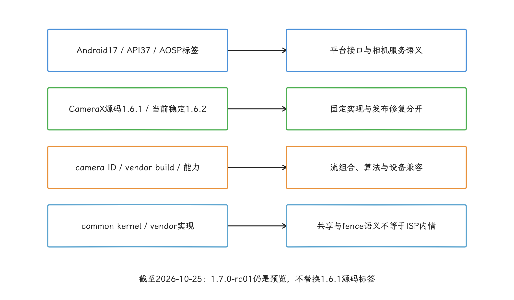

图：同一台设备可运行不同CameraX，不能只写Android版本。

下面的依赖片段用于把相机模块锁定到同一稳定版本。

```kotlin
// build.gradle.kts
val cameraxVersion = "1.6.1"

dependencies {
    implementation("androidx.camera:camera-core:$cameraxVersion")
    implementation("androidx.camera:camera-camera2:$cameraxVersion")
    implementation("androidx.camera:camera-lifecycle:$cameraxVersion")
    implementation("androidx.camera:camera-view:$cameraxVersion")
    implementation("androidx.camera:camera-video:$cameraxVersion")
}
```

`camera-core`、`camera-camera2`、`camera-lifecycle`、`camera-view` 和 `camera-video` 应使用同一版本。Extensions 也要遵守这条规则；混用版本会让 API 与内部实现组合脱离官方发布包。

CameraX 的关键版本变化，我们可以按下面的顺序理解：

- CameraX 1.2 引入实验性的 ZSL 捕获模式；
- CameraX 1.3 扩展了并发相机与录像镜像等能力；
- CameraX 1.5 开始提供 `SessionConfig`、高速录像会话和更完整的特性组合表达；
- CameraX 1.5.2 修复 Android 17 新 dynamic range profile（动态范围档位标识） 造成的绑定崩溃；
- CameraX 1.6 把默认 Camera2 实现迁移到 CameraPipe，录像的 MP4 / 3GPP 封装默认使用 Media3 Muxer，并稳定 `SessionConfig`、`HighSpeedVideoSessionConfig` 与 `isSessionConfigSupported()`；
- CameraX 1.6.1 修复 1.6.0 的依赖编译问题；
- CameraX 1.7 仍处于 alpha 阶段。1.7.0-alpha02 加入面向 GPU 的 `ImageAnalysis`、QHD（2560 × 1440）录像等接口；1.7.0-alpha03 又加入新的 Camera2Interop 配置方式、UseCase Kotlin DSL（领域专用配置语法） 配置语法，并移除预览与录像镜像控制的实验注解。这些能力均不属于 1.6.1 稳定基线。

## 2. CameraX 1.6 的位置：CameraPipe 仍在 Camera2 与 HAL 之上

CameraPipe 是 CameraX 内部负责 Camera2 适配、会话和请求管理的模块。CameraX 1.6 里，`Camera2Config.defaultConfig()` 返回的已经是基于 CameraPipe 的配置，早期那套 Camera2 内部实现已经不用了。CameraPipe 调用（Binder 是 Android 的跨进程通信机制）的仍是平台 Camera2 接口，往下同样要经过相机服务进程 `cameraserver`、Camera HAL、sensor 和 ISP。

我们先借助下图分清配置层与数据消费者，归因时才好判断一段耗时该记在谁名下。

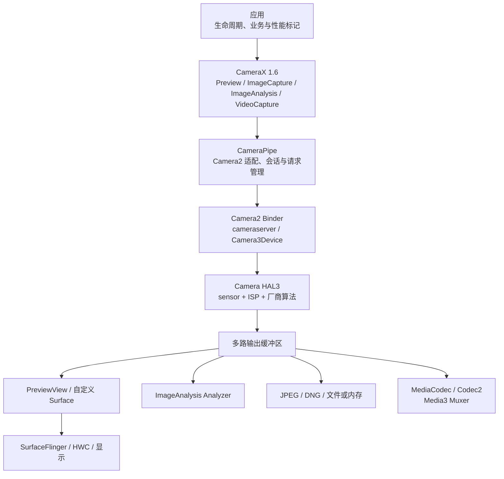

图里的分层同时给出归因规则：用例协商、quirk 与绑定行为属于 CameraX，请求提交和结果分发跨越 CameraPipe 与平台；曝光、ISP 和厂商多帧算法属于设备，分析、编码、封装、存储和显示则各有独立消费者。图中的 Camera2 Binder 指应用进程与 `cameraserver` 之间的调用，Binder 是 Android 的跨进程通信机制。

<!-- gracker-diagram: a249-02-camera-consumer-topology -->
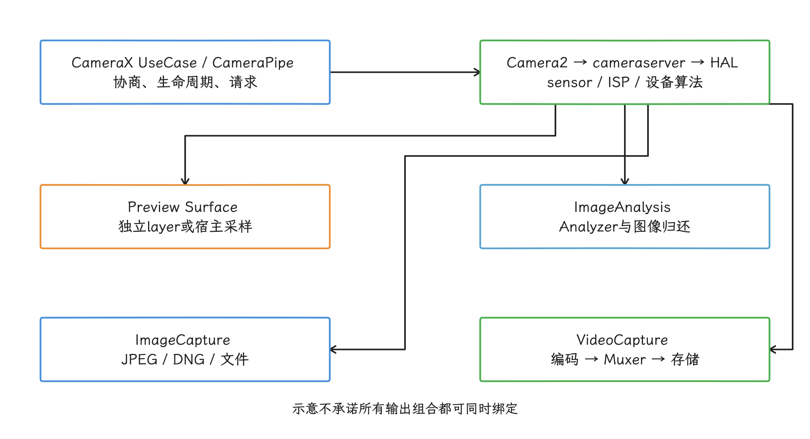

图：箭头表示接口和输出关系，各消费者有独立队列与开销。

| CameraX 用例 | 主要下游 | 常见限制 |
|---|---|---|
| `Preview` | 输出 Surface、BufferQueue、SurfaceFlinger / HWC | 实际承载类型、裁剪、旋转、显示合成 |
| `ImageAnalysis` | 以 ImageReader 为代表的图像消费者、Analyzer 执行器 | 回压、格式转换、图像归还、模型耗时 |
| `ImageCapture` | 静态拍照请求（still request）、3A、ISP、编码、I/O | 画质模式、ZSL、闪光灯、多帧处理 |
| `VideoCapture` | 相机输出、编码器、Muxer、文件 | 质量组合、dynamic range、持续吞吐 |
| Extensions | 扩展会话、厂商算法 | 支持范围、延迟、内存、热与设备差异 |

`Camera3OutputStream` 仍从 `ANativeWindow` 取得缓冲区，等待 acquire fence（生产者允许写入的同步点），再把 HAL 返回的 release fence（消费者可以读取的同步点） 随缓冲区交给消费者，release fence 到了，消费者才可以读取。CameraX 的 Java/Kotlin API 不改变这条所有权链；Analyzer 长时间持有 `ImageProxy`、编码器消费变慢或显示端等待，都可能向上游施加压力。

<!-- gracker-diagram: a249-03-hal-fence-ownership -->
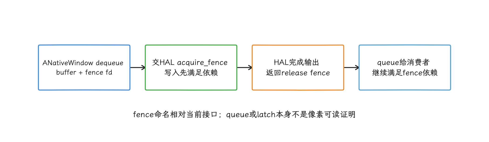

图：Camera3OutputStream取到fd后可直接交HAL，不必先CPU等待。

## 3. 会话配置先于单个参数优化

CameraX 要把所有同时运行的用例转换成一组底层输出。某个尺寸能单独打开，只说明它自己这一路可行；能否与另外三路输出并发，要看组合协商的结果。分辨率、格式、帧率、dynamic range、防抖、扩展模式及设备 quirk 都会参与组合选择。

### 3.1 一次绑定完整用例集合

已经知道要同时运行哪些用例时，我们应在同一次 `bindToLifecycle()` 里提交，让 CameraX 基于完整集合协商输出。先绑定 Preview，再多次加入或移除其他用例，可能反复触发会话配置、缓冲区准备和首帧等待。

CameraX 1.6 的 `SessionConfig` 是“一次相机会话需要哪些用例和特性”的完整配置对象，可以把用例、帧率、视口、效果和特性组放在一起。对正在运行的生命周期再次绑定新 `SessionConfig`，数据仍可能暂时停止并重新初始化，所以要按“可能重新起会话”来设计更新路径，把它当成无缝更新是有风险的。

下面的代码用于在绑定前查询完整组合，并在不支持时进入产品定义的降级分支。

```kotlin
val sessionConfig = SessionConfig(
    preview,
    imageCapture,
    imageAnalysis,
)

val cameraInfo = cameraProvider.getCameraInfo(cameraSelector)
if (!cameraInfo.isSessionConfigSupported(sessionConfig)) {
    showUnsupportedCombination()
} else {
    cameraProvider.bindToLifecycle(
        lifecycleOwner,
        cameraSelector,
        sessionConfig,
    )
}
```

`isSessionConfigSupported()` 检查这组会话包含的 Surface、特性和参数，比单独读取 `CONTROL_AE_AVAILABLE_TARGET_FPS_RANGES` 或某个输出尺寸更接近最终配置。不过这个查询发生在绑定前，运行时稳定性、厂商算法耗时和热状态仍要靠实测。

<!-- gracker-diagram: a249-04-session-negotiation -->
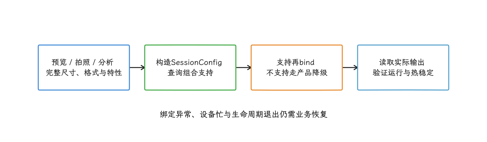

图：支持查询比单项能力更接近组合，但不是运行时性能保证。

### 3.2 能力查询与运行结果要分开记录

诊断表应同时保存“请求值”和“协商结果”：

- CameraX artifact（发布组件）版本、相机 id、前后摄，以及 logical camera（聚合多个镜头的逻辑相机） / physical camera（逻辑相机与物理镜头）；
- 已绑定用例及其格式、最终尺寸、crop rect（裁剪矩形）与 target rotation；
- 目标帧率范围、实际 CaptureResult（每帧相机结果元数据） 中的帧时长与曝光时间；
- dynamic range、防抖、ZSL、Extensions、CameraEffect 与 Camera2Interop 配置；
- `PreviewView` 请求的实现模式及实际 View / 显示 layer；
- 设备温度、运行时长、充电状态与显示刷新率。

`QualitySelector`、`ResolutionSelector` 和帧率范围表达的都是选择规则，最终结果可能因组合限制或 quirk 而变化，所以业务代码和性能日志都应读取绑定后的实际信息。

### 3.3 避免无意义的重绑

以下操作常引起完整或局部重配：

- 切换相机、Extensions、dynamic range 或高帧率模式；
- 增删 `ImageAnalysis`、`ImageCapture` 或 `VideoCapture`；
- 修改会影响输出选择的分辨率、宽高比或效果；
- 生命周期频繁进入 STARTED / STOPPED；
- 每次 Compose 重组或 View 重建都创建新用例并重新绑定。

界面状态变化若只影响覆盖层、焦点框或分析开关，优先保留会话：停止分析可以清除 Analyzer，恢复时再设置回来，无需为每次暂停重建全部用例。

`CameraCaptureSession.updateOutputConfigurations()` 是 Android 17 / API 37 新增的 Camera2 平台接口，可以替换属性兼容的既有输出 Surface，无需重建整个会话；它只用于替换，传入数量必须与现有输出一致，增加或删除输出配置则超出了它的范围。CameraX 1.6 没有承诺把任意用例切换自动映射为该 API，需要精确控制 Android 17 的动态输出更新时，应评估 Camera2。

<!-- gracker-diagram: a249-05-session-update-boundaries -->
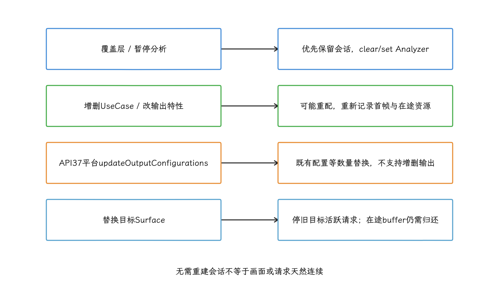

图：CameraX不承诺把所有用例切换自动映射到平台动态换面。

## 4. Preview：请求模式不等于实际显示路径

### 4.1 `PERFORMANCE` 与 `COMPATIBLE`

`PreviewView.ImplementationMode.PERFORMANCE` 是默认值。它会尽量使用 `SurfaceView`；`COMPATIBLE` 使用 `TextureView`。

- `SurfaceView` 为预览提供独立 Surface，SurfaceFlinger 可以把它作为独立 layer 参与合成；满足设备条件时，HWC 有机会使用 overlay，从而减少宿主窗口的纹理采样；
- `TextureView` 把相机图像作为纹理放进宿主窗口，裁剪、旋转、动画和 View 变换更灵活，但每帧还要经过宿主窗口的 HWUI（Android 界面硬件加速渲染器） / GPU 路径。

overlay 用不用，是 HWC 对当帧 layer 集合逐帧决定的；选 `SurfaceView` 只是让 overlay 成为可能，每帧是否真的走硬件 overlay 仍由 HWC 决定。

下面的代码用于普通取景页明确表达低开销预览偏好。

```kotlin
previewView.implementationMode =
    PreviewView.ImplementationMode.PERFORMANCE

val preview = Preview.Builder().build().also {
    it.setSurfaceProvider(previewView.surfaceProvider)
}
```

这段配置表达的是偏好。CameraX 仍可能因 API level、LEGACY camera、设备 quirk 等条件选择 `TextureView`；LEGACY 是 Camera2 公布的最低硬件能力等级，常见于由旧相机栈兼容接入的设备。所以性能报告里，我们通过 View 层级、SurfaceFlinger layer 或实际内部 View 确认承载方式。

CameraX 1.6.1 的 `PreviewView` 说明文档把 target rotation（目标旋转角）与显示旋转不一致列为 `TextureView` 回退条件；同版本源码里的决策方法 `shouldUseTextureView()` 尚未实现这项判断，当前判断包含 API 24 及以下、LEGACY camera 与 SurfaceView quirk。工程结论要以锁定版本的源码和设备观测为准，单看枚举名称推断会出错。

<!-- gracker-diagram: a249-06-preview-mode-and-layer -->
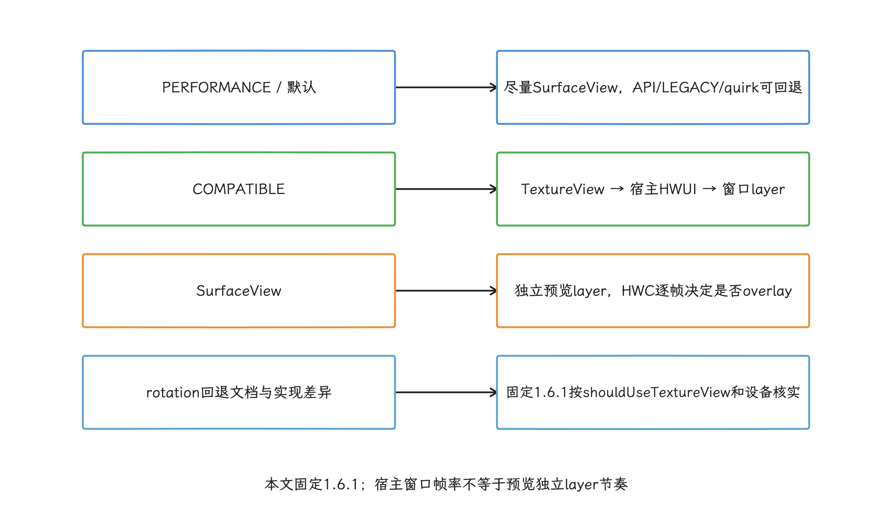

图：动画需求不能独自决定承载方式，模式名称也不能证明overlay。

### 4.2 首帧至少分成四段

“页面打开到有画面”应拆成：

1. `ProcessCameraProvider` 初始化；
2. 用例绑定与底层会话配置；
3. 首个有效相机输出到达预览消费者；
4. SurfaceFlinger latch 这帧预览缓冲区，并把包含该 layer 的显示帧 present 到屏幕。

`PreviewView.getPreviewStreamState()` 可以辅助判断数据流状态，但 `PERFORMANCE` 模式下 `STREAMING` 可能早于画面可见；需要精确首帧指标时，我们要加应用标记，并把 Camera、BufferQueue 与 SurfaceFlinger 轨迹关联起来看。

<!-- gracker-diagram: a249-07-preview-first-visible -->
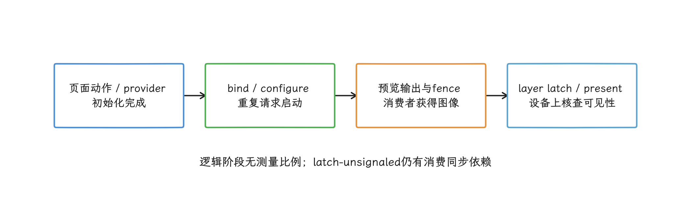

图：STREAMING在PERFORMANCE模式下可能早于画面可见。

### 4.3 分辨率、裁剪与帧率要一起看

预览分辨率覆盖显示和业务裁剪需求即可。超过屏幕与识别需求的输出，会增加 ISP、缓冲区、内存带宽和 TextureView / 特效路径的 GPU 工作；而降低分辨率也可能让 HAL 改选另一个 sensor mode（传感器工作模式），所以效果要在同一设备上复测。

帧率判断应使用目标帧周期：

- 30 fps 的周期约为 33.33 ms；
- 60 fps 的周期约为 16.67 ms；
- 可变帧率与弱光长曝光下，单纯按显示帧率判断 HAL 掉帧会误报。

先别急着设一条跨设备的“超过多少毫秒就是 CameraX 卡顿”规则：我们把 sensor timestamp（传感器采集时间戳）、相机输出和显示 present 三组间隔统计出来，才能区分相机产帧变化与显示漏帧。

<!-- gracker-diagram: a249-08-camera-and-display-cadence -->
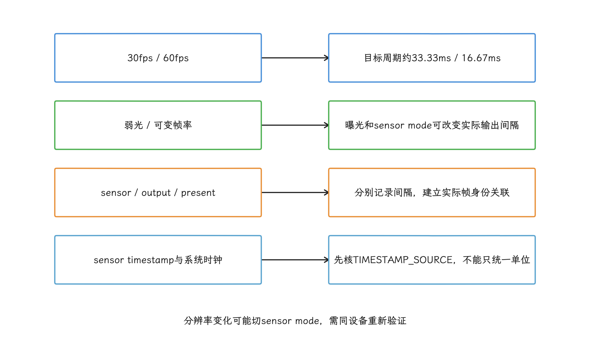

图：不能用显示60Hz直接判定30fps相机漏帧。

## 5. ImageAnalysis：吞吐、等待时间和归还责任

`ImageAnalysis` 是应用最容易直接造成相机回压的位置：回压（backpressure）就是消费者处理速度跟不上图像生产速度时，缓冲区队列把等待压力传回生产端。CameraX 1.6.1 的源码提供两种策略：

| 策略 | 行为 | 适合场景 |
|---|---|---|
| `STRATEGY_KEEP_ONLY_LATEST` | Analyzer（分析回调）忙时替换待处理的旧帧；队列深度配置被忽略 | 扫码、姿态、预览叠加等关注最新结果的实时任务 |
| `STRATEGY_BLOCK_PRODUCER` | 按顺序保留帧；队列满后生产端等待，影响同一 camera device（相机设备）的其他用例 | 每帧都必须处理且平均吞吐能跟上输入的任务 |

`KEEP_ONLY_LATEST` 是默认策略。`BLOCK_PRODUCER` 的默认队列深度为 6，深度包含正在分析的图像；加深队列只能吸收短时抖动，还会增加内存占用和结果等待时间，平均处理速度一旦低于输入速度，队列迟早会占满。

<!-- gracker-diagram: a249-09-analysis-backpressure -->
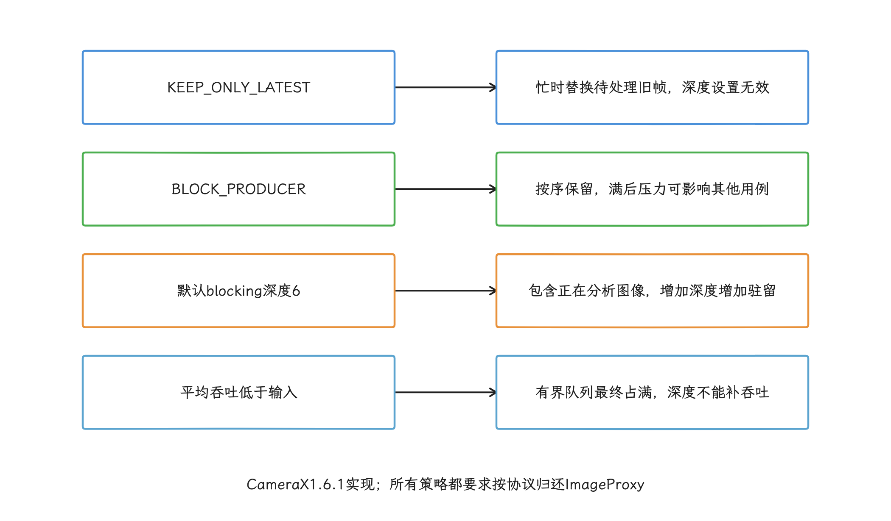

图：加深队列只吸收有限抖动，实时结果仍可能变旧。

下面的 Analyzer 适合实时识别：它保留最新帧，并用 ATrace（应用写入 Perfetto 的命名时间区间） 标出处理过程。ATrace 是应用写入 Perfetto 的命名时间区间。

```kotlin
val analysis = ImageAnalysis.Builder()
    .setOutputImageFormat(
        ImageAnalysis.OUTPUT_IMAGE_FORMAT_YUV_420_888
    )
    .setBackpressureStrategy(
        ImageAnalysis.STRATEGY_KEEP_ONLY_LATEST
    )
    .build()

analysis.setAnalyzer(analysisExecutor) { imageProxy ->
    Trace.beginSection("CameraX#analyze")
    try {
        analyzeFrame(imageProxy)
    } finally {
        imageProxy.close()
        Trace.endSection()
    }
}
```

`ImageProxy.close()` 把底层图像归还 CameraX。应用可以读取包装的 `Media.Image`，归还则必须走 `ImageProxy.close()`，不能直接调用 `Media.Image.close()`。漏关图像会让后续帧被丢弃或停住；在 `BLOCK_PRODUCER` 下，还可能影响 Preview 和其他绑定用例。

<!-- gracker-diagram: a249-10-synchronous-analysis-close -->
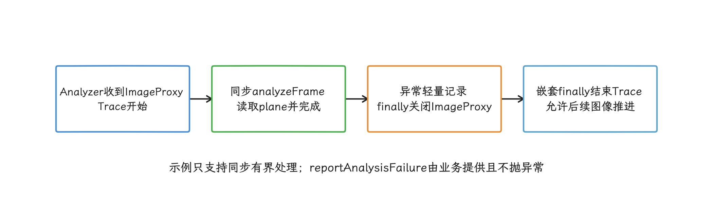

图：不能直接关闭被包装的Media.Image，也不能提前结束仍在访问的任务。

异步模型下，关闭操作要放到异步任务的完成回调里。若 `analyzeFrame()` 只是提交任务就返回、`finally` 立即关闭，模型随后访问的图像已经失效；若一直等业务回调才关闭，又会延长缓冲区持有时间。解决办法是让分析任务明确拥有这次 `ImageProxy` 的生命周期，并为超时、异常和取消路径都注册关闭操作。

### 5.1 格式转换也属于分析耗时

`YUV_420_888` 是默认输出。请求 `RGBA_8888` 时，CameraX 会在内部执行 YUV 到 RGBA 的转换，把结果放进第一个数据平面（plane），这段转换时间同样要计入分析成本。

分析预算应至少分为：

- 等待 Analyzer 开始；
- 图像旋转、裁剪与格式转换；
- 模型预处理；
- 推理；
- 后处理与坐标映射；
- `ImageProxy` 持有总时间。

只记录模型的 `process()` 耗时，会低估应用消费者对相机管线的占用；实时任务还应记录输入帧数、实际分析帧数、主动跳过帧数和结果年龄。

<!-- gracker-diagram: a249-12-analysis-cost-breakdown -->
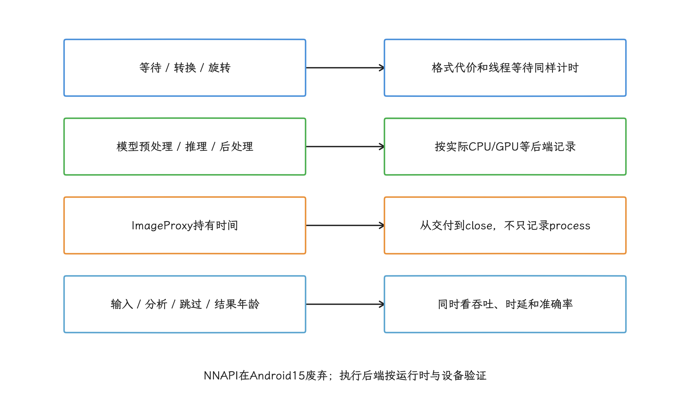

图：YUV读取遵守stride和crop，避免每帧Bitmap复制与分配。

### 5.2 降低分析负载的顺序

建议按影响范围逐步处理：

1. 改用 `KEEP_ONLY_LATEST`，消除旧结果排队；
2. 减少输入尺寸，确认识别准确率仍满足产品要求；
3. 避免每帧分配 Bitmap、ByteArray 或大对象；
4. 直接使用 YUV plane，减少无必要的 YUV → RGB → Bitmap 转换；
5. 降低分析频率或依据场景变化触发分析；
6. 选择更轻的模型或合适的 NNAPI（Android 神经网络 API）/ GPU 执行路径；
7. 只有必须逐帧处理时才使用 `BLOCK_PRODUCER`，并对队列等待时间设监控。

<!-- gracker-diagram: a249-11-async-image-ownership -->
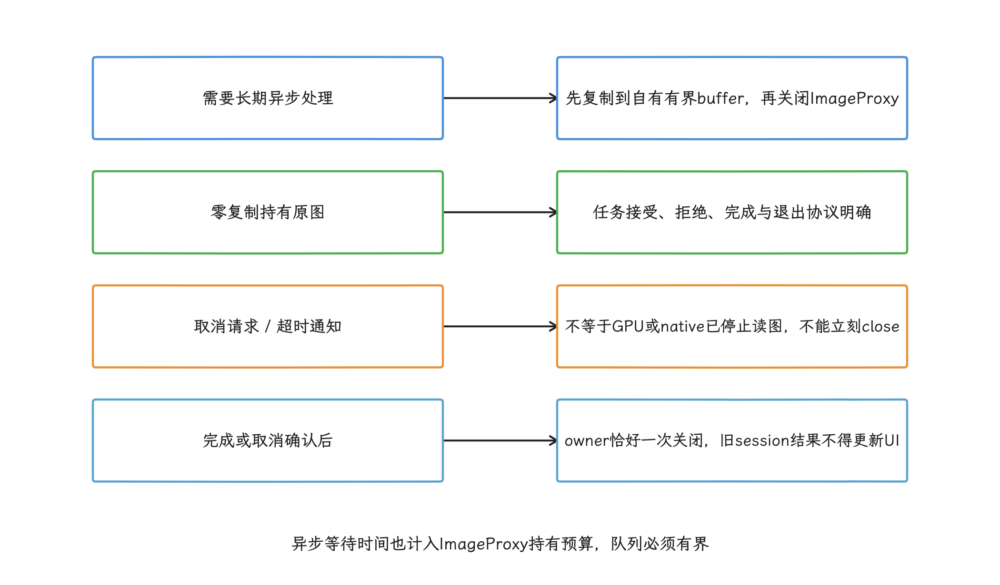

图：释放依据是访问已停止，不是业务计时器到期。

## 6. ImageCapture：捕获模式只表达偏好

`ImageCapture` 的端到端延迟可能包含 3A、曝光、sensor readout（传感器逐行读出）、ISP、厂商多帧处理、JPEG / DNG 编码、应用回调和存储写入。从 `takePicture()` 到回调只拿到一个总数时，我们还得往下拆，才知道是哪一段变慢。

### 6.1 三种捕获模式

- `CAPTURE_MODE_MINIMIZE_LATENCY`：默认值，优先减少捕获延迟；
- `CAPTURE_MODE_MAXIMIZE_QUALITY`：允许设备选择更重的画质路径；
- `CAPTURE_MODE_ZERO_SHUTTER_LAG`：实验能力，从候选历史帧中选择接近按键时刻的帧，再执行 reprocess（把已捕获图像作为输入重新处理），把已捕获的图像作为输入重新处理。

ZSL 这个名称只表达“优先复用历史候选帧”的捕获策略，文件是否立即可得要看后续流程。公开文档描述的能力与 CameraX 1.6.1 的具体实现要分开对待：设备能力、用例组合和单次 ring 取帧都可能让请求降级，固定实现见 6.4。

### 6.2 把拍照延迟拆成可解释的时间点

建议记录：

| 时间点 | 说明 |
|---|---|
| 用户触发 | 产品定义的起点 |
| 捕获请求提交 | 区分应用调度与相机等待 |
| shutter / sensor timestamp | 曝光对应的采集时刻 |
| 静态拍照缓冲区可读 | HAL / ISP 输出完成 |
| 编码结果可用 | JPEG、DNG 或内存图像完成 |
| 文件写入完成 | 包含存储与 MediaStore 工作 |

弱光下曝光时间增长是预期现象，HDR（高动态范围）、夜景、Extensions 等多帧处理也会拉长 ISP / 厂商算法段；文件写入慢时，相机数据可能已经完成，这时优化方向应转向编码、磁盘或 `ContentResolver`。

<!-- gracker-diagram: a249-13-capture-modes-and-latency -->
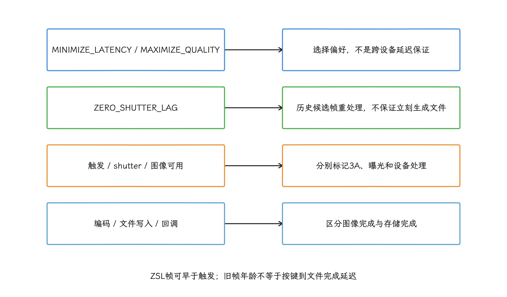

图：弱光与多帧算法要单独分桶，不编造固定快门时延。

### 6.3 Android 17 RAW14 与 CameraX RAW 的对应关系

Android 17 / API 37 新增了 `ImageFormat.RAW14`，表示紧密打包的单平面 14 位传感器原始数据，设备还必须公布相应输出能力。CameraX 1.6 的 RAW / RAW+JPEG 能力则通过 `ImageCaptureCapabilities` 和 CameraX 输出格式表达——CameraX 支持 RAW，同它是否把平台 `RAW14` 暴露给应用，是两件要分开验证的事。

业务需要指定 `RAW14`、精确管理 RAW Surface、手动请求参数或读取底层格式时，应使用 Camera2 并查询 `StreamConfigurationMap` 与相机特征；普通 DNG 拍摄则先查询 CameraX 的输出格式能力再决定开启，只看 API level 是不够的。

<!-- gracker-diagram: a249-14-raw14-and-dng -->
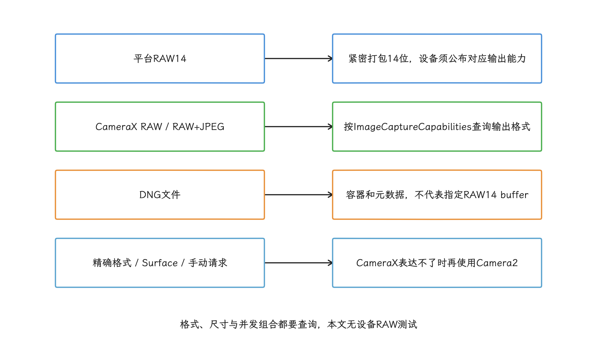

图：不能由API37或支持DNG推断本机支持RAW14流。

### 6.4 CameraX 1.6.1 ZSL：3 帧 ring 与 CameraPipe 重处理

6.1 讲的是公开的模式偏好；这一节我们把 CameraX 1.6.1 的一次请求逐段拆开，从能力检查到 `PRIVATE` 候选帧、CameraPipe `InputRequest`，再到资源回收。升级 CameraX 后，ring 容量、quirk、过滤条件与后端路径都要重新核对。

#### 能力预筛选、会话校验与禁用条件

下面的示例用于在构建 `ImageCapture` 前选择拍照模式：

```kotlin
@OptIn(ExperimentalZeroShutterLag::class)
fun buildImageCapture(cameraInfo: CameraInfo): ImageCapture {
    val captureMode = if (cameraInfo.isZslSupported) {
        ImageCapture.CAPTURE_MODE_ZERO_SHUTTER_LAG
    } else {
        ImageCapture.CAPTURE_MODE_MINIMIZE_LATENCY
    }

    return ImageCapture.Builder()
        .setCaptureMode(captureMode)
        .setFlashMode(ImageCapture.FLASH_MODE_OFF)
        .build()
}
```

这段代码只完成能力选择。最终能否建立 ZSL 会话，还要等 CameraX 合并所有用例配置、检查流组合之后才知道。

在 CameraX 1.6.1 的 Camera2 实现中，`CameraInfoAdapter.isZslSupported()` 主要检查两项：

- CameraCharacteristics 包含 `REQUEST_AVAILABLE_CAPABILITIES_PRIVATE_REPROCESSING`；
- 当前设备没有命中 `ZslDisablerQuirk` 兼容性特例。

API 文档还规定最低系统版本为 Android 6.0，即 API 23。这个返回值覆盖的范围有限：闪光灯模式、`VideoCapture`、Camera Extension、分辨率策略都不在检查之列，本次会话最终选中的 `Surface` 能否同时配置，也要留到流组合检查阶段。

可以把判定分成三层：

<!-- gracker-diagram: a249-15-zsl-three-gates -->
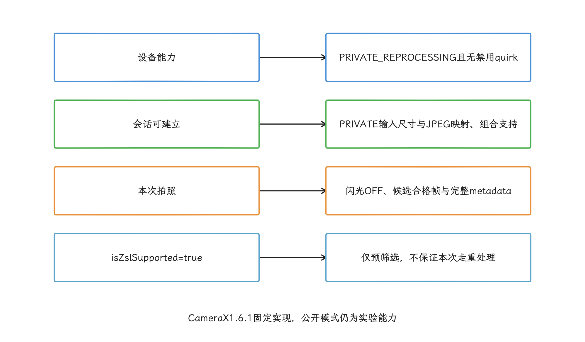

图：能力布尔值不能代替完整会话与单次路径证据。

| 层次 | 典型检查 | 失败结果 |
|---|---|---|
| 设备能力 | API 23 及以上、支持 `PRIVATE_REPROCESSING`、无禁用兼容性特例 | 不宣称支持 ZSL |
| 会话配置 | `PRIVATE` 输入尺寸有效、支持 `PRIVATE → JPEG`、用例组合可配置 | 不建立重处理输入流 |
| 单次拍照 | 闪光灯为 `OFF`、环形队列中存在带完整元数据的合格帧 | 改用普通静态拍照 |

##### CameraX 1.6.1 的禁用与兼容性条件

以下情况会禁用或绕过 CameraX ZSL：

- 绑定 `VideoCapture`；
- 启用 Camera Extension；
- 闪光灯模式为 `ON` 或 `AUTO`；
- 请求高分辨率优先模式，导致 `OPTION_ZSL_DISABLED` 被设置；
- 命中 `ZslDisablerQuirk` 设备特例；
- 设备没有 `PRIVATE_REPROCESSING`；
- `StreamConfigurationMap` 没有可用的 `PRIVATE` 输入尺寸；
- `getValidOutputFormatsForInput(PRIVATE)` 不包含 JPEG；
- 拍照时环形队列为空，或其中没有可用的元数据。

闪光灯的处理有所不同：CameraX 可以保留已经建立的可重处理会话，只在闪光灯为 `ON` 或 `AUTO` 时提交普通静态拍照；用户切回 `OFF` 后，也无需仅为这一变化重建整个会话。用例配置、设备能力或兼容性特例不允许 ZSL 时，`ZslControlImpl` 会直接跳过输入流的建立。

<!-- gracker-diagram: a249-16-zsl-disable-and-flash -->
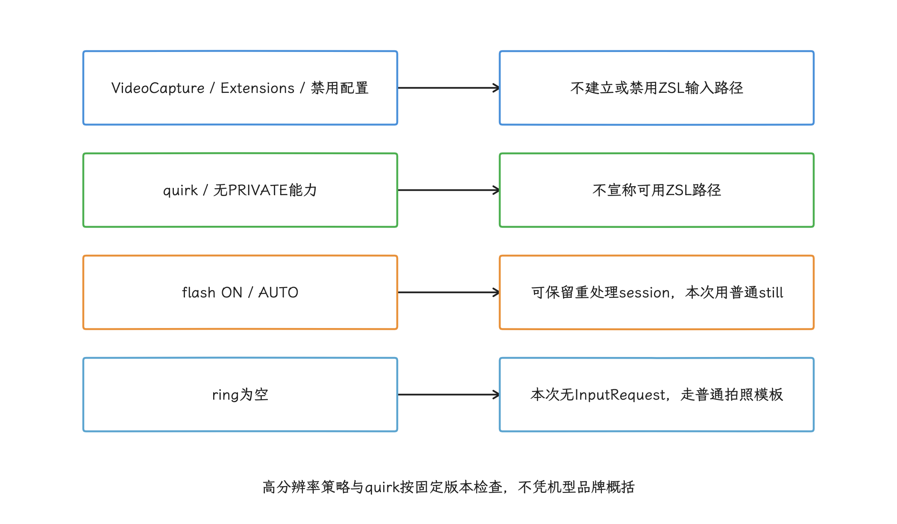

图：闪光切回OFF无需仅为该变化重建已存在的重处理会话。

CameraX 1.6.1 的兼容性特例列表包含若干 Samsung Fold4、S22、S24 型号和 Xiaomi Mi 8，原因是重处理图像可能出现颜色异常或变焦冻结；机型名单属于库版本的实现细节，升级 CameraX 后应重新检查相应版本的 `ZslDisablerQuirk`。

#### `PRIVATE` output、input Surface 与 reprocessable session

##### 输入格式与合法输出

`ZslControlImpl` 把 ZSL 格式固定为 `ImageFormat.PRIVATE`。它从：

```text
StreamConfigurationMap.getInputSizes(ImageFormat.PRIVATE)
```

选择面积最大的输入尺寸，然后确认：

```text
getValidOutputFormatsForInput(ImageFormat.PRIVATE)
```

包含 `ImageFormat.JPEG`。

这些查询解决两个不同问题：

<!-- gracker-diagram: a249-17-zsl-private-selection -->
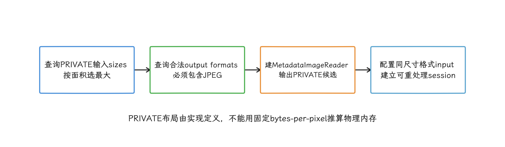

图：输入尺寸可用与PRIVATE能转JPEG是两个条件。

- 输入尺寸决定哪一种 `PRIVATE` 图像可以送回设备；
- 输入/输出格式映射决定这种输入能否重处理成 JPEG。

`PRIVATE` 表示应用不读取图像的像素布局：CameraX 持有的是 `Image` 与 `GraphicBuffer` 句柄以及元数据，设备端按照实现定义的缓冲区契约处理。因此这批缓冲区的物理内存，用“宽 × 高 × 固定每像素字节数”是算不准的。

##### 同一 session 的候选输出与重处理输入

CameraX 会创建一个 `MetadataImageReader`，把它的 `Surface` 加入重复请求的输出目标。这路输出会持续接收可作为候选帧的 `PRIVATE` 图像。

CameraX 还会为会话设置宽、高和格式相同的 `InputConfiguration`。Camera2 建立可重处理捕获会话后，会话会暴露一个输入 `Surface`。CameraPipe 在这个输入 `Surface` 上创建 `ImageWriter`，供拍照时把候选图像送回相机设备。

结构可以画成：

```text
regular repeating request
  ├─ preview output → PreviewView / Surface
  └─ ZSL PRIVATE output → MetadataImageReader → ZslRingBuffer

selected PRIVATE Image
  → ImageWriter → session input Surface
  → reprocess request
  → JPEG output Surface
```

上半部分仍是传感器采集，下半部分以已有缓冲区为输入，不再触发新的传感器曝光。

<!-- gracker-diagram: a249-18-zsl-output-input-loop -->
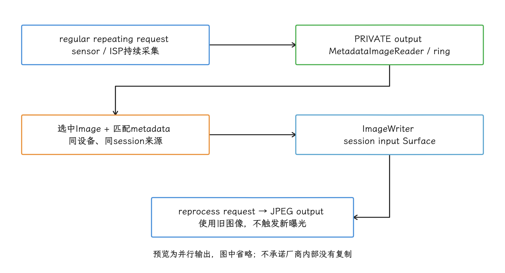

图：环路不是把JPEG送回HAL；会话输入接收PRIVATE历史图像。

#### 三帧 ring、元数据匹配与 3A 过滤

##### 图像与 metadata 先按 timestamp 配对

`MetadataImageReader` 同时监听 `ImageReader` 和 `CameraCaptureCallback`。图像与 `CameraCaptureResult` 的到达顺序可能不同，它会根据时间戳把二者配成一个带有 `ImageInfo` 的 `ImageProxy`。

匹配成功后，`ZslRingBuffer` 才读得到相应的 AF、AE、AWB 状态。图像和捕获结果长时间配不上时，旧数据会被清理；所以 `ImageReader` 回调到达，离“环形队列中已有可重处理帧”还差一次成功的匹配。

<!-- gracker-diagram: a249-19-metadata-pairing -->
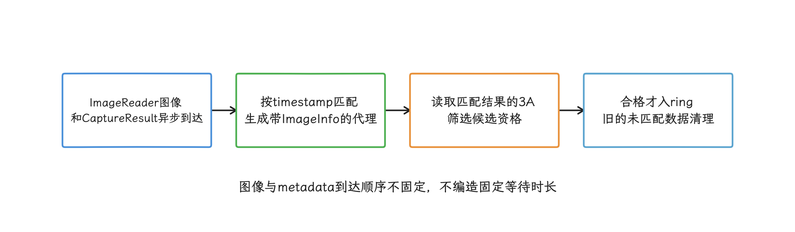

图：收到图像回调不等于已经存在可重处理候选帧。

##### AF、AE、AWB 决定候选资格

`ZslRingBuffer.isValidZslFrame()` 的条件是：

- AF（自动对焦）为 `LOCKED_FOCUSED` 或 `PASSIVE_FOCUSED`；
- AE（自动曝光）为 `CONVERGED`；
- AWB（自动白平衡）为 `CONVERGED`。

任一条件不满足，`ImageProxy` 都会立即关闭，进不了环形队列。这一步只依据枚举状态过滤元数据，并不分析图像内容；弱光下 AE 长时间不收敛、连续对焦扫描、快速切换场景或元数据缺失，都可能让环形队列为空。

<!-- gracker-diagram: a249-20-zsl-three-a-filter -->
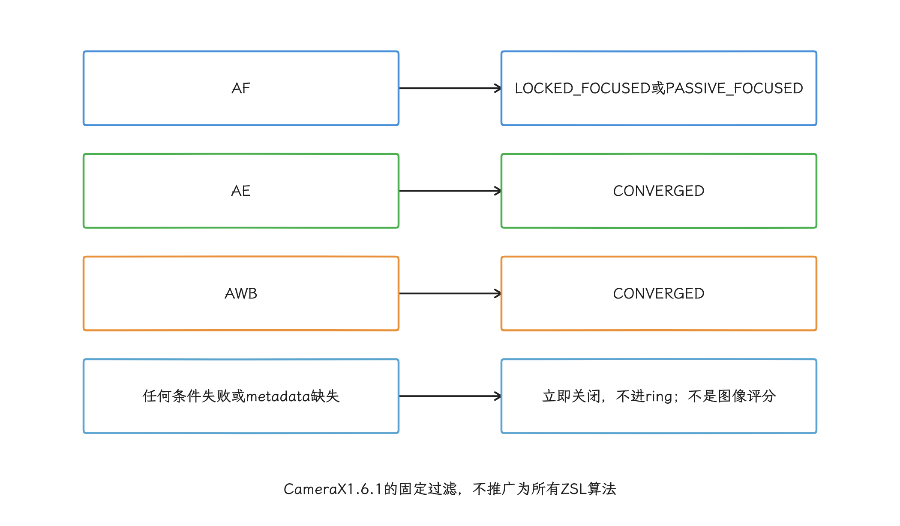

图：弱光或对焦扫描可使ring无帧，必须观察实际3A状态。

##### ring、ImageReader 与 input 的三个上限

CameraX 1.6.1 源码中出现了三个含义不同的缓冲区数量：

| 名称 | 数值 | 约束对象 |
|---|---:|---|
| `RING_BUFFER_CAPACITY` | 3 | 可供 ZSL 选择的合格 `ImageProxy` 数量 |
| `ZslControlImpl.MAX_IMAGES` | 9 | 传给 `MetadataImageReader` 的图像上限，源码中为环形队列容量的 3 倍 |
| CameraPipe 输入端 `maxImages` | 1 | 会话输入 `Surface` 上的 `ImageWriter` 并发图像数 |

“ZSL 缓存 3 帧”只描述环形队列的容量；至于整个相机处理流水线，预览、JPEG、ZSL 输出、HAL 处理中的缓冲区、`ImageReader` 和输入流各有自己的队列约束，`GraphicBuffer` 驻留量要逐条流统计。

<!-- gracker-diagram: a249-21-zsl-buffer-limits -->
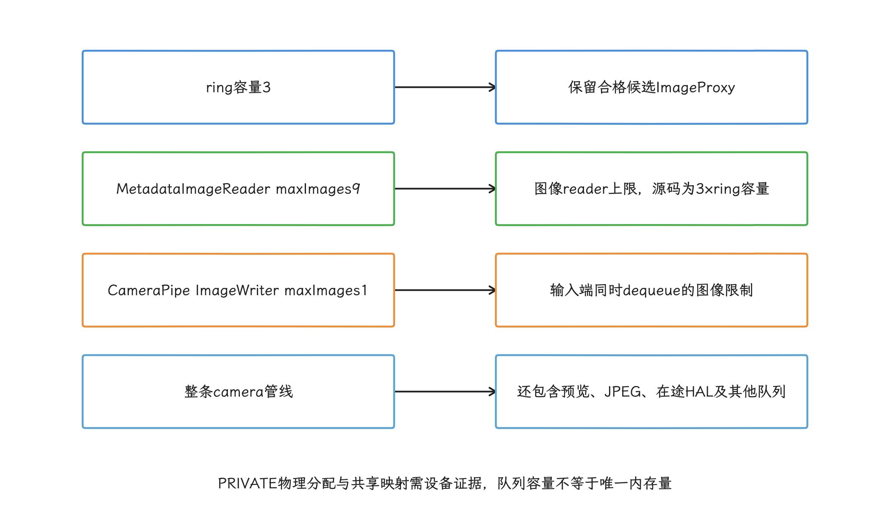

图：不能用3帧或1个输入槽推断整机只驻留这些buffer。

##### 当前实现没有图像评分器

`ZslRingBuffer` 继承自 `ArrayRingBuffer`。新帧通过 `addFirst()` 加入，`dequeue()` 通过 `removeLast()` 取出；容量已满时，会先移除并关闭队尾最旧的帧。

按这段实现，CameraX 1.6.1 的行为是：

1. 监听器每次通过 `acquireLatestImage()` 取得当时最新的已匹配图像；
2. 图像先经过 AF、AE、AWB 过滤；
3. 环形队列最多持有 3 帧；
4. 拍照时取出当前队列里最早保留的合格帧。

`ImageCapture` API 注释把目标概述为交付时间戳接近快门的中间结果，而 1.6.1 的这段实现既没有按触摸时间遍历候选，也没有清晰度评分或运动补偿。排查具体版本时，我们以该版本源码和实测 `SENSOR_TIMESTAMP` 为准。

<!-- gracker-diagram: a249-22-fifo-candidate-order -->
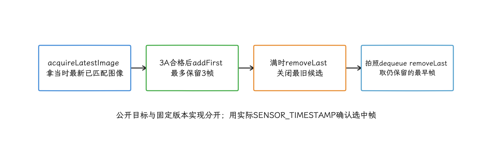

图：1.6.1没有按触摸时间遍历、清晰度评分或运动补偿。

#### CameraPipe 怎样构造并回收重处理请求

CameraX 1.6.1 的 Camera2 后端已经迁移到 CameraPipe。较早资料里常见的 `androidx.camera.camera2.internal.*` 路径不能直接代表这个版本，对应的核心实现位于 `androidx.camera.camera2.adapter` 和 `androidx.camera.camera2.pipe.compat`。

##### `CaptureConfigAdapter` 生成 InputRequest

捕获配置的模板为 `TEMPLATE_ZERO_SHUTTER_LAG`，且用例和闪光灯设置未禁用 ZSL 时，`CaptureConfigAdapter` 会尝试从环形队列取出一帧。

取帧成功后，它完成三件事：

<!-- gracker-diagram: a249-23-input-request-construction -->
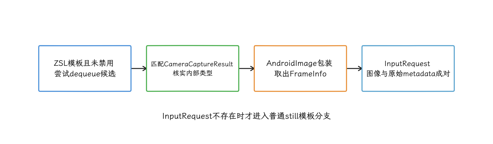

图：Image、FrameInfo的身份必须一致，内部类型错误按失败处理。

1. 从 `ImageProxy.imageInfo` 取回匹配的 `CameraCaptureResult`；
2. 把底层 `Image` 包装为 CameraPipe 的图像对象；
3. 把图像与相应的 `FrameInfo` 组合成 `InputRequest`。

环形队列为空时，`inputRequest` 保持为空，CameraX 随后把请求模板改为普通的 `TEMPLATE_STILL_CAPTURE`。环形队列中的帧已经完成元数据匹配；若内部图像与结果的类型或非空约束被破坏，源码会在构造 `InputRequest` 时直接失败，这类异常属于失败路径，与普通降级是两回事。

##### ImageWriter 排入 session input

CameraPipe 会为可重处理会话的输入 `Surface` 创建 `ImageWriter`。准备提交请求时，`Camera2CaptureSequenceProcessor` 先调用以下方法，把选中的历史帧排入输入队列：

```text
imageWriter.queueInputImage(selectedImage)
```

<!-- gracker-diagram: a249-25-reprocess-build-order -->
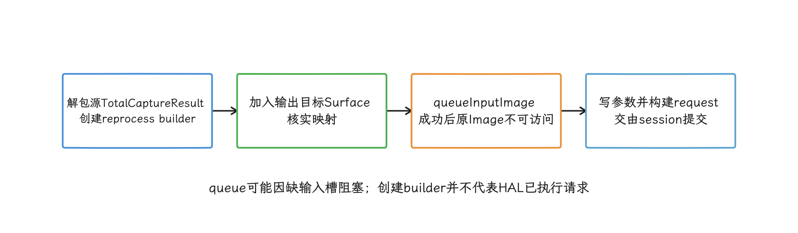

图：正文按主题分节，真正调用顺序以1.6.1请求构建循环为准。

这一步把 CameraX 持有的 `PRIVATE` 图像排入 Camera2 会话的输入队列，全程既没有复制出应用可访问的位图，也没有把 JPEG 数据送回 HAL。

##### TotalCaptureResult 初始化 reprocess request

CameraPipe 从 `FrameInfo` 中解包同一源帧的 `TotalCaptureResult`，再调用以下方法创建重处理请求：

```text
cameraDevice.createReprocessCaptureRequest(totalCaptureResult)
```

设备需要原始捕获结果中的曝光、白平衡、镜头、裁剪和厂商元数据，才能按源图像的拍摄条件重处理。Android Camera2 还要求输入图像来自同一台相机设备，并在同一个会话中直接或间接产生；把其他相机或其他会话的图像与结果随意组合起来，是不符合接口约定的。

<!-- gracker-diagram: a249-26-reprocess-image-identity -->
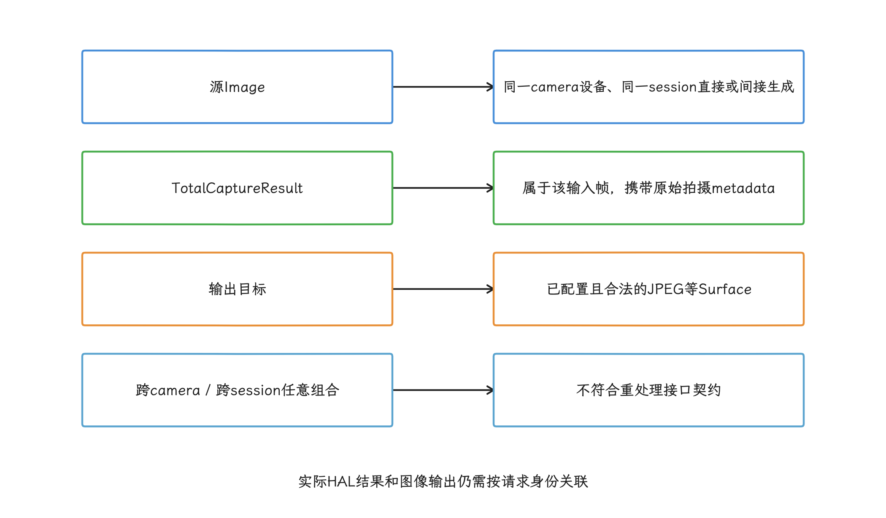

图：重处理沿用源帧拍摄条件，不是再次触发传感器曝光。

创建请求构建器后，CameraPipe 会添加本次静态拍照的目标 `Surface`，通常是 CameraX 图像流水线的 JPEG 输出端，并写入 JPEG 方向、质量等请求参数。

##### 成功、失败、取消都要回收 input image

被选中的 `ImageProxy` 在排入 `ImageWriter` 后仍持有底层资源。CameraX 会为请求安装监听器，并在以下路径中通过同一个原子引用关闭它：

- 请求完成；
- 请求失败；
- 请求中止；
- 完整捕获结果到达。

多个回调可能先后发生，原子引用保证资源只关闭一次。我们若自行实现 Camera2 ZSL，同样要在提交失败、会话关闭、请求中止和异常路径中完整回收输入图像。

失败的位置分两种：拍照时没有候选帧，CameraX 会改用普通静态拍照；而一旦已经构造 `InputRequest`，随后 `ImageWriter.queueInputImage()` 或 `createReprocessCaptureRequest()` 失败，CameraPipe 就会让本次捕获序列构建失败。这一阶段是否还会自动重试普通拍照并没有保证，应按失败处理。

<!-- gracker-diagram: a249-27-image-transfer-and-release -->
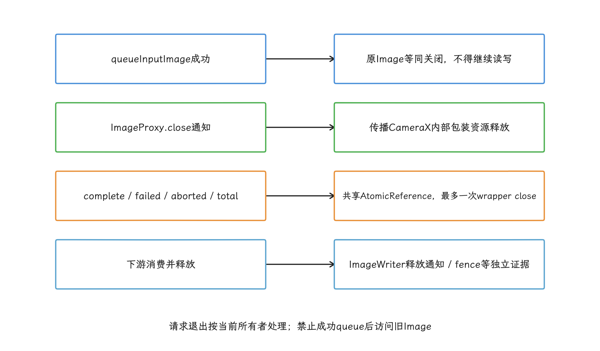

图：回调关闭wrapper不能证明HAL已经归还同一物理buffer。

<!-- gracker-diagram: a249-24-zsl-fallback-vs-failure -->
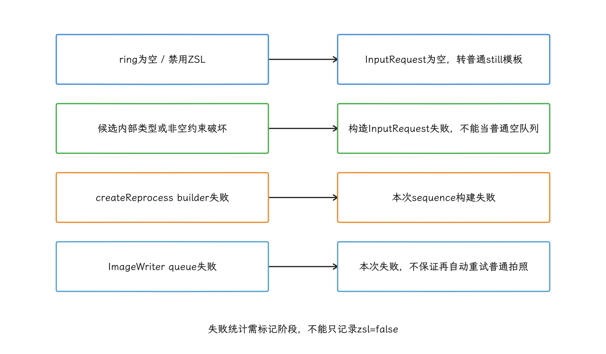

图：只有源码定义的缺候选路径可确认为普通降级。

#### 候选帧也占用 stream buffer

环形队列保存的是尚未关闭的 `ImageProxy`，每保留一帧，就有一块 `PRIVATE` 输出缓冲区回不到生产方队列。队列满后关闭被淘汰的帧，拍照完成或失败后关闭被选中的帧，会话重置时清空全部帧。

如果图像没有按预期关闭，可能出现：

- `MetadataImageReader` 达到 `maxImages`；
- ZSL 输出流没有空闲缓冲区；
- 重复请求被输出端背压拖慢；
- 预览、分析或其他共享 camera 资源出现连带延迟。

这类问题要按 [Camera 平台管线的逐 stream Buffer 方法](../../part2-performance/ch13-rendering-pipelines/10-camera-pipeline.md) 对每条流分别检查。预览正常只说明预览那一路没问题，ZSL 输出流和输入队列要单独检查。

<!-- gracker-diagram: a249-28-zsl-residency-and-pressure -->
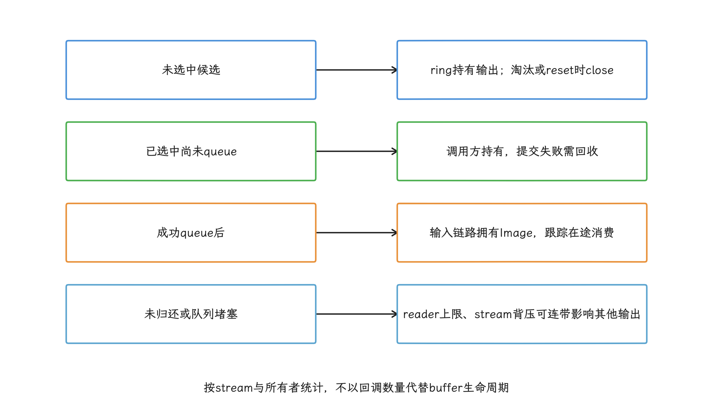

图：预览正常不能证明ZSL输出与input队列也正常。

#### 应用条件、降级与日志证据

##### 记录应用层条件

每次拍照至少记录：

- CameraX 版本；
- 相机 ID；
- `CameraInfo.isZslSupported()`；
- 拍照模式；
- 闪光灯模式；
- 已绑定的用例；
- Camera Extension 是否启用；
- 目标分辨率策略；
- `SENSOR_INFO_TIMESTAMP_SOURCE`；
- 按键的 `elapsedRealtimeNanos()`；
- 输出图像或捕获结果的传感器时间戳；
- 成功、失败和错误码。

只记一个 `zsl=true` 布尔值是不够的：会话是否建立了输入流、本次拍照是否从环形队列取得了历史帧，都要靠上面的字段回答。

<!-- gracker-diagram: a249-29-zsl-clock-and-evidence -->
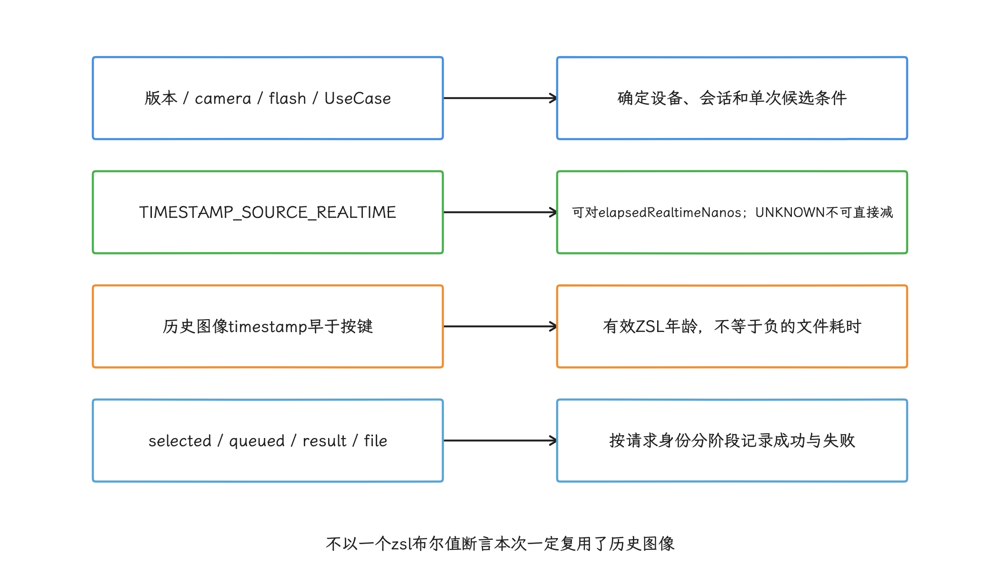

图：公共API能力、内部路径日志和最终文件事件需组合取证。

##### 检查 CameraX 日志

CameraX 1.6.1 源码中可直接定位的诊断文本包括：

- `Private reprocessing isn't supported`；
- `Unable to find a supported size for ZSL`；
- `JPEG isn't valid output for ZSL format`；
- `Selected ZSL size`；
- `No such element`；
- `Queuing image ... for reprocessing to ImageWriter`；
- `Failed to create a ReprocessingCaptureRequest.Builder`。

前三项对应能力或会话配置，`No such element` 表示拍照时环形队列中没有帧，末尾两项才接近单次重处理请求的提交阶段。

#### CameraX 1.6.1 与 Android 17 的双版本边界

| 版本 | 相关边界 |
|---|---|
| Android 6.0（API 23） | Camera2 可重处理会话、`createReprocessCaptureRequest()` 和 `ImageWriter` 能力成为 CameraX ZSL 的系统基础 |
| CameraX 1.2.0 | `CAPTURE_MODE_ZERO_SHUTTER_LAG` 作为实验 API 引入 |
| Android 14（API 34） | 重处理请求的 `CONTROL_CAPTURE_INTENT` 默认设为 `STILL_CAPTURE`；更早版本需要调用方自行留意 |
| CameraX 1.6.0 | Camera2 后端迁移到 CameraPipe，排障时应使用新的 adapter 与 pipe 实现路径 |
| CameraX 1.6.1 | 库侧锚点；固定 3 帧环形队列、`PRIVATE` 重处理、当前兼容性特例和降级逻辑均按该版本源码核对 |
| Android 17（API 37） | 平台源码锚点；Camera2 重处理、Camera3 输入流与 AIDL `CaptureRequest.inputBuffer` 均按 `android-17.0.0_r1` 核对 |

CameraX 是独立于 Android 系统发布的 Jetpack 库，同一台 Android 17 设备可以运行不同的 CameraX 版本。因此我们写分析报告时，要同时写明系统源码标签、厂商构建版本和 CameraX 版本。

## 7. VideoCapture：相机、编码、封装和存储是四段

看录像路径的性能，先记住 CameraX 1.6 的两个版本事实：

- 默认 Camera2 实现已迁移到 CameraPipe；
- `Recorder` 对 MP4 / 3GPP 默认创建 `Media3MuxerImpl`，WebM 仍走基于平台 `MediaMuxer` 的实现。

所以把所有录像尾部耗时都归到平台 `MediaMuxer` 已经站不住了，诊断时要记录 CameraX 版本与输出格式。

### 7.1 `QualitySelector` 的质量保证范围

`QualitySelector.getSupportedQualities()` 返回的质量保证，只针对 `VideoCapture` 单独运行或 `Preview + VideoCapture` 组合；再加入 `ImageCapture`、`ImageAnalysis`、HDR、稳定或 CameraEffect 后，绑定仍可能失败或改用不同配置。

下面的选择器用于优先 1080p，并允许在不支持时选择较低质量。

```kotlin
val qualitySelector = QualitySelector.fromOrderedList(
    listOf(Quality.FHD, Quality.HD, Quality.SD),
    FallbackStrategy.lowerQualityOrHigherThan(Quality.SD),
)

val recorder = Recorder.Builder()
    .setQualitySelector(qualitySelector)
    .build()

val videoCapture = VideoCapture.withOutput(recorder)
```

选择器给出的是优先级和回退规则。绑定后我们仍要记录最终尺寸、帧率、dynamic range、编码器与输出 `MediaFormat`：`FHD` 只表示分辨率等级，具体编码格式和码率由配置与设备能力决定，把它当成固定 codec、码率或色彩格式会出问题。

<!-- gracker-diagram: a249-30-video-quality-selection -->
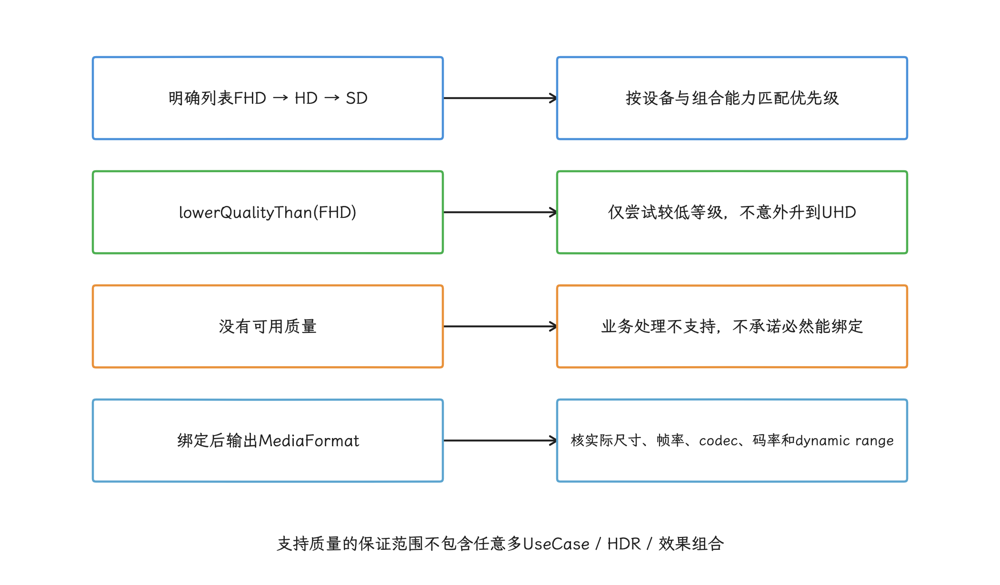

图：FHD不是固定编码格式或码率，选择规则也不是输出保证。

### 7.2 丢帧按四段归因

| 段 | 观测 | 常见问题 |
|---|---|---|
| 相机输出 | sensor timestamp、相机输出间隔 | 曝光、HAL、ISP、会话配置、热限制 |
| 编码输入 | Surface 缓冲区队列、编码器输入节奏 | 输出组合、GPU 效果、编码器背压 |
| 编码输出 | MediaCodec / Codec2 输出时间戳 | codec 负载、关键帧、设备 quirk |
| 封装与写入 | Muxer 写入、文件大小、存储延迟 | 存储空间、文件系统、MediaStore、I/O 抖动 |

只看最终文件的时间戳间隔，区分不出相机漏产、编码器丢帧或时间戳修正；Perfetto 里我们要同时看 camera、codec、调度、频率和应用标记。

<!-- gracker-diagram: a249-31-recording-four-stages -->
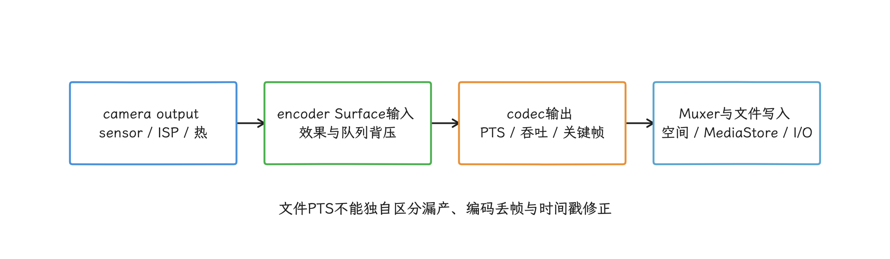

图：1.6.1 MP4与3GPP默认Media3MuxerImpl；WebM仍是平台实现。

### 7.3 高速录像与多路输出

CameraX 1.6 的 `HighSpeedVideoSessionConfig` 已是稳定 API。我们应使用对应 `SessionConfig` 查询支持的帧率范围，再绑定；普通 `CameraInfo.getSupportedFrameRateRanges()` 中出现某个范围，和当前输出组合真的支持它，是两件要分开确认的事。

<!-- gracker-diagram: a249-32-high-speed-combination -->
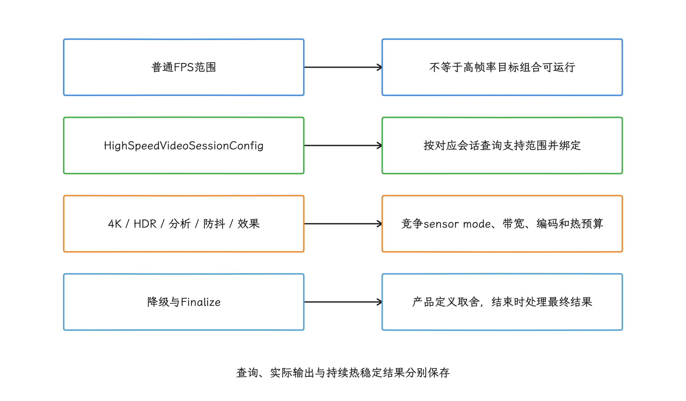

图：无跨设备的固定降级优先级或吞吐保证。

高帧率、4K、HDR、稳定、分析与效果会一起竞争 sensor mode、ISP、内存带宽、编码器和热预算。产品降级顺序由业务定义，例如：

- 保留录像，降低或关闭分析；
- 保留目标帧率，降低分辨率；
- 保留画质，降低帧率；
- 高温时关闭效果或稳定；
- 存储空间不足时及时结束并处理 `VideoRecordEvent.Finalize`。

这些策略没有跨设备的固定优先级，要用设备覆盖和场景测试来确定。

## 8. Extensions：把厂商算法当作独立工作模式

夜景 Night（夜景）、HDR、背景虚化 Bokeh（背景虚化）、人像润饰 Face Retouch（人像润饰） 等 Extensions 会建立扩展会话，并调用设备厂商实现。它们可能使用多帧采集、额外中间缓冲区和后处理线程，延迟、内存与热表现无法从普通 `ImageCapture` 推导。

CameraX 1.6 提供稳定的 `ExtensionSessionConfig`，可以在绑定前参与 `getCameraInfo()` 和 `isSessionConfigSupported()` 查询，但它不支持 `ImageAnalysis`。需要 Extension 与分析同时运行的产品，要设计模式切换，不能假设普通会话的用例组合可直接搬入扩展会话。

<!-- gracker-diagram: a249-33-extension-isolated-mode -->
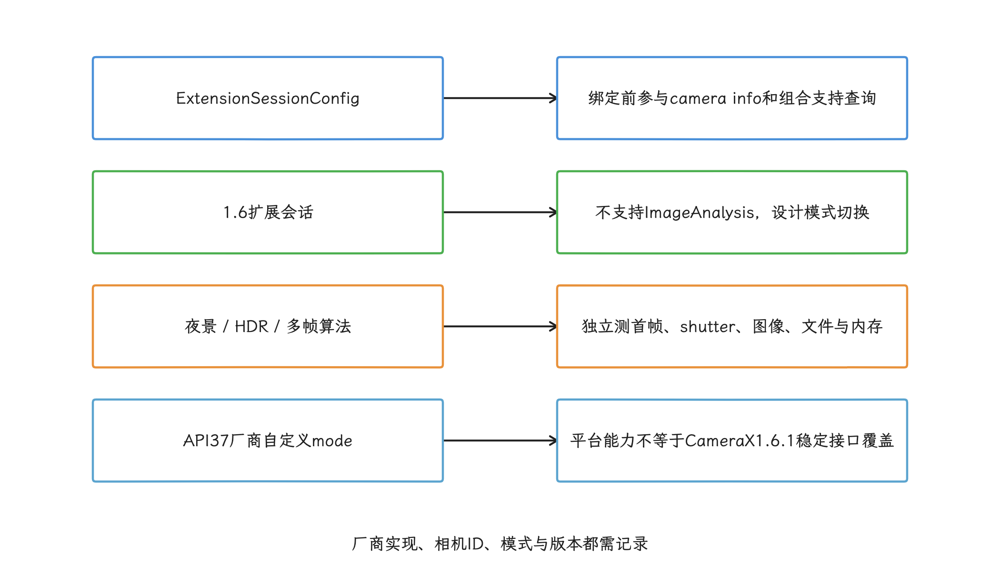

图：不能从普通拍照推导扩展会话的成本和稳定性。

Android 17 平台还允许厂商定义 Camera Extension mode，例如超分辨率或厂商 AI 增强，应用可通过 Camera2 的 `isExtensionSupported(int)` 查询这类模式。不过平台有这个能力，不代表 CameraX 1.6.1 已为所有厂商自定义模式提供等价的稳定接口；CameraX 表达不了的需求，再评估 Camera2。

Extensions 的测试记录至少包含：

- extension mode、相机 id 与 CameraX 版本；
- 预览首帧、拍照 shutter、图像可用与文件完成时间；
- 连续拍摄间隔与设备忙状态；
- 冷机和热稳定状态下的差异；
- 失败、不可用与普通模式回退；
- 内存、dma-buf 和厂商进程变化。

## 9. ML Kit、CameraEffect 与自研 GPU 管线

ML Kit 集成通常运行在 `ImageAnalysis` 消费端，CameraEffect 或自研 OpenGL / Vulkan 管线则可能位于预览、录像或拍照输出之间。两者的资源竞争方式不同：

- CPU Analyzer 会占用 CPU、内存带宽，并持有分析图像；
- GPU Analyzer 或效果会增加纹理导入、同步、shader（着色器程序） 与输出 Surface 的工作；
- NNAPI / GPU 模型可能与预览效果争用 GPU 或内存；
- 逐帧 YUV → RGB 与 Bitmap 分配会增加 CPU、内存和 GC（垃圾回收） 压力；
- 结果覆盖层若每帧触发复杂 UI 重绘，还会增加宿主窗口的帧耗时。

性能计时要覆盖从相机 timestamp 到结果显示的端到端延迟——即使模型推理很快，输入帧在队列里等得太久，用户看到的仍是旧结果。

坐标转换同样要用 CameraX 提供的 rotation、crop rect 与 transformation 信息。直接拿传感器坐标绘制到 `PreviewView`，在裁剪、镜像和旋转场景会错位；为修错位反复复制或旋转 Bitmap，又会引入额外开销。

<!-- gracker-diagram: a249-34-model-effects-and-display -->
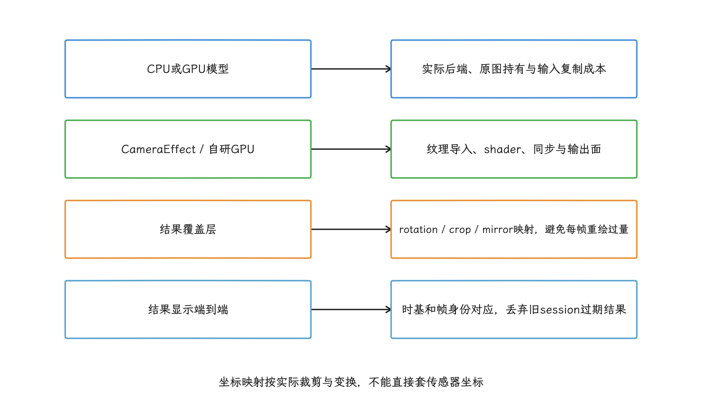

图：模型推理快也可能显示旧结果；预览镜像不代表分析图像已镜像。

## 10. 热稳定：峰值数据不能代表持续录像

相机持续运行会同时用到 sensor、ISP、DDR 内存、CPU、GPU、NPU（神经网络处理器）、编码器、显示与存储。短时间测试可能恰好处于高频状态；几分钟后，系统热管理策略可能调整处理器频率或设备算法，帧率和延迟分布也会随之变化。

长时间场景应固定：

- 室温、充电状态、屏幕亮度和网络活动；
- 前后摄、分辨率、帧率、dynamic range 与稳定；
- Preview 承载方式、Analyzer 模型和效果；
- 录像编码设置与存储位置；
- 预热时间、总时长和系统热状态。

降级要由状态机控制，升降级使用不同温度阈值，形成滞回，避免温度在阈值附近时反复重绑会话。只降低应用线程优先级，通常解决不了 ISP、GPU、编码器或 DDR 的热限制。

公共 kernel 的 dma-buf 与 dma-fence 源码，分别回答“设备间如何共享同一缓冲区”和“设备间如何表达工作完成”。相机 sensor、ISP、频率和带宽策略通常位于厂商驱动、固件与 HAL，所以缺少厂商轨迹时，我们不把 kernel 调度等待直接写成 ISP 结论。

<!-- gracker-diagram: a249-35-thermal-hysteresis -->
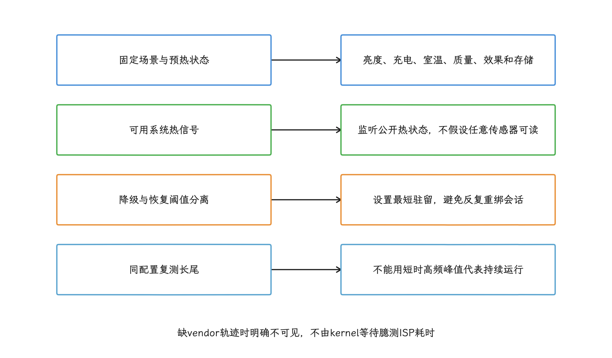

图：线程优先级无法直接解决ISP、编码器或DDR热限制。

## 11. 性能观测：先定义时间点，再看工具

### 11.1 最小指标集

| 指标 | 起点与终点 | 需要关联的证据 |
|---|---|---|
| `ProcessCameraProvider` 初始化 | 请求 provider → provider 可用 | 应用标记（marker）、Binder、线程调度 |
| 绑定耗时 | `bindToLifecycle` → 会话可出帧 | CameraX 日志、camera configure、HAL |
| 首个相机输出 | 首个 repeating request（重复捕获请求）→ 首个有效输出 | camera ATrace、frame number（帧编号）、stream（输出流） |
| 首个可见预览 | 页面动作 → layer present | 应用 marker、BufferQueue、SF / HWC |
| Analyzer 等待 | 图像可交付 → Analyzer 开始 | CameraX / 应用 marker |
| Analyzer 持有 | Analyzer 收到 → `ImageProxy.close()` | ATrace、计数器、异常路径 |
| 拍照延迟 | 用户触发 → shutter / 图像 / 文件 | 拍照回调（capture callback）、sensor timestamp、I/O |
| 录像稳定性 | 录制开始 → `VideoRecordEvent.Finalize` | camera、codec、Muxer、存储、热状态 |

平均值会隐藏首帧、弱光、切镜头和热限制的长尾，所以至少要报告 p50、p95、p99、最大值、失败数与样本场景。p95 表示 95% 的样本不超过该值，p99 同理；样本量不足时直接说明，不要补造百分位。

### 11.2 Perfetto 需要哪些轨迹

CameraX 问题的基础采集通常包括：

- `camera`、`hal`：相机服务、请求与厂商可见切片；
- `gfx`、`view`、SurfaceFlinger frame：预览与界面显示；
- Binder、sched（线程调度）与 CPU 频率：跨进程调用、线程切换与算力变化；
- MediaCodec / Codec2：录像编码；
- thermal（热状态）、CPU / GPU / 内存频率：持续运行；
- 应用 ATrace：用于标出页面动作、绑定、Analyzer、拍照与录制状态。

FrameTimeline 是系统记录的应用窗口帧时间线，主要解释界面帧。`SurfaceView` 预览作为独立 layer 时，应用窗口的 jank（卡顿帧） 情况说明的是界面帧，相机输出与预览 layer 的 present 要另外采集。`TextureView` 则还要查看宿主 HWUI 和应用窗口提交。

<!-- gracker-diagram: a249-36-trace-correlation-tracks -->
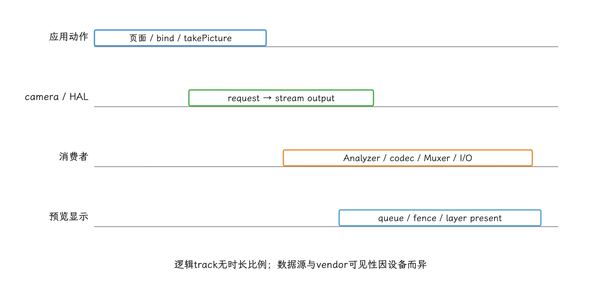

图：独立预览layer与应用窗口帧分开；以实际帧ID与时基映射关联。

[15.14 Android Camera 性能与 Perfetto 分析](../../part3-tools/ch15-other-tools/14-camera-performance-analysis.md) 给出了 Android 17 的 Perfetto 配置、CameraService 打开相机阶段、输出流首缓冲区、请求延迟直方图与 ZSL 时间点拆分，采集配置可以直接沿用。

### 11.3 内存必须分域

相机内存可能分布在：

- Java / Kotlin heap（托管堆）：业务对象、Bitmap、模型输入输出；
- native heap（原生堆）：CameraX、图像转换、codec、厂商库；
- GraphicBuffer / dma-buf：Preview、Analysis、录像与拍照输出；
- GPU、ISP、codec 与厂商私有池；
- ZSL、Extensions 和多帧算法的候选图像。

进程 RSS（常驻物理内存）的增长不能直接换算成 `ImageAnalysis` 的队列大小。我们先确认未关闭的 `ImageProxy`、Bitmap 分配和 native heap，再结合 dma-buf、Surface 与厂商数据判断。

<!-- gracker-diagram: a249-37-camera-memory-domains -->
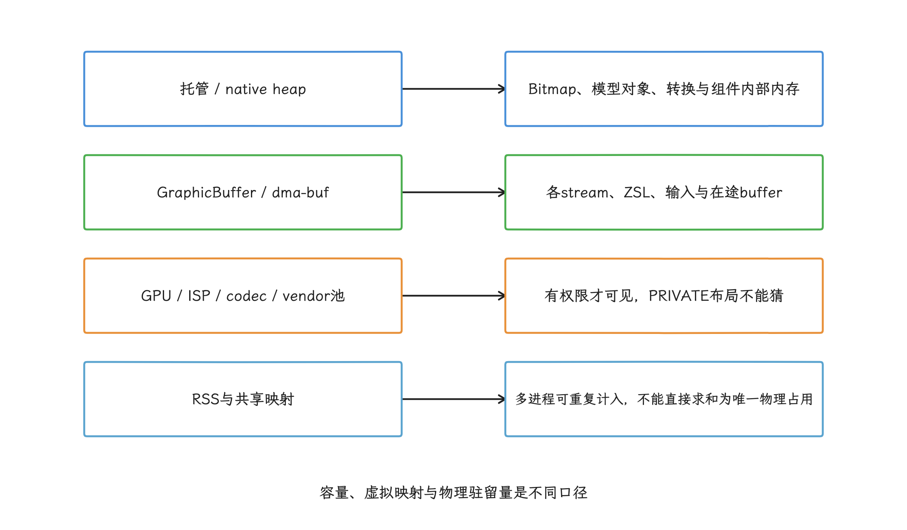

图：先查ImageProxy泄漏与逐帧分配，再关联实际共享buffer证据。

## 12. CameraX、Camera2Interop 与 Camera2 的选择

### 12.1 CameraX 适合的范围

以下场景通常留在 CameraX：

- Preview、普通拍照、扫码、文档扫描和常规录像；
- 可以通过 `SessionConfig`、分辨率、帧率、回压与降级表达需求；
- 需要 CameraX 的生命周期、quirk 与设备兼容处理；
- 轨迹显示问题位于 Analyzer、应用 UI、编码或存储，而非抽象能力缺失。

CameraX 1.6 的 CameraPipe 和稳定 `SessionConfig` 已经覆盖比旧版本更宽的高级配置范围，迁移到 Camera2 之前，应先确认当前稳定版是否已有对应能力。

### 12.2 Camera2Interop 的边界

`Camera2Interop` 可以向 CameraX 配置加入部分 `CaptureRequest` 选项，或读取 Camera2 信息。它的作用到此为止：CameraX 用例仍是 CameraX 用例，不会变成应用自管的 `CameraCaptureSession`，应用也拿不到输出流（stream）、Surface、请求序列和回调顺序的直接管理权。

Interop 选项还可能与 CameraX 自己的 3A、帧率、稳定或特性组配置冲突。设置成功只是参数进入了配置，设备是否支持、HAL 是否接受、运行效果如何，还要靠查询和 CaptureResult 结果来确认。

### 12.3 需要 Camera2 的明确条件

出现以下需求时再评估 Camera2：

- 精确创建 `OutputConfiguration`、输入 / reprocess 会话或物理相机输出；
- 使用 Android 17 `updateOutputConfigurations()` 管理既有输出 Surface；
- 指定 API 37 `RAW14` 或读取 CameraX 未暴露的格式；
- 管理 vendor tag（厂商自定义相机元数据键）、厂商自定义 Extension 或细粒度手动曝光；
- 使用 CameraX 无法表达的 Surface 组合、高速模式或请求序列；
- 已有轨迹证明瓶颈来自 CameraX 配置选择，且 Camera2 能给出不同的可支持配置。

改用 Camera2，设备能力查询、生命周期、会话恢复、quirk 和错误处理就都交回应用维护。性能收益必须用相同 camera id、输出组合、分辨率、帧率、dynamic range、预热状态和首帧定义来对比。

<!-- gracker-diagram: a249-38-abstraction-choice -->
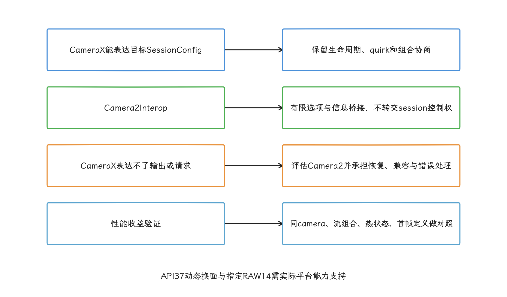

图：不能仅凭多一层封装推导Camera2一定更快。

## 13. 一条可执行的排查顺序

遇到预览卡顿、拍照慢、分析延迟或录像掉帧，我们按下面的顺序缩小范围：

1. 记录 Android build、CameraX 版本、camera id、用例组合和实际输出配置；
2. 仅绑定 Preview，建立首帧与稳定帧间隔基线；
3. 加入 ImageCapture，观察是否发生会话重配及 Preview 变化；
4. 加入 ImageAnalysis，记录 Analyzer 等待、处理和持有时间；
5. 加入 VideoCapture 或 Extensions，重新查询完整 `SessionConfig`；
6. 分别降低分析尺寸、录像质量或效果负载，每次只改一个变量；
7. 采集 Perfetto，把 camera output、消费者和显示时间轴对齐；
8. 复测长时间热稳定状态；
9. 只有在 CameraX 无法表达所需会话时，使用 Camera2 做同配置对照。

排查结论要能回答三个问题：慢在哪一段、哪个持有方在等待、哪项配置改变了结果。“CameraX 慢”“设备差”或“HAL 卡住”这样的结论，指导不了任何修复。

<!-- gracker-diagram: a249-39-diagnostic-progression -->
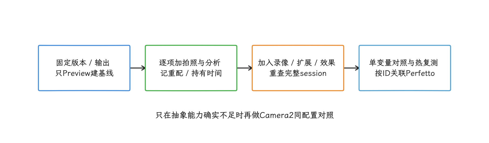

图：结论说明哪段变慢、谁持有资源以及哪个变量改变结果。

## 14. 全文小结

决定 CameraX 性能的是完整的 UseCase 组合，而不是某个单独参数或“多一层封装”。我们先固定平台与库版本，验证会话能否支持，再分别追踪 Preview、ImageAnalysis、ImageCapture 和 VideoCapture 的生产者、消费者、缓冲区持有与最终时间点。

CameraX 1.6 的 CameraPipe 仍运行在 Camera2、相机服务和 HAL 之上：库负责用例协商、生命周期和设备兼容，HAL 负责采集与 ISP，应用负责分析、效果、编码、存储和显示这些消费者。只有当 CameraX 无法表达目标会话、同配置对照也证明 Camera2 能改变瓶颈时，才值得接管更底层的生命周期与请求控制。

## 15. Android 17 / CameraX 1.6.1 源码锚点

### CameraX 1.6.1

- [`Camera2Config.kt`](https://android.googlesource.com/platform/frameworks/support/+/987b9ac8585b31424a397206c492196dd163997b/camera/camera-camera2/src/main/java/androidx/camera/camera2/Camera2Config.kt)：默认 CameraPipe 配置；
- [`PreviewView.java`](https://android.googlesource.com/platform/frameworks/support/+/987b9ac8585b31424a397206c492196dd163997b/camera/camera-view/src/main/java/androidx/camera/view/PreviewView.java)：实现模式、实际回退条件与预览状态；
- [`ImageAnalysis.java`](https://android.googlesource.com/platform/frameworks/support/+/987b9ac8585b31424a397206c492196dd163997b/camera/camera-core/src/main/java/androidx/camera/core/ImageAnalysis.java)：回压策略、默认队列深度与图像归还责任；
- [`SessionConfig.kt`](https://android.googlesource.com/platform/frameworks/support/+/987b9ac8585b31424a397206c492196dd163997b/camera/camera-core/src/main/java/androidx/camera/core/SessionConfig.kt)：用例、帧率、特性组与会话配置；
- [`Recorder.java`](https://android.googlesource.com/platform/frameworks/support/+/987b9ac8585b31424a397206c492196dd163997b/camera/camera-video/src/main/java/androidx/camera/video/Recorder.java)：质量选择、编码结果消费与 Muxer 实现选择。

### Android 17 平台

- [`CameraDevice.java`](https://android.googlesource.com/platform/frameworks/base/+/refs/tags/android-17.0.0_r1/core/java/android/hardware/camera2/CameraDevice.java)、[`CameraCaptureSession.java`](https://android.googlesource.com/platform/frameworks/base/+/refs/tags/android-17.0.0_r1/core/java/android/hardware/camera2/CameraCaptureSession.java)：Camera2 会话与 API 37 动态输出更新；
- [`Camera3Device.cpp`](https://android.googlesource.com/platform/frameworks/av/+/refs/tags/android-17.0.0_r1/services/camera/libcameraservice/device3/Camera3Device.cpp)：请求线程、在途请求与 HAL 交互；
- [`Camera3Stream.cpp`](https://android.googlesource.com/platform/frameworks/av/+/refs/tags/android-17.0.0_r1/services/camera/libcameraservice/device3/Camera3Stream.cpp)、[`Camera3OutputStream.cpp`](https://android.googlesource.com/platform/frameworks/av/+/refs/tags/android-17.0.0_r1/services/camera/libcameraservice/device3/Camera3OutputStream.cpp)：输出缓冲区、fence、dequeue 与 queue；
- [`ICameraDeviceSession.aidl`](https://android.googlesource.com/platform/hardware/interfaces/+/refs/tags/android-17.0.0_r1/camera/device/aidl/android/hardware/camera/device/ICameraDeviceSession.aidl)：Android 17 HAL 会话、请求、flush 与 stream 配置；
- [`ImageFormat.java`](https://android.googlesource.com/platform/frameworks/base/+/refs/tags/android-17.0.0_r1/graphics/java/android/graphics/ImageFormat.java)：API 37 `RAW14`。

### Kernel 6.18

- [`dma-buf.c`](https://android.googlesource.com/kernel/common/+/refs/tags/android17-6.18-2026-06_r6/drivers/dma-buf/dma-buf.c)：跨设备共享缓冲区；
- [`dma-fence.c`](https://android.googlesource.com/kernel/common/+/refs/tags/android17-6.18-2026-06_r6/drivers/dma-buf/dma-fence.c)、[`sync_file.c`](https://android.googlesource.com/kernel/common/+/refs/tags/android17-6.18-2026-06_r6/drivers/dma-buf/sync_file.c)：fence 状态、等待、回调与 fd 接口。

## 16. 参考资料

- [CameraX 版本说明](https://developer.android.com/jetpack/androidx/releases/camera)
- [CameraX 架构](https://developer.android.com/media/camera/camerax/architecture)
- [CameraX 配置与多用例组合](https://developer.android.com/media/camera/camerax/configuration)
- [`PreviewView` 预览实现](https://developer.android.com/media/camera/camerax/preview)
- [`ImageAnalysis` 回压与图像归还](https://developer.android.com/media/camera/camerax/analyze)
- [CameraX ZSL](https://developer.android.com/media/camera/camerax/take-photo/zsl)
- [CameraX VideoCapture](https://developer.android.com/media/camera/camerax/video-capture)
- [`SessionConfig`](https://developer.android.com/reference/androidx/camera/core/SessionConfig)
- [`ExtensionSessionConfig`](https://developer.android.com/reference/androidx/camera/extensions/ExtensionSessionConfig)
- [Android 17 Camera 更新](https://developer.android.com/about/versions/17/release-notes)
- [Camera2 API](https://developer.android.com/reference/android/hardware/camera2/package-summary)
- [13.10 Android Camera 平台管线：HAL3、Buffer、ZSL 与显示](../../part2-performance/ch13-rendering-pipelines/10-camera-pipeline.md)
- [15.14 Android Camera 性能与 Perfetto 分析](../../part3-tools/ch15-other-tools/14-camera-performance-analysis.md)
