# App Widget 更新性能：RemoteViews IPC（进程间通信） 与 Glance 渲染

App Widget 的界面绘制发生在宿主进程：提供方生成 `RemoteViews` 交给 `system_server`（承载多数系统服务的系统进程） 校验和缓存，再由 Launcher（桌面启动器）、SystemUI（系统界面进程） 或其他实现了 `AppWidgetHost` 的宿主创建 View、执行属性动作并绘制。我们在这套 IPC 模型下做优化，重点就是减少重复更新和无效动作，控制布局创建、集合数据与图像内存的成本。

> 源码基线：AOSP `android-17.0.0_r1`（Android 17 / API 37）；Glance 以 1.2.0 为准。文中讨论的更新、缓存和宿主应用逻辑都发生在 Android 框架与 Jetpack 库中，不延伸到内核实现。 截至2026-10-25，Google Maven 与发布页的最新稳定版仍是 Glance 1.2.0（2026-08-26），另有1.3.0-alpha02；本文不把预览版能力套到1.2.0。

## 一、执行模型：一次更新穿过三个进程

### 1. `RemoteViews` 是布局说明和动作集合

提供方交给宿主的是一份布局说明；创建 View 层级、加载布局、按顺序执行动作，这些都要等宿主收到说明后在自己的进程里完成。`RemoteViews` 保存的正是这份说明——布局资源、可能的尺寸变体，以及内部动作列表 `mActions`。`setTextViewText()` 记录一项文本属性设置，`setImageViewBitmap()` 记录携带位图的 `BitmapReflectionAction`。

说明与执行分处两个进程，我们的分析方法也顺着这个结构来：先把一次更新拆成三段看。

- 提供方进程的耗时主要来自取数、构造 `RemoteViews`、准备图像和发起 Binder 调用；
- `system_server` 负责检查调用者、更新缓存、检查图像内存，再把有效快照通知给宿主，快照就是一份描述 Widget 某一时刻界面状态的 `RemoteViews`；
- 宿主进程承担布局加载、动作应用、测量、布局、绘制等 UI 工作。

还有一点要留意：提供方完成 `updateAppWidget()` 调用时，桌面像素往往还没刷新。旧式集合适配器的兼容转换开启时，主线程调用还可能先把转换工作投递到后台执行器，再由后台提交更新——这时函数返回，连“系统服务已收到新快照”都保证不了。 转换由 CompletableFuture 链提交，非主线程调用也不能只凭函数返回认定服务已接收；转换失败可只写日志。业务应保留数据版本与提交/宿主观察的阶段证据，不能把调用返回当成功显示回执。

这张时序图定位的是不含旧式集合转换的一次完整更新；兼容转换开启时，提供方还会在提交前收集集合项。

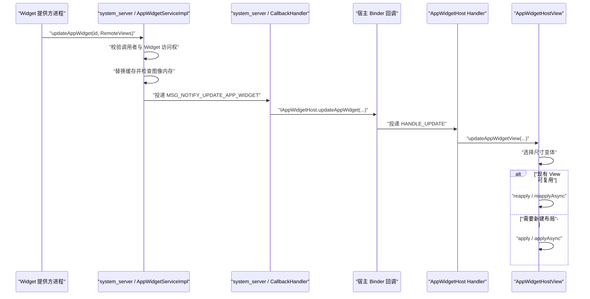

读这张图时，先抓住两个 Binder 方向：一个从提供方到系统服务，一个从系统服务到宿主。服务端先把通知投递给 `mCallbackHandler`，由服务线程调用宿主；`AppWidgetHost.Callbacks` 收到 Binder 回调后，再向指定的 `Handler` 发送消息。两端各有一条消息队列，服务端通知队列和宿主消息队列都可能产生等待，测量时我们要分别定位。

<!-- gracker-diagram: a250-01-update-three-process-tracks -->
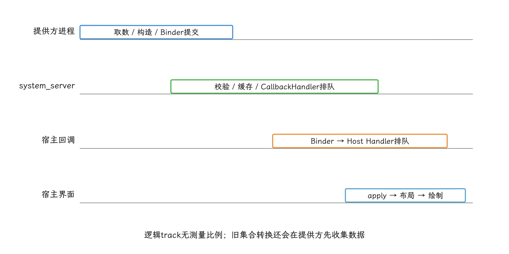

图：调用返回、服务提交通知和宿主画面刷新是不同时间点。

### 2. `apply()` 与 `reapply()` 由宿主选择

`AppWidgetHostView.applyRemoteViews()` 先选择适合当前尺寸的 `RemoteViews`，再判断现有 View 能否复用。同步路径调用 `canRecycleView(mView)`：布局与现有 View 满足复用条件时执行 `reapply()`，否则由 `apply()` 创建新内容。宿主配置了异步 `Executor`（执行任务的线程调度接口） 时，代码进入 `inflateAsync()`，按同样的判断分别调用 `reapplyAsync()` 或 `applyAsync()`。复用与否由宿主决定，提供方手里没有能强制宿主执行 `reapply()` 的公开接口。 即便判断可复用，reapply 抛 RuntimeException 后同步路径仍会尝试重新 apply；异步路径也有失败恢复。异步执行器只分担可异步的加载/初始化，最终 View 应用及界面帧仍由宿主管理，不代表测量、布局和绘制全在后台完成。

<!-- gracker-diagram: a250-02-host-apply-branches -->
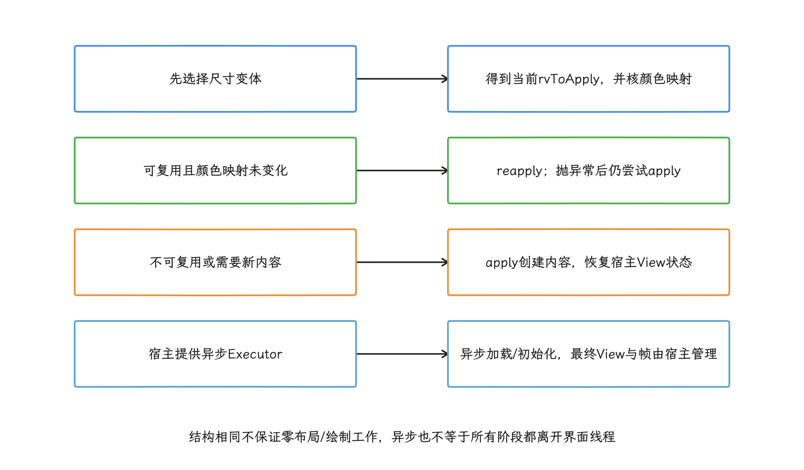

图：提供方没有强制宿主reapply的公开接口。

下面这些变化容易让复用条件失效，或增加宿主的工作量：

- 完整更新切换了布局资源或尺寸变体；
- 响应式布局需要按宿主尺寸选择另一套结构；
- 宿主的颜色映射发生变化；
- 动作集合需要处理较大的图像或较多子 View；
- 宿主没有设置异步执行器，只能在自己的界面线程同步应用更新。

提供方应减少无意义的布局切换，并把稳定结构留在 XML 中。我们验证性能时还要看宿主侧的 Perfetto 系统跟踪，确认 `apply`、测量和绘制耗时；只测提供方函数，会漏掉桌面侧开销。

### 3. Launcher 插件卡片与标准 App Widget 的分界

车机或定制桌面常把可插拔业务视图也叫“Widget”，但这类 Launcher 插件卡片走的通常不是 `AppWidgetManager`、`AppWidgetServiceImpl` 和 `RemoteViews` 缓存这条链路。以一篇移植 SystemUI Plugin Framework 的车机 Launcher 实践为例：插件 APK 在 manifest 中把实现类声明成带 action 的 `service`，宿主用 `PackageManager.queryIntentServices()` 发现候选组件，再通过自定义 `WidgetViewPlugin` 接口取得插件提供的普通 View；`PluginActionManager` 源码里也保留着“这并不是真的 service、不应启动，只是便于用 PackageManager 管理插件”的注释。[来源: https://juejin.cn/post/7678556373495971883][已验证: packages/SystemUI/shared/src/com/android/systemui/shared/plugins/PluginActionManager.kt@android-17.0.0_r1]

这个插件模型的加载与隔离方式也不同：`PluginActionManager` 在加载前检查插件权限和是否可启用，`PluginInstance` 为插件创建 `PathClassLoader`，把宿主类加载器包在只放行指定包名前缀的 `ClassLoaderFilter` 之后，再通过 `createApplicationContext()` 加载插件资源。它提供的是类可见性与资源上下文隔离；插件实例仍在宿主进程里执行，和 AppWidget 跨进程 `RemoteViews` 的进程级隔离是两回事。[已验证: packages/SystemUI/shared/src/com/android/systemui/shared/plugins/PluginActionManager.kt@android-17.0.0_r1][已验证: packages/SystemUI/shared/src/com/android/systemui/shared/plugins/PluginInstance.kt@android-17.0.0_r1] ClassLoaderFilter 不是不可信代码的安全沙箱，也不会隔离插件在宿主线程中的阻塞、崩溃或内存开销；实际生产加载还受非调试构建的特权名单等规则限制。

所以，排查这类自定义 Launcher 卡片时，`adb shell dumpsys appwidget`、`partiallyUpdateAppWidget()` 和 `RemoteViews` 图像上限通常解释不了它的加载与刷新成本，应改看 Launcher 进程内的插件发现、类加载、资源加载、接口回调和 View 绘制。只有通过标准 `AppWidgetProvider` 或 Glance 发布到系统 AppWidget 服务的桌面组件，才适用本文后续的更新语义、缓存和 IPC 分析。[来源: https://juejin.cn/post/7678556373495971883][已验证: frameworks/base/services/appwidget/java/com/android/server/appwidget/AppWidgetServiceImpl.java@android-17.0.0_r1]

<!-- gracker-diagram: a250-03-plugin-vs-appwidget -->
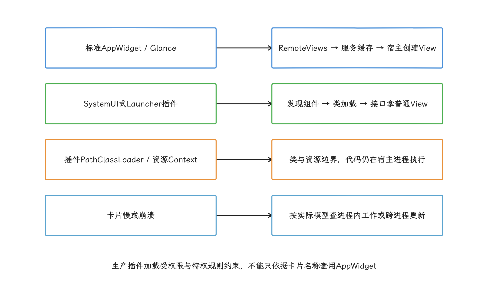

图：ClassLoaderFilter不是进程级隔离，也不隔离插件阻塞和崩溃。

## 二、三种更新语义的分工

Android 的 Widget 更新接口分为完整更新、局部更新和集合数据刷新，三者操作的对象不同：

| 更新类型 | 公开入口 | Android 17 服务端行为 | 适用场景 |
| --- | --- | --- | --- |
| 完整更新 | `updateAppWidget()` | 用新 `RemoteViews` 替换已缓存快照 | 首次显示、结构变化、需要重建完整状态 |
| 局部更新 | `partiallyUpdateAppWidget()` | 把新动作合并进已缓存快照，再通知宿主 | 布局不变，只更新少量属性 |
| 集合刷新 | `notifyAppWidgetViewDataChanged()` | 兼容转换关闭时通知宿主重新取数；开启时在提供方重取集合并提交新快照 | 仍使用服务适配器的 `ListView`、`GridView`；该入口已在 API 35 弃用 |

完整更新建立可恢复的缓存基线，局部更新修改这份基线中的少量属性；集合刷新让服务适配器重新提供列表项，兼容转换开启时还会重新提交 Widget 快照。我们先按当前适配器类型和平台分支选对入口，再比较每次更新的数据量。三种调用各管各的对象，仅凭“哪一个看起来更轻”来互换，很容易换来错误的行为。

<!-- gracker-diagram: a250-04-three-update-semantics -->
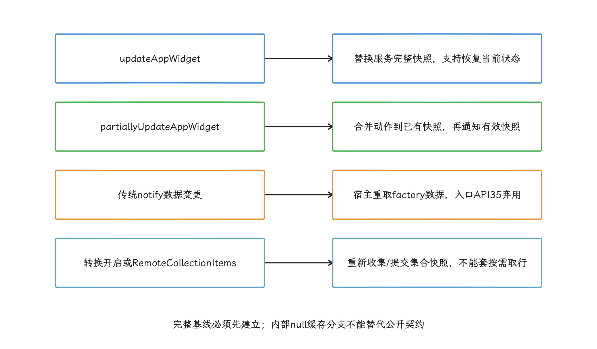

图：先按适配器和平台分支选择正确语义，再比较负载。

### 1. 完整更新是缓存基线

`AppWidgetServiceImpl.updateAppWidgetInstanceLocked()` 在完整更新分支中直接替换 `widget.views`，系统缓存的对象必须能独立描述当前 Widget。提供方进程死亡后，`system_server` 里的缓存不会立即清除，宿主重新连接时仍可能收到这份快照；设备重启后的重新更新属于另一条生命周期路径，内存快照能否跨重启保留没有保证。

<!-- gracker-diagram: a250-05-full-snapshot-recovery -->
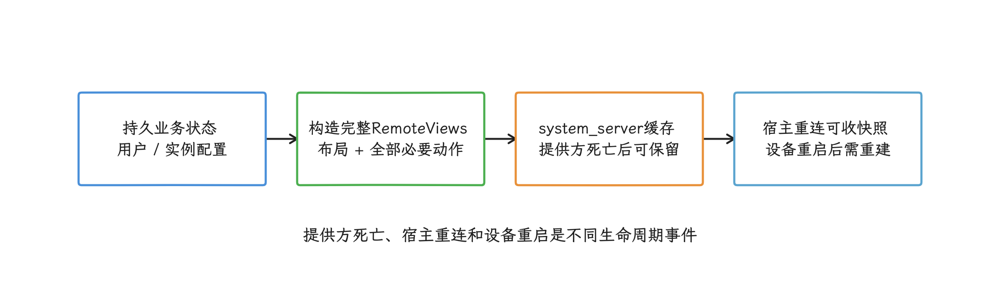

图：内存快照不是跨设备重启的持久存储协议。

下面的 Kotlin 示例构造一份完整状态，并一次更新同一提供方的多个实例。

```kotlin
fun updateWeatherWidgets(
    context: Context,
    appWidgetIds: IntArray,
    temperatureText: CharSequence,
    updatedAtText: CharSequence,
) {
    if (appWidgetIds.isEmpty()) return

    val views = RemoteViews(context.packageName, R.layout.widget_weather).apply {
        setTextViewText(R.id.temperature, temperatureText)
        setTextViewText(R.id.updated_at, updatedAtText)
    }

    AppWidgetManager.getInstance(context).updateAppWidget(appWidgetIds, views)
}
```

这段代码适合所有实例展示相同内容的情况；若每个实例绑定了不同城市或账户，就分别构造快照——为了合并一次调用而发送错误内容，损失更大。

### 2. 局部更新依赖已经存在的完整快照

`partiallyUpdateAppWidget()` 在 API 11 引入；从 API 17 起，新属性会追加到服务缓存，后续完整更新再替换合并后的缓存。公开 API 契约要求实例先收到一次完整更新，官方文档也说明缺少这份基线时局部更新会被忽略。

Android 17 的 `AppWidgetServiceImpl` 在缓存为空时会把传入对象直接暂存为当前 `widget.views`，跳过合并。这只是内部分支，公开契约没有变：传入对象仍可能只含少量动作，描述不了完整界面，其他 Android 版本和厂商实现也无需保持该行为。应用必须先提交完整更新，这项内部处理靠不住。

下面的示例只修改更新时间文字，调用方必须先为该实例提交过完整更新。

```kotlin
fun updateWidgetTimestamp(
    context: Context,
    appWidgetId: Int,
    updatedAtText: CharSequence,
) {
    val delta = RemoteViews(context.packageName, R.layout.widget_weather).apply {
        setTextViewText(R.id.updated_at, updatedAtText)
    }

    AppWidgetManager.getInstance(context)
        .partiallyUpdateAppWidget(appWidgetId, delta)
}
```

局部更新省下的是提供方发送的动作和参数；Android17服务合并后通知宿主的是 `widget.getEffectiveViewsLocked()` 的快照副本，不能假定宿主只收本次delta或仅执行新增动作，收益要结合更新频率、动作大小和宿主实现来测。业务状态容易偏离完整数据时，可以在配置变化、数据版本迁移这类明确事件后重新提交完整快照，让界面回到一致状态——这是一项工程策略，系统并没有要求按固定周期执行。 `mergeRemoteViews()` 按动作 unique key 和 mergeBehavior 做替换、追加或忽略；相同属性常会替换，追加型动作则可能累积。局部更新并不天然保证缓存动作数恒定。

<!-- gracker-diagram: a250-06-partial-merge-effective-snapshot -->
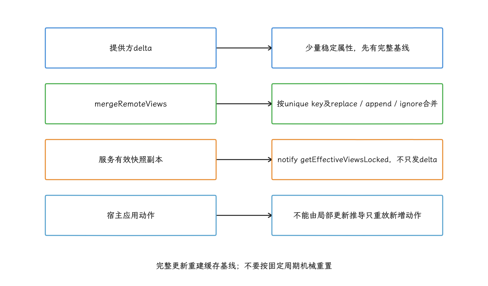

图：替换型动作可去旧值，追加型动作可能累积。

### 3. 集合刷新与适配器转换

旧式集合 Widget 通过 `RemoteViewsService` 创建 `RemoteViewsFactory`。在宿主仍使用 `RemoteViewsAdapter` 的传统路径中，服务按宿主请求提供列表项：调用 `notifyAppWidgetViewDataChanged(appWidgetId, viewId)` 后，宿主可以继续显示旧数据，同时触发 `onDataSetChanged()`，随后再调用 `getCount()`、`getViewAt()` 等方法读取新数据。

服务断开连接并不会触发 `onDataSetChanged()`；把刷新逻辑挂在断连事件上，不同宿主上的行为会不一致。

Android 12 / API 31 增加了 `RemoteViews.setRemoteAdapter(viewId, RemoteCollectionItems)`：`RemoteCollectionItems` 是随 `RemoteViews` 一起提交的集合项快照，宿主无须再绑定 `RemoteViewsService`。API 35 已弃用 `notifyAppWidgetViewDataChanged()` 及其对应的 `Intent` 适配器，官方迁移方式是设置新的 `RemoteCollectionItems`，再调用适用的完整或局部更新接口。

`remoteAdapterConversion` 功能开关开启时，旧式 `Intent` 适配器也会转换成集合快照：`AppWidgetManager.tryAdapterConversion()` 在提供方收集列表项后才提交更新；集合刷新则通过 `notifyCollectionWidgetChange()` 重新收集指定集合，再调用服务端的 `updateAppWidgetIds()`。继续使用 `RemoteViewsService` 的话，宿主是否仍按滚动位置逐项取数就没有保证。[已验证: frameworks/base/core/java/android/appwidget/AppWidgetManager.java@android-17.0.0_r1]

<!-- gracker-diagram: a250-07-legacy-vs-snapshot-collection -->
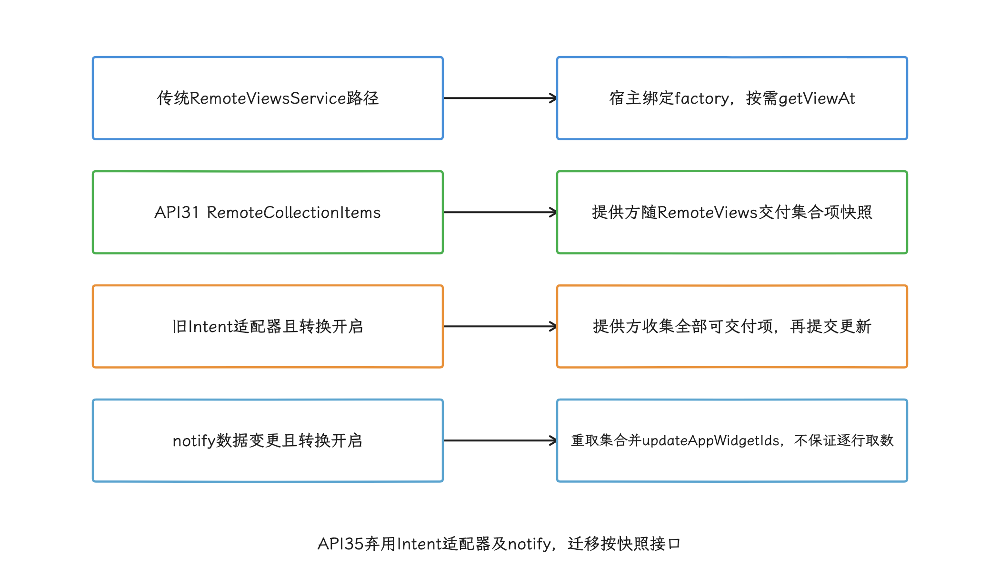

图：兼容转换由实际平台flag控制，不能只按API level猜。

转换时，内部方法 `RemoteViewsFactory.getRemoteCollectionItems()` 会顺序读取项目，达到序列化数据或位图容量限制时停止收集。较大的集合要检查实际交付的项目数量；排查列表缺项时，同样要检查转换阶段的容量限制。[已验证: frameworks/base/core/java/android/widget/RemoteViewsService.java@android-17.0.0_r1] 固定源码中，单项序列化后 `dataSize > capSize` 或位图累计 `>= capBitmapSize` 会在加入当前项之前停止；`getViewAt()` 返回 null 也会结束本次收集。这些内部限制不是应用可依赖的完整交付协议，应核对实际item数并提供有界数据。

<!-- gracker-diagram: a250-08-collection-capacity-stop -->
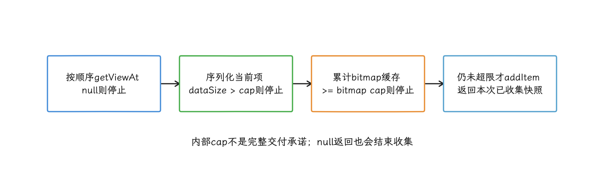

图：尾部缺项可由转换容量触发，不能只检查factory总行数。

维护集合 Widget 时，我们可以按数据规模判断：

- 项目较少、每项结构简单、数据已经在内存中：`RemoteCollectionItems` 易于维护。
- 项目较多、取数需要服务生命周期：维护 `RemoteViewsService` 旧实现时，核对兼容转换是否开启，并测量收集整份快照的耗时与容量，传统按需加载模型在这里套不上。
- 无论使用哪条路径，都要限制单项动作和图像体积。集合会把一次更新的成本放大到多个项目。

### 4. 集合项的优化位置

`RemoteViewsFactory.getViewAt(position)` 返回的是单项 `RemoteViews`。我们可以在 `onDataSetChanged()` 中完成一次数据快照，然后让 `getViewAt()` 只做确定性的映射：

1. 在后台完成数据库查询、排序和业务计算。
2. 生成不可变的数据列表，并在回调结束前通过 AtomicReference、volatile 引用或锁安全发布整份不可变新快照，读取方不会看到只更新了一半的数据。
3. `getViewAt()` 只读取快照，设置文本、资源和点击模板所需的填充参数。
4. 对相同内容复用资源引用，避免为每一项重复创建相同位图。
5. 数据暂不可用时返回稳定的加载或空状态，避免宿主反复收到结构差异很大的布局。 跨线程发布不仅要求引用写入不可分割，还要求可见性；不要在发布后继续修改列表或项目内部可变数据。

官方文档允许 `onDataSetChanged()` 和 `getViewAt()` 执行较重的同步工作，总延迟仍要自己盯：桌面滚动时项目迟迟交不出来，表现就是空白、占位或更新滞后。

<!-- gracker-diagram: a250-09-immutable-row-snapshot -->
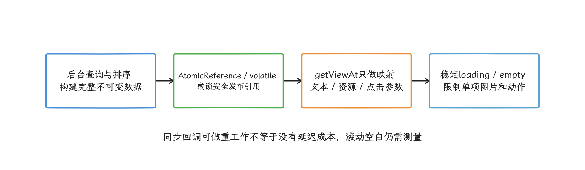

图：原子引用写入还需内存可见性，发布后不再改数据。

## 三、更新调度与数据时效等级

Widget 的更新频率应来自产品语义。天气摘要、日历倒计时、媒体进度和即时告警各有各的机制，套用同一个周期会出问题。

### 1. `updatePeriodMillis` 的周期规则

提供方 XML 中的 `updatePeriodMillis` 只适合低频周期刷新。`AppWidgetServiceImpl` 按以下规则注册更新：

- 值为 `0` 时不注册周期更新；
- 正值会与 `MIN_UPDATE_PERIOD` 取较大值；
- 非调试构建的 `MIN_UPDATE_PERIOD` 是 30 分钟；
- 服务端使用 `AlarmManager.setInexactRepeating(ELAPSED_REALTIME_WAKEUP, ...)`。

下面的配置关闭系统周期广播，把刷新交给业务事件或任务调度器。

```xml
<appwidget-provider
    xmlns:android="http://schemas.android.com/apk/res/android"
    android:initialLayout="@layout/widget_weather"
    android:minWidth="180dp"
    android:minHeight="110dp"
    android:updatePeriodMillis="0" />
```

关闭周期广播后，应用需要覆盖首次添加、配置变化、用户主动刷新、数据变化以及必要的后台任务；`0` 只是把系统周期广播关掉，新的调度来源还得应用自己建立。

### 2. `AppWidgetProvider` 广播入口的返回时限

`AppWidgetProvider` 继承 `BroadcastReceiver`。官方 API 用约10秒说明应迅速完成的一般原则，但不能把它写成所有广播固定ANR门槛：Android14及以上的前台优先广播通常为10–20秒，后台优先广播为60–120秒，取决于CPU饥饿等条件；冷启动也计入超时。`goAsync()` 仍受广播超时约束，必须及时 `PendingResult.finish()`。这些上限不是可使用的业务计算预算，网络、批量解码和大型迁移应放到 `onUpdate()` 之外。合适的处理顺序是：

<!-- gracker-diagram: a250-11-receiver-budget-and-finish -->
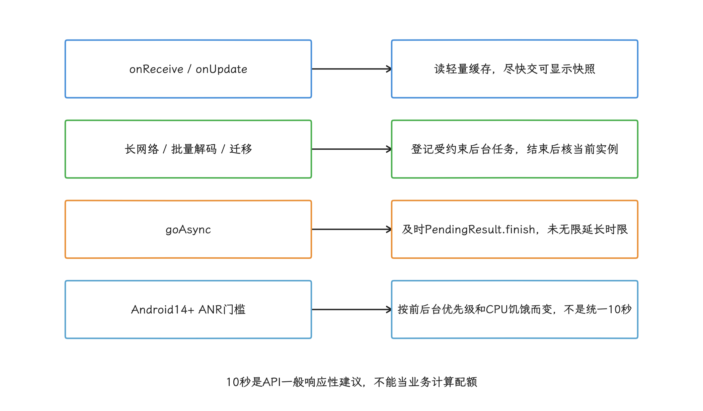

图：冷启动也计入广播超时，执行器排队同样消耗预算。

1. 读取已经缓存的轻量状态；
2. 尽快提交可显示的 `RemoteViews`；
3. 需要联网或持久化计算时，登记受系统约束的后台任务；
4. 任务完成后根据最新 Widget ID 再提交一次更新。

WorkManager 是 Jetpack 的可延迟后台任务调度器，可以表达网络、电量、充电等约束，也能把一次性任务去重。它不保证精确执行时刻，周期任务还受最小周期、应用待机分桶（按活跃度分档限制后台）、省电模式和执行配额影响；把它当成精确定时器，就会误判数据时效。 `PeriodicWorkRequest` 的最小重复间隔为15分钟，这也只是允许的请求参数，不是数据每15分钟必定刷新的SLA。离线、约束未满足或系统延期时，应继续显示最近可用值和更新时间。

<!-- gracker-diagram: a250-10-refresh-scheduling-contract -->
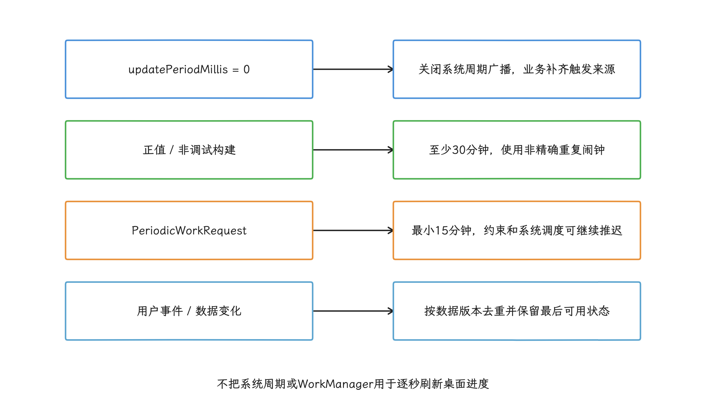

图：30分钟和15分钟都是调度边界，不是新数据准点到达SLA。

### 3. API 37 的监听器精确闹钟有进程生命周期限制

Android 17 / API 37 为 `AlarmManager` 增加了带 `Executor` 的监听器重载：

`setExactAndAllowWhileIdle(type, triggerAtMillis, tag, executor, listener)`

这个入口可以把回调交给指定执行器，适合某个 `Activity`、`Service` 或 `ContentProvider` 仍在运行期间的一次性短期任务。源码和 API 文档都说明：监听器闹钟要求请求进程持续运行，进程没有运行中的组件或进入缓存状态后，系统可能取消或丢弃回调。

监听器形式免去了 `SCHEDULE_EXACT_ALARM` 特殊访问权限，代价是受这条进程生命周期约束。调用方应在所属组件结束时调用 `cancel(OnAlarmListener)`。进程死亡后仍要触发更新的场景，改用 `PendingIntent` 形式——它由系统代应用保存、可在应用进程不存在时触发，其精确闹钟形式需要满足对应的访问规则。允许延迟时，优先使用 WorkManager 或系统的非精确周期机制。 allow-while-idle 仍受平台配额和调度规则约束，Executor 排队也会推迟业务执行；API37这个重载不是无配额的常驻Widget秒级刷新机制。

<!-- gracker-diagram: a250-12-listener-alarm-lifetime -->
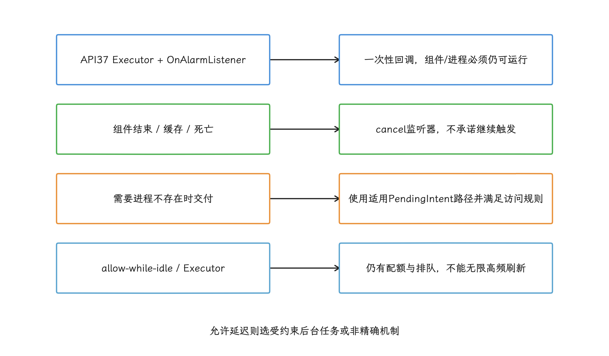

图：不能用监听器权限例外绕过Widget长期后台调度约束。

### 4. 可见状态与刷新节奏

标准 AppWidget API 没有“当前是否可见”的跨宿主统一回调；`onEnabled()`、`onDisabled()` 和 `onAppWidgetOptionsChanged()` 描述的是实例集合生命周期或尺寸选项变化，别拿它们当可见性信号。所以刷新逻辑本身要具备这几条性质：

- 相同数据版本重复到达时不再发送同一份更新；
- 多个相同配置的实例可以合并取数和构造；
- 只有在自有宿主或当前存活组件能够提供可靠可见性时，才按可见状态启停高频内存计时器；
- 用户主动刷新可以提升优先级，但要做点击去重；
- 失败时保留最近一次可用快照，并显示可理解的时间戳或错误状态。

媒体播放进度一类高频信息，还要优先考虑系统已有的媒体会话和宿主能力。用周期 Binder 更新模拟每一帧进度，会同时增加提供方、`system_server` 和 Launcher 的工作。 对可由宿主本地计时表达的倒计时或时钟，还可使用 RemoteViews 支持的 Chronometer / TextClock；Chronometer 的base使用elapsedRealtime时基，不能直接填墙上时间。它们减少逐秒IPC，但不替代业务数据刷新。

<!-- gracker-diagram: a250-13-freshness-and-local-clock -->
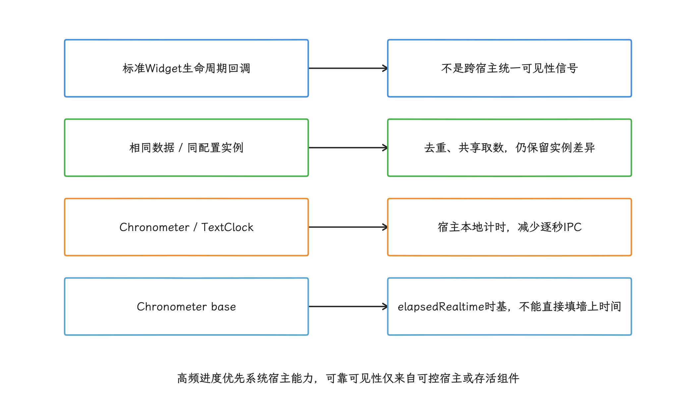

图：本地计时不替代天气、账户等业务数据刷新。

## 四、图像内存与 Binder 成本

### 1. Widget 有独立于通用 Binder 缓冲区的图像上限

“每次 Binder 只能传 1 MB”解释不了 Widget 图像问题。Binder 的事务缓冲区由进程内并发事务共享，序列化后的数据量也会影响是否成功；AppWidget 服务还会单独检查 `RemoteViews` 的图像内存。

系统在启动时读取真实显示尺寸，并计算：

`mMaxWidgetBitmapMemory = 6 × displayWidth × displayHeight`

源码注释给出的含义是 1.5 个屏幕、每像素 4 字节。对非系统 UID（Android 用来标识应用身份的 Linux 用户编号） 提交的非空快照，服务会在缓存合并或替换后检查 `RemoteViews` 的图像估算值。`targetSdkVersion` 不高于 37 时，强制上限只计普通位图缓存，超限会清空该 Widget 的缓存并抛出 `IllegalArgumentException`；`Icon` 对象内携带的位图会计入总量，总量超限时记录警告。 这里取的是提供方 ActivityInfo 中的 targetSdk，和Launcher的targetSdk无关；同一Android17源码还写有 targetSdk>37 时按 Bitmap+Icon 总量强制检查的分支。检查单位是合并/替换后的该Widget快照，不是提供方传入delta本身，也不是整个进程的总内存预算。

<!-- gracker-diagram: a250-15-provider-target-memory-branch -->
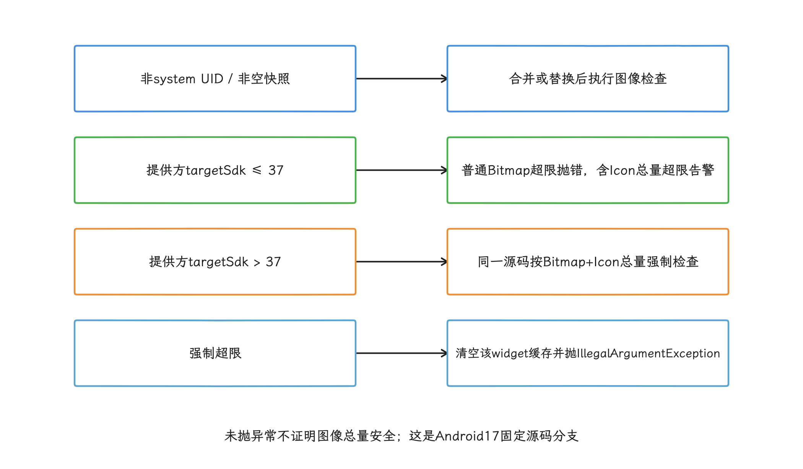

图：Launcher的targetSdk不会替代提供方target判断。

所以我们要把普通位图与 `Icon` 合并起来估算内存，仅凭“没有抛异常”判断快照大小，会漏掉只告警的超限。

这个上限随设备显示尺寸变化，写死成 1 MB、8 MB 或某个机型的实测值都套不上。设计时仍应让峰值显著低于系统上限——同一宿主还要同时处理桌面、其他 Widget 和自身图形资源。 位图估算采用缓存内 Bitmap.getAllocationByteCount()，不能用网络压缩图字节数、JPEG文件大小或动作Parcel大小代替；布局变体和集合图片也要纳入总量。

<!-- gracker-diagram: a250-14-bitmap-and-binder-limits -->
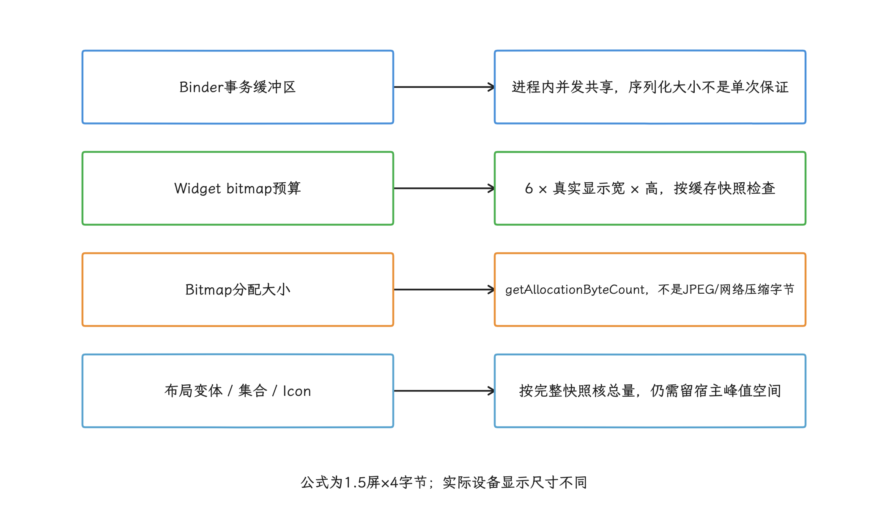

图：不要把所有图像问题归为单次1MB限制，也不要把快照上限当进程预算。

### 2. 图像优化按来源处理

- 静态图标和背景优先使用资源 ID，让宿主按资源加载。
- 网络图片按 Widget 实际显示尺寸解码，避免把相机原图缩放后再塞入 `RemoteViews`。
- 相同位图在一次快照中尽量复用，避免内容相同却创建多个对象。
- 使用内容 URI（统一资源标识符） 时确认目标宿主具备读权限，并保证 URI 生命周期覆盖显示周期。
- 提交新图片前先取消已经过时的下载或解码任务，并在完成回调重新核对用户、实例和数据版本；取消未必及时生效，仅靠取消不能阻止旧结果晚到覆盖新状态。
- 集合中的缩略图要按总量估算，只盯着单项大小会漏算。

服务端会遍历 `RemoteViews` 中的 URI：`content://` 要求调用 UID 自己具有读权限，`android.resource://` 可以通过，`file://` 和其他 URI 方案会被拒绝。宿主一侧的读权限，仍要提供方自己安排。URI 可以减少在动作中直接携带大位图的压力，但宿主权限、文件存活和读取耗时同样影响性能与正确性。

<!-- gracker-diagram: a250-16-image-source-and-stale-result -->
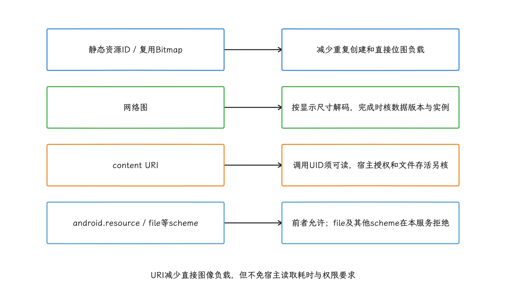

图：取消旧下载不保证旧回调不会到达，发布前仍核版本身份。

### 3. 动作数量也会累积

纯文本更新没有大位图，仍要序列化动作、执行 Binder 调用、合并缓存并由宿主重放动作。常见减负方法包括：

- 比较数据版本，跳过内容完全相同的更新；
- 把多字段变化合成一次完整更新；
- 只改一个稳定属性时使用局部更新；
- 多个实例内容相同且接口允许时，使用 `int[]` 批量提交；
- 避免在每次更新中重复设置从未变化的点击动作、可见性和资源。

批量提交减少提供方发起调用和重复构造的次数，但系统仍要逐个维护 Widget 实例并通知相应宿主，一次 API 调用的工作量要按多次宿主工作来估算。 上述批量接口不是跨实例的事务提交：某实例的权限、内存或宿主状态失败时，不应假定所有实例一起成功或一起回滚。业务保留每个实例的状态与重试范围。

<!-- gracker-diagram: a250-17-action-growth-and-batch -->
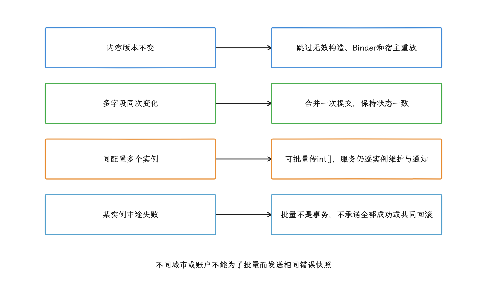

图：动作数、图片总量、频率与实例数共同影响成本。

## 五、Glance 的成本模型

### 1. Glance 使用 Compose Runtime，输出仍是 `RemoteViews`

Glance 1.2.0 建立在 Compose Runtime 上，用声明式 API 生成 App Widget 内容：Compose Runtime 根据状态执行可组合函数并形成界面描述，Glance 再把这份描述转换成 `RemoteViews`。这一步不经过 Compose UI 的 `LayoutNode`（Compose UI 内部的布局节点） 和绘制管线，也不支持任意 Compose UI 可组合组件——应用页面里的 Compose UI 组件，也就没法直接搬到桌面。

一次 Glance 更新大致包含：

1. 读取 `GlanceId` 对应状态；
2. 运行 Glance 组合；
3. 根据尺寸模式生成可表达为 `RemoteViews` 的结构与动作；
4. 通过 AppWidget 更新接口交给系统；
5. 由宿主应用并绘制结果。

Glance 1.2.0 的 `GlanceAppWidget` 会在 WorkManager 的协程工作单元 `CoroutineWorker`（用 Kotlin 协程执行任务的 WorkManager 工作单元） 中执行 `provideGlance()`；内部会话类 `AppWidgetSession` 把组合结果转换成 `RemoteViews`，再调用 `AppWidgetManager.updateAppWidget()`。Glance 简化了状态到 Widget 界面的映射，但 Binder、服务端缓存、宿主布局创建和图像上限都还在，性能分析要覆盖完整跨进程路径。

<!-- gracker-diagram: a250-18-glance-runtime-to-remoteviews -->
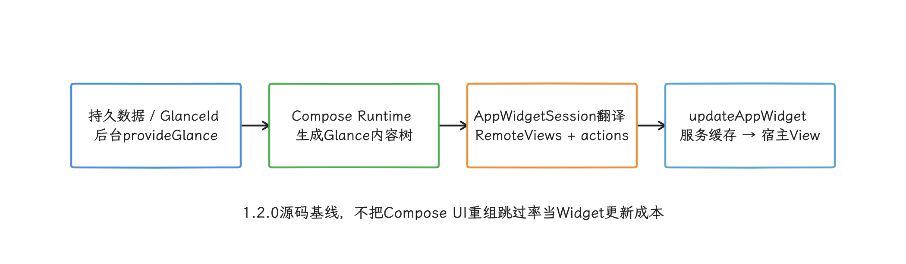

图：Glance不用Compose UI LayoutNode绘制桌面，但仍承担IPC和宿主工作。

同一个 `provideGlance()` 仍在运行时，再次调用 `update()` 不会重启它。需要展示的新数据应先写入 Glance 能观察到的状态，由现有会话重新组合；反复调用 `update()` 替代不了状态同步。 1.2.0的活跃组合通常只维持约45秒，并可因交互/更新请求延长，不是常驻桌面重组循环。外部完成持久状态写入后仍应调用update，以在会话已结束时启动新worker；会话仍活跃时，它会通过事件重读Glance状态，而非重新执行整个provideGlance。

<!-- gracker-diagram: a250-19-glance-session-state -->
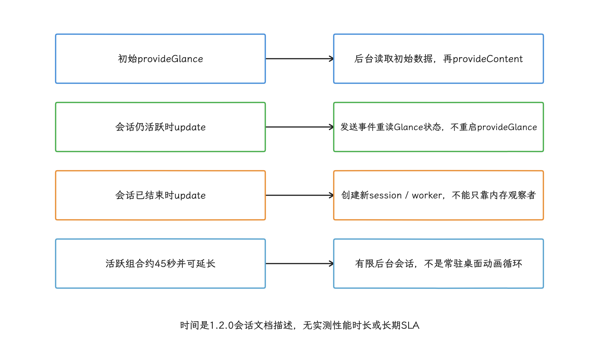

图：外部先写持久状态再update，数据同步与触发缺一不可。

### 2. 状态变化的交付粒度

Glance 利用 Compose Runtime 计算声明式内容，最终交付单位仍受 `RemoteViews` 表达能力约束。`LazyColumn` 会不会只序列化变化的那一项，我们要按实际生成的动作集合核实；Compose UI 的重组跳过率，也推导不出桌面更新成本。使用 Glance 时，我们的优化重点是：

- 业务主动触发更新时，先比较会影响界面的持久状态版本，跳过完全相同的数据；平台生命周期事件仍按对应回调处理；
- 在 `provideContent()` 启动持续组合前完成初始网络和数据库读取，后续变化通过可观察状态提供；
- 同一个列表项保持稳定的项目标识；
- 限制列表项数量、层级和图像；
- 用系统跟踪和宿主表现检验一次更新生成了多少工作。

### 3. 响应式尺寸的模式选择

Android 12 / API 31 通过 `OPTION_APPWIDGET_SIZES` 向提供方暴露宿主支持的尺寸集合。平台 `RemoteViews` 可以为不同尺寸保存变体；Glance 提供 `SizeMode.Responsive` 和 `SizeMode.Exact`。

尺寸能归纳为几个明确阈值时，`SizeMode.Responsive` 可以预先生成有限布局，这里的阈值就是响应式设计常说的尺寸断点。Android 12 及以上版本会为传入的响应式尺寸分别生成内容，再由框架选择合适变体。`SizeMode.Exact` 会在每次尺寸变化时按精确尺寸重新创建内容，官方文档提示它可能增加开销，并造成调整大小时的界面跳变。布局连续依赖精确宽高、有限断点表达不了时，再选用 `SizeMode.Exact`。 多尺寸会并发运行各自的内容组合，remember状态每个尺寸各有一份；相同默认lambda key可触发多个尺寸的对应动作，副作用也会按尺寸运行。共享网络、写库、支付等外部操作必须去重/幂等，不能按组合份数重复执行。API31+平台按尺寸映射的RemoteViews最多接受16个变体，断点不是越多越好。

<!-- gracker-diagram: a250-20-glance-size-modes -->
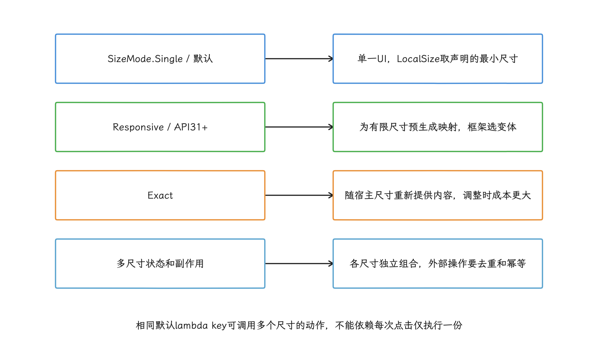

图：API31+按尺寸映射RemoteViews最多16个变体，断点越多前置工作越多。

### 4. 选择手写 `RemoteViews` 还是 Glance

| 维度 | 手写 `RemoteViews` | Glance |
| --- | --- | --- |
| 更新控制 | 可直接选择完整、局部和集合接口 | 由 Glance API 生成并提交内容 |
| 状态表达 | 需要自行维护数据与 View 动作映射 | 声明式状态映射较集中 |
| 可用组件 | 受 `RemoteViews` 允许的 View 类型和方法范围限制 | 受 Glance 组件和底层 `RemoteViews` 限制 |
| 性能定位 | 动作与平台调用较直观 | 还要观察组合和翻译阶段 |
| 迁移成本 | 既有 XML 与代码可继续维护 | 适合希望统一 Kotlin 声明式写法的团队 |

Glance 更适合集中维护声明式状态，手写 `RemoteViews` 对更新类型和动作控制更直接。二者都要经过同一套 AppWidget 服务与宿主，选择时我们同时核对功能约束、维护成本和实测结果。

<!-- gracker-diagram: a250-21-raw-versus-glance-choice -->
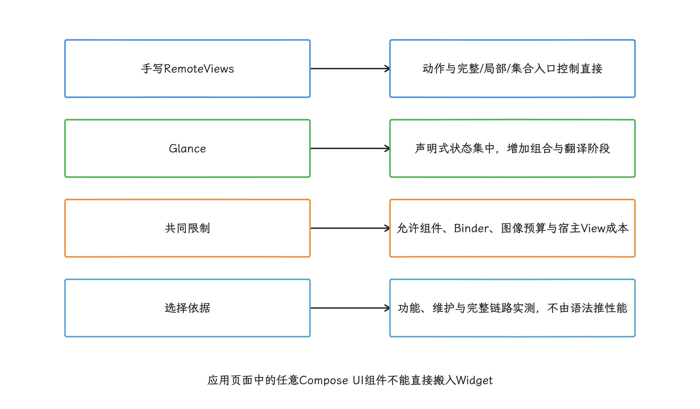

图：组件能力以RemoteViews和Glance实际支持范围为准。

## 六、权限、多用户与可靠性

### 1. 更新调用有明确的身份校验

`AppWidgetServiceImpl.updateAppWidgetIds()` 会校验调用包与 UID，并检查调用者是否有权访问目标 Widget。服务还会遍历 `RemoteViews` 中的 URI，通过 URI 授权服务确认调用 UID 对 `content://` URI 具有读权限。

平台没有公开的 `RemoteViews.CallingIdentity` API 可以替代这些校验，应用也不需要这样的接口。更新失败时，先确认：

- 当前进程的包名是否与提供方一致；
- `appWidgetId` 是否仍属于当前提供方和用户；
- 工作资料或多用户环境中是否使用了错误用户的数据；
- 内容 URI 是否由正确用户下的 `ContentProvider` 提供，并具有可授予的读权限；
- `PendingIntent` 的可变性和目标是否符合当前平台安全要求。

### 2. 每个用户和配置文件分别维护状态

`AppWidgetServiceImpl` 的提供方、宿主和实例记录都带有用户维度：个人资料与工作资料中的同名包属于不同身份，数据库缓存、图片 URI、任务唯一名称和 `appWidgetId` 映射都要按用户区分。

<!-- gracker-diagram: a250-22-user-instance-and-uri-identity -->
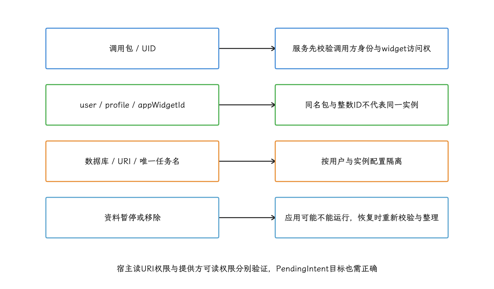

图：不能依赖资料移除后应用一定再执行一次清理。

把一个整数 ID 复制到另一份资料中，定位不到另一侧实例；资料暂停或移除时应用可能无法继续执行代码；系统负责相应进程/组件约束，应用应在可收到的生命周期事件及恢复启动时校验实例、停止失效工作并整理可访问缓存，不能依赖“移除后必跑一次清理”。

### 3. 保留最近可用快照

Widget 更新涉及多个进程，任何一段都可能暂时不可用。稳健的实现通常保留一份可快速构造的最近数据：

- 首次添加时先显示结构完整的本地状态；
- 后台刷新成功后一次性发布完整的新数据版本；
- 网络失败时保留旧值并更新错误提示；
- 图片加载失败时使用稳定资源占位；
- 收到删除回调后取消该实例不再需要的工作。

这套策略也能缩短广播入口的执行时间，避免每次启动都等待网络再提交首屏。 这属于产品恢复策略；Glance1.2.0的默认onCompositionError会发布错误布局并关闭该会话，errorUiLayout为0时会重新抛错。需要保留最近业务状态或自定义错误UI时，必须明确实现对应回调与恢复路径。

<!-- gracker-diagram: a250-23-last-good-and-glance-error -->
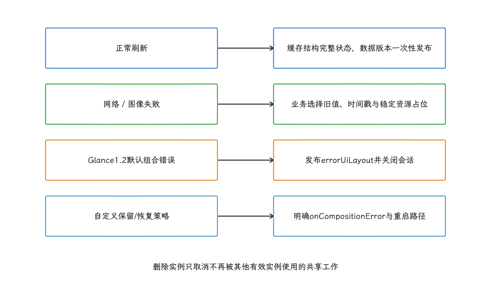

图：errorUiLayout为0时重抛错误；默认行为不是自动保留最近业务画面。

## 七、测量与排查

### 1. 三段耗时的拆分测量

第一节的三段模型在这里直接可用，耗时按这三段分别记录：

1. 提供方：取数、图像准备、构造 `RemoteViews`、调用更新接口；
2. `system_server`：AppWidget 更新与回调调度；
3. 宿主：接收消息、`apply` 或 `reapply`、测量、布局和绘制。

我们在 Perfetto 中同时观察提供方进程、`system_server` 和当前 Launcher；只看到提供方函数很快结束，还判断不了桌面更新是否顺畅。帧问题还要结合 [渲染管线总览](../../part2-performance/ch13-rendering-pipelines/01-android-view-pipeline-analysis.md) 和 [Perfetto 入门](../../part3-tools/ch14-perfetto/01-perfetto-intro-capture-reliability.md) 的分析方法。

下面的命令用于查看系统已登记的提供方、宿主、实例和更新周期。

```bash
adb shell dumpsys appwidget
```

输出适合确认实例归属、`updatePeriodMillis`、宿主和提供方状态；耗时分析它给不了，仍要与系统跟踪、应用日志以及 Launcher 行为对应。 为每次业务更新附带用户/实例/数据版本，在可控宿主记录收到与完成应用的标记；不可控Launcher缺少回执时，明确只能观察到哪一层，不能把API返回时间补写为屏幕刷新时间。

<!-- gracker-diagram: a250-24-three-process-measurement -->
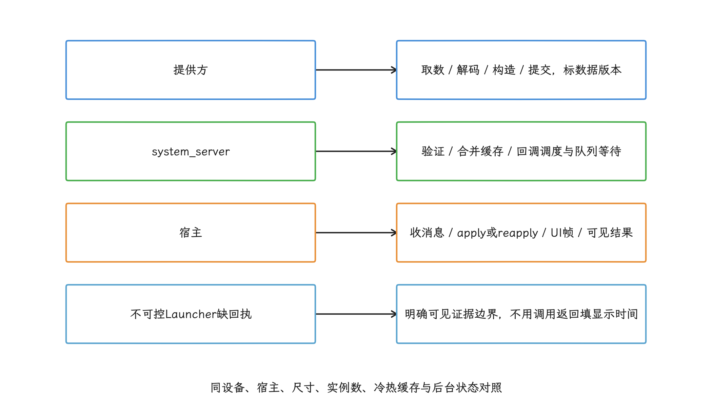

图：dumpsys appwidget确认归属和配置，不能代替时延跟踪。

### 2. 建立可复现的更新实验

一次有效的优化实验至少固定以下条件：

- 同一设备、Launcher、Widget 尺寸和实例数量；
- 相同数据量、图片尺寸和缓存状态；
- 区分完整更新、局部更新与集合刷新；
- 同时记录宿主首次创建布局和复用现有布局的更新；
- 报告多次样本的分布，不用单次最小值代表结果；
- 检查省电模式、应用待机分桶（系统按活跃度限制后台资源的等级）和工作资料状态。

若优化只减少了提供方构造时间，宿主的布局或绘制没有变化，报告时就把收益写在这一段，别扩大到整条更新链路。

### 3. 常见现象与检查顺序

| 现象 | 优先检查 |
| --- | --- |
| 更新调用成功，桌面没有变化 | 实例 ID、宿主连接、完整快照是否存在、数据版本是否被去重 |
| 局部更新第一次无效 | 该实例是否先收到过完整更新 |
| 列表长时间显示旧数据 | 是否调用正确的集合刷新接口，`onDataSetChanged()` 是否完成快照替换 |
| 调整尺寸时跳变 | 尺寸模式、布局变体数量、是否使用 `SizeMode.Exact` |
| 更新抛出图像内存异常 | 解码尺寸、集合总图像量、缓存快照中的位图与 `Icon` |
| 只在应用前台收到监听器闹钟 | `OnAlarmListener` 的进程生命周期边界 |
| 多用户或工作资料显示错数据 | `UserHandle`（Android 的用户身份句柄）、实例映射、URI，以及用于隔离不同用户数据的数据库命名范围 |

排查时先确认实例、用户与宿主归属，再按这次调用属于完整更新、局部更新还是集合刷新继续检查。先把身份或更新类型的错误排除掉，再进入图像解码和绘制耗时的排查，就不容易一开始就找错方向。

<!-- gracker-diagram: a250-25-symptom-first-checks -->
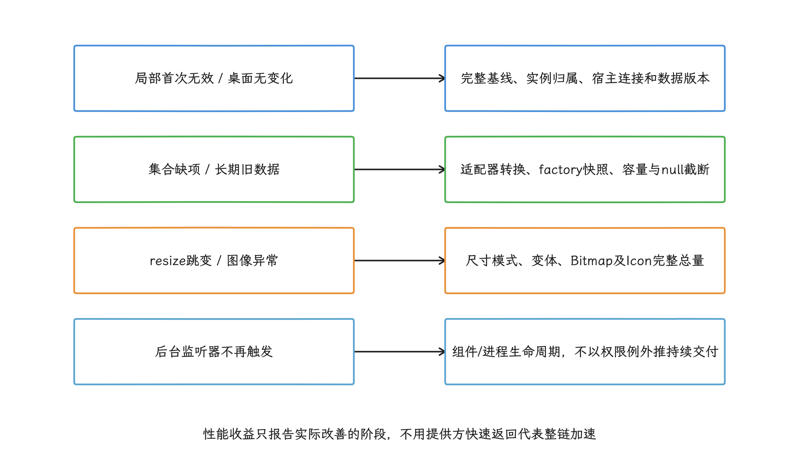

图：错误类型先决定取证位置，再比较构造、IPC或宿主帧成本。

## 八、全文小结

App Widget 的性能问题横跨提供方、`system_server` 和宿主进程三段。优化时先选对完整更新、局部更新或集合刷新语义，再控制 `RemoteViews` 动作、图像总量和更新频率；提供方调用快速返回时，Launcher 侧的应用和绘制通常还没完成。

Glance 改善的是状态到界面描述的组织方式，最终仍要生成 `RemoteViews` 并经过同一条跨进程链路。无论采用哪种写法，都应保留完整快照、按用户和实例隔离状态，并用覆盖三段进程的跟踪验证收益。

## 九、提交前检查清单

- [ ] 每个实例首次显示前提交完整 `RemoteViews`
- [ ] 局部更新只包含稳定布局上的少量属性变化
- [ ] 集合刷新路径与所用适配器类型匹配
- [ ] `RemoteViewsFactory` 从不可变快照读取数据
- [ ] `onUpdate()` 不执行网络、批量解码或长事务
- [ ] 调度机制与数据时效等级一致
- [ ] 不把 WorkManager 或非精确重复闹钟当成精确定时器
- [ ] API 37 监听器闹钟只用于进程组件仍存活的场景
- [ ] 位图按实际显示尺寸解码，并按整个快照估算总量
- [ ] 内容 URI 的授权与生命周期覆盖宿主读取
- [ ] 多实例共用取数结果，但保留实例配置差异
- [ ] 业务触发的 Glance 更新已按影响界面的持久状态版本去重
- [ ] 响应式布局优先使用有限尺寸断点
- [ ] Perfetto 覆盖提供方、`system_server` 和 Launcher

## 参考资料

- [AppWidgetManager.java（Android 17）](https://android.googlesource.com/platform/frameworks/base/+/refs/tags/android-17.0.0_r1/core/java/android/appwidget/AppWidgetManager.java)
- [AppWidgetServiceImpl.java（Android 17）](https://android.googlesource.com/platform/frameworks/base/+/refs/tags/android-17.0.0_r1/services/appwidget/java/com/android/server/appwidget/AppWidgetServiceImpl.java)
- [AppWidgetHost.java（Android 17）](https://android.googlesource.com/platform/frameworks/base/+/refs/tags/android-17.0.0_r1/core/java/android/appwidget/AppWidgetHost.java)
- [AppWidgetHostView.java（Android 17）](https://android.googlesource.com/platform/frameworks/base/+/refs/tags/android-17.0.0_r1/core/java/android/appwidget/AppWidgetHostView.java)
- [RemoteViews.java（Android 17）](https://android.googlesource.com/platform/frameworks/base/+/refs/tags/android-17.0.0_r1/core/java/android/widget/RemoteViews.java)
- [RemoteViewsService.java（Android 17）](https://android.googlesource.com/platform/frameworks/base/+/refs/tags/android-17.0.0_r1/core/java/android/widget/RemoteViewsService.java)
- [AlarmManager.java（Android 17）](https://android.googlesource.com/platform/frameworks/base/+/refs/tags/android-17.0.0_r1/apex/jobscheduler/framework/java/android/app/AlarmManager.java)
- [AlarmManagerService.java（Android 17）](https://android.googlesource.com/platform/frameworks/base/+/refs/tags/android-17.0.0_r1/apex/jobscheduler/service/java/com/android/server/alarm/AlarmManagerService.java)
- [PluginActionManager.kt（Android 17）](https://android.googlesource.com/platform/frameworks/base/+/refs/tags/android-17.0.0_r1/packages/SystemUI/shared/src/com/android/systemui/shared/plugins/PluginActionManager.kt)
- [PluginInstance.kt（Android 17）](https://android.googlesource.com/platform/frameworks/base/+/refs/tags/android-17.0.0_r1/packages/SystemUI/shared/src/com/android/systemui/shared/plugins/PluginInstance.kt)
- [Plugin.kt（Android 17）](https://android.googlesource.com/platform/frameworks/base/+/refs/tags/android-17.0.0_r1/packages/SystemUI/plugin_core/src/com/android/systemui/plugins/Plugin.kt)
- [高级 Widget 指南](https://developer.android.com/develop/ui/views/appwidgets/advanced)
- [集合 Widget 指南](https://developer.android.com/develop/ui/views/appwidgets/collections)
- [Jetpack Glance 概览](https://developer.android.com/develop/ui/compose/glance)
- [使用 Glance 构建响应式界面](https://developer.android.com/develop/ui/compose/glance/build-ui)
- [AlarmManager API 参考](https://developer.android.com/reference/android/app/AlarmManager)
- [AppWidgetManager API 参考](https://developer.android.com/reference/android/appwidget/AppWidgetManager)
- [Glance 1.2.0 发行说明](https://developer.android.com/jetpack/androidx/releases/glance#1.2.0)
- [`glance-appwidget:1.2.0` 源码 JAR](https://dl.google.com/dl/android/maven2/androidx/glance/glance-appwidget/1.2.0/glance-appwidget-1.2.0-sources.jar)
- [精确闹钟调度指南](https://developer.android.com/develop/background-work/services/alarms)
- [PeriodicWorkRequest API 参考](https://developer.android.com/reference/androidx/work/PeriodicWorkRequest)
- [【车载 Android】从 AAR 到 Plugin：Launcher 卡片插件化解耦实践](https://juejin.cn/post/7678556373495971883)
- [广播ANR的版本与优先级边界](https://developer.android.com/topic/performance/anrs/diagnose-and-fix-anrs)
- [TransactionTooLargeException](https://developer.android.com/reference/android/os/TransactionTooLargeException)
- [Chronometer时基](https://developer.android.com/reference/android/widget/Chronometer)：宿主本地计时。

本文的平台判断固定到 `android-17.0.0_r1`，Glance 判断固定到 1.2.0。升级 Android 或 Glance 后，应重新核对局部更新缓存、图像上限、集合适配器弃用状态、`GlanceAppWidget` 的会话执行方式和尺寸模式实现。
