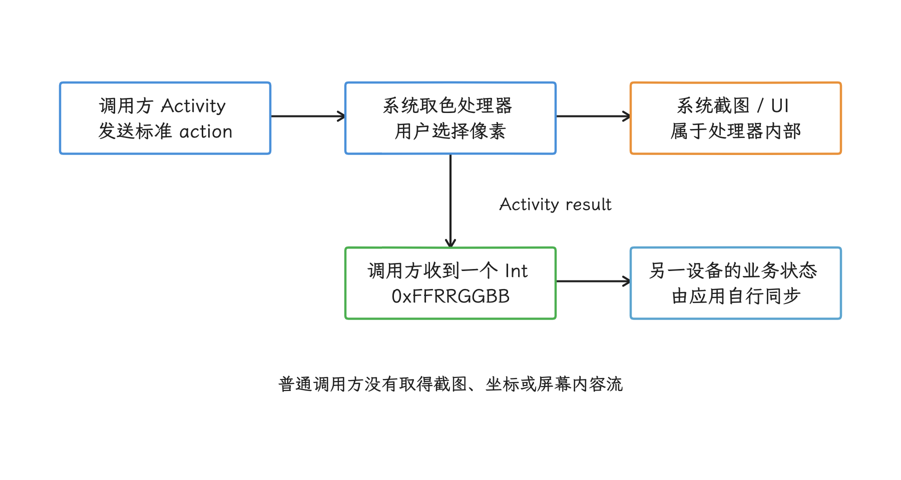
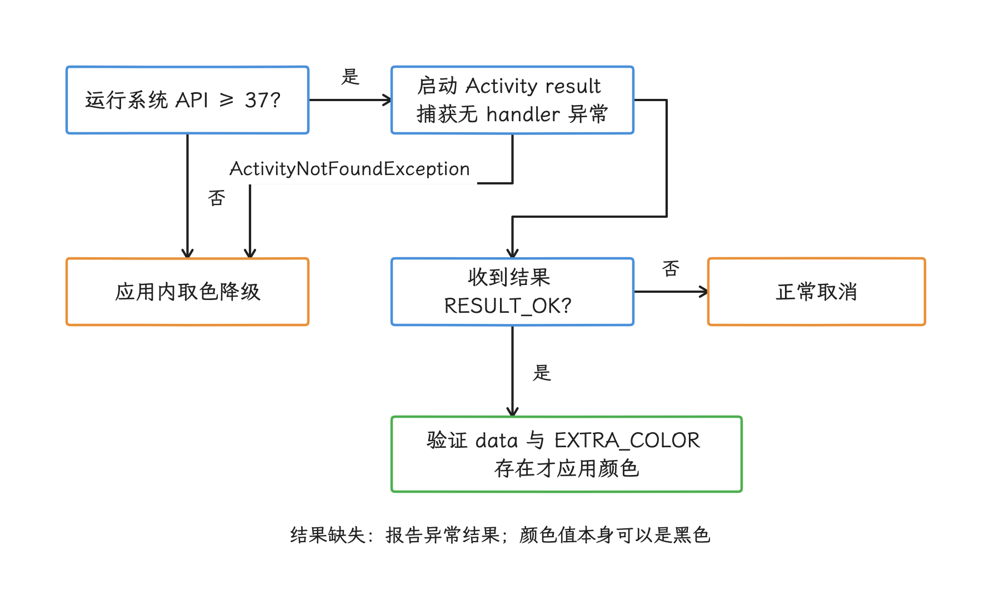
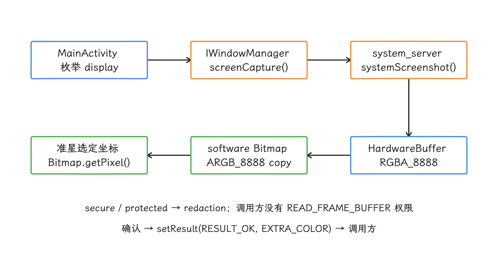
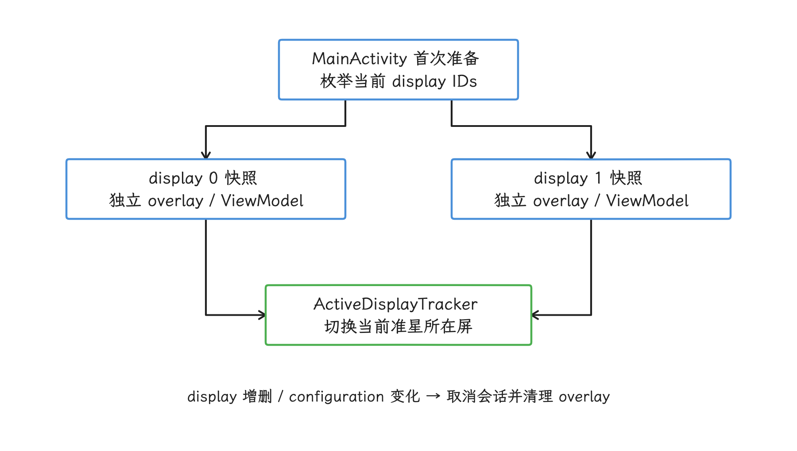
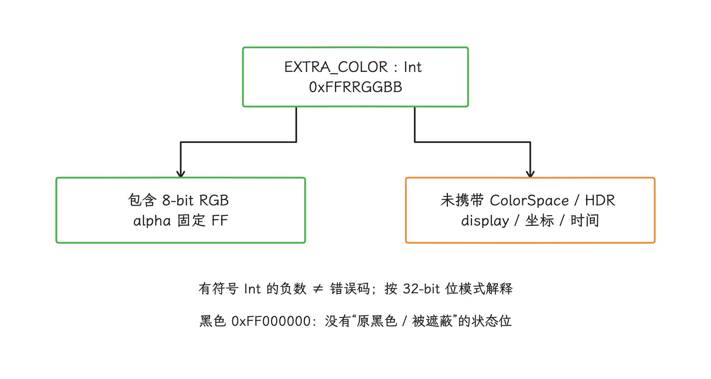
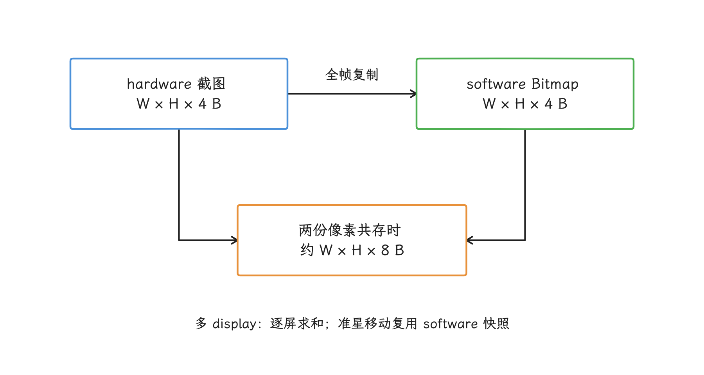
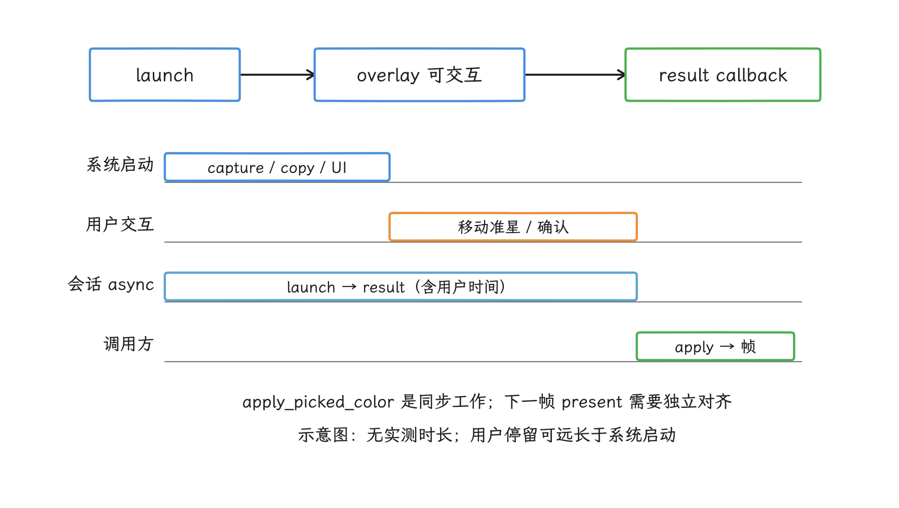
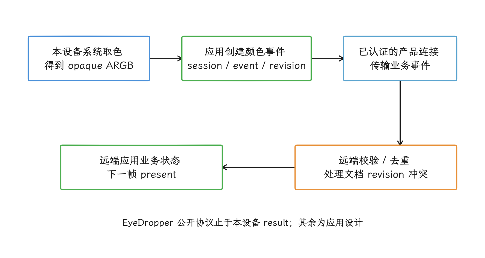

# Android 17 EyeDropper：系统取色、截图边界与跨设备同步

EyeDropper 的公开契约、AOSP 实现和厂商跨设备能力分属三层承诺：SDK 层保证的是一次标准的系统取色交互，截图流程发生在系统处理器内部，跨设备同步要靠应用自己的业务协议。接入前，我们先把可用设备、颜色返回语义和取消路径限定清楚，再评估截图、合成、IPC 或远端协作带来的成本。

## EyeDropper 需要明确哪些边界

Android 17 / API 37 增加了一个标准 Activity action：调用方发送 `Intent.ACTION_OPEN_EYE_DROPPER`，用户在系统取色界面选中一个像素，处理器再通过 Activity result 的 `Intent.EXTRA_COLOR` 把颜色送回调用方。整个交互由系统或产品组件实现，调用方经手的数据只有最后那一个颜色整数。

公开 API 本身很小，我们要先弄清的集中在五件事上：

- 它是一套隐式 Intent 协议：由匹配 action 的 Activity 处理，SDK 里没有可实例化的 `EyeDropper` 对象；
- API 37 常量存在，只说明 SDK 层有这两个字段；每台 Android 17 产品还要真的安装并启用处理器，调用才能成立；
- AOSP EyeDropper 内部会截取 display，截图留在系统处理器里，普通调用方拿不到；
- AOSP 支持的是同一个 Android 系统内的多 display；设备到设备的同步要由应用另行实现；
- 返回值只有色值本身，没有 ColorSpace 元数据，适合作为 UI 色值使用；跨屏幕一致的色度测量，它给不了。

<!-- gracker-diagram: a251-01-protocol-boundary -->


图：SDK 协议只返回用户选中的颜色。AOSP 的截图流程和产品的跨设备同步分别属于实现层与业务层。

> 源码基线：AOSP `android-17.0.0_r1`，公开契约来自 `frameworks/base` 的 `Intent`，具体流程来自 `packages/apps/EyeDropper` 的参考实现，产品可以采用不同处理器实现；如需继续追踪显示驱动或 dma-buf，kernel 基线为 `android17-6.18-2026-06_r6`。

## 公开 API 契约

### Action 与结果

`Intent.ACTION_OPEN_EYE_DROPPER` 的公开文档定义了取色 UI、颜色 extra、secure/protected 遮蔽和 opaque ARGB 输出。把公开契约和 AOSP 的结果返回路径放在一起，调用方的处理就是五步：

1. 处理该 action 的 Activity 提供取色 UI；
2. 用户确认后，以 `RESULT_OK` 返回；
3. `Intent.EXTRA_COLOR` 保存被选像素的颜色；
4. secure window 与 protected buffer 的像素会被涂黑；
5. action 的输出写成 opaque ARGB：`0xFFRRGGBB`。

`EXTRA_COLOR` 自身是一个通用 `int` extra，可保存 `0xAARRGGBB`，其中 AA、RR、GG、BB 分别表示 alpha、red、green、blue 的 8-bit 分量。EyeDropper action 的输出契约把 alpha 固定为 `0xFF`，所以结果一定是 opaque ARGB（完全不透明的 ARGB）。我们以 action 契约为准，取值前先检查 extra 是否存在，免得用默认颜色把异常结果掩盖掉。

### feature flag 与可用性判断

`Intent.java` 和 `current.txt` 都包含这两个 public field，源码同时保留：

```text
@FlaggedApi("com.android.eyedropper.enable_eye_dropper_api")
Intent.ACTION_OPEN_EYE_DROPPER
Intent.EXTRA_COLOR
```

`@FlaggedApi` 表示该 API 的公开启用曾受 aconfig feature flag 管理。应用侧要分别判断三层条件：使用 `compileSdk 37` 才能编译引用这些常量；运行系统达到 API 37 才能进入调用路径；当前产品还要安装并启用能处理该 Intent 的 Activity。`SDK_INT == 37` 只能确认系统版本，handler 是否存在要到启动时才见分晓：旧系统或无 handler 的产品，都要走应用内取色等降级路径。

## App 侧正确接入

下面的示例用 Activity Result API 注册回调，Activity 重建后结果路由仍可恢复。示例跳过了 `resolveActivity()`：Android package visibility 可能限制查询结果，而 `startActivity()` 本身就允许调用方直接启动。我们直接启动并捕获 `ActivityNotFoundException`，得到的判断更接近最终可用性。

```kotlin
class EditorActivity : ComponentActivity() {

    private val eyeDropperLauncher =
        registerForActivityResult(ActivityResultContracts.StartActivityForResult()) { result ->
            if (result.resultCode != Activity.RESULT_OK) {
                onEyeDropperCanceled()
                return@registerForActivityResult
            }

            val data = result.data
            if (data == null || !data.hasExtra(Intent.EXTRA_COLOR)) {
                onEyeDropperInvalidResult()
                return@registerForActivityResult
            }

            val opaqueArgb = data.getIntExtra(Intent.EXTRA_COLOR, Color.BLACK)
            applyPickedColor(opaqueArgb)
        }

    fun openSystemEyeDropper() {
        if (Build.VERSION.SDK_INT < 37) {
            openInAppColorPicker()
            return
        }

        try {
            eyeDropperLauncher.launch(Intent(Intent.ACTION_OPEN_EYE_DROPPER))
        } catch (_: ActivityNotFoundException) {
            openInAppColorPicker()
        }
    }
}
```

这段代码把确认、取消、结果缺失、无 handler、旧系统五条分支都走到了。`RESULT_CANCELED` 表示用户取消或处理器未返回选择结果，通常按正常取消处理即可，算不上应用错误。如果产品仍想用 `resolveActivity()` 控制按钮可见性，应在 manifest 的 `<queries>` 中声明对应 action，并把启动时的异常兜底留住；查询到 Activity、成功启动会话、最终拿到有效结果，是三个不同阶段的事。

<!-- gracker-diagram: a251-02-caller-outcomes -->


图：SDK 版本、启动成功和有效结果分别检查。RESULT_OK 缺少颜色字段时走异常结果处理，不能使用默认黑色掩盖缺失。

返回值用 Java/Kotlin 的有符号 `Int` 保存 32-bit ARGB 位模式。最高位为 1 时数值会显示成负数，这只是位模式本来的样子，与错误码无关；显示十六进制时按 32 位无符号位模式格式化，颜色计算交给 `Color` 或 Compose `Color` 的明确转换。

## AOSP 的真实实现

公开契约只管启动 Activity、返回颜色；处理器的包名、进程和 UI 结构由实现自定，SDK 对此没有承诺。我们来看 `android-17.0.0_r1` 的 AOSP 参考实现：它位于 `platform/packages/apps/EyeDropper`，用平台证书签名、安装在特权分区，因此拿得到普通第三方应用拿不到的系统权限。

### 从 Intent 到颜色结果

一次取色会话在 AOSP 实现里走这样一条主路径：

```text
Caller Activity
  └─ ACTION_OPEN_EYE_DROPPER
       └─ com.android.eyedropper.MainActivity
            ├─ 枚举当前 DisplayManager.displays
            ├─ 并发请求每个 display 的系统截图
            ├─ 绑定 EyeDropperControllerService
            ├─ 为每个 display 创建 TYPE_SCREENSHOT 透明 Compose overlay
            ├─ 用户用触屏、鼠标或键盘移动 reticle
            └─ Bitmap.getPixel(x, y)
                 └─ setResult(RESULT_OK, Intent(EXTRA_COLOR = color))
```

路径里的 reticle 是取色界面中的采样准星。“多 display”指同一个 Android 系统管理的内屏、外接屏或其他逻辑显示设备；这条路径里，截图和准星位置都只在本机使用，到不了另一台 Android 设备。

### 系统侧的截图流程

我们先看截图从哪里来：`ScreenCaptureHelper` 通过内部 `IWindowManager.screenCapture()` 获取每个 display 的 `HardwareBuffer`，它是可在 GPU、显示和进程之间共享的图形内存对象。

| 参数 | Android 17 AOSP 取值 | 含义 |
| --- | --- | --- |
| secure content policy | `SECURE_CONTENT_POLICY_REDACT` | secure window 内容被替换为不可恢复的遮蔽像素 |
| protected content policy | `PROTECTED_CONTENT_POLICY_REDACT` | protected buffer 内容被替换为不可恢复的遮蔽像素 |
| pixel format | `HardwareBuffer.RGBA_8888` | 每像素四字节的捕获格式 |
| include system overlays | `true` | 截图请求包含系统 overlay |
| preserve display colors | `false` | 捕获结果不保留 display 原始颜色表达 |
| capture timeout | 2000 ms | 单次异步封装的超时上限 |

回调拿到 `HardwareBuffer` 后，实现先用 `Bitmap.wrapHardwareBuffer()` 创建 hardware Bitmap；这种 Bitmap 的像素主要供 GPU 使用，`Bitmap.getPixel()` 读不了它。于是实现接着调用 `copy(Bitmap.Config.ARGB_8888, false)`，把整张图复制成 CPU 可读的 software Bitmap。用户确认时，ViewModel 才从这份快照里读出一个像素并返回。也就是说，单次取色前已经完成了全帧捕获和全帧复制，之后移动准星就无需再截屏。

调用链进入 system_server 后，`WindowManagerService.screenCapture()` 会检查 `READ_FRAME_BUFFER`，把 `ScreenCaptureParams` 转成 display capture 参数，再交给 `DisplayManagerInternal.systemScreenshot()`。回调把 `ScreenshotHardwareBuffer` 中的 `HardwareBuffer` 与 `ColorSpace` 送回 EyeDropper 进程。权限检查和实际 display capture 都发生在系统服务路径里；调用方 Activity 只发出标准 Intent，交互和准星显示由 EyeDropper 的 Compose overlay 完成。

隐私上准确的表述是：**系统特权实现内部持有 display 截图，普通调用方只收到一个颜色整数。**调用方无需申请 MediaProjection 授权，是因为屏幕捕获交给了受信任的系统处理器执行；授权免了，捕获本身仍在发生。

<!-- gracker-diagram: a251-03-aosp-capture-path -->


图：secure/protected 内容在系统捕获中被遮蔽；整帧快照和复制留在系统处理器，最后只把一个颜色 Int 交给调用方。

### 三个系统权限

AOSP EyeDropper 的 manifest 声明了三个系统权限，普通第三方应用一个也拿不到：

| 权限 | 用途 |
| --- | --- |
| `READ_FRAME_BUFFER` | 调用系统屏幕捕获能力 |
| `INTERNAL_SYSTEM_WINDOW` | 添加 `TYPE_SCREENSHOT` 系统 overlay |
| `INJECT_EVENTS` | 读取受限的光标位置，用于桌面模式下的准星控制 |

第三方应用通过标准 action 把取色任务交给系统处理器即可，这些权限没有申请的必要。用户显式选择、secure/protected redaction（遮蔽）以及只返回单个颜色值，一起把调用方能取得的数据限制在了很小的范围。

### 多显示器行为

一次会话里，AOSP 实现会做这些事：

- 在 `MainActivity.onWindowFocusChanged()` 首次进入准备分支时读取所有 display id；该版本由 `setupInitiated` 保证只准备一次，没有显式检查 `hasFocus` 为 true；

  > ⚠️ 矛盾：旧稿写成“获得焦点后”，而固定版本源码只检查 `setupInitiated`，不能据此断言准备分支必由焦点获得触发。
- 在 `Dispatchers.IO` 上为各 display 并发发起截图；这里的并发只发生在同一进程的一次会话中；
- 为每个 display 创建独立 `WindowContext`、`ComposeView` 和 ViewModel；
- 用 `ActiveDisplayTracker` 在 display 之间切换当前 reticle；
- display 被添加或移除时取消当前会话；
- configuration 变化时取消当前会话，旧截图不会继续复用。

多屏截图取的是会话启动阶段某一时刻的快照。取色 UI 出现后，底层应用哪怕继续播放动画或视频，准星展示和返回的也始终是已捕获 Bitmap 上的像素，会话期间没有再从 SurfaceFlinger 持续采样实时内容。

<!-- gracker-diagram: a251-04-multidisplay-session -->


图：多屏捕获并发发生在一次系统内会话中。添加或移除显示器、服务收到 configuration 变化会取消会话；取色 UI 使用快照而非持续采样。

## 颜色语义与安全边界

### UI 色值与测色数据的差别

我们拿到的 Activity result 只有一个 `int`，下面这些上下文都不在其中：

- `ColorSpace`；
- HDR metadata 或 headroom；
- 原 display id；
- 像素坐标；
- 取样时间；
- secure/protected 状态标记。

AOSP 捕获参数还设置了 `preserveDisplayColors(false)`，所以 `0xFFRRGGBB` 适合用于色板、画笔或普通 UI 颜色；两块屏幕上的物理亮度、广色域色度坐标或 HDR 观感是否一致，它说了不算。哪怕跨设备同步的是同一个整数，两台设备仍可能因面板、色彩管理、亮度和 HDR 状态而呈现不同效果。

<!-- gracker-diagram: a251-05-color-semantics -->


图：同一个 32-bit 色值可以同步，但视觉结果仍取决于屏幕和色彩管理。黑色既可能来自原像素，也可能来自 secure/protected 遮蔽。

### 与其他取色方案的区别

| 方案 | 调用方拿到什么 | 权限/确认 | 适用范围 |
| --- | --- | --- | --- |
| EyeDropper | 用户选择的一个 opaque ARGB 值 | 系统取色 UI；调用方无截图权限 | 跨 App 的一次性人工取色 |
| 应用内取色 | App 自有 Bitmap/View 数据 | 不需要额外系统授权 | 只处理应用拥有的内容 |
| PixelCopy | 指定 Window/Surface 等的像素副本 | 受目标对象和权限边界约束 | App 有权访问的窗口或 Surface 内容复制 |
| MediaProjection | 经用户授权的屏幕/应用内容流 | 系统捕获授权 | 录屏、共享、连续分析 |

EyeDropper 面向一次性、由用户完成的取色；后台自动化、连续采样、批量颜色分析、远端屏幕共享，都在它的适用范围之外。还要留意 secure/protected 区域返回的黑色与普通黑色之间没有任何标记差别：这个像素原本就是黑，还是被 redaction 涂黑，调用方从返回值里分辨不出来。

## 性能成本来自哪里

从调用方看，Intent 启动和颜色 extra 的数据量都很小，系统成本的大头在处理器内部。我们按一次会话的时间顺序把这些成本排开：

1. Activity/window 启动与转场；
2. 每个 display 的 screen capture；
3. `RGBA_8888 HardwareBuffer → ARGB_8888 software Bitmap` 的全帧复制；
4. 每个 display 的 Compose overlay 初始化与首帧；
5. 用户移动 reticle 时的 Compose 状态更新和局部绘制；
6. 返回结果后，调用方更新自己的 UI。

### 内存与带宽的量级

先估量级。忽略 stride（每行实际字节跨度）、分配对齐和中间合成 buffer，一张 `RGBA_8888` 截图约占 `width × height × 4` 字节；AOSP 路径同时存在 hardware screenshot 与 software copy 时，单 display 仅这两份可见像素数据的量级约为：

```text
minimum working-set estimate ≈ width × height × 4 × 2 bytes
```

这个公式用于估算数量级。常见分辨率对应的两份像素数据约为：

| 分辨率 | 两份 4 B/px Buffer 的数据量 |
| --- | ---: |
| 1920 × 1080 | 15.8 MiB |
| 2560 × 1440 | 28.1 MiB |
| 3840 × 2160 | 63.3 MiB |

多 display 时按各屏分辨率求和即可。真实峰值可能更高：row stride、分配对齐、合成中间结果、Compose 纹理和运行时对象都还要占内存；PSS 又按共享页比例计账，所以这张表只够看数量级，当不了进程 PSS 的精确预测。

<!-- gracker-diagram: a251-06-buffer-cost -->


图：3840 × 2160 的两份 4 B/px 像素数据约为 63.3 MiB；这是理想像素负载估算，不是设备实测或进程 PSS 预测。

### 该量什么

“launch 到 result”把系统处理时间和用户寻找、确认像素的停留时间混在一起，直接当系统性能指标用会失真。我们把它拆成三类：

| 指标 | 起止点 | 回答的问题 |
| --- | --- | --- |
| 启动可用延迟 | launch → overlay 首次可交互 | capture、Bitmap copy、service/overlay 初始化是否慢 |
| 交互流畅度 | reticle 移动期间 | Compose/UI/GPU 是否 miss 当前帧 deadline |
| 结果应用延迟 | result callback → 调用方新颜色帧 present | 调用方自己的状态更新是否造成卡顿 |

公开 API 没有承诺稳定的 EyeDropper 专属 Perfetto slice。AOSP 实现里的类名、日志和内部 track 可以辅助平台调试；应用性能基线要避开这些可能随实现变化的名称。

### 用异步 Trace 标记一次会话

同步的 `Trace.beginSection()/endSection()` 只能覆盖同一线程上成对出现的代码区间，拿它包住 `launch()`，量到的只是启动调用本身。下面的代码改用 async section 标记跨 Activity 的会话，并单独测量调用方应用颜色的同步工作：

```kotlin
private const val EYE_DROPPER_COOKIE = 1
private var eyeDropperTraceOpen = false

private fun beginEyeDropperTrace() {
    if (eyeDropperTraceOpen) return
    Trace.beginAsyncSection("eye_dropper_session", EYE_DROPPER_COOKIE)
    eyeDropperTraceOpen = true
}

private fun endEyeDropperTrace() {
    if (!eyeDropperTraceOpen) return
    Trace.endAsyncSection("eye_dropper_session", EYE_DROPPER_COOKIE)
    eyeDropperTraceOpen = false
}

fun openSystemEyeDropper() {
    if (Build.VERSION.SDK_INT < 37) {
        openInAppColorPicker()
        return
    }

    beginEyeDropperTrace()
    try {
        eyeDropperLauncher.launch(Intent(Intent.ACTION_OPEN_EYE_DROPPER))
    } catch (_: ActivityNotFoundException) {
        endEyeDropperTrace()
        openInAppColorPicker()
    }
}

private fun onEyeDropperResult(result: ActivityResult) {
    endEyeDropperTrace()
    if (result.resultCode != Activity.RESULT_OK) return

    val data = result.data ?: return
    if (!data.hasExtra(Intent.EXTRA_COLOR)) return
    val color = data.getIntExtra(Intent.EXTRA_COLOR, Color.BLACK)

    Trace.beginSection("apply_picked_color")
    try {
        applyPickedColor(color)
    } finally {
        Trace.endSection()
    }
}
```

`eye_dropper_session` 适合定位一次具体复现；因为包含用户停留时间，它当不了自动化性能分数。async trace 通过名称和 cookie 关联跨线程、跨时间的开始与结束。示例的布尔状态只限制当前状态持有者重复开始 trace：若字段属于 Activity 实例，它管不到同进程的其他实例，Activity 重建后也不会自动恢复。

实际接入时，应由能跨配置变化存活的请求状态持有者协调 pending 请求、cookie 和结束操作，并避免同一请求重复 launch。若允许并发，为每次请求分配进程内唯一的 cookie。进程在结果返回前退出的情形，trace 可能留下未闭合的 async slice，复盘时把它标记为中断会话即可。

> ⚠️ 矛盾：旧稿把实例布尔字段写成“限制同一进程只开启一段会话”；实例字段没有进程范围的互斥或重建恢复能力。Activity Result 的回调重注册也不会替应用保存这些额外状态。

要测 overlay 首次可交互时间，得先有 UI 自动化可识别的就绪条件，或在可控系统构建里加内部打点。result 返回后的 `apply_picked_color` 则可以直接和调用方 FrameTimeline 对齐，看状态更新对应的帧有没有按时 present。

<!-- gracker-diagram: a251-07-measurement-tracks -->


图：横向轨道只表示顺序与包含关系，不表示耗时比例。async section 关联会话，最终显示时刻仍需 FrameTimeline 或其他帧呈现证据。

## 跨设备协作

到这里，系统侧的能力就用完了：EyeDropper 没有提供设备发现、连接、传输、冲突处理或远端 UI API。产品想把颜色同步给另一台设备，这一段完全要靠应用自己的协议与传输通道。

设计最小事件时，下面这组字段可以作示意，具体取舍仍要服从产品的数据最小化要求：

```text
session_id
event_id
opaque_argb
source_device_id
source_boot_id
source_elapsed_realtime_ns
document_revision
```

传输通道直接复用产品已有、已经认证、加密的连接即可。事件处理上，我们要把这几件事定清楚：

- 同一会话只保留最新事件，或保留完整颜色历史；
- 离线重连后如何去重；
- 文档 revision 已变化时是拒绝、提示还是应用到新对象；
- 远端更新是否触发渲染，是否需要合并同一帧内的多次状态变化；
- 日志是否记录了不必要的设备标识或用户操作时间。

`source_elapsed_realtime_ns` 是从本次开机起单调递增的时间，只在同一设备、同一次开机内可排序。两个设备的 elapsed time 各自从开机起算，放到一起没有共同原点，跨设备的大小关系要交给服务端：用服务端分配的 revision/sequence，或按接收顺序记录。`source_boot_id` 只用来区分重启前后的单调时钟区间，长期设备身份要另找标识。

<!-- gracker-diagram: a251-08-crossdevice-result -->


图：取色 action 不提供设备发现、传输或冲突解决。业务协议同步色值后还要处理重连和远端渲染，设备单调时钟不能直接相减或排序。

单个颜色事件的网络负载很小，端到端体验更多取决于网络往返时延、重连、冲突处理和远端下一帧 present。一旦协议开始传输截图、准星坐标或连续像素流，需求就变成了屏幕共享或远程画布，权限、带宽、加密、数据保留和隐私都要重新评估，一次性颜色结果的风险判断也就不再适用。

API 不返回 ColorSpace，跨设备协议里同样要写明：这个值只是 opaque 8-bit ARGB 的 UI 色值。印刷、摄影、HDR 调色，或需要 ΔE（两种颜色之间的感知差异指标）的业务，应改用包含色彩空间、参考白点、传递函数和设备校准信息的专用数据模型。

## 降级与异常检查表

- [ ] 项目使用 `compileSdk 37`，运行时对 `SDK_INT < 37` 降级；
- [ ] 启动时捕获 `ActivityNotFoundException`；
- [ ] `RESULT_CANCELED` 作为正常取消分支处理；
- [ ] `RESULT_OK` 后用 `hasExtra(EXTRA_COLOR)` 验证结果；
- [ ] 不请求 `READ_FRAME_BUFFER`、`INTERNAL_SYSTEM_WINDOW` 或 `INJECT_EVENTS`；
- [ ] 返回黑色时不推断 secure/protected 状态；
- [ ] opaque ARGB 只按 UI 色值使用，不当成带 ColorSpace 的测量值；
- [ ] 同一系统的多显示器能力不写成跨设备能力；
- [ ] 跨设备只同步业务需要的字段，遵守数据最小化；
- [ ] Perfetto 指标区分系统启动、用户操作和调用方结果应用。

## 参考资料

- Android Developers, [`Intent.ACTION_OPEN_EYE_DROPPER`](https://developer.android.com/reference/android/content/Intent#ACTION_OPEN_EYE_DROPPER) 与 [`Intent.EXTRA_COLOR`](https://developer.android.com/reference/android/content/Intent#EXTRA_COLOR)
- Android Developers, [API 36 → 37 `Intent` diff](https://developer.android.com/sdk/api_diff/37/changes/android.content.Intent)
- Android Developers, [Get a result from an activity](https://developer.android.com/training/basics/intents/result)
- Android Developers, [Package visibility `<queries>`](https://developer.android.com/training/package-visibility/declaring) 与 [`Trace`](https://developer.android.com/reference/android/os/Trace)
- AOSP Android 17, [`Intent.java`](https://android.googlesource.com/platform/frameworks/base/+/refs/tags/android-17.0.0_r1/core/java/android/content/Intent.java)、[`current.txt`](https://android.googlesource.com/platform/frameworks/base/+/refs/tags/android-17.0.0_r1/core/api/current.txt) 与 [`ScreenCapture.java`](https://android.googlesource.com/platform/frameworks/base/+/refs/tags/android-17.0.0_r1/core/java/android/window/ScreenCapture.java)
- AOSP Android 17, [`WindowManagerService.screenCapture()`](https://android.googlesource.com/platform/frameworks/base/+/refs/tags/android-17.0.0_r1/services/core/java/com/android/server/wm/WindowManagerService.java)
- AOSP Android 17 EyeDropper, [`Android.bp`](https://android.googlesource.com/platform/packages/apps/EyeDropper/+/refs/tags/android-17.0.0_r1/Android.bp)、[`AndroidManifest.xml`](https://android.googlesource.com/platform/packages/apps/EyeDropper/+/refs/tags/android-17.0.0_r1/AndroidManifest.xml) 与 [`eye_dropper_flags.aconfig`](https://android.googlesource.com/platform/packages/apps/EyeDropper/+/refs/tags/android-17.0.0_r1/flags/eye_dropper_flags.aconfig)
- AOSP Android 17 EyeDropper, [`MainActivity.kt`](https://android.googlesource.com/platform/packages/apps/EyeDropper/+/refs/tags/android-17.0.0_r1/src/com/android/eyedropper/MainActivity.kt)、[`ScreenCaptureHelper.kt`](https://android.googlesource.com/platform/packages/apps/EyeDropper/+/refs/tags/android-17.0.0_r1/src/com/android/eyedropper/util/ScreenCaptureHelper.kt) 与 [`BaseEyeDropperViewModel.kt`](https://android.googlesource.com/platform/packages/apps/EyeDropper/+/refs/tags/android-17.0.0_r1/src/com/android/eyedropper/ui/BaseEyeDropperViewModel.kt)
- AOSP Android 17 EyeDropper, [`EyeDropperControllerService.kt`](https://android.googlesource.com/platform/packages/apps/EyeDropper/+/refs/tags/android-17.0.0_r1/src/com/android/eyedropper/EyeDropperControllerService.kt)、[`ActiveDisplayTracker.kt`](https://android.googlesource.com/platform/packages/apps/EyeDropper/+/refs/tags/android-17.0.0_r1/src/com/android/eyedropper/ui/touchscreen/ActiveDisplayTracker.kt) 与 [`DesktopDisplayListener.kt`](https://android.googlesource.com/platform/packages/apps/EyeDropper/+/refs/tags/android-17.0.0_r1/src/com/android/eyedropper/desktop/DesktopDisplayListener.kt)
