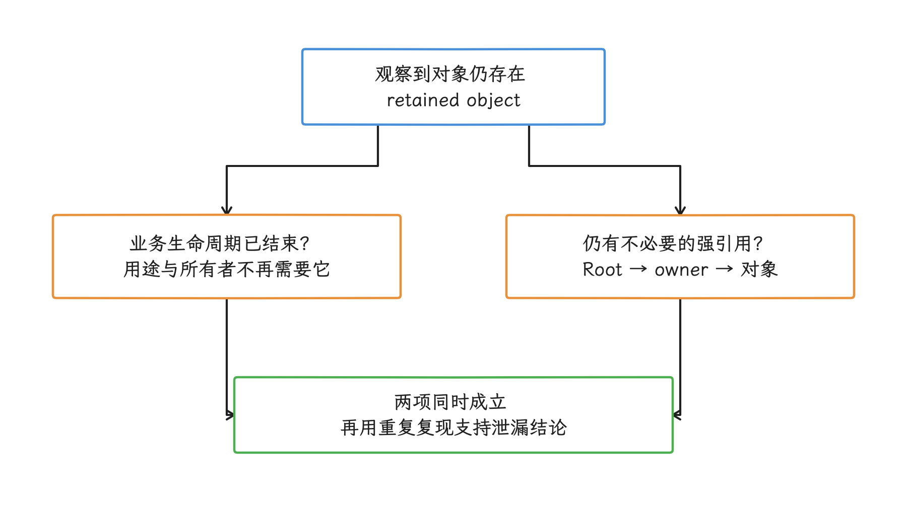
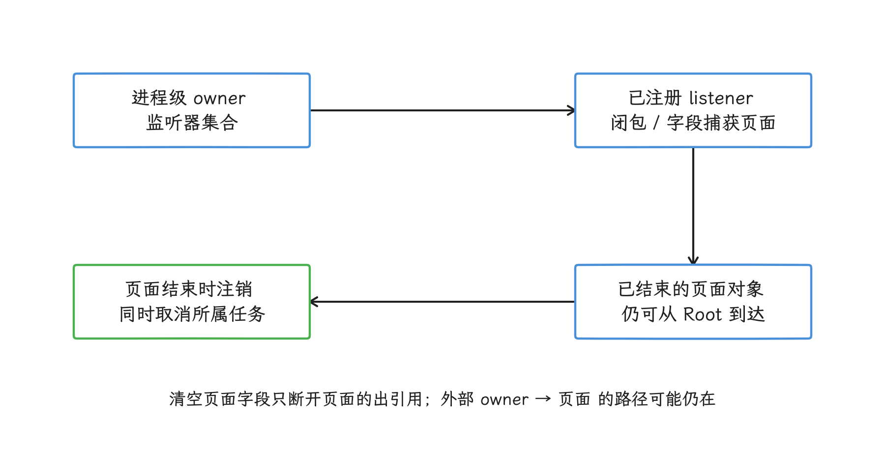
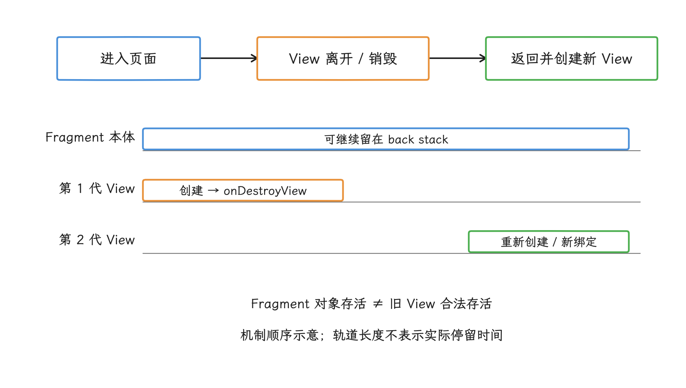
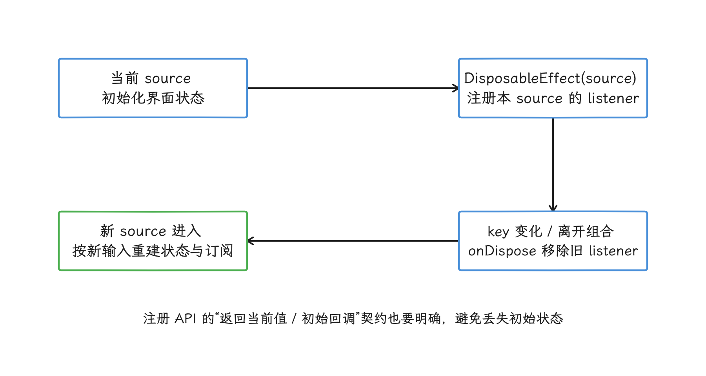
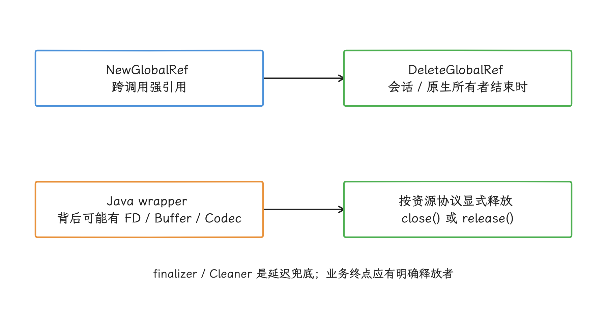
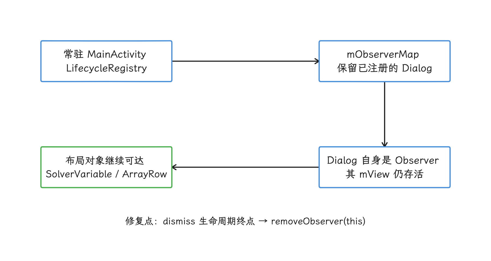
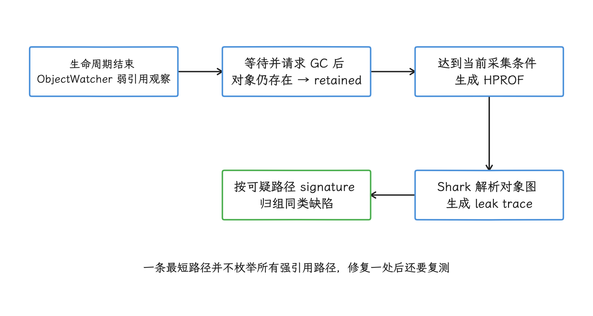
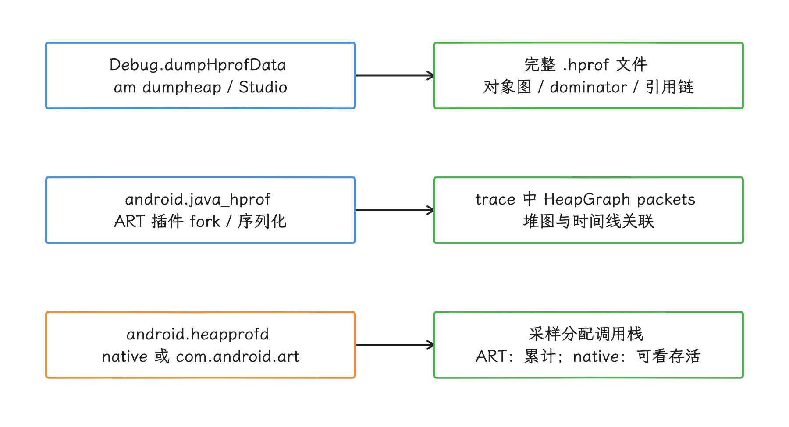
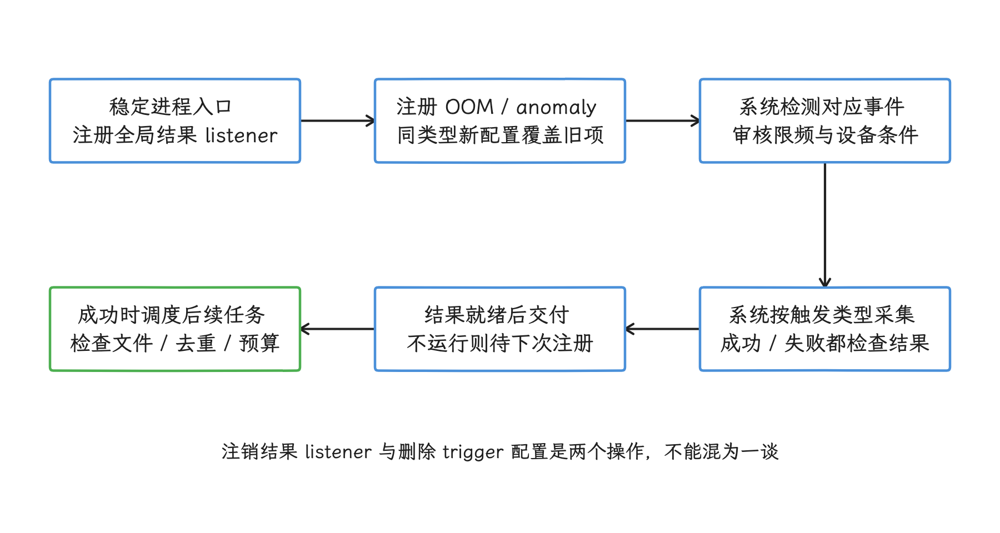
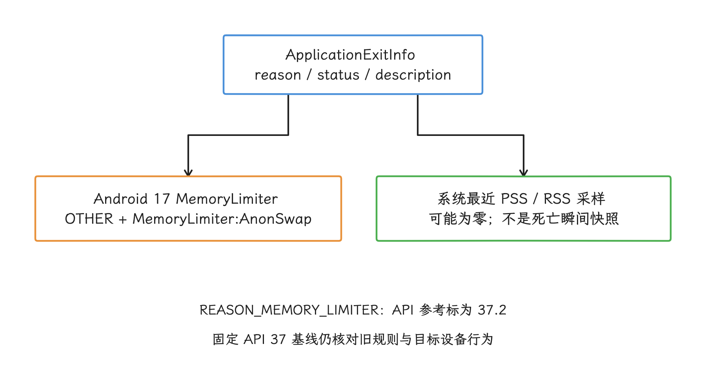

# 内存泄漏检测与治理

这篇文章处理内存治理中最容易混为一谈的两个判断：占用是不是在泄漏，以及一条泄漏结论需要什么证据。内存上涨只反映占用在变化，离泄漏结论还有一段距离；OOM（内存耗尽） 报错的位置，和增长源可能是两回事。反过来，一个对象仍然可达，也回答不了它是否已经越过业务生命周期——这正是要先定义“泄漏”的原因。Android 应用的内存由 ART（Android 运行时） 托管堆（managed heap）、原生堆（native heap）、线程栈、代码与文件映射、图形缓冲区等部分组成，增长可能落在其中任何一段。

> 源码基线：Android 17 / API 37 / `android-17.0.0_r1`。

排查要依次回答三个问题：

1. 怎样证明对象已经失去业务用途，却仍被强引用链保留？
2. 怎样区分托管堆泄漏、原生分配增长和正常缓存？
3. 怎样让本地复现、生产信号、采集产物与回归验证对得上？

文中保留与 API、工具界面和 Perfetto 数据源一致的英文标识：

| 术语 | 本文含义 |
|---|---|
| GC Root / 强引用路径 | GC Root 是垃圾回收遍历对象图的起点；对象存在从 Root 出发的强引用路径时，GC 不能回收它。 |
| retained object / memory leak | retained object（已保留对象）表示观察窗口结束后对象仍存在；memory leak（内存泄漏）还要求对象已经失去业务用途。 |
| shallow size / retained size | shallow size 是对象自身占用；retained size 是该对象一旦回收后可随之释放的对象集合大小。 |
| dominator | 若到达某组对象的所有路径都必须经过某个对象，该对象支配这些对象；工具用它计算 retained size。 |
| heap dump / HPROF | heap dump 是某一时刻的 Java 对象图快照；HPROF 是 Android 常见的完整堆转储文件格式。 |
| HeapGraph / allocation profile | HeapGraph 是 Perfetto trace 中的 Java 堆图数据；allocation profile 记录一段时间内的分配采样及创建调用栈：native heapprofd 可根据 free 更新存活信息，ART allocation profiling 不追踪对象删除或 GC。两者都不是完整 HPROF 的别名。 |
| RSS / PSS | RSS 是进程驻留页总量；PSS 会按共享者数量分摊共享页。它们是进程内存统计，不是某一个堆的大小。 |
| fork / COW | fork 创建子进程；COW（Copy-on-Write，写时复制）让父子进程先共享物理页，任一方写入时才复制对应页。 |

工具选择跟随增长所在的内存分区：对象图用于判断 Java 引用，原生分配调用栈用于判断 C/C++ 增长，退出记录只说明进程如何结束。Android 17 起，`ProfilingManager` 增加了 OOM 与 anomaly 两类系统事件 trigger。`ApplicationExitInfo`、LeakCanary 和 KOOM 各自回答不同的问题——退出记录、对象保留和泄漏结论，排查时按问题选工具，让它们各管一段。

## 1. 先定义“泄漏”

动手抓证据之前，我们先把“泄漏”两个字说清楚：它同时包含“对象已越过业务生命周期”和“仍被不必要的强引用保留”两个条件，两条都要成立。

### 1.1 GC 可达性

我们从一个基本事实开始：ART 的垃圾回收从 GC Root 出发遍历引用图，只要对象仍能通过强引用路径到达，GC 就会一直留着它。分析器报告的 Root 类型本身就是线索，排查时按类型读完整路径：

| Root 类别 | 常见来源 | 排查重点 |
| --- | --- | --- |
| 活跃线程栈与 JNI local reference（JNI 局部引用） | 正在执行的方法、原生调用帧 | 长任务、阻塞调用或未结束协程捕获了什么 |
| 活跃线程与线程局部变量 | `Thread`、`ThreadLocal` | 线程是否应退出，线程局部状态是否清理 |
| System class / boot class（系统类或启动类） | 已加载类及其静态字段 | 静态集合、单例与 SDK 注册表 |
| JNI global reference（JNI 全局引用） | `NewGlobalRef()` | 是否存在配对的 `DeleteGlobalRef()` 与明确持有者 |
| VM internal / monitor（运行时内部结构或监视器） | 虚拟机内部对象、锁相关结构 | 结合 Root 类型、引用边与对象生命周期判断 |

静态字段通常位于“类对象 → static field → 业务对象”的路径上。把每个 static 字段都当成独立 GC Root，会漏掉类对象这一层，也容易把合法的进程级状态误判成泄漏。

所以可达性之外，泄漏判断还要加上业务语义：

> 对象已经越过应有生命周期，却仍被一条不必要的强引用路径保留。

“GC Root 到对象有路径”只是必要条件之一：单例、进程级缓存、当前显示的 Activity 都有 Root 路径，我们还要确认它们是否仍在合法生命周期内。

### 1.2 retained object 的核查

页面收到 `onDestroy()`、Fragment view 收到 `onDestroyView()` 或 ViewModel 收到 `onCleared()` 后，我们让工具延迟观察对应对象是否仍存在。对象经过一个观察窗口仍未回收，先记作 retained object。它离泄漏结论还差一步，因为有四种常见解释：

- GC 可能尚未发生；
- 测试框架、调试器或系统组件可能暂时持有对象；
- 异步任务可能仍在合法完成阶段；
- 设备厂商修改过的系统框架（framework）可能存在已知泄漏。

我们把生命周期事件、引用路径、持有者语义和重复复现放在一起看，结论才算可靠。

<!-- gracker-diagram: a254-01-leak-conditions -->


图：观察延迟、GC 尚未发生、调试器和合法异步任务都可能解释 retained，单次内存上涨与 OOM 栈本身都不构成泄漏结论。

### 1.3 OOM 的来源

应用层 OOM 的托管堆上限随设备配置和应用属性浮动，跨设备并没有固定的 256 MB 或 512 MB 阈值；原生分配、线程创建、地址空间、图形缓冲区和 `mmap` 文件/匿名映射也可能触发不同形式的内存失败。排查 OOM 时，我们至少要区分下面几类现象：

| 现象 | 优先证据 | 常见方向 |
| --- | --- | --- |
| Java/Kotlin 对象数量持续增长 | heap dump、retained size、GC Root 路径 | 生命周期引用、无界集合、缓存 |
| native heap 持续增长 | Perfetto heapprofd（原生堆分析器）、原生分配调用栈 | C/C++ 分配未释放、第三方库 |
| 线程数持续增长 | `/proc/<pid>/task`、线程 dump（线程快照） | Executor/Thread 未停止、线程泄漏 |
| Graphics 图形内存持续增长 | `dumpsys meminfo`、图形工具、业务资源计数 | Bitmap、Surface、Image、GPU buffer（图形缓冲区） |
| RSS/PSS 上升但 Java heap 稳定 | `dumpsys meminfo`、maps/smaps（进程虚拟内存映射）、Perfetto | `mmap`、共享页、native/graphics |
| 分配速率过高但回落正常 | allocation recording（分配记录）、GC 事件 | 内存抖动，不一定是泄漏 |

`ActivityManager.getMemoryClass()` 可以读取当前设备为普通应用配置的 Java Heap 上限等级（近似值）。我们拿它做预算参考就好，“安全缓存容量”是过度解读：它只覆盖 Java 堆，原生和图形内存要另行统计。

## 2. Android 常见泄漏路径

定义清楚了，我们来看最常见的泄漏路径。它们分布在 Context、监听器、异步任务、Fragment、Compose、协程和 JNI 各处，结构却是同一个：引用的存活范围，比被引用对象应有的生命周期长。排查时拿这份清单对照引用链逐条排除。

### 2.1 长生命周期对象持有短生命周期 Context

我们从 `Context` 看起：它是 Android 组件访问资源和系统服务的上下文对象，可由 Application、Activity 或 Service 等组件提供；不同来源的 `Context` 生命周期不同。

进程级对象若只需要资源、文件或系统服务，通常保存 `applicationContext`。若功能必须依赖 Activity，例如弹出与页面绑定的窗口，就应让引用跟随页面生命周期释放。

下面的例子展示一个只需要进程级 Context 的仓库对象：

```kotlin
class ImageRepository(context: Context) {
    private val appContext = context.applicationContext

    fun cacheDir(): File = appContext.cacheDir
}
```

这里用 `applicationContext`，是因为仓库与进程同寿命。我们也要留意另一面：主题、窗口、权限交互和 Activity Result 等能力仍可能要求 Activity Context，把所有 Context 都改成 Application Context，就可能弄坏这些能力。

### 2.2 监听器注册与注销不对称

监听器泄漏常见的引用链是 `进程级单例 -> 监听器集合 -> Activity/Fragment/View`。注册和注销要落在同一个生命周期上，泄漏就出在只做了前一半。

下面用 `DefaultLifecycleObserver` 把回调注册限定在可见生命周期内：

```kotlin
class SensorBinding(
    private val sensorManager: SensorManager,
    private val sensor: Sensor,
    private val listener: SensorEventListener,
) : DefaultLifecycleObserver {

    override fun onStart(owner: LifecycleOwner) {
        sensorManager.registerListener(
            listener,
            sensor,
            SensorManager.SENSOR_DELAY_NORMAL,
        )
    }

    override fun onStop(owner: LifecycleOwner) {
        sensorManager.unregisterListener(listener)
    }
}
```

这段代码把所有权交待清楚了：`LifecycleOwner` 进入 `STARTED` 时注册，离开时注销。若业务要求后台继续采集，正确的做法是把所有者提升到 Service 或进程组件——注销这一步在任何方案里都要有人负责。

<!-- gracker-diagram: a254-02-listener-ownership -->


图：注册与注销绑定同一个所有者生命周期。合法后台采集可以更换所有者，但仍需要明确的注销终点。

### 2.3 延迟消息和异步任务越过页面生命周期

匿名 `Runnable`、回调 lambda 或协程都可能捕获 Fragment、View 或 Activity。要盯住的是任务队列是否比被捕获对象活得更久，“匿名类”这个语法形式本身无关紧要。

下面的 Fragment 在 view 销毁时移除只服务于该 view 的延迟任务：

```kotlin
class ResultFragment : Fragment(R.layout.result) {
    private val mainHandler = Handler(Looper.getMainLooper())
    private val hideLoading = Runnable {
        view?.findViewById<View>(R.id.loading)?.isVisible = false
    }

    override fun onViewCreated(view: View, savedInstanceState: Bundle?) {
        val timeoutMs = resources
            .getInteger(R.integer.loading_timeout_ms)
            .toLong()
        mainHandler.postDelayed(hideLoading, timeoutMs)
    }

    override fun onDestroyView() {
        mainHandler.removeCallbacks(hideLoading)
        super.onDestroyView()
    }
}
```

在 `onDestroyView()` 里移除回调，同时也避免了任务去操作已销毁的 view。协程场景我们优先选 `viewLifecycleOwner.lifecycleScope`、`repeatOnLifecycle()` 或结构化并发，让取消关系由作用域表达。

### 2.4 Fragment 的两个生命周期

Fragment 有两个生命周期：本体可以留在 back stack（返回栈） 中，view 却已被销毁。把 binding、Adapter callback、Animator 或 ComposeView 相关对象存为 Fragment 字段时，应在 `onDestroyView()` 释放 view 级引用。

`mFragmentManager == null`、`mCalled == true` 之类系统框架内部字段可以放一边：它们不在应用契约里，判断 view 是否销毁，以 view lifecycle（View 生命周期） 的回调为准。

<!-- gracker-diagram: a254-03-fragment-view-tracks -->


图：Fragment 仍在返回栈不能作为保留旧 View 的理由。旧 View 的 binding、Adapter 回调和 viewLifecycleOwner 收集任务应在相应生命周期结束时释放。

### 2.5 Compose effect 与外部订阅

`DisposableEffect` 适合管理必须显式注册和注销的非 Compose 资源。

下面的 composable（可组合函数） 会在 key（依赖键） 变化或离开 composition（Compose 组合树） 时移除监听器：

```kotlin
@Composable
fun NetworkState(source: NetworkStateSource) {
    var connected by remember(source) { mutableStateOf(source.isConnected()) }

    DisposableEffect(source) {
        val listener = NetworkStateListener { connected = it }
        source.addListener(listener)
        onDispose { source.removeListener(listener) }
    }

    Text(if (connected) "Connected" else "Disconnected")
}
```

我们把分工记清楚：`remember` 只管对象在当前 composition 里的存续，外部系统中的 listener（监听器） 要由 `DisposableEffect` 的 `onDispose` 定义释放点。

<!-- gracker-diagram: a254-04-compose-subscription -->


图：source 身份变化时，remember(source) 重新读取初始状态；DisposableEffect(source) 管理旧 listener 的注销和新 listener 的注册，两种职责要同时对齐。

### 2.6 `observeForever()`、静态集合与无界缓存

`observeForever()` 的 observer（观察者） 不受 Lifecycle 自动管理，调用方必须保存同一个 observer 并执行 `removeObserver()`。RxJava subscription（订阅）、Flow 转换后自建的 scope（协程作用域）、广播接收器和 SDK callback（回调） 遵循同一原则：谁注册，谁在对应的生命周期注销。

静态集合和缓存还要回答：

- key 是否会无限增长？
- value 是否间接持有页面对象？
- 淘汰策略依据数量、字节数还是业务代次？
- 账号切换、退出登录和低内存事件是否会清理？

这四个问题要靠缓存策略本身回答。`SoftReference` 把回收时机交给运行时，命中率和容量随之失去控制；弱引用同样顶替不了缓存策略。

### 2.7 Kotlin Coroutine 与 Flow 的生命周期

协程泄漏的根源仍是生命周期长短不匹配。我们先看 scope 放在哪：scope 决定协程的父子关系与取消的传播范围，页面任务放进 `GlobalScope` 或其他进程级 scope，就等于放弃了随页面取消的时机。Fragment View 相关的收集任务应绑定 `viewLifecycleOwner`，回调式 API 转为 `callbackFlow` 时，listener（结果监听器） 的移除写进 `awaitClose`。

```kotlin
class FeedFragment : Fragment(R.layout.feed) {
    override fun onViewCreated(view: View, savedInstanceState: Bundle?) {
        viewLifecycleOwner.lifecycleScope.launch {
            viewLifecycleOwner.repeatOnLifecycle(Lifecycle.State.STARTED) {
                viewModel.items.collect { items ->
                    render(items)
                }
            }
        }
    }
}
```

这段写法让收集任务随 View 生命周期停止和重启。Fragment 本体仍在 back stack、但 View 已销毁时，不会继续把旧 View 树留在收集回调里。Compose 场景对应使用 `LaunchedEffect`、`DisposableEffect`、`collectAsStateWithLifecycle` 等与组合生命周期绑定的入口。

### 2.8 JNI 引用与显式关闭资源

原生代码通过 `NewGlobalRef()` 创建的引用会让 Java 对象跨调用持续可达。每条成功创建的 global reference 都要有明确持有者，并在会话结束、模块卸载或原生对象析构时调用 `DeleteGlobalRef()`。从 Java 进入的一次 JNI 方法调用中，local reference 通常在返回时自动释放，不能带到其他线程或后续调用继续使用。自行 `AttachCurrentThread()` 的原生线程没有同样的逐次方法返回清理点，local reference 需用 `DeleteLocalRef()` 或 `PushLocalFrame()` / `PopLocalFrame()` 控制，并在退出前 `DetachCurrentThread()`。跨线程或跨调用持有对象时，应按业务所有权选择 global 或 weak global reference。

`Cursor`、`ParcelFileDescriptor`、`MediaCodec`、`Image`、`Surface` 等对象还带有显式关闭协议。Java wrapper（包装对象） 本身可能很小，背后连着的却是原生分配、图形缓冲区或内核对象。持有者应按各自 API 在业务生命周期终点显式释放：`Cursor`、`ParcelFileDescriptor`、`Image` 使用 `close()`，支持 `Closeable` / `AutoCloseable` 的对象可配合 `use` 或 try-with-resources；[`MediaCodec.release()`](https://developer.android.com/reference/android/media/MediaCodec#release()) 与 [`Surface.release()`](https://developer.android.com/reference/android/view/Surface#release()) 则调用各自的释放方法。finalizer 或 Cleaner 只能当延迟兜底，资源的及时归还靠显式关闭。

<!-- gracker-diagram: a254-05-jni-resource-ownership -->


图：从 Java 进入 JNI 的局部引用通常随返回释放；自行 AttachCurrentThread 的线程需 DeleteLocalRef/局部引用帧，并在结束时 detach。MediaCodec、Surface 使用 release。

### 2.9 案例：常驻 Activity 如何保留已关闭弹窗

我们拿货拉拉司机端公开复盘过的首页弹窗问题收尾：它正好完整走了一遍“业务事件—对象增长—引用链—生命周期缺口”的链路。

[原始复盘](https://mp.weixin.qq.com/s?__biz=MzI0MjIxNjE0OQ==&mid=2247490141&idx=1&sn=645139e24e5424bc0acdb6209d329360)中，测试人员每两秒触发一次弹窗，约八分钟、约 240 次展示后，观察到内存上涨约 50 MB；线上 OOM 样本中的弹窗展示次数超过 2000 次。这些数字描述的是当时版本和当时的测试条件，要坐实泄漏，还得往下看引用链。

heap dump 进一步显示 `SolverVariable[]`、`SolverVariable`、`ArrayRow` 等布局对象持续增加，原图的 References 面板从弹窗 `mView` 等子对象向 `LifecycleRegistry.mObserverMap`、常驻 `MainActivity` 回溯持有者。按强引用方向应读作：`MainActivity → LifecycleRegistry → mObserverMap → Dialog（观察者）→ mView → 布局对象`。

> ⚠️ 矛盾：旧稿沿分析器回溯方向描述引用链，容易被理解为弹窗持有 Activity 才导致弹窗泄漏。本例的保留原因是常驻 Activity 的观察者表仍持有已关闭的 Dialog；原图中更靠近 Root 的路径另含系统单例，本文链路为简化表示。

代码审查确认：Dialog 初始化时注册了 Activity 生命周期观察者，`dismiss` 时却没有移除。

修复后应使用同一事件序列复测，确认观察者、旧 Dialog/View 和布局对象不再随展示次数累积。

<!-- gracker-diagram: a254-06-dialog-observer-case -->


图：Dialog 初始化 addObserver(this)，dismiss 时未 removeObserver(this)，使旧弹窗随展示次数累积。原复盘的数字仅属于当时测试，不能外推为当前设备测量。

缺陷的根源在这里看得很清楚：注册方、注销方和资源生命周期终点没有对上。同一套排查方法也适用于监听器、回调、Flow collector（收集器） 和外部 SDK observer。

## 3. 证据链：从“内存上涨”到引用路径

### 3.1 固定复现场景

一次首页启动，和连续执行二十轮页面进出，两组数据没有可比性。比较之前，我们先固定条件：

- 相同设备、系统 build（构建版本）、CPU ABI（应用二进制接口） 与应用版本；
- 相同账号和数据规模；
- 相同操作序列与等待点；
- 相同前后台状态；
- 采集前是否执行 GC、是否连接调试器。

轮次不设通用门槛，应按页面应有对象数、噪声和问题增长速度确定，修复前后沿用同一协议。

### 3.2 按内存分区选工具

分区定位的第一步是 `dumpsys meminfo <package>`：它适合做低成本分区观察。分析时比较 Java Heap、Native Heap、Graphics、Code、Stack 等分区在相同操作序列下的变化，单次总 PSS 只算一个采样点。

下面的命令用于记录进程内存概况和线程数量：

```bash
adb shell dumpsys meminfo com.example.app
adb shell pidof com.example.app
adb shell ls /proc/<pid>/task | wc -l
```

把 `<pid>` 替换为 `pidof` 返回值。`dumpsys meminfo` 是采样视图，PSS 会受共享页和系统环境影响；我们解读线程数时，同样要结合业务并发阶段。

### 3.3 用 heap dump 看对象图

Android Studio Heap Dump 能显示类实例、shallow size、retained size、dominator（支配） 和引用关系，我们的分析顺序是：

1. 找到按业务应已销毁的对象实例；
2. 查看它到 GC Root 的 shortest path（最短引用路径）；
3. 在路径上找到第一个本应已释放的引用；
4. 判断这条引用属于应用代码、第三方库还是系统框架；
5. 修改所有权或注销时机后重复同一场景。

retained size 很大，只说明这个节点支配的对象集合大；我们找修复点时，往往要沿引用路径走向更靠近 Root 的字段或容器，当前节点本身未必就是要改的地方。

还要记得 heap dump 会暂停或扰动被测进程，也会暂时增加内存占用；性能结论要用正常运行数据，dump 期间的数据只反映 dump 状态本身。

命令行排查 debuggable 进程时，也可以让 ActivityManager 生成完整 HPROF：

```bash
adb shell am dumpheap com.example.app /data/local/tmp/example.hprof
adb pull /data/local/tmp/example.hprof
```

heap dump 文件还可能包含账号、页面文本与业务对象，采集、保存、上传和删除都要遵守调试数据的访问控制；生产设备的常规定时监控用轻量信号就好，全量 HPROF 留给按需触发。

### 3.4 原生增长与分配调用栈

Java heap 稳定而 Native Heap 上升时，我们先换工具再看数据：Perfetto `heapprofd` 是原生堆分析器，能记录 native allocation/free（分配/释放） 与调用栈；ART allocation profiling 则面向 Java/Kotlin 分配，这个场景里继续抓 Java HPROF 往往帮不上忙。

采样频率、目标进程、持续时间和符号化条件都会影响开销与可读性。生产环境启用前先在目标机型做开销验证，并保留 build ID（构建标识）、native symbols（原生符号文件） 和混淆映射。

## 4. LeakCanary：开发期 retained-object 检测

开发期排查，我们先把 LeakCanary 接进来，让它自动盯着已越过生命周期的对象。它的检测过程可以概括为：

1. `ObjectWatcher` 用弱引用观察已越过生命周期的对象；
2. 对象在等待和 GC 后仍存在时，标记为 retained；
3. retained object 达到当前配置条件后生成 HPROF；
4. Shark 分析对象图并计算 leak trace（泄漏引用路径）；
5. 相同可疑引用路径按 signature（路径特征签名）归组。

我们读一条 LeakCanary 报告时，先确认 `╰→` 指向的对象是否已经越过业务生命周期，再从 GC Root 沿 `↓` 阅读强引用路径；`~~~` 标出的是分析器认为可疑的引用边，修复点仍要回到注册、缓存、任务或 JNI 代码中的实际持有者。

retained size 要和 dominator 关系一起看：它估算的是某对象不可达后可随之释放的内存，泄漏定性要交给整条引用路径和业务语义。

leak signature（泄漏签名） 按可疑路径归组，适合统计同类缺陷；Shark 展示的只是便于诊断的一条路径，对象仍可能存在其他到 Root 的路径，修复后必须重新抓取验证。

<!-- gracker-diagram: a254-07-leakcanary-pipeline -->


图：leak trace 为定位入口。先核验目标对象的生命周期，再沿 Root 到对象阅读可疑字段；Library Leak 同样需要核对依赖版本与上游修复。

`Library Leak` 表示路径匹配已知库或 Framework 模式，这类泄漏照样要处理：核对依赖版本和上游修复，评估发生频率与 retained bytes；应用侧消除不掉的，记录受影响版本、规避方案和验收条件。

Activity、Fragment、Fragment view 和 ViewModel 等常见类型可以自动观察。业务自定义对象也可以在确认其生命周期结束后交给 `AppWatcher.objectWatcher.watch()`。

依赖通常只加进 debug variant（调试构建变体），避免把本地分析界面和自动 heap dump 带进生产包：

```kotlin
dependencies {
    debugImplementation(libs.leakcanary.android)
}
```

这里用 version catalog（Gradle 版本目录） 隐去了具体版本，项目应锁定经过验证的依赖版本；LeakCanary 的默认策略会随版本变化，阈值和延迟以当前依赖的配置与文档为准。

LeakCanary 给出的 leak trace 是定位入口，修复前还要确认：

- 被标记对象在业务上是否已经无用；
- 可疑引用是否由测试环境或调试器引入；
- library leak（库或系统已知泄漏） 是否有可升级版本或可行规避；
- 同一 signature 是否能稳定复现。

## 5. KOOM 与生产环境方案

到生产环境，我们再看 KOOM 这类线上方案。KOOM 官方仓库提供 Java Heap、Native Heap 和 Thread 三类监控模块。Java leak 模块包含基于 fork/COW 的 heap dump 方案；native 模块和 thread 模块则通过 hook（拦截目标函数以记录事件） 来记录事件，各有自己的分析路径。

截至 2026-10-25，KOOM 仓库仍未归档，GitHub 仓库元数据的 `pushed_at` 为 2026-10-20，最新正式版仍是 2024-04-16 发布的 v2.2.2。仓库级推送时间并不指明默认分支具体提交，也不证明某个系统版本已经兼容；接入时固定版本或提交，并在目标 Android 版本、ABI 和厂商设备上实测。

把 KOOM 简化成“计数器推断泄漏”，或者用一张固定的“精度高低”表格给 KOOM 和 LeakCanary 排名，都偏离了选型该做的事。是否接入取决于：

- 目标 Android 版本、ABI 与厂商设备兼容性；
- native hook、fork/dump 策略对稳定性和时延的影响；
- 产物体积、上传成本与隐私要求；
- 符号、混淆映射和服务端分析能力；
- 项目维护状态以及本地验证结果。

自建方案里，周期性 `System.gc()` 加弱引用产出的只是低成本趋势信号，适合筛选样本；泄漏结论仍要由系统或工具生成的 heap/native profile（堆或原生分配分析产物） 支持。

## 6. Android 17：用 `ProfilingManager` 捕获线上证据

开发期排查有 LeakCanary，线上取证则要用系统提供的入口：`ProfilingManager` 让应用在 OOM、内存异常这类事件发生时，拿到系统侧采集的产物。

### 6.1 ProfilingManager 的能力与版本

`ProfilingManager` 在 Android 15、API 35 加入平台，能请求 system trace（系统轨迹）、Java heap dump、heap profile（堆分配采样） 和 stack sampling（调用栈采样）；系统 trigger 能力在后续版本继续扩展。

Android 17 / API 37 新增了与内存诊断直接相关的 trigger：

- `ProfilingTrigger.TRIGGER_TYPE_OOM`：应用抛出 `OutOfMemoryError` 时采集 Java heap dump；若应用设置了自定义 `Thread.UncaughtExceptionHandler`，该处理器必须继续调用系统默认处理器，否则这个 trigger 不会生效；
- `ProfilingTrigger.TRIGGER_TYPE_ANOMALY`：系统检测到过量内存使用等异常时，可在系统采取处置前提供相应 profile；Android 17 MemoryLimiter 达到上限时，可通过该 trigger 获取 Java heap dump。

请求受系统 rate limiter（采集频率限制器）、设备状态和采集条件约束，结果交付按“尽力而为”预期：OOM 发生时原进程通常已难以继续可靠工作；如果结果生成时应用不在运行，系统会等到应用下次启动并注册 listener 后再交付。

### 6.2 区分完整 HPROF 与 Perfetto HeapGraph

取证时我们还要留意信号触发的版本变化：Android 17 上 `kill -10 <pid>` 已经触发不了 HPROF，数字 10 对应 SIGUSR1 信号，`SignalCatcher::HandleSigUsr1()` 的现行语义是强制 GC 和保存运行时 profile，源码日志明确标注 `no HPROF`。内存取证因此要区分两条管线：

- **完整 HPROF 文件**：应用显式调用 `Debug.dumpHprofData(path)`，或由具备权限的 `am dumpheap` / Android Studio 进入 ART `Hprof::Dump()`；适合交给成熟解析器做离线 dominator 和引用链分析。
- **Perfetto ART HeapGraph**：配置 `android.java_hprof` 数据源，由 Perfetto producer（数据生产组件） 使用 `__SIGRTMIN + 6` 通知目标进程，ART 插件 fork 后把 `HeapGraph` packet（轨迹数据包） 写入 trace；适合和时间线关联，但产物不是先落盘的完整 `.hprof`。

Native heapprofd 走另一条数据源和 `__SIGRTMIN + 4`；Java HeapGraph 能采集，native profile 的权限和运行条件仍要单独确认。

完整 HPROF 的写出分两遍：先遍历堆计算输出长度，第二遍才写出，segment（输出分段）通过 `CheckHeapSegmentConstraints()` 检查：当前对象数达到 128 或当前输出长度达到 4096 字节时开启新段。它是在对象记录之间检查的切段阈值，不把大数组等单条记录硬拆成不超过 4 KiB 的块，因此不能据此宣称每段最多 4 KiB。直接流式写入避免了为整个 dump 再持有一份大缓冲区，但 dump 仍会暂停、遍历并输出大量数据。Perfetto HeapGraph 这边同样有 fork、页表、COW、trace buffer（轨迹缓冲区） 和子进程序列化的成本。

两类产物的采集限定在调试、灰度或系统受控触发下；常规高频监控交给轻量信号。

<!-- gracker-diagram: a254-08-capture-artifacts -->


图：HPROF 是独立堆转储格式，HeapGraph 是 Perfetto trace 数据；分配画像回答创建来源，与堆引用保留关系不同。三条路径的权限、开销和产物都要单独验收。

### 6.3 注册 trigger 和结果监听

下面的 Kotlin 示例只在 API 37 及以上注册 OOM 与 anomaly trigger（系统事件触发器），并在采集成功时把系统生成的文件路径交给应用自己的上传调度器：

```kotlin
@RequiresApi(37)
class MemoryProfileRegistrar(
    context: Context,
    private val executor: Executor,
    private val onProfileReady: (File) -> Unit,
) {
    private val manager =
        context.getSystemService(ProfilingManager::class.java)

    private val callback = Consumer<ProfilingResult> { result ->
        if (result.errorCode == ProfilingResult.ERROR_NONE) {
            result.resultFilePath?.let { onProfileReady(File(it)) }
        } else {
            Log.w(TAG, "Profiling failed: ${result.errorCode}")
        }
    }

    fun register() {
        manager.registerForAllProfilingResults(executor, callback)
        manager.addProfilingTriggers(
            listOf(
                ProfilingTrigger.Builder(
                    ProfilingTrigger.TRIGGER_TYPE_OOM,
                ).build(),
                ProfilingTrigger.Builder(
                    ProfilingTrigger.TRIGGER_TYPE_ANOMALY,
                ).build(),
            ),
        )
    }

    fun unregister() {
        manager.unregisterForAllProfilingResults(callback)
    }

    private companion object {
        const val TAG = "MemoryProfiling"
    }
}
```

应用应在稳定的进程入口尽早注册全局 listener，否则可能错过先前事件的结果交付。示例的 `unregister()` 只解除结果 listener，不删除触发配置；若业务要停止特定类型的触发式采集，还应按目标 API 调用 `removeProfilingTriggersByType(intArrayOf(...))`。上传任务还要检查文件存在性、网络与电量条件、用户同意和服务端去重。不要在回调线程同步上传大型产物。

同一种 trigger 只能保留一个注册项；重复添加会覆盖先前配置。业务若设置 `setRateLimitingPeriodHours()`，该限制会叠加在系统 rate limiter 之上，数值应由样本预算和事件频率确定。

<!-- gracker-diagram: a254-09-trigger-delivery -->


图：自定义 OOM uncaught handler 需继续调用默认处理器。结果回调只做有界处理，上传等重工作交给独立调度并遵守用户与产品的数据规则。

## 7. `ApplicationExitInfo` 能证明什么

采集之外，退出记录是另一条常用线索：`ApplicationExitInfo` 从 API 30 起记录历史进程退出信息。它回答的是“进程为何退出、退出前系统最近采样到多少 PSS/RSS”；“哪条引用造成泄漏”要靠前文的 heap dump 与引用路径分析来回答。

MemoryLimiter 目前只在部分设备启用。按 Android 17 行为变更文档，受限进程的 `reason` 是 `REASON_OTHER`，`description` 包含 `MemoryLimiter:AnonSwap`；同一页还建议注册 `TRIGGER_TYPE_ANOMALY` 获取达到上限时的 heap dump。API 参考中 `REASON_MEMORY_LIMITER` 标为 37.2 版本加入；在 Android 17 上识别受限进程，以上行为变更文档的规则为准。

我们在生产记录里同时保存 reason、status 和 description，并按目标系统版本验证识别规则。

下面的代码读取最近退出记录，并提取内存诊断需要的基础字段：

```kotlin
data class ExitSnapshot(
    val reason: Int,
    val timestampMs: Long,
    val pssKb: Long,
    val rssKb: Long,
    val processName: String,
    val description: String?,
)

fun readRecentExits(context: Context): List<ExitSnapshot> {
    val activityManager =
        context.getSystemService(ActivityManager::class.java)

    return activityManager
        .getHistoricalProcessExitReasons(context.packageName, 0, 0)
        .map { info ->
            ExitSnapshot(
                reason = info.reason,
                timestampMs = info.timestamp,
                pssKb = info.pss,
                rssKb = info.rss,
                processName = info.processName,
                description = info.description,
            )
        }
}
```

`getPss()` 和 `getRss()` 是系统退出前最近一次采样值：可能为零，也未必等于死亡瞬间。`REASON_LOW_MEMORY` 说明系统在低内存情境下终止了进程，具体判断还要结合设备压力、进程重要性和内存分区；部分设备不支持该原因码，可用 `ActivityManager.isLowMemoryKillReportSupported()` 查询。`getTraceInputStream()` 主要用于 ANR（应用无响应） trace 和 API 31 起的 native tombstone（原生崩溃转储）；低内存记录并不保证附带 heap dump。

<!-- gracker-diagram: a254-10-exitinfo-boundaries -->


图：退出记录用于还原终止背景，不指出哪条引用导致增长。REASON_LOW_MEMORY 不保证有 heap dump，getTraceInputStream 的产物类型也要按退出场景核对。

## 8. 生产治理：信号、采集与验证分层

本节只说明泄漏问题怎样进入生产治理；跨 Java、Native、Graphics、退出原因和采集产物的统一监控架构由 [内存监控与线上治理](07-memory-monitoring.md) 展开。

### 8.1 低成本信号

生产环境可以长期保留：

- Java/native/graphics 等内存分区的轻量采样；
- 进程 RSS/PSS 与线程数；
- OOM、LMK（系统低内存回收进程）、native allocation failure（原生分配失败） 和历史退出原因；
- 当前页面或关键用户流程、设备档位、系统版本、应用 build；
- 采集器自身耗时、内存和失败率。

我们很难用单个绝对阈值覆盖所有设备：阈值应来自设备分层基线、业务场景和历史分布，再与持续增长、退出原因或异常率组合判断。

### 8.2 高成本证据按需触发

heap dump、native allocation profile（原生分配分析产物） 和长时间 trace 都带资源开销与敏感数据风险，采集策略要设限制：

- 设备与用户抽样；
- 单设备和单版本配额；
- 电量、温度、磁盘和网络条件；
- 文件生命周期与加密；
- 符号化、反混淆和访问权限；
- 失败重试和重复事件合并。

系统允许采集，只是技术前提；上传还要满足隐私声明、用户选择和所在地区的数据要求。

### 8.3 用回归实验确认修复

引用路径修正后，重复原场景并验证：

1. 目标对象数量回到预期；
2. 同一 leak signature 不再出现；
3. 相同轮次下 retained size 或分区增长斜率下降；
4. 页面行为、异步任务和缓存命中没有被错误破坏；
5. OOM/LMK 等线上指标按版本和设备分层改善。

修复后一次 heap dump 里看不到目标对象，只说明这一次快照恰好没抓到它；要压住偶然 GC、采样时机与数据规模带来的误判，靠的是稳定的复现协议和版本对照。

## 9. 容易制造新问题的“修复”

这些做法看起来都在“修复”，我们逐条看它们各自制造的新问题。

- **把所有引用换成 WeakReference**：弱引用会让对象在仍被业务需要时消失，也掩盖所有权设计问题。
- **用 SoftReference 做核心缓存**：回收时机不可预测，保证不了容量、命中或业务可用性。
- **频繁调用 `System.gc()`**：GC 请求不构成释放保证，还可能增加暂停和 CPU 开销。
- **只清空页面字段，不注销外部 listener**：外部持有者（owner）仍可通过 listener 捕获页面。
- **把 `observeForever()` 当 lifecycle observer（生命周期观察者）**：它必须显式 `removeObserver()`。
- **盲目使用对象池**：对象池会延长对象寿命、引入同步和重置成本；只应在基准证明确有收益时使用。
- **只上传 OOM stack trace（调用栈）**：内存耗尽后异常可能出现在任意后续分配点，stack trace 常常不是增长源。

## 10. 排查清单

### 现象确认

- 内存增长位于 Java 堆、原生堆、图形内存、线程还是 `mmap`？
- 增长是持续保留，还是高分配率后能够回落？
- 只发生在特定设备、ABI、系统版本或业务数据规模吗？

### 对象证据

- 对象的业务生命周期结束事件是什么？
- heap dump 中是否存在稳定的 GC Root 路径？
- 路径上第一个不合理持有者或容器是谁？
- 问题来自应用、SDK、厂商系统框架还是测试环境？

### 修复验证

- 注销、取消和字段清理是否位于正确生命周期？
- 是否误伤合法后台任务、缓存或配置变更恢复？
- 修复前后是否使用同一复现协议？
- 线上指标是否按版本、设备和场景分层验证？

## 11. 全文小结

内存泄漏治理要凑齐三样东西：已结束的业务生命周期、不必要的强引用路径、可重复的保留现象。OOM、PSS 上涨、retained object 和 `REASON_LOW_MEMORY` 都是线索，泄漏定性要等三样东西同时成立。

本地开发优先用 LeakCanary 与 Android Studio heap dump 找对象路径，原生增长交给 heapprofd 等 allocation profile；生产环境先用低成本趋势筛选样本，再用 Android 17 `ProfilingManager` 的 OOM/anomaly trigger 或经过验证的生产工具采集产物。修复点要回到所有权和生命周期本身，GC、弱引用和固定阈值都到不了这一层。

## 参考资料

- [AOSP `android-17.0.0_r1` manifest tag](https://android.googlesource.com/platform/manifest/+/refs/tags/android-17.0.0_r1/)
- [AOSP `ProfilingManager.java` at `android-17.0.0_r1`](https://android.googlesource.com/platform/packages/modules/Profiling/+/refs/tags/android-17.0.0_r1/framework/java/android/os/ProfilingManager.java)
- [AOSP `ProfilingTrigger.java` at `android-17.0.0_r1`](https://android.googlesource.com/platform/packages/modules/Profiling/+/refs/tags/android-17.0.0_r1/framework/java/android/os/ProfilingTrigger.java)
- [Android 17 features and APIs: new ProfilingManager triggers](https://developer.android.com/about/versions/17/features)
- [Android 17 应用内存限制与 MemoryLimiter](https://developer.android.com/about/versions/17/behavior-changes-all)
- [ProfilingManager API reference](https://developer.android.com/reference/android/os/ProfilingManager)
- [ProfilingTrigger API reference](https://developer.android.com/reference/android/os/ProfilingTrigger)
- [Trigger-based profiling](https://developer.android.com/topic/performance/tracing/profiling-manager/trigger-based-capture)
- [ApplicationExitInfo API reference](https://developer.android.com/reference/android/app/ApplicationExitInfo)
- [Capture a heap dump with Android Studio](https://developer.android.com/studio/profile/capture-heap-dump)
- [LeakCanary: How LeakCanary works](https://square.github.io/leakcanary/fundamentals-how-leakcanary-works/)
- [KOOM official repository](https://github.com/KwaiAppTeam/KOOM)
- [KOOM v2.2.2 release](https://github.com/KwaiAppTeam/KOOM/releases/tag/v2.2.2)
- [Perfetto heapprofd documentation](https://perfetto.dev/docs/data-sources/native-heap-profiler)
- [ART `SignalCatcher::HandleSigUsr1()`](https://android.googlesource.com/platform/art/+/refs/tags/android-17.0.0_r1/runtime/signal_catcher.cc)
- [ART HPROF 实现](https://android.googlesource.com/platform/art/+/refs/tags/android-17.0.0_r1/runtime/hprof/hprof.cc)
- [Perfetto ART HeapGraph 实现](https://android.googlesource.com/platform/art/+/refs/tags/android-17.0.0_r1/perfetto_hprof/perfetto_hprof.cc)
