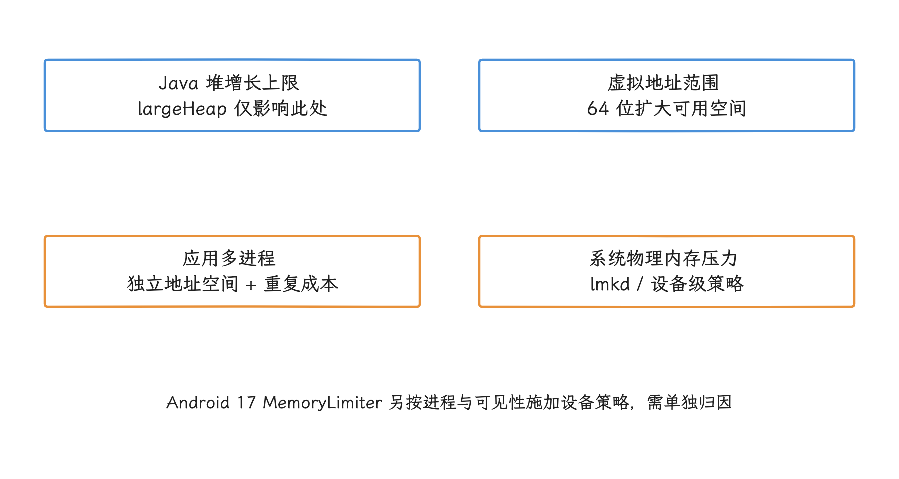
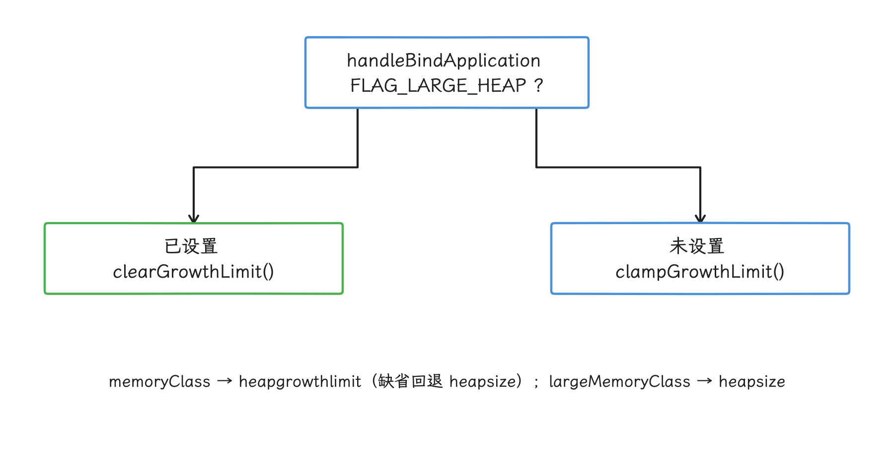
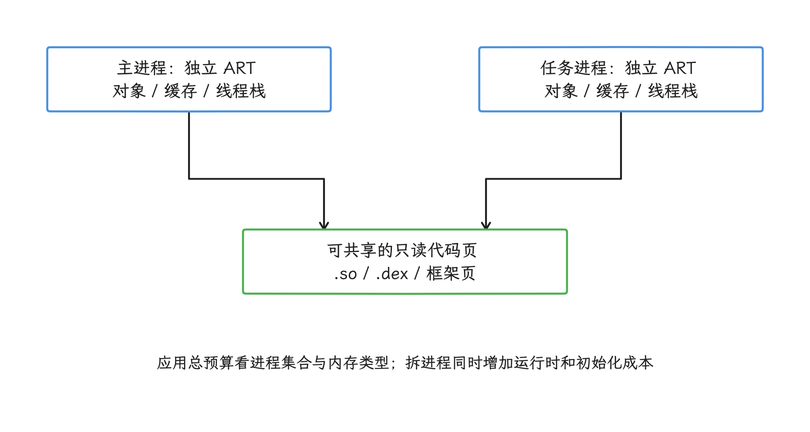
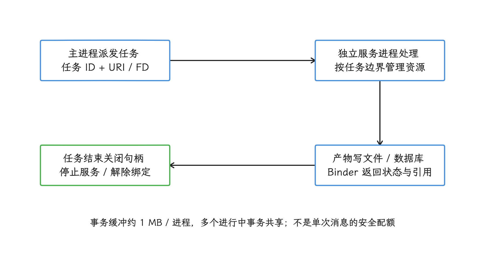
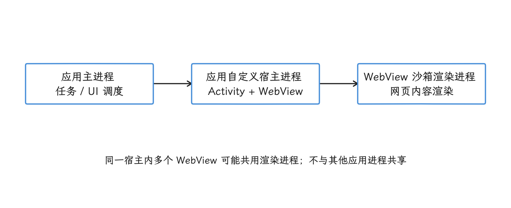
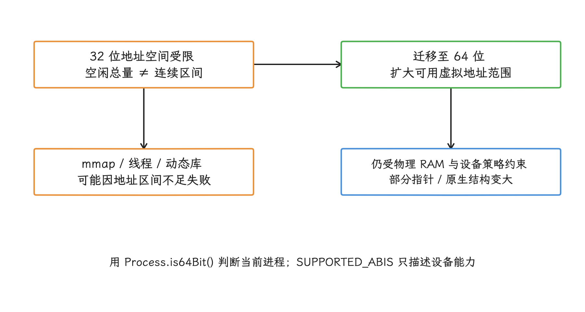
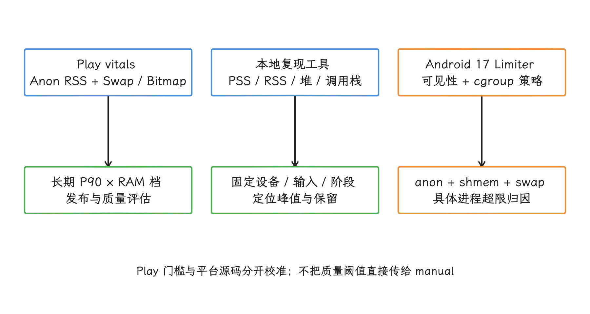
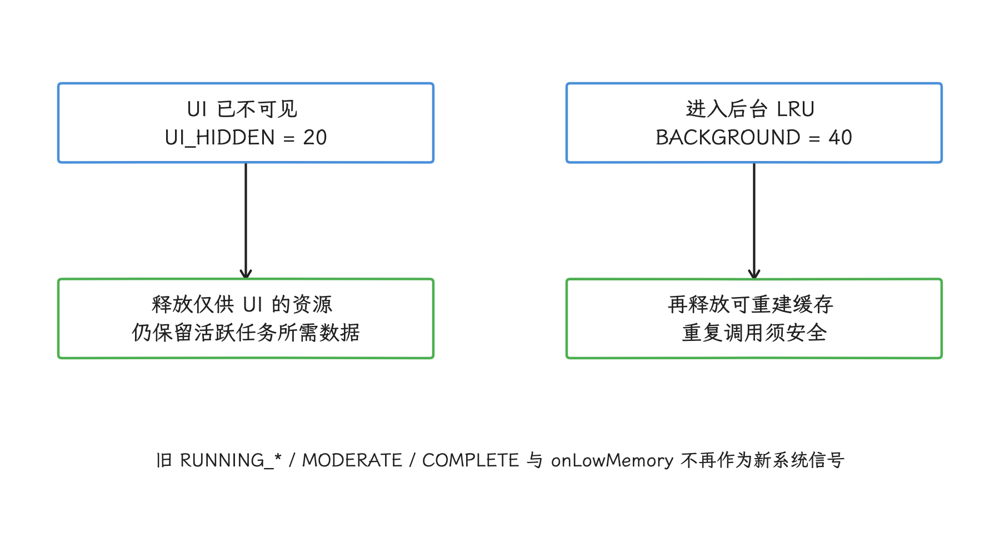
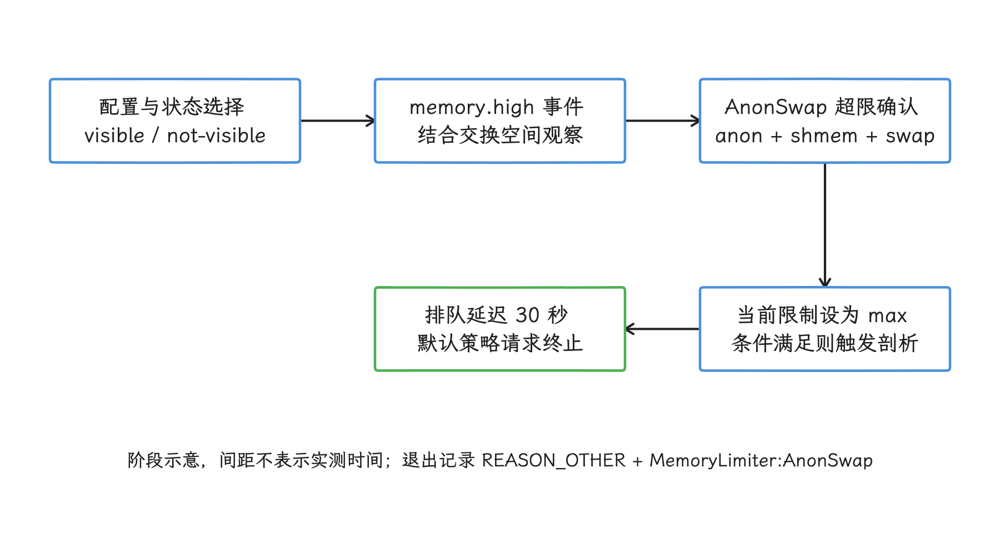
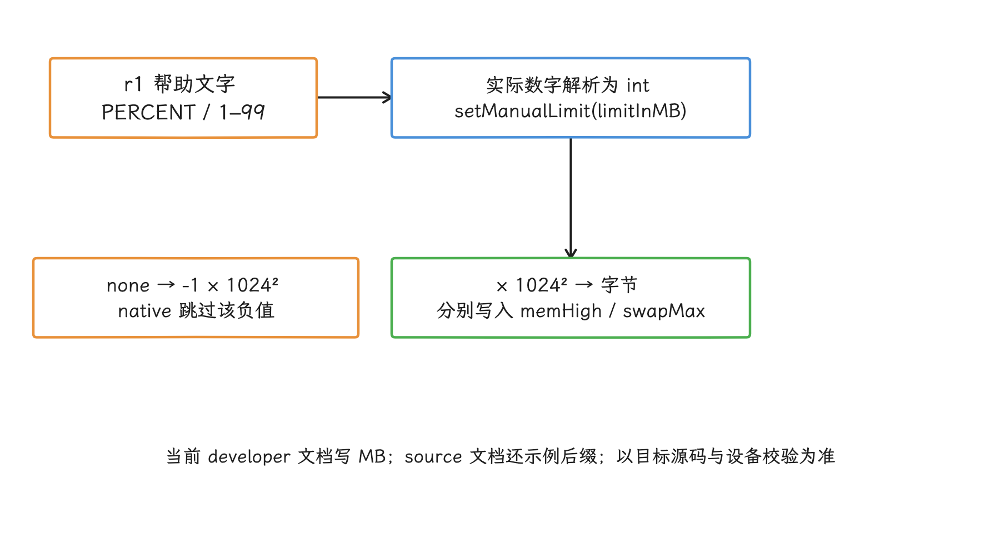

# 大内存与多进程策略

`largeHeap` 与多进程都可能扩大单个故障发生前的可用空间，却会引入更高系统压力、跨进程成本和回收不确定性。只有在对象所有权、进程生命周期和设备预算都量化之后，才适合把它们作为架构选择。

> 源码基线：Android 17 / API 37，AOSP `android-17.0.0_r1`；内核 `android17-6.18-2026-06_r6`，设备可能使用其他内核分支。

## 为什么要了解大内存与多进程策略

大内存问题通常落在两类限制上：Java 堆的增长上限，以及进程可用的虚拟地址范围。Java 堆放的是 ART 管理的 Java / Kotlin 对象；虚拟地址范围则决定一个 32 位进程还能不能继续用 `mmap`（内存映射系统调用） 为线程栈、`.so`、`.dex`、Bitmap、图形缓冲或匿名内存保留地址区间。

`android:largeHeap`、多进程和 64 位迁移各自针对不同的限制：`largeHeap` 抬高应用进程的 ART 堆增长上限；多进程让组件用上独立的地址空间和运行时，同时重复支付进程级内存成本；64 位迁移扩大可用虚拟地址范围，指针和部分原生数据结构却可能变大。这三种手段都不会自动降低 PSS（共享页按参与进程数分摊后的物理内存统计），泄漏也不会因此消失。

<!-- gracker-diagram: a257-01-limit-types -->


图：largeHeap、拆进程和 64 位改变不同的约束；它们都不会自动消除泄漏或降低应用总物理占用。

选择方案之前，我们先按失败类型定位。Java 堆 OOM（内存不足异常） 可参阅 [23.1 Java Heap、GC 与 Compose 内存分配](01-java-heap-gc-compose-allocation.md)；进程被低内存终止，可参阅 [4.3 系统内存压力与 lmkd](../../part1-fundamentals/ch04-memory/03-lmkd-freezer-memory-pressure.md)，lmkd 是 Android 根据系统内存压力终止低优先级进程的守护进程。`pthread_create`、`mmap` 或动态链接器报错时，要检查线程数、映射布局、ABI 及资源限制——ABI 规定指令集、调用约定和二进制布局。WebView、图形内存或原生内存在增长，则要定位实际分配者。

还有一类限制容易被忽略：Android 17 在部分设备上启用了按设备总 RAM 制定的应用内存限制，用来约束极端泄漏和异常占用。它对所有运行在 Android 17 上的应用生效，与 `targetSdkVersion` 无关；某台设备有没有启用、当前限制是多少，都要现场查询，`largeHeap` 和拆进程都绕不开它。怎么识别和归因这类退出，见“Android 17 应用内存限制”一节。

## `largeHeap` 的使用场景与代价

`android:largeHeap="true"` 写在 `<application>` 元素上。官方文档为它划了三条规则：设置作用于该应用创建的所有进程；同一进程以第一个载入应用的设置为准；共享 UID 且共用进程的多个应用必须保持设置一致。另外，设备给出的大堆内存等级（`large memory class`，大堆模式下建议的 Java 堆容量，单位 MB） `large memory class`——大堆模式下建议的 Java 堆容量，单位 MB——可能与普通内存等级相同，开了这个属性未必多出固定容量。

在源码这一侧，`ActivityThread.handleBindApplication()` 检查 `ApplicationInfo.FLAG_LARGE_HEAP`：设了标志就调用 `VMRuntime.getRuntime().clearGrowthLimit()`，否则调用 `clampGrowthLimit()`。读数接口是 `ActivityManager.getMemoryClass()` 读取 `dalvik.vm.heapgrowthlimit`，`getLargeMemoryClass()` 读取 `dalvik.vm.heapsize`。这些代码只调整 ART Java 堆限制，原生堆、图形内存、线程栈和文件映射都不会因此减少。

源码可查阅 AOSP `android-17.0.0_r1` 的 [`ActivityThread.java`](https://android.googlesource.com/platform/frameworks/base/+/android-17.0.0_r1/core/java/android/app/ActivityThread.java) 与 [`ActivityManager.java`](https://android.googlesource.com/platform/frameworks/base/+/android-17.0.0_r1/core/java/android/app/ActivityManager.java)。

真正适合打开 `largeHeap` 的场景很少，通常要同时满足三个条件：

- 峰值来自短时存在的 Java 对象或大数组，而且对象生命周期、缓存、Bitmap 和流式处理已经优化过。若主要增长来自原生内存、图形内存或线程栈，`largeHeap` 帮不上忙。
- 高内存操作有明确的起止范围，例如大图编辑、离线地图切片、批量导入或复杂文档解析；长期驻留的缓存不该依靠 `largeHeap` 扩容。
- 应用能按设备状态降低资源规格：在低内存设备、32 位进程、后台或设备过热时，降低分辨率、单批数据量、并发数或缓存上限。

`readHeapPolicyInputs()` 读取普通和大堆内存等级、当前进程的 `Runtime.maxMemory()`，以及低内存设备标志。这些数值用来制定策略，回答不了此刻还能成功分配多少字节。

```kotlin
data class HeapPolicyInputs(
    val normalClassMb: Int,
    val largeClassMb: Int,
    val runtimeMaxBytes: Long,
    val largeHeapEnabled: Boolean,
    val lowRamDevice: Boolean
)

fun readHeapPolicyInputs(context: Context): HeapPolicyInputs {
    val am = context.getSystemService(ActivityManager::class.java)
    val largeHeapEnabled =
        (context.applicationInfo.flags and ApplicationInfo.FLAG_LARGE_HEAP) != 0

    return HeapPolicyInputs(
        normalClassMb = am.memoryClass,
        largeClassMb = am.largeMemoryClass,
        runtimeMaxBytes = Runtime.getRuntime().maxMemory(),
        largeHeapEnabled = largeHeapEnabled,
        lowRamDevice = am.isLowRamDevice
    )
}
```

缓存预算要结合对象实测大小、并发峰值、重建成本、前后台状态和其他内存类型来定，拿内存等级乘一个通用比例是靠不住的。`Runtime.maxMemory()` 只描述当前 ART Java 堆上限，原生内存与图形内存仍需单独测量。

`largeHeap` 的代价主要有四类：

- GC 成本可能增加：`largeHeap` 本身不会创建对象；应用若用新增空间保留更多对象，垃圾收集器需要处理的存活对象集合随之增大，标记、复制或压缩的工作量也会增加。相关机制见 [23.1 Java Heap、GC 与 Compose 内存分配](01-java-heap-gc-compose-allocation.md) 和 [4.2 ART Heap、GC 与后台维护调度](../../part1-fundamentals/ch04-memory/02-art-heap-gc-maintenance.md)。
- 系统回收压力增加：PSS 上升后，lmkd 在系统内存紧张时更容易终止缓存进程或其他低优先级进程。进程优先级与终止条件见 [4.3 lmkd、Cached App Freezer 与内存压力治理](../../part1-fundamentals/ch04-memory/03-lmkd-freezer-memory-pressure.md)。
- 问题被延后暴露：泄漏、无界缓存和错误的批处理大小可能从“快速 OOM”变成“运行更久后卡顿或被杀”。
- 多进程统计更复杂：该属性作用于应用创建的所有进程；共享 UID 或同一进程载入多个应用时，还要满足前述一致性要求，只看单个组件会看漏。

评估 `largeHeap` 时，我们在同一设备、场景和输入下比较 Java 堆存活量、分配速率、GC、PSS、RSS（进程当前映射到物理内存的全部页面），以及 Android 17 记录的退出原因。OOM 不再出现，只说明这轮测试没有在原来的 Java 堆上限处失败，系统内存压力可能还在上升。

<!-- gracker-diagram: a257-02-largeheap-bind -->


图：largeHeap 改变 ART Java 堆增长策略；原生堆、图形缓冲和线程栈仍需独立预算。

## 多进程内存隔离与共享

Android 默认让同一应用的组件共用一个 Linux 进程和一个主线程。进程是拥有独立虚拟地址空间的执行容器；组件也可以在清单中用 `android:process` 指定其他进程。跨进程通信（IPC）常通过 Binder 完成：Binder 把参数序列化到 `Parcel`，再把事务送到目标进程。远程调用进入服务进程后，由系统维护的 Binder 线程池执行，所以服务端方法要能安全处理多个并发调用。进程模型及生命周期见 [1.1 Android 分层架构、进程模型与线程协作](../../part1-fundamentals/ch01-architecture/01-android-architecture-process-threading.md)。

多进程带来的是地址空间、组件生命周期和崩溃影响范围的隔离。把图片编辑、插件运行时或任务范围清楚的批处理服务放入独立进程后，系统回收该进程时会连同 Java 堆、原生堆、线程栈、JIT 缓存和文件映射一起释放。不过，进程的寿命由 Android 根据活跃组件、进程重要性和系统资源决定，把主动终止子进程当作常规的资源释放手段是行不通的。任务完成时，我们应停止 `Service`、解除绑定并保存结果，让组件状态如实反映还有没有工作在做。

拆成多个进程，应用总内存并不会自动变少。每个进程都有独立的 ART 运行时、类加载器（`ClassLoader`）、线程、Binder 线程池、原生内存分配器状态和业务缓存。`.so`、`.dex` 与 Android 框架的只读代码页可以共享；被进程修改过的脏页、Java 对象、线程栈和多数原生分配都是各进程私有的。多进程的账要靠 PSS 来算：共享页按参与进程数分摊，私有页全额计入当前进程。RSS 计算较快，但每个进程都会完整计算共享页，多个进程的 RSS 直接相加，得不出应用的物理内存总量。

<!-- gracker-diagram: a257-03-multiprocess-pages -->


图：私有内存分别付费，共享页按 PSS 分摊。多个进程 RSS 直接相加会重复计算共享页。

适合拆进程的模块通常有这些特征：

- 峰值高且生命周期清楚：任务完成后没有继续活跃的组件或绑定关系，系统可以将该进程转为缓存进程（`cached process`，没有用户可感知工作、可按需回收）。
- 需要隔离崩溃：原生代码崩溃、WebView 渲染进程异常或插件崩溃，不该连带终止主进程。
- 跨进程输入输出可以表示为文件路径、URI、文件描述符等资源句柄、任务 ID 或小型结果对象。句柄只引用资源，不携带资源的全部内容。
- 启动开销可测量：子进程冷启动、`ClassLoader` 初始化，以及该进程中的 `ContentProvider` 初始化都已纳入目标操作的耗时测量。

反过来，这几类模块拆出去容易吃亏：高频小调用、强共享内存状态、需要大量 Java 对象跨进程传输、每次都要同步 UI 状态。硬拆的结果，往往是把内存问题换成 Binder 成本、序列化成本和一致性问题。

常见的拆分方式，是让主进程只保留任务调度和少量状态，独立进程处理范围明确的任务。服务按任务 ID 读取输入，将产物写入文件或数据库，Binder 只返回状态和结果引用。不过 Binder 事务缓冲区目前为每个进程固定 1 MB，并由该进程所有正在执行的事务共享；即使单次参数不大，并发事务也可能触发 `TransactionTooLargeException`，大数组和 Bitmap 因此别直接写入 `Parcel`。

大数据可以改用句柄传递：`ContentProvider`、`ParcelFileDescriptor`、文件或 `SharedMemory` 共享内存接口都是现成通道，同时要规定关闭时机、访问权限和并发读写协议。句柄会减少 `Parcel` 内的数据量，但数据本身仍有内存和 I/O 成本。

<!-- gracker-diagram: a257-04-ipc-task-boundary -->


图：大数据通过文件或共享内存通道传递，Binder 保留小消息；组件停止后，进程回收时机仍由系统决定。

WebView 要单独统计。从 Android 8.0（API 26）起，WebView 可在多进程模式下使用与应用进程隔离的沙箱渲染进程。同一应用进程中的多个 WebView 可能共享渲染进程，该渲染进程不会与其他应用进程共享。把承载 WebView 的 `Activity` 放入应用自定义进程，只会再增加一个应用进程，合并或替代不了 WebView 渲染进程。`WebView.getWebViewRenderProcess()` 从 API 29 起可返回关联渲染进程的句柄；测量时我们要把主进程、WebView 宿主进程、渲染进程和 GPU 使用量分开记。

<!-- gracker-diagram: a257-05-webview-processes -->


图：自定义宿主进程不会替代 WebView 沙箱渲染进程；测量须分别覆盖宿主、渲染与图形成本。

## 64 位迁移与内存空间扩展

多进程改变内存分配的进程归属，64 位迁移扩大单个进程可用的虚拟地址范围，两者解决的是不同的问题。这一节我们接着看 64 位迁移。

Google Play 的 64 位要求适用于包含原生代码的应用。若继续分发某个 32 位 ABI，应为对应架构提供可工作的 64 位版本，例如 `armeabi-v7a` 对应 `arm64-v8a`、`x86` 对应 `x86_64`；在设备兼容性与分发策略允许时，也可以只提供 64 位 ABI。完全由 Java / Kotlin 编写、依赖中也没有原生库的应用，无需为了在 64 位设备上运行而添加原生库。

线程栈、`.so`、`.dex` / `.oat`、WebView、图形资源和原生缓冲区都会占用虚拟地址。32 位进程即使还有可用物理内存，也可能因为虚拟地址耗尽或找不到足够大的连续区间，导致 `mmap`、动态链接器或 `pthread_create` 失败。64 位进程拿到的是大得多的地址范围，但设备的物理 RAM 和系统施加的应用内存限制都原样不动。

<!-- gracker-diagram: a257-06-abi-address-space -->


图：64 位可以缓解地址范围和碎片问题；迁移后仍需验证指针宽度、ABI 依赖和实际物理内存成本。

64 位指针会增加部分原生对象、表结构和容器节点的体积；二进制大小、冷启动 I/O、指令缓存命中率和内存访问局部性也可能变化。JNI 代码里别把指针存进 `int` 或 `jint`，要使用 `uintptr_t`、`intptr_t` 或其他与指针宽度匹配的字段。ABI 迁移还要覆盖第三方 SDK、插件、热修复、动态加载路径、符号文件和原生崩溃调用栈解析。

迁移检查我们按这条顺序做：

- 安装包检查：用 APK Analyzer 或解包结果核对 ABI；每个受支持的 64 位环境都不该依赖只有 32 位版本的 `.so`。
- 运行时检查：用 `Process.is64Bit()` 确认当前进程位数；`Build.SUPPORTED_ABIS` 只表示设备支持 ABI 的优先顺序，证明不了当前进程已经以 64 位运行。
- 代码检查：排查指针截断、结构体布局、序列化格式、汇编、编译参数和按 ABI 选择资源的逻辑。
- 性能检查：在同一设备上对比启动耗时、PSS、原生堆、图形内存、线程数、缺页异常和崩溃率。
- 设备检查：至少覆盖 64 位进程、仍受支持的 32 位设备和仅支持 64 位的环境；仅支持 64 位的环境能直接暴露遗漏的 32 位专用依赖。

## 进程内存预算管理

预算要按“进程 × 内存类型 × 场景”分别记录，整个应用共用一个总数是看不出问题的：主进程盯常驻 PSS 和缓存，WebView 宿主进程要连同沙箱渲染进程一起测，图片编辑进程要区分 Bitmap、原生内存和图形内存，播放器进程还要统计解码缓冲与图形表面（`surface`）。

开发测试时，我们可以先用 `dumpsys meminfo` 建立基线，再采集 Java 堆转储、原生堆分配、Perfetto 内存计数器或生产环境抽样。`dumpsys meminfo` 能显示 PSS、private dirty（只被当前进程修改、不与其他进程共享的驻留页）、Java 堆和原生堆等分类。排查泄漏还要结合对象引用、分配调用栈、`maps` / `smaps` 映射明细和业务对象的生命周期。

我们用这组命令依次查看主进程汇总、指定子进程汇总和内核提供的 `smaps_rollup` 映射汇总。读取 `/proc/<pid>/smaps_rollup` 通常需要 `root` 权限、`userdebug` 系统镜像，或设备明确允许对应的 `/proc` 访问；量产设备返回 `Permission denied`，只说明当前调用者没有读取权限。

```bash
adb shell dumpsys meminfo com.example.app
adb shell dumpsys meminfo com.example.app:editor
editor_pid="$(adb shell pidof com.example.app:editor | tr -d '\r')"
adb shell su 0 cat "/proc/${editor_pid}/smaps_rollup"
```

`dumpsys meminfo` 各列与 `/proc` 中的 RSS/PSS 采集和汇总方式不同，别混进同一条时间序列。比较前应固定设备、系统版本、测试场景和采样工具；多进程应用还要分别记录应用进程、WebView 渲染进程和相关 GPU 内存。

### 把 Play 技术质量线纳入发布预算

Google Play 在 2026-08-26 公告的新技术质量要求把内存使用纳入 Android vitals 核心指标：从 2027 年 2 月起，面向手机和平板发布的应用和游戏需要满足各自的内存 bad behavior thresholds；Play 使用最近 28 天的聚合数据，并用 90th percentile（P90）与阈值比较。这个门槛是发布与质量信号，既动不了本文的 Android 17 / `android-17.0.0_r1` 平台源码基线，也替代不了本机压力测试。 [来源: DeepResearch/2026-08-28-evening-Android-App-memory-thresholds-2027-02/2026-08-28-Play内存门槛2027-02先对四行-深度调研.md；已验证: raw/02-play-support.html]

Play 的“Memory usage”指标是 Anonymous RSS + Swap：Anon RSS 包括 Java/Kotlin 堆、原生分配和匿名映射等在没有 swap 时换不到落盘文件的应用私有数据；Swap 包括压缩或换入 zRAM 的内存。这个指标和 ART `memoryClass`、PSS 以及 Android 17 `MemoryLimiter` 源码中的 `AnonSwap` 退出描述不是一回事。另一个单独指标是 Bitmap memory usage，用来发现后台或缓存状态下长期保留大图的问题。 [来源: DeepResearch/2026-08-28-evening-Android-App-memory-thresholds-2027-02/2026-08-28-Play内存门槛2027-02先对四行-深度调研.md；已验证: raw/01-googleblog.html 与 raw/02-play-support.html]

Play Help Center 17492799 给出的 Apps 类 Anonymous RSS + Swap P90 阈值如下；每个 RAM 档包含下限，Total Memory 可能低于设备宣传的物理 RAM。[来源: DeepResearch/2026-08-28-evening-Android-App-memory-thresholds-2027-02/2026-08-28-Play内存门槛2027-02先对四行-深度调研.md；已验证: raw/02-play-support.html]

| Total Memory 档 | Foreground | User-perceived services | Background | Cached |
| --- | --- | --- | --- | --- |
| 0–3200 MB | - | - | - | - |
| 3200–4800 MB | 2 GB | 1 GB | 1 GB | - |
| 4800–6800 MB | 2.25 GB | 1.25 GB | 1.25 GB | - |
| 6800–9216 MB | 2.25 GB | 1.5 GB | 1.5 GB | - |
| 9216–14336 MB | 3.25 GB | 1.75 GB | 1.75 GB | - |
| 14336–18432 MB | 4.25 GB | 2 GB | 2 GB | - |
| Above 18432 MB | - | - | - | - |

Bitmap memory usage 的 P90 阈值只在非前台状态给出：user-perceived services 与 background 为大于 200 MB，cached 为大于 400 MB。前台短时占用 Bitmap 是可以的，但进入后台或缓存状态后仍长时间保留大图，通常说明 `onTrimMemory()`、页面销毁或图片缓存策略没有把可重建资源释放出去。 [来源: DeepResearch/2026-08-28-evening-Android-App-memory-thresholds-2027-02/2026-08-28-Play内存门槛2027-02先对四行-深度调研.md；已验证: raw/02-play-support.html]

预算表之外，还要区分三类观察入口。Play Console / Developer Reporting API 看到的是按用户设备聚合的长期 P90 和 RAM 档；`dumpsys meminfo`、Perfetto、堆转储与 `/proc` 采样看到的是当前复现场景；Android 17 `MemoryLimiter` 则是在单台设备上按可见性和 cgroup 限制处理“此刻”的异常占用。三组数字回答的是不同问题：Play 阈值没法直接当某台设备的 `am memory-limiter manual` 参数用，本地 PSS 低于某个表格值，也跳不过 Play Console 的分桶检查。 [来源: DeepResearch/2026-08-28-evening-Android-App-memory-thresholds-2027-02/2026-08-28-Play内存门槛2027-02先对四行-深度调研.md；已验证: raw/01-googleblog.html、raw/02-play-support.html 与 AOSP android-17.0.0_r1 MemoryLimiter 源码]

预算值应来自目标设备上的实测峰值，并提前规定超限时允许降低哪些资源规格。表中列出了各进程需要记录的输入、资源释放时机和超限处理，不提供跨设备通用比例。

| 对象 | 需要单独测量 | 生命周期控制 | 超出预算后的动作 |
| --- | --- | --- | --- |
| 主进程 | Java 缓存内容的实测字节数；原生内存、图形内存与线程栈分别计数 | UI 隐藏或进入后台时释放可重建资源 | 缩小缓存、停止预取、降低后台并发 |
| 图片任务进程 | 输入尺寸、图层数、解码副本、Bitmap / `HardwareBuffer` | 任务完成后停止 `Service`、解除绑定并关闭句柄 | 降低分辨率、分块处理、限制并发任务 |
| WebView 宿主与渲染进程 | 页面数量、通过 `addJavascriptInterface()` 暴露给 JavaScript 的对象、渲染进程 PSS、GPU 使用量 | 页面销毁时移除引用；用渲染进程回调识别退出 | 取消非必要预热、减少并发页面、简化页面资源 |
| 批处理进程 | 单批对象、文件映射、原生缓冲区和序列化副本 | 每批关闭流与描述符；无任务时停止组件 | 缩小批大小、暂停后台任务；同一任务 ID 重试时不得重复写入结果 |

这张表的重点，是给每个进程指定可观测的输入和明确的释放时机。缺了这两项，单个“内存上限”既说不清是哪类分配在增长，也判断不了任务完成后有没有回收可重建资源。

<!-- gracker-diagram: a257-07-metric-boundaries -->


图：Play、场景采样和设备策略回答不同问题；任何一个数字都不能直接替代另一个。

### 用进程状态信号释放可重建资源

`onTrimMemory()` 的实现应关注 `TRIM_MEMORY_UI_HIDDEN` 与 `TRIM_MEMORY_BACKGROUND`。前者表示进程原先显示的 UI 已不可见，后者表示进程进入按最近使用顺序维护的后台 LRU 列表；两者描述的都是状态变化，而不是连续的系统内存压力等级。其余等级已经不在投递范围内：从 Android 14（API 34）开始，系统不再投递 `TRIM_MEMORY_RUNNING_*`、`TRIM_MEMORY_MODERATE` 和 `TRIM_MEMORY_COMPLETE`，这些常量在 Android 15（API 35）废弃。低内存设备还要通过 `ActivityManager.isLowRamDevice()` 选择更小的资源规格。

`onLowMemory()` 从 API 34 起也不再调用，并于 API 35 废弃；最低支持版本高于 API 14 且已经实现 `onTrimMemory()` 的应用，可以把 `onLowMemory()` 留空。Android 17 的资源释放，别再指望这些旧回调。

这个回调只释放可重建资源：播放、导航或前台服务仍在使用的数据，`releaseUiOnlyResources()` 不要删；活跃任务占用的资源，`releaseRebuildableCaches()` 也不要关。

```kotlin
override fun onTrimMemory(level: Int) {
    if (level >= ComponentCallbacks2.TRIM_MEMORY_BACKGROUND) {
        releaseRebuildableCaches()
    }
    if (level >= ComponentCallbacks2.TRIM_MEMORY_UI_HIDDEN) {
        releaseUiOnlyResources()
    }
}
```

用 `>=` 是为了兼容系统以后插入的中间等级。`BACKGROUND` 的数值高于 `UI_HIDDEN`，收到前者时两个分支都会执行，因此两个函数应释放不同资源，并保证重复调用不会重复关闭同一资源或产生错误。兼容 Android 13 及更早版本的实现可以保留旧等级处理，但 Android 17 不会发送这些旧等级。

<!-- gracker-diagram: a257-08-trim-state-resources -->


图：示例使用两个 >= 分支；收到 40 时两者都会执行，因此释放职责应明确且可重复调用。

### 把线程数纳入虚拟地址预算

线程栈会占用虚拟地址，其中已访问的页面还可能计入 RSS/PSS。ART 的 `Thread::CreateNativeThread()` 会先调用 `FixStackSize()`：把默认请求换成运行时默认栈大小，加入兼容空间和栈溢出保护区，满足 POSIX 线程库规定的最小栈大小 `PTHREAD_STACK_MIN`，再向上按页对齐，修正后的数值才传给 `pthread_attr_setstacksize()` 和 `pthread_create()`。所以代码里请求的栈大小，和最终映射大小是两回事。

治理线程内存时，应限制线程来源和最大并发：复用有界线程池，关闭不再使用的 executor，并核对每个 SDK 创建的常驻线程。只有在调用深度可控，且递归、JNI、复杂解析与第三方库调用路径都经过压力测试时，才可以自行缩小栈；否则线程创建失败可能转化为 `StackOverflowError` 或原生代码崩溃。

具体修正规则可查阅 AOSP `android-17.0.0_r1` 的 [`art/runtime/thread.cc`](https://android.googlesource.com/platform/art/+/android-17.0.0_r1/runtime/thread.cc) 中 `FixStackSize()` 与 `Thread::CreateNativeThread()`。

### Android 17 应用内存限制

应用内存限制属于 Android 17 对所有应用生效的行为变更，不按 `targetSdkVersion` 区分，但只在部分设备启用。AOSP r1 的实现要求功能标志开启，设备提供 `/vendor/etc/memory-limiter-config.xml`，并且配置中至少有一组限制与 `/proc/meminfo` 的设备总内存 `MemTotal` 匹配。配置分别定义 `visible`（用户仍可感知）和 `not-visible`（用户不可见）进程的限制；同一进程可能在前台低于限制，进入后台后因限制降低而超限。

这套限制独立于 ART `memoryClass`、`largeHeap` 和 lmkd。原生层 `MemoryLimiter` 用 cgroup 约束单个进程：它监听 `memory.events` 中 `memory.high` 计数的变化，把交换区上限写入 `memory.swap.max`，再用这个统计量判断是否超过 `AnonSwap` 限制：

> `memory.stat` 中的 `anon + shmem`，再加 `memory.swap.current`

其中 `anon` 是匿名页，`shmem` 是共享内存页，`memory.swap.current` 是该 cgroup 当前使用的交换空间。超过 `memory.high` 会促使内核回收页面并限制分配速度，`memory.swap.max` 则限制该 cgroup 可用的交换空间。`AnonSwap` 是源码为上述组合量起的名称，和 PSS、RSS 或 Java 堆各是各的指标。

确认 `AnonSwap` 超限后，Android 17 r1 先把当前进程的 `memory.high` 和 `memory.swap.max` 恢复为 `max`。相关剖析功能标志均开启且系统能取得包名时，系统再发送 `TRIGGER_TYPE_ANOMALY` 异常剖析触发器；无论是否成功生成剖析文件，源码都会延迟 30 秒请求终止进程。这 30 秒只给系统剖析器预留处理时间，应用拿它当保存期限是靠不住的，业务状态仍应在正常流程中持续保存。

退出归因应同时检查三项：

- `ApplicationExitInfo.getReason() == REASON_OTHER`。`ApplicationExitInfo` 是系统保存的历史进程退出记录。
- `getDescription()` 包含固定标记 `MemoryLimiter:AnonSwap`。
- 退出前的进程状态、测试场景、PSS/RSS 采样和系统触发的剖析文件能够对应到同一次事件。

`getPss()` / `getRss()` 可能返回零，也不保证记录的是终止瞬间；`getTraceInputStream()` 同样不保证返回 `MemoryLimiter` 的诊断文件。命中只能证明匿名页、共享内存页与交换空间的组合量超过了设备策略，单凭这一条记录判定不了内存泄漏；大图处理、端侧模型推理、WebView 或音视频处理的短时峰值，也可能触发限制。

> **版本警告**：`manual` 的参数语法在三条文档里不一致。`android-17.0.0_r1` 的帮助文本是 `manual <PID> <PERCENT|none>`，数字解释为设备总 RAM 的百分比，并要求使用 1–99 的整数；现行 developer.android.com 行为变更页是 `manual <pid> <limit>|max|none`，把无后缀整数解释为 MB 并增加 `max`；source.android Memory Limiter 文档还示例了字节值和 `MB` / `GB` 后缀。三者不能混用。

这段脚本只展示“查询状态、施加测试限制、恢复默认限制”的顺序，应在专用测试设备上运行。r1 中传入的数值是根据场景基线选择的故障注入百分比，不是应用发布时的预算：

```bash
target_pid="$(adb shell pidof com.example.app:editor | tr -d '\r')"
test_limit_value="${TEST_LIMIT_VALUE:?export TEST_LIMIT_VALUE according to the target build syntax}"
adb shell am memory-limiter status
adb shell am memory-limiter manual "$target_pid" "$test_limit_value"
adb shell am memory-limiter manual "$target_pid" none
```

测试前应查看目标系统构建的命令帮助和限制状态，别只根据“Android 17”这个版本名推断参数单位。先用 `status` 保存设备是否启用及 `visible` / `not-visible` 配置，每次 `manual` 后再次查询状态，测试结束用 `none` 恢复设备默认限制。`ignore all` 会改变整台设备的限制策略，拿来掩盖回归测试失败是不可取的。

r1 的 Java 控制逻辑与命令解析见 [`MemoryLimiter.java`](https://android.googlesource.com/platform/frameworks/base/+/android-17.0.0_r1/services/core/java/com/android/server/am/MemoryLimiter.java) 和 [`ActivityManagerShellCommand.java`](https://android.googlesource.com/platform/frameworks/base/+/android-17.0.0_r1/services/core/java/com/android/server/am/ActivityManagerShellCommand.java)，cgroup 文件访问与 `AnonSwap` 公式见原生层 [`com_android_server_am_MemoryLimiter.cpp`](https://android.googlesource.com/platform/frameworks/base/+/android-17.0.0_r1/services/core/jni/com_android_server_am_MemoryLimiter.cpp)。

<!-- gracker-diagram: a257-09-limiter-enforcement -->


图：AnonSwap 确认后释放当前限制，再按条件剖析并排队终止；实际终止还受运行时开关控制。

<!-- gracker-diagram: a257-10-manual-source-trace -->


图：r1 实际按 MiB 转换数字；none 的负值进入 native 忽略范围，不能作为已验证的默认策略恢复操作。

## 实战决策表

| 现象 | 优先判断 | 推荐动作 | 不建议动作 |
| --- | --- | --- | --- |
| Java 堆 OOM，GC 后仍无法分配对象 | `java.lang.OutOfMemoryError`、堆转储、`getMemoryClass()` | 按 [23.1 Java Heap、GC 与 Compose 内存分配](01-java-heap-gc-compose-allocation.md) 检查对象和缓存；短时峰值可评估 `largeHeap` | 直接拆进程却不修改对象生命周期 |
| `pthread_create` 失败或 `maps` 显示虚拟地址碎片严重 | 线程数、`/proc/<pid>/maps`、32 / 64 位状态 | 限制线程池和常驻线程，迁移到 64 位 | 未经压力测试便统一缩小线程栈 |
| WebView / 图片编辑使主进程峰值过高 | 宿主进程、渲染进程、原生/图形内存、任务生命周期 | 数据边界清楚时拆进程；停止已完成任务的组件并关闭资源 | 把 `largeHeap` 当作 WebView 或图形内存方案 |
| 后台发生低内存终止 | Android Vitals、进程重要性、PSS、后台任务和缓存 | 响应状态回调，减少可重建缓存与后台并发，缩短组件活跃时间 | 提高 Java 堆上限或用常驻组件延长进程寿命 |
| Android 17 `MemoryLimiter` 命中 | `ApplicationExitInfo` 的退出原因与描述、`MemoryLimiter` 状态 | 定位匿名页、共享内存页或交换空间的异常增长，在目标设备复现并修复 | 把 `ignore all` 或 `max` 用作发布配置 |
| 低内存设备运行不稳 | `isLowRamDevice()`、ABI、RAM、zRAM、lmkd 日志 | 降低分辨率、批大小、缓存和并发数 | 沿用高内存设备的预算 |

同一现象可能对应多种限制，决策表的“优先判断”列就是用来挑第一组该看的数据的。确认 Java 堆、虚拟地址、系统内存压力或 `MemoryLimiter` 中的具体一类后，再执行对应动作，避免只因进程退出就统一增加堆上限。

## 全文小结

`largeHeap` 改变 ART Java 堆上限，多进程改变地址空间归属，64 位迁移扩大虚拟地址范围。诊断时要把 Java 堆 OOM、原生或图形内存增长、线程或映射失败、系统低内存终止，以及 Android 17 `MemoryLimiter` 命中分开处理。

预算应细化到每个进程、每类内存和具体场景。生命周期及 IPC 数据边界都清楚的高峰任务才适合拆进程；任务完成后停止组件并关闭资源，进程何时回收仍由系统决定。64 位可以缓解地址空间不足，却不会增加物理内存。方案变更后，我们应在同一设备和输入下复测 Java 堆、原生/图形内存、PSS、线程数、GC、退出原因和用户可见性能。

## 参考资料

- [Android 17：App memory limits](https://developer.android.com/about/versions/17/behavior-changes-all#app-memory-limits)
- [Source.android：Memory Limiter](https://source.android.com/docs/core/perf/memory-limiter)
- [Android 开发者博客：Android 17 内存效率建议](https://developer.android.com/blog/posts/prioritizing-memory-efficiency-essential-steps-for-android-17)
- [Android Developers Blog：Elevating app quality](https://android-developers.googleblog.com/2026/08/app-quality-memory-optimization-secure-onboarding.html)
- [Google Play Help：Play Console technical quality requirements](https://support.google.com/googleplay/android-developer/answer/17492799)
- [`<application android:largeHeap>`](https://developer.android.com/guide/topics/manifest/application-element#largeHeap)
- [`ActivityManager`：memory class API](https://developer.android.com/reference/android/app/ActivityManager)
- [Processes and threads overview](https://developer.android.com/guide/components/processes-and-threads)
- [Processes and app lifecycle](https://developer.android.com/guide/components/activities/process-lifecycle)
- [`TransactionTooLargeException`](https://developer.android.com/reference/android/os/TransactionTooLargeException)
- [`WebView` renderer process API](https://developer.android.com/reference/android/webkit/WebView)
- [`WebViewRenderProcess`](https://developer.android.com/reference/android/webkit/WebViewRenderProcess)
- [管理 WebView 对象](https://developer.android.com/develop/ui/views/layout/webapps/managing-webview)
- [Manage your app's memory](https://developer.android.com/topic/performance/memory)
- [`ComponentCallbacks2`](https://developer.android.com/reference/android/content/ComponentCallbacks2)
- [Support 64-bit architectures](https://developer.android.com/google/play/requirements/64-bit)
- [AOSP `ActivityThread.java` @ `android-17.0.0_r1`](https://android.googlesource.com/platform/frameworks/base/+/android-17.0.0_r1/core/java/android/app/ActivityThread.java)
- [AOSP `ActivityManager.java` @ `android-17.0.0_r1`](https://android.googlesource.com/platform/frameworks/base/+/android-17.0.0_r1/core/java/android/app/ActivityManager.java)
- [AOSP `ComponentCallbacks2.java` @ `android-17.0.0_r1`](https://android.googlesource.com/platform/frameworks/base/+/android-17.0.0_r1/core/java/android/content/ComponentCallbacks2.java)
- [AOSP ART `thread.cc` @ `android-17.0.0_r1`](https://android.googlesource.com/platform/art/+/android-17.0.0_r1/runtime/thread.cc)
- [AOSP `MemoryLimiter.java` @ `android-17.0.0_r1`](https://android.googlesource.com/platform/frameworks/base/+/android-17.0.0_r1/services/core/java/com/android/server/am/MemoryLimiter.java)
- [AOSP `ActivityManagerShellCommand.java` @ `android-17.0.0_r1`](https://android.googlesource.com/platform/frameworks/base/+/android-17.0.0_r1/services/core/java/com/android/server/am/ActivityManagerShellCommand.java)
- [AOSP `com_android_server_am_MemoryLimiter.cpp` @ `android-17.0.0_r1`](https://android.googlesource.com/platform/frameworks/base/+/android-17.0.0_r1/services/core/jni/com_android_server_am_MemoryLimiter.cpp)
- [AOSP `TransactionTooLargeException.java` @ `android-17.0.0_r1`](https://android.googlesource.com/platform/frameworks/base/+/android-17.0.0_r1/core/java/android/os/TransactionTooLargeException.java)
