# 文件 I/O、SAF 与 ContentResolver 性能

文件 I/O 的成本来自系统调用、缓冲、页缓存、同步写和存储设备；走到 SAF 场景，还要再加上 URI 授权、ContentResolver、Provider 与 Binder 的开销。这一章我们先看直接文件 I/O：主线程、键值存储和持久化同步各有哪些等待点；再看 SAF 与 ContentResolver 的开销从哪里来、怎么分段测量。无论选哪条路径，都要同时满足权限模型和性能需求。

> 源码基线：AOSP `android-17.0.0_r1`，API 37；内核 `android17-6.18-2026-06_r6`。

## 文件读写、键值存储与同步边界

### 文件 I/O 的性能边界

我们排查卡顿时常先看 CPU 火焰图（按调用栈汇总 CPU 采样的图），但文件 I/O 的等待不一定体现在 CPU 计算量上：火焰图里可能看不到明显热点，主线程却停在 `read()`、`write()`、`fsync()`、缺页（所需文件页尚未驻留内存）或 `QueuedWork.waitToFinish()` 上。到 Perfetto 里看，这些线程可能处于可中断睡眠、等待内核 I/O 的不可中断睡眠，或等待锁；落到用户那里，就是启动变慢、点击无响应、页面切换掉帧。

Android 存储栈、I/O 调度、页缓存和 SharedPreferences 的内部路径见 [6.1 Android 存储架构](../../part1-fundamentals/ch06-storage/01-storage-architecture.md)、[6.2 文件系统与 I/O 调度](../../part1-fundamentals/ch06-storage/02-filesystem-io-scheduling.md)和 [6.3 SharedPreferences 与 DataStore：I/O、ANR 与多进程一致性](../../part1-fundamentals/ch06-storage/03-sharedpreferences-datastore.md)。落到应用侧，我们要回答四个取舍问题：哪些 I/O 要搬离主线程，哪些键值数据该迁移，什么时候 MMKV 合适，普通文件读写怎样避免并发冲突和同步持久化放大尾延迟（少量最慢操作的延迟）。

### 主线程 I/O 的危害与 StrictMode 检测

主线程 I/O 的风险来自不可预估的尾延迟。读路径可能命中页缓存，也可能触发缺页、存储读取和目录遍历；写路径通常先写入页缓存，需要持久化时还会通过 `fsync()` 等待文件系统完成相应回写。线程等待期间 CPU 占用往往不高，输入、布局和绘制却都排在后面。对应到 ANR（Application Not Responding，应用无响应），就是主线程没有及时返回消息循环，详见 [9.1 ANR 类型与触发条件](../../part2-performance/ch09-anr/01-anr-mechanism-types-triggers.md)。

StrictMode 是开发阶段检测线程磁盘、网络等策略违规的工具，`StrictMode.ThreadPolicy.Builder.detectAll()` 会启用 `detectDiskReads()` 和 `detectDiskWrites()`；框架也会在明确知道线程可能等待磁盘的位置触发检测，例如 `SharedPreferencesImpl.awaitLoadedLocked()` 在等待 XML 加载前调用 `BlockGuard.getThreadPolicy().onReadFromDisk()`。

下面的配置用于在调试构建中暴露主线程磁盘读写。`penaltyLog()` 只记录违规、不结束进程，适合开发期持续启用；可能改变用户流程的惩罚，就不要带入发布构建。

```kotlin
class App : Application() {
    override fun onCreate() {
        super.onCreate()
        if (BuildConfig.DEBUG) {
            StrictMode.setThreadPolicy(
                StrictMode.ThreadPolicy.Builder()
                    .detectDiskReads()
                    .detectDiskWrites()
                    .detectNetwork()
                    .penaltyLog()
                    .build()
            )
        }
    }
}
```

同时要看清这段策略的管辖范围：它只报告受该线程策略约束的调用。I/O 切到工作线程之后，工作线程是否占满存储队列、是否持有主线程需要的锁、主线程是否在等它的结果，就要靠 Perfetto 来回答了——看线程状态、应用自定义 trace 区间（标记业务操作的起止时间），以及采集配置中可用的文件系统或块设备事件。

<!-- gracker-diagram: a261-01-io-wait-main-thread -->
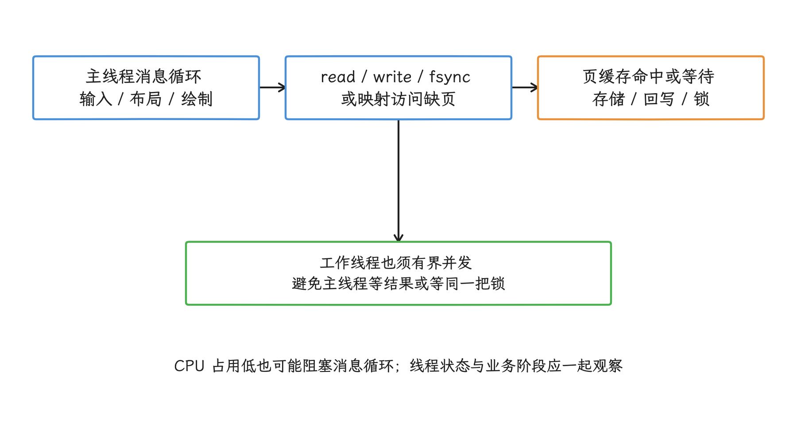

图：StrictMode 发现受策略约束的调用；跨线程锁等待、后台 I/O 排队和主线程等待结果仍需 Perfetto 取证。

[源码锚点：[`StrictMode.java`](https://android.googlesource.com/platform/frameworks/base/+/refs/tags/android-17.0.0_r1/core/java/android/os/StrictMode.java)、[`SharedPreferencesImpl.java`](https://android.googlesource.com/platform/frameworks/base/+/refs/tags/android-17.0.0_r1/core/java/android/app/SharedPreferencesImpl.java)]

应用侧处理主线程 I/O，可分为三类场景：

- 初始化读取：在工作线程读取并显式协调依赖；非首屏配置延后到首帧后。内存默认值只适用于允许短暂使用默认值的界面状态，认证、隐私和迁移开关这类要校验的数据，要等真实值到位。
- 用户交互写入：点击、滑动和输入回调只更新界面状态，把持久化交给串行 I/O 队列。确需确认成功的草稿或交易状态，应在工作线程等待持久化结果并向用户呈现失败；主线程上做 `fsync()` 属于误用。
- 批量文件处理：图片、日志和缓存清理放到后台任务，并限制并发数。过多 I/O 任务会增加锁竞争和存储队列排队；协程切到 `Dispatchers.IO` 只是换了执行线程，并发量还要由业务自己约束。

### SharedPreferences 的风险与 DataStore 迁移

文件之外，应用里最常见的持久化是键值存储。SharedPreferences（SP）的性能风险集中在首次读取和写入完成阶段：`getString()`、`getAll()` 等 API 会进入 `awaitLoadedLocked()`，后台 XML 加载未完成时，调用线程就在这里等待。写入时，`apply()` 先提交内存变更，再把磁盘任务交给框架内部、未纳入公开 SDK 的 `QueuedWork`；`commit()` 等待 `writtenToDiskLatch`（写盘完成同步信号），并返回本次持久化结果。

这里最容易误判的一点是：`apply()` 调用点很快返回，后续组件切换却仍可能要等它。`apply()` 会向 `QueuedWork` 登记 finisher（等待磁盘任务完成的收尾回调），`ActivityThread` 根据应用的 `targetSdkVersion` 分支：目标版本不低于 Android 3.0（Honeycomb，API 11）时在 `handleStopActivity()` 中等待，低于 API 11 时在 `handlePauseActivity()` 中等待；Service 命令完成和 Service 停止等位置也会调用 `QueuedWork.waitToFinish()`。框架 API 文档明确警告：未完成的 `apply()` 可能在 Activity 或 Service 状态切换时阻塞主线程。所以页面里连续写入许多状态，代价可能集中出现在稍后的 Activity 停止或 Service 收尾时。

<!-- gracker-diagram: a261-02-apply-lifecycle-wait -->
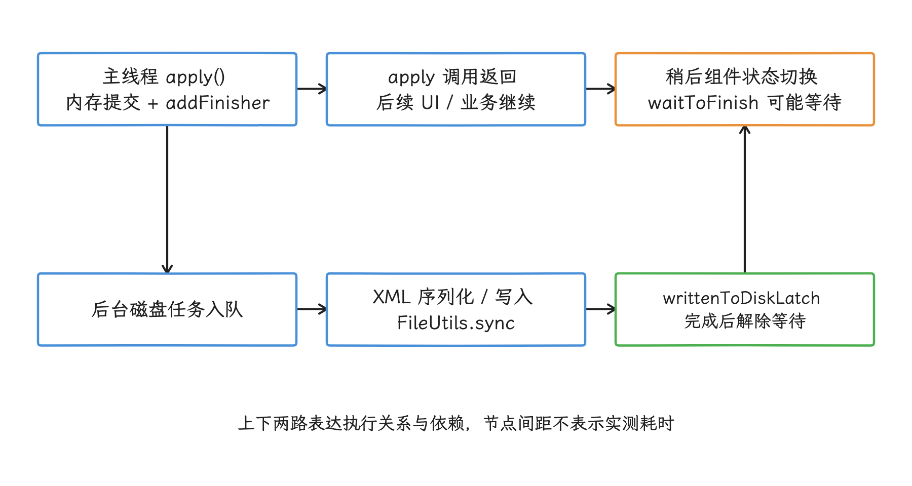

图：apply 把写盘移到后台，但 finisher 会在稍后的 Activity/Service 收尾处等待；调用点快不代表不会影响主线程。

[源码锚点：[`SharedPreferencesImpl.java`](https://android.googlesource.com/platform/frameworks/base/+/refs/tags/android-17.0.0_r1/core/java/android/app/SharedPreferencesImpl.java)、[`QueuedWork.java`](https://android.googlesource.com/platform/frameworks/base/+/refs/tags/android-17.0.0_r1/core/java/android/app/QueuedWork.java)、[`ActivityThread.java`](https://android.googlesource.com/platform/frameworks/base/+/refs/tags/android-17.0.0_r1/core/java/android/app/ActivityThread.java)]

SP 适合少量、低频、轻量配置。以下场景应迁移或拆分：

| 场景 | 风险 | 处理方式 |
| --- | --- | --- |
| XML 持续增长，启动路径又同步读取 | 首次加载与解析时间落在主线程 | 按访问域拆分，首屏只等待必要数据 |
| 高频写入埋点开关、实验参数、草稿状态 | `apply()` 堆积，生命周期收尾等待 | 合并写入，切到 DataStore 或专用文件队列 |
| 多进程同时读写同一份配置 | SP 不支持跨进程一致性 | 使用 `MultiProcessDataStoreFactory`、数据库或单进程服务 |
| 结构化对象被序列化成字符串塞进 SP | XML 体积膨胀，解析成本上升 | Proto DataStore 或数据库 |

DataStore 用协程和 `Flow`（按时间发出数据的 Kotlin 异步流）提供异步读取与事务性更新：同一次事务更新要么写入新值，要么保留原值。Preferences DataStore 适合没有固定字段模式的小型键值设置；Proto DataStore 适合由 Protocol Buffers 模式定义字段和类型的结构化设置。两者仍面向小型数据；局部更新、条件查询和表关系这类能力，在 Room/SQLite 那一侧。

迁移时我们先按一致性要求和读取时机分组：启动必须确认的键、界面可延后键、后台刷新键，各有各的等待策略。允许先显示默认值的设置可在 `Flow` 发出数据后更新界面；认证、隐私和数据迁移状态要在进入相关业务前完成异步读取与校验。用 `runBlocking` 把 DataStore 重新变成主线程同步 I/O，迁移就失去了意义。

下面的代码用于展示 SP 到 Preferences DataStore 的迁移形态。创建 DataStore 的属性委托应在顶层只声明一次，`SharedPreferencesMigration` 会在 DataStore 对外提供数据前执行，写入方通过挂起的 `edit` 等待更新结果。

```kotlin
val Context.settingsStore by preferencesDataStore(
    name = "settings",
    produceMigrations = { context ->
        listOf(SharedPreferencesMigration(context, "legacy_settings"))
    }
)

private val launchFlagKey = booleanPreferencesKey("launch_flag")

suspend fun updateLaunchFlag(context: Context, enabled: Boolean) {
    context.settingsStore.edit { prefs ->
        prefs[launchFlagKey] = enabled
    }
}

fun observeLaunchFlag(context: Context): Flow<Boolean> =
    context.settingsStore.data.map { prefs -> prefs[launchFlagKey] ?: false }
```

这段代码把同步打开 XML 文件的动作从调用方拿掉了，但 `data` 流的读取异常和迁移失败仍要业务自己处理。默认的 `preferencesDataStore` 委托面向单进程；多个进程访问同一文件时，要让所有进程统一使用官方多进程工厂；单进程与多进程实例混用会破坏一致性。

DataStore 面向少量配置、强类型设置和 SP 键值迁移；多表查询、条件检索、分页和关系事务应交给 Room/SQLite。

[官方文档：[`SharedPreferences`](https://developer.android.com/reference/android/content/SharedPreferences)、[`SharedPreferences.Editor`](https://developer.android.com/reference/android/content/SharedPreferences.Editor)、[DataStore](https://developer.android.com/topic/libraries/architecture/datastore)]

#### 从 `QueuedWork.waitToFinish()` 还原 SharedPreferences ANR

ANR 出现在页面停止、应用进入后台或 Service 回调结束时，我们先看主线程停在哪里：停在 `QueuedWork.waitToFinish()` 的话，SharedPreferences 即便走的是 `apply()` 也在嫌疑之列。`apply()` 只是把调用点与磁盘写入分开，它先更新内存，再向 `QueuedWork` 登记等待磁盘完成的收尾回调；框架稍后在 Activity 停止、Service 命令结束和 Service 销毁等时机等待这些工作。`commit()` 则会直接等待 `writtenToDiskLatch`，没有其他磁盘写入时，当前调用线程还可能参与写文件。

排查时，我们把同一时间窗口里的五类信息拼在一起看：

| 证据 | 观测方式 | 判断点 |
| --- | --- | --- |
| ANR 主线程 | ANR trace、bugreport（系统诊断包） | 是否停在 `QueuedWork.waitToFinish()` 或首次加载等待 |
| 磁盘线程 | Perfetto 与同窗口线程栈 | 是否在 XML 序列化、`writeToFile()`、`FileUtils.sync()` 或块设备等待 |
| 写入来源 | 统一存储封装 | 偏好文件类别、调用线程、生命周期阶段、写入类型和次数 |
| 文件状态 | 应用内部诊断 | XML 大小、键值条目数、备份文件是否存在 |
| 生命周期 | Activity、Service 与广播时序 | 写入是否集中在停止、销毁或回调返回前 |

日志只记录经过分类的业务来源，或只记录用于同类来源聚合的稳定散列标识，原始键和值一概不输出。StrictMode 能发现主线程同步磁盘访问；至于之前的 `apply()` 会不会在生命周期切换处造成等待，要靠上面这组信息拼出来判断。

治理时先按数据语义决定迁移方向：小型设置进入 Preferences/Proto DataStore，结构化和可查询数据进入 Room，高频瞬时状态尽量只保留在内存，需要确认的用户操作必须暴露持久化失败，跨进程数据使用明确支持跨进程一致性的存储或单进程服务。持久化保证要来自明确的提交结果，固定防抖时间窗顶多算延迟写入；只有“中间状态可丢，只需保留较新值”的数据才允许合并写入，并且要写明进程终止后的恢复规则。

验收要选公开观测得到的指标：同一偏好文件的大小、键值条目数和写入次数，生命周期结束前后的写入分布，Perfetto 中 `queued-work-looper` 与主线程等待，以及 `QueuedWork.waitToFinish()` 相关 ANR 数量除以会话数或活跃用户数后的比例；同一报表要固定分母。“`apply()` 完成耗时”公开观测拿不到，就先排除在指标外。回归场景至少覆盖冷启动首次读取、连续修改后立即切后台、Service 停止、进程终止、存储压力、升级迁移和多进程误用。

### MMKV 的原理与适用场景

键值存储还有第三条路线。Tencent MMKV 的设计文档说明，它用 `mmap`（把文件映射进进程虚拟地址空间）读写文件，值使用 Protocol Buffers（protobuf）二进制编码；更新采用追加写，同名键以末次值为准；空间不足时整理有效数据或扩容，文件损坏由 CRC（循环冗余校验）来发现。

我们先看清 `mmap` 省掉了什么、没省掉什么：它能减少传统 `read()` / `write()` 路径上的部分复制，并把小写入转成映射页修改，但文件 I/O 本身还在——首次访问仍可能触发缺页，脏页（已修改但尚未写回存储的内存页）仍要回写，初始化还要校验并解析文件。所以把同步读取放在主线程，延迟未必稳定；StrictMode 也未必把映射缺页报告成普通磁盘读取。

MMKV 的 API 返回只说明调用完成，数据到没到持久化介质是另一回事。业务需要断电或进程异常下的明确持久性时，应核对所用 MMKV 版本的同步接口、返回值与恢复策略，并做故障注入（主动模拟进程终止、存储错误等失败）；“使用 `mmap` 文件映射”这一句话，推导不出交易数据所要的持久性。

MMKV 适合这些位置：

- 高频读取的开关、实验参数、轻量运行态标记：读路径短，避免 SP XML 首次解析拖住启动。
- 对启动延迟敏感的小配置：控制键数量和文件大小，并测量冷启动首次缺页与解码。
- 多进程共享的小型状态：显式启用 MMKV 多进程模式，并验证进程锁、变更检测和异常恢复。

不建议放在这些位置：

- 大 JSON、图片、二进制包：文件膨胀和内存映射会增加页缓存与进程地址空间压力。
- 需要范围查询、排序、分页的数据：数据库更合适。
- 要求明确持久化确认的交易数据：应使用能表达事务、失败和恢复语义的存储。

MMKV 与 DataStore 的选择应基于访问行为和一致性要求。需要 Jetpack 组件、`Flow` 订阅、SP 迁移或官方多进程一致性时，可优先评估 DataStore；只有当真实设备基准证明 MMKV 更适合读写频繁的小型键值数据，并且团队能维护第三方库与恢复策略时，再选 MMKV。选型依据放在本应用自己的冷启动、尾延迟、内存和异常恢复测试上；库作者的一次基准结果，只能当参考。

<!-- gracker-diagram: a261-03-key-value-choice -->
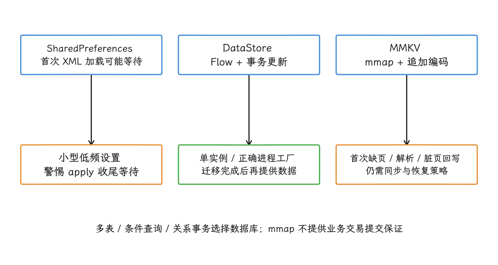

图：用访问模式、进程边界、迁移和持久化要求选型；DataStore 的异步入口也不应被 runBlocking 搬回主线程。

[项目来源：[Tencent/MMKV](https://github.com/Tencent/MMKV)、[MMKV Design](https://github.com/Tencent/MMKV/wiki/design_eng)]

### 文件读写的线程安全与性能

键值存储之外，剩下的是普通文件读写，这里的难点从延迟换成了并发、可见性和持久性。多个线程同时写一个文件、读取方看到半成品，或写入失败后只留下损坏版本，都会把性能问题变成数据问题。

`AtomicFile` 把新内容写到 `.new` 文件，`finishWrite()` 对流调用 `FileUtils.sync()`、关闭文件，再用 rename（同一文件系统内的重命名）替换目标文件；调用 `failWrite()` 时会关闭流并删除 `.new`。它保证的是“读到旧版本或完整新版本”，文件锁要调用方自己加，源码注释也要求调用方为所有并发访问建立互斥条件。

下面的代码用于展示“工作线程 + 单进程互斥 + 原子替换”的形态。`withContext(ioDispatcher)` 负责执行线程，`Mutex` 才负责同一个文件的写入顺序。

```kotlin
class JsonFileStore(
    private val file: File,
    private val ioDispatcher: CoroutineDispatcher = Dispatchers.IO
) {
    private val writeMutex = Mutex()

    suspend fun writeJson(content: String) = withContext(ioDispatcher) {
        writeMutex.withLock {
            val atomicFile = AtomicFile(file)
            var stream: FileOutputStream? = null
            try {
                stream = atomicFile.startWrite()
                stream.write(content.toByteArray(Charsets.UTF_8))
                atomicFile.finishWrite(stream)
            } catch (t: Throwable) {
                if (stream != null) {
                    atomicFile.failWrite(stream)
                }
                throw t
            }
        }
    }
}
```

这段实现覆盖的是共享同一个 `JsonFileStore` 实例的进程内写入。读取也可能与写入并发时，让读取走同一把互斥锁。多个实例或多个进程之间仍可能互相覆盖，更稳妥的做法是把写入集中到单进程 Service 或 ContentProvider，或改用具备跨进程事务语义的数据库。

`AtomicFile.finishWrite()` 返回 `void`，内部同步或 rename 失败主要写日志，业务从这里拿不到丰富的持久化失败信息。支付、订单等需要确认提交的状态，要在这层封装之外另配明确的提交确认。

<!-- gracker-diagram: a261-04-atomicfile-single-writer -->
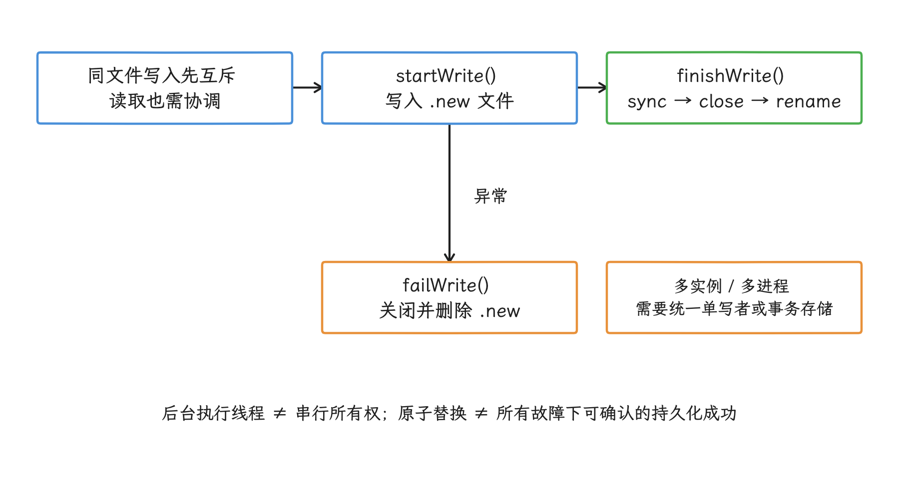

图：原子替换与写入互斥是两件事。调用方负责共享锁和跨进程协调，关键状态还需明确的提交与恢复语义。

[源码锚点：[`AtomicFile.java`](https://android.googlesource.com/platform/frameworks/base/+/refs/tags/android-17.0.0_r1/core/java/android/util/AtomicFile.java)]

#### `write()`、页缓存与 `fsync()` 的区别

普通缓冲文件写入返回时，数据通常只到内核页缓存这一层；是否已经到达持久化介质，返回结果里查不到答案。Android 17 对应的 Linux 6.18 common kernel 中，`fsync` 系统调用进入 `do_fsync()`，再经 `vfs_fsync()` / `vfs_fsync_range()` 调用具体文件系统的 `fsync` 实现。尾延迟受脏页数量、用于故障恢复的文件系统日志、存储设备和当时 I/O 负载影响。

这带来两条工程规则：

- 可重建的日志、埋点和缓存索引可以合并写入与同步，减少频繁 `fsync()`；
- 不可丢状态要在工作线程等待明确的提交结果，并把失败反馈给上层，只看 `write()` 成功是不够的。

合并同步的前提是业务接受对应时间窗的数据丢失；批次和间隔要按文件类别分别定，一套固定参数覆盖不了所有文件。

<!-- gracker-diagram: a261-05-page-cache-sync -->
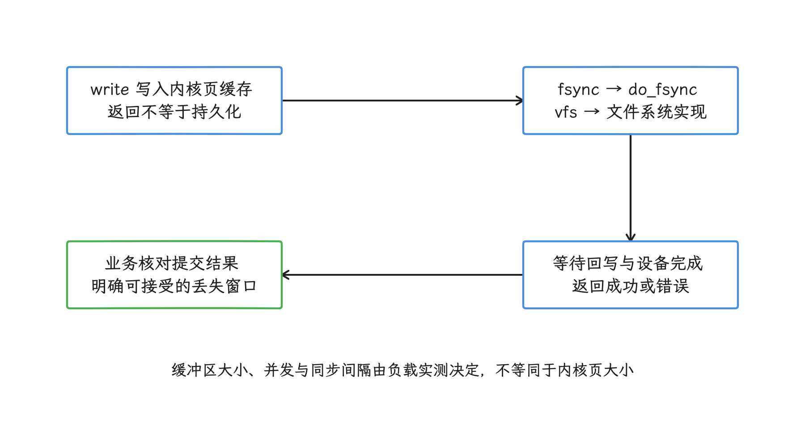

图：可重建日志可以合并同步；不可丢状态必须等待明确提交结果，并验证异常恢复。

[内核锚点：[`fs/sync.c`](https://android.googlesource.com/kernel/common/+/refs/tags/android17-6.18-2026-06_r6/fs/sync.c)、[`mm/filemap.c`](https://android.googlesource.com/kernel/common/+/refs/tags/android17-6.18-2026-06_r6/mm/filemap.c)]

读路径的优化目标是减少主线程等待和重复解析：

- 大文件按块读，避免一次性分配大字节数组。图片、音频和日志交给流式 API 或专用库处理。
- 热数据保留内存快照，文件修改后再刷新；每次 UI 绘制都重新打开文件是一种浪费。
- 读取结果和解析结果分开缓存。文件内容没变时，复用已解析对象，避免 CPU 解析和 I/O 等待同时发生。
- 缓冲区大小用真实负载做基准：“更大缓冲区”不是固定优化，过小会增加调用次数，过大则增加内存和复制成本。

设备可能采用 4 KiB 或 16 KiB 页。使用 `mmap()`、NDK 库或自定义文件格式时，不要把页大小硬编码为 4096；对齐要求应取运行时页大小。Java 流式 I/O 的业务分块大小也不必等于内核页大小，两者应分别验证。

[官方边界：[支持 16 KiB 页大小](https://developer.android.com/guide/practices/page-sizes)]

文件 I/O 优化要保留可观测入口。至少记录单次读写耗时、数据量、调用线程和业务场景。调试构建用 StrictMode 抓主线程读写；分阶段发布版本可对慢操作采样。分析时区分读取、写入、编码/解析、锁等待和 `fsync()`，并关联存储剩余空间与同期系统负载。不要记录用户文件内容、完整路径或敏感键值。

### 生产环境文件 I/O 观测清单

上线之后，文件 I/O 的生产监控可以从低成本项开始：

- 慢读写采样：记录路径类型、文件大小、耗时、线程名、业务场景，不上传用户文件内容。
- 主线程违规：调试和内测构建打开 StrictMode，生产环境只做采样记录，避免惩罚策略影响用户。
- 队列积压：记录 I/O 队列长度、最老任务等待时间、丢弃或合并次数。
- SP 遗留风险：统计 SP 文件大小、单次 `apply()` 次数和启动阶段读取键数量，为迁移 DataStore 或 MMKV 排优先级。
- 存储环境：关联剩余空间、设备型号、Android 版本、温度和同期 I/O 负载，解释设备间尾延迟差异。

采集范围可以从启动、页面切换、登录态更新、草稿保存和日志写入等高频路径逐步扩大。慢操作阈值应来自同类设备和同一业务场景的基线，不使用一套毫秒值覆盖所有文件。

### 文件 I/O 小结

这一节的建议可以按风险排序：主线程不做磁盘读写；SP 先确认首次加载和 `QueuedWork` 等待，再决定迁移；键值存储按一致性和访问行为选择 DataStore 或 MMKV；普通文件用单写者、互斥和原子替换保护内容完整性。需要持久化确认时，还要在工作线程等待明确结果，并验证故障恢复。

## URI、Provider、文件描述符与 SAF 开销

直接文件路径优化完成后，SAF 场景还要计算 Provider 查询和 Binder 往返。能取得 ParcelFileDescriptor 时，可把后续流式 I/O 与元数据查询分开。

Android 的文件访问入口很多，性能问题往往来自入口与场景不匹配：把 `content://` URI（统一资源标识符）当成本地路径，把 `DocumentFile` 当成批量查询接口，或在取得文件描述符后仍把每次读写都归因于 Binder。

这一部分说明存储访问框架（Storage Access Framework，SAF）、`DocumentFile`、`ContentResolver`、MediaStore 和直接文件路径各自的性能特征。我们判断快慢，依据是查询、打开文件和传输数据分别经过哪些组件；一张固定的快慢顺序表，回答不了这些入口的比较问题。

### 先分清五种访问入口

SAF 由系统文件选择器、`DocumentsContract` 协议和文档提供器共同组成。文档提供器是 `DocumentsProvider` 的实现，本文简称 Provider，负责列出文档、检查权限并提供内容；`content://` URI 里类似主机名的部分叫 `authority`，标识由哪个 Provider 处理这个 URI。

同一个 `content://` 形式可以对应完全不同的存储对象，例如：

- 本机共享存储上的普通文件；
- USB、SD 卡或工作资料中的文件；
- 云文档提供方按需下载的对象；
- Provider 通过管道（pipe）或成对套接字（socket pair）即时生成的数据流；
- 没有可直接读取二进制内容的虚拟文档。

因此，同一套 API 在两个 Provider 上可能有不同的延迟、随机访问能力和错误类型。性能记录至少要包含 `authority`、Provider 类型、内容是否已缓存在本机、访问模式和文件大小；定位问题靠这些字段，“SAF 与 `File` 谁快”这样一句单一比较，既落不到具体环节，也推不到其他 Provider 上。

| 访问入口 | 适合场景 | 调用路径 | 主要边界 |
| --- | --- | --- | --- |
| `File` / `java.nio.file.Path` | 应用内部目录、应用专属外部目录、应用可合法直接访问的文件 | 应用 → 内核虚拟文件系统层（VFS）→ 具体文件系统 | 仍受分区存储（Scoped Storage）约束；存储卷状态变化时路径可能失效 |
| SAF + `DocumentsContract` | 用户选择的文档、目录树或云盘内容 | 应用 → `ContentResolver` → `DocumentsProvider` | 元数据查询和打开操作可能跨进程；能力由标志位（flag）声明 |
| AndroidX `DocumentFile` | 少量文件的便利操作、兼容 `File` 风格的调用 | 对 `DocumentsContract` 的轻量封装 | 属性方法通常各自查询，大目录容易形成一次列表查询加 N 次属性查询 |
| MediaStore | 共享图片、视频、音频和下载项的索引访问 | 应用 → `MediaProvider` 数据库；内容读取再打开 URI | 受媒体权限、所有权和用户授权约束 |
| Photo Picker | 用户选择少量图片或视频 | 系统照片选择器 → 本地或云媒体 Provider | 只覆盖图片和视频；读取前可能下载或转码 |

选择入口时，我们先按数据归属判断。应用内部数据优先放在 `filesDir`、`cacheDir` 或数据库中，这些位置可以直接使用 `File`，也不经过共享外部存储的 FUSE（Filesystem in Userspace，用户空间文件系统）挂载。用户希望在卸载应用后仍保留的文档，使用 SAF 或合适的共享集合。图片、视频和音频的列表与批量筛选交给 MediaStore；只需用户挑选少量图片或视频时，优先使用 Photo Picker。

### SAF 的授权和 URI 语义

`ACTION_OPEN_DOCUMENT` 让用户选择并授权单个文档，`ACTION_CREATE_DOCUMENT` 让用户指定新文档的位置，`ACTION_OPEN_DOCUMENT_TREE` 则授权一棵目录树。这里的 URI 授权（URI grant）是系统赋予调用应用的读写能力，和传统文件权限是两套机制。

从 Android 11 / API 30 开始，`ACTION_OPEN_DOCUMENT_TREE` 可选的范围收窄了：内部存储卷或可靠 SD 卡卷的根目录选不到，`Download` 根目录、`Android/data` 和 `Android/obb` 也一样。另外，选择器界面是否展示某个位置，与应用能否取得该位置的树授权是两件事。

`DocumentsContract.Document.COLUMN_DOCUMENT_ID` 由 Provider 自行定义。客户端把它当作不透明标识即可：原样交回同一个 `authority`，路径含义留给 Provider 解释。一个文档也可能同时出现在多个父目录中。以下假设都站不住：

- 从 URI 字符串截取 `/storage/emulated/0/...`；
- 把显示名称（display name）拼成子文档 URI；
- 假定重命名后 URI 不变；
- 假定同一个 URI 永远对应本机普通文件；
- 用 `File(uri.path)` 打开 `content://` URI。

#### 持久化 URI 授权

选择器通过结果 `Intent` 临时授予 URI 访问权。需要在设备重启后继续编辑，或把任务交给 WorkManager 后台执行时，应在收到结果后调用 `takePersistableUriPermission()`，持久化 Provider 已经授予的访问位。

这段实现只保存结果 `Intent` 中已有的读写访问位，不额外申请 Provider 没有授予的写权限：

```kotlin
fun persistDocumentGrant(
    resolver: ContentResolver,
    result: Intent,
): Uri {
    val uri = requireNotNull(result.data)
    val takeFlags = result.flags and (
        Intent.FLAG_GRANT_READ_URI_PERMISSION or
            Intent.FLAG_GRANT_WRITE_URI_PERMISSION
        )

    require(takeFlags != 0) { "The picker returned no read/write grant" }
    resolver.takePersistableUriPermission(uri, takeFlags)
    return uri
}
```

`takePersistableUriPermission()` 管理的是授权生命周期，不会加快读取速度；收到结果后调用一次即可，无须放进每次打开文件或每个 Worker 的循环。文档被删除、移动，或 Provider 撤销授权后，持久化记录仍可能失效。任务开始前要检查访问结果，处理 `SecurityException` 和 `FileNotFoundException`，并提供重新选择文档的入口。长期不用的授权通过 `releasePersistableUriPermission()` 释放。

Photo Picker 返回的媒体 URI 也可以为长任务持久化逐项读取权限。该权限只覆盖用户选中的图片或视频，不等同于目录树授权。

<!-- gracker-diagram: a261-08-uri-grant-lifecycle -->
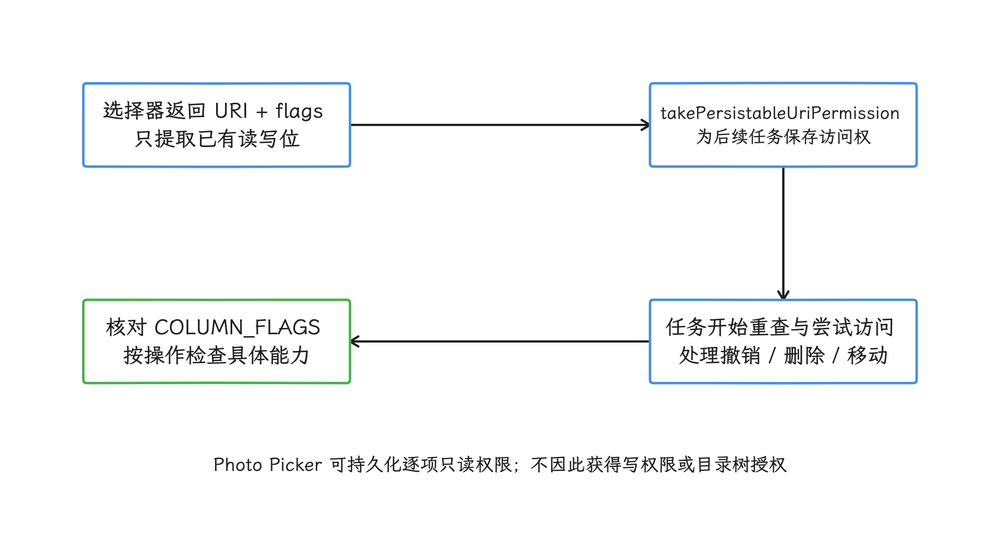

图：授权决定能否访问，COLUMN_FLAGS 决定支持什么操作；canWrite 不能概括改写、删除、创建等全部能力。

### `DocumentFile` 的性能成本来自哪里

AndroidX 官方文档将 `DocumentFile` 定义为模仿 `File` 的便利封装，并明确提示它会增加较多开销。我们把它用在少量文件的便利操作上；需要批量读取元数据或使用完整的文档能力时，直接调用 `DocumentsContract`。2026-10-25 核对[官方发布页](https://developer.android.com/jetpack/androidx/releases/documentfile)，稳定版本仍是 `androidx.documentfile:documentfile:1.1.0`。

#### `listFiles()` 是一次查询

[`TreeDocumentFile.listFiles()`](https://android.googlesource.com/platform/frameworks/support/+/27495ca3d1fe4a1166bea16413ecf8cff5d85855/documentfile/documentfile/src/main/java/androidx/documentfile/provider/TreeDocumentFile.java) 先用 `buildChildDocumentsUriUsingTree()` 构造子项集合 URI，再执行一次 `ContentResolver.query()`，只读取 `COLUMN_DOCUMENT_ID`。再用 `Cursor` 遍历查询结果，把每个文档 ID 包装成新的 `TreeDocumentFile`。

所以，目录中有 N 个文件时，`listFiles()` 本身通常只发起一次查询。`Cursor` 分批装载数据，或远端 Provider 的内部实现，仍可能触发多次 IPC；逐项发起 `query()` 的是下面的属性读取，`listFiles()` 这一层没有。

#### 属性读取会形成 N+1

额外查询发生在取得数组以后。`TreeDocumentFile.getName()`、`getType()`、`lastModified()`、`length()` 和 `exists()` 会进入 [`DocumentsContractApi19`](https://android.googlesource.com/platform/frameworks/support/+/27495ca3d1fe4a1166bea16413ecf8cff5d85855/documentfile/documentfile/src/main/java/androidx/documentfile/provider/DocumentsContractApi19.java)，每次方法调用各自查询一两个字段。

这就是常说的 N+1 查询：先查一次列表，再为 N 个结果各查一次属性。目录有 N 个子项时，这段代码会产生一次列表查询和 N 次名称查询：

```kotlin
val names = directory.listFiles().mapNotNull { it.name }
```

少量、低频的交互可以接受这项成本。文件管理器、同步器或大目录扫描应在一次子项查询中取得 ID、名称、媒体类型（MIME type，例如 `image/jpeg`）、大小、修改时间和能力标志位。

`DocumentFile.findFile(name)` 也会先调用 `listFiles()`，再逐项调用 `getName()`。在同一目录中循环查找多个名称，会反复枚举并查询属性。批量查找应先构建一次名称索引，并定义名称重复时的处理规则；Provider 不保证显示名称唯一。

<!-- gracker-diagram: a261-07-documentfile-n-plus-one -->
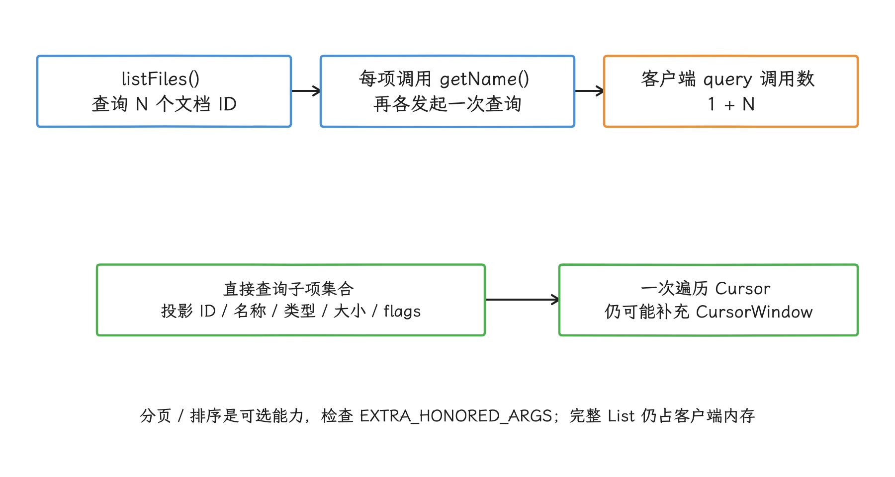

图：一次投影查询取齐列表元数据，避免逐项便利调用；Cursor 分窗装载和 Provider 内部成本仍然存在。

#### 一次查询取齐列表所需字段

查询中的投影（projection）是需要 Provider 返回的列名数组。这个实现把目录列表所需的字段放入一个投影；调用方传入树授权 URI、目标目录的文档 ID 和用于取消查询的 `CancellationSignal`，并在工作线程执行查询：

```kotlin
data class DocumentRow(
    val uri: Uri,
    val documentId: String,
    val displayName: String,
    val mimeType: String,
    val sizeBytes: Long?,
    val lastModifiedMillis: Long?,
    val flags: Int,
)

fun queryChildren(
    resolver: ContentResolver,
    treeUri: Uri,
    parentId: String,
    signal: CancellationSignal,
): List<DocumentRow> {
    val parentDocumentUri = DocumentsContract.buildDocumentUriUsingTree(
        treeUri,
        parentId,
    )
    val childrenUri = DocumentsContract.buildChildDocumentsUriUsingTree(
        parentDocumentUri,
        parentId,
    )
    val projection = arrayOf(
        DocumentsContract.Document.COLUMN_DOCUMENT_ID,
        DocumentsContract.Document.COLUMN_DISPLAY_NAME,
        DocumentsContract.Document.COLUMN_MIME_TYPE,
        DocumentsContract.Document.COLUMN_SIZE,
        DocumentsContract.Document.COLUMN_LAST_MODIFIED,
        DocumentsContract.Document.COLUMN_FLAGS,
    )

    val cursor = resolver.query(
        childrenUri,
        projection,
        Bundle.EMPTY,
        signal,
    ) ?: throw IOException("Provider returned a null cursor: ${childrenUri.authority}")

    return cursor.use { c ->
        val idIndex = c.getColumnIndexOrThrow(
            DocumentsContract.Document.COLUMN_DOCUMENT_ID,
        )
        val nameIndex = c.getColumnIndexOrThrow(
            DocumentsContract.Document.COLUMN_DISPLAY_NAME,
        )
        val typeIndex = c.getColumnIndexOrThrow(
            DocumentsContract.Document.COLUMN_MIME_TYPE,
        )
        val sizeIndex = c.getColumnIndex(
            DocumentsContract.Document.COLUMN_SIZE,
        )
        val modifiedIndex = c.getColumnIndex(
            DocumentsContract.Document.COLUMN_LAST_MODIFIED,
        )
        val flagsIndex = c.getColumnIndexOrThrow(
            DocumentsContract.Document.COLUMN_FLAGS,
        )

        buildList {
            while (c.moveToNext()) {
                val id = c.getString(idIndex)
                add(
                    DocumentRow(
                        uri = DocumentsContract.buildDocumentUriUsingTree(
                            parentDocumentUri,
                            id,
                        ),
                        documentId = id,
                        displayName = c.getString(nameIndex),
                        mimeType = c.getString(typeIndex),
                        sizeBytes = if (sizeIndex >= 0 && !c.isNull(sizeIndex)) {
                            c.getLong(sizeIndex)
                        } else {
                            null
                        },
                        lastModifiedMillis =
                            if (modifiedIndex >= 0 && !c.isNull(modifiedIndex)) {
                                c.getLong(modifiedIndex)
                            } else {
                                null
                            },
                        flags = c.getInt(flagsIndex),
                    ),
                )
            }
        }
    }
}
```

查询授权根目录时，`parentId` 取 `DocumentsContract.getTreeDocumentId(treeUri)`；查询某个子目录时，使用上一轮结果中的 `documentId`。文档 ID 只应交回同一个 `authority`，不参与路径拼接。

这段代码消除了列表页的逐项属性查询，但 `buildList` 仍把完整结果收集到内存，适合规模可控的目录；大目录还需设计分批消费或可用的 Provider 分页，不能把“一次 query”当作低内存保证。分页和排序仍由 Provider 决定是否支持。`QUERY_ARG_LIMIT`、`QUERY_ARG_OFFSET` 和结构化排序参数都属于可选查询能力；客户端要检查 `Cursor` 附加数据（`getExtras()`）中的 `EXTRA_HONORED_ARGS`，确认哪些参数已被接受。若 Provider 不支持分页，客户端分批遍历 `Cursor` 只能压低自身的峰值内存；Provider 生成整个结果集的成本，这一侧省不下来。

#### `canWrite()` 与 `COLUMN_FLAGS`

Android 官方 SAF 指南提醒，`DocumentFile.canWrite()` 在文档可删除或目录可创建子项时也可能返回 `true`。判断能否改写文件内容时，应查询 `COLUMN_FLAGS` 并检查 `FLAG_SUPPORTS_WRITE`。创建、删除、重命名、复制、移动和移入回收站分别有自己的能力标志位，一个布尔值概括不了这组能力。

### `ContentResolver`：Binder 负责协商，文件描述符负责传输

Binder 是 Android 的进程间通信机制。`ContentResolver.openFileDescriptor()` 通过 Binder 调用 Provider 的 `openFile()`，取得包装系统文件描述符的 `ParcelFileDescriptor`。这一步传递 URI、打开模式、授权信息和文件描述符，可以称为控制阶段。对于普通文件，随后的内容读写直接通过文件描述符进行，可以称为数据传输阶段；文件内容不会逐块放进 Binder 事务。

大文件复制缓慢时，我们先把下面几个阶段分开测量，再判断瓶颈在哪里；Binder 缓冲区未必是唯一原因：

<!-- gracker-diagram: a261-06-uri-control-data -->
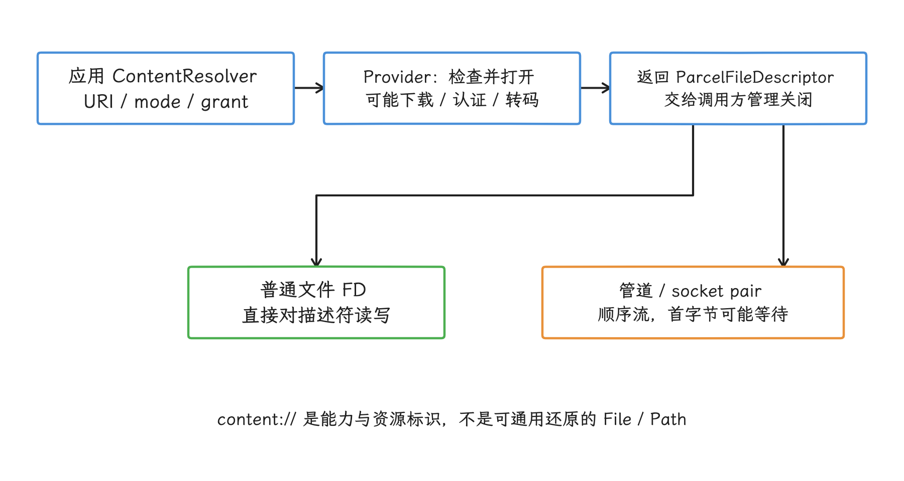

图：先测 query/open/首字节/传输/关闭；描述符的数据路径和打开协商路径的瓶颈不同。

- `openFileDescriptor()` 返回前的 Provider 启动、权限检查、身份认证和按需下载时间；
- 打开调用返回到首个字节的时间；
- 描述符上的持续读写吞吐；
- 刷新与关闭流，以及 Provider 提交远端修改的时间。

`"r"` 或 `"w"` 模式可能得到管道或成对套接字，便于 Provider 边生成边发送或边接收边处理。这类描述符一般只支持顺序访问，读写位置移动受限。`"rw"` 表示调用方需要可读写、可定位的文件，Provider 仍可以拒绝该模式。写入时是否截断原内容也由 Provider 实现决定。所有 URI 都支持 `FileChannel.position()`、`size()`、`map()` 或 `transferTo()`，是代码里要避免的假定，用之前先逐个确认。

#### 大文件复制的通用实现

在同一个 Provider 内，如果源文档声明 `FLAG_SUPPORTS_COPY`，应优先调用 `DocumentsContract.copyDocument()`。Provider 可能在自身存储或云服务端完成复制，无需让文件内容经过应用进程。跨 Provider 复制，或 Provider 未声明复制能力时，再由应用流式传输内容。

这个实现兼容由管道提供内容的 URI，不要求随机访问；调用方在读写循环中检查取消状态：

```kotlin
@Throws(IOException::class)
fun copyDocumentBytes(
    resolver: ContentResolver,
    source: Uri,
    target: Uri,
    isCancelled: () -> Boolean,
): Long {
    val input = resolver.openInputStream(source)
        ?: throw IOException("Provider returned no input stream")

    return input.use { from ->
        val output = resolver.openOutputStream(target, "wt")
            ?: throw IOException("Provider returned no output stream")
        output.use { to ->
            val bytes = ByteArray(DEFAULT_BUFFER_SIZE)
            var total = 0L
            while (true) {
                if (isCancelled()) throw InterruptedIOException("Copy cancelled")
                val count = from.read(bytes)
                if (count < 0) break
                to.write(bytes, 0, count)
                total += count
            }
            to.flush()
            total
        }
    }
}
```

`openFileDescriptor(uri, mode, CancellationSignal)` 可以取消尚未完成的打开请求。描述符返回后，`CancellationSignal` 不会自动中断普通流读取，所以读写循环仍要主动检查取消状态。循环检查只在两次读写之间生效：如果 `read()` 已阻塞等待云端或管道生产方，取消并不会立即返回。需要及时中断时，应按 Provider 与所有权约定设计关闭描述符、可取消源或超时，并覆盖阻塞中的取消测试；不能在消费者仍使用资源时无协调地关闭。

复制失败后，目标文档可能留下部分内容。应用要记录任务状态，并在适当时机删除未完成的目标。原子复制要求操作失败时不留下部分结果；两个 Provider 之间没有这项保证。

<!-- gracker-diagram: a261-09-copy-ownership-fallback -->
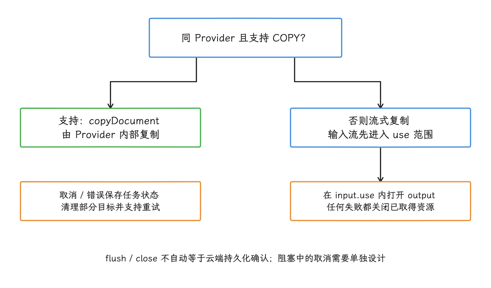

图：在已打开输入流的 use 范围内再打开输出流；打开、读写、取消或关闭失败时都要保留任务状态与目标清理策略。

如果两个描述符已经确认对应本机可随机访问的普通文件，可以基准测试 `FileChannel.transferTo()`。在部分文件系统和内核上，它能减少应用进程中的数据复制；它的适用范围之外是管道、转码流和云 Provider；带起始偏移的 `AssetFileDescriptor` 也要单独验证后再用。实现以目标设备和目标 Provider 的测量结果为准，接口名称说明不了速度。

### Cursor、批处理和观察器的边界

#### `CursorWindow` 分批承载查询结果

查询走到跨进程这一步，我们面对的就是 `CursorWindow` 的分批机制：Provider 用它承载一批行，客户端进程读取其只读视图。当游标移动到当前窗口以外的行时，系统可能要求 Provider 填充另一个窗口。投影包含的列越多，或结果中有大字符串和二进制大对象（BLOB），窗口越容易装满，后续填充次数与内存开销也会增加。

查询时遵守四条规则：

- 明确列出投影，不传 `null` 读取全部列；
- 筛选条件（selection）使用 `?` 占位符和 `selectionArgs`，不拼接用户输入；
- 在工作线程遍历 `Cursor`，并用 `use` 及时关闭；
- 可取消的界面查询传入 `CancellationSignal`。

Provider 是否利用数据库索引，取决于该 `authority` 的公开契约和具体实现。MediaStore 的列、索引与查询策略，换一个云盘 Provider 就要重新核对。第三方 Provider 还可能拒绝或忽略未公开的 SQL 表达式。

#### `applyBatch()` 的原子性由 Provider 决定

`ContentResolver.applyBatch()` 把同一 `authority` 的 `ContentProviderOperation` 列表交给 Provider；列表中的对象描述插入、更新、删除等内容操作。官方契约明确说明：如果发生 `OperationApplicationException`，其中多少项已经生效由 Provider 实现决定；调用 `applyBatch()` 本身，换不来跨实现一致的事务保证。

`DocumentsContract.createDocument()`、`copyDocument()`、`moveDocument()` 和 `renameDocument()` 使用文档协议中的专用调用，不会自动合并到一笔通用的 `ContentProviderOperation` 事务中。Android 也不提供跨 Provider 的文件事务。

批量文件工作应采用可恢复设计：

- 为每项记录源 URI、目标 URI、操作状态和最近一次错误；
- 支持重试时检查目标是否已存在，避免重复副本；
- Provider 声明复制或移动能力时使用其原生操作；
- 应用侧复制完成后再更新任务状态；
- 失败清理也要容忍 URI 已失效或权限被撤销。

MediaStore 的批量用户授权属于另一套 API。`createWriteRequest()`、`createTrashRequest()` 和 `createDeleteRequest()` 自 Android 11 / API 30 引入，它们生成封装待执行系统操作的 `PendingIntent`，再显示系统确认界面。这些 API 不会为任意 SAF 文档提供事务能力。

应用以 Android 16 / API 36 / `BAKLAVA` 或更高版本为目标时，一次请求最多包含 2000 个具体的 MediaStore 项目 URI；超过上限会抛出 `IllegalArgumentException`。在 Android 17 上也要按 2000 项分组，并分别处理用户取消或部分批次未执行的情况。

#### `ContentObserver` 是失效通知

`ContentObserver` 是内容变化观察器。`registerContentObserver(uri, notifyForDescendants, observer)` 监听 Provider 通过 `notifyChange()` 发出的通知。Provider 可以通知集合 URI，也可以通知具体项目；插入、更新和删除的操作标志同样是可选信息。回调的数量、粒度和顺序都不构成可靠的文件变更日志。

对我们来说，回调只表示相关数据可能已经变化，收到后的动作就是重新查询：

1. 合并短时间内的重复通知。
2. 在工作线程重新查询受影响的目录或集合。
3. 比较文档 ID、修改时间、大小和 Provider 提供的业务版本。
4. 界面销毁时注销观察器。

云 Provider 还可能先返回部分结果，并在 `Cursor` 的附加数据中设置 `DocumentsContract.EXTRA_LOADING`，表示列表仍在加载。加载完成后，Provider 再发送变更通知。客户端应展示加载状态，并允许对同一目录重新查询。

### MediaStore、SAF 和 Photo Picker 怎么选

在媒体这件事上，我们手里有三个名字相近的入口，先分清分工。MediaStore 是共享媒体索引，适合枚举和筛选图片、视频、音频，也提供缩略图和增量同步所需的世代号（generation）。世代号由 MediaStore 随数据库变化递增，比文件修改时间更适合判断索引变化；如果 MediaStore 的版本发生变化，仍要执行一次全量同步。SAF 面向任意文档类型和用户选择的目录树。Photo Picker 只授予用户选中的图片或视频，无需申请整个媒体库的读取范围。

Photo Picker 从 Android 13 / API 33 进入平台。支持模块化系统更新的 Android 11 及以上设备可以通过系统模块获得它；支持 Google Play 服务的 Android 4.4 至 Android 10 设备，以及部分 Android Go 11/12 设备，还可安装回移版本。AndroidX Activity 的 `ActivityResultContracts.PickVisualMedia` 依次尝试平台 Photo Picker、OEM 或系统应用提供的兼容选择器，最终回退到 `ACTION_OPEN_DOCUMENT`。因此，系统版本本身说明不了设备上用的是哪种选择器实现。

Photo Picker 的范围比 SAF 窄：

- 选不了任意 PDF、压缩包或源码目录；
- 不提供目录树编辑；
- `PickVisualMedia` 返回的 URI 只读，不会授予写权限；
- 返回项可能来自云媒体 Provider；
- 高动态范围（HDR）视频可能根据应用的解码能力转码；
- 打开延迟取决于本地缓存、云端下载和转码，未必比 SAF 快。

需要修改其他应用拥有的 MediaStore 项目时，可以用 `createWriteRequest()` 请求用户成组授权。该写权限与发起请求的 `Activity` 生命周期绑定，不支持持久化授权或 URI 前缀授权。后台服务或作业需要继续使用时，要按 API 文档通过带授权标志的 `ClipData` 或 `Intent` 传递 URI。长时间后台读取 Photo Picker 结果属于另一种场景，应持久化用户所选项目的逐项读取权限。

24.4 节给出了媒体查询、分页、缩略图和世代号同步的完整实现。

### Scoped Storage、FUSE（用户空间文件系统） 与 BPF

#### SAF 请求不一定经过 FUSE（Filesystem in Userspace）

FUSE 是一种让用户空间进程处理文件系统请求的机制，Android 用它管理共享外部存储的权限与存储视图。SAF 调用的对象则是 `DocumentsProvider`：云 Provider 可以返回管道，企业 Provider 可以代理远端内容，本地 Provider 也可以直接返回普通文件描述符。只有内容位于 Android 共享外部存储并通过模拟存储挂载访问时，才可能进入 MediaProvider 的 FUSE 路径。

Android 11 弃用 `sdcardfs`，共享外部存储改用新版 FUSE 执行分区存储的权限、隐私与媒体策略。应用内部数据目录（如 `/data/user/0/<package>`）不在这条挂载路径上；`Android/data` 和 `Android/obb` 中的应用专属外部目录也有独立的隔离与访问处理。因此，某次 SAF 访问较慢时，我们先把实际路径查清楚，再判断要不要把原因归到 FUSE 上。

#### FUSE 透传减少持续读写开销

Android 12 开始支持 FUSE 透传（passthrough）。打开文件时，FUSE 守护进程先完成权限判断；满足条件时，它把下层文件引用交给内核，随后的读写请求可直接转发到下层文件系统，减少内核与用户空间之间的往返。Android 17 内核的 [`fs/fuse/passthrough.c`](https://android.googlesource.com/kernel/common/+/refs/tags/android17-6.18-2026-06_r6/fs/fuse/passthrough.c) 包含 `fuse_passthrough_read_iter()`、`write_iter()`、用于在文件描述符间传递数据的 `splice`，以及内存映射（`mmap`）路径。

透传是否可用取决于设备内核、MediaProvider 和产品配置，应用从 API 名称看不出某个文件是否启用了透传。打开文件、权限检查、元数据查询和不满足透传条件的访问仍可能进入 FUSE 守护进程；申请更宽的存储权限，也保证不了启用透传。

#### Android 17 FUSE-BPF 的适用范围

Android 17 的 MediaProvider 包含 FUSE-BPF 支持。BPF 是可在内核受控环境中运行的小程序机制；这里的用途是把匹配路径的请求转给下层文件系统。[`FuseDaemon.cpp`](https://android.googlesource.com/platform/packages/providers/MediaProvider/+/refs/tags/android-17.0.0_r1/jni/FuseDaemon.cpp) 会尝试取得 `/sys/fs/bpf/prog_fuseMedia_fuse_media`，并在源码注释中将当前范围限定为 `Android/data` 和 `Android/obb`。对应的内核支撑代码位于 [`fs/fuse/fuse_bpf_backing.c`](https://android.googlesource.com/kernel/common/+/refs/tags/android17-6.18-2026-06_r6/fs/fuse/fuse_bpf_backing.c)。

从 Android 11 起，普通应用通过 SAF 已经选不到 `Android/data` 或 `Android/obb`。FUSE-BPF 因而不适合作为普通 SAF 文档读写的性能依据。分析 SAF 性能时，仍应先确认具体 Provider、查询次数、打开延迟和描述符类型。

<!-- gracker-diagram: a261-10-fuse-scope -->
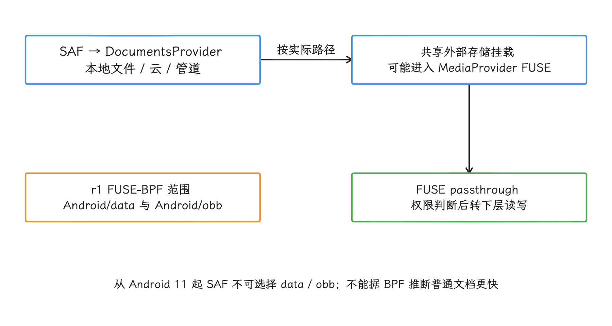

图：SAF 是文档访问协议，FUSE 是部分存储路径的实现。应用内部目录、云管道与共享挂载要分别判断。

### Android 17 的文档 API 变化

AndroidX DocumentFile 1.1.0 没有提供批量元数据、`Path` 转换或回收站封装。Android 17 的新增能力位于平台 `DocumentsContract` 和 `DocumentsProvider`，是否可用仍由 Provider 的列与标志位决定：

- `FLAG_SUPPORTS_TRASH`、`trashDocument()`；
- `FLAG_SUPPORTS_RESTORE`、`restoreDocumentFromTrash()`；
- `Root.FLAG_SUPPORTS_QUERY_TRASH`、`queryTrashDocuments()`；
- `COLUMN_CONTENT_SYNC_STATE_FLAGS`；
- `COLUMN_ORIGINAL_RELATIVE_PATH`，表示回收站文档原位置的相对路径；
- 本地可用、存在本地修改、上传或下载进行中、上传或下载失败等同步状态位；
- `Root.FLAG_LIMITED_FUNCTIONALITY_WHEN_OFFLINE`。

`Root.FLAG_LIMITED_FUNCTIONALITY_WHEN_OFFLINE` 告诉系统文件选择器：离线时，如果文档内容不在本机，打开、复制和移动等依赖内容的操作可能不可用。重命名和删除等不读取内容的操作不受这条规则影响。

客户端在 API 37 上仍要先检查 `COLUMN_FLAGS`。这个实现只在 Provider 声明回收站能力时调用 Android 17 API：

```kotlin
@RequiresApi(37)
fun trashIfSupported(
    resolver: ContentResolver,
    documentUri: Uri,
    flags: Int,
): Uri? {
    val supported =
        (flags and DocumentsContract.Document.FLAG_SUPPORTS_TRASH) != 0
    if (!supported) return null
    return DocumentsContract.trashDocument(resolver, documentUri)
}
```

文档进入回收站后，框架会撤销原文档 ID 对应的 URI 授权。Provider 返回的新 URI 可能使用不同的文档 ID；调用方要更新记录，并在访问失败时重新取得合适的授权，此后以新 URI 为准。

<!-- gracker-diagram: a261-11-trash-new-uri -->
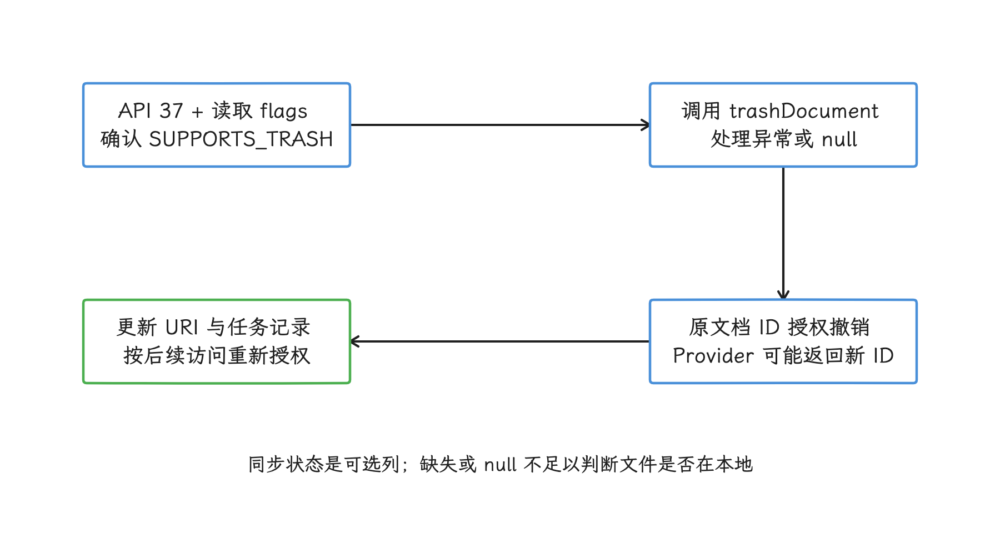

图：回收站能力由 Provider 声明；调用后以返回 URI 为准，同时处理旧授权撤销与访问失败。

云文档列表可以读取 `COLUMN_CONTENT_SYNC_STATE_FLAGS`，区分内容是否已在本机、是否存在待上传的本地修改、上传或下载是否正在进行，以及最近一次同步是否失败。这是可选列；缺失或 `null` 只说明 Provider 没有报告状态，文件是否在本机要另找依据。

#### `content://` 与 `java.nio.file.Path` 没有通用转换

`java.nio.file.Path` 表示某个文件系统中的路径。Android 没有公开契约可以把任意 `content://` URI 映射成 `Path`。取得支持随机访问的 `ParcelFileDescriptor` 后，可以用 `FileChannel` 操作该描述符；至于描述符本身，还原不出稳定的共享存储路径。

第三方库只接受 `Path` 时，可以选择：

- 如果库也支持文件描述符，直接传递文件描述符（fd），并约定由哪一方负责关闭；
- 把文档复制到应用内部临时文件，再传入 `Path`；
- 更换支持 `InputStream`、`OutputStream` 或 `SeekableByteChannel` 的库。

使用临时副本时，要检查可用空间，支持取消和清理，并检测源文档在编辑期间是否变化。这种兼容方案自带复制成本，算不上 URI 到路径的直接转换。

### 场景选型

| 场景 | 推荐入口 | 实现重点 |
| --- | --- | --- |
| 应用内部配置、索引、下载中间文件 | 内部 `File` / `Room` 数据库 | 原子替换、空间管理、避免在主线程读写 |
| 应用专属大文件 | `getExternalFilesDir()` + `File` | 卷状态、卸载清理、敏感数据风险 |
| 用户打开或保存 PDF、Office 文档 | `ACTION_OPEN_DOCUMENT` / `ACTION_CREATE_DOCUMENT` | 持久化 URI 授权、工作副本、保存失败恢复 |
| 用户选择一个目录进行同步 | `ACTION_OPEN_DOCUMENT_TREE` + `DocumentsContract` | 一次投影查询取得元数据、可恢复任务、Provider 差异 |
| 相册、视频库、音乐库 | MediaStore | 索引查询、世代号同步、缩略图、用户授权 |
| 用户选择少量图片或视频 | Photo Picker | 云项、持久化逐项授权、转码延迟 |
| 文件管理、备份恢复、杀毒等核心能力 | 通过权限与政策评估后的 `MANAGE_EXTERNAL_STORAGE` | Play 权限声明、最小化数据访问、仍不可访问其他应用的专属目录 |

这张表先按数据归属缩小选择范围，再依据 Provider 能力与实测结果决定具体实现。单纯为了减少几次查询，就把 SAF 换成访问范围更广的权限，这笔账并不划算。

#### 文档编辑器

远端文档或随机访问受限的文档，适合采用本地工作副本，并由用户明确触发保存：

1. 打开 URI，复制到内部临时文件。
2. 编辑期间只操作内部文件。
3. 保存前重新读取源元数据，检查是否被外部修改。
4. 写回目标 URI；确认 Provider 支持时使用会截断旧内容的写入模式。
5. 写回成功后更新基线元数据并删除临时文件。

修改时间和大小只够用来做冲突提示；需要严格判断内容是否相同，应用应保存内容摘要，或使用 Provider 提供的业务版本号。

#### 文件管理器

目录列表应直接查询 `DocumentsContract`，不要在 `RecyclerView` 绑定列表项时调用 `DocumentFile.getName()`、`length()` 或 `lastModified()`。复制和移动按钮是否可用由 `COLUMN_FLAGS` 决定；Provider 的原生复制或移动优先，应用侧流式复制作为兼容方案。

#### 云同步

WorkManager 负责按约束调度后台工作，不会替应用保存 URI 权限。任务入队前要持久化授权；输入数据只保存 URI 字符串和任务 ID，不把大量文件列表放入 `WorkRequest`。`Worker` 运行时重新查询目录，检查授权和网络条件，并根据每一项的状态记录恢复进度。

### 性能监控与基准

#### 分段记录运行时指标

不要只记录文件操作总耗时，至少按阶段记录：

| 指标 | 起止点 | 可帮助判断的问题 |
| --- | --- | --- |
| 查询延迟 | 调用 `query()` 到获得 `Cursor` | Provider 启动、数据库或远端查询 |
| 首行延迟 | 获得 `Cursor` 到 `moveToFirst()` | `CursorWindow` 填充、远端首批结果 |
| 枚举行数与耗时 | 开始遍历到关闭 `Cursor` | 结果规模、窗口补充、对象分配 |
| 打开延迟 | 发起打开调用到取得描述符或流 | 权限检查、身份认证、下载、转码 |
| 首字节延迟 | 打开返回到第一次成功读取 | 管道生产方、存储设备唤醒 |
| 持续吞吐 | 首字节后的字节数 / 有效读写时间 | 文件系统、网络、FUSE、复制实现 |
| 关闭与提交延迟 | 开始刷新或关闭到操作完成 | Provider 提交、远端上传、错误上报 |

每条指标至少带上 `authority`、MIME 类型、操作类型、文件大小区间、内容是否在本机、网络类型、Android 版本和设备型号。URI、显示名称和用户目录属于敏感信息，采集前应删除或散列可识别用户的部分。

<!-- gracker-diagram: a261-12-io-measurement-phases -->
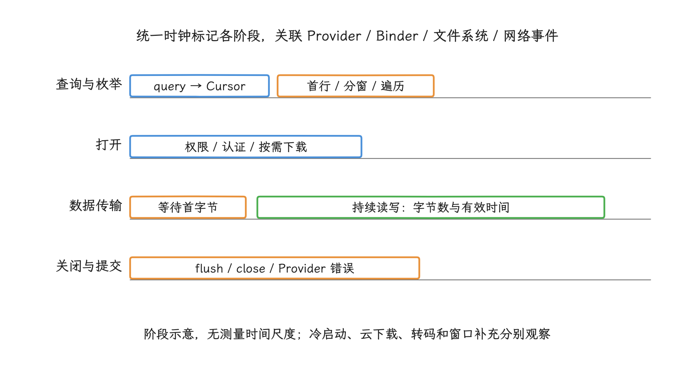

图：每项按 authority、内容是否本地、模式和设备分组；报告分布及错误率，不把单次测量写成平台常量。

#### StrictMode 和 Perfetto

StrictMode 是开发期的线程与资源违规检测工具。它的 `detectDiskReads()` 和 `detectDiskWrites()` 可以发现应用自身的主线程磁盘操作；远端 Provider 的耗时不一定表现为调用进程的磁盘违规，这部分我们交给 `Trace`：为查询、打开、首字节、复制和关闭分别记录时间片，便于在 Perfetto 中区分各阶段。

Perfetto 是 Android 的系统级追踪工具。分析记录时关注：

- 调用线程是否在主线程等待 Binder；
- Provider 进程是否冷启动、被调度延迟或等待数据库锁；
- FUSE 守护进程、文件系统和块设备 I/O 是否活跃；
- 云 Provider 是否在 Binder 调用中同步等待网络；
- 复制线程是否频繁小读写或被取消后仍继续运行。

`dumpsys activity providers` 可以确认某个 `authority` 对应的 Provider 进程。ADB 命令运行在 `shell` 用户身份下，不会继承应用通过选择器取得的 URI 授权；`adb shell content query` 失败，也代表不了应用进程内的同一访问会失败。

#### 基准测试维度

同一操作至少覆盖：

- 本机 Provider 与云 Provider；
- 冷启动与 Provider 已存活；
- 内容已在本地与需要下载；
- 小目录、大目录、深目录；
- 顺序读取、随机读取、写入和重命名；
- `DocumentFile` 便利调用与单次投影查询；
- Provider 支持与不支持原生复制；
- FUSE passthrough 可用与不可用的设备。

报告耗时分布和错误率，不把一台设备的一次测量结果写成 Android 平台常量。

### `MANAGE_EXTERNAL_STORAGE` 的边界

`MANAGE_EXTERNAL_STORAGE` 是 Android 11 引入的所有文件访问特殊权限。它只适用于以广泛文件访问为核心功能的应用，例如文件管理、备份恢复、杀毒、文档管理、设备迁移和设备内文件搜索。Google Play 要求应用提交权限声明并通过审核；媒体访问或让用户手动选择文件不属于获准理由。

取得该权限后，其他应用在 `Android/data` 中的专属目录依然在访问范围之外，云 SAF URI 也依然换不成路径。为了减少几次 Provider 查询而申请这项权限，只会无谓扩大数据访问范围，也偏离了普通性能优化的用途。

### 实施前检查

提交文件访问方案前，我们对照下面这张清单过一遍：

- 访问对象属于应用内部、共享媒体、用户文档还是云文档；
- URI 授权是否覆盖任务生命周期；
- 列表是否用一次投影查询取得所需字段；
- Provider 的查询参数和 `COLUMN_FLAGS` 是否已检查；
- 打开、首字节、持续吞吐和关闭是否分别计时；
- 代码是否兼容管道、未知长度和不可随机访问的描述符；
- 复制或移动失败是否可恢复，是否会留下部分目标；
- `ContentObserver` 是否只用于触发重查；
- Android 17 同步状态、回收站与恢复能力是否按可选字段和标志位处理；
- 日志和监控是否避免保存用户文件名与 URI。

## 全文小结

文件 I/O 优化先区分读取、写入、解析、锁等待和持久化同步，再把不可预测的磁盘等待移出主线程。SharedPreferences、DataStore、MMKV 与普通文件分别提供不同的一致性和恢复语义；选择时要以数据规模、进程边界和持久化要求为准。

进入 SAF 与 `ContentResolver` 后，还要把查询、打开、首字节、持续传输和关闭提交分段测量。URI 不是文件路径，Provider 能力也不是平台常量；批量元数据、文件描述符传输、取消和失败恢复都应按目标 `authority` 的真实行为验收。

## 参考资料

- [Android 共享文档与 SAF 指南](https://developer.android.com/training/data-storage/shared/documents-files)
- [`DocumentFile` API 与性能说明](https://developer.android.com/reference/androidx/documentfile/provider/DocumentFile)
- [AndroidX DocumentFile 1.1.0 发布说明](https://developer.android.com/jetpack/androidx/releases/documentfile)
- [`ContentResolver` API](https://developer.android.com/reference/android/content/ContentResolver)
- [`DocumentsContract` API](https://developer.android.com/reference/android/provider/DocumentsContract)
- [`MediaStore` API](https://developer.android.com/reference/android/provider/MediaStore)
- [共享存储中的媒体访问指南](https://developer.android.com/training/data-storage/shared/media)
- [Photo Picker 指南](https://developer.android.com/training/data-storage/shared/photo-picker)
- [`ActivityResultContracts.PickVisualMedia` API](https://developer.android.com/reference/androidx/activity/result/contract/ActivityResultContracts.PickVisualMedia)
- [Scoped Storage 实现说明](https://source.android.com/docs/core/storage/scoped)
- [FUSE passthrough](https://source.android.com/docs/core/storage/fuse-passthrough)
- [Google Play 的 All files access 政策](https://support.google.com/googleplay/android-developer/answer/10467955)
- [Android 的所有文件访问说明](https://developer.android.com/training/data-storage/manage-all-files)
- [Android 17 `DocumentsContract.java`](https://android.googlesource.com/platform/frameworks/base/+/refs/tags/android-17.0.0_r1/core/java/android/provider/DocumentsContract.java)
- [Android 17 `DocumentsProvider.java`](https://android.googlesource.com/platform/frameworks/base/+/refs/tags/android-17.0.0_r1/core/java/android/provider/DocumentsProvider.java)
- [Android 17 `FuseDaemon.cpp`](https://android.googlesource.com/platform/packages/providers/MediaProvider/+/refs/tags/android-17.0.0_r1/jni/FuseDaemon.cpp)
