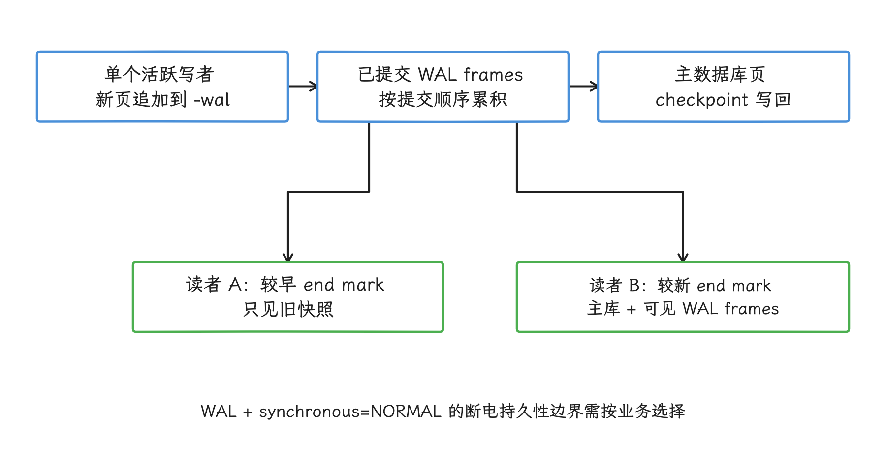
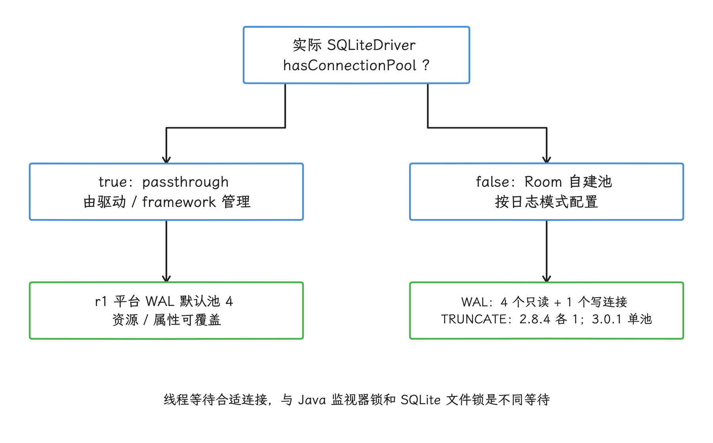
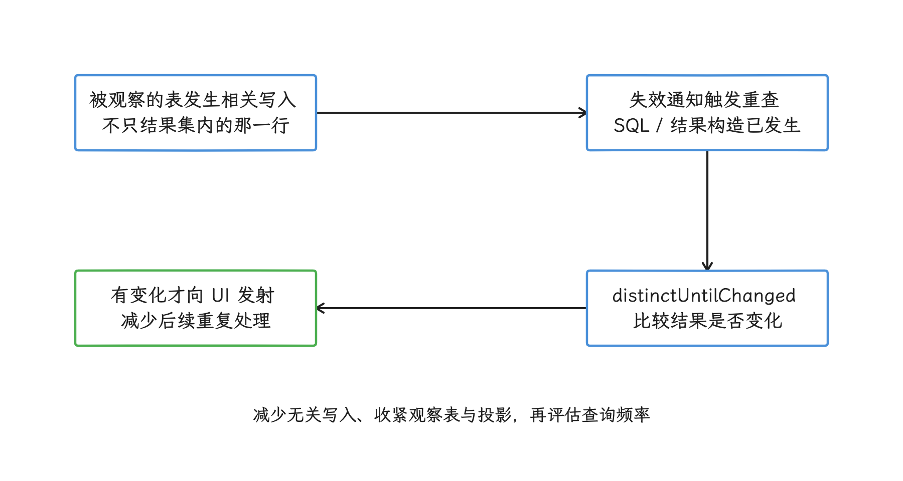
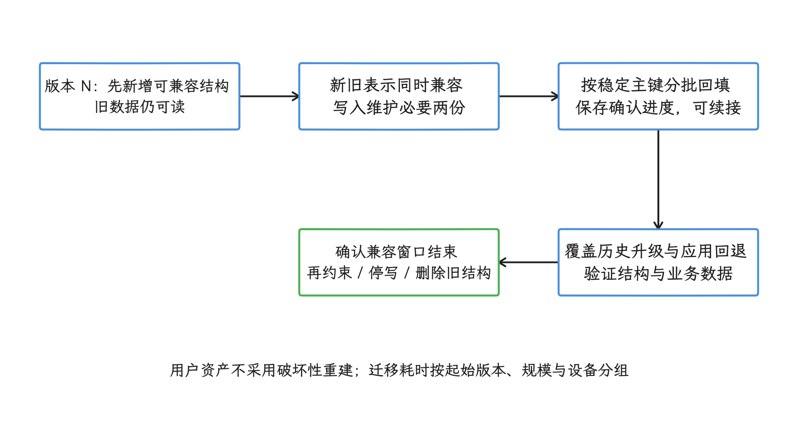
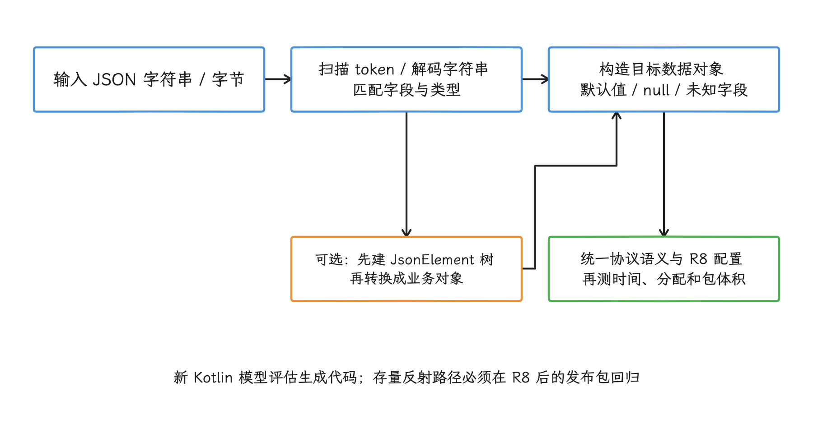

# 数据库与序列化性能

数据持久化链路上的每一环都有成本：对象序列化、数据库事务、索引查询、结果反序列化。我们排查“数据库慢”时，SQL 本身往往只是嫌疑之一，格式转换、对象分配和主线程等待占掉主要时间的情况同样常见。

## 事务、索引、查询计划与并发

### 数据库性能问题的等待位置

> 源码基线：AOSP `android-17.0.0_r1`，Android 17 / API 37；涉及 WAL 同步与文件持久性时，内核基线为 `android17-6.18-2026-06_r6`，见 [24.1 文件 I/O、SAF 与 ContentResolver 性能](01-file-io-saf-contentresolver.md)。Room 是独立发布的 AndroidX 组件，行为以项目锁定的 Room 版本为准。 本文的实现细节固定到 Room 2.8.4、Room 3.0.1 与 SQLite 2.7.0 的源码包，不表示最新发布版本。2026-10-25 核对，当前稳定版分别为 [Room 2.8.5](https://developer.android.com/jetpack/androidx/releases/room)、[Room 3.0.3](https://developer.android.com/jetpack/androidx/releases/room3) 和 [SQLite 2.7.1](https://developer.android.com/jetpack/androidx/releases/sqlite)；升级后应重新核对实现与基线。

数据库慢不一定表现为 CPU 满载，也可能停在等待路径：主线程等查询返回，工作线程排队等连接，首次打开被 Migration（数据库迁移）拖长，或者列表滚动时 `CursorWindow`（承载查询结果的内存窗口）反复重填。落到 Perfetto 和线程栈上，常见的名字是 `SQLiteConnectionPool.waitForConnection()`、`SQLiteSession.executeForCursorWindow()`、Room 生成的 DAO（Data Access Object，数据访问对象） 代码，以及 `ContentResolver.query()` 的 Binder 跨进程等待。

我们排查的第一步，是确认线程停在哪一种等待上：执行 SQL、等连接、等 Binder，还是等数据库首次打开。位置确定后，再结合 SQLite 并发、`CursorWindow`（分段保存查询结果的内存窗口）、Room 执行模型和 ANR 现场决定动什么——日志模式、查询、索引、事务或迁移。

### SQLite WAL 模式与并发优化

回滚日志模式的思路，是先把旧内容保存下来再修改主库页；提交阶段需要取得排他锁时，读写访问可能相互等待。WAL（Write-Ahead Logging，预写式日志）换了一个方向：新页追加进 `-wal` 文件。读事务记下自己的 end mark（当前快照可见的 WAL 终点），再用主库加上该位置之前的 WAL frame（记录一次数据库页变更的帧）拼出一致快照；读者还在读旧快照时，写者可以继续追加。两种模式都只有一个活跃写者——WAL 给的是读写并发，写入始终是串行的。

<!-- gracker-diagram: a262-01-wal-snapshot -->


图：读者按各自 end mark 读取一致快照，写者继续追加；增加读连接不会增加同库并行写者。

Android 官方性能文档的建议是：除 `ATTACH DATABASE` 场景外启用 WAL，并在 WAL 下使用 `synchronous=NORMAL`。代价在持久性上：应用进程崩溃后事务仍可恢复，但设备断电或内核崩溃可能回滚已经返回成功的事务。订单、支付或跨库依赖这类场景，我们先把这一点的优先级放到吞吐量前面，再选同步级别。

#### Android 9 的 Compatibility WAL 到 Android 17 的变化

Android 9 引入 Compatibility WAL 时，[官方历史文档](https://source.android.com/docs/core/perf/compatibility-wal)描述的是“WAL 日志模式 + 每库最多一个连接”。到 Android 17 源码里，这个连接数结论已经不再成立：

- `SQLiteCompatibilityWalFlags` 从 `Settings.Global.SQLITE_COMPATIBILITY_WAL_FLAGS` 读取 `legacy_compatibility_wal_enabled`；
- 只有应用没有显式指定日志/同步模式（`journal/sync mode`）时，旧兼容开关（`legacy compatibility flag`）才生效；
- `SQLiteDatabaseConfiguration.resolveJournalMode()` 会把它解析成 WAL；
- `SQLiteConnectionPool` 看到解析结果为 WAL 后，使用 `SQLiteGlobal.getWALConnectionPoolSize()`，而 `android-17.0.0_r1` 的资源默认值是 4，厂商和调试属性仍可覆盖。

所以“Compatibility WAL 永远单连接”只适用于 Android 9 的历史说明。调查 Android 17 设备时，我们直接读当前连接池的诊断输出和生效配置，不按旧文档猜连接数。这个全局兼容开关属于平台内部配置，应用可依赖的做法，是通过实际使用的数据库 API 明确选择日志模式。

[源码锚点：[`SQLiteCompatibilityWalFlags.java`](https://android.googlesource.com/platform/frameworks/base/+/refs/tags/android-17.0.0_r1/core/java/android/database/sqlite/SQLiteCompatibilityWalFlags.java)、[`SQLiteDatabaseConfiguration.java`](https://android.googlesource.com/platform/frameworks/base/+/refs/tags/android-17.0.0_r1/core/java/android/database/sqlite/SQLiteDatabaseConfiguration.java)、[`SQLiteConnectionPool.java`](https://android.googlesource.com/platform/frameworks/base/+/refs/tags/android-17.0.0_r1/core/java/android/database/sqlite/SQLiteConnectionPool.java)]

#### Android 17 的 WAL 默认参数

在 `android-17.0.0_r1` 中：

| 参数 | AOSP 默认值 | 含义 |
| --- | ---: | --- |
| `db_wal_sync_mode` | `NORMAL` | WAL 连接默认同步模式 |
| `db_wal_autocheckpoint` | 100 | 自动 checkpoint 阈值，单位是数据库页 |
| `db_connection_pool_size` | 4 | framework WAL 连接池资源默认值 |

把这些当作 AOSP 资源默认值就好：系统属性、资源覆盖、应用显式配置和 AndroidX 驱动都可能改写它们，Room 驱动路径另有自己的数值。100 页也只是页数，换算内存前要先查这个库的 `PRAGMA page_size`。

[源码锚点：[`SQLiteGlobal.java`](https://android.googlesource.com/platform/frameworks/base/+/refs/tags/android-17.0.0_r1/core/java/android/database/sqlite/SQLiteGlobal.java)、[`config.xml`](https://android.googlesource.com/platform/frameworks/base/+/refs/tags/android-17.0.0_r1/core/res/res/values/config.xml)]

#### Checkpoint（检查点）、长读事务与生效值

checkpoint 负责把已提交的 WAL frame 写回主库，`PASSIVE` checkpoint 可以推进到活跃读事务允许的位置；持有较老 end mark 的长读事务会让它提前停下，而后续写入还在继续追加，`-wal` 文件于是可能持续增长。要止住这种增长，先得找到迟迟不结束的读事务或仍持有活动语句的连接，调小自动 checkpoint 阈值结束不了它们。Cursor 对象长期存在本身不是证据：framework 的 [SQLiteSession.executeForCursorWindow()](https://android.googlesource.com/platform/frameworks/base/+/refs/tags/android-17.0.0_r1/core/java/android/database/sqlite/SQLiteSession.java)在填窗后会走 `finally` 释放本次连接使用，是否仍持有事务还取决于外层事务和实际驱动。

```sql
PRAGMA journal_mode;
PRAGMA page_size;
PRAGMA wal_autocheckpoint;
PRAGMA wal_checkpoint(PASSIVE);
```

`wal_checkpoint` 返回三列：第一列表示调用是否遇到阻止完成的 busy 情况，后两列分别为 WAL frame 总数与已写回主库的 frame 数。**`PASSIVE` 不等待所有读者，第一列为 `0` 也可能没有全部写回**；FULL、RESTART 或 TRUNCATE 被阻止完成时才可能以第一列 `1` 报告 busy。没有 WAL 时后两列可能为 `-1`。因此后两列长期拉开时，要结合长读事务、写入批次和 checkpoint 时机判断，不能只看第一列（[SQLite PRAGMA 契约](https://sqlite.org/pragma.html#pragma_wal_checkpoint)）。普通 checkpoint 使用 WAL 相关锁和读标记协调，并非先取得主库 EXCLUSIVE 锁；日志模式切换、恢复或截断的加锁路径应另行核对。


#### Room 怎样选择日志模式

判断 Room 2.8.4 的日志模式，我们先要分清看的是哪个 `source set`（Kotlin Multiplatform 按目标平台区分的源码集合）。Android `actual` 实现有 `AUTOMATIC`、`TRUNCATE` 和 `WRITE_AHEAD_LOGGING` 三档，Builder 默认 `AUTOMATIC`：普通设备解析为 WAL，低内存设备解析为 `TRUNCATE`。common/KMP（Kotlin Multiplatform）声明只有后两项，Builder 默认 WAL。官网聚合 API 可能把不同 `source set` 的说明混在一起，所以 Android 项目核对 `RoomDatabase.android.kt`，KMP 或自定义驱动项目核对实际目标和依赖源码。

下面这段配置展示一个可审计的 Room 打开入口：日志模式和 Migration（数据库结构迁移） 都在同一个 builder 里明确声明；执行器先保留 Room 默认值，等追踪结果证明默认调度不合适，再自定义。

```kotlin
val database = Room.databaseBuilder(
    context.applicationContext,
    AppDatabase::class.java,
    "app.db"
)
    .setJournalMode(RoomDatabase.JournalMode.AUTOMATIC)
    .addMigrations(MIGRATION_7_8, MIGRATION_8_9)
    .build()
```

注意这段代码并未保证启用 WAL，低内存设备拿到的可能是 `TRUNCATE`。若自定义执行器，Room 文档的要求是：查询执行器有线程上限、避开主线程；事务最多同时执行一个；共享事务执行器还要遵守文档中的死锁约束。固定线程数不要原样复制到所有应用。

使用 Room 3 / `SQLiteDriver`（连接具体 SQLite 引擎的接口）的项目，framework `SQLiteConnectionPool` 的连接数和 `CursorWindow` 结论要重新验证——驱动换掉了 Room 使用的 SQLite 实现与数据传递路径。具体差异见 [Room 3 与 SQLiteDriver（Room 连接具体 SQLite 引擎的驱动接口） 迁移边界](#room-3-与-sqlitedriver-迁移边界)。

#### Session、连接池与等待对象

Android framework 的 `SQLiteDatabase` 为每个线程保存一个 `SQLiteSession`。Session 只维护事务与连接使用状态，执行语句时仍要向 `SQLiteConnectionPool` 申请连接。线程停在 `waitForConnection()`，表示它在等一个符合要求的连接；这一停顿与保护连接池状态的 Java 对象监视器锁是两回事。

WAL 下，平台池用非主连接服务只读工作，写事务通常走主连接——所以增加只读连接并不会增加 SQLite 的写连接数量。Room 2.8.4 的默认 SupportSQLite 兼容路径使用 passthrough pool（只转交连接请求、不自行管理物理连接的池），物理连接仍由 Android framework 管理；驱动本身没有连接池时，`RoomConnectionManager` 才自建池，把 WAL 映射为最多 4 个只读连接加 1 个写连接，`TRUNCATE` 下各 1 个。

这些数字属于特定路径的当前实现，随时可能变化。看到连接等待，我们排的顺序是：先查长事务、耗时过长的读取、未关闭资源、写入队列和首次打开，最后才考虑扩池。

<!-- gracker-diagram: a262-03-connection-pool-path -->


图：先确认驱动、source set 和生效日志模式，再解释连接等待；长事务与慢查询优先于扩池。

2026-10-25 核对[SQLite WAL 文档](https://sqlite.org/wal.html#the_wal_reset_bug)，上游还记录了多连接同时写入与 checkpoint 特定竞态下可能造成损坏的 WAL-reset bug。修复进入 SQLite 3.51.3 及以后版本，并回移到 3.44.6、3.50.7 等分支。部署前应核对实际引擎及厂商补丁；不能只凭 Android API、Room 版本或连接池数量认定已修复，也不能假定所有较旧分支都未回移补丁。

WAL 的应用侧检查项：

- 在目标设备读取实际生效的日志/同步模式，Builder 选项只是意图，运行结果以设备为准。
- 如果使用 `ATTACH DATABASE`，重新评估 WAL——官方文档把 `ATTACH DATABASE` 列为启用 WAL 的例外条件。
- 大事务后观察 `-wal` 文件增长、读事务持续时间和 checkpoint 耗时；长读事务可能阻止 checkpoint 推进。
- 首次打开数据库避开主线程：首次打开可能触发模式校验、Migration、预置库复制或 checkpoint。
- 连接池等待先查长事务、慢查询和连接持有者，再考虑改变池大小。

[官方文档：[SQLite 性能建议](https://developer.android.com/topic/performance/sqlite-performance-best-practices)、[`RoomDatabase.JournalMode`](https://developer.android.com/reference/androidx/room/RoomDatabase.JournalMode)、[SQLite WAL](https://sqlite.org/wal.html)]

### Room 执行模型与常见性能问题

Room 提供编译期 SQL 校验、DAO 生成、迁移管理和异步 API 适配，这些便利都不会自动降低 SQL、连接等待和事务提交本身的成本。`allowMainThreadQueries()` 只关闭主线程保护，查询耗时原封不动；它可以用于受控测试，发布配置里则要避免出现。

Room 的性能问题集中在四类位置：同步 DAO 被界面路径调用、首次打开落在启动主线程、事务范围过大，以及可观察查询在表失效后反复执行。

DAO 方法按执行模型分开设计：

| DAO 形态 | 执行位置 | 使用场景 | 风险 |
| --- | --- | --- | --- |
| 普通同步方法 | 调用线程 | 测试、极少量工具代码 | UI 线程调用会被 Room 拦截；关闭拦截后会卡 UI |
| `suspend` 方法 | Room 异步执行机制 | 单次读写、批量写入 | 事务范围过大会长期占用连接 |
| `Flow`（异步数据流） | 观察表失效后重新查询 | UI 订阅数据变化 | 表中任意行变化都可能触发重查 |
| `PagingSource`（分页数据源） | 分页列表 | 大列表、离线缓存 | 深 offset（跳过大量前置行）仍可能扫描许多行，游标分页需按查询设计 |

Room 2.8.4 另外提供显式连接入口：`useReaderConnection()` 与 `useWriterConnection()` 让调用方直接申请读连接或写连接；`suspend` DAO 通过 Room 的协程上下文申请连接，`Flow` 在开始收集后才查询。Android 兼容路径仍保留 `queryExecutor` / `transactionExecutor`，驱动路径和 common/KMP 路径要另行分析。排障时以项目实际 `source set`、驱动、生成代码和 `sources.jar`（依赖附带的源码包）为准。

下面的 DAO 演示列表查询与详情查询的分工：列表只取渲染所需的列（投影），正文等大字段留给详情查询；调用方还要限制 `limit` 的合法范围。

```kotlin
data class MessageRow(
    val id: Long,
    val conversationId: Long,
    val senderName: String,
    val preview: String,
    val sentAt: Long
)

@Dao
interface MessageDao {
    @Query(
        """
        SELECT id, conversation_id AS conversationId, sender_name AS senderName,
               preview, sent_at AS sentAt
        FROM messages
        WHERE conversation_id = :conversationId
        ORDER BY sent_at DESC
        LIMIT :limit
        """
    )
    suspend fun latestRows(conversationId: Long, limit: Int): List<MessageRow>

    @Query("SELECT * FROM messages WHERE id = :id")
    suspend fun detail(id: Long): MessageEntity?
}
```

在 framework SQLite 驱动下，少读列能直接降低 `CursorWindow` 填充、跨 JNI（Java Native Interface，Java 与原生代码的调用接口） 复制和对象构造成本；换用其他 AndroidX SQLite 驱动后，保存查询结果的数据结构可能不同，但“少读行、少读列”始终成立。过滤、排序和聚合也尽量交给 SQL 完成。

可观察查询按“引用到的表”失效，与结果集里的具体行无关。表内任意相关写入都可能让查询重跑；`distinctUntilChanged()` 能减少相同结果向下游发射，已经发生的 SQL 查询省不掉。高频更新的表，要么拆小观察范围，要么减少无关写入。

<!-- gracker-diagram: a262-04-flow-invalidation -->


图：distinctUntilChanged 减少相同结果的下游发射，省不掉已经发生的 SQL 与对象构造。

事务范围画在不可分割的数据变更上：批量插入、删除和状态切换适合放进一个事务，网络请求、文件读取和复杂计算留在事务外。同一个 RoomDatabase 的 `withTransaction` 等写事务入口会串行调度；事务内等待外部工作，会让后续写事务持续排队，需要连接的查询也可能被拖住。这不等于 WAL 下所有只读事务都不能并行，实际读写连接与作用域仍由所用驱动和连接池决定。

下面的代码展示批量替换的事务范围。传入的 `rows` 应在进入事务前完成网络读取、解码和业务校验。

```kotlin
class MessageRepository(
    private val database: AppDatabase,
    private val dao: MessageDao
) {
    suspend fun replaceConversationMessages(
        conversationId: Long,
        rows: List<MessageEntity>
    ) {
        database.withTransaction {
            dao.deleteByConversation(conversationId)
            dao.insertAll(rows)
        }
    }
}
```

事务保证删除与插入要么一起成功、要么一起回滚，还顺带减少了多次独立提交。代价是写连接在整个事务期间被占用，批次大小因此要用真实数据量和尾延迟（第 95/99 百分位耗时，即 95%/99% 的请求耗时不超过对应数值）验证。

要让生产环境里的 Room 问题可定位，我们还需要记录这些信息：

- Room `QueryCallback` 会为每条查询增加回调成本，且回调本身只给出 SQL 与绑定参数，执行耗时要在 DAO/仓库层或 Perfetto 中另行测量。若做短期受控采样，先去除字面参数，再对 SQL 计算散列值（hash，用于归并相同语句）并记录线程，原始参数不上传。
- 记录首次打开和 Migration 耗时，把它们和冷启动、首屏、ContentProvider 初始化分开统计。
- 对高频 Flow 查询统计重查次数。某张表每秒多次更新时，观察者可能被重复触发。
- 记录连接池等待栈。Perfetto 里看到 `waitForConnection()` 时，要能反查当前持有写连接的任务。

Android 17 的 `dumpsys meminfo <package>` 在 `DATABASES` 和 `POOL STATS` 中提供 SQLite 页、连接与语句缓存统计。该版本的单连接行与池汇总行中，`cache size` 都表示当前缓存的预编译语句数量。Android 16 的单连接行也是这个含义，但 `POOL STATS` 中的同名列是累计 prepare 次数，也就是命中与未命中之和；跨版本监控要按行类型和平台版本解释字段。

#### CursorWindow 与窗口重填

framework 驱动下，`SQLiteCursor` 不要求一次把全部结果装进内存。目标行离开现有窗口时，`SQLiteCursor.onMove()` 经 `fillWindow()`、`SQLiteQuery.fillWindow()` 进入 `SQLiteSession.executeForCursorWindow()`，大结果集于是在 trace（可在 Perfetto 时间轴上定位的事件区间） 里可能表现为多轮 SQL 步进与窗口重填。窗口容量取 Android 17 的系统资源默认值 2048 KB；OEM 资源覆盖和显式构造仍可能改变它。

窗口装得下多行，未必装得下任意大的单行。单行文本或 BLOB（二进制大对象）放不进窗口时，减少总行数没有帮助，该做的是缩小这一行的宽度、收紧投影列集合。窗口创建成功、滚动时却不断跨出窗口重填，则要减少结果宽度、改进分页，并在 trace 里统计 refill（窗口重新填充） 次数——先别急着放大窗口。调用方还应及时关闭 Cursor，给允许取消的查询传入 `CancellationSignal`。

ContentProvider 跨进程返回 Cursor 时，Provider 侧的 `CursorToBulkCursorAdaptor` 按位置获取或重新填充窗口。原生函数 `CursorWindow::writeToParcel()` 会为基于 ashmem（匿名共享内存）的窗口传递一份文件描述符副本；没有 ashmem（anonymous shared memory，匿名共享内存） FD（file descriptor，文件描述符） 时，则按已用容量把数据写进 Parcel（Binder 传输的数据容器）。所以 `TransactionTooLargeException`、单行过宽和窗口反复填充是三类不同的问题，都归因到“2 MB Binder 限制”会把三类问题混成一类。


#### 从 ANR 还原数据库等待

拿到数据库 ANR，我们按线程停点依次缩小范围：

1. 主线程直接进入生成 DAO 或 `executeForCursorWindow()`：检查首次打开、SQL 计划、返回行数与投影列集合。
2. 线程停在 `waitForConnection()`：寻找持有读连接或写连接的线程、事务起止和未关闭资源。
3. 客户端停在 `ContentResolver.query()` 的 Binder 响应：转到 Provider 进程，追踪同一事务的 SQL、Migration 或连接等待。
4. 写连接遇到 `SQLITE_BUSY` / `SQLITE_LOCKED`：结合另一连接或进程的事务、WAL 与 checkpoint 时间判断锁的来源。
5. Cursor 移动时卡住：确认是否跨窗口触发重新填充，以及 Provider 端是否重新执行或继续步进 SQL。

`StrictMode.detectDiskReads()` / `detectDiskWrites()` 能提前暴露主线程磁盘访问，发现不了“主线程等待后台数据库”的所有间接路径；Perfetto 的 Java 对象锁竞争也看不见 SQLite 文件锁、WAL 共享内存锁或 `waitForConnection()` 里的线程挂起等待。下结论时至少保存 trace 时间戳、SQL、查询计划、数据库与 Room 版本、日志模式、数据库页大小和数据规模。

[官方文档：[异步 DAO 查询](https://developer.android.com/training/data-storage/room/async-queries)、[`RoomDatabase.Builder`](https://developer.android.com/reference/androidx/room/RoomDatabase.Builder)、[SQLite 性能排查工具](https://developer.android.com/topic/performance/sqlite-performance-best-practices)]

### 索引设计与查询优化

索引跟着查询形状和数据分布走：查询形状指过滤、排序、分组用到哪些列、按什么顺序。查询同时按 `conversation_id` 等值过滤、按 `sent_at` 排序时，两个互不相关的单列索引通常只有一个能派上用场，过滤与排序难以同时完成。`EXPLAIN QUERY PLAN` 能显示 `SCAN`、`SEARCH`、`USING INDEX` 和 `USING COVERING INDEX` 等策略，输出格式则不属于稳定的应用接口。

下面的 Room 实体展示与前述查询配套的复合索引：等值过滤列放在索引前缀，排序列跟在后面；SQLite 支持反向扫描 B-tree（按键有序组织数据的树形索引），所以同一索引也能服务 `sent_at DESC`。

```kotlin
@Entity(
    tableName = "messages",
    indices = [
        Index(
            value = ["conversation_id", "sent_at"],
            name = "idx_messages_conversation_sent_at"
        ),
        Index(
            value = ["server_id"],
            unique = true,
            name = "idx_messages_server_id_unique"
        )
    ]
)
data class MessageEntity(
    @PrimaryKey(autoGenerate = true) val id: Long = 0,
    @ColumnInfo(name = "conversation_id") val conversationId: Long,
    @ColumnInfo(name = "server_id") val serverId: String,
    @ColumnInfo(name = "sender_name") val senderName: String,
    val preview: String,
    @ColumnInfo(name = "sent_at") val sentAt: Long,
    val body: String
)
```

`conversation_id, sent_at` 适合“某个会话内按时间取消息”的查询。`server_id` 的唯一索引让数据库执行唯一性约束。每个索引都会占用空间并增加插入、更新和删除成本，因此要用查询记录确认它确实被用到。

索引和查询优化按这张清单检查：

| 检查项 | 做法 | 目标 |
| --- | --- | --- |
| 只读必要列 | 列表页使用 DTO（Data Transfer Object，数据传输对象）投影，详情页再读全文 | 降低 CursorWindow 与对象构造成本 |
| 只读必要行 | 加 `LIMIT`，分页查询不要一次取全量 | 控制单次查询时间和内存占用 |
| 把计算交给 SQL | 过滤、排序、计数、去重用 SQL 表达 | 避免把大量行搬到 Kotlin/Java 后再处理 |
| 复合索引匹配查询形状 | 结合等值、范围、排序和选择性决定列顺序 | 减少无关行访问和临时排序 |
| 批量写入进事务 | 多条插入、更新或删除合并提交 | 减少独立提交，但控制事务时长 |
| 清理无效索引 | 用生产环境中的 SQL 采样和 `EXPLAIN QUERY PLAN` 反查 | 降低写入维护成本 |

下面的 SQL 用于在接近真实分布的本地数据库上检查查询计划。预期能按 `conversation_id` 搜索复合索引，并利用索引顺序返回时间序结果。

```sql
EXPLAIN QUERY PLAN
SELECT id, conversation_id, sender_name, preview, sent_at
FROM messages
WHERE conversation_id = 42
ORDER BY sent_at DESC
LIMIT 50;
```

输出里出现 `SCAN`，我们先结合被扫描的对象判断：小表扫描、覆盖索引扫描或统计信息变化都可能让扫描成为合理选择。同时检查扫描对象、临时 B-tree、返回行数和实际耗时；空库或均匀小样本代表不了线上的偏斜分布。

查询回归可以进 CI（Continuous Integration，持续集成）：为关键 DAO 准备有代表性的规模与分布，验证结果正确性、索引是否存在，并对明显的计划退化和耗时变化报警。断言完整的 `EXPLAIN QUERY PLAN` 文本不可取——SQLite 明确表示不保证该输出格式跨版本稳定。

#### Paging 的 OFFSET 与基于排序键的分页

Room 2.8.4 的 `LimitOffsetPagingSource` 包装 DAO 原查询并使用 `LIMIT ... OFFSET ...`。Paging 负责加载、刷新、预取和失效通知；读深页时，SQLite 仍要扫描并跳过前面的行，投影里的正文或 BLOB 也照样写入查询结果。

列表有稳定的复合排序键时，可以在 DAO 里显式提供基于排序键的查询——以上一页末行的排序键作为下一页边界，也就是 `keyset` 分页：

```sql
SELECT id, conversation_id, sent_at, preview
FROM messages
WHERE conversation_id = :conversationId
  AND (
      sent_at < :cursorSentAt
      OR (sent_at = :cursorSentAt AND id < :cursorId)
  )
ORDER BY sent_at DESC, id DESC
LIMIT :limit;
```

对应索引应覆盖 `conversation_id, sent_at, id` 的过滤与排序顺序。基于排序键的分页绕开了深 OFFSET，按页码任意跳转则不再支持；刷新锚点（`refresh anchor`，刷新时重新加载的位置）、数据插入和相同时间值都要按业务语义处理。


#### `WITHOUT ROWID` 与 PRAGMA 的生效范围

普通表的 `INTEGER PRIMARY KEY` 已是 rowid 别名。`WITHOUT ROWID` 更适合较短的非整数或复合主键、查询频繁沿主键访问的表；它不支持 `AUTOINCREMENT`，大主键还会复制进二级索引。迁移前用真实数据比较库大小与读写耗时，它当不了通用的省空间开关。

PRAGMA 同时包含持久状态与每连接状态。`journal_mode`、`synchronous`、`wal_autocheckpoint`、`busy_timeout`、`cache_size` 和 `page_size` 的生效范围各不相同；Room 或平台连接池建了多个连接后，在一个临时连接上执行 per-connection PRAGMA（仅对当前连接生效的配置），改到的只有这个连接，其余连接维持原样。配置统一下发要走受支持的 Builder、驱动或数据库打开回调，并逐连接验证。`busy_timeout` 只是把锁冲突改成等待，长事务还在那里；UI 或 Binder 路径上的快速失败，被它改写后可能变成长卡顿。

[SQLite 文档：[`EXPLAIN QUERY PLAN`](https://sqlite.org/eqp.html)、[Query Planner](https://sqlite.org/queryplanner.html)、[`WITHOUT ROWID`](https://sqlite.org/withoutrowid.html)]

### 调度、多进程与加密数据库

SQLite 在同一数据库上同一时间只允许一个写事务，这项约束不替应用安排业务写入的先后顺序和优先级。高频写入可以先进入一个有容量上限的队列；队列接近满载时，让生产者减速或拒绝新任务，这就是背压。若同一对象的旧状态可由较新状态覆盖，等待中的更新还可以合并。

事务只包住不可分割的数据变更，网络、结果不确定的回调或无关锁都等在事务外面。

读连接数同样要看目标设备：吞吐、P95/P99 延迟、I/O 和数据库页缓存一起决定上限；盲目同时启动更多读连接，可能只是让多次大表扫描一起争用存储。

多个进程打开同一数据库文件时，日志模式（例如 WAL）、数据库结构版本（`schema version`）和连接配置必须一致，SQLite 文件锁与 WAL 负责数据库级协调。Room 的多实例失效通知（`multi-instance invalidation`）只告诉其他数据库实例“哪些表发生了变化”；跨进程事务它不提供，不同进程写入的先后顺序它也不规定。高频写入宜交给一个职责明确的进程统一接收；数据库迁移、备份、恢复和清库同样只能有一个协调者。

客户端线程停在 Binder 调用时，要同时采集实际访问数据库的 ContentProvider 所在进程，只看调用端调用栈会漏掉真正干活的一方。

SQLCipher 会在数据库打开、密钥派生和数据页读写路径上增加工作，代价取决于 SQLCipher 版本、加密页大小（`cipher_page_size`）、密钥派生函数（KDF，Key Derivation Function）参数、硬件、短期频繁访问的数据页、页缓存与索引，套用固定百分比得不出结论。对比实验至少覆盖冷打开、热查询、批量事务、WAL 检查点、数据库迁移和低端设备，持久性配置保持相同。Android Keystore 可以保护或封装密钥材料；数据库页面是否透明加密，仍由 SQLCipher 这类数据库实现负责。

### 数据库迁移与版本管理

Room 第一次打开数据库时会校验结构，并按版本之间的升级路径执行自动或手写 `Migration`。自动迁移适合 Room 能明确推导的简单改动；重命名、删除、拆表、合表和数据转换通常要 `AutoMigrationSpec`（为自动迁移补充重命名、删除等信息的规范类）或手写 `Migration`。导出的数据库结构 JSON 一举两得：既用于生成自动迁移，也让 `MigrationTestHelper` 能创建历史版本数据库。

迁移设计分三层：

- 数据库结构改动：新增表、列、索引或视图，SQL 必须与导出的目标结构一致。
- 数据转换：能在短事务内完成的小规模转换随 `Migration` 执行；大表转换让新旧结构先共存一段时间，再由后台任务分批把旧数据补写到新结构。这类后台回填必须能在中断后继续；未完成的新结构，也要继续对只理解旧结构的代码隐藏。
- 发布策略：只有明确可重建的数据才允许破坏性重建，用户资产库必须提供完整迁移路径。

遇到大表转换，我们可以跨两个应用版本完成。版本 N——这里指任意一个起始版本——先增加可空的新列或新表，新代码同时兼容新旧数据表示，写入时维护两份表示；后台任务按稳定主键分批回填，记录最近处理完的主键等进度位置，进程被终止后从已确认的位置继续。回填期间的读取必须能识别“新表示尚未生成”，空值不该被当成业务结果。等监控确认所有受支持版本的回填完成，后续版本再增加非空约束、停止写旧表示并删除旧列或旧表。若仍需支持从更早版本直接升级，迁移路径和读取逻辑也要覆盖这种情况。

下面的 Migration 只新增带默认值的列和索引。它展示的是明确的 8→9 升级路径，对任意大小的 `messages` 表未必够快。

```kotlin
val MIGRATION_8_9 = object : Migration(8, 9) {
    override fun migrate(db: SupportSQLiteDatabase) {
        db.execSQL(
            "ALTER TABLE messages " +
                "ADD COLUMN sync_state INTEGER NOT NULL DEFAULT 0"
        )
        db.execSQL(
            """
            CREATE INDEX IF NOT EXISTS idx_messages_sync_state_sent_at
            ON messages(sync_state, sent_at)
            """.trimIndent()
        )
    }
}
```

创建索引和重建表都可能扫描或重写大量数据。把首次开放给工作线程，避免的只是主线程直接执行迁移；I/O 还在，与冷启动争用 CPU 和存储的可能也还在。应用应明确数据库何时可用；大迁移若超出可接受的启动时间，就走兼容新旧字段的分阶段版本加可恢复回填。

下面的设备端测试（`instrumented test`，真机或模拟器内运行）验证 8→9 的数据库结构和数据：`runMigrationsAndValidate()` 校验目标结构，测试代码再查询旧行，确认默认值与用户数据都被保留。

```kotlin
@RunWith(AndroidJUnit4::class)
class AppDatabaseMigrationTest {
    @get:Rule
    val helper = MigrationTestHelper(
        InstrumentationRegistry.getInstrumentation(),
        AppDatabase::class.java.canonicalName,
        FrameworkSQLiteOpenHelperFactory()
    )

    @Test
    fun migrate8To9() {
        helper.createDatabase("migration-test", 8).apply {
            execSQL(
                """
                INSERT INTO messages(
                    id, conversation_id, server_id, sender_name, preview, sent_at, body
                ) VALUES(1, 42, 's-1', 'alice', 'hello', 1000, 'hello body')
                """.trimIndent()
            )
            close()
        }

        helper.runMigrationsAndValidate(
            "migration-test",
            9,
            true,
            MIGRATION_8_9
        ).use { db ->
            db.query("SELECT body, sync_state FROM messages WHERE id = 1").use { cursor ->
                assertTrue(cursor.moveToFirst())
                assertEquals("hello body", cursor.getString(0))
                assertEquals(0, cursor.getInt(1))
            }
        }
    }
}
```

这个测试只覆盖一条相邻迁移。发布检查还要从所有受支持的历史版本打开当前数据库，走完每条升级路径，并验证关键业务数据。缺少路径时 Room 会在打开阶段抛出异常——分阶段发布已经出现崩溃才发现缺路径，就太晚了。

`fallbackToDestructiveMigration()` 只适合经过产品确认可以重建的数据：缺少迁移路径时，它删除数据库表中的数据并重建。用户草稿、离线内容、支付状态和消息记录走不进这项配置。缓存库采用它时，也应记录触发版本和重建成本。

迁移发版前的检查：

- `exportSchema = true`，数据库结构 JSON 提交到版本库。
- 所有历史版本到当前版本的迁移路径可测试。
- 大表转换有兼容阶段、进度记录和中断恢复方案。
- `Migration` 耗时按起始版本、设备和库大小观察。
- 破坏性重建只用于可恢复数据，并记录触发情况。

[官方文档：[迁移 Room 数据库](https://developer.android.com/training/data-storage/room/migrating-db-versions)、[`MigrationTestHelper`](https://developer.android.com/reference/androidx/room/testing/MigrationTestHelper)]

### Room 3 与 SQLiteDriver 迁移边界

Room 3 不是 Room 2 的一次普通小版本升级。`@Database`、`@Entity`、`@Dao` 与 `@Query` 的基本模型还在，换掉的是 Maven 坐标（依赖的 `group:artifact` 标识）、运行期 SQLite 接口、代码生成链和异步 API。截至 2026-08-15，稳定版本是 [Room 3.0.1](https://developer.android.com/jetpack/androidx/releases/room3) 与 [SQLite 2.7.0](https://developer.android.com/jetpack/androidx/releases/sqlite)；两个库要分别固定版本；它们同属 AndroidX，版本号却各走各的。

| 维度 | Room 2.x 常见用法 | Room 3.0.1 | 迁移检查 |
| --- | --- | --- | --- |
| 包名与坐标 | `androidx.room:*` | `androidx.room3:room3-*` | 更新依赖、导入、反射类名与混淆规则 |
| SQLite 接口 | `SupportSQLiteDatabase`、`Cursor` | `SQLiteDriver`、`SQLiteConnection`、`SQLiteStatement` | 替换直接查询、回调与迁移签名 |
| 代码生成 | KAPT（Kotlin 注解处理）、Java AP（Java 注解处理）或 KSP（Kotlin 符号处理） | 只支持 KSP，生成 Kotlin | 数据模块启用 Kotlin 与 KSP，检查增量编译 |
| DAO 调用 | 同步、Executor、协程并存 | 数据库操作使用协程或响应式接口 | DAO 改为 `suspend`、`Flow` 等类型 |
| 失效通知 | `InvalidationTracker.Observer` | `InvalidationTracker.createFlow()` | 改写观察者注册与注销 |
| 多平台 | 以 Android 为主 | Android、Apple、JVM、JS、WasmJS | 每个平台分别选择驱动与建立基线 |

Room 3 只生成 Kotlin，KSP（Kotlin Symbol Processing，Kotlin 符号处理） 仍能处理 Java 编写的数据库、DAO 和实体，Java 调用方也可调用生成代码；包含这些声明的模块仍要启用 Kotlin 编译器与 KSP。`androidx.room` 与 `androidx.room3` 可以同时出现在依赖图中，主要用途是避免 WorkManager 等库间接引入旧 Room 后造成类冲突；至于两个 Room 实例并发打开同一个数据库文件，这层保证它给不了。

#### 固定依赖、驱动与数据库结构输出

下面的最小配置选择平台 `AndroidSQLiteDriver`。若使用 `BundledSQLiteDriver`，替换为 `androidx.sqlite:sqlite-bundled:2.7.0`；不要同时引入两个实现，再让不同模块各自选择引擎。

```kotlin
plugins {
    id("com.android.library")
    id("org.jetbrains.kotlin.android")
    id("com.google.devtools.ksp")
    id("androidx.room3")
}

val roomVersion = "3.0.1"
val sqliteVersion = "2.7.0"

dependencies {
    implementation("androidx.room3:room3-runtime:$roomVersion")
    ksp("androidx.room3:room3-compiler:$roomVersion")
    implementation("androidx.sqlite:sqlite-framework:$sqliteVersion")
}

room3 {
    schemaDirectory("$projectDir/schemas")
}
```

Room Gradle Plugin 要求配置 `schemaDirectory`。带构建变体（build type、product flavor 等组合出的构建版本）的项目会在对应目录生成数据库结构 JSON；这些文件是自动迁移与迁移测试的输入，必须提交仓库，并由 CI 检查有没有未提交的结构变化。构建性能分开测：完整构建、DAO/Entity 增量构建、普通 Kotlin 增量构建和远端构建缓存命中。只有 Gradle、JDK、Kotlin、KSP 与缓存条件相同，测量结果才可比。

Android 上的两种驱动各有实现，性能结论要分别验证后再通用：

| 项目 | `AndroidSQLiteDriver` | `BundledSQLiteDriver` |
| --- | --- | --- |
| SQLite 引擎 | Android 系统提供 | AndroidX 随应用携带一份原生 SQLite 库 |
| 版本一致性 | 随系统变化 | 各受支持平台更一致 |
| 连接池 | 驱动内部已有连接池 | 驱动本身没有连接池，Room 配置连接池 |
| 线程边界 | 平台连接池处理并发 | 单个连接不能被多个线程同时使用 |
| 工程代价 | 不增加一份 SQLite 原生库 | 增加安装包体积、动态库装载和不同 CPU 架构的兼容成本 |

`AndroidSQLiteDriver.hasConnectionPool` 为 `true`，Room 的 `setSingleConnectionPool()` 与 `setMultipleConnectionPool(...)` 对它不生效。`BundledSQLiteDriver.hasConnectionPool` 为 `false`；默认情况下，Room 对 `TRUNCATE` 使用单连接，对 WAL 使用读写连接池。连接数加上去，吞吐未必跟着涨——写入仍受 SQLite 串行化约束，配置不当还可能撞上 `SQLITE_BUSY`。Android 专用应用应在相同数据库、日志模式、设备和构建类型下比较两种驱动，再决定是否接受随库 SQLite 的体积与初始化代价。


```kotlin
fun buildAppDatabase(context: Context): AppDatabase =
    Room.databaseBuilder(
        context.applicationContext,
        AppDatabase::class.java,
        "app.db"
    )
        .setDriver(AndroidSQLiteDriver())
        .build()
```

若配置 `setQueryCoroutineContext(...)`，上下文必须包含决定协程在哪些线程执行的 `CoroutineDispatcher`。增加调度器线程数修不好慢查询、长事务或连接长期占用。

#### 直接查询与兼容包装层

Room 3 中，`RoomDatabase.useReaderConnection()` / `useWriterConnection()` 交给调用方的是受池管理的连接。直接查询在作用域内调用 `usePrepared()`；`connection` 或 `statement` 不保存到成员变量，占用连接期间也不执行网络、JSON 解析或大段业务计算。

```kotlin
suspend fun findUserName(
    db: AppDatabase,
    userId: Long,
): String? = db.useReaderConnection { connection ->
    connection.usePrepared(
        "SELECT name FROM users WHERE id = ?"
    ) { statement ->
        statement.bindLong(1, userId)
        if (statement.step()) statement.getText(0) else null
    }
}
```

参数绑定一方面避免把外部值直接拼进 SQL 的注入风险，另一方面让同一种查询保持稳定的 SQL 文本，便于复用预编译语句；索引、数据分布或事务范围的问题它解决不了。等待连接超过内部期限会抛出 `SQLiteException`，要纳入稳定性监控。跨数据库事务也要明确规定调用顺序——SQLite 的单库事务，保证不了多个数据库同时提交或同时回滚。

Room 3 移除了 Room 接口中的 `SupportSQLiteDatabase`、`SupportSQLiteOpenHelper` 和 Android `Cursor`。`androidx.room3:room3-sqlite-wrapper:3.0.1` 可在迁移期通过 `getSupportWrapper()` 提供临时兼容层，适配调试面板、一次性导出或尚未改造的第三方库。`Migration`、`Callback`、高频查询和批量写入应迁移到 `SQLiteConnection`、DAO 或受连接池管理的 API；这个兼容层不进新的全局工具类，免得新代码继续依赖旧接口。

#### 数据库结构、跨平台与回退验收

每个仍受支持的历史数据库结构都要经过 `MigrationTestHelper`。测试除确认目标结构完全一致外，还应覆盖非空列、默认值、索引、外键、触发器、FTS5 全文检索表、`WITHOUT ROWID` 表、复合关系键、大数据集重建与迁移中断。Room 2 与 Room 3 包名可以共存，迁移同一个数据库文件时只能有一个打开者。

应用版本回退比改回 Maven 依赖版本更困难。新应用把设备上的数据库结构从 N 升到 N+1 后，旧应用必须能识别 N+1，或提供验证过的降级迁移；远程开关撤销不了已经写入数据库的结构变化。`fallbackToDestructiveMigrationOnDowngrade()` 只适用于明确允许丢失的数据。分阶段发布前执行“旧版本写入 → 新版本迁移并读写 → 旧版本重新打开”的完整测试。

<!-- gracker-diagram: a262-07-staged-migration -->


图：数据库结构升级后，应用回退必须能再次打开新结构，或拥有验证过的降级路径；删回依赖版本无济于事。

Room 3 支持 JavaScript 与 WasmJS（面向浏览器等 JavaScript 环境的 Kotlin/Wasm 目标，区别于编译为 JavaScript 的 Kotlin/JS）。SQLite 2.7.0 的 `WebWorkerSQLiteDriver` 可把数据库操作放进 Web Worker，并将文件保存到 OPFS（浏览器为站点提供的私有文件系统），Worker 脚本符合消息协议这一项由项目自行提供。Web 与非 Web 平台共用代码时，可以评估异步 SQLite 接口 `androidx.sqlite:sqlite-async:2.7.0`；Android、Web、Apple 与桌面 JVM 分别建立性能基线——共享 DAO 消不掉驱动、文件系统和线程模型的差异。

迁移性能分段观察：应用启动、数据库首次打开、每段 `Migration`、首个关键 DAO、稳定期查询和连接等待。为这些阶段添加自定义 trace 区段（可在 Perfetto 时间轴上定位的事件区间），再用固定数据集的 Macrobenchmark（宏基准测试）、Perfetto、查询计划和数据库测试交叉验证。

记录表行数、索引、数据库/WAL 大小、驱动、日志模式、Room 版本、设备、构建类型、R8 代码优化状态与 Baseline Profile（预先指定热点代码的编译配置）；平均值替代不了 P95/P99 延迟和迁移失败率。

迁移时依次检查：固定 Room 3.0.1 与 SQLite 2.7.0；启用 Kotlin/KSP 和数据库结构输出；选择并验证一种驱动；改造同步 DAO、回调以及直接使用 SupportSQLite 接口的代码；从每个受支持版本执行升级与应用版本回退测试；分阶段发布期间观察迁移失败、`SQLiteException`、ANR、数据库损坏与关键操作耗时。

### SQLite、Realm 与 ObjectBox 选型

SQLite/Room 仍是 Android 本地结构化数据的常用选择：SQL 语义稳定、迁移路径明确，也能结合 SQLite shell（命令行客户端）、数据库检查器、Perfetto 追踪和 ANR 栈排查。表结构、索引、迁移和查询性能，仍然要团队自己负责。

Realm 与 ObjectBox 换了一套对象存储和查询接口，随之而来的是专有文件格式、原生库、迁移工具和版本兼容责任。本项目没有针对它们当前版本的同机、同数据、同查询基准，性能排名给不出来。

Realm 还有产品生命周期问题。MongoDB 已在 2025 年 9 月 30 日终止 Atlas Device SDKs 和 Device Sync；本地 Realm 数据库继续以开源项目存在。复核时，Realm Kotlin 仓库建议无同步功能的项目使用 3.0.0 以上版本或 `community` 分支。新项目若仍考虑 Realm，先确认所选依赖包、维护分支、Kotlin/Gradle 兼容范围和升级负责人；已终止的云端同步能力，要从方案里划掉。

| 核查维度 | SQLite/Room | Realm 系列 | ObjectBox |
| --- | --- | --- | --- |
| 存储与查询 | 验证 SQL、事务、关系与全文检索需求 | 验证对象关系、查询限制和线程语义 | 验证对象关系、查询限制和事务语义 |
| 生命周期 | 锁定 Room、驱动和 SQLite 版本 | 明确本地数据库分支；排除已终止的 Device Sync | 核对当前依赖包、许可证与支持周期 |
| Android 17 兼容 | 测试所用 Room/驱动，不只看 API 级别 | 测试 Kotlin/Gradle、ABI（应用二进制接口，对应不同 CPU 架构）和原生库 | 测试插件、ABI 和原生库 |
| 16 KiB 页设备 | 检查所有自带 SQLite 原生库 | 验证 Realm Core（Realm 的原生存储引擎）依赖包 | 验证 ObjectBox 原生依赖包 |
| 升级与恢复 | 覆盖历史迁移、备份和损坏恢复 | 演练文件迁移、回滚和导出 | 演练模型 UID（模型属性的稳定标识）、文件迁移和回滚 |
| 性能验证 | 用目标查询和数据分布建立基线 | 使用相同数据、事务边界与持久性配置 | 使用相同数据、事务边界与持久性配置 |

选型依据数据关系、查询复杂度、持久性要求和团队维护周期。涉及订单、支付状态、用户草稿或消息记录时，先验证迁移、回滚、损坏恢复和监控手段，再比较接口代码量。任何带原生库的方案，还要针对 Android 17 支持的目标 CPU 架构和 16 KiB 内存页设备，执行安装、打开、读写、升级与恢复测试。

[生命周期资料：[Atlas Device SDKs 弃用说明](https://www.mongodb.com/docs/atlas/device-sdks/deprecation/)、[Realm Kotlin 仓库说明](https://github.com/realm/realm-kotlin)]

### 数据库小结

WAL 给的是读写并发，写入始终串行；Android 17 的 Compatibility WAL、连接池和 checkpoint 参数，按源码与设备生效值解释。Room 要分清 AndroidX 版本与平台版本：用异步 DAO、控制事务范围、观察查询失效与连接等待。索引对应查询和数据分布，`EXPLAIN QUERY PLAN` 里的一个词定不了对错。数据库升级覆盖所有受支持的升级路径；大表转换让新旧结构分阶段共存、支持中断后继续，用户数据的迁移、回滚和恢复能力同时验证。

## 编码格式、对象分配与兼容性

数据库访问确定行和列之后，序列化接手，把数据转换成内存或网络格式；我们选择格式时，同时比较体积、CPU、分配和 schema 演进。

### 序列化成本出现在哪里

> 源码基线：AOSP `android-17.0.0_r1`，Android 17 / API 37；涉及 Binder 驱动时，内核基线 `android17-6.18-2026-06_r6`。JSON、Protocol Buffers、FlatBuffers 等库独立于 Android 平台发布，行为以项目锁定的依赖版本为准。

序列化把内存中的对象编码成可传输或保存的数据，反序列化把它们还原成运行时对象。两步都消耗 CPU、产生临时对象，还会波及安装包体积、代码优化规则和协议升级方式。

问题通常这样浮现：冷启动解析配置时，Perfetto（Android 系统追踪工具）里出现较长区段；网络响应后频繁分配对象并触发 GC（Garbage Collection，垃圾回收）；Binder 调用两侧花时间编解码；或者字段只在经过 R8 缩减、优化与混淆的发布包中丢失。

选型先确定数据怎么流动：

- 进程内函数调用直接传对象，序列化用不上。
- 网络与持久化需要可演进、跨版本的格式，例如 JSON 或 Protocol Buffers。
- Android 组件参数、瞬时状态和跨进程调用使用 `Parcelable`、`Bundle` 或 AIDL（Android Interface Definition Language，Android 接口定义语言）支持的类型。
- 大型二进制内容通过文件描述符、Content URI（由 ContentProvider 授权访问的数据地址）或分页接口传递，一个 Binder 事务装不下它。

Binder 机制见 [1.9 Android IPC 全景与 Binder 性能](../../part1-fundamentals/ch01-architecture/09-ipc-binder-performance.md)，启动观测见 [21.1 App 启动路径、监控与度量](../ch21-startup/01-app-startup-path-monitoring.md)，网络协议设计见 [24.5 移动网络架构、连接与容灾](05-mobile-network-connection-resilience.md)。

### JSON（Gson / Moshi / kotlinx.serialization）性能对比

JSON 便于抓包、日志检查和跨语言协作，解析端要做的事却一件不少：扫描括号、字段名、数字等词法单元，解码字符串、匹配字段并构造对象；若先建立 `JsonElement` 等表示完整 JSON 层级的树，再转换成业务对象，还要多分配一批节点对象。小响应的解析时间可能低于网络等待；大列表、配置恢复和启动预读，需要单独测量。

#### 三个库的当前边界

截至本轮复核，Gson 仍处于维护模式：项目会继续修复已有问题，大型功能基本不再增加。其项目说明写得很直白：Gson 以 Java 为主要目标，不支持 Kotlin 非空类型和默认参数等语言语义；它还会在运行时反射任意模型字段，这种开放式反射难以与 Android 发布包的缩减、优化和混淆配合。因此官方不再推荐用 Gson 处理 Android JSON。

存量项目不必因这段说明立即重写，但要把允许反射的模型圈出来，用 `@SerializedName` 为字段声明稳定名称，并用经过 R8 处理的发布 APK 或 AAB 验证字段名、构造方式和泛型适配器。新 Kotlin 数据模型，宜先评估代码生成方案。

[Gson 项目说明](https://github.com/google/gson)

Moshi 同时支持 Java 和 Kotlin。Kotlin 类可以用反射适配器，也可以通过 KSP 在编译期生成适配器；`@JsonClass(generateAdapter = true)` 会让 Moshi 选择生成代码。代码生成减少运行时反射依赖，R8 规则也更容易审计；它在每种数据形状上都比其他库快，这一点倒没有保证。迁移 Gson 时逐项验证空值、默认值、枚举、时间格式和自定义适配器——方法名和用法看起来相近，直接替换有风险。

[Moshi 项目说明](https://github.com/square/moshi)

`kotlinx.serialization` 通过 Kotlin 编译器插件为 `@Serializable` 类型生成序列化器，适合受控的 Kotlin 与 Kotlin Multiplatform 数据模型。截至 2026-08-15，官方格式列表中仍只有 JSON API 稳定；CBOR（二进制对象表示）、Protocol Buffers、HOCON（面向人工编辑的配置格式）和 Properties（键值配置）都是实验 API，调用接口可能继续变化。`kotlinx-serialization-protobuf` 也不同于由 `protoc`（Protocol Buffers 编译器）生成的 Java/Kotlin API，跨端协议采用它之前，二进制格式和升级规则要单独验证。

[Kotlin 序列化格式状态](https://kotlinlang.org/docs/serialization.html)

#### 先验证语义，再比较速度

同一份 JSON 在不同库中未必得到相同对象。跑基准前，我们先把这几条规则固定：

| 规则 | 需要验证的内容 |
| --- | --- |
| 未知字段 | 忽略、报警还是拒绝 |
| 缺失与 `null` | 是否使用默认值，非空字段如何失败 |
| 数字 | 整数范围、浮点特殊值、字符串数字是否接受 |
| 枚举 | 未知枚举值的处理 |
| 多态 | 类型判别字段、未知子类型与安全范围 |
| 字段名 | `@SerializedName`、`@Json`、`@SerialName` 是否完全对应 |
| 发布包 | R8 后生成代码、反射规则和自定义适配器是否仍可用 |

这些行为一致了，速度结果才是在比较实现成本；一个库忽略未知字段、另一个库直接失败，耗时差异里就混进了语义差异。

<!-- gracker-diagram: a262-09-json-cost-pipeline -->


图：缺失字段、null、默认值、数字和枚举等行为先对齐；否则耗时差异里会混入协议语义差异。

应用场景按下面的顺序筛选：

| 场景 | 候选方案 | 工程判断 |
| --- | --- | --- |
| 新 Kotlin 模块，模型可加注解 | kotlinx.serialization JSON 或 Moshi KSP | 对比协议语义、构建插件、包体积与目标路径数据 |
| Java/Kotlin 混合 | Moshi 代码生成或经过约束的 Gson | Java 模型覆盖率与迁移回归成本更重要 |
| 存量 Gson | 保留并补发布包测试，按路径迁移 | 不把一次性全量替换当作性能优化 |
| 大响应，只读取少量字段 | 流式读取或拆分接口 | 避免构造完整 JSON 树和全部传输对象 |
| 客户端与服务端共同维护协议 | Protocol Buffers | 评估字段演进、运行库、压缩后大小和调试工具 |

这张表只用于缩小候选范围。项目仍要用相同数据、相同发布配置和相同设备验证结果。

#### 用可复现的基准测试比较

下面的设备端 Microbenchmark 只比较“同一字符串解码成同一对象”的稳态成本——稳态指代码完成预热后重复执行时的表现。两个数据类同时启用 kotlinx.serialization 和 Moshi 代码生成。固定输入样本（`test fixture`，即测试样本）的结果校验放在计时循环之外，`BlackHole.consume()` 把结果标记为已被使用，编译器和 R8 也就失去了“结果无人使用”这条删除被测代码的理由。

```kotlin
@Serializable
@JsonClass(generateAdapter = true)
data class BenchmarkFeed(
    val items: List<BenchmarkItem> = emptyList()
)

@Serializable
@JsonClass(generateAdapter = true)
data class BenchmarkItem(
    val id: Long,
    val title: String,
    val tags: List<String> = emptyList()
)

@RunWith(AndroidJUnit4::class)
class FeedJsonBenchmark {
    @get:Rule
    val benchmarkRule = BenchmarkRule()

    private val fixture = InstrumentationRegistry.getInstrumentation()
        .context.assets.open("feed_payload.json")
        .bufferedReader()
        .use { it.readText() }

    private val kotlinxJson = Json {
        ignoreUnknownKeys = true
    }

    private val moshi = Moshi.Builder().build()
    private val moshiAdapter = moshi.adapter(BenchmarkFeed::class.java)

    @Before
    fun verifyFixture() {
        val kotlinxResult = kotlinxJson.decodeFromString<BenchmarkFeed>(fixture)
        val moshiResult = checkNotNull(moshiAdapter.fromJson(fixture))
        assertEquals(kotlinxResult, moshiResult)
    }

    @Test
    fun decodeWithKotlinxSerialization() = benchmarkRule.measureRepeated {
        val result = kotlinxJson.decodeFromString<BenchmarkFeed>(fixture)
        BlackHole.consume(result)
    }

    @Test
    fun decodeWithMoshiCodegen() = benchmarkRule.measureRepeated {
        val result = checkNotNull(moshiAdapter.fromJson(fixture))
        BlackHole.consume(result)
    }
}
```

这段测试没有测首次类加载、读取文件、网络等待或对象到业务模型的转换，也没有比较编码。它适合隔离解码函数，代表不了启动或接口从输入到结果的完整耗时。项目还应分别建立编码用例、小型与大型测试样本、正常与缺字段样本；库配置与发布代码保持一致。

Jetpack Microbenchmark 会预热代码，记录执行时间和对象分配次数，并把明细写入 JSON 报告。使用 Benchmark 1.3.0-beta01 以上和 Android Gradle Plugin 8.4.0 以上版本时，`androidx.benchmark` 插件默认对基准测试 APK 做 AOT（Ahead-of-Time，运行前）完整编译；这与 R8 缩减与混淆是两回事。要验证 R8 处理后的差异，库模块用 AGP 8.3 以上并单独启用测试最小化。

可调试包或模拟器结果，决定不了生产环境选型；首次使用成本和完整用户路径，交给 Macrobenchmark（从应用外部测量启动、滚动等场景）与 Perfetto 系统追踪验证。


[Microbenchmark 概览](https://developer.android.com/topic/performance/benchmarking/microbenchmark-overview) · [编写 Microbenchmark](https://developer.android.com/topic/performance/benchmarking/microbenchmark-write) · [`BlackHole`](https://developer.android.com/reference/kotlin/androidx/benchmark/BlackHole)

### Protocol Buffers 与 FlatBuffers

Protocol Buffers 为每个字段分配唯一编号，把编号写进二进制数据，再为各语言生成读写代码。客户端、服务端和缓存格式由同一套协议定义管理时，它最合适。至于比 JSON 更小、更快与否，取决于字段类型、字符串比例、压缩方式、运行库和访问方式；我们该比较的是生产网络实际压缩后的字节数与编解码全程的 CPU 时间，公开排名在这里派不上直接用场。

协议结构怎样升级，比格式名称更重要。字段编号一经发布就锁定含义；删除字段时同时保留编号和名称，阻止后续复用。Proto3 解析二进制消息时会保存当前代码不认识的字段，并在重新编码同一消息时写回；转换成 JSON，或逐字段复制到新消息，都可能丢失这些未知字段。数字、布尔值、字符串等基本类型还要决定是否显式记录字段存在性（`presence`，区分“没有提供”与“提供了默认值”）。

下面的 `.proto` 定义演示字段删除和存在性处理。`legacy_title` 与编号 4 都被保留；`subtitle` 使用 `optional`，生成代码因此能区分缺失和空字符串。

```proto
syntax = "proto3";

package feed.v1;

message FeedItem {
  reserved 4;
  reserved "legacy_title";

  int64 id = 1;
  string title = 2;
  optional string subtitle = 3;
  repeated string tags = 5;
}
```

这个片段只是二进制协议的一部分。发布检查还要让新旧客户端互相读写固定测试样本，验证未知字段、枚举、默认值和重新编码路径。Android 端可以评估 Protocol Buffers `lite` 精简运行库；官方生成代码文档说明，它更适合资源受限设备，描述符、嵌套 Builder 和反射能力没有提供。运行库与 `protoc` 编译器版本一起固定。

[Protocol Buffers 概览](https://protobuf.dev/overview/) · [Proto3 演进规则](https://protobuf.dev/programming-guides/proto3/#updating) · [Java lite 运行库](https://protobuf.dev/reference/java/java-generated/#runtime-library)

FlatBuffers 的目标是直接从序列化字节中读取字段，省去先解析或解包成完整对象的步骤。结构稳定、读多写少、经常只访问局部字段的大型数据——例如离线索引或资源清单——最适合它。它不会自动调用 `mmap`（把文件映射到进程虚拟地址空间）；应用自行提供可访问的字节缓冲区，内存映射仍可能因页面尚未载入而触发页错误和存储 I/O。生成访问器、构建器、协议结构升级、输入校验和调试工具要一起评估。

[FlatBuffers 项目说明](https://github.com/google/flatbuffers)

选型时可用下面的比较维度：


| 维度 | JSON | Protocol Buffers | FlatBuffers |
| --- | --- | --- | --- |
| 人工检查 | 直接可读 | 需要 `.proto` 与解码工具 | 需要 `.fbs` 与工具 |
| 访问方式 | 解析为对象或流式读取 | 解析为生成消息 | 可从字节缓冲区按字段访问 |
| 演进约束 | 由字段名与应用规则管理 | 字段编号、字段存在性、未知字段 | 数据结构兼容规则与生成代码 |
| Android 代价 | 解析、字符串和对象分配 | 运行库、生成代码和消息分配 | 原生/Java 依赖包、构建器与缓冲区生命周期 |
| 适用判断 | 协议变化快、可读性重要 | 跨端稳定协议、高频编解码 | 大型稳定数据、局部读取 |

把现有 JSON 传输对象逐字段改写成 `.proto` 或 `.fbs` 后直接复用为界面对象，这条路不要走。网络协议、持久化结构和界面状态的升级周期各不相同；在仓储层（连接数据来源与业务模型的边界）显式转换，由哪一层处理默认值和兼容逻辑才清楚。

### Parcelable 与 Serializable

`Parcel` 是 Android 为 IPC（Inter-Process Communication，进程间通信）设计的高效传输容器，当通用序列化格式用则不行。Android 17 的 `Parcel.java` 明确禁止把 Parcel 数据写入持久化存储——底层实现一变，旧数据可能读不出来。磁盘缓存和网络协议需要的是有版本规则的持久化格式；在 Parcelable 与 Serializable 之间二选一，挑的是另一件事。

组件参数或跨进程接口中，我们优先使用 Android SDK 和 AIDL 直接支持的基础类型，或明确的 Parcelable。`writeParcelable()` 会同时写类名和数据；`writeTypedObject()`、`writeTypedList()` 等类型明确的 API 由读取方提供 `Parcelable.Creator`，不写对象类信息，因此更紧凑。AIDL 已知参数类型时会生成相应编解码代码，业务层就不必再把对象包进 `Serializable` 或无类型的嵌套容器。

Android 17 的 `writeValue()` 在其他已支持类型都不匹配时才处理 `Serializable`，并注明通用 Java 序列化开销很大：要处理类描述和对象图（对象及其互相引用形成的结构），还受类结构、`serialVersionUID`（Java 序列化版本标识）与混淆影响。已有低频接口可以在测量后保留；新接口只因为 `implements Serializable` 写起来短就选它，这个理由不成立。

下面的代码展示 `@Parcelize` 数据对象和一个调试期大小估算函数。`writeTypedObject()` 与读取端已知类型的场景一致；`Parcel.dataSize()` 给出本地编码后的字节数。

```kotlin
@Parcelize
data class UserCard(
    val id: Long,
    val name: String,
    val avatarUrl: String?
) : Parcelable

fun parcelSizeBytes(card: UserCard): Int {
    val parcel = Parcel.obtain()
    return try {
        parcel.writeTypedObject(card, 0)
        parcel.dataSize()
    } finally {
        parcel.recycle()
    }
}
```

这个数值用于观察对象随数据增长的趋势。它不包括 Binder 命令元数据、标记 Binder 对象和文件描述符位置的偏移表、同一进程正在处理的其他事务或返回值，当安全阈值用不合适。`@Parcelize` 也只生成读写代码，持久化版本协议它不提供。使用 `@RawValue` 时，插件改用 `Parcel.writeValue()`；高频 IPC 中要确认该属性在运行时进入哪一种类型分支。

[Android 17 `Parcel.java`](https://android.googlesource.com/platform/frameworks/base/+/refs/tags/android-17.0.0_r1/core/java/android/os/Parcel.java) · [Parcelize 文档](https://developer.android.com/kotlin/parcelize)

### 序列化在启动和 IPC 中的性能影响

#### 启动路径：区分稳态速度和首次使用成本

`Application.onCreate()`、初始化 `ContentProvider`、首屏配置恢复和接口返回后的批量对象构造，都可能拖慢 `TTID`（Time to Initial Display，从启动到初始画面显示）或 `TTFD`（Time to Full Display，从启动到应用报告内容已完整显示）。官方启动文档也把反序列化列为启动变慢时应检查的工作。处理顺序：

- 只解析首帧或可交互状态需要的数据，其余数据延后或分页。
- 只读取少量字段时，用流式读取或调整接口，先构建完整 JSON 树再挑字段是浪费。
- 复用应用级格式配置和 Moshi 适配器；Moshi 提供的适配器可以安全地供多个线程共用，自定义适配器也必须满足线程安全要求。
- 在真实冷启动中测首次类加载、生成序列化器初始化、磁盘读取、解析和业务模型转换。
- 解析后的内容要跨启动复用时，写成有版本的数据库或文件格式——Parcel 持久化不了。

Microbenchmark 的预热与完整编译，适合比较预热后的函数；“这次解析是否延迟初始画面或可交互状态”，要靠 Macrobenchmark（Android 宏基准测试） 和 Perfetto 回答。可以添加只包围解析调用的自定义追踪区段，再结合采样调用栈、对象分配与 GC，判断时间花在 JSON 扫描、对象构造还是业务转换。

[应用启动性能](https://developer.android.com/topic/performance/vitals/launch-time)

#### Android 17 Binder 缓冲区容量

“Binder 每笔事务有 1 MB”的说法不准确。Android 17 的 `ProcessState.cpp` 把普通 `/dev/binder` 映射大小定义为 `1 MiB - 2 × 运行时页大小`（MiB 是二进制兆字节，1 MiB 等于 1,048,576 字节）；`android17-6.18-2026-06_r6` 的 `binder_alloc.c` 允许的映射上限是 4 MiB，实际缓冲区取用户空间请求值与该上限的较小者。Android 平台原生层请求约 1 MiB，`TransactionTooLargeException` 文档因此把当前容量概括为 1 MB；在 16 KiB 内存页设备上，表达式还会扣除两个 16 KiB 页。

这块空间属于进程，由该进程正在处理的 Binder 事务共享，单次调用拿不到独占配额。单个参数看起来很小，并发调用、返回值和其他系统交互同时发生时也可能失败。`TransactionTooLargeException` 不会指出失败发生在发送请求还是返回结果；重试会修改数据的调用前，先采用幂等协议（同一请求重复执行不产生重复副作用），或先查询提交状态。


`rememberSaveable` / `onSaveInstanceState()` 保存的状态也会经由系统进程参与 Binder 传输。Android 官方建议把这类状态控制在 50 KB 以下；这个数值只针对状态保存，对所有 Binder 接口并不通用。状态里保存恢复界面所需的标识和少量输入，列表、位图或完整接口响应都放别处。

[Android 17 `ProcessState.cpp`](https://android.googlesource.com/platform/frameworks/native/+/refs/tags/android-17.0.0_r1/libs/binder/ProcessState.cpp) · [6.18 内核 `binder_alloc.c`](https://android.googlesource.com/kernel/common/+/refs/tags/android17-6.18-2026-06_r6/drivers/android/binder_alloc.c) · [Android 17 `TransactionTooLargeException.java`](https://android.googlesource.com/platform/frameworks/base/+/refs/tags/android-17.0.0_r1/core/java/android/os/TransactionTooLargeException.java) · [Parcelable 与 Bundle 建议](https://developer.android.com/guide/components/activities/parcelables-and-bundles)

大型结果要改变接口形状：

- 列表用稳定的续页标记分页，下一次请求从已返回位置继续，已有数据不再重复传输。
- 大型二进制数据通过受权限保护的 Content URI，或 `ParcelFileDescriptor`（Android 对文件描述符的封装）读取。
- 进程间只传记录标识，接收方通过明确的数据接口查询。
- 高频小调用在事务时长仍可控时合并成批，并验证 P95/P99 延迟（第 95/99 百分位耗时）与失败后能否安全重试。

### 建立序列化选型基线

公开基准测试只能帮我们圈定候选项。应用自己的字段分布、字符串长度、R8 配置、依赖版本、设备 CPU 和协议压缩都会改变结果。至少建立四组可复现数据：

| 基线 | 记录内容 | 回答的问题 |
| --- | --- | --- |
| 编解码 Microbenchmark | 时间、分配次数、发布配置、设备与测试样本哈希（内容指纹） | 单个函数预热后的差异 |
| 冷启动 Macrobenchmark | `TTID`、`TTFD`、解析追踪区段、GC 与类加载 | 首次解析是否影响用户路径 |
| 网络或磁盘端到端测试 | 压缩前后字节数、读写时间、业务模型转换 | 格式变化是否降低从读取到业务对象的总耗时 |
| IPC 压力测试 | 本地 Parcel 估算、并发数、往返延迟、失败与重试 | 接口是否需要分页或外部数据通道 |

发布前还要运行协议兼容性回归测试：

- 当前解码器读取所有仍受支持的历史测试样本。
- 新旧编码器与解码器交叉验证，检查缺失字段、未知字段和默认值。
- 经过 R8 处理的发布 APK 或 AAB 执行相同测试，覆盖反射、生成代码和自定义适配器。
- 目标设备覆盖 Android 10 / API 29 与 Android 17 / API 37；包含 16 KiB 页设备时，额外观察 Binder 缓冲区与原生序列化库。
- 格式错误、体积过大或嵌套层级过深的输入能够受控失败，原始用户数据不写进性能日志。

### 序列化小结

JSON 库先比较协议语义和发布包稳定性，再比较速度；Gson 存量代码渐进迁移，新 Kotlin 模块优先评估生成代码。Protocol Buffers 靠严格的字段编号与兼容测试；FlatBuffers 的直接访问优势，只在目标数据形状中成立。Parcelable 服务于 Android 瞬时传输，持久化轮不到它；Android 17 的 Binder 容量，始终是进程共享资源。优化顺序从减少数据、延迟非必要解析、分页和调整接口开始；换库，要有同一业务路径上的测量结果支持。

## 全文小结

数据库与序列化共同决定一次数据操作的等待、复制和兼容成本。先用事务、查询计划、投影和索引控制数据库实际读取的数据量，再用符合协议生命周期的格式完成编码；扩连接池、放大 `CursorWindow` 或单纯更换 JSON 库，都掩盖不了数据范围的问题。

验收时把首次打开、迁移、SQL、连接等待、编解码、对象分配和 IPC 分段记录。Room/SQLite 驱动、格式库和协议版本都独立于 Android API 级别，升级要同时覆盖历史数据、发布包优化、跨版本读写与失败恢复。
