# 数据缓存与离线优先架构

缓存减少重复计算和网络访问；离线优先再往前一步，界面固定读本地数据源，远端状态放到后台同步。数据可靠与否，取决于 TTL（存活时间）、容量、版本和冲突策略。

> 源码基线：AOSP `android-17.0.0_r1`，对应 Android 17 / API 37；HTTP 客户端以 OkHttp 5.4.0 为例。

## 缓存层级、压缩、淘汰与一致性

### 压缩和缓存分别节省什么

我们先把问题拆开：网络耗时既来自 DNS 查询、建连和拥塞，也来自应用传了多少数据、是否重复下载、是否反复解析相同内容。压缩、HTTP 缓存、进程内缓存和离线数据源各管其中一段，谁也替不了谁。

三者的代价各不相同：压缩花的是 CPU 运算时间和少量协议开销，换来更少的传输字节；缓存花的是内存、存储空间和一致性成本，换来更少的网络访问与解析；离线优先还要多维护一条可恢复的写队列。评审方案时，我们至少要同时回答这些问题：

- 数据是否会被重复读取，允许陈旧多久？
- 界面以哪一份持久数据为准，数据冲突时由谁裁决？
- 账号切换、退出登录和租户切换后，旧数据怎样隔离或删除？
- 缓存文件被系统清理、文件损坏或应用升级后，读取路径能否自行恢复？
- 压缩节省的传输时间，是否大于编码、解码和额外耗电？

OkHttp 的 Maven 坐标仍是 `com.squareup.okhttp3`，5.4.0 源码上游已迁至 `lysine-dev/okhttp`；服务端、CDN 或客户端库版本与本文不同时，按实际部署版本重新核对行为即可。

### HTTP 请求与响应压缩

#### 内容编码与数据格式是两个层次

客户端通过 `Accept-Encoding` 声明自己能接收哪些内容编码，服务端通过 `Content-Encoding` 标出响应体实际采用的编码。gzip 与 Brotli（标头值为 `br`）都是 HTTP 内容编码；JSON、Protocol Buffers、JPEG 和 MP4 则是数据或媒体格式。前者作用于完整表示，后者定义表示内部怎样组织——分清这两个层次，后面的压缩选型才好讨论。

Protocol Buffers 是按消息结构定义字段的二进制序列化格式，本身并不会自动压缩：它通常比等价 JSON 紧凑，但字段值里仍可能有大量可压缩的重复内容。要不要在它外面再套 gzip 或 Brotli，拿样本数据测一下就知道，`.proto` 这个后缀本身说明不了“已经压缩”。

#### OkHttp 5.4.0 的透明解压行为

OkHttp 默认的 `BridgeInterceptor` 只在请求没有显式设置 `Accept-Encoding`、并且没有 `Range` 时添加 `Accept-Encoding: gzip`。满足以下条件时，它会流式解压响应：

- 该请求由 OkHttp 自动添加了 gzip 协商头；
- 响应包含 `Content-Encoding: gzip`；
- 响应语义允许携带响应体。

解压后的响应返回给应用时，`Content-Encoding` 和 `Content-Length` 会被移除，解码后的长度标为未知。业务代码拿到的是解压后的内容；这时要统计线上传输字节数，得另外从网络层取，返回响应里的 `Content-Length` 已经派不上用场。

OkHttp 5.4.0 还提供通用 `CompressionInterceptor`。它把注册算法组成 `Accept-Encoding`，并按完整的 `Content-Encoding` 值寻找一个已注册算法。它不会逐层解码 `gzip, br` 这类包含多层编码的值。`okhttp-brotli` 5.4.0 中的 `BrotliInterceptor` 注册 `Brotli` 与 `Gzip`，请求会声明 `Accept-Encoding: br, gzip`；这条拦截器路径接管响应解压，并替代 `BridgeInterceptor` 的默认透明 gzip 路径。

如果调用方手动设置了 `Accept-Encoding`，解码就要自己负责，`CompressionInterceptor` 和默认 gzip 路径都不会再透明介入。要关闭压缩，显式发送 `Accept-Encoding: identity` 即可。只添加 `br` 或 `gzip` 请求头、又指望响应体自动解压，是常见的踩坑点。

<!-- gracker-diagram: a263-01-compression-negotiation -->
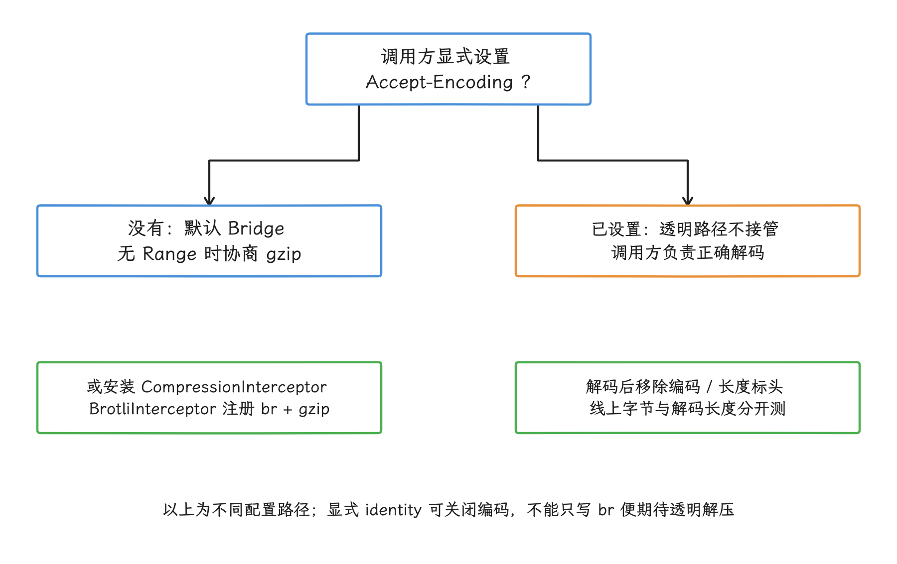

图：手写 Accept-Encoding 会改变解码责任；协商和数据格式是不同层次，Protocol Buffers 本身也不是内容压缩。

服务端按 `Accept-Encoding` 返回不同表示时，应发送 `Vary: Accept-Encoding`。`Vary` 指定“哪些请求头共同决定缓存变体”；共享缓存据此把 gzip、Brotli 和未编码响应分开保存，每种编码只发给支持它的客户端。

#### 哪些数据值得压缩

压缩收益用线上样本测量，各接口按自己的数据形态分别定阈值：

| 数据形态 | 建议 | 原因 |
| --- | --- | --- |
| JSON、HTML、XML，以及 GraphQL 接口返回的文本 | 评估 gzip 与 Brotli | 键名和结构重复较多，通常存在压缩空间 |
| Protocol Buffers | 用样本决定 | 二进制序列化不等于压缩，收益受字段内容影响 |
| JPEG、WebP、AVIF、音视频和 ZIP | 通常不再套通用压缩 | 这类格式已经使用专用编码，再压缩常见收益有限 |
| 加密或高熵内容 | 通常不再压缩 | “高熵”表示字节分布接近随机，重复模式很少，通用压缩难以缩小 |
| 很小的响应 | 以端到端测量决定 | 编码头、压缩器初始化和处理器时间可能高于传输收益 |

图片和视频应优先调整尺寸、格式、码率和分片策略，相关网络边界见 24.6，端到端耗时分析见 12.1。

请求体压缩要服务端明确接受对应的请求 `Content-Encoding`。批量日志或大型结构化上传值得评估；表单和小型写请求默认关闭。压缩包装可能改变请求体可否重复发送，重试前记得 24.6 讲过的幂等与一次性请求体约束。

#### 测量与防护

至少分别记录：

- 编码前的应用数据大小；
- 网络上传输的字节数；
- 解码后的响应体大小；
- 编码、解码和解析耗时；
- 请求端到端耗时、失败类型与重试次数。

透明解压会让应用层看到的长度与线上传输长度对不上。传输字节从服务端、网络层观测或已验证口径的事件指标采集，解码后长度在消费响应体时计数，两套数字各记各的用途。

客户端还要给解码后的数据量、集合元素数量和解析深度设上限。攻击者可以构造传输体积很小、解压后急剧膨胀的数据，也就是常说的“压缩炸弹”——压缩前的 `Content-Length` 挡不住这种放大。上限要在构建大型对象之前生效，超限就终止读取，并记录服务端、媒体类型和编码方式。

### 多级缓存设计：内存 / 磁盘 / 网络

#### 四层各自的语义

内存缓存管当前进程内的重复访问；磁盘文件缓存让应用重启后还能复用可再生成的数据；HTTP 缓存按协议复用响应；Room、DataStore 或普通持久文件保存应用必须恢复的状态。Room 是基于 SQLite 的持久化库，DataStore 适合保存少量键值或类型化对象。界面从应用指定的权威数据源读取——HTTP 缓存和 `cacheDir` 随时可能缺失，权威数据源得由持久层承担。

| 层级 | 常见载体 | 适合缓存的数据 | 淘汰依据 | 主要风险 |
| --- | --- | --- | --- | --- |
| 内存 | `LruCache`、图片库内存层、进程内键值表 | Bitmap 像素对象、解析结果、短生命周期配置 | 容量、最近访问、业务热度 | 占用堆，可能增加垃圾回收（GC）频率，甚至引发内存不足（OOM） |
| 可删除磁盘文件 | `cacheDir`、`externalCacheDir`、图片库磁盘层 | 图片、接口快照、预取文件 | 配额、最近修改时间、业务分组 | 系统或用户可以删除，读取必须允许缺失 |
| HTTP | OkHttp `Cache`、CDN、代理缓存 | 符合 HTTP 缓存规则的响应 | 新鲜度、验证器和缓存指令 | 错误响应头、账号隔离和陈旧数据 |
| 应用数据源 | Room、DataStore、持久文件 | 用户可见数据、离线数据、同步状态 | 业务版本、账号、租户、服务端版本 | 迁移、冲突、隐私和恢复成本 |

`LruCache` 的 LRU 是“最近最少使用”策略：空间不足时优先淘汰最久未访问的条目。容量要按对象的实际成本算——以 `Bitmap` 为例，条目大小应来自分配字节数这类可验证数据，只数条目个数会严重失真。系统给出的内存等级只作为容量输入之一；界面对象、数据库游标、原生内存和图形资源仍在共同消耗进程预算。

<!-- gracker-diagram: a263-02-cache-storage-lifetimes -->
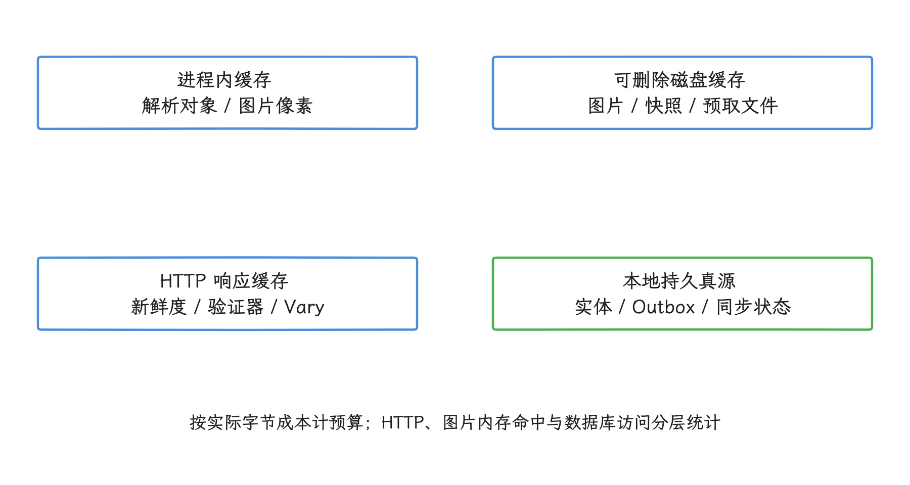

图：容量、淘汰和陈旧策略属于缓存；离线实体和待发送操作属于持久真源，不能因缓存缺失而丢掉用户操作。

AOSP `Context.getCacheDir()` 的文档说明了以下几点：

- 系统需要回收存储空间时，会按 `lastModified()` 从较旧文件开始处理；
- 应用应尽量把缓存使用量控制在 `StorageManager.getCacheQuotaBytes()` 返回的动态配额以内；该值表示系统当前建议的缓存额度，会随设备状态变化；
- 设备采用可迁移存储后，绝对路径可能变化，只应持久化相对路径；
- 应用无需额外权限访问自己的内部缓存目录。

API 26 起，`StorageManager.setCacheBehaviorGroup()` 可以让一个目录在系统自动清理时整体保留或整体删除，并用组内最新的修改时间代表整组。`setCacheBehaviorTombstone()` 会把被系统自动清理的文件截断为零字节，而非移除目录项；这种零长度“墓碑”可帮助应用区分“曾经存在但已被清理”和“从未创建”。

两种行为都只能设置在目录上并递归生效，也都只影响系统的自动清理。用户主动清除缓存时，墓碑设置会被忽略；分组设置也不提供持久性保证。

<!-- gracker-diagram: a263-03-cache-cleanup-semantics -->
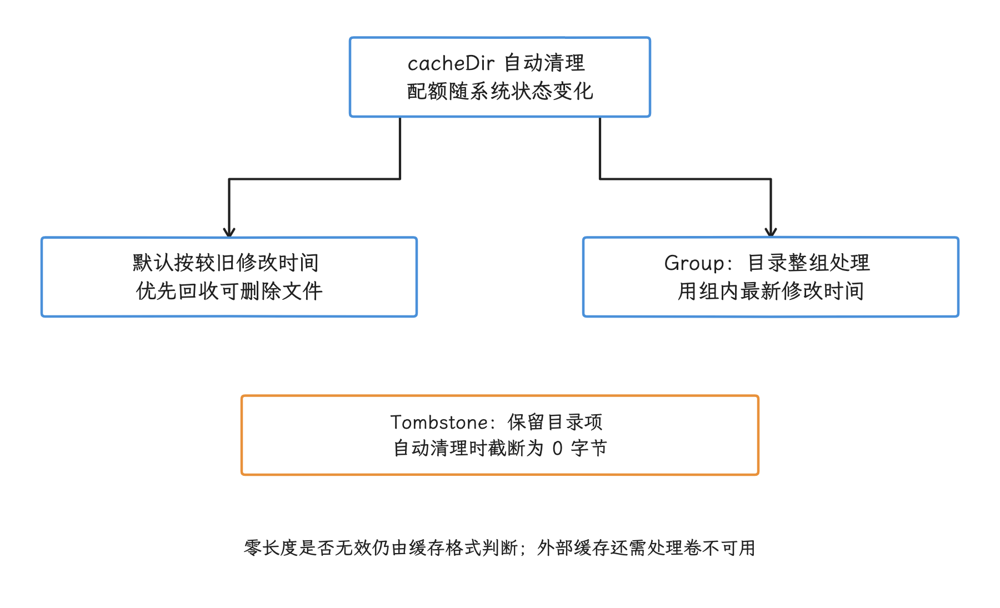

图：Group 改变自动清理粒度，Tombstone 保留零长度痕迹；两者都不把缓存提升为用户数据存储。

`externalCacheDir` 可能不可用，使用前先检查返回值和卷状态。要在应用升级、进程重启或设备重启后仍可靠恢复的数据，放进持久数据源，缓存目录只当加速层用。

#### 配置 OkHttp 磁盘缓存

这个函数显式传入容量，并为 OkHttp 分配独占子目录：

```kotlin
fun buildHttpClient(
    context: Context,
    maxCacheBytes: Long,
): OkHttpClient {
    require(maxCacheBytes > 0) { "maxCacheBytes must be positive" }

    val httpCache = Cache(
        directory = File(context.cacheDir, "okhttp-http-cache"),
        maxSize = maxCacheBytes,
    )

    return OkHttpClient.Builder()
        .cache(httpCache)
        .build()
}
```

容量由设备存储、缓存配额、内容分布和命中收益共同决定，所以示例里不写固定值。`Cache` 必须独占目录，一个目录只交给一个 `Cache` 实例；反过来，一个实例可以由多个 OkHttpClient 共用。应用通常共享长生命周期的 OkHttpClient，替换或结束使用缓存实例时再正确关闭它。

OkHttp 的 `Cache.delete()` 会删除所配置目录中的全部内容，这个目录就专用到底，别混放应用的其他文件。缓存读写失败时退回网络或应用数据源并记录错误；损坏的缓存直接绕过，别让它阻塞正常读取。

### HTTP 缓存：由协议决定能否复用

#### 新鲜度、存储与验证

RFC 9111 把“能否存储”“当前是否新鲜”“过期后能否验证”分成三件独立的事。新鲜状态意味着缓存仍可直接复用，陈旧状态意味着新鲜期已经结束。我们把常用指令逐一过一遍：

- `max-age` 表示响应从何时起变为陈旧。当前年龄由 `Date`、`Age` 和本地驻留时间共同计算，单看设备时钟与下载时间会算错。
- `Expires` 是绝对过期时间；存在适用的 `max-age` 时，优先采用后者。
- `no-cache` 允许存储，但每次复用前必须向源站验证；源站指生成该资源的原始服务器。它的含义是“先验证”，和“不要存储”是两回事。
- 响应中的 `no-store` 要求缓存不存储本次请求或响应，也不把该响应用于后续请求；请求中的 `no-store` 禁止存储本次交换，但 RFC 9111 不禁止用已经存好的响应满足该请求。至于传输加密、访问控制和端侧数据保护，要由其他机制承担。
- `private` 限制 CDN、代理等共享缓存存储响应，不会禁止私有缓存存储。OkHttp 的磁盘缓存属于私有缓存。
- `s-maxage` 只为共享缓存指定新鲜期。OkHttp 5.4.0 的私有缓存会解析这个值，复用时间仍由自己的新鲜度计算决定。

陈旧响应的返回要有授权：协议指令可以授权缓存在限定条件下复用陈旧响应。产品若采用“先展示旧数据、后台刷新”，刷新中、陈旧时长和刷新失败这些界面状态要由应用数据层表达，HTTP 缓存本身给不了。

#### ETag 与 Last-Modified 的适用条件

复查一个缓存条目时，我们手上有个现成机制：`ETag`（实体标签）是服务端为某个资源表示分配的版本标识，复查时通过 `If-None-Match` 发回；`Last-Modified` 记录修改时间，复查时配合 `If-Modified-Since`。服务端返回 `304 Not Modified` 就表示内容没变，客户端保留缓存内容、更新可合并的响应元数据即可，响应体不用再下载一次。

`ETag` 可以表达与时间无关的表示版本，还分强验证器和弱验证器；`Last-Modified` 适用于服务端能可靠维护修改时间的资源，但 HTTP 日期粒度、时钟和生成方式都会影响判断。两者该按服务端数据模型选，它们是两套适用条件，排不出高低。

<!-- gracker-diagram: a263-04-http-cache-decision -->
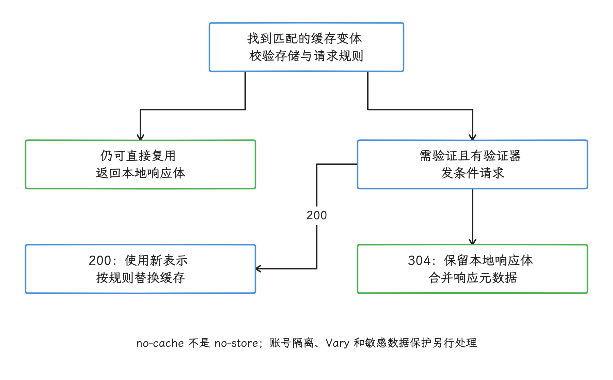

图：条件命中仍访问网络，OkHttp 同时增加 networkCount 与 hitCount；只看单一命中率会混淆复用路径。

服务端返回随请求头变化的表示时，用 `Vary` 声明参与选择的请求头。OkHttp 把这些请求头的名称和值写进缓存元数据，复用前逐项比较；`Vary: *` 表示任何请求都匹配不上，这样的响应也就进不了 OkHttp 缓存。自建缓存键要是只包含 URL、漏掉语言、内容编码或账号范围，就可能复用错误的响应变体。

#### OkHttp 5.4.0 的缓存实现

按 OkHttp 5.4.0 `Cache` 与 `CacheStrategy` 源码：

- 磁盘缓存只写入 `GET` 响应；当前实现不支持缓存 `206 Partial Content` 这类部分响应；
- 请求或响应含 `no-store` 时不会写入；请求带该指令时也不复用已有条目，这是 OkHttp 5.4.0 的实现行为；
- 请求含 `no-cache` 且允许联网时，会绕过已有缓存，缓存层也不会自动添加条件验证头；只需强制验证已有条目时，可改用 `max-age=0`，存在可用验证器时再由缓存层构造条件请求；
- `only-if-cached` 禁止访问网络，找不到可用条目时由 OkHttp 自己生成 `504 Unsatisfiable Request`；这个状态来自客户端本地，和源站返回的网络错误是两回事；
- 条件命中会访问网络完成验证，同时复用本地响应体，因此同时计入 `networkCount` 和 `hitCount`；
- `requestCount`、`networkCount`、`hitCount` 分别记录总请求数、使用网络的请求数和缓存命中数。

这些计数只说明 OkHttp 这一层。图片库内存命中、Room 查询和应用文件缓存要分别统计——合并成一个“总命中率”会丢掉层级信息，没法定位问题。评估时还应观察写入失败、淘汰、条件请求、响应年龄、账号范围和因缓存节省的网络字节。

#### 账号与敏感数据隔离

OkHttp 的缓存以 URL 为主键，依据 `Vary` 记录的请求头匹配响应变体。“私有”只说明它不与其他客户端共享，同一应用里的多个登录账号它并不自动区分。带凭据的接口要我们自己拿主意：

- 敏感或一次性数据由服务端返回 `no-store`；
- 允许端侧缓存的账号数据使用账号级独立缓存目录和客户端，退出登录时关闭并删除该账号目录；
- 应用自建缓存键包含账号、租户、环境、查询参数、分页位置和数据版本，但不写入原始令牌；
- 日志、埋点和错误上报不记录 `Authorization`、Cookie 或完整敏感缓存键。

多账号隔离这件事，光返回 `private` 解决不了。响应使用 `Vary: Authorization` 后，OkHttp 会按授权标头区分响应，并把对应请求头值写入缓存元数据；采用这条路径前，先评估设备端保存凭据的风险。

### 业务缓存失效与一致性

#### 权威数据源与缓存键

TTL 规定缓存条目可直接使用多久，但固定 TTL 只认时间：用户刚完成写操作、服务端版本改变、依赖资源已经更新，这些它都感知不到。所以应用要为每类数据指定权威数据源，并给缓存条目记录可验证的来源与版本。

一个应用自建缓存条目通常需要以下维度：

- 资源标识、账号、租户和环境；
- 经过规范化的查询参数与分页位置；
- 数据结构版本、服务端版本或验证器；
- 写入时间、允许陈旧时间和来源；
- 完整性信息，例如长度、校验值或原子提交标记。

写操作成功后，按资源关系让受影响条目一起失效，只删当前接口 URL 是删不干净的。例如头像更新会影响用户详情、会话列表和个人页摘要。依赖关系可以用标签记录，也可以建立从资源标识指向缓存键的“反向索引”，由资源查出所有相关条目；枚举不可靠时，就提升账号或资源版本，让旧版本缓存整体失效——这比在多处手工删除容易验证得多。

#### 处理并发、损坏和陈旧数据

同一缓存键的条目过期时，多个并发读取可能同时发起刷新。`single-flight` 把这些同键请求合并为一次实际刷新，其余调用等待并共享结果。互斥范围限制在同一键内，某次超时或取消只影响这一键的刷新；多进程应用要改用进程间可见的原子写入或数据库事务，进程内锁管不到另一个进程。

磁盘写入走“临时文件 + 原子重命名”：先写同一文件系统中的临时文件，校验成功后再替换目标；文件系统提供该保证时，读取者只会看到旧文件或完整的新文件。读取时把文件不存在、零长度、结构版本不支持、校验失败和解析失败都当作可恢复的缓存未命中——删掉损坏条目，回权威数据源重新获取。持久业务数据损坏则进入迁移或恢复流程。

展示陈旧数据时，界面状态至少要分得清“已有旧数据、正在刷新”“已有旧数据、刷新失败”和“没有数据”三种情形。字段 `lastSyncedAt` 只记录最近一次成功同步的时间，失败的尝试别去改写它。预取任务要设业务范围和淘汰优先级，别让一次性内容挤占高复用资源。

<!-- gracker-diagram: a263-05-business-cache-refresh -->
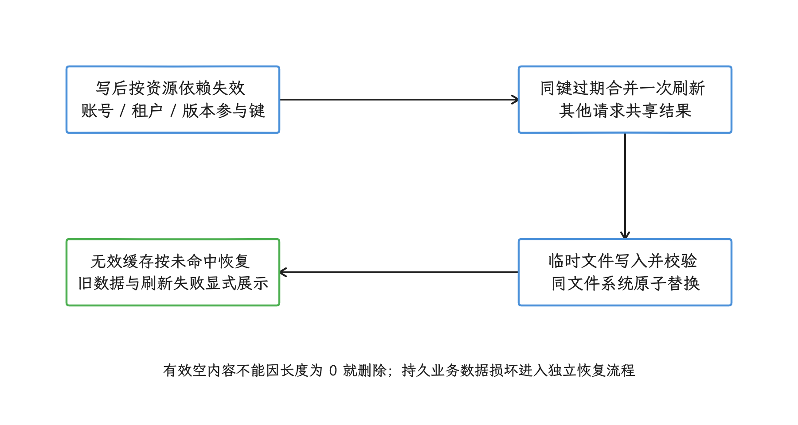

图：TTL 之外仍需依赖失效、同键合并与完整性校验；lastSyncedAt 只在成功同步后更新。

### 缓存与离线真源的分工

HTTP、内存和可删除文件缓存都在减少重复工作，条目缺失时回到权威数据源重新取得即可。至于本地写入是否已被服务端确认，以及冲突版本、幂等键、用户可见失败状态，这些要交给下一层的离线架构来管。

需要离线读写时，我们把本地持久数据源提升为界面唯一读取入口，用持久队列记录待同步操作。Room 事务、Outbox、WorkManager、冲突处理和乐观更新的细节在下一部分统一展开；缓存层只负责命中、失效、淘汰与可恢复缺失。

### 缓存执行检查清单

- 压缩协商：调用方手动覆盖 `Accept-Encoding` 时自行负责解压；服务端按编码返回不同表示时发送正确的 `Vary`。
- 压缩选型：`Protocol Buffers` 不被当成压缩格式；文本、媒体、加密内容和小响应分别测量。
- 解码防护：限制解码后大小、集合数量和解析深度；主线程不执行大型解码或解析。
- 内存缓存：容量按字节等真实成本计算；缓存项可被淘汰，业务对象要有内存之外的权威副本。
- 磁盘缓存：`cacheDir` 数据允许随时缺失；使用相对路径；OkHttp 使用独占子目录。
- HTTP 指令：区分 `no-cache`、`no-store`、`private` 与 `s-maxage`；正确处理 `Vary` 和验证器。
- 账号隔离：敏感响应不存储；多账号缓存分区；退出登录时清除所属数据；缓存键和日志不包含原始凭据。
- 一致性：写后按资源关系失效；同键刷新合并；文件原子替换；损坏条目可删除并重新获取。

### 缓存部分的参考与验证

- [Android Developers · App-specific storage](https://developer.android.com/training/data-storage/app-specific)
- [Android Developers · StorageManager API reference](https://developer.android.com/reference/android/os/storage/StorageManager)
- [Android Developers · Network access optimization](https://developer.android.com/develop/connectivity/network-ops/network-access-optimization)
- [Android Developers · Offline-first architecture](https://developer.android.com/topic/architecture/data-layer/offline-first)
- [OkHttp · Caching](https://lysine.dev/okhttp/features/caching/)
- [OkHttp 5.x API · CompressionInterceptor](https://lysine.dev/okhttp/5.x/okhttp/okhttp3/-compression-interceptor/)
- [OkHttp 5.x API · BrotliInterceptor](https://lysine.dev/okhttp/5.x/okhttp-brotli/okhttp3.brotli/-brotli-interceptor/)
- [Maven Central · OkHttp metadata](https://repo.maven.apache.org/maven2/com/squareup/okhttp3/okhttp/maven-metadata.xml)
- [OkHttp 5.4.0 · Release](https://github.com/lysine-dev/okhttp/releases/tag/parent-5.4.0)
- [OkHttp 5.4.0 · BridgeInterceptor.kt](https://github.com/lysine-dev/okhttp/blob/parent-5.4.0/okhttp/src/commonJvmAndroid/kotlin/okhttp3/internal/http/BridgeInterceptor.kt)
- [OkHttp 5.4.0 · CompressionInterceptor.kt](https://github.com/lysine-dev/okhttp/blob/parent-5.4.0/okhttp/src/commonJvmAndroid/kotlin/okhttp3/CompressionInterceptor.kt)
- [OkHttp 5.4.0 · BrotliInterceptor.kt](https://github.com/lysine-dev/okhttp/blob/parent-5.4.0/okhttp-brotli/src/main/kotlin/okhttp3/brotli/BrotliInterceptor.kt)
- [OkHttp 5.4.0 · Cache.kt](https://github.com/lysine-dev/okhttp/blob/parent-5.4.0/okhttp/src/commonJvmAndroid/kotlin/okhttp3/Cache.kt)
- [OkHttp 5.4.0 · CacheStrategy.kt](https://github.com/lysine-dev/okhttp/blob/parent-5.4.0/okhttp/src/commonJvmAndroid/kotlin/okhttp3/internal/cache/CacheStrategy.kt)

以下 5.3.0 源码链接保留供版本对照：

- [OkHttp 5.3.0 · BridgeInterceptor.kt](https://github.com/square/okhttp/blob/parent-5.3.0/okhttp/src/commonJvmAndroid/kotlin/okhttp3/internal/http/BridgeInterceptor.kt)
- [OkHttp 5.3.0 · CompressionInterceptor.kt](https://github.com/square/okhttp/blob/parent-5.3.0/okhttp/src/commonJvmAndroid/kotlin/okhttp3/CompressionInterceptor.kt)
- [OkHttp 5.3.0 · BrotliInterceptor.kt](https://github.com/square/okhttp/blob/parent-5.3.0/okhttp-brotli/src/main/kotlin/okhttp3/brotli/BrotliInterceptor.kt)
- [OkHttp 5.3.0 · Cache.kt](https://github.com/square/okhttp/blob/parent-5.3.0/okhttp/src/commonJvmAndroid/kotlin/okhttp3/Cache.kt)
- [OkHttp 5.3.0 · CacheStrategy.kt](https://github.com/square/okhttp/blob/parent-5.3.0/okhttp/src/commonJvmAndroid/kotlin/okhttp3/internal/cache/CacheStrategy.kt)
- [RFC 9110 · HTTP Semantics](https://www.rfc-editor.org/rfc/rfc9110.html)
- [RFC 9111 · HTTP Caching](https://www.rfc-editor.org/rfc/rfc9111.html)
- [AOSP android-17.0.0_r1 · Context.java](https://android.googlesource.com/platform/frameworks/base/+/refs/tags/android-17.0.0_r1/core/java/android/content/Context.java)
- [AOSP android-17.0.0_r1 · StorageManager.java](https://android.googlesource.com/platform/frameworks/base/+/refs/tags/android-17.0.0_r1/core/java/android/os/storage/StorageManager.java)


## 本地真源、同步队列与冲突处理

缓存命中解决的是访问成本；从这一部分开始，我们要管理的是本地写入、待同步操作、服务端确认和冲突。用户看到的状态，必须反映同步的真实结果。

### 离线优先的最低要求

离线优先把网络中断、变慢和暂时不可用当作数据层的常见条件。Android 官方给出的最低要求是：应用的主要内容在没有网络时仍可读取。至于写操作，离线提交只覆盖合适的部分——转账、权限授予或需要实时库存确认的操作，仍可采用仅在线写入。

工具箱是三件 AndroidX 组件：Room 是基于 SQLite 的持久化库，WorkManager 用于持久后台调度，Paging 用于分页加载。它们的能力随库版本变化；本文示例只使用这些库的稳定公开接口，AndroidX 的行为也不归因到平台版本上。

前一部分区分了可删除缓存与持久数据；在此基础上，离线优先还要保存用户操作、同步进度、服务端版本和失败状态。

本地权威数据源是界面与业务逻辑唯一读取的数据副本。它可能暂时落后于服务端，但无论网络好坏，应用读到的都是同一套数据。Outbox 是数据库中的待发送操作表，服务端幂等协议用固定标识识别同一次操作的重复请求。两者配合，写入就是可恢复的。

设计离线能力前，要逐项回答：

- 哪些页面在首次安装且无网络时仍应可用？
- 哪些写操作只能在线确认，哪些可以排队，哪些允许先改本地？
- 本地与服务端都修改了同一资源时，由谁检测和处理冲突？
- 进程在服务端成功之后、本地确认之前终止，重发会不会产生重复结果？
- 账号退出、租户切换和令牌失效时，旧队列怎样停止与清理？

### 离线优先的设计原则

#### 本地数据源是读取入口

离线优先的 `Repository` 是协调本地与网络数据源的数据访问组件：`Flow` 是可持续发出新值的异步数据流，`StateFlow` 还会保留当前值，Paging 数据流则按页提供列表。界面与业务逻辑只观察本地数据；网络读取完成后先写进本地，再由本地数据变化通知界面。绕过 `Repository` 直接读网络数据源，离线语义就断了。

只有业务实体的界面还缺同步语义：刷新状态不暴露出来，“旧数据可读”和“数据已经同步”就混在一起了。我们建议把以下信息也放进界面状态：

<!-- gracker-diagram: a263-06-offline-read-source -->
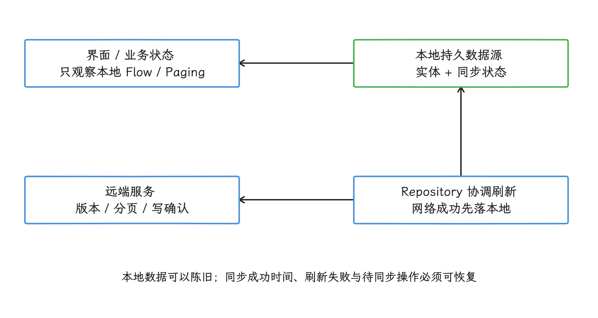

图：界面读取本地，网络更新持久层；“本地可读”“正在刷新”和“已同步”分别表达。

- 本地是否有可展示数据；
- 最近一次成功同步时间；
- 当前是否刷新；
- 最近一次刷新是否失败；
- 用户操作处于待同步、待登录、冲突还是永久失败。

#### 为每类写入选择策略

Android 官方离线优先指南给出三类写入。策略按业务风险选择，业务结果由产品语义决定，本地队列只是实现手段：

| 写入策略 | 适用情况 | 本地行为 | 用户看到的结果 |
| --- | --- | --- | --- |
| 仅在线写入 | 转账、实时库存、权限变更 | 服务端确认后再更新权威本地数据 | 成功或失败均明确返回 |
| 排队写入 | 日志、遥测、非时效上报 | 操作进入持久队列，稍后发送 | 通常不阻塞当前操作 |
| 延迟写入 | 草稿、待办、可离线编辑内容 | 先更新本地，再把变更加入 Outbox | 立即可见，同时显示同步状态 |

“延迟写入”也常称为乐观更新：服务端确认前先改变本地状态，失败或冲突留待后续处理。支付或订单可以在本地显示“已提交”；“已支付”“已下单成功”要等服务端确认之后。能提前反馈的只有提交动作，尚未成立的业务结果先按“处理中”表述。

#### 分开保存四类状态

结构化离线数据通常需要四组表或等价持久结构：

- 业务实体：界面查询的用户数据；
- Outbox：尚未得到服务端确认的本地操作；
- 远端分页键或增量水位：分页键记录某组查询从哪个游标继续取下一页，增量水位记录本地已经同步到哪个版本、时间点或令牌；
- 同步状态：账号、数据域、成功时间、错误分类和下一次可尝试时间。

这些表各有职责，HTTP 缓存顶替不了。WorkManager 自己的数据库同样当不了业务队列：它保存工作调度状态，业务冲突、账号版本和用户可见失败要放在业务表里。

### Room + WorkManager 的离线架构

#### Room 表按读取和同步方式建模

Room 适合保存结构化本地数据。表结构从界面查询、同步顺序、冲突字段和账号隔离推导出来，逐字段照搬接口响应会处处被动。数据库索引额外保存可快速查找的列值，适合“某账号下可立即发送的 Outbox 项”这类高频查询，代价是写入与存储成本上升。数据库迁移还要覆盖升级前遗留的待同步操作。

这个实体骨架展示 Outbox 要表达的协议状态。字段名只作示意，业务按服务端协议调整：

```kotlin
enum class OutboxStatus {
    PENDING,
    WAITING_FOR_AUTH,
    CONFLICT,
    PERMANENT_FAILURE,
}

@Entity(
    tableName = "sync_outbox",
    indices = [
        Index(
            value = ["localOperationId"],
            unique = true,
        ),
        Index(
            value = [
                "accountId",
                "status",
                "nextAttemptAtMillis",
                "localSequence",
            ],
        ),
    ],
)
data class SyncOutboxEntity(
    @PrimaryKey(autoGenerate = true)
    val localSequence: Long = 0,
    val localOperationId: String,
    val accountId: String,
    val resourceType: String,
    val resourceId: String,
    val operation: String,
    val payloadJson: String,
    val idempotencyKey: String,
    val expectedServerVersion: String?,
    val status: OutboxStatus,
    val attemptCount: Int,
    val nextAttemptAtMillis: Long?,
    val lastErrorCategory: String?,
    val createdAtMillis: Long,
    val updatedAtMillis: Long,
)
```

重试同一操作时复用同一个 `idempotencyKey`；用户发起新的业务操作时生成新键。服务端记录这个键及处理结果，再次收到同一键时返回已有结果，避免重复产生副作用。`expectedServerVersion` 表示本次修改依据的服务端版本，用来发现“读取之后又被别人修改”的并发冲突。幂等键识别重复操作，版本字段识别数据变化，两者各司其职。

`localSequence` 由数据库生成，用于稳定选择本地操作顺序；`createdAtMillis` 用于展示和观测，先后不能由它独自决定。服务端确认后可以删除 Outbox 行；业务要求保留审计记录时，转入字段更受控、保留规则独立的历史表。

Room 2.3 及以上在没有自定义转换器且未禁用内置枚举转换时，会把枚举名称转换为字符串保存；自定义 `@TypeConverter` 的优先级更高，Room 2.8.4 仍保留该行为。枚举常量改名后，旧字符串可能解析失败；要长期演进的数据库格式应使用稳定编码，并为已有数据提供迁移。

`payloadJson` 可能包含用户输入或凭据派生信息，存储前限定字段、保留时间和日志输出；需要加密时，把密钥失效后的清理路径一并设计好。访问令牌始终留在 Outbox 之外。

#### 本地变更与 Outbox 同事务写入

这个函数用一次 Room 事务同时更新收藏状态和插入待发送操作：

```kotlin
suspend fun setBookmarked(
    accountId: String,
    articleId: String,
    bookmarked: Boolean,
) {
    val operationId = idGenerator.newId()
    val nowMillis = clock.nowMillis()

    database.withTransaction {
        val operation = SyncOutboxEntity(
            localOperationId = operationId,
            accountId = accountId,
            resourceType = "article",
            resourceId = articleId,
            operation = "set_bookmarked",
            payloadJson = payloadEncoder.encodeBookmark(bookmarked),
            idempotencyKey = operationId,
            expectedServerVersion = articleDao.serverVersion(
                accountId = accountId,
                articleId = articleId,
            ),
            status = OutboxStatus.PENDING,
            attemptCount = 0,
            nextAttemptAtMillis = null,
            lastErrorCategory = null,
            createdAtMillis = nowMillis,
            updatedAtMillis = nowMillis,
        )

        articleDao.setBookmarkLocally(
            accountId = accountId,
            articleId = articleId,
            bookmarked = bookmarked,
            pendingOperationId = operationId,
        )
        outboxDao.insert(operation)
    }

    syncScheduler.ensureScheduled(accountId)
}
```

`pendingOperationId` 让远端确认能对应到具体本地操作。用户快速切换两次收藏状态时，较早请求的确认对较新操作的待同步标记无效。服务端版本读取、业务实体更新与 Outbox 插入都在同一事务中，三项写入一起提交或一起回滚，账号也参与每次查询。

调度调用放在事务之后。进程恰好在事务提交后、调用 `ensureScheduled()` 前终止时，Outbox 记录还在，应用启动、登录恢复或其他同步入口会再次安排“唯一工作”。唯一工作以固定名称避免重复调度同一逻辑任务。分工是：Outbox 保存待发送这一业务事实，`WorkRequest` 只记录何时、在什么约束下运行 `Worker`。

<!-- gracker-diagram: a263-07-outbox-atomic-scheduling -->
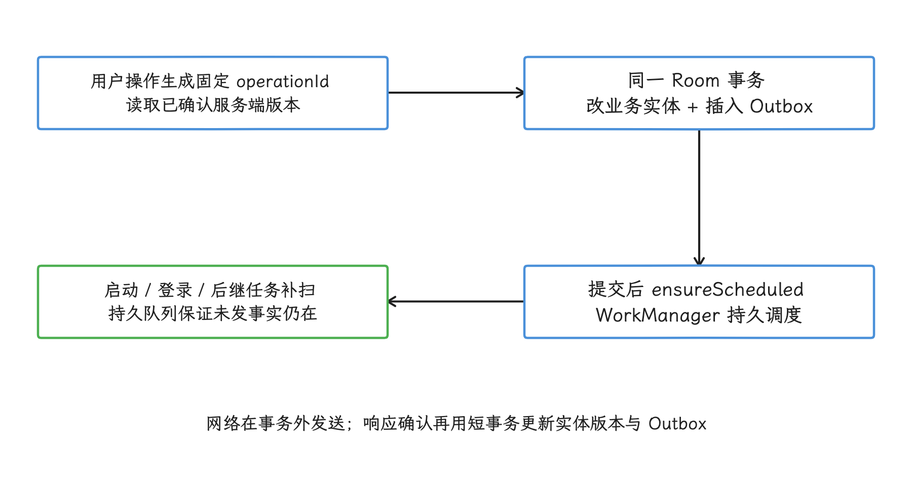

图：本地提交与安排工作之间进程终止时，恢复入口重扫 Outbox；唯一工作策略还须覆盖 Worker 结束与新操作入队的交错。

网络请求放在 Room 事务外面：发送前用短事务选择可发送记录，响应回来后再用短事务更新实体、服务端版本和 Outbox 状态。这样网络等待期间就不会占着数据库事务。

#### WorkManager 负责持久调度

WorkManager 持久保存调度记录，适合离开界面、进程退出或设备重启后仍需执行的同步。`NetworkType.CONNECTED` 只说明系统判断当前有可用网络；鉴权是否有效、DNS 是否成功、源站是否可访问，都要 `Worker` 自己分类处理请求结果。

这个 `Worker` 骨架只从输入数据读取账号标识，业务请求数据仍保存在 Room：

```kotlin
@HiltWorker
class OutboxSyncWorker @AssistedInject constructor(
    @Assisted appContext: Context,
    @Assisted params: WorkerParameters,
    private val repository: OfflineRepository,
) : CoroutineWorker(appContext, params) {

    override suspend fun doWork(): Result {
        val accountId = inputData.getString(INPUT_ACCOUNT_ID)
            ?: return Result.failure()

        return when (repository.drainReadyOutbox(accountId)) {
            DrainResult.DRAINED -> Result.success()
            DrainResult.WAITING_FOR_USER -> Result.success()
            DrainResult.RETRYABLE_FAILURE -> Result.retry()
            DrainResult.INVALID_CONFIGURATION -> Result.failure()
        }
    }
}
```

带业务依赖的 `Worker` 需要 `HiltWorkerFactory` 或自定义 `WorkerFactory`。Hilt 是依赖注入库；使用 `@HiltWorker` 时采用“辅助注入”——`Context` 与 `WorkerParameters` 由 WorkManager 在运行时提供，其余应用依赖由 Hilt 注入。这些依赖要能由 `SingletonComponent` 提供，即处于应用生命周期范围。项目里没上 Hilt 时，让 `Worker` 从应用级依赖容器获取 `Repository` 即可。

WorkManager 的输入与输出 `Data` 有序列化大小上限，由 `Data.MAX_DATA_BYTES` 定义。`Data` 用来传账号或队列标识就好；整批请求数据放 Room。队列内容进了 Room，重新安排工作、进程恢复和账号清理用的都是同一份状态。

同步工作按账号或租户设置唯一名称，并明确选择 `ExistingWorkPolicy`。`KEEP` 保留已有工作并忽略新请求，适合“同一账号已有一个队列处理器”的场景；`REPLACE` 会取消旧 `Worker`；`APPEND` 把新工作接到旧工作之后，同时继承前置工作的失败或取消状态；要避开这种继承，可评估 `APPEND_OR_REPLACE`。策略要结合队列顺序与取消语义测试，避免只为免重复启动而随意替换。

唯一工作管住的只是同名 WorkManager 工作；页面协程、其他调度入口或另一个进程仍可能同时读取 Outbox。所以所有发送入口要经过同一同步协调器，或在数据库事务中“原子认领”记录：用带状态条件的更新把待发送行标为已认领，只有更新成功的调用方可以发送。实现了持久的“发送中”状态，还要定义 `Worker` 被取消或进程终止后的重新认领规则；服务端幂等在这条路径上同样省不掉。

Worker 运行期间约束失效时，WorkManager 会停止它；停止信号之后返回的 `Result` 会被忽略。协程代码要保留取消传播，网络、文件和数据库操作也要能随取消停下来；`CancellationException` 捕获后转成普通成功或失败，是明确要避开的写法。

WorkManager 对开始时间只有尽力而为的保证。要用户当场等结果的前台操作走页面生命周期内的请求；同时也要求进程退出后继续完成的，再把持久 Outbox 交给 WorkManager。

#### 按失败类别处理队列

把所有失败一律 `Result.retry()`，制造的是无效请求，用户也看不到需要自己处理的错误。指数退避指每次临时失败后逐步延长等待时间，只适用于预期稍后可能恢复的错误。各类失败对应的队列状态这样处理：

| 结果 | 队列处理 | 调度处理 |
| --- | --- | --- |
| 连接中断、超时、可重试的服务端错误 | 保留待发送状态，增加尝试记录 | 按退避策略重试 |
| `429` | 读取合法的 `Retry-After`；该响应头给出服务端允许重试的时间或等待秒数 | 记录下次可尝试时间，到时再安排 |
| `401` 或登录失效 | 改为等待登录或令牌恢复 | 不进行无限退避重试 |
| 请求数据校验失败 | 标记永久失败并保存可展示原因 | 结束本次 Worker |
| `412 Precondition Failed` | 标记版本冲突并拉取远端版本 | 进入冲突策略 |
| `409 Conflict` | 按服务端定义的业务冲突处理 | 不默认当作临时网络错误 |
| 删除返回资源不存在 | 按删除协议判断是否可视为幂等成功 | 完成或转为业务失败 |

表中这几类错误——临时传输错误、身份失效、数据错误、版本冲突——会进入不同的队列状态；退避时间、服务端限流时间和业务重试上限也是三档不同的约束。服务端明确给出等待时间时，业务队列把它保存下来，WorkManager 的退避只负责工作级重新调度。

<!-- gracker-diagram: a263-08-worker-error-states -->
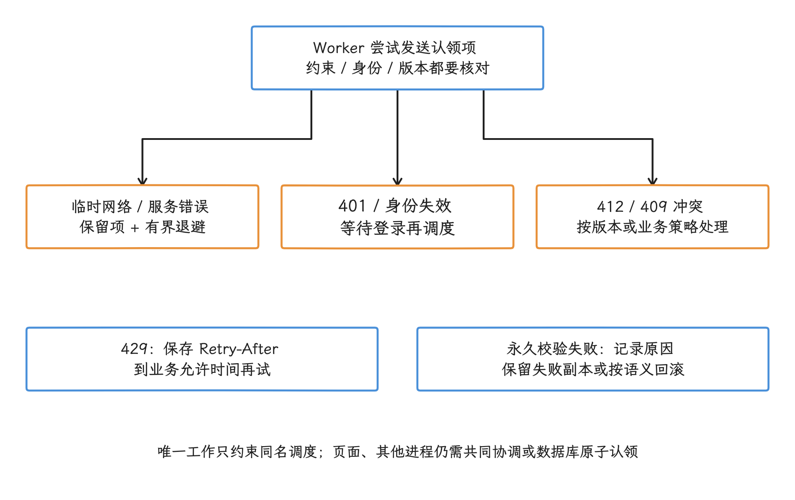

图：重试、服务端限流时间和业务错误上限是不同约束；取消后的 Result 不作为成功确认。

“服务端已成功、本地尚未确认时进程终止”这种情形，靠发送端复用原操作的幂等键来兜底：服务端返回已有结果后，本地按普通成功确认。WorkManager 的唯一工作防不住这种重复请求。

<!-- gracker-diagram: a263-09-idempotency-and-version -->
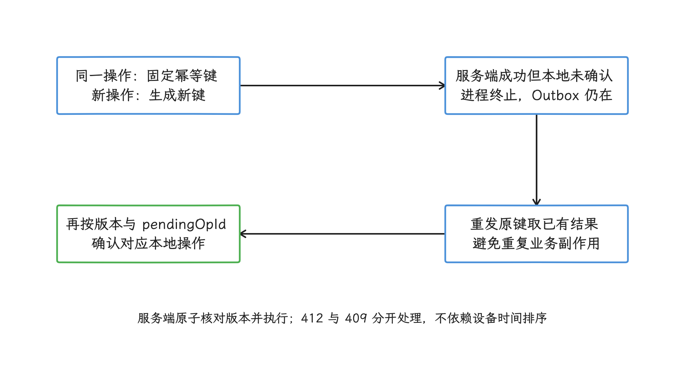

图：幂等键防同一次操作重复执行；服务端版本防基于旧副本覆盖新数据。两者不能互相替代。

### 冲突解决策略

#### 幂等键与服务端版本

幂等键识别“同一个操作被重发”，防止重复执行副作用；服务端版本识别“操作基于旧数据”，防止旧副本覆盖新数据。两套机制要同时到位：

- 同一 Outbox 项每次重试使用相同幂等键；
- 用户再次发起操作时使用新幂等键；
- 本地保存最近确认的服务端版本；
- 写请求携带它所依据的版本；
- 服务端原子地检查版本并执行写入。

用 HTTP `ETag` 作版本时，修改请求可以发送 `If-Match`。弱 ETag 以 `W/` 开头，只表示两个响应在语义上等价；强 ETag 才标识完全匹配的表示。RFC 9110 要求 `If-Match` 做强比较，弱 ETag 过不了这道写入前置条件。版本不匹配通常返回 `412 Precondition Failed`；`409 Conflict` 表示资源当前状态与业务操作冲突，具体含义由接口协议定义。客户端要把两者分开处理，测试两边都要覆盖，只测 `409` 是不够的。

#### 冲突策略按业务风险选择

| 策略 | 适用情况 | 服务端与本地需要保存 | 失败方式 |
| --- | --- | --- | --- |
| 服务端版本覆盖 | 公告、推荐、只读配置 | 服务端版本、同步水位 | 本地旧副本被替换 |
| 服务端判定的后写覆盖 | 低风险且允许覆盖的字段 | 服务端接收序列或可信时间 | 较早编辑可能丢失 |
| 字段级合并 | 字段互相独立的资料或设置 | 字段版本、修改来源 | 同字段仍可能冲突 |
| 操作级合并 | 可交换或可累积的业务操作 | 操作标识与合并规则 | 错误规则会重复或漏算 |
| 用户处理 | 文档编辑、审批和高风险业务 | 本地副本、远端副本、差异与恢复入口 | 用户需要明确选择 |

“后写覆盖”表示服务端保留它判定为较晚的修改。直接比较设备时间并不可靠——用户改时钟、时区、离线时长和设备漂移都会干扰结果，可以改由服务端分配版本或接收序列。产品必须保留用户编辑发生时间时，它只作为展示与策略输入之一，不能充当唯一并发条件。

删除操作需要“墓碑”或等价的服务端删除版本。墓碑只保留资源标识、删除版本和时间，用来告诉其他副本“该资源已经删除”；只从本地表移除记录的话，下一次增量同步会把服务端旧对象重新写回。墓碑同样要定义保留期限和服务端确认规则。

同一资源积压多个待发送操作时，先定义顺序与合并条件。操作合并指把多个尚未发送、业务含义可替代的变更压成一个目标状态，例如“设置收藏状态”可以只保留较新的目标值；已经发送的请求则必须等待确认、依靠版本条件，或由服务端按操作序列处理。订单、转账和审计事件不能按资源标识合并。

同步批量没有通用的固定条数，要结合请求数据大小、单次数据库事务时间、服务端限流、Worker 可用时间和失败隔离能力来定。网络调用在事务外执行，服务端响应对应的数据与分页键在短事务中一起提交。

### 渐进式加载与乐观更新

#### Paging 3 仍以数据库驱动界面

`RemoteMediator` 是 Paging 在本地数据不足或需要刷新时调用的网络加载器，它把远端结果写进 Room，网络响应本身不直接上界面；界面读的是 `PagingSource`——本地分页读取接口，只从 Room 取数据。网络成功但数据库事务失败时，这一页就不显示；数据库写入成功后，Room 使旧 `PagingSource` 失效，新实例再从本地读出更新后的分页数据。

远端分页键记录某组查询下一次应使用的服务端游标。它与对应数据要在同一个事务中更新：只保存了下一页键、没保存这一页数据，恢复后会跳过内容；只保存了数据、没更新键，又会重复请求同一页。

`RemoteMediator.initialize()` 返回值决定首次创建分页流时是否访问网络。`REFRESH` 表示重建或刷新列表，`APPEND` 和 `PREPEND` 分别表示向列表末尾和开头加载：

- `LAUNCH_INITIAL_REFRESH` 发起远端刷新，并让远端 `APPEND` 与 `PREPEND` 等待该刷新成功；
- `SKIP_INITIAL_REFRESH` 跳过这次远端刷新，直接使用已有本地数据。

缓存要不要刷新，由数据域的过期规则决定，文档示例里的固定时长仅供参考。刷新失败时保留本地列表，通过 `LoadState` 或业务状态给出重试入口。`LoadState` 用 `Loading`、`Error` 和 `NotLoading` 表示一次分页加载正在进行、已经失败或当前没有加载。

分页键必须包含查询条件、账号和排序方式——只用一个全局 `nextKey`，不同搜索词或账号就会共享分页位置。服务端改变排序或游标格式时，清理相应分页键并启动完整刷新。

<!-- gracker-diagram: a263-10-remote-mediator-transaction -->
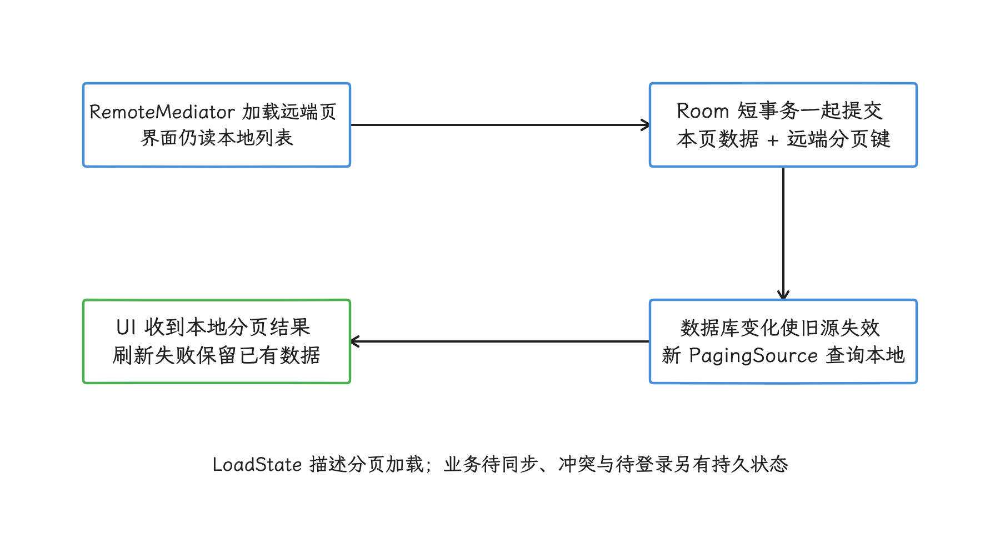

图：数据与续页键必须同时推进，避免恢复后跳页或重复请求；远端响应不直接绕过本地上界面。

#### 乐观更新需要持久状态机

状态机为每项操作规定允许的状态及转换，例如“待同步 → 已确认”或“待同步 → 冲突”。当前状态持久化之后，进程重建也能恢复同一语义。乐观更新适合收藏、已读、草稿这类可回滚或失败可解释的动作。界面状态要区分：

| 状态 | 界面含义 | 后续动作 |
| --- | --- | --- |
| 待同步 | 本地已更新，服务端尚未确认 | 允许继续浏览，显示轻量状态 |
| 已确认 | 服务端接受了对应操作 | 清除对应待同步标识 |
| 待登录 | 操作仍保留，需要恢复身份 | 引导登录后重新安排同步 |
| 冲突 | 服务端版本已变化 | 自动合并或让用户处理 |
| 永久失败 | 服务端拒绝且不会自动重试 | 回滚或保留失败副本 |

确认响应必须匹配 `pendingOperationId`，较早操作的迟到响应对较新本地状态无效。永久失败时回滚还是保留本地副本，由业务可逆性决定；无论哪种，结果都要持久化，一次短暂提示交代不过去。

仅在线的高风险操作同样可以给渐进反馈，文案保持“处理中”或“等待服务端确认”即可。网络断开、页面退出和进程终止后，界面都从本地状态恢复同一语义。

### 同步可观测性与恢复验证

这里的“可观测性”，指用指标和日志回答三个问题：队列积压了多久、同步卡在哪一类状态、用户看到的数据有多旧。单看接口成功率说明不了离线体验，我们分层记录：

- 首次本地可读耗时、本地为空与本地陈旧的比例；
- 最近成功同步时间与数据年龄；
- Outbox 条目数量、年龄分布和账号归属；
- 成功、临时失败、待登录、冲突与永久失败的数量；
- `412`、`409`、限流和服务端幂等命中的结果；
- WorkManager 工作状态、停止原因和重试次数；
- Room 事务耗时、分页键异常与数据库迁移失败。

日志里只放内部操作标识和错误分类；令牌、完整请求数据和用户正文一律不落日志。账号退出时，取消该账号的唯一工作，删除或隔离它的业务数据、分页键和 Outbox，并验证已在运行的请求返回后写不进已退出的账号。

<!-- gracker-diagram: a263-11-late-ack-account-fence -->
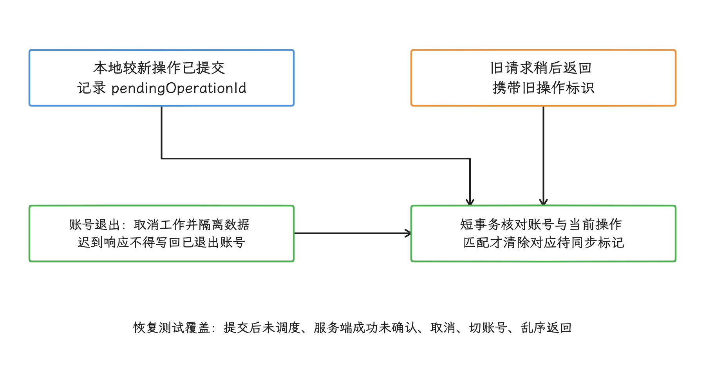

图：确认只清除对应操作的状态；账号退出和连续编辑都需防止迟到响应覆盖更晚的本地事实。

恢复测试应覆盖：

- 首次安装后在飞行模式进入页面；
- 有旧数据时刷新失败；
- 本地事务提交后、安排 WorkRequest 前终止进程；
- 服务端成功后、本地确认前终止进程；
- Worker 运行期间失去网络约束或收到取消；
- 设备重启、进程重建和数据库迁移；
- 令牌失效、账号切换与退出登录；
- `429`、`412`、`409`、永久校验错误和重复幂等键；
- 设备时间错误、多端乱序写入与删除后同步；
- 用户连续修改同一资源，远端响应按不同顺序返回。

### 设计审查清单

- 读取：界面与业务逻辑只从本地权威数据源观察数据，刷新状态与数据状态分开表达。
- 写入：每类操作明确选择仅在线、排队或延迟写入，不把高风险结果提前标成成功。
- 事务：用户可见本地变更与 Outbox 同事务；网络调用不占用 Room 事务。
- 幂等：同一操作重试复用键，新操作使用新键，服务端提供对应去重保证。
- 冲突：版本条件、`412` 和 `409` 语义写入接口协议；设备时间不是唯一顺序依据。
- 调度：WorkManager 只处理持久调度，业务请求数据与状态保存在 Room。
- 多账号：队列、唯一工作、分页键和数据均按账号隔离，退出登录有清理与迟到响应防护。
- Paging：远端分页键与数据同事务，查询条件与排序参与分页键范围。
- 乐观更新：待同步、待登录、冲突和永久失败均能在进程重建后恢复。
- 隐私：Outbox 不保存访问令牌，日志不输出完整请求数据，敏感内容有保留和清理规则。

## 全文小结

缓存与离线优先解决两个层级的问题：缓存用压缩、复用和淘汰降低重复成本；离线优先用本地真源、持久操作队列和冲突协议，保证网络不稳定时的数据语义。用户资产、同步状态和待确认写入，始终要放在可删除缓存之外。

实现时先指定每类数据的权威来源、新鲜度、账号范围和恢复方式，再让 Room 事务保存业务变更与 Outbox，WorkManager 只负责调度。验收除了命中率和接口成功率，还要看数据年龄、积压、幂等命中、冲突、进程终止恢复和账号清理。

## 参考资料

- [Android Developers · Build an offline-first app](https://developer.android.com/topic/architecture/data-layer/offline-first)
- [Android Developers · Data layer](https://developer.android.com/topic/architecture/data-layer)
- [Android Developers · Save data in a local database using Room](https://developer.android.com/training/data-storage/room)
- [Android Developers · Referencing complex data using Room](https://developer.android.com/training/data-storage/room/referencing-data)
- [Android Developers · Task scheduling with WorkManager](https://developer.android.com/develop/background-work/background-tasks/persistent)
- [Android Developers · Define work requests](https://developer.android.com/develop/background-work/background-tasks/persistent/getting-started/define-work)
- [Android Developers · Manage work](https://developer.android.com/develop/background-work/background-tasks/persistent/how-to/manage-work)
- [Android Developers · Work states](https://developer.android.com/develop/background-work/background-tasks/persistent/how-to/states)
- [Android Developers · HiltWorker](https://developer.android.com/reference/androidx/hilt/work/HiltWorker)
- [Android Developers · WorkManager Data](https://developer.android.com/reference/androidx/work/Data)
- [Android Developers · Page from network and database](https://developer.android.com/topic/libraries/architecture/paging/v3-network-db)
- [AndroidX · Room release notes](https://developer.android.com/jetpack/androidx/releases/room)
- [AndroidX · WorkManager release notes](https://developer.android.com/jetpack/androidx/releases/work)
- [AndroidX · Paging release notes](https://developer.android.com/jetpack/androidx/releases/paging)
- [RFC 9110 · HTTP Semantics](https://www.rfc-editor.org/rfc/rfc9110.html)
