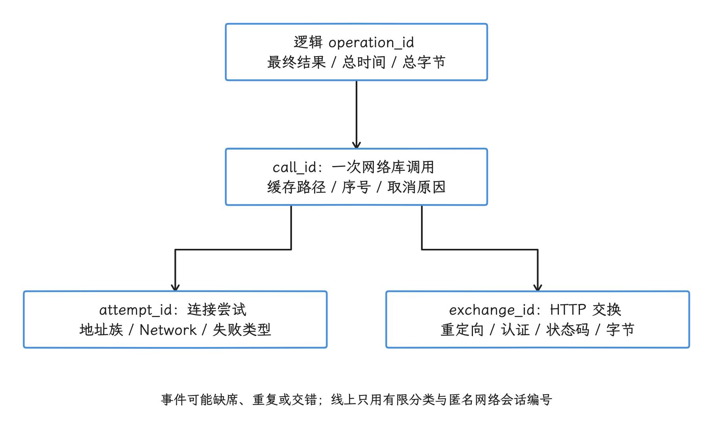
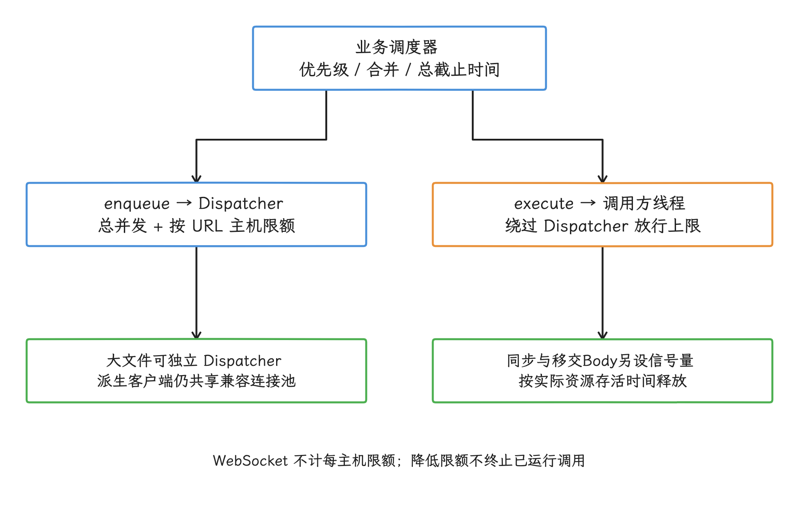
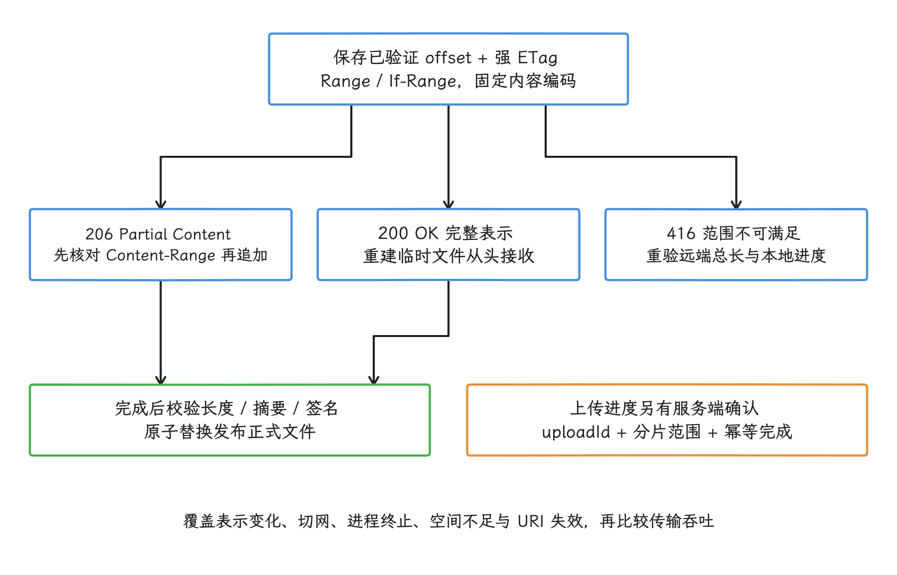
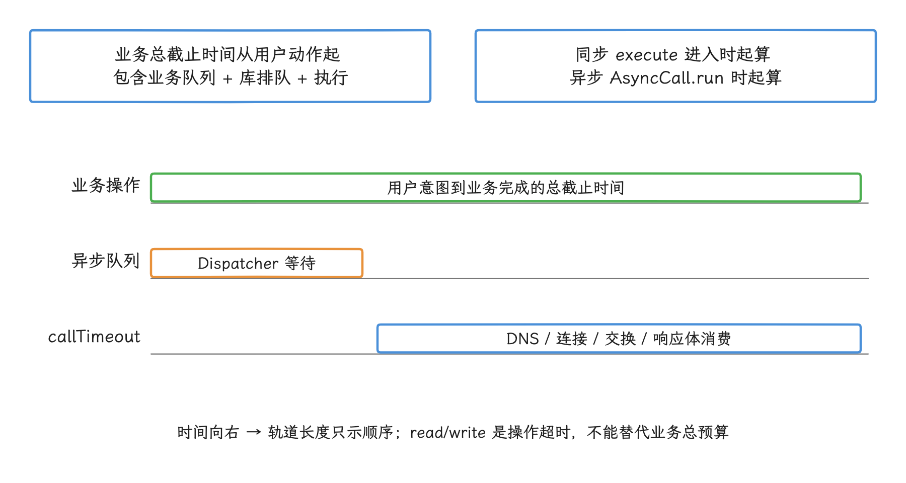
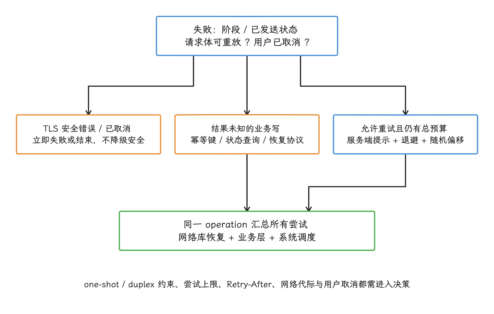
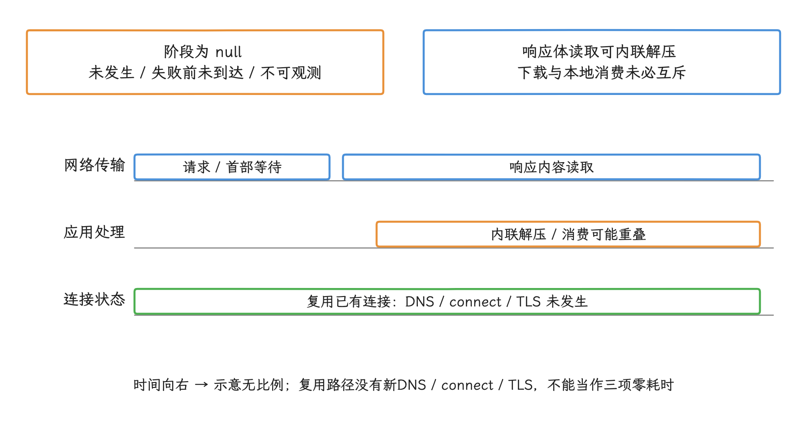
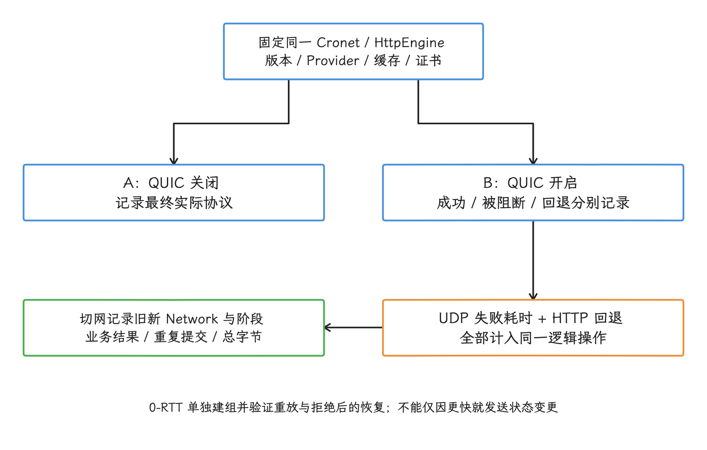
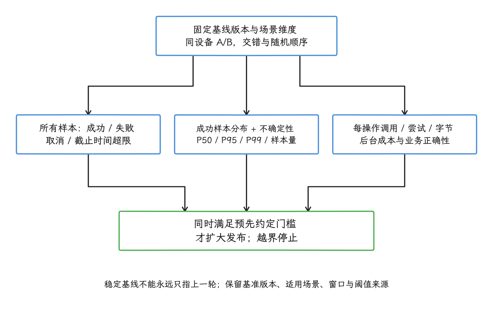

# 移动网络架构、连接与容灾

移动网络会在 Wi-Fi、蜂窝、VPN 和受限网络之间变化。应用先通过 ConnectivityManager 获得 Network（系统分配给一条具体网络的句柄） 与能力，再把 DNS、连接池、重试和幂等策略绑定到对应的网络生命周期。这篇文章讲的就是这条链路：连接怎么复用、域名怎么解析、请求怎么调度、失败之后怎么办。

> 源码基线：平台 AOSP `android-17.0.0_r1`，Android 17 / API 37；客户端 OkHttp 5.4.0，2026 年 6 月 8 日发布。OkHttp 独立于 Android 发布，升级客户端版本后，默认参数、拦截器能力和事件定义要按所升版本重新核对。

## 网络架构、连接生命周期与容灾策略

### 一次网络请求为何会变慢

我们从一次“慢”的请求说起。表面上它只是一个慢，内部却可能先后经历 Dispatcher（OkHttp 的异步调用调度器）排队、DNS 查询、多条地址竞速、TCP 建连、TLS 握手、服务端等待和响应体读取；此时若只改某个超时参数，时间花在哪个阶段仍然判断不了，局部故障还可能被拖成更长的等待。

所以网络层的架构要回答四个问题：怎样复用连接，怎样选择解析策略，怎样隔离不同类型的流量，以及怎样在网络变化和请求失败时控制重试。一次调用的分段计时、协议细节与 TLS 信任配置，我们放到 [12.1 Android 网络与 TLS 性能优化](../../part2-performance/ch12-apk-network/01-android-network-tls-performance.md) 里展开。

### 把网络层拆成四类职责

我们先把网络层拆成连接、解析、调度和容错四类职责。这样分工之后，配置、故障和指标都有了明确的归属。

| 职责 | 负责的问题 | 常见故障 | 主要观测点 |
| --- | --- | --- | --- |
| 连接 | TCP、TLS 和 HTTP 连接如何创建、复用与释放 | 频繁冷建连、响应体未关闭、HTTP/2 复用率低 | `connectStart`、`secureConnectStart`、`connectionAcquired`、协议 |
| 解析 | 主机名如何得到候选地址 | DNS 慢、地址族回退慢、缓存跨网络污染 | `dnsStart`、`dnsEnd`、候选地址数、目标 `Network` |
| 调度 | 哪些请求立即执行，哪些延迟、取消或批量执行 | 首屏流量被大文件占用、同步调用绕过并发限制 | 业务队列、Dispatcher 队列、取消率、后台约束 |
| 容错 | 失败是否重试，何时读取缓存或进入离线队列 | 重试风暴、重复写入、切网后持续使用旧地址 | 失败阶段、尝试次数、幂等键、缓存状态、网络变化序号 |

这四类职责要各自保留接口与指标。全部写进一个拦截器的话，一次逻辑调用里的重定向、认证、传输恢复和业务重试会搅在一起，统一的调用截止时间也难以设置。OkHttp 5.4.0 允许拦截器为当前调用覆盖缓存、连接池、DNS、套接字工厂等客户端配置；这类覆盖应进入配置审计和诊断日志，方便事后追查。

### OkHttp 连接池与复用策略

#### 进程级共享客户端

`OkHttpClient` 持有连接池、Dispatcher、DNS、TLS 配置和拦截器，这些资源都跟着客户端对象走。所以 OkHttp 官方建议在应用内共享客户端；每次请求都新建客户端，得到的是彼此隔离的连接池与线程资源。

下面的代码建立一个进程级共享客户端。示例保持 OkHttp 默认的连接池、并发和超时参数不变——这类参数由项目的链路数据和服务等级目标（可接受的耗时、成功率等边界）决定。

```kotlin
object NetworkClient {
    val shared: OkHttpClient by lazy {
        OkHttpClient.Builder()
            .eventListenerFactory { NetworkEventListener() }
            .build()
    }
}
```

`lazy` 只负责避免重复构造，应用仍要保证各处用的是同一个对象。需要为某类请求单独调整时，优先从 `shared.newBuilder()` 派生：OkHttp 5.4.0 的 `newBuilder()` 会继承配置，并共享连接池、调度器所用线程池等资源；直接调用新的 `OkHttpClient.Builder()`，拿到的就是另一套独立资源。

#### 连接池的空闲连接上限

OkHttp 5.4.0 默认连接池构造参数中的数量，表示最多保留多少条**空闲连接**；正在使用的连接总数由当时的请求决定，域名数量与它也没有对应关系。HTTP/1.1 通常在连接空闲后复用；HTTP/2 更进一步，一条连接上可以并发跑多个逻辑流，每个流承载一组请求与响应。默认值是库自身的调优选择，客户端升级后可能变化，抄进架构文档当常量会跟着过时。

OkHttp 用 `Address`（连接地址配置） 和 `Route`（具体连接路径） 判断连接能否复用：

- `Address` 是一条连接的静态配置，包含 URL 协议方案（scheme，例如 HTTP 或 HTTPS）、主机、端口、DNS、代理、套接字创建器（socket factory）、TLS 配置、主机名校验（hostname verification）器（hostname verifier）和证书或公钥固定（certificate pin）器（certificate pinner）。
- `Route` 在此之上记录本次连接的具体路径：代理、候选 IP 与套接字地址。
- 跨主机的 HTTP/2 连接合并还要求直连路径、IP、证书覆盖、主机名校验、证书固定规则等条件同时满足。

两个域名解析到同一 IP，也未必共享 HTTP/2 连接；反过来，证书覆盖多个域名，同样未必能合并。合并与否，以 OkHttp 5.4.0 的 [`RealConnection.isEligible()`](https://github.com/lysine-dev/okhttp/blob/parent-5.4.0/okhttp/src/commonJvmAndroid/kotlin/okhttp3/internal/connection/RealConnection.kt) 为准；为便于追溯，5.3.0 的 [`RealConnection.isEligible()`](https://github.com/lysine-dev/okhttp/blob/parent-5.3.0/okhttp/src/commonJvmAndroid/kotlin/okhttp3/internal/connection/RealConnection.kt) 也一并保留。


#### 响应体关闭与连接复用

同步调用必须关闭 `Response` 或 `ResponseBody`。下面的代码用于读取一个短文本响应，并确保成功、异常和提前返回时都执行关闭。

```kotlin
fun executeText(client: OkHttpClient, request: Request): String {
    return client.newCall(request).execute().use { response ->
        check(response.isSuccessful) {
            "HTTP ${response.code}"
        }
        response.body.string()
    }
}
```

`use` 在离开作用域时关闭响应体。响应体未正确消费或关闭时，可能持续占用套接字、HTTP/2 流和其他资源，降低复用能力；是否仍能复用还取决于内容是否读完、协议和关闭方式，不能只靠池配置修复。流式下载不要先调用 `string()`，消费结束、取消或异常时同样要关闭响应体。


#### 用事件区分排队、解析、建连与服务端等待

下面的监听器只标出各阶段的起止位置。生产采集器要用单调时钟保存时间戳，把数据写进低开销的内存队列；回调里只做记录，不做文件 I/O、网络 I/O，也不重新调用同一个客户端。

```kotlin
class NetworkEventListener : EventListener() {
    override fun dnsStart(call: Call, domainName: String) = Unit

    override fun dnsEnd(
        call: Call,
        domainName: String,
        inetAddressList: List<InetAddress>,
    ) = Unit

    override fun connectStart(
        call: Call,
        inetSocketAddress: InetSocketAddress,
        proxy: Proxy,
    ) = Unit

    override fun secureConnectStart(call: Call) = Unit

    override fun connectionAcquired(
        call: Call,
        connection: Connection,
    ) = Unit

    override fun responseHeadersStart(call: Call) = Unit

    override fun callFailed(call: Call, ioe: IOException) = Unit
}
```

连接池命中时，DNS 与建连事件可能全部缺席；重定向、认证和连接路径重试，又可能让同一组事件出现多次。所以采集时要以一次逻辑 `Call` 为父级，再为每次 DNS、建连和交换分配事件序号；第一组事件只对应第一次尝试，把它当成整次调用的唯一阶段，时间线就会读错。

一次请求在进入 DNS 之前，还可能先停在业务队列、OkHttp Dispatcher 或缓存判定里，所以端到端时间线要从业务入队开始，覆盖异步排队、直接或条件缓存命中、DNS、每次连接与 TLS 尝试、请求写入、响应首部等待、响应体消费以及解码入库。本文把请求发送完成到最终交换的 `responseHeadersStart` 定义为响应首部等待的代理指标；它不等同于完整响应头解析耗时，也不承诺精确观测网卡首字节。TTFB（Time to First Byte）若使用不同起点、网络栈原始时间或服务端时间，必须另列字段，不能混算。流式上传、双工请求和长连接另行定义起止。

指标应分成四层，避免重试把一次用户动作统计成多次失败：

| 层级 | 示例 | 应记录的标识与预算 |
| --- | --- | --- |
| 逻辑操作 | 刷新首页、提交订单、上传草稿 | `operation_id`、总截止时间、允许的总字节、最终结果 |
| 网络调用 | 一次 OkHttp `Call` 或 Cronet `UrlRequest` | `call_id`、调用序号、缓存路径、取消原因 |
| 连接尝试 | IPv6、IPv4、代理或替代地址 | `attempt_id`、地址族、匿名化 `Network`、失败分类 |
| HTTP 交换 | 重定向、401 跟进、业务层重试 | `exchange_id`、响应码、发送/接收字节 |

逻辑操作成功率、网络调用成功率、连接尝试成功率和缓存可用率，必须各用各的分母。以 Fast Fallback（并行尝试多个候选地址、优先采用先成功连接的机制）为例，把它的每个地址尝试都当成一次请求，会虚增失败率；只保留获胜连接，又看不到某个地址族在持续故障。线上监控只用路由模板、错误分类与匿名化网络标识；完整 URL、查询参数、Cookie、Authorization、原始 IP、证书正文和未经清洗的异常消息，一律不进上报数据。

<!-- gracker-diagram: a265-04-metric-parentage -->


图：四层标识与分母分别保留；缓存命中可无新连接，多地址失败后仍可能完成同一次操作。

### DNS 优化与 HTTPDNS

#### 系统 DNS 的默认解析链路

我们先看默认链路。OkHttp 5.4.0 的 `Dns.SYSTEM` 最终调用 `InetAddress.getAllByName()`，进入当前 Android `Network`（系统分给一条网络的句柄）对应的系统解析链路；这条路会受 VPN、Private DNS（系统级加密 DNS 设置）、每个网络的缓存和网络切换影响。DNS Resolver 自 Android 10 起由可独立更新的 `com.android.resolv` Mainline 模块提供，应用无需再自己维护一份永久 IP 表。

`Dns.lookup()` 是同步接口，OkHttp 在选择连接路径时调用它，实现类还必须支持并发调用。HTTPDNS 指应用通过 HTTP 或 HTTPS 接口获取域名地址的自定义解析方案；它未必采用标准化的 DNS over HTTPS（DoH）协议。

若 `lookup()` 内使用同一个业务客户端向 HTTPDNS 服务发请求，该服务的域名也可能重新进入自定义 `Dns`，形成递归解析；若查询又依赖同一组受限执行资源，还可能出现线程相互等待。排查这类问题时，我们先检查解析路径有没有依赖自身——把它归因成“连接池没有空闲连接”，方向就查偏了。

#### HTTPDNS 接入前的策略约定

HTTPDNS 可用于处理特定地区的解析污染、CDN（Content Delivery Network，内容分发网络）地址选择或解析时延；接入之前，先把以下规则写清楚：

- HTTPS URL 继续使用原主机名。自定义 `Dns` 只返回地址；SNI（TLS 握手携带的主机名提示）、主机名校验、证书或公钥固定和 Cookie 域规则仍按主机名执行。
- TTL（Time to Live，解析结果的有效期）取 HTTPDNS 响应或服务协议给出的值，“统一取 TTL（Time to Live，解析结果的缓存有效期） 的某个百分比”这类通用规则并不存在。
- 缓存键至少包含主机名与 Android `Network` 身份；默认网络变化后旧网络的结果不能直接继承。
- 缓存保留 IPv4、IPv6 和多个候选地址。OkHttp 5.4.0 默认开启 Fast Fallback，会并行错峰尝试候选连接；只保留一个地址会丢失这项恢复能力。这类策略也常称为 Happy Eyeballs。
- HTTPDNS 查询要用独立的引导解析策略，避免依赖正在执行的自定义解析器本身。
- 系统 DNS 回退是产品策略，不是无条件规则。严格隐私模式若承诺只使用指定解析服务，静默转向系统 DNS 会违反承诺；允许回退时也要记录原因。
- 自定义 HTTPDNS 会绕开系统解析器为 Private DNS（Android 的加密 DNS 设置）、企业 VPN 和分流 DNS（不同域名交给不同解析器）提供的解析语义。应用仍可能通过 VPN 传输后续连接，但域名解析结果已不再由该系统策略决定。企业内网、专网和本地域名尤其需要实机验证。

下面的工程骨架只在同步路径读取缓存。`HttpDnsCache` 是应用接口，异步刷新、持久化和服务鉴权应在它的实现外完成。

```kotlin
interface HttpDnsCache {
    fun lookup(
        network: Network?,
        hostname: String,
        nowElapsedRealtimeMs: Long,
    ): List<InetAddress>
}

class CachedHttpDns(
    private val currentNetwork: () -> Network?,
    private val cache: HttpDnsCache,
    private val systemDns: Dns = Dns.SYSTEM,
) : Dns {
    override fun lookup(hostname: String): List<InetAddress> {
        val cached = cache.lookup(
            network = currentNetwork(),
            hostname = hostname,
            nowElapsedRealtimeMs = SystemClock.elapsedRealtime(),
        )
        return cached.ifEmpty {
            systemDns.lookup(hostname)
        }
    }
}
```

这里用 `elapsedRealtime()` 判断进程内有效期，避免用户修改设备日期或时间后错误延长 TTL（Time to Live，生存时间）。缓存要跨重启持久化的话，还要同时保存可恢复的过期依据，并在重启后按协议重新校验。缓存写入端应直接解析数值 IP，避免在同步 `lookup()` 中用主机名解析 API 间接触发另一轮 DNS。

示例适用于明确允许系统 DNS 回退的策略。严格解析策略应把回退实现作为依赖传入，并让失败显式返回。若客户端绑定到指定 Android `Network`，回退解析也应使用该网络的 `getAllByName()`，并与对应的套接字绑定策略保持一致。 `Network` 参与缓存键并不会自动绑定后续连接；需要固定网络时，应捕获同一网络身份，统一配置解析与套接字，并处理捕获后网络失效的情况。示例的 `currentNetwork()` 只表示读取缓存时的当前值，不提供跨解析与建连的原子网络快照。

排查时要分清四种事件：HTTPDNS 查询失败、返回空地址，属于解析服务与缓存策略；地址连接失败要落到具体连接路径上；TLS 校验失败则回到证书与主机名。关闭主机名校验换来的“兼容”，只是把故障藏了起来。


### 网络状态作为动态信号

[`NetworkCapabilities`](https://android.googlesource.com/platform/packages/modules/Connectivity/+/android-17.0.0_r1/framework/src/android/net/NetworkCapabilities.java) 对三个常用能力给出了明确语义：

- `NET_CAPABILITY_INTERNET` 表示网络被配置为访问一般互联网，当前是否可达要另行确认。
- `NET_CAPABILITY_VALIDATED` 表示系统最近一次验证一般互联网成功，业务端点此刻是否可达要另行确认。
- `NET_CAPABILITY_NOT_METERED` 表示网络不按流量计费。大传输应看该能力；Wi-Fi 或蜂窝等传输类型说明的是接入方式，代替不了计费判断。

`VALIDATED` 适合提示离线状态、延迟非紧急公网同步和标记监控数据；拿它当每个 API 请求的前置条件并不合适。系统验证可能刚失效，业务端点仍可达；局域网、企业专网和登录门户（captive portal，需要网页登录或同意条款的受限网络）也可能没有一般互联网验证。Android 17 的局域网访问约束见 [24.9 低带宽、流媒体与本地网络适配](09-low-bandwidth-streaming-local-network.md)。

#### 用回调维护有时序的状态

`getNetworkCapabilities()` 返回的是调用瞬间的快照，源码注释也说明它可能立即过时。所以要注册 `NetworkCallback`，并使用 `onCapabilitiesChanged()` 传入的对象；若在回调内重新同步查询 `getNetworkCapabilities()` 或 `getLinkProperties()`，查询结果可能属于更新后的状态，与当前回调不再对应——这个不一致就是竞态。

下面的代码维护当前 UID（Android 为应用分配的 Linux 用户标识）的默认网络信号，收到能力回调后才发布状态；Android 8.0 / API 26 起，`onAvailable()` 后会按序收到 `onCapabilitiesChanged()`。

```kotlin
data class DefaultNetworkState(
    val network: Network? = null,
    val hasInternetCapability: Boolean = false,
    val validated: Boolean = false,
    val notMetered: Boolean = false,
)

class DefaultNetworkMonitor(
    private val publish: (DefaultNetworkState) -> Unit,
) : ConnectivityManager.NetworkCallback() {
    private var currentNetwork: Network? = null

    override fun onAvailable(network: Network) {
        currentNetwork = network
    }

    override fun onCapabilitiesChanged(
        network: Network,
        capabilities: NetworkCapabilities,
    ) {
        if (network != currentNetwork) return

        publish(
            DefaultNetworkState(
                network = network,
                hasInternetCapability = capabilities.hasCapability(
                    NetworkCapabilities.NET_CAPABILITY_INTERNET,
                ),
                validated = capabilities.hasCapability(
                    NetworkCapabilities.NET_CAPABILITY_VALIDATED,
                ),
                notMetered = capabilities.hasCapability(
                    NetworkCapabilities.NET_CAPABILITY_NOT_METERED,
                ),
            ),
        )
    }

    override fun onLost(network: Network) {
        if (network == currentNetwork) {
            currentNetwork = null
            publish(DefaultNetworkState())
        }
    }
}
```

注册方需要声明 `ACCESS_NETWORK_STATE`，并在不再观察时调用 `unregisterNetworkCallback()`；若把回调投递到可并发执行的自定义执行器，`currentNetwork` 和发布器还要增加同步保护。

默认网络从 Wi-Fi 切到蜂窝时，新旧网络对象具有不同身份；接入点断开后重连，也可能得到新的 `Network`。HTTPDNS 缓存、按网络绑定的套接字以及诊断记录都应保留这一身份，只保存“Wi-Fi/蜂窝”字符串是不够的。


### 网络请求优先级与调度

#### Dispatcher 的管辖范围

OkHttp 5.4.0 的 `Dispatcher` 是异步调用调度器：`maxRequests` 和 `maxRequestsPerHost` 控制通过 `Call.enqueue()` 提交的调用，超过并发上限的调用留在内存队列，等待已有异步调用结束。通过 `Call.execute()` 发起的同步调用虽然会计入 `runningCalls()`，排队与放行的判断却都绕过这两个上限。 这里的“异步调用结束”按 Dispatcher 计数口径指 `onResponse` / `onFailure` 返回；同步调用在 `execute()` 返回时移出运行集合。响应体若被交给其他线程继续消费，仍可能占用连接、流和内存，因此 `runningCalls()` 不是所有活跃传输资源的完整清单，应用的端到端并发限制应覆盖实际资源生命周期。

这一区别会影响架构选择：

- Dispatcher 参数管不到任意线程上的同步 `execute()`，全局层面的限流要在调用方自己实现。
- Dispatcher 没有业务优先级，首屏、预取、监控上报和大文件之间的时效差异，要由上层调度表达。
- `maxRequestsPerHost` 按 URL 主机名计数；多个主机可能指向同一 IP 或代理。WebSocket 也不计入该单主机限制。
- 限额调小只会阻止新的异步调用进入执行状态，已经运行的调用不会被中止。

业务调度应位于 OkHttp 之上：

| 层级 | 职责 | 示例 |
| --- | --- | --- |
| UI / ViewModel | 生命周期与用户意图 | 页面离开时取消；重复点击合并 |
| 数据访问层（Repository） | 数据来源与新鲜度 | 选择内存、磁盘、网络或离线队列 |
| 业务调度器 | 优先级、去重、配额与截止时间 | 首屏先于预取；监控数据合批 |
| OkHttp Dispatcher | 异步总并发与单主机并发 | 执行 `enqueue()` 调用 |
| WorkManager / JobScheduler | 持久后台工作的系统约束 | 网络、电量、充电和存储条件 |

若大文件流量经过 `enqueue()`，并且确认它会影响交互请求，可以为它配置独立 Dispatcher；派生时仍从共享客户端出发，以继续复用兼容的连接。下面的函数展示资源关系，限额由调用方传入项目配置。

```kotlin
fun OkHttpClient.withDispatcherLimits(
    maxRequests: Int,
    maxRequestsPerHost: Int,
): OkHttpClient {
    require(maxRequests > 0)
    require(maxRequestsPerHost in 1..maxRequests)

    val dispatcher = Dispatcher().apply {
        this.maxRequests = maxRequests
        this.maxRequestsPerHost = maxRequestsPerHost
    }
    return newBuilder()
        .dispatcher(dispatcher)
        .build()
}
```

派生客户端使用新的 Dispatcher，连接池仍沿用基准客户端的。并发上限应来自本项目的数据，定值时同时观察 Dispatcher 排队、服务端并发能力、HTTP/2 逻辑流、文件吞吐和交互请求的尾延迟——尾延迟指 P95、P99 等较慢分位的耗时，平均值代表不了它。

<!-- gracker-diagram: a265-07-dispatcher-scope -->


图：独立 Dispatcher 隔离异步调度；连接仍可共享，活跃流与带宽竞争需另行测量。

请求取消应由持有 `Call` 的业务作用域执行 `Call.cancel()`，或由支持取消传播的协程适配器完成。扫描 `dispatcher.queuedCalls()` 和 `runningCalls()` 后按请求标签（tag）取消，拿到的是一个会变化的快照，还容易误取消其他页面复用的请求；共享请求则要用引用计数或订阅者模型——一个订阅者退出时，其他订阅者仍在等待的调用继续执行。

#### 后台传输要按用户意图选择 API

Android 官方的[后台数据传输选择指南](https://developer.android.com/develop/background-work/background-tasks/data-transfer-options)区分了可延迟同步和用户发起的长传输：

| 场景 | 推荐机制 | 边界 |
| --- | --- | --- |
| 非用户发起、可延迟的同步或上传 | WorkManager | 普通工作通常应能在约 10 分钟内完成，并且可停止、可重试；约束满足不保证精确开始时间 |
| 用户发起并需要持续展示进度的长上传或下载 | Android 14 / API 34 起使用 User-Initiated Data Transfer Job（UIDT，用户发起的数据传输任务） | 调度时机、通知与约束需符合 UIDT 要求；旧系统准备兼容方案 |
| 平台已有专用传输 API 的场景 | 专用 API | 优先使用平台已提供的生命周期与系统集成 |
| WorkManager 和专用 API 均不适合的短时关键工作 | 符合类型要求的前台服务 | 受后台启动、时长和前台服务类型限制 |

WorkManager 的长运行 Worker（工作单元）由前台服务与 JobScheduler（系统后台任务调度器）协作执行。Android 16 起这类工作会消耗应用的任务运行配额——系统允许应用占用后台执行资源的额度——Android 17 沿用这一规则；UIDT 走另一条路，不消耗普通任务配额，但仍受系统健康约束。截至本次核验，Jetpack 还没有 UIDT 的兼容抽象，Android 14 以下要准备 WorkManager 长运行 Worker 等回退路径。用户点击后启动的长文件传输，就要按这些配额和时长约束来设计运行方式。

可延迟流量应合并传输，并用 `UNMETERED`、充电和电量等约束表达成本偏好。无线电尾部耗电随设备、制式、信号和运营商配置变化，通用调度算法里写死某个固定秒数行不通。


#### 大文件传输的可恢复状态

大文件一次失败的成本远高于普通 API。下载任务至少要持久化资源标识、临时文件、已验证字节数、总长度、强 ETag（服务器为特定字节表示生成且不带弱校验前缀 `W/` 的版本标识）、内容摘要与任务状态；上传任务还要区分“客户端已发送”和“服务端已确认”——进度只放在内存里，一遇切网、进程终止或系统停止任务就会丢。

恢复 HTTP 下载时应遵守以下协议：

- 发送 `Range: bytes=<offset>-` 请求从指定字节偏移继续下载，并用 `If-Range` 携带强 ETag 等版本验证器；
- 只有收到 `206 Partial Content`（部分内容），且 `Content-Range` 给出的起点、终点和总长度都与记录一致时才追加；
- 收到 `200 OK` 说明服务端发送完整表示，此时要丢弃或重建旧临时文件，从头接收；
- 收到 `416 Range Not Satisfiable`（请求范围不可满足）时重新核对 `Content-Range` 与本地长度，确认前先别宣告完成；
- 透明内容编码会改变字节偏移，断点协议要固定编码表示，必要时使用 `Accept-Encoding: identity`，要求服务器不要对响应内容再做压缩转换；
- 完成后校验长度、摘要或签名，再用一次不可分割的替换发布正式文件，避免其他读取方看到半成品。

上传前不要把整份文件读入字节数组。用户选择的 `content://` 内容地址应复制到应用拥有的不可变暂存文件，或通过 `ACTION_OPEN_DOCUMENT`（系统文档选择器动作）获取持久 URI（资源标识符）权限；即便已经持久授权，原文档被移动或删除后仍要按可恢复错误处理。

OkHttp 的文件请求体可流式发送，但暂存文件在重试完成前必须保持路径、长度和内容不变。

断点上传还要服务端协议配合：创建稳定的 `uploadId`（一次上传会话的唯一标识）；每个分片携带范围、长度与校验值；服务端以不可分割的操作确认分片，重复提交同一分片得到相同结果；客户端只持久化已确认范围；完成操作使用幂等语义，并由服务端验证完整长度与摘要。幂等指同一操作重复执行不会重复产生业务效果。

分片并发与大小应依据网络、服务端限制和设备读写实测，进度回调按时间或变化幅度限制频率。

验收时先验证恢复正确性，再比较吞吐：用例要覆盖 `206`/`200`/`416`、远端表示变化、网络切换、进程终止、任务停止、存储不足、URI 失效、多任务争用和计费网络策略；完整传输的本地长度/摘要、正式文件发布状态与服务端完成状态必须一致。

<!-- gracker-diagram: a265-09-range-download-recovery -->


图：断点针对稳定字节表示；客户端已发送不等于服务端已确认，上传恢复需要服务端协议。

### 弱网优化从失败阶段开始

弱网优化的第一步，是把失败落到具体阶段上。直接延长全部超时并增加重试次数，失败请求会占用更多连接、线程、电量和用户等待时间，问题本身还留在原地。

| 阶段 | 可观测信号 | 处理方向 |
| --- | --- | --- |
| Dispatcher 排队 | `dispatcherQueueStart` 到 `dispatcherQueueEnd` | 调整业务优先级、合并请求、隔离大传输 |
| DNS | `dnsStart` 到 `dnsEnd`、`UnknownHostException` | 检查目标网络、Private DNS、自定义解析和候选地址 |
| TCP | `connectStart` 到成功或 `connectFailed` | 保留多地址与 Fast Fallback，按地址族和具体连接路径分析 |
| TLS | `secureConnectStart` 后成功或连接失败 | 检查证书链、主机名、证书固定规则、TLS 协商与连接复用 |
| 请求写入 | 请求体事件、已发送字节 | 检查上传体积、写超时、取消与请求体是否可重新发送 |
| 响应首部 | 请求发送完成到 `responseHeadersStart` | 检查服务端排队、CDN、上行完成时间 |
| 响应体 | 响应体事件、读取字节 | 分页、压缩、断点续传、消费方读取速度 |

我们先用这张表定位失败阶段，再选相应措施；阶段还没确定时的统一延长、统一加重试，只会掩盖原始问题。

#### 超时是分阶段预算

OkHttp 的超时是分阶段的预算：`connectTimeout` 约束套接字建连，`readTimeout` 和 `writeTimeout` 约束对应的读写操作；`callTimeout` 覆盖一次 `Call` 开始执行后的 DNS、连接、写入、服务端等待和响应体消费。固定 5.4.0 的 `RealCall` 在同步 `execute()` 进入时启动计时，异步调用则在 `AsyncCall.run()` 才启动，Dispatcher 队列等待不包含在内。业务总截止时间应在外层从用户动作开始计算，并覆盖队列等待、多次 Call、退避与恢复；超限时主动取消。延长读超时不能解决 DNS 或 Dispatcher 排队，单次 Call 的超时也不能替代整个用户路径的截止时间。

<!-- gracker-diagram: a265-03-queue-and-call-timeouts -->


图：异步 Dispatcher 等待不计入 callTimeout；用户路径用外层总截止时间统一限制多次调用与重试。

参数由同一接口在不同网络类别下的耗时分位数、用户交互截止时间和服务端服务等级目标得出。分位数描述一组请求中有多少比例不超过该耗时，例如 P95 是 95% 的样本不超过的值；流式下载与短 API 的读取模型不同，共用一组机械常数并不合适。

#### 区分传输恢复与业务重试

OkHttp 5.4.0 的 `retryOnConnectionFailure` 默认开启，用于从部分连接故障中恢复，例如失效的池连接或可替代连接路径。这里要分清：它恢复的是传输，业务操作要不要重新提交是另一个问题。一次 `Call` 内部发生传输恢复后，应用层拦截器若又执行重试，实际尝试次数可能高于业务代码表面上的计数。 `RetryAndFollowUpInterceptor.recover()` 主要按异常类别、请求是否开始发送、`isOneShot()` 与剩余连接路径判断，并不普遍替业务验证 HTTP 方法或服务端幂等性；可重放的 POST 也可能被传输层重发。因此结果未知的业务写必须先设计服务端幂等键或状态查询，不能把“库内恢复”视为不会重复副作用的保证。

HTTP 语义提供起点，但服务端契约仍需确认：

- RFC 9110 把 GET、HEAD 等安全方法，以及 PUT、DELETE，定义为幂等方法。幂等描述重复相同请求的预期服务端效果；响应是否相同、服务端是否严格照规范实现，都不在它的保证范围内。
- 对非幂等方法，“尚未收到响应”推不出服务端没有执行；支付、下单、发消息这类 POST 请求，要靠服务端幂等键、状态查询或事务协议兜住。
- 一次性请求体重放起来并不可靠。自定义流式 `RequestBody` 若只能写一次，应实现 `isOneShot()`，把“该内容不可重新生成”明确告诉客户端，避免不安全的重传。
- `Retry-After` 可表达服务端期望的等待时间。503 的语义见 RFC 9110，429 的使用见 RFC 6585；客户端还要服从用户取消与整次调用截止时间。

一个可审计的重试策略至少包含以下字段：

| 字段 | 要回答的问题 |
| --- | --- |
| 失败阶段 | DNS、连接、TLS、写入、响应首部还是响应体失败 |
| 已发送状态 | 请求头或请求体是否可能已到达服务端 |
| 操作语义 | 方法是否幂等，服务端是否支持幂等键 |
| 请求体能力 | 能否重新生成；是否为 `one-shot`（只能写一次）或 `duplex`（请求与响应可同时流动的双工传输） |
| 服务端提示 | 是否有合法的 `Retry-After` |
| 总预算 | 已尝试多少次，还剩多少调用时间 |
| 网络变化 | 默认网络是否已变化，旧连接路径是否仍适用 |
| 取消状态 | 页面、任务或用户是否已取消 |

重试间隔可以按指数逐次增大，并在每次间隔中加入随机偏移，避免大量客户端同时重试。起始间隔、上限和次数要来自业务恢复目标、服务端容量与整次截止时间；对所有接口都安全的一组毫秒值，并不存在。

<!-- gracker-diagram: a265-10-retry-admission -->


图：多层重试共享同一逻辑操作预算；可重放请求体只是必要条件之一，不能证明业务副作用幂等。

#### 网络状态与端点结果分开看

默认网络为空时，应用可以直接进入离线界面，但切网回调与请求执行之间仍有时序差。网络带 `VALIDATED`，业务域名也可能故障；没有 `VALIDATED`，局域网端点仍可能可达。所以请求结果、端点健康和 `NetworkCapabilities` 要分别记录。

弱网体验还要数据策略配合：列表可展示带新鲜度标记的缓存，图片可按资源版本选择较小变体，上传可持久化进度并支持断点，非必要模块可以延迟请求。缓存控制与离线写入见 [24.3 数据缓存与离线优先架构](03-data-cache-offline-first.md)。

Android 的网络调用要放在后台线程执行。AOSP `android-17.0.0_r1` 的 `StrictMode` 在启用网络检测和对应终止策略时，会由 `onNetwork()` 抛出 `NetworkOnMainThreadException`；UI 线程等待后台 `Future`、锁或 `runBlocking` 不一定触发同一异常，却照样卡住输入与绘制，排查时要同时检查线程等待关系。

#### 流量归因的统计范围

归因先看 UID 级计数。`TrafficStats.getUidRxBytes()` 与 `getUidTxBytes()` 返回当前 UID 自开机以来、跨所有网络接口累计的网络层字节，适合做前后差值与粗粒度异常发现，统计会合并同一 UID 的多个进程，不能直接归因给当前进程；在 Android 7.0（API 24）及以上，应用只能查询调用方自身 UID 的这两个计数。

单请求、单域名或后台移动网络的字节，要另找数据源：这两个接口给不出，设备重启后归零，不支持时返回 `UNSUPPORTED`；VPN 转发和 CLAT（把应用的 IPv4 流量转换到仅 IPv6 网络的兼容机制）也可能改变计数的范围，结算和安全审计要用别的数据源。历史用量走 `NetworkStatsManager`，并遵守权限与用户授权；`setThreadStatsTag()` 只是添加归因标签，限流、取消和后台约束仍要应用自己实现。

网络方案上线时，至少比较逻辑操作的 P50、P95、P99 和超时率，再看每个操作产生的调用数、连接尝试数与总字节，缓存直接或条件命中率，切网或页面退出后的遗留请求，以及后台移动流量和任务完成时效。平均耗时下降而 P99、重试次数或后台字节上升，还谈不上优化有效。

### 账号、安全与资源隔离

Cookie、认证头和业务拦截器属于请求策略；共享连接不会自动让后续请求继承上一次请求的 Cookie 或 Authorization，应用仍必须正确构造并隔离各请求的认证信息。对于按请求认证的普通 HTTP 业务，登录态和匿名态可用派生客户端或请求构造器表达，仅因为账号不同不必另建连接池；若采用与连接绑定的认证或其他隔离要求，应按该协议单独评估共享边界。

TLS、代理与套接字配置会参与连接资格判断。使用不同的证书信任管理器（trust manager）、主机名校验器、证书或公钥固定器、客户端证书、代理或 DNS 时，要让配置差异在各自客户端中一眼可见，并验证 OkHttp 复用的都是兼容连接；复用率靠连接管理去提升，证书校验与主机名验证始终保持完整。

是否使用独立连接池，可按以下条件判断：

- 是否需要独立释放资源或独立进程生命周期。
- 大传输是否经过实测持续影响交互请求，且只隔离 Dispatcher 仍不足。
- 代理、套接字创建器或连接安全策略是否存在不可共享的要求。
- 独立连接池带来的额外建连、TLS 和内存成本是否可接受。

按业务团队各建一个客户端，对网络层没有实际意义，还会让拦截器、认证、缓存和指标配置产生多份版本。客户端应按传输与安全策略管理，而不是按模块目录管理。

### Wi-Fi 选网的应用侧观测

默认网络由 Android 连接服务按请求能力、网络评分、用户选择、验证状态和设备配置决定，我们拿一个 RSSI（接收信号强度，通常以 dBm 表示）阈值是复现不了系统结果的。相关源码链路见 [24.8 Wi-Fi 评分、网络选择与连接切换性能](08-wifi-connectivity-selection.md)。

应用侧应记录：

- 默认 `Network` 身份与变化序号。
- 传输类型、`VALIDATED`、`NOT_METERED`、VPN 和登录门户等取值种类有限的信号；限制取值种类可以控制指标维度数量，避免监控系统负担失控。
- Dispatcher 排队、DNS、每次连接尝试、TLS、请求写入、TTFB 和响应体读取。
- 使用的协议、连接是否复用、缓存命中与失败阶段。

应用侧记录上面这些信号，系统侧再结合 `bugreport`（Android 诊断信息包）、`dumpsys connectivity` 与 `dumpsys wifi`（分别导出连接服务和 Wi-Fi 服务状态的命令）、Perfetto 系统追踪和 `logcat` 系统日志，把选网过程还原出来。应用指标里的“Wi-Fi”只说明传输类型，计费、互联网可达性和信号质量要看对应的字段。

### 工程检查清单

- 是否共享基准 `OkHttpClient`，并明确哪些派生客户端共享连接池。
- 同步 `execute()` 是否由调用方限流，是否错误地把 Dispatcher 参数当成同步限额。
- 是否关闭每个响应体，并测试取消、异常和提前返回路径。
- `EventListener` 是否允许事件缺席、重复和交错，回调中是否避免阻塞工作。
- HTTPDNS 是否保留原主机名、TTL、多地址、网络身份和引导解析策略。
- HTTPDNS 对 Private DNS、VPN、企业分流和隐私承诺的影响是否经过评审。
- 网络状态是否来自回调参数，是否避免把 `VALIDATED` 当作业务端点前置条件。
- 页面取消是否直接作用于所持有的 `Call`，共享请求是否保护其他订阅者。
- 可延迟工作、用户发起的长传输和前台服务是否按 Android 17 规则选择。
- 重试是否同时检查失败阶段、幂等语义、请求体能力、服务端提示和总截止时间。
- 大传输是否根据 `NOT_METERED` 与用户意图决策，而不是只看 Wi-Fi 传输类型。
- 是否用 `MockWebServer` 等测试工具覆盖断连、慢响应体、TLS 失败、重定向和重试，并在设备上覆盖 VPN、Private DNS、IPv6、切网与登录门户。

### 架构与容灾小结

回到整体：我们把网络层拆成连接、解析、调度和容错四类独立责任，再让每次逻辑操作统一约束调用数、连接尝试、字节和总截止时间。系统网络能力只提供动态背景；恢复策略仍要结合失败阶段、请求体是否可重放、服务端幂等协议和用户取消状态。

### 相邻专题边界

- [24.6 HTTP/2、HTTP/3、gRPC 与 ECH](06-http2-http3-grpc-ech.md)：HTTP/2、HTTP/3、gRPC 与协议协商。
- [24.3 数据缓存与离线优先架构](03-data-cache-offline-first.md)：HTTP 缓存、多级缓存、新鲜度、离线队列与冲突处理。
- [24.8 Wi-Fi 评分、网络选择与连接切换性能](08-wifi-connectivity-selection.md)：系统评分、默认网络与切换。
- [24.9 低带宽、流媒体与本地网络适配](09-low-bandwidth-streaming-local-network.md)：局域网能力与 Android 17 的访问限制。

### 架构与连接部分的源码依据

#### 当前平台与客户端依据

- [AOSP `android-17.0.0_r1` NetworkCapabilities](https://android.googlesource.com/platform/packages/modules/Connectivity/+/android-17.0.0_r1/framework/src/android/net/NetworkCapabilities.java)
- [AOSP `android-17.0.0_r1` ConnectivityManager 与 NetworkCallback](https://android.googlesource.com/platform/packages/modules/Connectivity/+/android-17.0.0_r1/framework/src/android/net/ConnectivityManager.java)
- [AOSP `android-17.0.0_r1` DnsResolver](https://android.googlesource.com/platform/packages/modules/Connectivity/+/android-17.0.0_r1/framework/src/android/net/DnsResolver.java)
- [AOSP `android-17.0.0_r1` StrictMode](https://android.googlesource.com/platform/frameworks/base/+/android-17.0.0_r1/core/java/android/os/StrictMode.java)
- [Android DNS Resolver Mainline 模块](https://source.android.com/docs/core/ota/modular-system/dns-resolver)
- [Android 读取网络状态指南](https://developer.android.com/develop/connectivity/network-ops/reading-network-state)
- [Android 后台数据传输选择指南](https://developer.android.com/develop/background-work/background-tasks/data-transfer-options)
- [Android User-Initiated Data Transfer Job](https://developer.android.com/develop/background-work/background-tasks/uidt)
- [Android WorkManager 长运行 Worker](https://developer.android.com/develop/background-work/background-tasks/persistent/how-to/long-running)
- [OkHttp 变更记录](https://github.com/lysine-dev/okhttp/blob/main/CHANGELOG.md)
- [OkHttp 5.4.0 OkHttpClient](https://github.com/lysine-dev/okhttp/blob/parent-5.4.0/okhttp/src/commonJvmAndroid/kotlin/okhttp3/OkHttpClient.kt)
- [OkHttp 5.4.0 Dispatcher](https://github.com/lysine-dev/okhttp/blob/parent-5.4.0/okhttp/src/commonJvmAndroid/kotlin/okhttp3/Dispatcher.kt)
- [OkHttp 5.4.0 Dns](https://github.com/lysine-dev/okhttp/blob/parent-5.4.0/okhttp/src/commonJvmAndroid/kotlin/okhttp3/Dns.kt)
- [OkHttp 5.4.0 EventListener](https://github.com/lysine-dev/okhttp/blob/parent-5.4.0/okhttp/src/commonJvmAndroid/kotlin/okhttp3/EventListener.kt)
- [OkHttp 5.4.0 ResponseBody](https://github.com/lysine-dev/okhttp/blob/parent-5.4.0/okhttp/src/commonJvmAndroid/kotlin/okhttp3/ResponseBody.kt)
- [OkHttp 5.4.0 RequestBody](https://github.com/lysine-dev/okhttp/blob/parent-5.4.0/okhttp/src/commonJvmAndroid/kotlin/okhttp3/RequestBody.kt)
- [OkHttp 5.4.0 RealConnection](https://github.com/lysine-dev/okhttp/blob/parent-5.4.0/okhttp/src/commonJvmAndroid/kotlin/okhttp3/internal/connection/RealConnection.kt)

#### 保留的旧版本源码锚点

- [OkHttp 5.3.0 OkHttpClient](https://github.com/lysine-dev/okhttp/blob/parent-5.3.0/okhttp/src/commonJvmAndroid/kotlin/okhttp3/OkHttpClient.kt)
- [OkHttp 5.3.0 Dispatcher](https://github.com/lysine-dev/okhttp/blob/parent-5.3.0/okhttp/src/commonJvmAndroid/kotlin/okhttp3/Dispatcher.kt)
- [OkHttp 5.3.0 Dns](https://github.com/lysine-dev/okhttp/blob/parent-5.3.0/okhttp/src/commonJvmAndroid/kotlin/okhttp3/Dns.kt)
- [OkHttp 5.3.0 EventListener](https://github.com/lysine-dev/okhttp/blob/parent-5.3.0/okhttp/src/commonJvmAndroid/kotlin/okhttp3/EventListener.kt)
- [OkHttp 5.3.0 ResponseBody](https://github.com/lysine-dev/okhttp/blob/parent-5.3.0/okhttp/src/commonJvmAndroid/kotlin/okhttp3/ResponseBody.kt)
- [OkHttp 5.3.0 RequestBody](https://github.com/lysine-dev/okhttp/blob/parent-5.3.0/okhttp/src/commonJvmAndroid/kotlin/okhttp3/RequestBody.kt)

#### HTTP 规范

- [RFC 9110：HTTP Semantics](https://www.rfc-editor.org/rfc/rfc9110.html)
- [RFC 6585：Additional HTTP Status Codes](https://www.rfc-editor.org/rfc/rfc6585.html)
- [RFC 7233：Range Requests（旧版范围请求规范）](https://www.rfc-editor.org/rfc/rfc7233.html)


## 网络性能基线、故障实验与发布门禁

系统网络状态确定后，应用传输层还要处理域名解析、连接建立、协议回退和网络切换，重试要始终受幂等性和总截止时间约束。这一部分我们接着讨论样本设计、对照实验和发布阻断规则。

### 基线范围

谈基线之前先约定它指什么：性能基线是一组可重复测量、可与后续版本比较的数据分布，记录中要写清用户路径、应用与系统版本、网络状态、缓存与连接方式，以及成功和失败的计数规则。缺了这些条件的“平均耗时”，说明不了新版本有没有退化。

37.1 新增的 `HttpEngine` 计时能力会单独标出。前文已给出请求事件与重试上限；协议与解析分别在 24.6（HTTP/2、HTTP/3 与 QUIC）和 24.7（HTTPDNS 接入）展开。发布阻断规则指持续集成或发布系统里的自动判断——指标越过约定阈值，就停止合入或发布。

### 三类基线各自回答一个问题

工程中至少保留三类基线。它们的环境和用途不同，数据合并后算出的分位值说明不了问题。

| 基线 | 环境 | 回答的问题 | 适合自动阻断的指标 |
| --- | --- | --- | --- |
| 确定性基线 | 本地测试服务、固定响应、受控故障代理 | 客户端排队、读写、解码、取消和重试语义是否退化 | 操作耗时、调用数、尝试数、字节数、功能不变量 |
| 设备实验室基线 | 固定真机、系统版本、接入点、服务端，并人为控制带宽、延迟和丢包 | DNS、建连、协议、切网与功耗改动是否符合预期 | 分阶段分布、成功率、协议使用率、恢复时间、能耗 |
| 线上基线 | 真实地区、运营商、设备与服务端版本 | 改动对用户路径和慢请求有什么影响 | 页面完成、请求成功、P50/P95/P99、后台流量、业务正确性与资源上限 |

P50、P95、P99 分别表示 50%、95%、99% 的样本不超过该值；P95/P99 描述分布尾部的慢请求，常称“尾延迟”。三类基线里，确定性基线可以进入 CI（持续集成）随每次提交执行；公共互联网和生产 CDN（内容分发网络）受调度、拥塞、证书、服务端发布与时间段影响，适合定时实验和分阶段发布验证，当不了每次提交的单一阻断条件。分阶段发布是先让少量用户用上候选版本，观察指标后再逐步扩大范围，也常称“灰度发布”。


基线对象也应从用户路径开始。“首页可交互”这样的路径可能包含配置、列表、图片和本地解码，单个 API 变快，页面未必跟着变快。每条关键路径都要定义：

- 开始事件与完成事件。
- 必须成功的请求、允许使用旧缓存的请求和可延后请求。
- 用户等待截止时间与取消条件。
- 允许的网络调用数、连接尝试数和总字节。
- 服务端写操作的幂等与结果查询方式，例如重复请求不会创建两笔订单。

### 请求阶段拆分使用同一份指标字典

基线字段沿用前文的请求时间线。一个“逻辑操作”——用户或业务发起的一次目标，例如刷新首页——可能触发多次网络库调用；一次网络库调用又可能因多地址连接、重试或重定向，产生多次连接尝试和 HTTP 交换。报告至少保留这四个层级，把内部恢复和用户请求分开数，才不会把前者误算成后者。

| 阶段 | 起止边界 | 缺失时如何解释 | 不能混入的时间 |
| --- | --- | --- | --- |
| 业务队列 | 用户动作到调用网络层 | 无队列也要记录零或明确缺失原因 | OkHttp `Dispatcher` 等待 |
| 调度队列 | 网络库接收调用到开始执行 | 同步调用或未排队时可能没有独立事件 | DNS、代理选择、缓存查找 |
| 缓存路径 | 缓存判定到命中，或转入网络 | 未配置缓存与缓存未命中要分开 | 响应解码与业务缓存 |
| DNS | 解析开始到结果或错误 | 复用连接时通常没有 DNS | 地址建连和 Fast Fallback 等待 |
| 建连尝试（connect） | 每次 `connectStart` 到 `connectEnd` 或 `connectFailed` | 复用连接时没有新建连 | OkHttp HTTPS 的成功区间包含 TLS 子区间，不可再与 TLS 时长直接相加 |
| TLS | 握手开始到验证结束 | 明文、复用连接或库未暴露时为空 | 服务端应用处理 |
| 上传 | 请求头发送开始到请求体完成 | 无请求体时以请求头发送完成为界 | 排队和响应等待 |
| 响应首部等待代理 | 请求发送完成到最终交换的 `responseHeadersStart` | 不等同网卡首字节；缓存与双工流另行定义 | 完整响应头解析与响应体下载 |
| 响应体消费 | 响应体开始到读取完成或关闭 | 提前关闭要记录取消或截断 | 可能包含内联解压与消费方等待，需额外埋点才能拆分 |
| 本地消费 | 字节可用到业务消费完成 | 后台预取可能没有界面事件 | 网络等待 |

阶段值允许为空，但应同时记录原因：阶段未发生、请求提前失败，或所用网络栈没有暴露数据。复用连接时不能把缺失的 DNS、connect、TLS 强行填成零；实际计时起止相同才可按接口契约解释为未阻塞或零观测间隔。OkHttp HTTPS 的 connect 包含 TLS 子区间，流式响应体读取也可能与解压、本地消费重叠，只有边界互斥时才能把阶段相加。聚合前，按缓存路径、连接复用、协议、成功/失败和取消分别统计。

<!-- gracker-diagram: a265-12-missing-and-overlapping-stages -->


图：保留缺失原因；分段只有在边界互斥时才可相加，响应头事件作为代理指标须写明定义。

#### 用结构化键约束样本

下面的 Kotlin 数据结构给实验记录建立最小约束：它不发请求，只规定哪些环境字段必须随样本保存。

```kotlin
enum class RequestPathState {
    NETWORK_NEW_CONNECTION,
    NETWORK_REUSED_CONNECTION,
    CACHE_HIT,
    CACHE_REVALIDATED,
}

enum class OperationOutcome {
    SUCCEEDED,
    FAILED,
    CANCELED,
    DEADLINE_EXCEEDED,
}

data class NetworkBaselineKey(
    val platformApi: Int,
    val platformBuildId: String,
    val appVersionCode: Long,
    val networkStackName: String,
    val networkStackVersion: String,
    val networkStackConfigId: String,
    val scenarioId: String,
    val requestPathState: RequestPathState,
    val networkSessionId: Long,
    val transports: Set<Int>,
    val validated: Boolean,
    val metered: Boolean,
)

data class NetworkBaselineSample(
    val key: NetworkBaselineKey,
    val operationElapsedNanos: Long,
    val outcome: OperationOutcome,
    val negotiatedProtocol: String?,
    val sentBytes: Long?,
    val receivedBytes: Long?,
    val networkCallCount: Int,
    val connectionAttemptCount: Int,
)
```

`networkSessionId` 是进程内为每个新观察到的 `Network` 分配的临时编号，系统网络句柄本身不上传。实验室里可以保存完整系统构建号；线上数据则按预先定义的版本或设备类别分组，属性组合一旦过细，就可能形成可识别单台设备的指纹。这种把连续或高种类数据归入有限类别的做法常称“分桶”。

`scenarioId`、网络栈配置编号和传输集合必须来自白名单，账号、URL、IP 和文档名一律排除在外。

分位值只在 `NetworkBaselineKey` 相同、或分析者明确选择的维度内计算；系统版本、网络栈提供程序、缓存路径或计费状态不同的样本直接混合，环境构成变化会被误判成代码回归。

### DNS 与地址选择的基线怎么建

我们先看解析这一侧。Android 10 / API 29 起公开的 `DnsResolver` 支持异步查询，并可传入代表某条系统网络的 `Network`；`android-17.0.0_r1` 的 [`DnsResolver.java`](https://android.googlesource.com/platform/packages/modules/Connectivity/+/refs/tags/android-17.0.0_r1/framework/src/android/net/DnsResolver.java) 仍按目标网络的 `netId` 发起解析，`netId` 是系统内部标识该网络的编号。它属于系统解析入口，和应用自行请求指定服务的 HTTPDNS 是两回事。

每种解析方案单独建组：

| 解析路径 | 固定条件 | 必须记录 | 不能由结果推断 |
| --- | --- | --- | --- |
| 系统 DNS | Android `Network`、Private DNS 状态、网络会话 | 是否执行查询、耗时、结果数量、错误类别 | 具体递归解析器的完整内部耗时 |
| HTTPDNS | 服务版本、缓存版本、系统 DNS 回退策略 | 本地命中、过期、请求结果、回退原因 | 返回地址一定可连接或证书一定匹配 |
| 应用内 DoH | DoH 提供方、引导地址、连接复用状态 | 引导方式、查询耗时、HTTP 状态、回退 | Android 系统 DNS 的行为 |
| 平台 Private DNS | 系统设置与 `LinkProperties` 快照 | 是否启用、是否验证、默认网络会话 | 应用请求一定使用某个特定服务器 |

DoH（DNS over HTTPS）把 DNS 查询装入 HTTPS 请求；Android 的 Private DNS 则是用户或管理员配置的平台级加密 DNS。`LinkProperties` 提供某条网络的链路属性快照，包括 DNS 服务器等配置。

“冷 DNS”通常指没有可用解析缓存的首次查询。应用能清理自己的 HTTPDNS 缓存，系统解析缓存通常既独占不了、也清理不干净；控制系统缓存做不到时，报告就写“新应用客户端、无应用缓存”，别写成“系统冷解析”。

地址选择要保留候选数量、地址族、每次尝试的顺序、是否并行、失败类型和获胜尝试。OkHttp 5.4.0 默认启用 Fast Fallback：固定源码每隔 250 ms 启动候选 TCP 建连，较早成功的 TCP 路径胜出后取消并推迟其余竞速，再在获胜路径执行 TLS 等后续建立步骤；后续失败仍可继续尝试；这类算法也称 Happy Eyeballs，用少量额外连接，换掉单一地址族不可达造成的等待。只记录最终 IPv4 或 IPv6，另一组地址持续失败就被隐藏了。线上遥测不保存原始 IP，可使用地址族、匿名化边缘节点编号和服务端返回的区域标记。

TTL 规定 DNS 记录可以缓存多久，到期只影响后续解析：已经复用的连接不会随之自动失效，清空连接池也模拟不了普通的 TTL 刷新。HTTPDNS 与 OkHttp 同步接口的衔接见 24.7。

### 连接复用与队头阻塞要分路径测试

队头阻塞指排在前面的数据丢失或处理变慢时，后续数据也被迫等待。连接复用实验至少建立四种请求路径：

| 路径 | 实验准备 | 验证目标 |
| --- | --- | --- |
| 新连接 | 无可复用连接，明确 DNS 缓存条件 | 解析、地址选择、connect、TLS 和首个交换 |
| 复用空闲连接 | 同一网络、代理、地址与安全配置，前一请求已完成 | 连接池命中与省去握手后的收益 |
| 多路复用并发 | 同一 HTTP/2 或 HTTP/3 连接发出多请求 | 流数量、优先级、丢包时的尾延迟与大响应干扰 |
| HTTP 缓存 | 分别制造直接命中、条件请求和未命中 | 缓存语义、线上字节与本地读取成本 |

注意，新建一个客户端，网络状态未必都已清空：系统 DNS、TLS 会话状态、Cronet 磁盘数据、服务器 QUIC 信息和 CDN 边缘状态都可能保留。报告要列出清理了哪些状态、保留了哪些状态。

连接池保存可再次使用的连接，省去后续请求的建连和握手成本。HTTP/1.1 的并发通常依赖多条连接；HTTP/2 可在一条 TCP 连接上多路复用多个流，即让多个请求交错传输。TCP 丢包会拖慢该连接的发送进度；HTTP/3 在 QUIC 中为流提供独立的有序交付，单个流的数据丢失不会按 HTTP/2 的 TCP 字节序阻塞其他流——但 QUIC 仍共享连接级拥塞控制和路径容量，某个流占用大量带宽，其他流仍可能受影响。


连接合并指多个主机在证书、DNS、代理、地址和网络库规则都允许时，共用同一条 HTTP/2 连接；实验里要单独标记这一情况。主机数替换不了连接数，单看连接复用率也证明不了页面更快。

### Cronet、OkHttp、HttpEngine 与 Mars 的可比性

选型实验要记录实际实现，“Cronet 组”“OkHttp 组”这种过宽标签说明不了问题：`CronetProvider` 决定 Cronet 引擎由哪个实现提供，同一个 API 可能落到原生引擎，也可能落到功能较少的 Java 回退实现。Mars 是微信开源的长连接网络组件，消息确认与重连模型不同于一次 HTTP 请求，也要单独定义指标。

| 网络栈 | 基线必须固定 | 可用观测 | 主要边界 |
| --- | --- | --- | --- |
| OkHttp 5.4.0 | 精确版本、拦截器顺序、`Dispatcher`、连接池、DNS、协议列表 | `EventListener`、`Response.protocol`、应用事件 | 标准公开配置没有 HTTP/3；事件可因复用、重试和重定向而缺失或重复 |
| Cronet 库 | Maven 版本、实际 `CronetProvider`、引擎版本、缓存目录和配置 | `RequestFinishedInfo.Metrics`、`UrlResponseInfo`、网络质量估计、NetLog | Java 回退实现与原生实现不等价；NetLog 只用于受控诊断 |
| 平台 `HttpEngine` | API/SDK 扩展版本、模块版本、缓存与 QUIC/Brotli 配置 | `UrlResponseInfo` 与公开回调 | 基础 API 属于 API 34 / S Extension 7；详细计时 `FinishedRequestTimings` 到 37.1 / S Extension 23 才加入，`android-17.0.0_r1` 没有该接口 |
| Mars 或自有长连接 | 仓库提交、协议版本、心跳、连接复用、加密与重连策略 | 团队定义的消息确认、积压、重连和字节指标 | 指标需和 HTTP 请求分开，不能用库名称代替具体实现 |

Cronet 的 `RequestFinishedInfo.Metrics` 能提供请求、DNS、连接、TLS、发送、响应开始和结束等时间。复用套接字时 DNS、连接和 TLS 时间为空；重定向相关计时与字节按该 API 的定义累计，分析前先读一遍所用 Cronet 版本的接口说明。

NetLog 是 Chromium 网络栈的详细事件日志，可能包含敏感网络信息，只用于受控诊断。`UrlRequest.Builder.addRequestAnnotation()` 可关联请求类型；注解值应来自数量有限的固定集合，保持“低基数”，指标维度才不会因 URL、用户 ID 等不断增加，注解值同时要避开个人信息。

Cronet 网络质量估计器的 RTT（Round-Trip Time，往返时延）样本可能来自 TCP、QUIC 或 URL 请求层；吞吐样本来自网络栈观察，吞吐指单位时间内成功传输的数据量。这两类数值都是网络状态信号，要拿某条请求的 DNS、TTFB 或下载耗时，还得回到请求自身的计时。未启用估计器或观察不足时，API 会返回未知值，此时保留未知即可，不要填默认网速。

跨网络栈比较时，业务拦截器、缓存、压缩、Cookie、代理、证书验证、线程执行器和响应读取方式必须一致。若同时从 OkHttp 切到 Cronet 并启用 HTTP/3，结果就同时包含实现变化与协议变化，差异来自哪个变量说不清——统计实验把这种情况称为“混杂”。

### HTTP/3、QUIC 与网络切换的实验设计

QUIC 是主要运行在用户空间、以 UDP 为承载的传输协议，HTTP/3 构建在 QUIC 之上。要单独观察协议影响，优先在同一个 Cronet 或 `HttpEngine` 实现中只改变 QUIC 开关，其余配置保持一致。实验组还要按以下状态分开：

- 首次连接、已有 QUIC 服务器信息、具备可用会话状态。
- HTTP/3 成功、主动禁用、UDP 不可达后回到 HTTP/2 或 HTTP/1.1。
- 直接响应、重定向、HTTP 缓存命中和条件请求。
- 请求前切网、上传期间切网、等待响应时切网、下载期间切网。

每次切网实验记录旧、新 `Network` 的临时编号和能力快照、切换发生时的请求阶段、已发送与已接收字节、最终协议、是否重新建连、业务层是否重复提交。QUIC 的连接迁移允许连接在 IP 地址或网络变化后继续使用，能否迁移成功取决于提供程序、服务端和路径；代理、VPN、NAT（Network Address Translation，网络地址转换）、服务器配置和连接迁移选项都会改变结果。

UDP 阻断测试必须保留从首次 QUIC 尝试到 HTTP 回退完成的总耗时；只比较成功的 HTTP/3 与成功的 HTTP/2，协议探测失败造成的慢请求就漏掉了。服务端同时记录 ALPN（Application-Layer Protocol Negotiation，TLS 握手中的应用协议协商）、QUIC 版本、连接 ID 迁移、重试令牌和错误分类，协议以这些记录为准，客户端不要从端口或 URL 反推。

<!-- gracker-diagram: a265-14-quic-fallback-experiment -->


图：同时换库与协议无法单独归因；最终协议用网络栈结果或受控服务端记录确认。

0-RTT 是在恢复已有 TLS/QUIC 会话时、握手完成前发送应用数据的能力，可以省去一个往返等待。它单独建组，只用于即使被攻击者重放也不会产生额外副作用的操作；客户端与服务端要共同验证重复到达时的语义，状态变更请求不该只因为耗时更短，就放进早期数据。

QUIC 状态机位于用户空间网络栈，也就是普通进程可实现的协议层；UDP 套接字、IP、路由、队列和驱动归 Android common kernel（Android 通用内核）负责。内核源码以 `android17-6.18-2026-06_r6` 为准，UDP 发送路径可从 [`net/ipv4/udp.c`](https://android.googlesource.com/kernel/common/+/refs/tags/android17-6.18-2026-06_r6/net/ipv4/udp.c) 继续检查。内核 UDP 统计说的是套接字层面的事，要看 HTTP/3 的请求结果，还得回到应用层指标。

### 弱网故障测试检查不变量

故障注入指测试环境主动制造 DNS 超时、断网、截断响应等异常，用来验证“不重复提交、按时取消、资源能关闭”这类在故障下仍必须成立的条件——这些条件称为不变量。每种故障都要写出客户端允许做什么、禁止做什么。

| 故障 | 要验证的行为 | 主要风险 |
| --- | --- | --- |
| DNS 超时、无答案、NXDOMAIN | 错误分类、系统 DNS 或缓存回退、总截止时间 | 多层解析同时重试 |
| 单个地址超时或拒绝连接 | Fast Fallback、失败隔离、尝试上限 | 并行连接过多 |
| 证书链或主机名错误 | 立即失败并保留安全错误 | 被错误归类为可重试弱网 |
| 上传后连接断开 | 结果未知、幂等查询或恢复 | 重复下单、支付或发消息 |
| 429、503 与 `Retry-After` | 尊重服务端等待要求和逻辑操作截止时间 | 客户端请求风暴 |
| 响应头慢、响应体截断 | TTFB 与下载阶段分离、关闭资源 | 只记录响应码为成功 |
| 网络切换、VPN 变化 | 取消或恢复符合幂等规则 | 全量清池与集中重建 |
| 页面退出与任务取消 | 网络调用停止、回调不再更新界面 | 遗留下载和无效解码 |

读这张表前先分清 NXDOMAIN：它表示 DNS 明确回答“该域名不存在”，与查询超时、返回空记录是不同的失败。超时参数来自用户路径截止时间和各阶段历史分布，全局复制一组数字行不通。网络库内部恢复、业务重试、图片库重试和 WorkManager 退避都要计入同一个逻辑操作——退避指连续失败后逐步延长下一次尝试前的等待。实现顺序与幂等规则见前文。

熔断器在某类请求连续失败达到阈值后暂时拒绝新请求，等待后再用少量探测判断服务是否恢复。熔断范围通常限定到具体服务、路由或接入点，并限制探测并发；对全站共用一个状态，局部故障可能就此扩大成整站不可用。备用域名和 IP 还必须通过证书、SNI（TLS 握手携带的目标主机名提示）、Host、Cookie、鉴权和服务端反滥用规则校验——SNI（Server Name Indication，服务器名称指示） 是 TLS 握手中用于表明目标主机名的扩展，换成备用 IP 后同样不该省略。

### 数据体积与传输成本分两个轴比较

序列化格式决定业务数据怎样表示，内容编码决定表示结果怎样压缩。这是两个可以独立改变的变量：先比较 JSON、Protocol Buffers 等表示在相同字段集合下的大小和解析成本，再比较 gzip、Brotli、Zstandard 等内容编码在相同输入上的网络传输字节与 CPU 成本。

| 变量 | 需要固定 | 需要测量 | 兼容边界 |
| --- | --- | --- | --- |
| JSON 字段集合 | 业务语义、空值与默认值策略 | 未压缩字节、解析 CPU、对象分配 | 服务端与旧客户端字段兼容 |
| Protocol Buffers | 消息结构（schema）、未知字段、默认值与版本 | 编码字节、序列化/反序列化 CPU | 结构演进和调试工具 |
| gzip | 压缩级别、服务端实现、响应类型 | 线上字节、压缩与解压 CPU | 客户端透明解压后的字段口径 |
| Brotli | 质量等级、静态或动态响应、网络栈开关 | 线上字节、首包与 CPU | HttpEngine 默认关闭 Brotli，实际配置要入样本 |
| Zstandard | 客户端/服务端支持、内容协商、可选字典版本 | 线上字节、CPU、内存和失败回退 | 不能假定所有 Android 网络栈自动支持 |
| 压缩字典 | 字典 ID、版本、分阶段发布与回滚 | 命中率、字节、解码失败 | 客户端与服务端必须同时拥有兼容字典 |

这里的 schema 是消息字段、类型和编号的结构定义，决定 Protocol Buffers 如何编码与兼容演进。压缩字典则保存一组常见字节序列，编码端和解码端必须使用兼容版本。请求字段裁剪、分页和差量更新通常能先减少无用数据，再考虑是否更换压缩算法。基线因此要同时记录业务实际使用的字节和网络传输字节，防止“压缩率提高”掩盖响应仍包含大量首屏不用的字段。

字节指标必须写清统计范围和定义。Cronet `UrlResponseInfo.getReceivedByteCount()` 返回处理该请求所需的最小网络接收字节，发生在解压前，包含重定向的头部与数据；IP、TCP/UDP、TLS 和代理等开销是否计入，它没有保证。OkHttp 事件字节、响应体长度、`TrafficStats` UID 差值也各有定义——UID 是 Android 分配给应用身份的整数编号，`TrafficStats` 的 UID 数据覆盖该应用的累计流量，与单请求字节放进同一列直接比较会出错。


序列化和解压 CPU 用 Microbenchmark 在固定输入上重复测量单段代码；端到端页面用 Macrobenchmark 启动应用并测量完整用户流程。两者都应配合本地固定响应：远程网络波动会混入 CPU 微基准，真实互联网请求就别放进循环测试。

### 验证与回归测试

#### 固定环境，再做 A/B

做 A/B 时，我们把样本分成基线组 A 与候选组 B，尽量只改变待验证的一个变量。同一轮实验至少固定：

- 物理设备、Android 版本、系统构建和相关 Mainline 模块状态。Mainline 是可通过 Google Play 系统更新独立于整机 OTA 升级的系统模块机制。
- 发布型 APK、编译状态、代码压缩配置和应用数据准备方式。
- 网络接入点、代理/整形配置、计费与验证能力、VPN 和 Private DNS 状态。
- 网络栈版本、提供程序、缓存目录、协议开关和连接预热方式。
- 服务端版本、响应内容、缓存指令、边缘节点与证书配置。
- 实验顺序、并发背景任务、充电与温度条件。

Android 官方性能指南要求使用接近发布版本的构建，并在同一设备与系统版本上做 A/B。Debug 构建、调试器、持续抓包和详细 NetLog 都会增加开销，只用于定位，不进入正式基线。

为降低时间漂移，可以在同一设备上交错运行基线组与候选组，并随机化用例顺序。网络切换、DNS 缓存、CDN 状态等跨用例状态仍需显式重置或记录；“重新启动应用”不是完整清理方案。

#### 统计时先看总样本构成

报告顺序建议固定为：

1. 样本数、成功、失败、取消和截止时间超限。
2. 每个逻辑操作的网络调用数、连接尝试数和总字节。
3. 成功样本的 P50、P95、P99 与置信区间。置信区间表示根据当前样本推断总体指标时的不确定范围。
4. 按缓存路径、协议、网络能力、地区、运营商、设备和版本分组。
5. 页面完成、业务正确性、后台流量和功耗限制。

只对成功样本计算延迟会产生幸存者偏差：失败样本被排除后，留下的成功请求代表不了全部请求；候选方案若更早失败，成功请求反而可能看起来更快。成功率和延迟必须并列展示，失败请求也要保留失败阶段与已消耗时间。

<!-- gracker-diagram: a265-16-release-gate-denominators -->


图：更早失败会让成功样本看似更快；分母、结果构成、尾延迟与资源成本共同评估。

回归阈值来自用户体验目标、历史波动、样本量和实验成本。固定的通用毫秒阈值盖不住首页 API、媒体、长连接和后台同步之间的差别。自动阻断配置应保存基线版本、适用场景、统计窗口和阈值来源；基线也别一直指向“上一轮结果”，否则连续小幅退化会被逐次接受。

#### 工具各看一层

| 工具 | 适合观察 | 不适合回答 |
| --- | --- | --- |
| OkHttp `EventListener` | 调度、DNS、连接、TLS、交换、缓存和重试决策 | Cronet、WebView 或自有套接字流量 |
| Cronet 完成信息与网络质量估计 | Cronet 请求时间、字节、协议与网络状态样本 | 平台外部网络栈或业务页面完成 |
| `NetworkCapabilities` / `LinkProperties` | 网络会话、能力、传输集合、路由与 DNS 配置 | 端到端实测速率；带宽字段只估算设备到接入网络这一段 |
| `TrafficStats` | 当前 UID 跨接口的粗粒度累计字节 | 单请求、单域名、后台移动流量或协议开销 |
| Perfetto 与应用 Trace | 线程调度、CPU、Binder、GC 和本地处理时间关系 | 完整 DNS、TLS、HTTP/3 语义 |
| 服务端追踪记录 | 接入层排队、上游耗时、响应字节与限流 | 客户端队列、无线网络和本地解码 |
| Macrobenchmark | 带固定数据源的用户路径完成与系统 Trace | 把不受控公共互联网结果用作稳定的协议阻断条件 |

Android vitals 是 Play Console 汇总的应用质量指标，其中的后台移动网络数据可作为发布保护指标。实验室确认协议收益后，仍要分阶段发布，并为失败率、P99、重试数、后台字节、服务端 CPU 和业务成功率分别设置停止条件。

### 扩展：Android 10 到 Android 17 的网络基线变化

Android 版本和可独立更新的 Mainline 模块都会改变实验环境，因此同一应用版本也可能出现不同结果。

| 平台节点 | 与基线相关的变化 | 记录要求 |
| --- | --- | --- |
| Android 10 / API 29 | `DnsResolver` 成为公开异步 API；DNS Resolver 以 `com.android.resolv` APEX 交付 | 系统构建、解析路径、Private DNS 和模块状态 |
| Android 14 / API 34 | 平台加入 `HttpEngine`，也标注为 Android S 扩展 7 | API/扩展版本、HttpEngine 配置与实现版本 |
| Android 17 / API 37 | 面向 API 37 的应用默认启用 CT；平台为 TLS 连接提供 ECH 配置 | `targetSdk`、安全配置、网络库 ECH 支持和系统构建 |

APEX 是 Android 用于封装和独立更新底层系统组件的文件格式；实验记录里，模块版本和整机版本都要有。`NetworkCapabilities.getLinkDownstreamBandwidthKbps()` 与上行对应接口只表示系统估计的首跳传输带宽，也就是设备到接入网络这一段，服务器到应用的端到端吞吐要另看实测。Wi-Fi、蜂窝、VPN 和卫星等传输类型同样回答不了计费、延迟或可用带宽的问题。源码定义可在 [`NetworkCapabilities.java`](https://android.googlesource.com/platform/packages/modules/Connectivity/+/refs/tags/android-17.0.0_r1/framework/src/android/net/NetworkCapabilities.java) 中核对。

IPv6 同样不单独判定快慢：IPv6-only 表示接入网络只提供 IPv6，NAT64 会把 IPv6 客户端流量转换到 IPv4 服务端，它们与双栈地址顺序、代理、运营商、边缘节点和服务端路由共同决定请求结果。基线用连接尝试与端到端结果回答问题，不按地址族预判快慢。

### 扩展：安全策略也是基线条件

Android 17 / API 37 的网络安全配置需要进入 TLS 基线。`targetSdk` 是应用声明并据此启用新平台行为的目标 API 版本；面向 API 37 的应用默认启用 CT（Certificate Transparency，证书透明度），系统会要求证书出现在可验证的公开日志中。ECH（Encrypted Client Hello）用于加密 TLS ClientHello 中的 SNI，要网络库和服务端都支持才会协商成功；协商失败时，客户端还可能发送带随机内容的 ECH GREASE 扩展，让网络设备不至于把 ECH 扩展当成异常——GREASE 本身不表示 SNI 已加密。

网络安全配置写成 `enabled`，证明不了某条请求已经协商 ECH；要确认协商结果，只有看网络栈公开结果或受控服务端记录。详细机制见 24.6。

性能实验不得安装“信任所有证书”的 `TrustManager`、宽松主机名验证或明文回退。`TrustManager` 负责验证服务端证书是否来自受信任的 CA（Certificate Authority，证书颁发机构）；若测试代理需要解密 HTTPS，应使用只存在于测试构建的调试 CA，并把“经过代理”和“直接连接”分成两组。


Android 官方文档不建议普通应用做证书固定。证书固定是客户端只接受预先记录的公钥或证书，它会把服务端证书轮换与客户端版本覆盖绑定在一起；若风险评估后仍采用，基线必须包含备用公钥、过期策略、旧版本客户端和轮换演练——客户端连不上服务端时，远程配置也未必送得达。

TLS 会话恢复与 0-RTT 在基线里要分成两个字段：0-RTT 有重放风险，只允许经过服务端确认的可重放操作；测试还要验证早期数据被拒绝后的重发语义。

### 扩展：系统源码查询入口

应用观察到 DNS 慢、切网或连接失败时，按职责查源码：

| 层级 | Android 17 源码位置 | 能回答的问题 |
| --- | --- | --- |
| 应用 DNS API | [`DnsResolver.java`](https://android.googlesource.com/platform/packages/modules/Connectivity/+/refs/tags/android-17.0.0_r1/framework/src/android/net/DnsResolver.java) | 查询如何绑定 `Network`、取消和回调 |
| 网络能力模型 | [`NetworkCapabilities.java`](https://android.googlesource.com/platform/packages/modules/Connectivity/+/refs/tags/android-17.0.0_r1/framework/src/android/net/NetworkCapabilities.java) | 验证、计费、受限、传输与设备到接入网络的带宽字段语义 |
| 系统网络选择 | [`ConnectivityService.java`](https://android.googlesource.com/platform/packages/modules/Connectivity/+/refs/tags/android-17.0.0_r1/service/src/com/android/server/ConnectivityService.java) | 默认网络匹配、能力变化与回调分发 |
| DNS Resolver 模块 | [`packages/modules/DnsResolver`](https://android.googlesource.com/platform/packages/modules/DnsResolver/+/refs/tags/android-17.0.0_r1/) | 系统存根解析器（stub resolver）、缓存和解析实现 |
| Linux UDP | [`udp.c`](https://android.googlesource.com/kernel/common/+/refs/tags/android17-6.18-2026-06_r6/net/ipv4/udp.c) | QUIC 所依赖的 UDP 发送、套接字与错误路径 |

存根解析器接收应用的域名查询，再把请求交给递归 DNS 服务并缓存结果。DNS Resolver 从 Android 10 起以 `com.android.resolv` APEX 交付。官方模块说明指出，它由 Android 网络守护进程 `netd` 动态链接，同时直接服务本地 Unix socket `/dev/socket/dnsproxyd`；解析器配置的 Binder 跨进程入口也已移到该模块。Android 17 上，再拿 Android 9 以前“所有解析都由 netd 内部实现”的结构解释问题，就对不上了。

这些源码用于确认平台职责和公开语义。普通应用仍应通过 SDK、网络库和服务端观测定位，不绕过平台路由、权限、证书验证或后台限制。

### 上线前检查清单

- 每条基线都带场景、版本、网络栈配置、网络会话、缓存路径和结果状态。
- 持续集成、设备实验室和线上基线没有混算。
- 无应用 DNS 缓存、无可复用连接、复用连接与缓存命中的准备条件写清楚。
- 失败、取消和截止时间超限进入分母，不只统计成功请求。
- DNS、建连、TLS 缺失表示阶段未发生或不可观测，不填零。
- 协议来自网络栈公开结果，HTTP/3 失败后的回退时间计入逻辑操作。
- A/B 只改变计划验证的变量；网络栈与协议同时变化时，报告明确写出两个变量都变了，单独归因给其中一个并不成立。
- 弱网用例检查幂等、取消、资源关闭和尝试上限。
- 压缩比较区分 JSON/Protocol Buffers 等数据表示、网络内容编码、解压后字节和 UID 总流量。
- Android 17 的 CT、ECH、网络能力和 Mainline 模块状态进入实验记录。
- 发布阻断规则说明阈值来源，并同时检查成功率、P95/P99、字节、功耗与业务正确性。

## 全文小结

移动网络治理的主线，是先把一次用户操作拆成业务排队、网络调用、连接尝试和 HTTP 交换，再分别管理连接复用、解析、调度与失败恢复；网络切换、HTTPDNS、超时和重试的调参，都要放在 `Network` 生命周期、请求幂等性和总截止时间的约束之下。

性能基线则要把确定性测试、设备实验室和线上分布分开，允许未发生的阶段为空，并同时报告成功率、尾延迟、调用数、尝试数和字节。协议、网络栈或安全策略变化必须做单变量对照；弱网不变量和发布停止条件应先于平均耗时收益。

## 参考资料

- [Android 17 / API 37 公开 API 签名](https://android.googlesource.com/platform/prebuilts/sdk/+/refs/tags/android-17.0.0_r1/37.0/public/api/android.txt)
- [读取 Android 网络状态](https://developer.android.com/develop/connectivity/network-ops/reading-network-state)
- [Cronet 功能与接入](https://developer.android.com/develop/connectivity/cronet)
- [Cronet RequestFinishedInfo 源码](https://chromium.googlesource.com/chromium/src/+/lkgr/components/cronet/android/api/src/org/chromium/net/RequestFinishedInfo.java)
- [Cronet 网络质量 RTT](https://developer.android.com/develop/connectivity/cronet/reference/org/chromium/net/NetworkQualityRttListener)
- [Android 网络安全配置](https://developer.android.com/privacy-and-security/security-config)
- [Android 网络协议安全与证书固定建议](https://developer.android.com/privacy-and-security/security-ssl)
- [Android vitals：后台移动网络使用过多](https://developer.android.com/topic/performance/vitals/bg-network-usage)
- [Android 17 行为变化](https://developer.android.com/about/versions/17/behavior-changes-17)
- [Android API：`HttpEngine`](https://developer.android.com/reference/android/net/http/HttpEngine)
- [Android API：`FinishedRequestTimings`](https://developer.android.com/reference/android/net/http/FinishedRequestTimings)
- [OkHttp 5.4.0 源码：Fast Fallback](https://github.com/lysine-dev/okhttp/blob/parent-5.4.0/okhttp/src/commonJvmAndroid/kotlin/okhttp3/OkHttpClient.kt)
- [Android DNS Resolver 模块](https://source.android.com/docs/core/ota/modular-system/dns-resolver)
- [Android 应用性能测量](https://developer.android.com/topic/performance/measuring-performance)
- [Android Benchmark 概览](https://developer.android.com/topic/performance/benchmarking/benchmarking-overview)
- [TrafficStats API](https://developer.android.com/reference/android/net/TrafficStats)
- [Zstandard Content-Encoding：RFC 9659](https://www.rfc-editor.org/rfc/rfc9659.html)
- [QUIC 传输与流：RFC 9000](https://www.rfc-editor.org/rfc/rfc9000.html)
- [HTTP/3：RFC 9114](https://www.rfc-editor.org/rfc/rfc9114.html)
