# HTTP/2、HTTP/3、gRPC 与 ECH

这一篇把四件事放在一起讲：HTTP/2 在 TCP 上复用流，HTTP/3 在 QUIC 上处理传输和拥塞，gRPC 在 HTTP/2 或 HTTP/3 上定义 RPC 语义，ECH 保护 ClientHello 中的目标信息。前三件主要是选型与验证问题，ECH 还依赖 DNS HTTPS 记录和服务端部署。

> 源码基线：AOSP `android-17.0.0_r1`；内核 `android17-6.18-2026-06_r6`。

## 多路复用、QUIC 与 RPC 流控制

### 三个协议各自解决的问题

选型之前，先把三个名字拆开，它们解决的问题不同：

- HTTP/2 用逻辑流（stream）复用和 HPACK 首部压缩，减少并发请求对连接数量与重复首部字节的需求。
- HTTP/3 在 QUIC 传输协议上提供 HTTP 语义。QUIC 的每条逻辑流独立排序，可避免 TCP 丢包让同一连接所有流一起等待的传输层队头阻塞，并支持连接迁移。
- gRPC 是远程过程调用（Remote Procedure Call，RPC）框架和接口契约；Android 常用实现仍通过 HTTP/2 传输，选了 gRPC 之后，传输层落在哪个协议还要看所用实现。

连接池、DNS、超时和重试见 [24.5 移动网络架构、连接与容灾](05-mobile-network-connection-resilience.md)，分段性能与 TLS 见 [12.1 Android 网络与 TLS 性能优化](../../part2-performance/ch12-apk-network/01-android-network-tls-performance.md)；协议与规范的出处集中在文末“源码与规范依据”一节。

<!-- gracker-diagram: a266-01-protocol-layers -->
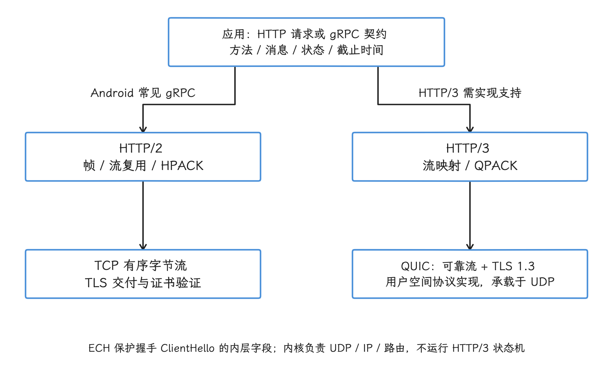

图：gRPC 是调用契约；HTTP/2 与 HTTP/3 分别使用 TCP 与 QUIC，库名不等于实际协商协议。

### 协议能力来自不同组件

Android 项目里的协议能力来自不同组件：

| 组件 | Android 17 下的协议能力 | 版本边界 |
| --- | --- | --- |
| OkHttp 5.4.0 | HTTP/1.1、HTTP/2 | 没有稳定的公开 HTTP/3 配置入口 |
| `android.net.http.HttpEngine` | 由设备提供的 HTTP 引擎处理 HTTP/1.1、HTTP/2、HTTP/3 | API 34 起可用，也可由 S Extensions 7（系统组件扩展版本 7）提供；实际能力受设备实现影响 |
| Cronet 库 | Chromium 网络栈，支持 HTTP/1.1、HTTP/2 和基于 QUIC 的 HTTP/3 | 能力取决于项目采用的 Cronet 实现与版本 |
| gRPC Java / Kotlin | RPC 语义、生成的客户端代理（stub）、流式调用、调用截止时间（deadline）与状态码 | Android 常用传输基于 HTTP/2，也可评估 Cronet 传输实现 |

配置里允许 HTTP/3，客户端拿到的只是选择资格；这次请求最终走哪个协议，还要看服务端能力、代理、UDP 可达性、证书和客户端状态——服务端常通过 Alt-Svc（服务器声明同一资源可由另一地址或协议提供的响应首部）声明自己支持的其他协议。所以线上数据以实际协商结果为准，客户端库名称只能当参考。

### HTTP/2 多路复用与服务端推送

#### 多路复用下的并发与排队

我们先看 HTTP/2 在一条连接里做了什么。它保留 HTTP 方法、状态码和首部语义，把消息编码成二进制帧，再把帧归入不同的逻辑流；多个流可以在同一连接上交错传输，HPACK 用动态表等机制压缩重复首部。Android 上的 HTTPS 请求通常在 TLS 握手里通过 ALPN（Application-Layer Protocol Negotiation）协商出 `h2`。

| 维度 | HTTP/1.1 | HTTP/2 |
| --- | --- | --- |
| 并发请求 | 通常需要多条连接 | 一条连接可以承载多个逻辑流 |
| 首部编码 | 每次发送文本首部 | HPACK 可复用首部表并压缩 |
| 应用层队头等待 | 一条连接同一时刻通常处理一次请求—响应交换 | 不同逻辑流可并发推进 |
| 传输层队头等待 | TCP 丢包阻塞连接后续字节 | 仍运行在 TCP 上，因此影响同一连接的所有逻辑流 |
| 流量控制 | 主要依靠 TCP 与应用读取 | 同时存在连接级和逻辑流级 HTTP/2 流量控制 |

并发数由好几层一起决定：服务端 `SETTINGS_MAX_CONCURRENT_STREAMS`（同时活跃的逻辑流上限）、客户端 `Dispatcher`、连接级与逻辑流级的流量窗口、服务端容量和设备资源都在约束它。请求最终是否共用一条连接没有保证，业务请求也拿不到优先级承诺。

OkHttp 5.4.0 还给单个 HTTP/2 响应的首部总量设了上限：256 KiB（262,144 字节）；服务端真要发超大首部，超出部分会被客户端按这个上限拦下。

大响应体会争用同一连接的带宽和拥塞窗口。消费方长时间不读取响应体，还会产生逻辑流级背压，也就是接收方处理不及时后逐步限制发送方，并可能影响连接级流量窗口。

大文件与短 API 要不要共用同一个客户端或 `Dispatcher`？我们按排队情况和 P95、P99 等尾部耗时来定——P95、P99 分别表示 95%、99% 的样本不超过该耗时。“HTTP/2 支持多路复用”这句话本身回答不了这个问题，答案要从数据里来。

连接能否复用，还要看 OkHttp 的 `Address`（连接地址配置）、`Route`（具体连接路径）、证书和连接健康状态。把资源分散到多个域名的“域名分片”，可能增加 DNS、TCP 与 TLS 成本，也可能拦住符合条件的 HTTP/2 连接合并。资格检查见 [24.5 移动网络架构、连接与容灾](05-mobile-network-connection-resilience.md)。

#### 服务器推送（Server Push）在 OkHttp 上的现状

RFC 9113 定义了 `PUSH_PROMISE`（服务器在客户端请求前声明将主动发送某项资源的帧），客户端则可以限制或拒绝推送。落到 OkHttp 5.4.0 上：`Http2Connection.Builder` 默认使用内部的 `PushObserver.CANCEL`，该观察器收到推送事件后请求取消；`OkHttpClient.Builder` 也没有向应用开放 `PushObserver` 配置。

所以在使用 OkHttp 的 Android 应用里，服务器推送停留在“协议定义、客户端取消”的状态，性能方案里能用的是下面这些替代方式：

- 首屏聚合接口，减少明确存在的依赖链。
- 客户端在用户意图足够明确时发起可取消的预取。
- 使用标准 HTTP 缓存，让重复资源按新鲜度复用。
- 服务端返回资源清单，由客户端按当前界面、网络费用和本地缓存决定是否获取。

即使换到支持推送的客户端，我们也要先测量推送资源被使用、已缓存、重复传输和取消的比例。协议有这个能力，和它对移动 API 有净收益，是两回事。

<!-- gracker-diagram: a266-02-h2-flow-backpressure -->
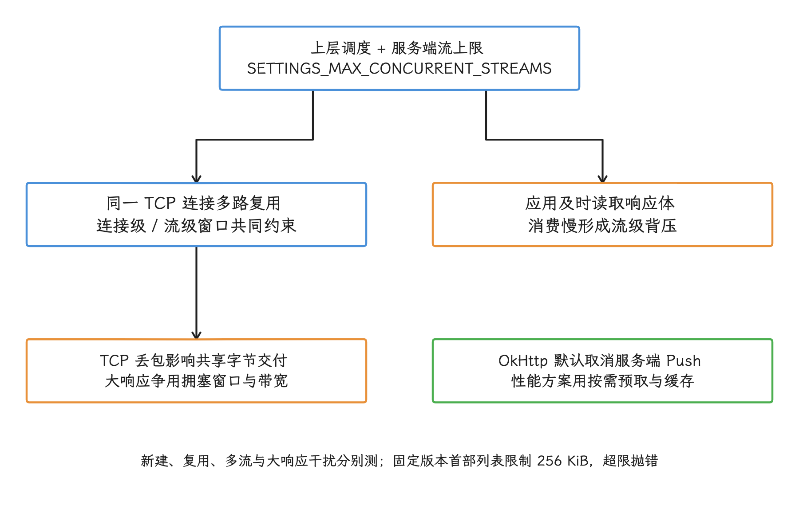

图：多路复用不提供无限并发或业务优先级承诺；OkHttp 5.4 默认 PushObserver.CANCEL。

### HTTP/3 与 QUIC 能改变什么

#### 传输层发生了什么变化

HTTP/3 把 HTTP 消息映射到 QUIC 逻辑流，首部压缩换成了 QPACK。QUIC 在 UDP 之上实现可靠传输、拥塞控制、TLS 1.3、逻辑流复用和连接 ID（不依赖 IP 地址与端口的连接标识）。对我们来说，行为上的变化主要是三条：

- 一条逻辑流丢失的数据需要重传时，其他不依赖该数据的流可以继续交付。HTTP/2 运行在单个 TCP 有序字节流上，丢失字节会阻塞后续字节。
- TLS 与 QUIC 握手集成，之前建立的状态满足条件时可以使用恢复；0-RTT 仍是可选能力。
- 连接用连接 ID 标识，IP 地址或端口变化后可以验证新路径是否可用，再迁移连接。

这些机制也有共享的部分。QUIC 的拥塞控制通常作用于整条连接路径，丢包把拥塞窗口压小时，多条逻辑流的吞吐一起受影响；DNS、服务端处理和应用读取的耗时，HTTP/3 一段也省不掉。

再往下追一层：QUIC 的协议状态机在 Cronet/Chromium 的进程代码里，Android 通用内核（common kernel）负责 UDP 套接字、IP、路由、队列和设备驱动，没有 HTTP/3 状态机。要追踪 UDP 收发，可以从 `android17-6.18-2026-06_r6` 标签的 [`net/ipv4/udp.c`](https://android.googlesource.com/kernel/common/+/refs/tags/android17-6.18-2026-06_r6/net/ipv4/udp.c) 读起。

#### 连接迁移的生效条件

RFC 9000 定义了连接迁移和路径验证机制。`ConnectionMigrationOptions` 的源码写明两项前提：连接必须是 QUIC，服务端必须支持迁移。在此之上，客户端还要面对这些约束：

- 新网络需要可达同一服务端，并通过路径验证。
- NAT（网络地址转换）、企业代理、VPN、防火墙和服务端负载均衡配置可能阻止迁移。
- 迁移期间的请求可能超时或被取消，业务仍要有恢复策略。
- 允许使用非默认网络可能产生流量费用；`setAllowNonDefaultNetworkUsage()` 在 AOSP `android-17.0.0_r1` 中标注为实验 API。

`HttpEngine.Builder.setConnectionMigrationOptions()` 在同一份源码里也带着 `ConnectionMigrationOptions.Experimental` 注解。要试默认网络迁移，我们先在受控实验里启用；上线前把设备实现、服务端、代理、计费网络和远程关闭开关都验证一遍。

<!-- gracker-diagram: a266-03-quic-path-migration -->
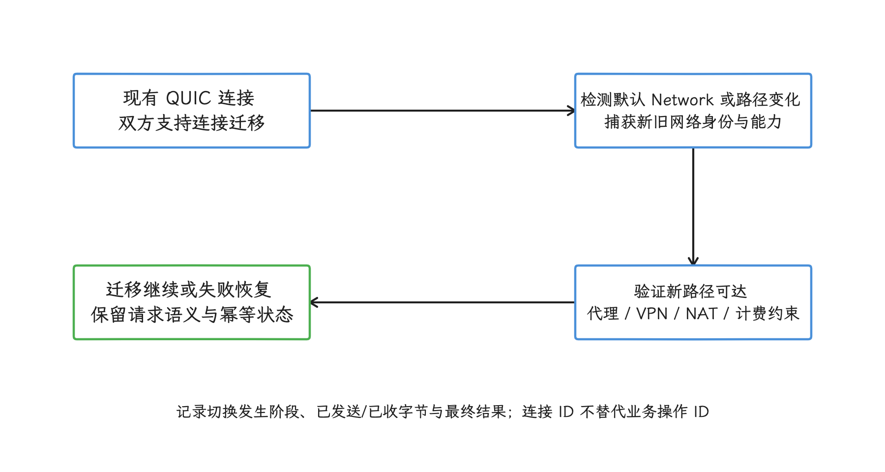

图：迁移需要 QUIC、客户端、服务端与新路径共同支持；中断后的业务仍需恢复协议。

#### 0-RTT 的重放风险与适用范围

QUIC 的 0-RTT（零往返恢复）允许恢复中的连接在握手完成前发送早期数据（early data），代价是这类数据缺少跨连接的防重放保证——攻击者可以把捕获的数据重新发送一遍。所以登录、支付、下单和产生一次性副作用的写请求，我们默认让它们走完整握手。

`HttpEngine.Builder.addQuicHint()` 用主机与备用端口提示服务器支持 QUIC；官方文档同时说明，跨引擎会话要用 0-RTT，先得启用磁盘缓存。配置都满足之后，服务端仍然可以拒绝早期数据，客户端要允许按正常握手继续。指标上，最终协议和业务总耗时分开记，“启用 QUIC”和“命中 0-RTT”也要分开记。

#### UDP、代理与 HTTP/3 发现机制

HTTP/3 依赖 UDP，而部分企业网络、代理、VPN 或热点会阻断或限制 QUIC，所以客户端要保留基于 TCP 的 HTTP/2 或 HTTP/1.1；RFC 9114 也允许在 QUIC 连接出现问题时改用基于 TCP 的 HTTP。

服务端还要用客户端支持的方式声明 HTTP/3 能力，比如发送 Alt-Svc，或者由应用提供可信的 QUIC 能力提示（hint）。`setEnableQuic(true)` 打开后，引擎只是拿到了选择 QUIC 的资格；缺少服务端配置的域名，最终仍落在 HTTP/2 或 HTTP/1.1 上。

Android 17 / API 37（同时属于 S Extensions 22）为 `HttpEngine.Builder` 增加了 `setProxyOptions()`。注意应用代理配置会覆盖系统代理配置：企业环境依赖系统代理时，一个错误的应用代理、或者代理列表末尾漏掉 `null` 回退，都可能让网络完全不可达。分批启用协议的实验，也要把企业代理和 VPN 场景包含进来。

<!-- gracker-diagram: a266-04-zero-rtt-and-discovery -->
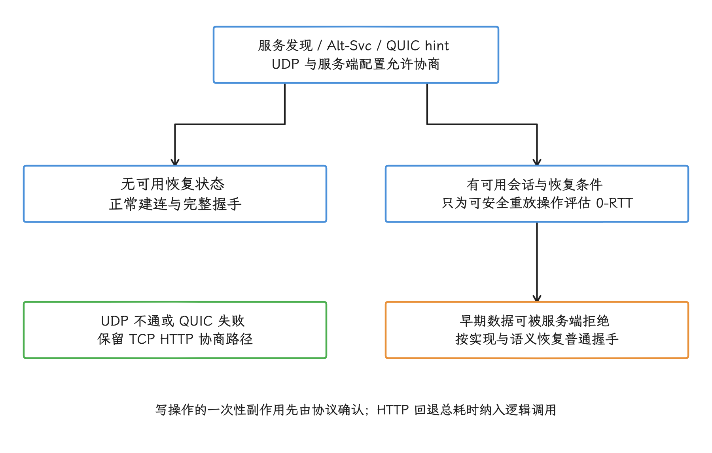

图：QUIC 开关、实际协议、会话恢复与 0-RTT 接受分别记录；代理失败策略按所用 API 明确允许或禁止直连。

### OkHttp、HttpEngine 与 Cronet 的选择

#### OkHttp 5.4.0

如果项目已经有 Retrofit、拦截器、Cookie、缓存和 `EventListener` 这套体系，OkHttp 是最顺的 HTTP/1.1、HTTP/2 选择。它用 `Response.protocol` 报告最终协议，用 `EventListener` 记录 DNS、连接、TLS 和交换阶段；到 OkHttp 5.4.0 为止，还没有稳定的公开 HTTP/3 配置入口。

想保留 OkHttp API、又想用 Cronet 传输的项目，可以看 Android 官方集成文档列出的 `Cronet Transport for OkHttp`。接入时我们要逐项核对传输库版本、支持的 OkHttp API、拦截器语义、缓存、证书、代理和事件指标——换了依赖，这些行为要重新确认一遍。

#### HttpEngine

`HttpEngine` 从 API 34 起提供，也标注为 S Extensions 7；AOSP `android-17.0.0_r1` 的 `HttpEngine.Builder` 直接使用 `NativeCronetEngineBuilderImpl`。默认配置是：

- 启用 HTTP/2。
- 启用 QUIC。
- 关闭 HTTP 缓存。

默认启用只代表引擎可以选择相应协议，最终请求仍可能落在 HTTP/1.1 或 HTTP/2 上。要 HTTP 缓存就显式配置缓存模式与容量，磁盘缓存还要配一个独占的存储目录——同一目录被多个 `HttpEngine` 同时使用属于禁止用法。

`HttpEngine` 要作为长生命周期对象复用，不再使用时调用 `shutdown()`。按请求创建引擎，会丢掉连接、QUIC 状态、线程和缓存复用，也可能违反存储目录的单实例约束。

#### Cronet 库

Cronet 是 Android 应用可以直接使用的 Chromium 网络栈。当前 Android 官方概览确认它原生支持 HTTP/1.1、HTTP/2 与基于 QUIC 的 HTTP/3；至于每种集成方式是否都有相同能力，要按提供方、版本、原生库加载结果和协议支持，结合项目实际依赖与运行时实现来确认。

版本上，Android 10—13 要用 HTTP/3 通常得带外部 Cronet，Android 14 及以上可以评估平台 `HttpEngine`。走哪条路径，再按安装包（APK）体积、设备覆盖、更新渠道、现有网络层适配和诊断指标能力来定。

#### 基础 API 37 能观测什么

在基础 API 37 上，我们能从 `UrlResponseInfo` 拿到最终协商协议、缓存使用情况和接收字节下界；字节下界表示至少接收了这么多网络字节，统计上可以忽略部分协议开销。下面的代码在请求的终止回调里生成一条结果记录：

```kotlin
data class HttpEngineResult(
    val negotiatedProtocol: String?,
    val cacheUsed: Boolean,
    val receivedByteCountLowerBound: Long,
)

fun UrlResponseInfo.toTerminalResult(): HttpEngineResult {
    return HttpEngineResult(
        negotiatedProtocol = negotiatedProtocol.ifEmpty { null },
        cacheUsed = wasCached(),
        receivedByteCountLowerBound = receivedByteCount,
    )
}
```

最终字节数要在终止回调里读取；`onFailed()` 和 `onCanceled()` 回调还要先确认 `UrlResponseInfo` 非空。`wasCached()` 返回 `true`，也可能包含经过网络重新验证的响应，别把它一律当成零网络流量。

`getReceivedByteCount()` 是处理请求所需网络字节的最小计数：包含所有重定向的首部与数据，在解压前统计，IP、TCP/UDP、TLS 和代理开销可以忽略。空协议字符串表示未协商、未知或普通 HTTP/HTTPS，不要自行改写成 HTTP/1.1。

`FinishedRequestTimings` 和 `UrlRequest.getFinishedRequestTimings()` 是 37.1 / S Extensions 23 新增的能力，只能在成功、失败或取消的终止回调到达后读取，并不属于 API 37 / `android-17.0.0_r1` 这条基线。基础 API 37 上，DNS、连接和 TLS/QUIC 的完整公开时序要等这套新接口才有。

<!-- gracker-diagram: a266-05-engine-lifecycle-metrics -->
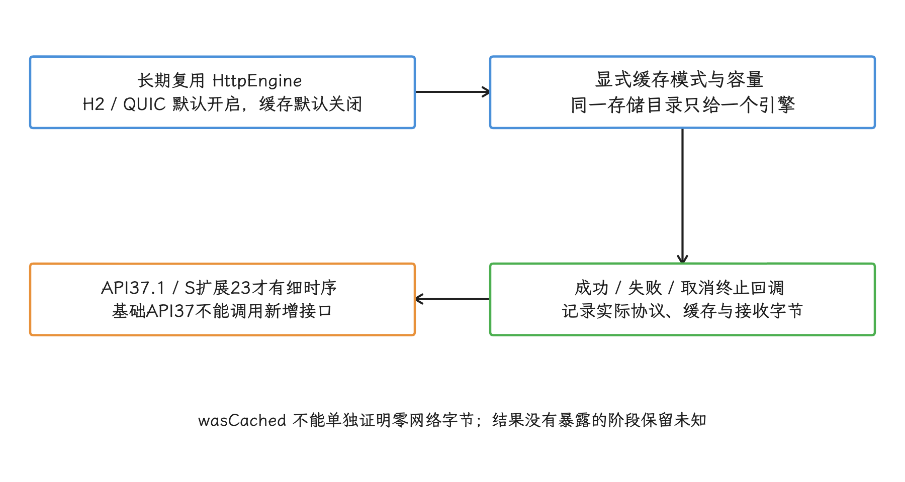

图：缓存可能经过网络重验证；接收字节为解压前最小网络计数，空协议不自行填 HTTP/1.1。

### gRPC 在移动端的实践

#### gRPC 的调用契约与方法形态

gRPC 用 `.proto` 接口定义文件描述服务与消息，Android 上通常用 protobuf lite（精简版 Protocol Buffers 运行库）生成客户端类型。方法形态有四种：

| 方法形态 | 请求与响应 | 适合的业务 |
| --- | --- | --- |
| 一元调用 | 单请求、单响应 | 有明确边界的查询与写入 |
| 服务端流 | 单请求、响应流 | 服务端持续发送一组结果或更新 |
| 客户端流 | 请求流、单响应 | 分段上传或批量聚合 |
| 双向流 | 双向流 | 双方独立持续发送消息的会话 |

四种形态的差别在于是哪一侧可以持续发送消息；选了流式调用，流量控制和断线恢复就要另行设计。生成代码给的是字段类型与方法签名，协议演进仍要遵守 Protocol Buffers 兼容规则：字段号不复用，删除的字段保留编号，客户端与服务端支持新旧版本交错发布。序列化边界见 [24.2 数据库与序列化性能](02-database-serialization-performance.md)。

标准 gRPC 在 HTTP/2 上承载键值元数据（metadata）、带长度前缀的消息和响应体结束后发送的尾部字段（trailers）。HTTP 状态码装不下 RPC 的结果语义，监控要以 gRPC 状态码为主，连同服务名、方法名、调用截止时间、取消、消息字节和每次尝试一起记录；一个 HTTP 200 在这里说明的东西很有限。

#### `Channel` 是逻辑通信通道

gRPC `Channel` 表示到一个逻辑目标的通信通道，可以在内部持有零条、一条或多条实际连接，并参与名称解析与客户端负载均衡。它不等同于一条套接字连接。

官方性能建议的第一条就是复用：`Channel` 和生成的客户端代理（stub）都尽量复用，复用范围按逻辑目标、TLS、代理、名称解析和服务配置来划。用户令牌更适合放在每次调用的调用凭据（credentials）或元数据里；仅因账号切换就重建 `Channel`，会丢掉可以安全共享的传输资源。认证实现里，我们要避免把旧令牌固化在长生命周期拦截器中。

#### 调用截止时间、取消和 Wait-for-Ready

gRPC 默认不设置调用截止时间（deadline），客户端可能因此一直等下去。所以每个方法都要按用户交互期限、网络耗时分布和服务端处理预算显式设置截止时间；上游取消、页面销毁和后台任务停止，也要传播到 RPC。

`wait-for-ready`（等待通道就绪）会在 `Channel` 暂时不可用时把调用留在队列里，等连接恢复再发送；默认模式则更早返回失败。调用截止时间仍然生效，所以它只适合能短暂等待连接恢复的调用，绕不过用户取消，也无限延长不了启动等待。

<!-- gracker-diagram: a266-06-grpc-channel-deadline -->
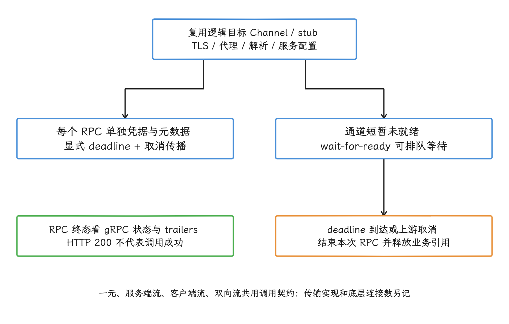

图：通道是逻辑通信对象；每次 RPC 的凭据、截止时间、取消与最终状态分别管理。

流式 RPC 还要自己定义断线恢复语义：连接中断时未完成的逻辑流会失败，重新建流不会自动恢复业务位置，消息序号、游标、确认、去重和补发都属于应用协议的事。

这类流式调用还受 gRPC 与 HTTP/2 流量控制约束：一次写入只说明消息交给了 gRPC，字节未必已经发到网络；发送方速度长期高于接收方时，框架会等待或缓存。因此应用队列要有界，手动流量控制要保证两端持续读取，别让双方都在等写入空间。

<!-- gracker-diagram: a266-07-grpc-flow-recovery -->
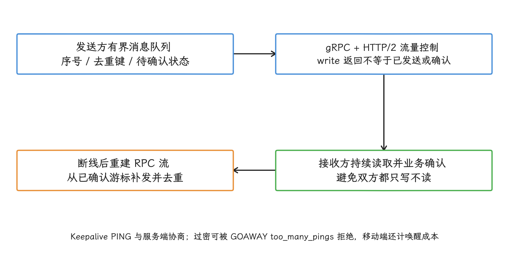

图：消息交给 gRPC 不等于服务端已处理；重连后从业务确认位置恢复，不能仅重新打开流。

#### 透明重试与 Service Config 重试

重试在 gRPC 里分两层。没有显式重试策略时，框架的透明重试也可能恢复少量底层故障，前提是确认调用还没进入服务端应用逻辑——这类故障来自并发事件顺序的不确定。更大范围的重试靠 Service Config（服务配置），按方法设置尝试次数上限、逐次延长的等待间隔、可重试状态码和重试总量限制。

看到状态码 `UNAVAILABLE`，重试之前先与服务端确认方法语义：

<!-- gracker-diagram: a266-08-grpc-retry-commit -->
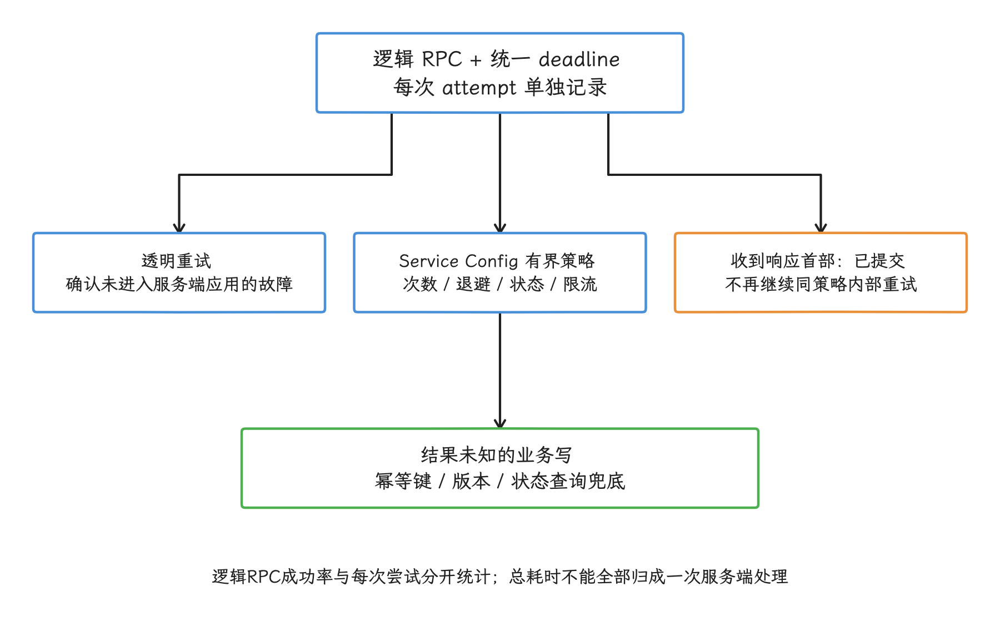

图：UNAVAILABLE 只提供重试线索；业务写的重复效果由服务端幂等和确认协议保护。

- 查询或幂等操作可以在总截止时间内受控重试。
- 写操作需要幂等键、版本条件或查询确认兜底，才谈得上按状态码重发。
- 一旦收到响应首部，gRPC 重试机制会把 RPC 视为已提交，不再按同一策略重试。
- 应同时记录逻辑 RPC 与每次尝试，避免把内部重试时间全部归为一次服务端延迟。

#### 保活探测（Keepalive）与长流的资源成本

gRPC 保活探测用 HTTP/2 `PING` 检查空闲连接。频率多高、没有活动 RPC 时还发不发，都要和服务端约定；当前官方指南的建议是，客户端间隔不要远低于一分钟，也尽量避免在没有调用时启用保活。探测过密时，服务端可以发 `GOAWAY`（通知客户端停止在该连接上创建新流）和 `too_many_pings` 调试信息来拒绝。

移动端还要把蜂窝无线电唤醒、Doze（Android 设备空闲省电模式）、应用进程回收和后台执行限制算进去。低频通知通常更适合系统共享推送通道；长流留给前台持续交互、或业务确有连续传输需求的场景，并且要具备取消、恢复与断点状态。

长生命周期逻辑流启动后，通常就不再重新参与客户端负载均衡；服务端滚动发布、连接年龄和节点故障都会中断它。高可用要靠重连与恢复逻辑来保障，一条永久逻辑流撑不起来。

### 协议选型与兼容策略

#### 从请求形态与系统约束选择

把前文的协议能力和系统约束合在一起，常见请求形态可以这样对号入座：

| 请求形态 | 候选方案 | 需要验证的边界 |
| --- | --- | --- |
| 常规 REST / JSON，同一主机与端口组合（authority）下短请求较多 | OkHttp + HTTP/2 | 网关与 CDN 的 ALPN、连接复用、服务端逻辑流上限 |
| 媒体、长下载、切网与丢包敏感流量 | HttpEngine / Cronet，评估 HTTP/3 | UDP、代理、VPN、服务端 QUIC、迁移和缓存 |
| 自有客户端与服务端之间的强类型 RPC | 基于 HTTP/2 的 gRPC | Protocol Buffers 演进、网关、状态码与尾部字段、截止时间、重试 |
| 长生命周期双向消息 | gRPC 双向流或已有消息协议 | 后台限制、流量控制、断线恢复、负载均衡 |
| 浏览器和第三方共同使用的公开接口 | REST / JSON，必要时另建 gRPC-Web 网关 | 调试、兼容、缓存和跨语言契约 |
| 可延迟后台上报 | 批量 REST 或批量 RPC | WorkManager 约束、幂等、与交互流量隔离 |

这张表给出的是候选方向，最终选择要靠设备与服务端的实验来定。协议选择还要计算安装包体积、适配成本、发布渠道和排障工具；一个小型低频接口即使能用 gRPC 或 HTTP/3，新增依赖与运维成本也未必划算。

#### 协议回退与业务回退

HTTP/3 到 HTTP/2、HTTP/2 到 HTTP/1.1 的回退，是同一 HTTP 语义下的传输协商，成熟客户端能根据服务端和网络条件自己完成。应用要做的是记录最终协议和错误，每次 QUIC 失败都手写另一遍请求没有必要。

gRPC 到 REST 则是两套接口契约，协议层不会自动回退，只有业务明确维护双路径时才谈得上使用，而且两条路径必须共享：

- 权限与鉴权规则。
- 幂等键、版本条件和重复提交处理。
- 字段含义、默认值和错误映射。
- 分批发布、审计与数据一致性规则。

双路径会增加测试与服务端维护成本。多数业务更适合在当前 RPC 上恢复或显示错误，看到任意 gRPC 失败就改发 REST 并不划算。

<!-- gracker-diagram: a266-09-transport-and-contract-fallback -->
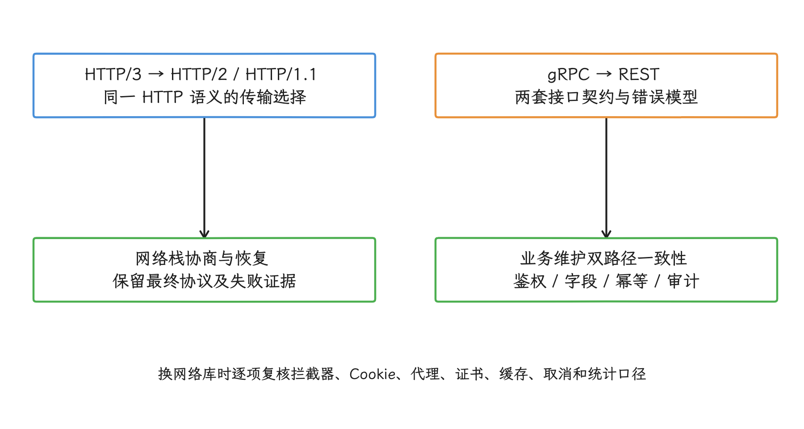

图：自动传输回退不等于自动业务重发；双接口必须共享幂等状态与权限语义。

#### 更换传输实现时保持业务契约不变

从 OkHttp 迁移到 HttpEngine/Cronet，或为 OkHttp 接入 Cronet 传输实现时，下面这份清单要逐项核对：

- `Authorization`、Cookie、跨服务关联一次调用的追踪标识（trace ID）、实验首部和 `User-Agent`。
- Network Security Config（Android 网络安全配置）、证书或公钥固定、用户安装的 CA（证书颁发机构）证书、系统代理、应用代理和 VPN。
- HTTP 缓存、业务缓存、Cookie 存储和磁盘目录。
- 重定向、上传重放、取消、超时和后台生命周期。
- 压缩、字节统计、错误分类和敏感字段脱敏。

协议实验期间，接口语义、服务端业务逻辑和缓存策略保持稳定；多项改动同时发布，归因就被破坏了。

### 协议实验与观测

#### 各客户端公开指标不同

各客户端公开的指标并不对等，我们列成下表：

| 客户端 | 基础可观测信息 | 限制 |
| --- | --- | --- |
| OkHttp 5.4.0 | `Response.protocol`、`EventListener` 阶段、连接事件 | HTTP/2 逻辑流并发与底层 TCP 指标不是完整公开 API |
| 基础 API 37 HttpEngine | `getNegotiatedProtocol()`、`wasCached()`、接收字节下界、回调时刻与异常 | 没有 37.1 的 `FinishedRequestTimings` |
| Cronet 库 | 实现提供方给出的请求完成信息、NetLog（Chromium 网络诊断日志）与回调 | 能力随 Cronet 版本和集成方式变化 |
| gRPC | 方法、状态码、截止时间、元数据、逻辑调用和每次尝试 | 还需与所用传输实现的连接指标关联 |

最终协商是 HTTP/2，客户端可能压根没尝试过 HTTP/3。要区分“未发现 HTTP/3”“UDP 不通”“QUIC 握手失败”和“策略未启用”，要靠底层日志或可靠的连接尝试指标；拿不到这些数据时，把记录标成最终协议就好，写成“HTTP/3 回退”反而误导。

#### 实验单位与分层

协议实验要稳定地按用户或设备分组，并限制到明确的主机与接口。分析时至少按这些维度分层：

- 最终协议、客户端实现与实现提供方版本。
- 默认网络变化序号、传输类型、计费属性、VPN 和代理。
- 请求与响应大小、缓存状态、冷连接或复用连接。
- DNS、连接、握手、TTFB（Time to First Byte，从请求发出到收到响应首部的等待）、响应体与逻辑调用总时长；只使用当前客户端实际公开的阶段。
- HTTP 或 gRPC 错误、取消、重试尝试与最终成功率。
- 前台交互、后台任务、媒体传输和切网场景。

比较中位数和高分位延迟，同时观察错误率、取消率、字节量与电量。把连接状态、CDN 节点、服务端版本和缓存命中分好层，平均值的变化才能归到协议上。

分批实验的开关要支持按主机、接口、网络类型、客户端版本和应用版本关闭。关闭实验、恢复原传输实现时，只改变传输选择，正在执行写操作的幂等状态要原样保住。

### 工程检查清单

- 是否记录请求最终协商的协议，而不是只记录客户端库名称。
- HTTP/2 连接复用是否被无意义的多客户端或域名分片削弱。
- 是否把服务端逻辑流上限、流量控制和 TCP 队头等待纳入分析。
- OkHttp 方案是否已移除不可用的 HTTP/2 服务器推送假设。
- HTTP/3 是否保留基于 TCP 的协议协商路径。
- QUIC 迁移是否覆盖 Wi-Fi/蜂窝切换、VPN、代理、计费网络和服务端不支持场景。
- 0-RTT 是否只允许可重放操作，指标是否避免把 QUIC 等同于 0-RTT。
- HttpEngine 是否复用，缓存与磁盘目录是否显式配置。
- Android 17 应用代理是否验证系统代理覆盖与最终回退。
- 基础 API 37 指标是否避免引用 37.1 才提供的详细时序。
- gRPC `Channel` 与客户端代理（stub）是否复用，用户令牌是否按调用安全更新。
- 每个 gRPC 方法是否有合理的调用截止时间，取消是否传播。
- gRPC 重试是否由 Service Config 与业务幂等语义共同限制。
- 流式 RPC 是否具备流量控制、断线恢复、前后台和电量策略。
- 分批协议实验是否保持服务端业务、缓存和接口语义稳定。

### 协议与 RPC 小结

HTTP/2、HTTP/3 和 gRPC 分别改变连接复用、传输恢复和调用契约，收益要按上面这些维度验证，光看协议名称定不下来。选型时固定客户端实现、最终协商协议、缓存与连接状态，再同时验证流量控制、截止时间、幂等重试、切网和后台生命周期。

### 源码与规范依据

#### 当前平台与客户端依据

- [AOSP `android-17.0.0_r1` HttpEngine](https://android.googlesource.com/platform/external/cronet/+/android-17.0.0_r1/android/java/src/android/net/http/HttpEngine.java)
- [AOSP `android-17.0.0_r1` ConnectionMigrationOptions](https://android.googlesource.com/platform/external/cronet/+/android-17.0.0_r1/android/java/src/android/net/http/ConnectionMigrationOptions.java)
- [AOSP `android-17.0.0_r1` UrlResponseInfo](https://android.googlesource.com/platform/external/cronet/+/android-17.0.0_r1/android/java/src/android/net/http/UrlResponseInfo.java)
- [Android common kernel `android17-6.18-2026-06_r6` UDP](https://android.googlesource.com/kernel/common/+/refs/tags/android17-6.18-2026-06_r6/net/ipv4/udp.c)
- [Android HttpEngine.Builder API](https://developer.android.com/reference/android/net/http/HttpEngine.Builder)
- [Android ConnectionMigrationOptions API](https://developer.android.com/reference/android/net/http/ConnectionMigrationOptions)
- [Android UrlResponseInfo API](https://developer.android.com/reference/android/net/http/UrlResponseInfo)
- [Android FinishedRequestTimings API](https://developer.android.com/reference/android/net/http/FinishedRequestTimings)
- [Android UrlRequest API](https://developer.android.com/reference/android/net/http/UrlRequest)
- [Android Cronet 功能](https://developer.android.com/develop/connectivity/cronet)
- [Android Cronet 与其他库集成](https://developer.android.com/develop/connectivity/cronet/integration)
- [OkHttp 变更记录](https://github.com/lysine-dev/okhttp/blob/main/CHANGELOG.md)
- [OkHttp 5.4.0 Http2Connection](https://github.com/lysine-dev/okhttp/blob/parent-5.4.0/okhttp/src/commonJvmAndroid/kotlin/okhttp3/internal/http2/Http2Connection.kt)
- [OkHttp 5.4.0 PushObserver](https://github.com/lysine-dev/okhttp/blob/parent-5.4.0/okhttp/src/commonJvmAndroid/kotlin/okhttp3/internal/http2/PushObserver.kt)

#### 保留的旧版本源码锚点

- [OkHttp 5.3.0 Http2Connection](https://github.com/lysine-dev/okhttp/blob/parent-5.3.0/okhttp/src/commonJvmAndroid/kotlin/okhttp3/internal/http2/Http2Connection.kt)
- [OkHttp 5.3.0 PushObserver](https://github.com/lysine-dev/okhttp/blob/parent-5.3.0/okhttp/src/commonJvmAndroid/kotlin/okhttp3/internal/http2/PushObserver.kt)

#### 协议与 gRPC 依据

- [RFC 9113：HTTP/2](https://www.rfc-editor.org/rfc/rfc9113.html)
- [RFC 9000：QUIC](https://www.rfc-editor.org/rfc/rfc9000.html)
- [RFC 9001：Using TLS to Secure QUIC](https://www.rfc-editor.org/rfc/rfc9001.html)
- [RFC 9114：HTTP/3](https://www.rfc-editor.org/rfc/rfc9114.html)
- [gRPC Android Java 指南](https://grpc.io/docs/platforms/android/java/basics/)
- [gRPC Deadline](https://grpc.io/docs/guides/deadlines/)
- [gRPC Wait-for-Ready](https://grpc.io/docs/guides/wait-for-ready/)
- [gRPC Retry](https://grpc.io/docs/guides/retry/)
- [gRPC Flow Control](https://grpc.io/docs/guides/flow-control/)
- [gRPC Keepalive](https://grpc.io/docs/guides/keepalive/)
- [gRPC 性能建议](https://grpc.io/docs/guides/performance/)

## ECH、DNS HTTPS 记录与回退

传输协议定了之后，剩下的隐私问题集中在 TLS ClientHello 上，这就是 ECH 的位置。它要生效，客户端支持、DNS 结果和服务端配置必须同时满足；失败路径上，还要保留可控的回退。

### 适配范围

Android 17 / API 37 为网络库提供了加密客户端问候（Encrypted Client Hello，ECH）所需的接口，覆盖 DNS、TLS 和按域名的策略。ECH 加密的是 TLS 初始握手中的敏感字段，主要是服务器名称指示（Server Name Indication，SNI）。

`domainEncryption` 是 Android 网络安全配置里的一个 XML 元素。应用把 `targetSdkVersion` 设为 37 后，它的默认模式从 `disabled` 变成 `enabled`；这个默认值表达的只是应用策略。

默认值之外，网络库仍要读取策略、从 DNS 的 HTTPS 资源记录取得 ECH 配置，并在 TLS 握手中应用。用平台 TLS 提供方（provider，Java 安全框架中的 TLS 实现组件）的网络库可以调 Android 17 新增的接口，自带 TLS 实现的网络库要做等价处理。服务端一侧，则要支持 RFC 9849。

容易混淆的一点：DNS 的 HTTPS 资源记录描述的是服务连接参数，和以 `https://` 开头的网页地址没有关系。HTTPS 最终能连通，也只说明连接路径可用。验收时我们还要逐项确认：

- 当前网络库版本是否已经接入 Android 17 ECH API。
- 设备使用的解析路径能否取得 HTTPS 资源记录中的 `ech` 参数。
- 服务端 ECH 配置、用于外层握手路由的公开名称、证书与轮换流程是否一致。
- 没有 ECH 配置、配置失配、代理拦截和证书透明度（CT）失败时分别发生什么。
- 连接复用、DNS 等待和协议切换是否改变业务耗时。

源码层面，ECH 的 Android 实现在用户空间的 DNS 与 TLS 组件里，没有供应用调用的内核接口。TLS 1.3、证书链、连接池和 HTTP/2、HTTP/3 的原理见 12.1、24.5 与本章前文。

### ECH 的 Android 17 适配路径

先看握手本身。ClientHello 是客户端发出的第一条 TLS 握手消息，里面带着支持的算法、SNI 等信息；ECH 把它拆成外层 `ClientHelloOuter` 和加密的 `ClientHelloInner`——真实 SNI 这些敏感扩展放进内层，外层保留供服务端路由的公开名称。RFC 9849 还定义了配置失配后的重试信息和 ECH GREASE；GREASE 是内容随机的兼容性测试扩展，用来检查网络中间设备能否容忍 ECH 格式，它本身并不加密真实 SNI。

ECH 保护的是握手中的特定字段，下面这几处它管不到，评估前我们先把范围摆清楚：

- 目标 IP 地址仍对网络路径可见。
- 公开名称仍会出现在外层 ClientHello。
- 使用明文 DNS 时，查询名称仍可能泄露；ECH 不替代加密 DNS。
- 流量大小、时序与连接目的地仍可用于流量分析。
- 客户端、服务端、代理与业务日志仍能看到各自处理的数据。

所以 ECH 做到的是：网络库和服务端完成协商后，ClientHello 内的真实 SNI 等字段被加密，网络中间设备直接读取这些字段的能力被降低——域名对全部观察者隐身是做不到的。[RFC 9849](https://www.rfc-editor.org/rfc/rfc9849) 给出 ECH 协议细节，[RFC 9460](https://www.rfc-editor.org/rfc/rfc9460) 定义 HTTPS 与服务绑定（SVCB）资源记录。

<!-- gracker-diagram: a266-10-ech-visible-boundary -->
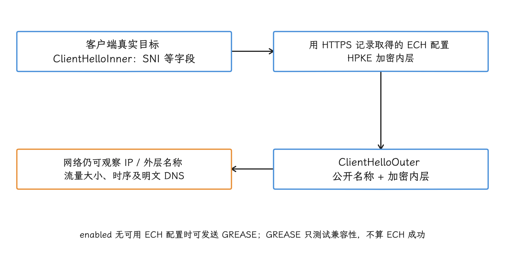

图：ECH 保护指定握手字段；加密 DNS、IP 暴露、日志与流量分析仍有各自边界。

走 Android 17 平台 API 接入 ECH 的网络库，处理顺序如下：

1. 网络库通过 `NetworkSecurityPolicy.getDomainEncryptionMode(hostname)` 读取应用对目标域名的策略。
2. 网络库通过 `DnsResolver` 并发查询 IPv4 地址记录（A）、IPv6 地址记录（AAAA）和 HTTPS 记录，得到描述候选连接端点的 `HttpsEndpoint`。
3. `HttpsRecord.getEchConfigList()` 从服务模式（ServiceMode）的 HTTPS 记录中解析可选的 ECH 配置列表 `EchConfigList`。
4. 网络库在握手开始前调用 `SSLSockets.setEchConfigList()` 或 `SSLEngines.setEchConfigList()`。
5. 平台 TLS 实现发送 ECH ClientHello；服务端接受配置，或返回配置失配及可选的重试配置。

`domainEncryption` 给到的只是按域名策略，网络库该做的 DNS 查询、握手配置和失配处理一样少不了；Android 官方文档也把网络库已接入 ECH 列为生效前提。

<!-- gracker-diagram: a266-11-ech-api-integration -->
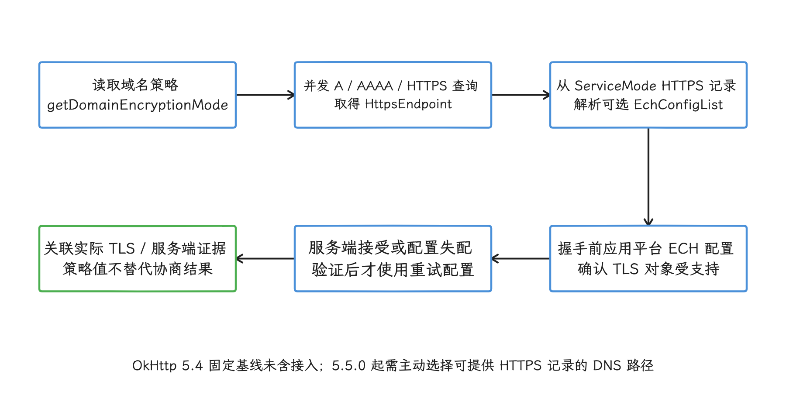

图：XML 声明需要库版本、DNS HTTPS 记录和 TLS 集成共同执行；只返回 IP 的自定义 DNS 可能丢失 ECH 配置。

### 在网络安全配置中声明 `domainEncryption`

网络安全配置（Network Security Configuration）是应用资源里的 XML 文件，`domainEncryption` 可以放在 `base-config` 或 `domain-config` 下：前者是未被域名规则覆盖时的默认配置，后者只匹配指定域名。多个规则同时命中时，平台取域名最长、范围最具体的一条；`includeSubdomains="true"` 让规则覆盖该域名及各级子域。

下面这份 XML 全局声明启用，并为一个已知不兼容的网关域名禁用 ECH：

```xml
<?xml version="1.0" encoding="utf-8"?>
<network-security-config>
    <base-config>
        <domainEncryption mode="enabled" />
    </base-config>

    <domain-config>
        <domain includeSubdomains="true">legacy-gateway.example.com</domain>
        <domainEncryption mode="disabled" />
    </domain-config>
</network-security-config>
```

对支持该策略的网络库，这段配置的含义是：普通域名用 `enabled`；访问 `legacy-gateway.example.com` 及其子域时不发送 ECH，也不发送 ECH GREASE。`targetSdkVersion 37` 的应用平台默认已经是 `enabled`，显式写进 `base-config` 的价值在于把应用策略记录下来。

Android 17 正式版的 XML 语法只接受两个值：

| XML 模式 | 语义 |
| --- | --- |
| `enabled` | 握手获得 ECH 配置时使用 ECH；没有配置时启用 ECH GREASE |
| `disabled` | 不使用 ECH，也不使用 ECH GREASE |

`NetworkSecurityPolicy` 的公开常量里还有 `DOMAIN_ENCRYPTION_MODE_OPPORTUNISTIC` 和 `DOMAIN_ENCRYPTION_MODE_UNKNOWN`：`OPPORTUNISTIC` 表示有服务端配置时尝试 ECH、没有配置时不发送 GREASE；`UNKNOWN` 要求网络库退回普通 TLS。这两个值是网络库读策略时可能遇到的 API 值，XML 语法并不接受它们，`mode="opportunistic"` 写进配置是无效的。

要确认某个主机名经过 Network Security Configuration 匹配后拿到的策略值，可以用这段诊断函数：

```kotlin
@RequiresApi(37)
fun domainEncryptionMode(hostname: String): String {
    val mode = NetworkSecurityPolicy.getInstance()
        .getDomainEncryptionMode(hostname)

    return when (mode) {
        NetworkSecurityPolicy.DOMAIN_ENCRYPTION_MODE_DISABLED -> "disabled"
        NetworkSecurityPolicy.DOMAIN_ENCRYPTION_MODE_OPPORTUNISTIC -> "opportunistic"
        NetworkSecurityPolicy.DOMAIN_ENCRYPTION_MODE_ENABLED -> "enabled"
        NetworkSecurityPolicy.DOMAIN_ENCRYPTION_MODE_UNKNOWN -> "unknown"
        else -> "unrecognized:$mode"
    }
}
```

这个返回值只证明平台解析出的策略；DNS 有没有返回 ECH 配置、某次 TLS 握手用没用 ECH，还要分别从 DNS 和 TLS 两侧确认。诊断日志里也不要记录完整 URL、查询参数或用户标识。

模式与默认值以 [Network Security Configuration](https://developer.android.com/privacy-and-security/security-config#domain-encryption) 为准，API 常量见 [`NetworkSecurityPolicy`](https://developer.android.com/reference/android/security/NetworkSecurityPolicy)。

<!-- gracker-diagram: a266-12-domain-policy-modes -->
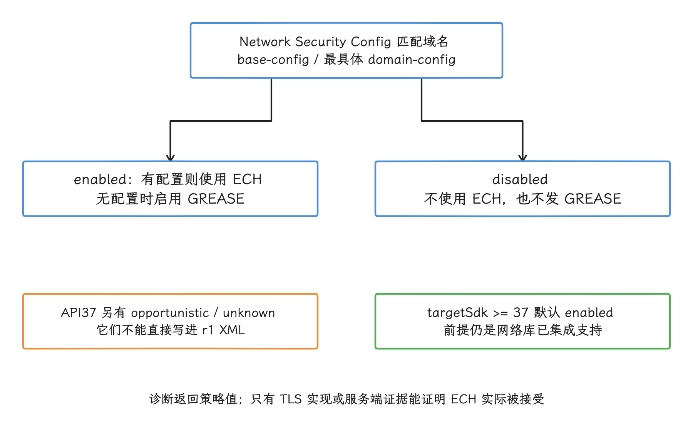

图：区分XML可写模式、平台返回常量和实际协商；后续37.2新增required不纳入r1示例。

### Android 17 API 与源码位置

`DnsResolver` 在 API 37 增加了返回 `HttpsEndpoint` 的查询重载：并发发出 A、AAAA 和 HTTPS 查询，调用方可以用 `httpsTimeoutMillis` 指定地址记录完成后还要等多久 HTTPS 记录。同在 API 37，`DnsResolver.getInstance()` 已废弃，新代码改用接收 `Context` 与 `Looper` 的构造函数。

`HttpsRecord` 表示 RFC 9460 的 HTTPS 记录。`priority == 0` 是别名模式（AliasMode），只把查询指向另一个名称，不带 IP 提示、端口、ALPN（Application-Layer Protocol Negotiation，TLS 握手中的应用层协议协商） 或 ECH 配置；其他优先级是服务模式（ServiceMode），可以携带连接参数——ALPN 用来声明 HTTP/1.1、HTTP/2 等可选上层协议。`getEchConfigList()` 可能返回 `null`，ECH 配置二进制格式无效时会抛出 `InvalidEchDataException`。

`SSLSocket` 封装基于套接字（socket）的 TLS 连接，`SSLEngine` 提供不直接绑定套接字的 TLS 状态机。`SSLSockets.setEchConfigList()` 和 `SSLEngines.setEchConfigList()` 要在握手开始前调用，而且只接受平台 TLS 实现创建的对应对象——自带 BoringSSL、OpenSSL 等 TLS 库，或自带 QUIC 实现的 SDK，不会因为应用加了 XML 就自动执行这些 API。

在 `android-17.0.0_r1` 中可以直接核对这些实现：

- [`DnsResolver.java`](https://android.googlesource.com/platform/packages/modules/Connectivity/+/refs/tags/android-17.0.0_r1/framework/src/android/net/DnsResolver.java) 发起 A、AAAA 与 HTTPS 查询，并构建 `HttpsEndpoint`。
- [`HttpsRecord.java`](https://android.googlesource.com/platform/packages/modules/Connectivity/+/refs/tags/android-17.0.0_r1/framework/src/android/net/dns/HttpsRecord.java) 解析 `EchConfigList`。
- [`DomainEncryptionMode.java`](https://android.googlesource.com/platform/external/conscrypt/+/refs/tags/android-17.0.0_r1/common/src/main/java/org/conscrypt/DomainEncryptionMode.java) 给出平台 TLS 实现 Conscrypt 内部使用的模式枚举。
- [`Platform.java`](https://android.googlesource.com/platform/external/conscrypt/+/refs/tags/android-17.0.0_r1/platform/src/main/java/org/conscrypt/Platform.java) 把 ECH 配置失配转换为 Android 公共异常。

对应用来说，通常没必要重写这套解析与重试逻辑。自定义网络库确要接入时，要完整处理 `HttpsEndpoint` 选择、平台 TLS 对象检查、握手前配置、取消、超时和配置失配；只把一段 ECH 字节交给套接字，换不来安全的协商与重试。

### 网络库支持状态要按版本核对

Android 17 [行为变更页面](https://developer.android.com/about/versions/17/behavior-changes-17#ech) 把 HttpEngine、WebView 与 OkHttp 列为网络库示例，同时明确 ECH 只在网络库已集成支持时生效。页面列的是库名，应用当前安装或依赖的版本支持到什么程度，要按版本核对。

截至 2026-08-15，我们能把上游状态核实到这个程度：

| 路径 | 可验证事实 | 适配判断 |
| --- | --- | --- |
| Android 平台 API | DNS、策略、TLS 与失配异常 API 已进入 API 37 | 提供接入能力，不替网络库完成接入 |
| OkHttp | `square/okhttp` 现重定向到上游仓库 `lysine-dev/okhttp`。主分支于 2026-07-24 合并初始 Android API 37 ECH 支持的 [PR #9573](https://github.com/square/okhttp/pull/9573)，并于 2026-07-26 合并按 `NetworkSecurityPolicy` 选择模式的 [PR #9596](https://github.com/square/okhttp/pull/9596)；最新 [`parent-5.4.0`](https://github.com/square/okhttp/tree/parent-5.4.0) 标签创建于 2026-06-08，早于两次合并 | 主分支已经有接入代码，`parent-5.4.0` 尚未包含；核对依赖版本或提交号 |
| Chromium / WebView / Cronet | 2026-06-22 的 [Chromium 提交](https://chromium.googlesource.com/chromium/src/net/+/b91f5ad12e2adc0166183b0172cd4cbc0a04a934) 加入按主机读取平台模式；2026-07-11 的 [后续提交](https://chromium.googlesource.com/chromium/src/net/+/40d5138e2f148890a937d6653284074cd3c3676d) 已在 TLS 与 QUIC 路径执行 ECH 模式 | 主分支已具备读取和执行逻辑；设备上的 WebView 或 Cronet 仍要确认其版本包含这两次提交 |
| 自定义 `SSLSocket` / `SSLEngine` | 公共 API 已可用 | 应由网络库维护完整 DNS、策略与重试流程 |
| 自带原生 TLS 的 SDK | 是否读取 Android XML 取决于 SDK | 要求供应方给出版本、源码或测试证据 |

从主分支到已发布制品、设备组件，中间还隔着发布流程。所以上线记录要写 Maven 依赖坐标与版本、WebView 实现版本、Android 构建号、TLS 实现、是否使用自定义 DNS，以及服务端 ECH 发布状态——Maven 坐标唯一标识依赖库，WebView 实现是设备上可独立更新的系统网页组件，只记库名还原不出实际能力。

HTTPDNS 这类通过 HTTP 请求调用第三方 DNS 服务、绕开系统解析器的方案，和只返回 IP 地址的自定义 `Dns` 接口，都要单独审查：ECH 配置在 HTTPS 资源记录里，解析实现只交付 A、AAAA 结果时，网络库可能拿不到 `EchConfigList`。HTTPDNS 的适配细节见 24.7。

### 失败与回退判定

ECH 失败要按发生阶段分类。表中用到的缓存生存时间（time to live，TTL）表示 DNS 记录可以缓存多久。

| 现象 | 可能原因 | 核对动作 |
| --- | --- | --- |
| 连接成功，没有 ECH 配置 | HTTPS 记录缺失、AliasMode、记录没有 `ech` 参数、自定义 DNS 丢失记录 | 对比权威 DNS、设备解析结果和网络库日志 |
| 发送 GREASE 后连接成功 | `enabled` 下没有可用 ECH 配置 | 记为 GREASE，不能记为 ECH 成功 |
| `InvalidEchDataException` | HTTPS 记录里的 ECH 数据为空、长度错误或格式无效 | 修复 DNS 发布内容，检查缓存与 TTL |
| `EchConfigMismatchException` | 客户端缓存的配置与服务端当前配置不一致 | 验证公开名称与证书，再使用服务端给出的重试配置 |
| 普通 TLS 证书失败 | 证书链、主机名、证书透明度或代理证书问题 | 单独核对证书错误，禁用 ECH 不会修复证书 |
| HTTP/3 失败而 HTTP/2 成功 | UDP、QUIC、地址或协议协商问题 | 按本节前文的协议路径分析 |
| 私网地址、`.local` 或设备发现失败 | `ACCESS_LOCAL_NETWORK` 未获授权 | 按 24.9 的本地网络权限路径分析 |

再说 GREASE：ECH GREASE 用随机内容模拟 ECH 扩展，帮我们找出会阻断未知扩展的网络中间设备；它手上没有可用的服务端 ECH 配置，真实 SNI 是加密不了的。诊断事件至少要区分 ECH 被接受、GREASE、策略禁用、没有配置、配置失配与其他 TLS 错误这几种状态。

配置失配后的重试有一套硬性顺序：`EchConfigMismatchException` 要求客户端先取得 `getPublicHostname()`，用主机名验证器确认证书对该公开名称有效；公开名称为 `null` 时，重试配置必须忽略。验证成功、`getRetryConfigList()` 非空，网络库才可以新建连接重试；校验这一步省不掉。公共 API 的约束见 [`EchConfigMismatchException`](https://developer.android.com/reference/android/net/ssl/EchConfigMismatchException)。

<!-- gracker-diagram: a266-13-ech-mismatch-authentication -->
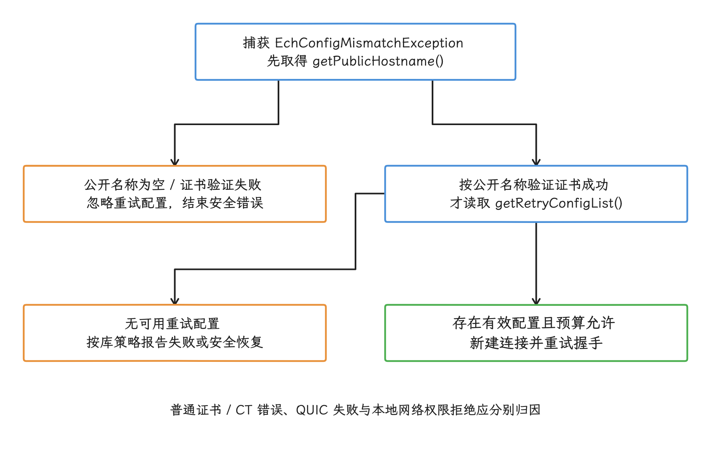

图：先认证公开名称，再解释重试配置；配置轮换、DNS TTL 和总预算共同约束恢复。

还要把 CT 和 ECH 分开：Android 17 对 `targetSdkVersion 37` 及以上的应用默认启用证书透明度（Certificate Transparency，CT），证书颁发机构（CA）签发证书后，签名证书时间戳（SCT）可以证明该证书已提交到 CT 日志。CT 与 ECH 都可能表现为 TLS 失败，但校验阶段不同——用系统 CA 时核对 SCT 与 CT 策略；用用户 CA 或应用内嵌 CA 时，网络安全配置可能因信任锚不是系统 CA 而关闭 CT，除非域名规则显式启用。禁用 ECH 不会改变证书链或 CT 的结果。

`domainEncryption` 位于 APK 的资源 XML 里，普通远程配置改不动它：要把某个域名改成 `disabled`，通常得发布新版本。网络库自带的策略开关属于另一套配置，它和平台策略谁优先，必须先确认清楚；要即时生效的远程开关，得在 XML 之外另找。

### 性能观测方法

ECH 的耗时影响可能来自几处：HTTPS DNS 查询等待、配置失配后的新连接、TLS 计算和连接复用变化。不同设备与网络的结果差异很大，耗时要看实测分布，固定毫秒数只能当参考。

| 阶段 | 建议记录 | 解释限制 |
| --- | --- | --- |
| DNS | A、AAAA、HTTPS 各阶段耗时；HTTPS 记录与 ECH 配置是否存在 | 权威 DNS 有记录不代表设备解析路径取得了记录 |
| TLS | 新连接握手耗时、ECH 接受、GREASE、失配、证书错误 | 通用 HTTP 事件监听器未必暴露 ECH 状态，需要网络库或服务端证据 |
| 重试 | 配置失配次数、是否收到重试配置、新连接次数 | 重试会增加高分位慢样本，不能只看首次握手的平均值 |
| 连接池 | 新建连接率、复用率、HTTP/2 流与 HTTP/3 会话 | 已复用连接不会重新执行完整握手 |
| 业务 | 首包、关键接口分位数、页面首屏、媒体首缓冲 | 同时记录网络类型、代理、VPN、地域与运营商 |

`DnsResolver` 的三个等待模式各有代价：`HTTPS_QUERY_WAIT_NONE` 在地址查询完成后立即回调，哪怕 HTTPS 查询还没返回，官方不建议用在安全或延迟敏感场景；`HTTPS_QUERY_WAIT_UNTIL_TIMEOUT` 等待 HTTPS 查询完成或超时，在丢弃 HTTPS 查询的网络里可能增加延迟。网络库通常从 `HTTPS_QUERY_WAIT_AUTO` 起步、按实测调整，应用别随意覆盖这个内部选择。

<!-- gracker-diagram: a266-14-https-dns-wait -->
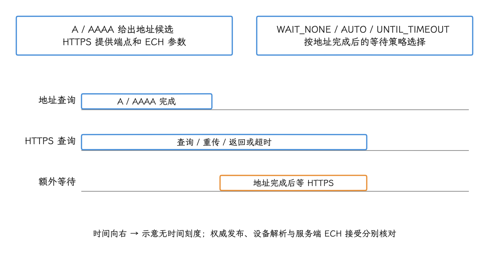

图：HTTPS 记录等待可能影响隐私能力与尾延迟；电脑 dig 的结果不能代表 Android 在 VPN、Private DNS 或 HTTPDNS 下的答案。

`dig` 是查询 DNS 记录的命令行工具。下面这条命令用当前电脑配置的解析器，检查域名有没有发布 HTTPS 记录：

```bash
dig HTTPS api.example.com +short
```

命令结果验证的是发布格式，代表不了 Android 设备在蜂窝网络、专用 DNS、VPN 或 HTTPDNS 下拿到的答案——专用 DNS 是 Android 的系统级加密 DNS 设置，VPN 还可能接管解析路径。所以客户端解析日志、服务端 DNS 日志和 TLS 服务端的 ECH 接受状态要放在一起核对。

抓包能看到有没有形似 ECH 的扩展、连接重试和协议选择，有效 ECH 与 GREASE 的区分要靠网络库或服务端的状态，从 ECH 中恢复内层 SNI 这条路也别走。业务性能数据还是要来自网络库事件、应用 trace 与服务端日志。

### 分阶段发布策略

分阶段发布前先核对这些条件，XML 已配置只是其中一项：

- 固定网络库、WebView 实现、TLS 实现和 Android 17 构建版本。
- 确认库版本包含策略读取、HTTPS DNS 查询、握手配置与失配重试。
- 为候选域名发布 HTTPS 记录，记录 TTL、内容分发网络（CDN）节点、公开名称和证书覆盖。
- 让服务端提供 ECH 接受、拒绝与配置轮换日志。
- 选择低风险域名测试，再处理登录、支付、消息与配置获取等关键接口。
- 分开观察普通网络、企业代理、VPN、校园网、蜂窝网络和不同地域。

对照实验有个陷阱：`targetSdkVersion 36` 与 37 的差异里混着 CT 等其他行为变化，直接对比会把 CT 的效果算进 ECH。实验室可以在相同网络库和代码下构建两份网络安全配置，一份保持 `enabled`，另一份把候选域名设为 `disabled`，这样就只改变了 ECH 策略；生产发布还要把应用版本更新需要的时间算进去。

<!-- gracker-diagram: a266-15-ech-rollout-evidence -->
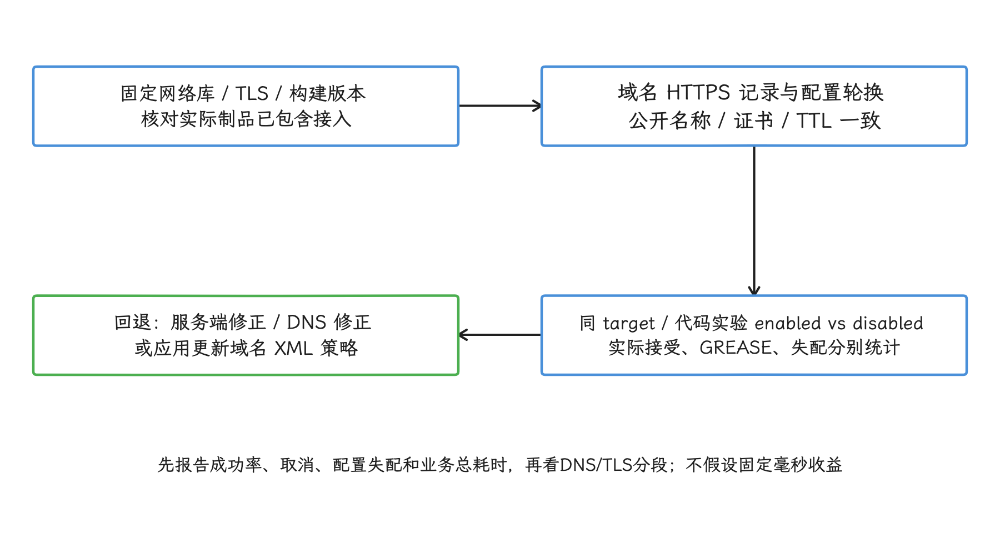

图：不要用target36/37差异单独归因ECH；CT、证书、QUIC与本地权限先按失败阶段分类。

回退手段有三类：

- 服务端修正或轮换 ECH 配置，并在失配响应中提供有效重试配置。
- DNS 撤下或修正 `ech` 参数；客户端缓存会按 TTL 延迟生效。
- 发布应用更新，将确认不兼容的域名设为 `disabled`。

降低 `targetSdkVersion` 这条路要慎重：它会同时改变其他 Android 17 安全行为，也可能不符合应用商店要求，常规回退还是靠前面三类手段。远程开关只有在网络库明确支持、并且定义了它与平台策略的优先级时才可用。

隐私日志记到域名分类、错误类型、网络库版本、粗粒度网络环境和协议就够了；完整 URL、令牌、用户输入、证书私钥材料或 ECH 配置原始字节都不要进日志。

### 与 12.1 TLS 性能章节的分工

分工上，12.1 解释 TLS 1.3、证书、CT、SNI、混合公钥加密（HPKE）、会话恢复和安全连接成本；ECH 使用 HPKE 加密 ClientHello 内层。本节管的是 Android 17 的按域名策略、配置获取和接入验证，握手耗时、证书链和 0-RTT 等问题仍按 12.1 的方法分析——0-RTT 指恢复会话时在完整握手结束前发送早期数据。

### 与 24.9 本地网络权限适配的关系

24.9 处理 Android 17 `ACCESS_LOCAL_NETWORK`、局域网设备发现、Google Cast 投屏、物联网（IoT）设备与本地 HTTP 服务；ECH 与网络安全配置作用于公网 HTTPS 连接，两类问题的失败阶段不同。

判断顺序可以很直接：公网域名的 TLS 握手失败，查 DNS HTTPS 记录、ECH、CT、证书与协议回退；RFC 1918 私有 IPv4 地址、仅在当前网段有效的地址、`.local`、组播 DNS（mDNS）、简单服务发现协议（SSDP）和本地 HTTP 服务失败，先查本地网络权限。工单里记下目标地址类别和失败阶段，可以避免把权限拒绝误报成 TLS 问题。

### ECH 小结

回到整体：Android 17 提供了 ECH 所需的平台接口，并为 `targetSdkVersion 37` 的应用把 `domainEncryption` 默认设为 `enabled`；能否生效，仍取决于网络库接入和服务端支持。正式 XML 只接受 `enabled` 与 `disabled`，公开 API 里的 `opportunistic` 常量写进 XML 是无效的。

验收沿着策略、HTTPS DNS、TLS 配置、服务端协商和重试逐段取证。没有 ECH 配置时发送的是 GREASE，计不进 ECH 成功；配置失配时，先验证公开名称，再用重试配置。CT、HTTP/3 和本地网络权限各有独立的触发条件，同样表现为连接失败时，归因要分开做。

## 全文小结

协议优化的顺序是：先定请求与流的语义，再选能稳定提供相应能力的客户端、服务端和网络路径。HTTP/2 多路复用、HTTP/3/QUIC、gRPC 流与 ECH，都要拿实际协商、错误阶段和业务完成结果来验收——配置存在，离能力生效还差着验证这一步。

ECH 站在 DNS HTTPS 记录、网络安全策略和 TLS 握手的交界上，加密 DNS、证书验证和业务容灾仍要各自做好。协议升级与 ECH 发布都按主机和场景分批，保留 TCP/普通 TLS 的安全回退，多项网络栈变化不要放进同一次实验。
