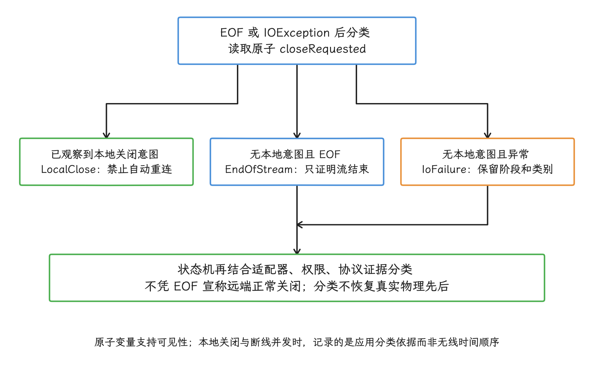
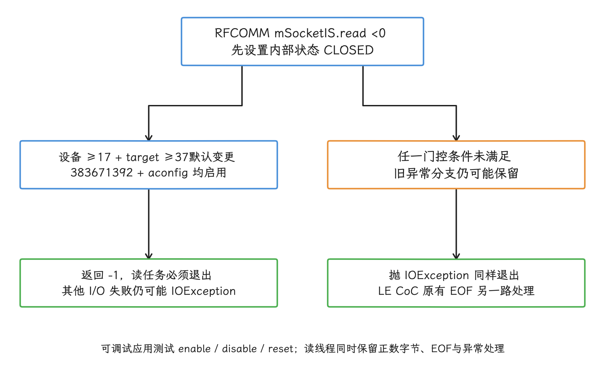
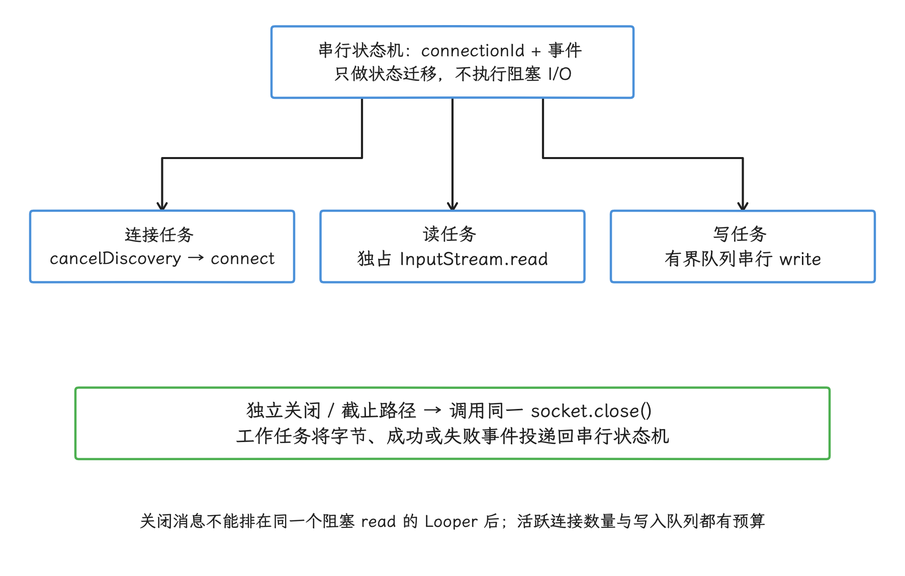
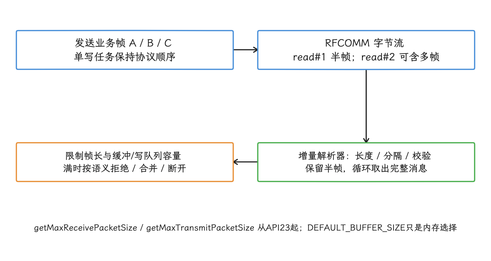
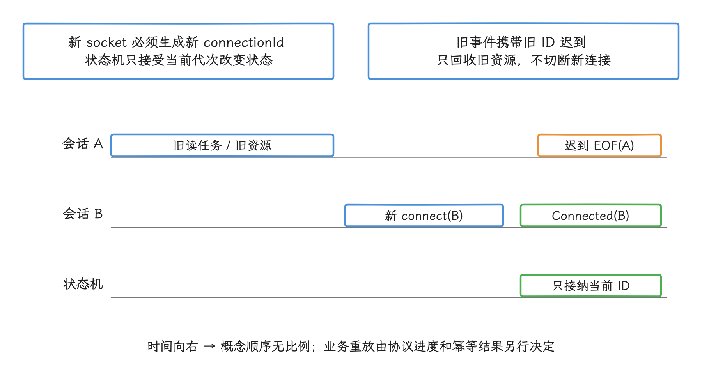
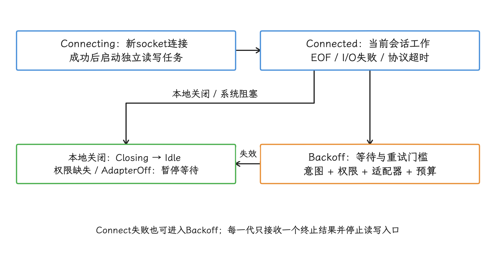
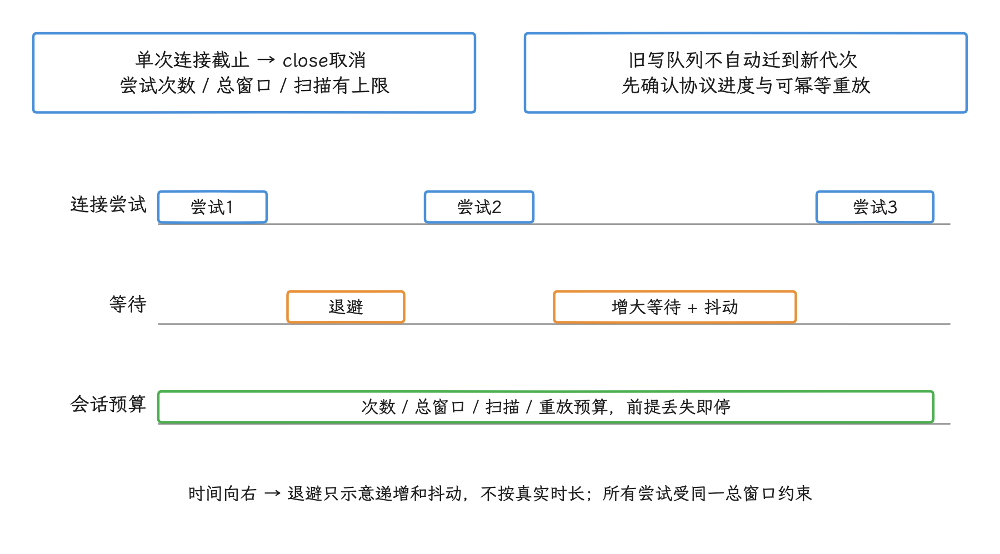
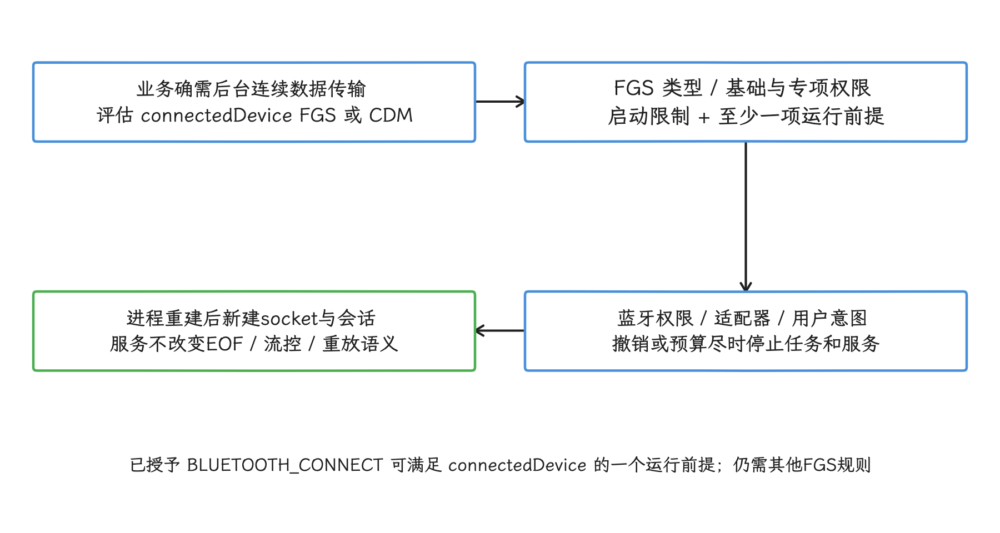
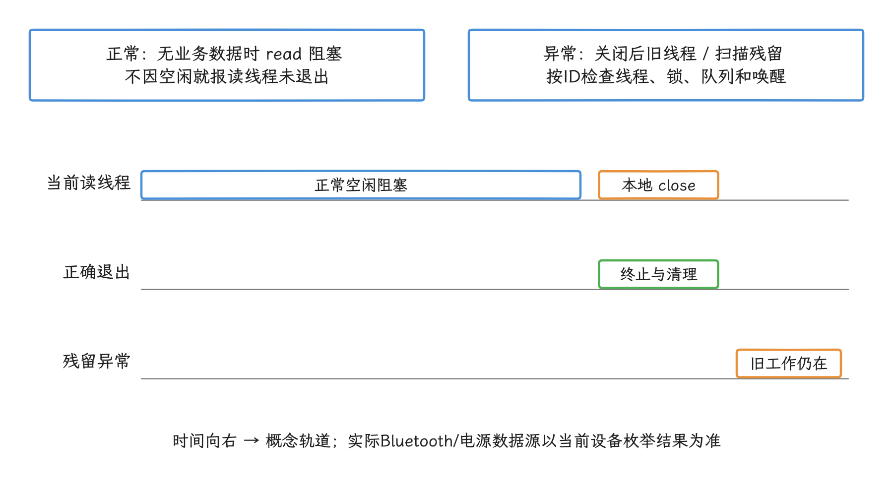

# BluetoothSocket read() 断开语义与长连接治理

`BluetoothSocket` 输入流中阻塞的 `read()` 会以 EOF、异常或字节数三种结果反映连接状态，每一种结果都要接到自己的处置动作上，立即重连只在部分场景下才是正确响应；可靠长连接要把读写线程、关闭顺序、状态机和退避预算放进同一套治理。

> 源码基线：AOSP `android-17.0.0_r1`，实现位于 `packages/modules/Bluetooth` 的 Java 框架层；公开行为以 Android Developers 文档为准。

## 问题范围

维护蓝牙长连接时，只要有一次返回值处理出错，就可能同时看到读线程不退出、界面仍显示已连接、旧连接事件覆盖新状态，以及重连反复触发扫描。背景是一次版本行为的变化：Android 17 改变了 `BluetoothSocket` 上 RFCOMM 输入流结束时的表现，只捕获 `IOException` 的旧代码从此要补上 EOF 这条新退出路径。

几个术语会贯穿全文，先在这里约定：RFCOMM（Radio Frequency Communication，射频通信）是经典蓝牙中面向连接的字节流传输，常用于串行端口规范（Serial Port Profile，SPP）；EOF（end of file）标记输入流已没有后续数据；低功耗蓝牙面向连接信道（LE Credit-based Connection-Oriented Channel，LE CoC）是另一种蓝牙套接字传输类型；目标 SDK（target SDK）指应用声明采用的 Android 行为级别。后文沿用这套术语，方便与日志、源码及官方文档对照。

我们需要回答四个工程问题：

- Android 17 的变化由哪些设备版本、目标 SDK 和套接字类型共同触发。
- `-1` 能证明什么，把它判成远端正常断开还差哪些信息。
- 阻塞的 `connect()`、`read()` 与 `write()` 应怎样取消和分线程。
- 状态机怎样区分关闭意图、流结束、传输错误和过期连接事件。

应用面对的始终是 `BluetoothSocket` 公开契约：我们拿框架层源码核对行为，结论不从 Linux 内核的套接字实现额外推导。

## Android 17 的 RFCOMM EOF 语义

我们先把触发条件圈出来。[Android 17 行为变更](https://developer.android.com/about/versions/17/behavior-changes-17#bluetooth-rfcomm-socket-change) 列出的范围有四条：

- 设备运行 Android 17。
- 应用的 `targetSdkVersion` 为 37 或更高。
- 输入流来自 RFCOMM `BluetoothSocket`。
- 套接字被关闭或连接丢失后，`read()` 返回 `-1`。

调整之后，RFCOMM 与 LE CoC 的结束语义都符合 Java `InputStream` 契约；流结束之外的其他 I/O 故障仍可能抛出 `IOException`。所以我们的读循环要同时处理正数字节数、`-1` 和异常三种结果。

这段旧写法用来说明迁移缺口：

```kotlin
while (running) {
    try {
        val count = input.read(buffer)
        onFrame(buffer, count)
    } catch (e: IOException) {
        onDisconnected(e)
        break
    }
}
```

这段代码的问题有两处：`read()` 返回 `-1` 时，它把负数交给协议解析器，然后继续下一次循环；它还默认每次 `read()` 恰好对应一个业务帧，而 RFCOMM 是字节流，一次读取可能只得到半帧，也可能同时得到多帧。

### `-1` 能证明什么

官方契约把两种情况都映射到 `-1`：应用调用 `close()`，以及连接丢失。只凭这个返回值，我们区分不了本地主动关闭、远端主动关闭和连接意外中断，能依靠的是应用自己记录的信息。

合理的归因顺序分四步：

1. 状态机在调用 `close()` 前记录本地关闭意图。
2. 读线程收到 `-1` 或 `IOException` 后，先检查这项意图。
3. 没有本地关闭意图的 `-1` 记为 `EndOfStream`，更精确的远端原因留给二次分类。
4. 再结合适配器状态、权限状态、业务心跳和设备侧日志做二次分类。业务心跳是应用协议定期发送的存活探测，在归因里当辅助证据用。

下面这段读循环实现了关闭意图和流结束的最小安全处理，`onBytes` 拿到的是独立字节数组，适合异步交给协议解析器：

```kotlin
import android.bluetooth.BluetoothSocket
import java.io.IOException
import java.util.concurrent.atomic.AtomicBoolean
import kotlin.io.DEFAULT_BUFFER_SIZE

sealed interface BtReadExit {
    data object LocalClose : BtReadExit
    data object EndOfStream : BtReadExit
    data class IoFailure(val error: IOException) : BtReadExit
}

class BtReadLoop(
    private val socket: BluetoothSocket,
    private val onBytes: (ByteArray) -> Unit,
    private val onCloseFailure: (IOException) -> Unit,
    private val onExit: (BtReadExit) -> Unit,
) : Runnable {
    private val closeRequested = AtomicBoolean(false)

    fun requestClose() {
        closeRequested.set(true)
        try {
            socket.close()
        } catch (e: IOException) {
            onCloseFailure(e)
        }
    }

    override fun run() {
        val reason = try {
            val input = socket.inputStream
            val buffer = ByteArray(DEFAULT_BUFFER_SIZE)
            var terminalReason: BtReadExit? = null

            while (!closeRequested.get()) {
                val count = input.read(buffer)
                if (count < 0) {
                    terminalReason = if (closeRequested.get()) {
                        BtReadExit.LocalClose
                    } else {
                        BtReadExit.EndOfStream
                    }
                    break
                }
                if (count > 0) {
                    onBytes(buffer.copyOf(count))
                }
            }

            terminalReason ?: BtReadExit.LocalClose
        } catch (e: IOException) {
            if (closeRequested.get()) {
                BtReadExit.LocalClose
            } else {
                BtReadExit.IoFailure(e)
            }
        }

        onExit(reason)
    }
}
```

几个实现细节值得留意。`closeRequested` 是原子布尔值，关闭线程与读线程靠它安全地共享意图：关闭线程先更新它、再调用 `close()`，读线程的阻塞被 `close()` 终止时就能看见本地意图。EOF 分支按读取 `closeRequested` 那一刻可见的意图保存分类；`read()` 返回与这次原子读取之间仍可能插入新的关闭请求，真实断线的物理先后从这段时序里还原不出来，分类以读取时刻看到的意图为准。分类一旦写进 `terminalReason`，之后的关闭请求就不会再改动它。

<!-- gracker-diagram: a271-02-exit-cause-classification -->


图：原子变量保证线程间可见性，恢复不出真实断线的物理时间顺序；分类以代码实际读取时为准。

示例复制有效字节，避免异步消费者继续引用下一次读取会覆盖的数组；高吞吐场景可以改用容量受限的缓冲池，并要求缓冲区归还前只能由一个消费者持有。

`onBytes` 只负责移交字节，并且不抛异常，协议解析错误由独立事件返回状态机；`onCloseFailure` 还应触发读线程存活检查，防止关闭失败后线程持续阻塞。这里的 `onExit` 只移交读任务结果，会话清理到这一步还没有结束：外层会话所有者要关闭当前套接字、停用写入口并回收任务资源，界面状态的更新只是其中一环。

### 源码中的生效条件

我们从 `android-17.0.0_r1` 源码核对 RFCOMM 负返回值的生效条件，下面这段用于对照，应用无需复制：

```java
@EnabledSince(targetSdkVersion = Build.VERSION_CODES.CINNAMON_BUN)
@ChangeId
static final long MAKE_SOCKET_READ_BEHAVIOR_CONSISTENT = 383671392L;

// BluetoothSocket.read(byte[], int, int)
if (ret < 0) {
    mSocketState = SocketState.CLOSED;
    if (Flags.makeSocketReadBehaviorConsistent()
            && CompatChanges.isChangeEnabled(
                    MAKE_SOCKET_READ_BEHAVIOR_CONSISTENT)
            && SdkLevel.isAtLeastC()) {
        return -1;
    }
    throw new IOException("bt socket closed, read return: " + ret);
}
```

在 [`BluetoothSocket.java`](https://android.googlesource.com/platform/packages/modules/Bluetooth/+/refs/tags/android-17.0.0_r1/framework/java/android/bluetooth/BluetoothSocket.java) 里，RFCOMM 路径先调用底层 `mSocketIS.read()`；拿到负返回值后，先把私有 `mSocketState` 设为 `CLOSED`，再根据 aconfig 特性开关、兼容性变更 383671392 和设备版本，选择返回 `-1` 或抛出 `IOException`。

其中的 aconfig 指 Android 平台声明并生成特性开关的配置机制，`CINNAMON_BUN` 是源码中代表 Android 17 的版本常量。`@EnabledSince` 标在兼容性变更常量上，`read()` 方法本身不带这个注解。

[`BluetoothInputStream.java`](https://android.googlesource.com/platform/packages/modules/Bluetooth/+/refs/tags/android-17.0.0_r1/framework/java/android/bluetooth/BluetoothInputStream.java) 的数组读取直接委托给 `BluetoothSocket.read()`。[`sockets.aconfig`](https://android.googlesource.com/platform/packages/modules/Bluetooth/+/refs/tags/android-17.0.0_r1/flags/sockets.aconfig) 则说明 `make_socket_read_behavior_consistent` 的用途是统一 RFCOMM 与 LE CoC 的 EOF 返回值。

LE CoC 在该源码中已经在接收缓冲为空且底层读到 EOF 时直接返回 `-1`。Android 17 的公开行为变更只承诺 RFCOMM 的新语义；同步面向连接（Synchronous Connection-Oriented，SCO）等其他套接字类型即使与 RFCOMM 共享部分实现，公开契约也要从各自的官方渠道确认；SCO 主要承载蓝牙语音数据。

<!-- gracker-diagram: a271-01-rfcomm-eof-gates -->


图：公开变化只承诺 RFCOMM；兼容工具覆盖的是应用侧门控，设备版本与模块特性标志仍由设备本身决定。

可调试应用可在 Android 17 测试设备上执行这些命令，切换兼容性变更：

```bash
adb shell am compat enable 383671392 com.example.app
adb shell am compat disable 383671392 com.example.app
adb shell am compat reset 383671392 com.example.app
```

前两条命令便于在相同 Android 安装包（APK）上对比新旧分支，测试结束后用 `reset` 清除覆盖。兼容性开关切换的只是应用看到的分支，设备系统版本维持原样，模块的 aconfig 标志也仍须启用。面向普通用户的公开 user 构建，只允许为可调试应用切换由目标 SDK 门控的变更；其他组合受构建类型和应用是否可调试限制，详见[兼容性框架工具](https://developer.android.com/guide/app-compatibility/test-debug)。

## 读写线程模型与取消路径

线程怎么摆，取决于阻塞发生在哪里。[Bluetooth 数据传输指南](https://developer.android.com/develop/connectivity/bluetooth/transfer-data) 明确指出，`read(byte[])` 与 `write(byte[])` 都可能阻塞：读取会等待数据、EOF 或异常；远端读取太慢且中间缓冲区已满时，写入也会因流量控制而阻塞。流量控制是接收方根据处理能力限制发送速度的机制。

[`BluetoothSocket` API](https://developer.android.com/reference/android/bluetooth/BluetoothSocket) 还给出两条取消规则：

- `connect()` 会阻塞到连接成功或失败，没有公开的超时参数。
- `BluetoothSocket` 是线程安全的，另一个线程调用 `close()` 会立即中止进行中的操作并关闭套接字。

因此，光取消协程或中断 Java 线程，还不足以让 `connect()`、`read()` 退出，取消处理最终要调用同一个 `BluetoothSocket.close()`。连接超时交给管理本次连接生命周期的任务执行：到达设定的截止时间后关闭当前套接字；下一次重试创建新的 `BluetoothSocket`，已关闭对象就此作废。

状态机在这里承担串行接收事件、按规则转换连接状态的职责。我们先把一次连接会话拆成四个执行单元：

| 执行单元 | 职责 | 约束 |
| --- | --- | --- |
| 连接任务 | 取消设备发现，执行阻塞的 `connect()` | 不在主线程运行；状态机可通过 `close()` 取消 |
| 读任务 | 独占 `InputStream.read()`，产生字节与退出事件 | 长期占用一个工作线程；不直接修改界面状态 |
| 写队列 | 串行执行 `OutputStream.write()` | 有容量上限、取消策略和单次写入耗时记录 |
| 状态机 | 顺序处理连接、关闭、读写失败和系统事件 | 不执行任何阻塞 I/O |

阻塞读循环与状态机要分开部署。`HandlerThread` 是带消息循环（Looper）的线程，`read()` 阻塞期间它处理不了关闭或超时消息，两者共用会拖住取消路径。我们改用独立读线程，或由执行器管理的有限 I/O 工作线程，再把事件投递到单线程状态机。活跃连接数量也要受业务限制，因为每个阻塞读循环都会长期占用执行资源。

<!-- gracker-diagram: a271-03-io-ownership-and-cancel -->


图：读任务与关闭/超时消息分线程部署，HandlerThread 被阻塞也拖不住取消路径；每个活跃连接都有资源预算。

### 字节流与消息定界

RFCOMM 向应用提供的只有字节流：发送方一次 `write()`，接收方可能要经过多次 `read()` 才拿全；接收方的一次 `read()` 也可能同时包含多条业务消息。所以协议至少要约定一种明确的定界方式，例如长度前缀、分隔符或固定长度字段，并处理这些情况：

- 一次读取只有一条消息的部分内容，常称半包；解析器应把它留在缓冲区，等待后续字节。
- 一次读取包含多条完整消息，常称粘包；解析器应逐条取出。
- 长度字段超过协议上限，按协议错误关闭连接。
- 校验失败、未知消息类型和重复业务序号有确定处理规则。

写入同样要串行。文档把 `BluetoothSocket` 描述为线程安全，但应用协议仍需要稳定的消息顺序，以及明确规定哪些消息允许重发。多个调用方先进入有界队列，即容量固定的等待队列，再由单一写任务写入；队列已满时由产品策略决定拒绝、合并或关闭连接，避免任务无限积压。

API 23 及以上的 `getMaxReceivePacketSize()` 与 `getMaxTransmitPacketSize()` 描述底层传输的包尺寸，可以用来优化每次读写的大小；业务帧长度由应用协议定义，一次读取也未必恰好对应一个底层包。示例中的 `DEFAULT_BUFFER_SIZE` 同样只是内存选择，不是协议常量。

<!-- gracker-diagram: a271-04-stream-framing-and-bounds -->


图：InputStream 没有业务帧语义；复制有效字节或明确单消费者所有权，避免下一次read覆盖异步数据。

`isConnected()` 反映的是调用那一刻的套接字连接状态，下一次读写能否成功，它说了不算。所以业务在线状态，我们交给当前连接代次、读写结果和协议活性共同决定；协议活性通常来自业务心跳，或请求响应是否按时完成。

## 断线归因与状态机

断线之后由谁来定原因？我们把这件事交给状态机。一个 `connected: Boolean` 装不下关闭意图、失败阶段和是否允许重连，所以连接事件至少要携带 `connectionId`，即应用为每次连接会话生成的短期唯一标识；每次创建新套接字都生成新值，新值同时代表新的连接代次。状态机只认当前 `connectionId`，旧标识的迟到事件直接丢弃，旧读线程在新连接成功后也就改不了状态。

| 事件 | 直接证据 | 状态机处理 |
| --- | --- | --- |
| `LocalCloseRequested` | 业务先记录意图，再调用 `close()` | 进入 `Closing`，禁止自动重连 |
| `EndOfStream` | 无本地关闭意图，`read()` 返回 `-1` | 记录 EOF，按当前重连预算处理 |
| `ReadFailure` | 无本地关闭意图，读取抛 `IOException` | 记录读取阶段与异常类别 |
| `WriteFailure` | 写入抛 `IOException` | 关闭当前套接字，避免继续使用只能读或只能写的连接 |
| `ConnectFailure` | `connect()` 抛 `BluetoothSocketException` 或 `IOException` | API 34 及以上保留 [`BluetoothSocketException.getErrorCode()`](https://developer.android.com/reference/android/bluetooth/BluetoothSocketException)，进入等待或终止 |
| `AdapterOff` | 观察到适配器状态关闭 | 主动关闭当前会话，等待适配器恢复 |
| `PermissionLost` | 新操作前权限检查失败，或调用抛 `SecurityException` | 主动关闭会话，转到授权状态 |
| `ProtocolTimeout` | 协议定义的响应截止时间到达 | 记为协议层事件，关闭套接字后再决定重连 |

`EndOfStream` 到这一步仍只说明流结束。官方文档把连接丢失也映射到 `-1`，公开的关闭原因平台并未提供。记录 `IOException` 时，一段消息文本远远不够，至少保留发生阶段、异常类名、是否存在本地关闭意图和适配器状态。MAC 是蓝牙设备的硬件地址，完整 MAC、设备名和业务负载都要留在日志之外。

API 34 及以上的 `BluetoothSocketException.getErrorCode()` 提供结构化整数错误码，比异常消息文本更适合聚合；低版本和普通 `IOException` 仍按发生阶段与异常类别记录。在 Android 12（API 31）及以上设备上、应用目标 API 31 及以上时，连接操作需要 `BLUETOOTH_CONNECT` 运行时权限，扫描还涉及 `BLUETOOTH_SCAN`；旧目标与旧系统仍须按各自兼容权限模型检查，权限错误单独归类，避免混进传输失败。

我们推荐的状态集合见表：

| 状态 | 进入条件 | 允许的出口 |
| --- | --- | --- |
| `Idle` | 没有连接意图 | `Connecting` |
| `Connecting` | 新套接字正在执行 `connect()` | `Connected`、`Backoff`、`Idle`、`PermissionRequired`、`AdapterOff` |
| `Connected` | 连接成功且读写任务已启动 | `Closing`、`Backoff`、`PermissionRequired`、`AdapterOff` |
| `Closing` | 已记录本地关闭意图 | `Idle` |
| `Backoff` | EOF、连接失败、读写失败或协议超时 | `Connecting`、`Idle`、`PermissionRequired`、`AdapterOff` |
| `PermissionRequired` | 缺少 `BLUETOOTH_CONNECT` 等所需权限 | `Idle`、`Connecting` |
| `AdapterOff` | Bluetooth 适配器关闭 | `Idle`、`Connecting` |

所有迁移由单线程状态机执行；读任务、写任务、界面、权限回调和适配器广播只提交事件，共享状态的写入权留在状态机手里。每个 `connectionId` 只接受一个终止结果，进入终止状态时同时关闭读写入口。

还有两个常见竞态要处理：

- 本地关闭与远端掉线同时发生时，以状态机已经记录的本地意图为归因依据，不宣称知道无线连接事件的先后顺序。
- 新连接已经进入 `Connected` 后，旧连接的 `EndOfStream` 或 `ReadFailure` 只用来清理旧资源，当前连接不受它影响。

<!-- gracker-diagram: a271-05-connection-generation-fence -->


图：代次同时约束读退出、写失败和连接回调；旧任务清理只回收旧资源，新界面维持当前连接的显示。

## 重连预算与退避

失败之后先核对前提，再谈重连。我们要核对的有四项：业务仍希望保持连接、必要权限仍在、Bluetooth 适配器已开启、当前预算允许重试；任何一项消失，重连就停在原地，后台计时器也随之停止创建套接字。状态表中的 `Backoff` 就是失败后等待下一次连接的阶段。

<!-- gracker-diagram: a271-06-reconnect-state-gates -->


图：重试不是所有终止事件的默认出口；用户断开后停在Idle，缺权限和蓝牙关闭分别等待。

建议分别配置这些预算：

| 预算 | 建议记录 | 用途 |
| --- | --- | --- |
| 单次连接截止时间 | `connect_deadline_ms`、`connect_duration_ms` | 到期后由连接生命周期管理任务调用 `close()` 取消阻塞连接 |
| 会话重试次数 | `attempt_index`、`attempt_limit` | 限制一次用户连接意图内的尝试数量 |
| 总时间窗口 | `retry_window_ms`、`elapsed_in_window_ms` | 限制持续失败占用的总时间 |
| 扫描 | `scan_reason`、`scan_duration_ms`、`scan_attempts` | 区分重连扫描与用户主动配网 |
| 写入重放 | `pending_request_count`、`replay_decision` | 只重放协议允许且幂等的请求 |

等待时间可以用有上限的指数退避：每次失败后成倍延长等待，封顶在设定上限；再加入少量随机时间偏移，也就是重连抖动，减少多台设备或大量客户端同时发起连接的概率。

初始等待、上限和尝试次数属于产品参数，由设备类型、前后台状态和用户等待预期决定。失败计数的清零也要挑时机：等连接持续稳定，或完成一次有效业务交换后再重置，更能减少短连接反复建立和断开。

对已配对且地址已知的经典蓝牙（Bluetooth Classic）设备，我们断线后通常直接创建新的 RFCOMM 套接字即可。全量设备发现要扫描周围设备，只在确需时进行：带过滤条件、截止时间和停止条件，并把原因标记为 `reconnect`。执行 `connect()` 前还要调用 `BluetoothAdapter.cancelDiscovery()`，官方 API 文档说明，进行中的设备发现会显著拖慢新连接。

协议层也要决定断线后的数据处理：

- 已写入只代表字节交了出去，远端是否已处理需要确认，重放决策等确认结果再做。
- 请求携带业务序号或幂等键，重连后由双方确认进度。幂等键是用于识别同一业务请求的唯一标识，使重复提交可以复用已有结果。
- 重复执行有风险的操作，需要先查询结果或让用户确认。
- 旧连接写队列中的任务留在旧 `connectionId` 里，不随新连接自动转移。

<!-- gracker-diagram: a271-07-retry-window-and-replay -->


图：已写出只代表字节交了出去；幂等键或业务序号决定重放，重放有风险时先查询结果。

### 后台连续连接

应用要在后台持续与外部设备传输数据时，按场景评估 `connectedDevice` 前台服务或配套设备管理器（Companion Device Manager）；普通后台线程对进程被系统保留的优先级没有帮助。

[前台服务类型文档](https://developer.android.com/develop/background-work/services/fgs/service-types#connected-device) 要求在 Android 14 及以上设备上、应用目标 API 34 及以上时，在服务上声明 `android:foregroundServiceType="connectedDevice"`，并在清单中声明 `FOREGROUND_SERVICE_CONNECTED_DEVICE`；基础 `FOREGROUND_SERVICE` 权限及前台服务启动限制也仍适用。启动服务时还要满足文档列出的至少一项运行前提；已授予 `BLUETOOTH_CONNECT` 的应用可满足蓝牙连接场景的这一条件。

前台服务改变的是进程执行条件，`BluetoothSocket.read()` 的 EOF 语义、扫描和重连的约束都维持原样。用户主动断开、权限撤销或预算用尽后，我们应停止连接任务和不再需要的前台服务。若使用配套设备管理器，恢复流程要按设备进入或离开通信范围的事件设计，旧套接字跨进程存活这条路走不通。

<!-- gracker-diagram: a271-08-background-execution-and-permissions -->


图：前台服务只改善执行条件，进程仍可能被停止，蓝牙权限、用户断开和重试预算照常生效。

## 性能与功耗监控字段

监控字段上，我们把 Bluetooth 套接字指标与 HTTP 指标分开，单独保留传输类型与失败阶段。每个事件记录原始耗时，分位数放到聚合系统里计算。`p50` 是中位数，`p95` 是 95% 样本不超过的值；两者都是多条样本的统计结果，单次事件里没有这两个字段。

| 类别 | 事件字段 | 用途 |
| --- | --- | --- |
| 版本 | `sdk_int`、`target_sdk`、`build_fingerprint_group` | 验证 Android 17 与目标 SDK 边界 |
| 连接 | `connection_id`、`socket_type`、`connect_duration_ms`、`connect_result` | 区分 RFCOMM、LE CoC 和连接阶段 |
| 读取 | `read_exit_reason`、`bytes_read`、`reader_lifetime_ms` | 发现 EOF 漏处理、异常和未退出线程 |
| 写入 | `write_bytes`、`write_duration_ms`、`write_result`、`queue_depth` | 观察流量控制、队列压力和失败 |
| 重连 | `attempt_index`、`backoff_ms`、`retry_stop_reason` | 检查退避与预算是否执行 |
| 扫描 | `scan_reason`、`scan_duration_ms`、`filter_present` | 与 11.4 的扫描功耗分析关联 |
| 系统 | `adapter_state`、`permission_state`、`app_importance`、`battery_saver` | 区分系统状态与传输失败 |

遥测是应用自动采集并上报的运行指标。`connection_id` 用应用生成的短期随机标识。若必须按设备族聚合，优先上传非唯一的产品型号或固件大版本；需要识别同一设备产生的重复事件时，用定期更换的密钥生成一个标识，它只在指定业务范围内有效，从它也推不回设备地址。`build_fingerprint_group` 同样取粗粒度构建分组，完整构建指纹留在端上。完整 MAC、设备名、广播负载和业务数据也一律留在端上。

Perfetto 是 Android 的系统跟踪工具，BatteryStats 统计设备电量使用；把二者与应用跟踪放到一起，我们可以核对断线后的线程、唤醒锁、扫描和重连是否仍在运行。Perfetto 中的 Bluetooth 与电源时间轴随设备实现变化，测试脚本先枚举当前设备可用数据源，再选择分析字段，时间轴名称以当场枚举结果为准。

读观测数据时，我们把两种情况分开：没有业务数据，和读线程已经退出。空闲连接长时间阻塞在 `read()` 是正常形态，本地关闭后仍未退出、或连接换代后旧线程仍存活，才是需要告警的异常。

<!-- gracker-diagram: a271-09-disconnect-work-versus-idle -->


图：以用户关闭与代次划分观测范围；指标保留socket_type和阶段，与 HTTP 的 DNS、读取超时分开统计。

## Android 17 适配测试表

这张表要在 Android 17 设备上同时覆盖设备版本、目标 SDK、兼容性开关和断开来源；表中的 `sdk_int` 表示设备 API 级别，`target_sdk` 表示应用的目标 SDK。

| 维度 | 覆盖项 | 通过标准 |
| --- | --- | --- |
| 目标 SDK | 36、37 | 在 RFCOMM 底层负返回值且模块开关启用的对照中，36 默认旧异常分支、37 默认 EOF 分支都能终止读任务；其他 I/O 错误仍可抛异常 |
| 兼容性开关 | `targetSdkVersion 36` 强制启用、`targetSdkVersion 37` 强制禁用、重置默认值 | 相同 APK 可隔离 383671392 的影响，测试后没有遗留覆盖 |
| 套接字类型 | RFCOMM、LE CoC | RFCOMM 处理新 EOF；LE CoC 原有 EOF 行为没有回归 |
| 本地关闭 | 用户断开、会话销毁、连接超时取消 | 先记录关闭意图，结果为 `LocalClose`，不触发自动重连 |
| 远端与无线连接 | 对端关闭、对端进程退出、设备关机、距离与干扰 | `EndOfStream` 或 `IoFailure` 都能终止当前连接 |
| 连接换代 | 旧连接退出延迟到新连接成功之后 | 旧 `connectionId` 事件不能修改新连接状态 |
| Bluetooth 状态 | 手动关闭和重新开启适配器 | 关闭时停止连接与扫描，恢复后按业务意图决定是否连接 |
| 飞行模式 | Bluetooth 随飞行模式关闭、用户在飞行模式中重新开启 Bluetooth | 以实际适配器状态为准，不把飞行模式直接等同于 Bluetooth 关闭 |
| 权限 | 启动前拒绝、连接期间撤销、重新授权 | 不循环请求或重连；授权后创建新套接字 |
| 后台执行 | 进入后台、停止前台服务、进程被系统终止 | 状态与通知一致，恢复流程不复用失效套接字 |
| 写入阻塞 | 对端暂停读取、写队列达到容量限制 | 主线程不阻塞，截止时间和拒绝策略生效 |
| 协议分帧 | 半包、粘包、超长长度、校验失败 | 解析器不把一次 `read()` 当作一帧，错误路径可关闭会话 |

每个用例至少记录 `sdk_int`、`target_sdk`、兼容性开关状态、`connection_id`、`read_exit_reason` 和重试终止原因。远端关闭在不同蓝牙控制器芯片、固件和时序下可能表现为 EOF 或异常，所以我们的断言检查的是状态机结果，底层表现为 EOF 还是异常都算通过。

## 与相邻章节的分工

11.4 节负责 Bluetooth 扫描、连接和功耗分析；我们只在断线扫描、重连预算和套接字线程处引用它，低功耗蓝牙（Bluetooth Low Energy，BLE）的扫描限制放到那一章讲。

24.5 节负责公网请求的弱网处理和重试预算。Bluetooth 套接字可以复用失败分类、安全重试规则和总时间预算，但错误仍需独立建模，与 HTTP 的 DNS、连接或读取超时分开归类。

26.10 节负责线上网络质量监控，Bluetooth 套接字在那里作为独立通道上报，原始事件保留 `socket_type`、`read_exit_reason`、`connection_id` 和 `retry_stop_reason`。

## 检查清单

- `InputStream.read()` 同时处理正数字节数、`-1` 和 `IOException`。
- 不把 `-1` 直接命名为远端正常关闭；本地关闭意图在 `close()` 前记录。
- `connect()`、`read()`、`write()` 都不在主线程或界面回调中执行。
- 取消协程或线程时会调用同一套接字的 `close()`，连接超时后创建新套接字。
- RFCOMM 解析器支持半包、粘包和非法长度，不依赖单次 `read()` 划分消息。
- 写入使用有界串行队列，并记录写入耗时、队列深度和失败阶段。
- 每次连接使用新 `connectionId`，旧连接迟到事件不会覆盖当前状态。
- 重连有连接、次数、总时间、扫描和数据重放预算。
- Bluetooth 关闭、权限撤销、用户断开和预算耗尽都会停止重连。
- Android 17 / API 37 用例覆盖默认分支与兼容性开关对照。
- 遥测不上传完整 MAC、设备名、广播负载或业务数据。

## 全文小结

Android 17 在 `targetSdkVersion 37` 下让 RFCOMM 输入流在套接字关闭或连接丢失时返回 `-1`，`IOException` 路径仍要保留。`-1` 能证明的只有输入流结束，远端主动关闭要结合其他状态才能下结论。

可靠实现把本地关闭意图、EOF、I/O 失败和系统状态都转换成带 `connectionId` 的状态机事件：阻塞读写放在独立工作线程，取消动作通过 `BluetoothSocket.close()` 完成，协议解析负责消息边界，重连负责预算、幂等和后台执行条件。这样 Android 17 的返回值变化被限制在传输适配层，界面状态、重连和业务重放拿到的是同一个状态机给出的归因。
