# 定位与传感器功耗优化

定位与传感器的功耗，主要花在采样频率、精度、批处理、唤醒和后台持续时间这几件事上。优化的次序我们倒过来走：先从业务需要的新鲜度和准确度推出请求参数，再用系统记录核对硬件活动有没有随之减少。

## 功耗边界

做定位与传感器的功耗评审时，我们先把耗电拆到具体的硬件活动和数据流上。定位请求可能启用 GNSS（全球卫星导航系统）、Wi-Fi 扫描、蜂窝测位和传感器融合；传感器监听又牵出采样、FIFO（先进先出缓冲区）交付、应用处理器唤醒和后续计算。所以评审要从 API 名称往下追，顺着数据走一遍：它从哪里产生、多久产生一次、何时交付，应用收到后又做了多少 CPU（中央处理器）、存储和网络工作。

顺着这条数据流看请求参数：定位与传感器 API 表达的大多是期望条件或上限，并不承诺准确的到达周期：其他客户端请求、权限精度、设备硬件、传感器 HAL（硬件抽象层）、待机状态和省电策略都会改变结果。我们先把业务可接受的精度、新鲜度、交付延迟、持续时间和退出条件定义清楚，再从一次性定位、连续 FLP（融合位置提供器）、Geofencing（地理围栏）、被动定位或传感器批处理里选合适的形态。诊断工具见 §25.1，后台限制见 §25.2。

## 定位精度与功耗的权衡

具体挑参数时，官方把定位功耗归纳为三个变量：精度、计算频率和交付延迟，我们就对着这三条权衡。高精度请求更可能用上高成本来源；计算间隔越短，定位工作越多；交付延迟越短，应用被唤醒的次数越多。`setMinUpdateDistanceMeters()` 还能减少没有足够位移时的回调，但它和其余 `LocationRequest` 参数一样，属于提供给位置服务的请求条件。

| 业务场景 | 推荐接口 | 数据契约 | 退出条件 |
|------|------|------|------|
| 天气、城市级内容 | `getLastLocation()`，缓存过旧或为空时再用 `getCurrentLocation()` | 接受粗略位置；显式校验位置年龄 | 一次结果返回或取消令牌触发 |
| 地图选点 | 短时 `PRIORITY_BALANCED_POWER_ACCURACY` 或确有需要时使用 `PRIORITY_HIGH_ACCURACY` | 页面可见；精度与刷新率跟随交互 | 页面不可见、选择完成或超时 |
| 导航、用户主动共享轨迹 | 高精度 FLP + location 类型前台服务（FGS） | 用户持续可见；需要连续更新 | 用户停止、会话结束或服务退出 |
| 到达区域后提醒 | Geofencing | 接受分钟级响应与位置误差 | 围栏过期、功能关闭或区域集合替换 |
| 借用系统已有位置 | `PRIORITY_PASSIVE` | 不保证有结果，也不保证新鲜 | 业务窗口结束 |
| 姿态或运动趋势 | 最低可用采样率 + 批处理 | 按事件时间处理，允许批量到达 | 生命周期结束或前台服务停止 |

`getLastLocation()` 不主动计算新位置，返回值可能为空也可能过时。判断新鲜度时，我们优先比较 `Location.elapsedRealtimeNanos` 与当前 elapsed realtime（设备开机后持续递增的单调时间）——两者都从开机起单调递增；墙上时钟会被用户、网络校时或时区改变，不用它做这类判断。需要一次较新的结果时，用 `getCurrentLocation()` 并传入取消条件，别为一次查询留下长期注册的回调。

<!-- gracker-diagram: a277-01-location-shape-by-freshness -->
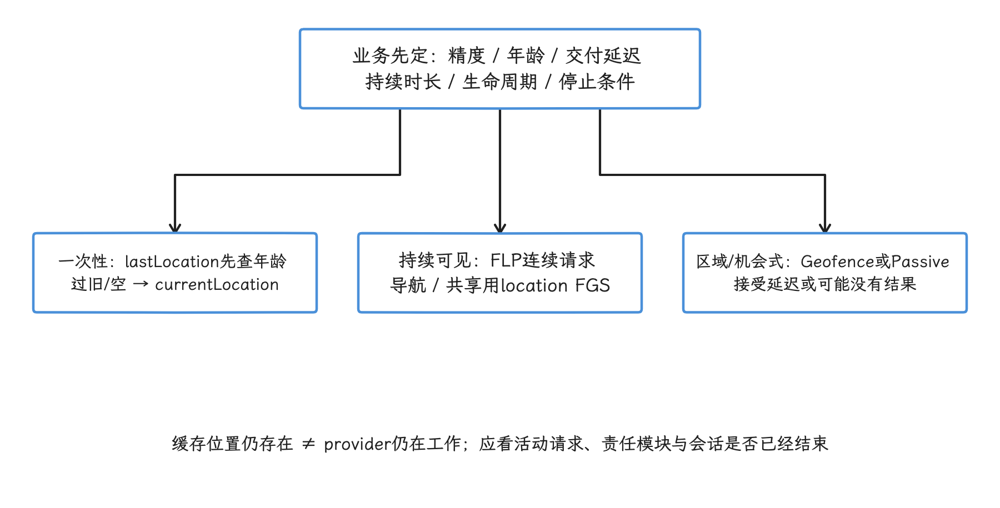

图：位置年龄使用同次开机elapsedRealtime；epoch墙钟会跳变，时区只改变当地时间换算。

## Fused Location Provider（FLP，融合位置提供器） 最佳实践

选好形态，我们来填参数。来源的挑选和融合交给 FLP：它把 GNSS、Wi-Fi、蜂窝与传感器等来源交给 Google Play services，应用这边指定优先级、期望间隔、最小回调间隔、最小位移、最大交付延迟、精度档位和持续时间。`LocationRequest` 文档明确说明系统只能尽力满足这些参数：权限、硬件、系统状态与其他客户端请求可能让结果更慢、更快、更粗或更细。

连续定位请求要有两层停止条件：

- 正常路径由页面、导航会话或用户开关调用 `removeLocationUpdates()`。
- 异常路径由 `setDurationMillis()` 或 `setMaxUpdates()` 限制请求寿命。

先看用户可见的连续追踪。`buildVisibleTrackingRequest()` 构造这类请求，间隔、最小回调间隔、最小位移和持续时间都由入参传入；函数体只用 `require` 挡住非法组合，不给业务预设一组固定数字。参数取值取决于已评审的业务契约。

```kotlin
fun buildVisibleTrackingRequest(
    intervalMillis: Long,
    minUpdateIntervalMillis: Long,
    minDistanceMeters: Float,
    durationMillis: Long,
): LocationRequest {
    require(intervalMillis > 0)
    require(minUpdateIntervalMillis in 1L..intervalMillis)
    require(minDistanceMeters >= 0f)
    require(durationMillis > 0)

    return LocationRequest.Builder(
        Priority.PRIORITY_HIGH_ACCURACY,
        intervalMillis,
    )
        .setGranularity(Granularity.GRANULARITY_PERMISSION_LEVEL)
        .setMinUpdateIntervalMillis(minUpdateIntervalMillis)
        .setMinUpdateDistanceMeters(minDistanceMeters)
        .setDurationMillis(durationMillis)
        .build()
}
```

构造器里的参数我们逐个过一遍：`GRANULARITY_PERMISSION_LEVEL` 让请求遵守当前授权精度；`minUpdateIntervalMillis` 定的是允许的最快回调间隔，回调仍可能比它来得慢；`durationMillis` 到期后位置服务会移除请求，所以业务结束时仍应主动停止。优先级档位同样按需选：balanced accuracy（均衡功耗精度）已满足需求时，应改为 `PRIORITY_BALANCED_POWER_ACCURACY`，别默认走高精度。

注册与注销围绕同一个 `locationCallback` 实例进行：`startVisibleTracking()` 和 `stopVisibleTracking()` 操作的都是它，注销时不用重新构造回调。两处都假定调用方已经检查过 coarse（粗略）/fine（精确） 权限，并分别在可见生命周期的开始和结束调用。

```kotlin
@SuppressLint("MissingPermission")
fun startVisibleTracking(request: LocationRequest) {
    fusedLocationProviderClient.requestLocationUpdates(
        request,
        locationCallback,
        Looper.getMainLooper(),
    )
}

fun stopVisibleTracking() {
    fusedLocationProviderClient.removeLocationUpdates(locationCallback)
}
```

主线程回调只做轻量状态更新；轨迹压缩、写库和网络操作要移到受控执行器。解除注册返回 `Task<Void>（Google Play services 的异步结果）`；需要严格确认停止完成的测试可以等待该任务，仅凭页面回调已经执行还不够。

<!-- gracker-diagram: a277-02-flp-lifetime-and-two-stop-paths -->
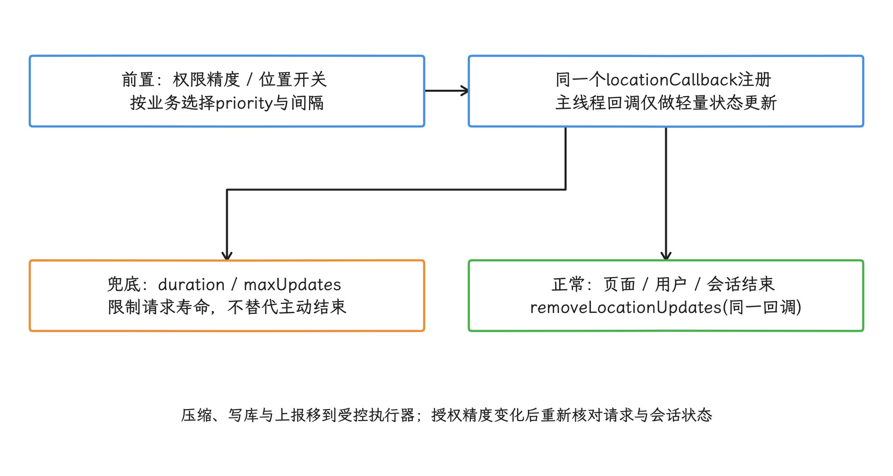

图：removeLocationUpdates返回异步Task；严格停止验收等待完成，再检查活动请求与残留回调。

业务允许延迟时，我们还能用 `setMaxUpdateDelayMillis()` 让设备尝试批量交付。Google Play services 只有在最大延迟至少是请求间隔的两倍时，才把请求视为允许批处理；即使满足该关系，硬件也可以逐点交付。

按这个关系构造请求就是 `buildBatchedLocationRequest()`：它构造允许批量交付的低频请求，优先级取 `PRIORITY_BALANCED_POWER_ACCURACY`，`require` 先校验最大延迟至少是间隔的两倍。调用方要明确最长可接受交付延迟和整个采集会话的寿命。

```kotlin
fun buildBatchedLocationRequest(
    intervalMillis: Long,
    maxUpdateDelayMillis: Long,
    durationMillis: Long,
): LocationRequest {
    require(intervalMillis > 0)
    require(maxUpdateDelayMillis / 2 >= intervalMillis)
    require(durationMillis > 0)

    return LocationRequest.Builder(
        Priority.PRIORITY_BALANCED_POWER_ACCURACY,
        intervalMillis,
    )
        .setGranularity(Granularity.GRANULARITY_PERMISSION_LEVEL)
        .setMaxUpdateDelayMillis(maxUpdateDelayMillis)
        .setDurationMillis(durationMillis)
        .build()
}
```

这段配置允许批处理，但每个回调未必都包含多条位置，不同批次之间还可能出现时间逆序，所以我们要按 `elapsedRealtimeNanos` 排序和去重，把事件发生时间与回调到达时间分别记录。`Location.time` 可用于跨设备或服务端的时间展示，单机轨迹的单调排序不要靠它。

<!-- gracker-diagram: a277-03-location-batching-event-time -->
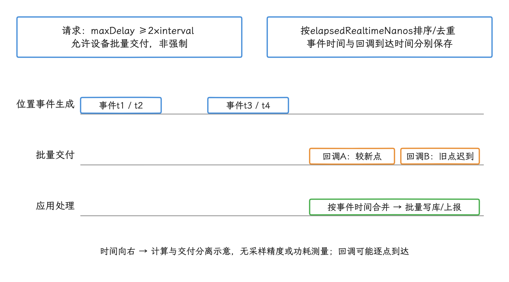

图：批处理改变交付时机，应用不能按回调到达顺序直接连接轨迹或逐条立即上报。

FLP 参数与功耗建议可对照 [`LocationRequest`](https://developers.google.com/android/reference/com/google/android/gms/location/LocationRequest)、[`LocationRequest.Builder`](https://developers.google.com/android/reference/com/google/android/gms/location/LocationRequest.Builder) 和 [Android 定位功耗指南](https://developer.android.com/develop/sensors-and-location/location/battery)。

## Geofencing 与被动定位

Geofencing 适合“设备到了区域再通知应用”这类业务：位置服务统一维护围栏，应用不必为查当前位置周期性唤醒进程。每个应用、每个设备用户最多同时注册 100 个围栏；大量门店场景可以先维护城市或商圈范围，再按用户所在区域替换附近门店集合。

半径与响应时间属于产品正确性的一部分。官方建议典型围栏采用 100 到 150 米的最小半径，以容纳常见 Wi-Fi 定位误差；`setNotificationResponsiveness()` 取 5 分钟或更大更有利于功耗。我们把这些当经验起点，具体数值还要结合室内定位能力、道路速度、误触成本和业务半径来定。Android 8.0 及以上设备在应用处于后台时通常每隔几分钟处理一次围栏事件，把响应时间调小也不构成及时送达的保证。

落到代码上，`buildDwellGeofence()` 只固定 `DWELL` 这一种 transition，半径、停留时间、响应时间和过期时间都留给业务配置；函数体的 `require` 只检查 API 要求的基本范围。

```kotlin
fun buildDwellGeofence(
    requestId: String,
    latitude: Double,
    longitude: Double,
    radiusMeters: Float,
    loiteringDelayMillis: Int,
    responsivenessMillis: Int,
    expirationMillis: Long,
): Geofence {
    require(requestId.isNotBlank())
    require(latitude in -90.0..90.0)
    require(longitude in -180.0..180.0)
    require(radiusMeters > 0f)
    require(loiteringDelayMillis >= 0)
    require(responsivenessMillis >= 0)
    require(expirationMillis > 0)

    return Geofence.Builder()
        .setRequestId(requestId)
        .setCircularRegion(latitude, longitude, radiusMeters)
        .setTransitionTypes(Geofence.GEOFENCE_TRANSITION_DWELL)
        .setLoiteringDelay(loiteringDelayMillis)
        .setNotificationResponsiveness(responsivenessMillis)
        .setExpirationDuration(expirationMillis)
        .build()
}
```

`DWELL` 表示在围栏内停留，可过滤短暂穿越区域造成的频繁提醒。围栏事件通过 `PendingIntent`（系统稍后代应用执行操作的凭据） 交给 `BroadcastReceiver`；接收器应核对错误码、transition（进入、离开或停留事件类型）与触发列表，再发布通知或安排有限的后台工作，不要从后台事件直接展示 Activity。

功能关闭、账号退出或区域集合改变时，按 request ID（围栏标识） 或原 `PendingIntent` 移除旧围栏。

围栏之外，另一条省电路径是被动定位，走 `PRIORITY_PASSIVE`。这个优先级不会让系统为当前请求单独计算位置，只接收系统为其他客户端生成的位置；它仍受位置权限、后台访问限制和进程调度影响，也可能收到批量数据。

`buildPassiveLocationRequest()` 把这些约定固化下来：优先级取 `PRIORITY_PASSIVE`，最小回调间隔限制应用处理数据的最高频率，持续时间防止请求长期遗留。

```kotlin
fun buildPassiveLocationRequest(
    minUpdateIntervalMillis: Long,
    durationMillis: Long,
): LocationRequest {
    require(minUpdateIntervalMillis > 0)
    require(durationMillis > 0)

    return LocationRequest.Builder(
        Priority.PRIORITY_PASSIVE,
        minUpdateIntervalMillis,
    )
        .setGranularity(Granularity.GRANULARITY_PERMISSION_LEVEL)
        .setMinUpdateIntervalMillis(minUpdateIntervalMillis)
        .setDurationMillis(durationMillis)
        .build()
}
```

这里的间隔只控制回调资格，我们把它调小，被动请求也不会变成周期定位。没有其他客户端计算位置时，它可以一直没有结果，安全告警、导航和完整运动轨迹要走主动定位。收到数据后还要按事件时间去重，把多条写库与上报合并处理。

<!-- gracker-diagram: a277-04-geofence-versus-passive -->
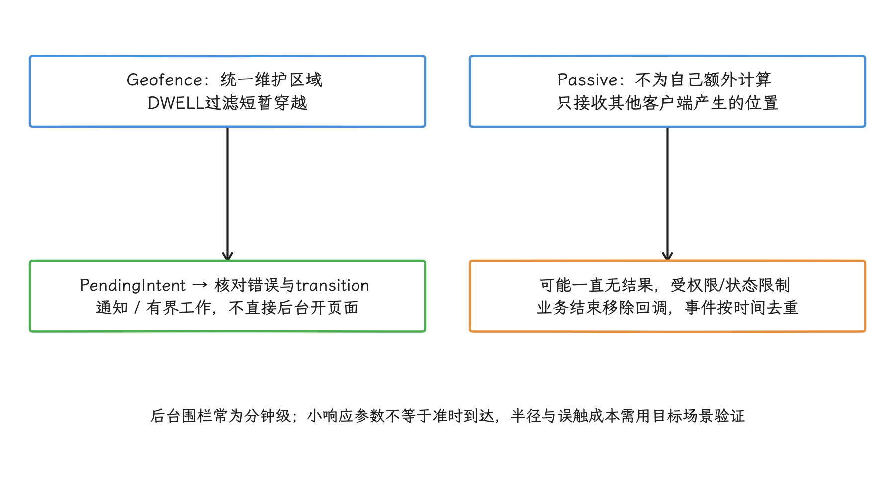

图：功能关闭、退出账号、区域集合变化时移除旧围栏；被动定位不适用于完整导航或安全告警时限。

定位层的公开资料包括 [Geofencing 指南](https://developer.android.com/develop/sensors-and-location/location/geofencing)、[后台定位权限](https://developer.android.com/develop/sensors-and-location/location/permissions/background) 和 [`Priority.PRIORITY_PASSIVE`](https://developers.google.com/android/reference/com/google/android/gms/location/Priority)。下面的 `android-17.0.0_r1` 源码可用于核对平台实现：

- [`LocationManagerService.java`](https://android.googlesource.com/platform/frameworks/base/+/android-17.0.0_r1/services/core/java/com/android/server/location/LocationManagerService.java) 提供系统位置服务入口。
- [`LocationProviderManager.java`](https://android.googlesource.com/platform/frameworks/base/+/android-17.0.0_r1/services/core/java/com/android/server/location/provider（位置数据提供器）/LocationProviderManager.java) 管理 provider 的注册、请求和交付。
- [`LocationFudger.java`](https://android.googlesource.com/platform/frameworks/base/+/android-17.0.0_r1/services/core/java/com/android/server/location/fudger/LocationFudger.java) 处理粗略位置。
- [`LocationRequest.java`](https://android.googlesource.com/platform/frameworks/base/+/android-17.0.0_r1/location/java/android/location/LocationRequest.java) 定义平台请求参数；它与 Google Play services 的同名类不是同一个类型。

## 传感器批处理与采样率控制

我们再看传感器，这条链路上的功耗点比定位更多：传感器本身、sensor hub（传感器协处理器）、硬件 FIFO（先进先出硬件缓冲区）、应用处理器唤醒、事件分发和应用计算都在列。批处理的目标是让 sensor hub（负责低功耗采集的传感器协处理器） 或 FIFO 暂存事件，减少应用处理器从 suspend（系统挂起） 状态醒来的次数；它改变的是交付时机，采样频率仍由 `samplingPeriodUs` 决定。

下面的流程图给出传感器事件从硬件到应用的主要层次。批处理发生在 HAL 之前的 sensor hub 或硬件 FIFO，`SensorService` 负责连接、权限、速率调整和事件分发。

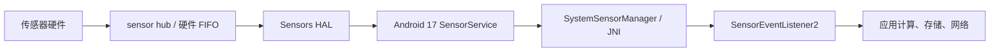

这条链路上有两个独立的功耗问题：批量交付能减少应用处理器唤醒；要减少事件生成与融合计算，得调低 `samplingPeriodUs` 对应的采样频率。回调后逐条写库或立即上报，还会抵消批处理带来的收益。

应用侧的注册入口是 `SensorManager.registerListener(listener（监听器）, sensor, samplingPeriodUs, maxReportLatencyUs)`：

- `samplingPeriodUs` 是期望的相邻事件间隔，单位为微秒，系统可以按硬件能力调整。
- `maxReportLatencyUs` 是允许事件延迟交付的最长时间，单位也为微秒。它大于零时才允许批处理。
- `Sensor.getFifoMaxEventCount()` 为零表示该传感器不使用 FIFO，此时带最大延迟的重载与普通注册没有批处理差异。
- FIFO 可能由多个传感器共享。某个传感器的最大延迟到期或 FIFO 提前填满时，同一 FIFO 的其他事件也可能提前交付。

把这些参数组装起来是 `registerBatchedSensor()`：它注册可批处理的 continuous（连续上报型） 或 on-change（数值变化时上报型） 传感器，采样周期和最大交付延迟由调用方按业务语义传入。调用方还要持有同一个 `SensorEventListener2`，因为 flush（立即交付缓冲事件） 的完成通知只会回到这个实例。

```kotlin
fun registerBatchedSensor(
    sensorManager: SensorManager,
    sensor: Sensor,
    listener: SensorEventListener2,
    samplingPeriodUs: Int,
    maxReportLatencyUs: Int,
): Boolean {
    require(sensor.reportingMode != Sensor.REPORTING_MODE_ONE_SHOT)
    require(samplingPeriodUs > 0)
    require(maxReportLatencyUs >= 0)

    return sensorManager.registerListener(
        listener,
        sensor,
        samplingPeriodUs,
        maxReportLatencyUs,
    )
}
```

返回 `false` 表示传感器不受支持或启用失败，注册之后要检查返回值。one-shot（触发一次后自动停用） 传感器要走 `requestTriggerSensor()`。如果 `fifoMaxEventCount` 为零，应用可以继续接收事件，只是 `maxReportLatencyUs` 提供不了硬件批处理能力。

flush 的作用是把缓冲里的事件取出来：`SensorManager.flush(listener)` 是异步操作，调用后，FIFO 中已有事件按正常回调送达，随后才调用 `SensorEventListener2.onFlushCompleted()`。我们要保存尾部事件时，应在 flush 成功后等完成回调、再注销 listener，还要准备超时退出。`flush()` 返回 `false` 表示该监听器没有已注册传感器，或至少一个 flush 请求失败。硬件没有原生 flush 支持时，框架仍可以发送一个简单的完成事件。

### wake-up（唤醒型）、non-wake-up（非唤醒型）与后台状态

wake-up sensor 在 FIFO 填满或最大报告延迟到期时可以唤醒应用处理器；non-wake-up sensor 在处理器挂起时不主动唤醒，其 FIFO 填满后可循环覆盖旧事件，等处理器因其他原因醒来再交付。业务要在完整保留事件和尽量不唤醒处理器之间做选择。

<!-- gracker-diagram: a277-06-wakeup-nonwakeup-fifo -->
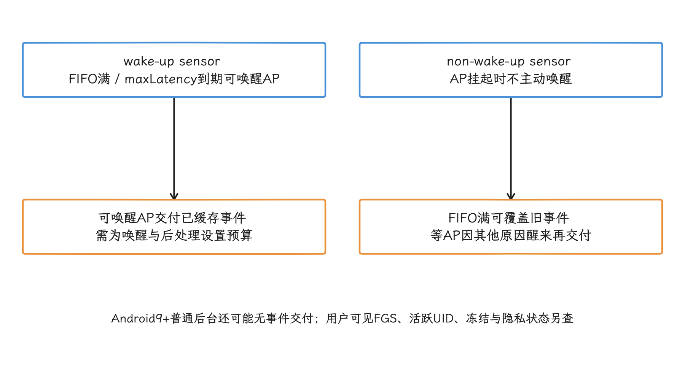

图：共享FIFO的其他传感器可能让事件提前交付；请求最大延迟不是每批固定间隔。

Android 9（API 28）及以上设备不会向后台应用交付 continuous、on-change 或 one-shot 传感器事件，长时间运动采集需要用户可见的前台服务，并在服务停止时解除注册。Android 17 `SensorEventConnection::hasSensorAccess()` 还会检查 UID（系统分配的应用身份） 是否活跃、进程是否被冻结以及传感器隐私开关——保留监听器换不来后台进程持续收到数据。

### Android 12 的 200 Hz（赫兹，即每秒 200 个事件） 限制

200 Hz 指每秒 200 个事件，这是与目标 SDK 和权限相关的高采样率限制；后台速率上限是另一回事。目标版本为 Android 12（API 31）及以上且没有 `HIGH_SAMPLING_RATE_SENSORS` 的应用，通过 `registerListener()` 读取三类原始传感器时最多为 200 Hz：

- 加速度计与未校准加速度计；
- 陀螺仪与未校准陀螺仪；
- 地磁场与未校准地磁场传感器。

`SensorDirectChannel` 在同一条件下被限制到 `RATE_NORMAL`，通常约为 50 Hz。需要更高速率时，应用声明普通权限 `HIGH_SAMPLING_RATE_SENSORS`；它只解除这项速率限制，后台持续采样资格和心率等受保护数据权限都不在它授予的范围里。用户关闭系统麦克风访问开关时，上述传感器仍会被限速，声明了权限也一样。

Android 17 的 `SystemSensorManager` 用 5000 微秒作为 200 Hz 的周期判定线；native（原生 C++ 层） `SensorService` 再按目标 SDK、权限和麦克风隐私状态调整采样周期与 direct channel（直接通道） 档位。可调试包在 Java 层请求超限速率时会收到 `SecurityException`，非调试包可能由 native 层直接限到允许值，所以判断有没有被限速要看实际生效的采样周期，光等异常会漏掉非调试包。

<!-- gracker-diagram: a277-08-high-rate-sensor-gates -->
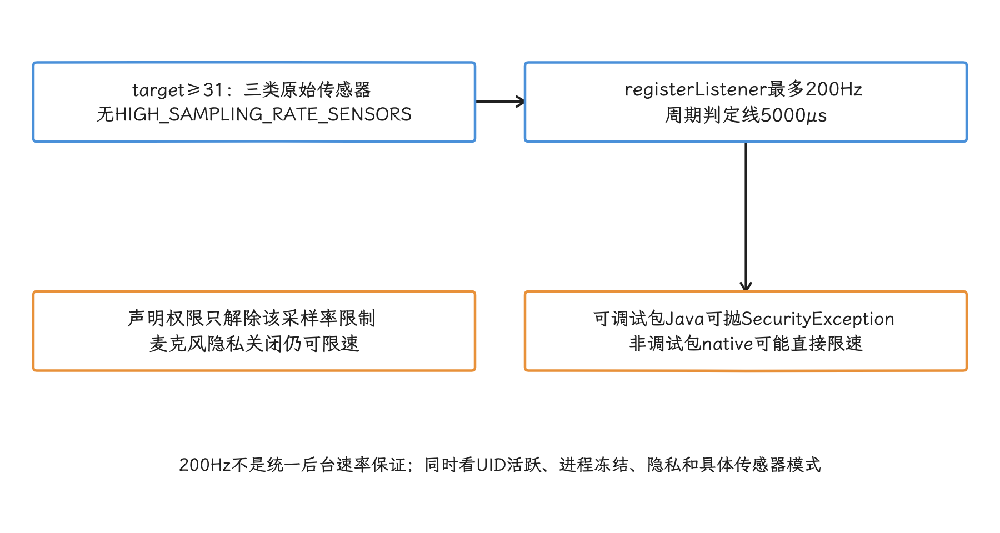

图：按实际采样周期验收；高采样率权限不提供身体数据权限、后台持续收样或FGS启动资格。

### health 前台服务与 Android 17 权限

在 Android 14（API 34）设备上，长时间的健康或运动传感器采集如果需要由前台服务维持，且目标版本为 34 及以上，就必须使用 `foregroundServiceType="health"` 与 `FOREGROUND_SERVICE_HEALTH`，并满足至少一种对应运行时条件。身体传感器权限要按版本拆开：

- Android 15（API 35）及以下的身体传感器使用 `BODY_SENSORS`；API 33 到 API 35 若要从后台启动并读取身体传感器，还需要 `BODY_SENSORS_BACKGROUND`。
- 在 Android 16（API 36）及以上系统中，目标版本 36 及以上的应用改用 `READ_HEART_RATE`、`READ_SKIN_TEMPERATURE`、`READ_OXYGEN_SATURATION` 等细分权限；后台读取对应健康数据需要 `READ_HEALTH_DATA_IN_BACKGROUND`。
- `ACTIVITY_RECOGNITION` 或清单中的 `HIGH_SAMPLING_RATE_SENSORS` 也可以满足 health FGS 的一种启动先决条件，但只能访问各自授权范围内的数据。

这套规则延续到 Android 17（API 37）。前台服务解决的是长时运行的合规问题；最低采样率、允许批处理、持续通知，以及用户停止会话后及时结束服务，这些优化动作仍然要做。

<!-- gracker-diagram: a277-09-location-health-resource-gates -->
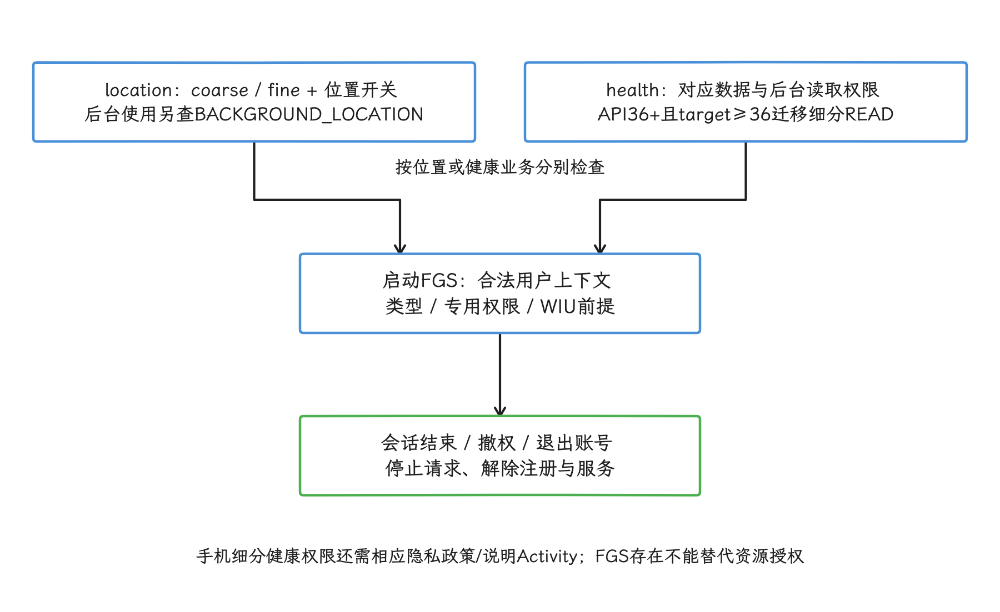

图：旧target按兼容路径核对；身体权限、活动识别与高采样率权限各只授予自己的范围。

### Android 17 源码锚点

- [`SystemSensorManager.java`](https://android.googlesource.com/platform/frameworks/base/+/android-17.0.0_r1/core/java/android/hardware/SystemSensorManager.java)：应用请求、200 Hz 周期判定与高采样率权限检查。
- [`SensorService.cpp`](https://android.googlesource.com/platform/frameworks/native/+/android-17.0.0_r1/services/sensorservice/SensorService.cpp)：目标 SDK、权限、麦克风隐私限速及传感器访问。
- [`SensorEventConnection.cpp`](https://android.googlesource.com/platform/frameworks/native/+/android-17.0.0_r1/services/sensorservice/SensorEventConnection.cpp)：事件连接、活跃 UID 检查、flush 与 wake-up 事件确认。
- [AOSP（Android 开源项目） Sensors batching](https://source.android.com/docs/core/interaction/sensors/batching)：FIFO、报告延迟、suspend 与 wake-up/non-wake-up 契约。

传感器驱动和 sensor hub 固件通常由设备厂商实现，通用 AOSP 给不出一条适用于所有设备的 Linux 驱动路径，我们在这里不据此推断内核行为；后续若引用通用内核实现，统一以 `android17-6.18-2026-06_r6` 为准，旧内核分支解释不了 Android 17 设备。

<!-- gracker-diagram: a277-05-sensor-hardware-to-app -->
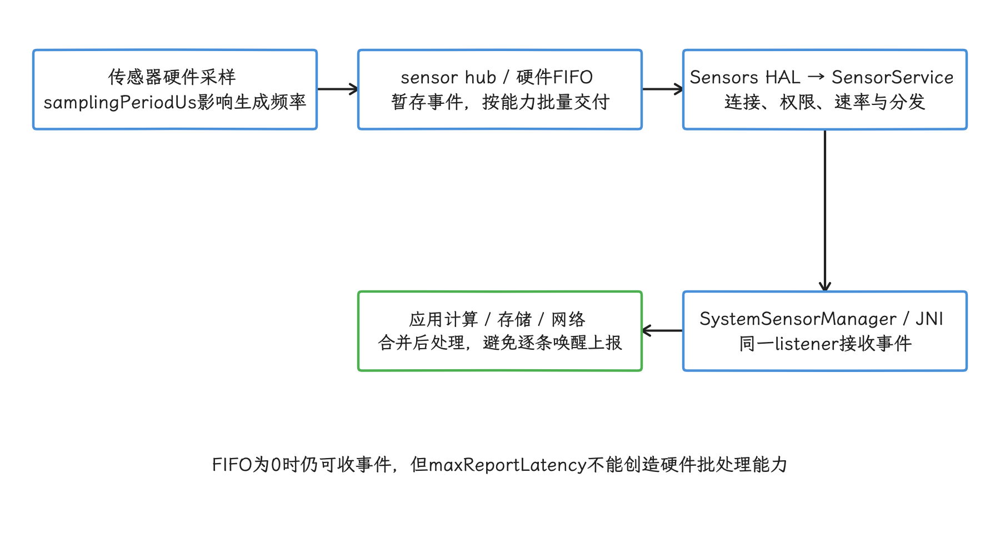

图：增大采样周期才能减少生成与融合计算；批量交付主要减少应用处理器唤醒。

<!-- gracker-diagram: a277-07-flush-per-sensor-completion -->
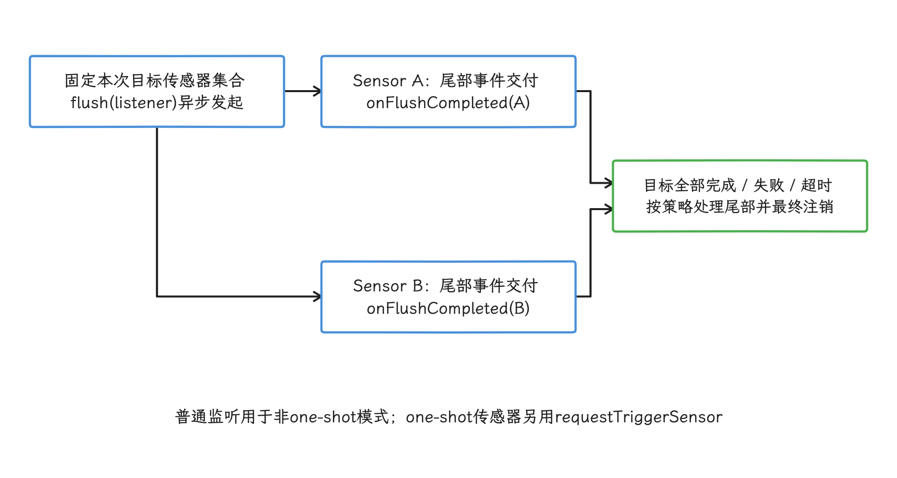

图：只收到第一个onFlushCompleted不能注销整个listener；失败与超时路径也必须回收注册。

## 后台定位、前台服务与定位现场

定位能力取决于好几层条件：运行系统、`targetSdkVersion`（目标 API 级别）、权限授予、位置总开关和当前可见性。我们逐层过一遍：

| 版本边界 | 需要处理的规则 |
| --- | --- |
| Android 8+ | 普通后台应用的位置更新受到频率限制；持续导航或共享应使用用户可见的 location FGS |
| Android 10+ | 后台定位使用 `ACCESS_BACKGROUND_LOCATION`；location FGS 声明 `foregroundServiceType="location"` |
| Android 11+ | target 30+ 不能在一次请求中同时申请前台与后台定位，后台权限要在功能上下文中分阶段解释 |
| Android 12+ | 用户可以只授予大致位置；从后台启动 FGS 还受通用限制 |
| Android 14+ | 目标版本 34 及以上声明 `FOREGROUND_SERVICE_LOCATION`，创建服务时满足粗略或精确位置权限与使用中权限前提 |

Android 8.0（API 26）起，后台应用的位置计算与交付被限制为每小时少数几次，后台 Geofencing 也按几分钟量级响应。这层限制属于设备行为，与应用的 `targetSdkVersion` 无关；提高请求频率绕不开它，反而会让业务契约与平台行为对不上。

权限和前台服务需要按版本分别处理：

- Android 10（API 29）起，目标版本为 29 及以上的应用若要在后台访问位置，必须声明并获得 `ACCESS_BACKGROUND_LOCATION`；访问位置的前台服务还要声明 `foregroundServiceType="location"`。Geofencing 也属于后台位置用例。
- Android 11（API 30）起，系统权限对话框不再提供始终允许选项；用户需要到设置页授予后台位置。应用应先说明用途，并允许用户拒绝。
- Android 12（API 31）起，用户可以只授予大致位置（approximate location）。前台被降为粗略位置时，后台位置也只有同等精度；精确度在设置中被降低还会导致应用进程重启。应用应同时请求 coarse 与 fine 两档权限，并在只有 `ACCESS_COARSE_LOCATION` 时保持主要流程可用，授权档位别靠经纬度数值去猜。
- 在 Android 14（API 34）设备上，目标版本为 34 及以上的应用还要声明 `FOREGROUND_SERVICE_LOCATION`，启动 location 前台服务时满足位置开关与 coarse/fine 运行时权限。位置权限受 while-in-use（使用中，一般要求应用可见或满足对应 FGS 条件） 语义约束；应用已在后台时，创建需要位置能力的前台服务要以 `ACCESS_BACKGROUND_LOCATION` 或其他系统豁免为前提。

这些版本规则一直适用到 Android 17（API 37）。要核对框架权限、请求合并与粗略位置处理，可以回到上面的平台源码；Google Play services 的 FLP 是独立发布的组件，AOSP 文件代替不了它的公开 API 契约。

声明 location FGS 本身带不来位置权限，也绕不过后台启动限制。用户持续导航、运动记录或位置共享时，应从可见界面启动服务，展示停止入口，并在 `onDestroy()` 中移除同一个回调；只关心进入或离开区域时用 Geofencing；页面附近内容在页面会话结束时停止请求。

本地排查先从活动请求而不是缓存位置开始：

```bash
adb shell dumpsys location
adb shell dumpsys location gps
adb shell dumpsys location --gnssmetrics
adb shell dumpsys powerstats
```

我们逐条核对调用 UID、请求是否 active（活动中）、间隔、质量，以及业务拥有者是否已结束。`last location` 还在只说明有缓存，provider 是否在工作要另看活动请求；监听器多本身说明不了泄漏，要结合业务是否结束来判断。设备提供 powerstats rail（硬件电源轨累计数据） 时，我们读到的仍是设备级累计量，给不出当前应用 GNSS 消耗的精确归因。

## GNSS 原始测量、Wi-Fi RTT 与 BLE 测距

最后看三类更底层的测量 API。它们采集的是测量值，定位本身仍交给普通定位流程；精度和功耗也没有跨设备固定的值。Wi-Fi RTT 指 round-trip time（往返时间）测距；BLE 指 Bluetooth Low Energy（低功耗蓝牙）。

- GNSS 原始测量需要 `ACCESS_FINE_LOCATION`。API 31 新增的 [full tracking](https://developer.android.com/reference/android/location/GnssMeasurementRequest.Builder) 会要求芯片关闭占空比，也就是停止周期性休眠，只在算法确需连续载波相位时开启。看到某个载波频率只说明本次观测包含该信号，说明不了定位解算用没用双频。
- Wi-Fi RTT 从扫描得到的真实 `ScanResult` 构建请求。目标版本 33 及以上使用 `NEARBY_WIFI_DEVICES`，回调按 MAC（媒体访问控制） 地址关联；Android 17 的 [`STATUS_BUSY_TRY_LATER`](https://developer.android.com/reference/android/net/wifi/rtt/RangingResult) 表示对端忙，要等 `getRetryAfterDurationMillis()` 给出的时间再重试，别立刻循环请求。
- BLE RSSI（接收信号强度指示）受人体遮挡、姿态、天线和多径影响，适合区域判定或排序，不要用它承诺米级距离。后台运行不会自动把扫描改成 `SCAN_MODE_LOW_POWER`；使用 `ScanCallback`（扫描回调对象） 的无过滤扫描会在熄屏时暂停，进程结束后就收不到回调了。需要在进程未运行时接收匹配结果，可使用带过滤条件的 [`PendingIntent` 扫描](https://developer.android.com/develop/connectivity/bluetooth/ble/background)。所有扫描都要设置结束条件，并用原 `ScanCallback` 显式调用 `stopScan()`。

门店场景我们可以先用地理围栏缩小候选区域，再在用户进入相关功能或满足后台条件时启动有界 RTT 或 BLE 会话。每个测量会话都要记录能力检查、权限、开始、停止、样本数、失败和重试，别让定位结束后扫描还在跑。

<!-- gracker-diagram: a277-10-gnss-rtt-ble-measurement-bounds -->
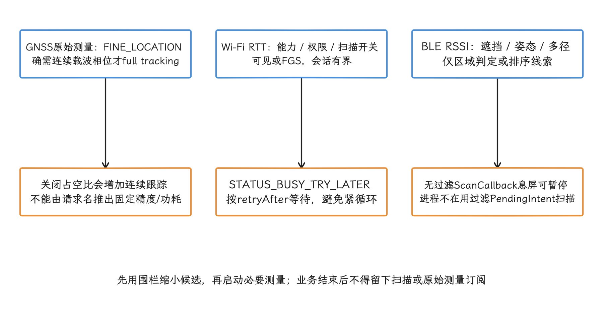

图：按开始、停止、样本、失败与重试记录；推导实际位置时不能盲目声明neverForLocation。

## 定位和传感器的回归守门

我们做定位与传感器回归时，先固定设备、系统版本、权限状态、位置开关、网络条件、屏幕状态、业务持续时间和移动轨迹。只比一次总耗电值找不出原因在哪一环；测试记录还要保存请求参数、回调次数、每批数据量、事件时间、应用处理时长和退出后的残留注册。

这三条命令用于查看平台位置请求、传感器连接和 UID 级电量归因。执行前先复现目标业务状态，执行后保存完整输出，供同版本对比。

```bash
adb shell dumpsys location
adb shell dumpsys sensorservice
adb shell dumpsys batterystats --charged
```

`dumpsys location` 用来核对 provider、请求间隔、权限级别和前后台状态；`dumpsys sensorservice` 显示活跃连接、采样周期、批处理延迟、FIFO 与 wake lock（阻止处理器休眠的唤醒锁） 相关信息；`batterystats` 用于把位置、传感器、唤醒和进程活动关联到应用 UID。不同厂商的字段可能不同，回归脚本应保存原始文本，只解析稳定字段。

测试至少覆盖九类场景：

- 只有 coarse、同时具备 fine、精度从 fine 降为 coarse 三种状态；降级导致进程重启后，请求能按持久化业务状态恢复或停止。
- 没有后台位置权限、具备后台位置权限、用户在设置页撤销权限三种状态；Geofencing 和连续定位在权限缺失时要显式失败或停止，不要静默失败后无限重试。
- 应用可见时启动 location FGS，以及应用已在后台且没有 `ACCESS_BACKGROUND_LOCATION` 时尝试启动；后一条路径应由产品流程提前阻止并引导用户操作。
- FLP 单点交付、批量交付和跨批次时间逆序；服务端结果按事件时间排序并去重。
- 应用进入后台、进程被终止、设备进入 Doze（低功耗待机）后继续测试 Geofencing；验证分钟级延迟下不会重复通知或误判为丢失。
- 有 FIFO 与无 FIFO 的传感器；确认同一 `maxReportLatencyUs` 配置在两类设备上的唤醒和批量大小差异。
- Android 9+ 普通后台状态与前台服务状态；普通后台不再收到受限传感器事件，服务结束后连接被移除。
- 目标版本 31 及以上在有无 `HIGH_SAMPLING_RATE_SENSORS` 时请求高于 200 Hz，并切换麦克风隐私开关；记录有效采样周期，并和请求值对照。
- flush 成功、flush 失败和等待超时；所有路径最终都会注销监听器。

回归阈值由业务基线确定。建议分别设置三类门禁：位置计算或请求是否仍存在，应用回调与唤醒是否增加，回调后的 CPU、存储与网络成本是否增加。这样才能区分硬件定位成本、交付策略和应用处理代码造成的变化。

## 全文小结

我们的默认起点是一次性、低精度、低频、可容忍延迟的请求，只有用户可见且确有精度需要时才持续使用高精度请求。Geofencing 与被动定位能减少主动计算，但仍受后台权限和交付延迟限制。传感器侧要同时降低采样率与应用处理器唤醒，批处理只解决唤醒那一项。

Android 17 的平台限制由位置服务、`SystemSensorManager` 和 native `SensorService` 共同执行；Google Play services FLP 还独立发版。评审时把两套实现和各自公开契约分开看，才不会拿 AOSP 结论去套 FLP 行为。

## 参考资料

- [About background location and battery life](https://developer.android.com/develop/sensors-and-location/location/battery)
- [Request location permissions](https://developer.android.com/develop/sensors-and-location/location/permissions)
- [Request background location](https://developer.android.com/develop/sensors-and-location/location/permissions/background)
- [Create and monitor geofences](https://developer.android.com/develop/sensors-and-location/location/geofencing)
- [Foreground service types: location and health](https://developer.android.com/develop/background-work/services/fgs/service-types)
- [Sensors overview](https://developer.android.com/develop/sensors-and-location/sensors/sensors_overview)
- [`SensorManager` API reference](https://developer.android.com/reference/android/hardware/SensorManager)
