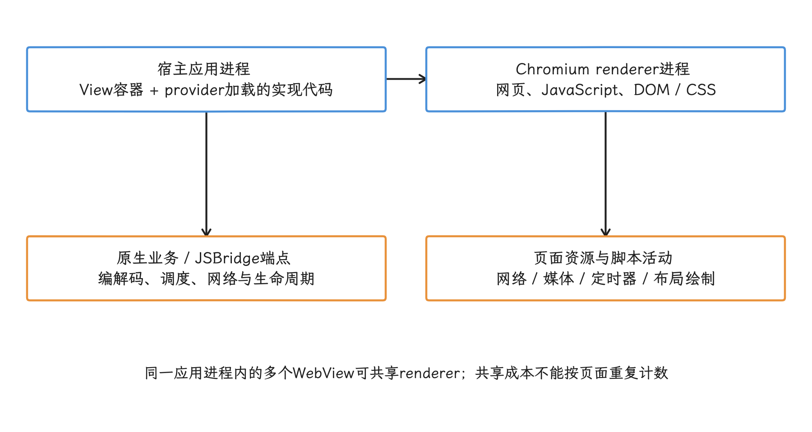
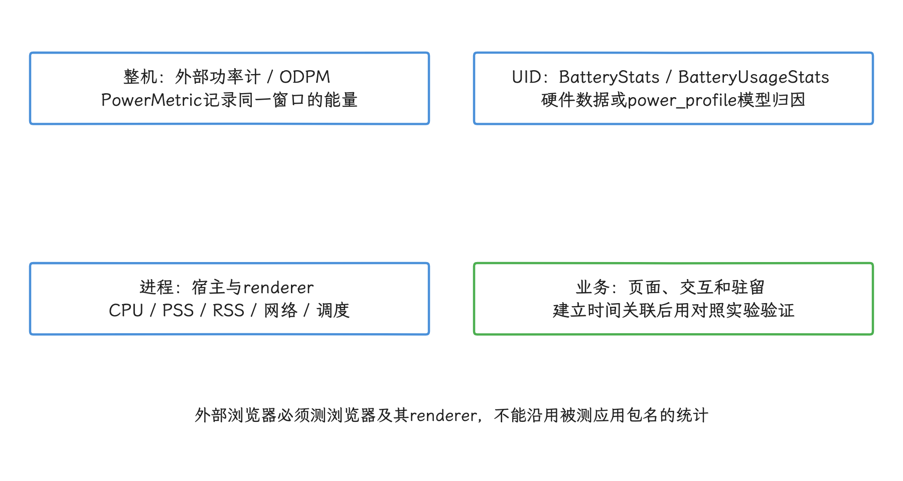
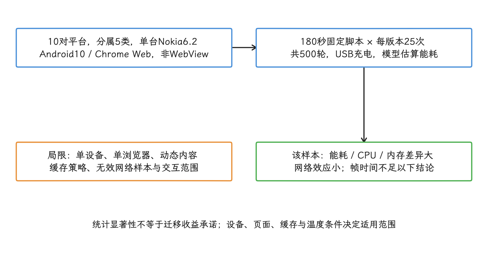
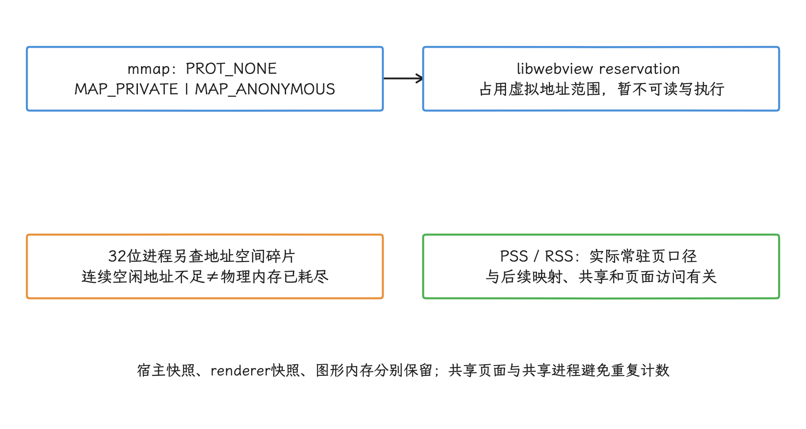
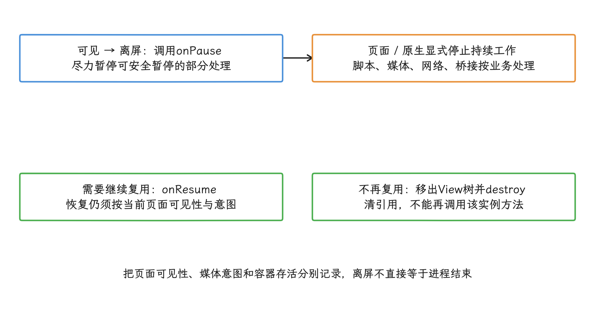
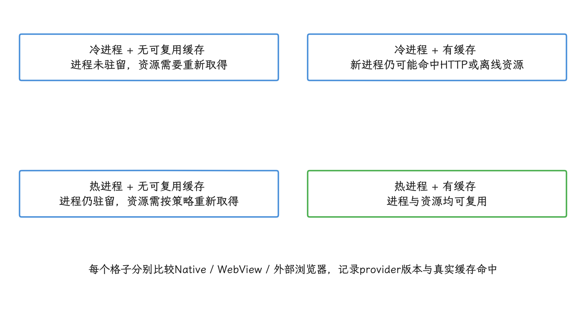
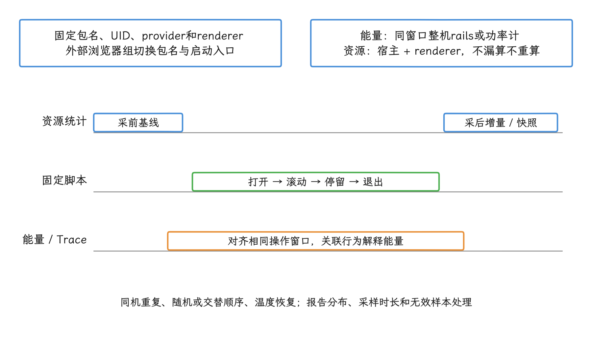
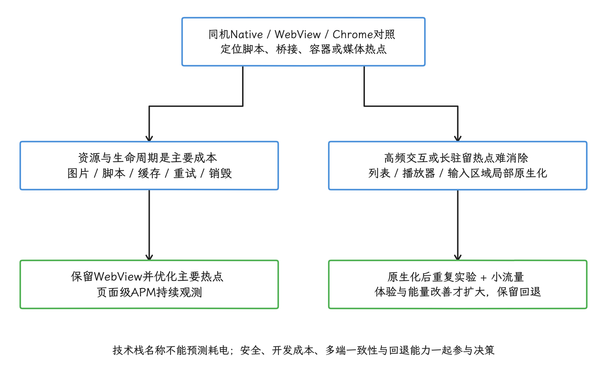
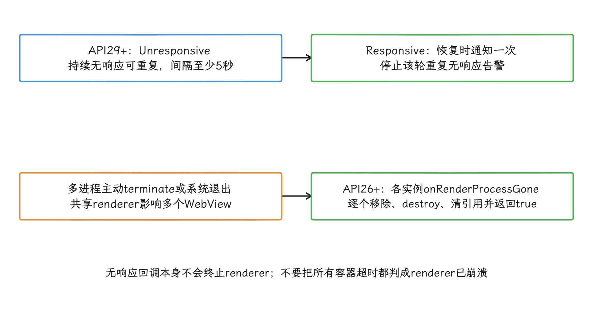
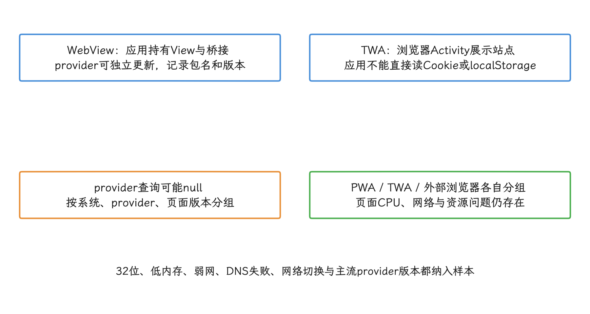

# Hybrid/WebView 功耗与原生化取舍

Hybrid 页面的能耗来自 WebView 进程、JavaScript、网络、媒体和原生桥接的共同活动，技术栈名称只能当线索；我们做原生化决策前，先在同一场景下测量，定位持续的 CPU 占用、唤醒和数据传输，再比较改造成本。

> 源码基线：Android 17（API 37），AOSP `android-17.0.0_r1`。

## Hybrid 页的功耗构成

Hybrid（混合开发）页面通常由原生应用里的 WebView 承载。我们分析它的功耗之前，先把“代码跑在哪里”弄清楚：WebView provider 是提供实现代码的安装包，把它的包名当成一个独立进程就会数错对象——容器及其加载的实现代码运行在宿主应用进程；多进程模式下，网页代码、JavaScript 等在 Chromium renderer（渲染进程）中执行，单进程配置下没有独立的 renderer 进程。页面资源和连接网页与原生代码的 JSBridge（JavaScript bridge，JS 桥）也在同一条执行路径上。电量百分比到这一步就只剩整机视角：耗电来自页面脚本、容器生命周期、网络请求还是原生代码，要靠分组测量来回答。

<!-- gracker-diagram: a279-01-provider-code-host-and-renderer -->


图：provider版本、宿主进程和renderer活动分别记录；一个页面对应哪些进程，要看provider与进程模式。

本章比较的是同一业务在原生页、应用内 WebView 和外部浏览器中的成本，结论分两类：一类是同机对照实验得到的相对差异，另一类是能够在线上按页面和 provider 包版本持续验证的指标。

WebView 渲染管线见 13.10 节，优化实战见 22.16 节，内存持续增长的分类诊断见 10.1 节，Hybrid APM（Application Performance Monitoring，应用性能监控）见 17.11 节。功耗分析与技术选型会复用这些章节的指标和结论。

## 原生 App、Web App、Hybrid 页面的能耗边界

同一个内容页换成不同形态，能耗差异来自运行时边界的变化。

| 形态 | 主要运行时 | 典型成本 | 适合场景 | 风险边界 |
| --- | --- | --- | --- | --- |
| 原生页 | 应用进程、ART（Android Runtime，Android 应用运行时）、UI 工具包、应用选择的网络客户端 | 业务代码、图片解码、布局绘制、数据缓存 | 高频入口、富交互页、视频/信息流、登录支付 | 开发与多端一致性成本较高 |
| 外部浏览器 Web 页 | 浏览器主进程、renderer、JavaScript 引擎、浏览器存储 | 网页节点与样式计算、脚本、媒体、页面请求与浏览器自身开销 | 外部链接、完整 Web 站点、低频内容页 | 应用难以取得进程级指标，也不能控制浏览器生命周期 |
| WebView Hybrid 页 | 应用进程、WebView provider 包、一个或多个 renderer、JSBridge | 页面资源、桥调用、renderer、容器与页面双重生命周期 | 运营页、轻交互配置页、需要跨端复用的内容页 | 稳定性、权限边界和页面级观测仍由应用团队负责 |

CPU 时间、网络传输、内存压力、页面驻留、后台活动和屏幕亮度都会影响整机能耗。`BatteryStats`（Android 框架的电量活动记账服务）并不直接读取每个应用的电流，它按 UID（Linux 用户 ID，通常按应用分配）记录 CPU、网络、唤醒等活动时间。设备缺少硬件测量能力时，平台会结合 `power_profile.xml`（厂商提供的组件耗电参数表）估算归因；实现了 [Power Stats HAL](https://source.android.com/docs/core/power/power-stats-hal)（功耗统计硬件抽象层）的设备，还可以用硬件能量数据改进部分归因。不同设备支持的电源轨（rail，给芯片子系统供电的支路）和归因模型差别很大，所以我们把 `BatteryStats` 用在定位行为、做同机比较上；要绝对数值时，再交给外部功率计。

<!-- gracker-diagram: a279-02-device-energy-uid-and-process -->


图：整机背景负载需要控制；隔离renderer与宿主的覆盖范围要核实，能量分摊要有依据。

## Native vs Web 能耗实验的结论与局限

论文 [arXiv:2308.16734](https://arxiv.org/abs/2308.16734) 对比了 10 个互联网内容平台的 Android 原生应用与 Chrome Web 版本，覆盖新闻、社交媒体、电商、音频流和视频流五类。我们先记住一个前提：这里的 Web 版本跑在 Chrome 里，和应用内 `WebView` 是两回事。

实验使用一台 Nokia 6.2（TA-1198）。论文把系统记为 Android (Go edition) 10，却没有提供构建指纹或系统镜像来源；这个标签只覆盖这一台设备，把结论推广到其他 Android Go 设备时要格外小心。

每个脚本运行 3 分钟，每个研究对象重复 25 次，总计 500 次；设备通过 USB 连接并保持充电，能耗由 Batterystats 根据硬件活动和 power profile 估算。为了控制变量，作者在每轮之间清理对应原生应用缓存，并清理浏览器标签页和除登录 Cookie 以外的缓存；交互固定为点击、滚动和输入脚本。

读结果之前先弄清两个统计词：“统计显著”指在该样本和检验假设下，观察到的差异很难只用随机波动解释；“效应量”描述差异幅度。两者都只对这套样本负责，换设备、换页面、换浏览器之后差异是否保持，要重新验证。在这套实验条件下，论文得到以下结果：

- 原生版本的能耗低于 Web 版本，差异具有统计显著性且效应量大；
- Web 版本使用更多 CPU 和内存，差异具有统计显著性且效应量大；
- 网络流量差异具有统计显著性，但效应量小；
- 帧时间数据不足以支持原生与 Web 孰优的结论。

把结论用到自己业务前，我们先记下作者列出的限制：样本只有 10 对；设备是一台 Android 10，浏览器只有 Chrome；静态脚本只覆盖固定路径，结账、发帖等交互在实验范围之外；Web 内容可能在实验期间变化；网络统计存在未及时更新的无效数据，部分对象被删减到较少的有效配对。此外，论文既没有测试 WebView 容器，也没有把 Web 与原生实现控制成同一功能代码。它可以提示 CPU、内存和网络方面的风险；某个 Hybrid 页面是否必须原生化，答案要来自我们自己的对照实验。

<!-- gracker-diagram: a279-03-paper-sample-and-generalization -->


图：论文结果可提示排查方向；本业务需要同内容、同脚本的Native / WebView / Chrome对照。

## WebView 的 CPU、内存和网络开销来源

分析 WebView 的开销时，我们通常把成本分成四类来看。

- **CPU**：JavaScript、DOM（页面节点树）与 CSS（样式和布局规则）计算、图片解码、滚动合成，以及 JSBridge 消息在两端的编码与还原都会使用 CPU。桥调用过密时，还会增加应用主线程或业务线程的调度与等待。
- **内存**：WebView 使用 Chromium renderer。多个 WebView 可能共享同一个 renderer，也可能各用各的；共享只发生在同一应用进程内，按“一个页面等于一个进程”去套通常会算错。`android-17.0.0_r1` 的 [`loader.cpp`](https://android.googlesource.com/platform/frameworks/base/+/android-17.0.0_r1/native/webview/loader/loader.cpp) 会用 `mmap(PROT_NONE)` 预留 `libwebviewchromium.so` 的虚拟地址空间，并命名为 `libwebview reservation`。`PROT_NONE` 表示这段地址暂时不可读写执行；这段预留区（reservation）占用的是虚拟地址范围，换算 PSS（私有常驻页加按比例分摊的共享常驻页）、RSS（进程映射的常驻物理内存总量）或实际物理页时要单独核算。32 位进程的地址范围较小，还要留意空闲地址被切成许多不连续区间的地址空间碎片。
- **网络与存储**：页面可能包含重定向、第三方脚本、字体和多种图片。HTTP 缓存、Cookie、DOM storage（`localStorage`、`sessionStorage` 等浏览器键值存储）、Service Worker（可拦截请求并管理离线缓存的浏览器后台脚本）与应用自己的离线包分属不同存储层；清理其中一层之后，其余各层是否清空要分别确认。
- **生命周期**：页面离屏（不再可见）后，renderer、音视频和定时任务可能还在跑。容器要把可见性映射到 `WebView.onPause()` / `onResume()`；`onPause()` 只是尽力暂停可安全暂停的处理，JavaScript 并不会被它暂停，音视频、网络或桥接任务是否停止也要另行确认。所以页面和原生侧要按业务生命周期显式停止持续工作，确认不再复用后，从 View 树（界面节点层级）移除并调用 `destroy()`。`pauseTimers()` / `resumeTimers()` 作用于当前进程中的所有 WebView，当单页面开关用会波及邻居；`clearCache()` 的定位是清缓存，页面退出时的清理要走上面这套生命周期流程。

<!-- gracker-diagram: a279-04-virtual-reservation-not-resident-memory -->


图：看到大块reservation先核对映射权限与常驻页；虚拟大小只是预留，物理泄漏按常驻页算。

功耗记录至少包含页面类型、provider 包版本、驻留时长、CPU 时间、PSS/RSS、网络字节、桥调用、前后台切换和 renderer 退出原因。本地诊断可以用 Perfetto（Android 系统跟踪工具）或 `ps` 按 renderer PID（进程编号）关联数据；线上记录则要另想办法，Android 公共 WebView API 没有提供可用于线上记录的 renderer PID。

<!-- gracker-diagram: a279-05-visibility-script-and-destruction -->


图：pauseTimers与resumeTimers要考虑同进程其他WebView；缓存清理、资源停止和实例销毁是不同动作。

## 功耗基准测试方案

功耗对比要做成同机、同内容、同脚本的对照实验，实验对象至少三组：原生页、应用内 WebView 页、外部浏览器 Web 页。外部浏览器组在选型上只当参照，它的价值在于帮我们判断问题出在 Web 内容还是应用容器。

实验前先固定这些条件：设备型号、系统版本、WebView provider 包版本、电量区间、亮度、刷新率、网络类型、账号状态、内容集合、广告开关、地理位置、温度起点和后台应用数量。条件固定之后，每次采样只改一个变量，避免把页面版本、网络波动和设备温升混在一起。

下面这组命令建立一轮手工采样窗口，每个方案都重复执行同一套步骤。进程状态和资源缓存状态要分别控制：冷启动指应用或浏览器进程未驻留，热进程指目标进程仍在内存；缓存状态看 HTTP 缓存、WebView 缓存或离线包能否复用。条件允许时，把“冷/热进程 × 无/有缓存”四种组合都测一遍；报告里至少写清本轮采用的是哪种组合。

<!-- gracker-diagram: a279-06-benchmark-cache-and-process-matrix -->


图：分别控制Cookie、HTTP、DOM storage、Service Worker和离线包；清了一层，其余层的清空状态仍要单独看。

```bash
adb shell dumpsys batterystats --reset
adb shell dumpsys netstats > netstats-before.txt

adb shell am force-stop com.example.app
adb shell am start -n com.example.app/.MainActivity

# 执行固定脚本：打开页面、滚动、停留、退出。
adb shell dumpsys meminfo --package com.example.app > meminfo-after.txt
adb shell dumpsys netstats > netstats-after.txt
adb bugreport bugreport-hybrid-power.zip
```

`netstats` 是累计统计，比较时按目标 UID 计算前后差值，直接比较两个完整文件的总字节数会得出错误结论。系统按时间区间聚合数据，最近一段统计可能尚未写入，读数时要把聚合与写入延迟考虑进去。Android 8 设备可能还在用旧网络记账实现，Android 17 设备使用的底层实现则是另一套；应用层基准统一通过 NetworkStats API（按 UID 查询网络流量）或 `dumpsys netstats` 取数，`/proc/net/xt_qtaguid/stats` 留给单设备排查，跨版本基准里绕开它。

这组 `meminfo --package` 提供的是对应包的内存快照，覆盖到哪些独立 renderer 要另行确认；缺的部分用本地进程关联补齐，同时避免共享 renderer 重复计数。外部浏览器对照组要替换被测包名和启动入口，并记录浏览器主进程与 renderer；浏览器组的结果从浏览器进程自己采，`com.example.app` 的统计放不到那一组里。UID 网络统计、宿主内存快照与整机能量三者各管一段，直接相加或相互替代都会算错。

这组数据要与 Perfetto、Android Studio [Power Profiler](https://developer.android.com/studio/profile/power-profiler) 或 Jetpack Macrobenchmark（宏基准测试框架）的 [`PowerMetric`](https://developer.android.com/topic/performance/benchmarking/macrobenchmark-metrics#powermetric) 交叉使用。ODPM（On Device Power Rails Monitor，设备上的电源轨监测）按硬件子系统记录整机能耗，归因只到子系统这一层；`PowerMetric` 也一样——它仍是实验性 API，返回的同样是整机能耗，当前官方支持 Pixel 6、Pixel 6 Pro 及更新的实体 Pixel 设备。使用整机能耗工具时，把其他进程、温度与屏幕状态一并固定。

Battery Historian 已进入维护尾声，读旧 Batterystats 记录时还能用；新基准平台的中心工具要另外选。

各指标按以下口径记录：

| 指标 | 采集方式 | 用途 | 判读边界 |
| --- | --- | --- | --- |
| 整机能耗 | Power Profiler、Macrobenchmark `PowerMetric`、外部功率计 | 对比同机同脚本的能量变化 | `PowerMetric`/ODPM 是整机数据，外部功率计还要控制 USB 供电 |
| UID 功耗归因 | `BatteryStats` / `BatteryUsageStats`（查询电池用量估算的 API） | 判断 CPU、网络、WakeLock（阻止 CPU 过早休眠的唤醒锁）等责任归属 | 依赖设备统计与功耗模型，不等于电流实测 |
| CPU 时间 | Perfetto、`simpleperf`（Android 原生 CPU 采样工具）、`top -H`、`/proc/<pid>/stat` | 判断脚本、布局、解码和桥调用成本 | 要覆盖应用与 renderer 进程，并按线程分析 |
| 内存 | `dumpsys meminfo`、Perfetto 内存计数器 | 观察应用、renderer、图形与原生（native）内存增长 | PSS/RSS 不等于泄漏结论，虚拟地址 reservation 也不能算作物理占用 |
| 网络 | NetworkStats/`dumpsys netstats`、应用网络观测 | 比较流量、请求数、重试和弱网影响 | CDN（内容分发网络）节点、广告、A/B 分流实验和统计刷新周期会造成样本混杂 |
| 帧耗时 | `FrameTimeline`（系统帧时间线）、`JankStats`（Jetpack 卡顿统计）、APM 帧率 | 判断功耗优化是否损害交互体验 | 论文未能证明 Web 与原生帧时间差异 |
| 温度 | `BatteryManager`、Perfetto thermal（温度与热状态）轨道、厂商接口 | 排除热降频（系统因温度过高而降低频率）的干扰 | 温度不同，CPU 频点和耗电不可比 |

整机能耗给出的是整机的总量，UID 归因把这些消耗算到具体应用，进程资源用量再往下拆到具体进程——三者回答的是三个层次的问题。单个指标说明的只是相关现象，要判断原因，还得把时间线和对照组放在一起看。

<!-- gracker-diagram: a279-07-benchmark-time-window-and-coverage -->


图：netstats比较目标UID前后增量并保留刷新延迟；meminfo包快照覆盖到哪些renderer要单独确认。

## 原生化与 Web 优化的决策表

走到技术选型，我们先回答两个问题：页面高频操作是否带来了可测量的额外 CPU、内存或网络成本；局部原生化是否足以消除主要成本。

| 业务形态 | 倾向方案 | 判断条件 | 可执行动作 |
| --- | --- | --- | --- |
| 视频流 / 直播 | 原生播放器优先 | 长驻留、高带宽、解码和渲染成本高 | 原生播放器负责播放，Web 只保留运营配置；监控播放时长、缓存命中、温度和退出原因 |
| 信息流 | 原生列表优先，局部 Hybrid | 高频滚动、大图、广告脚本多 | 原生 `RecyclerView`/Compose 负责列表，Web 卡片限制高度和资源；图片格式与预取由应用统一管理 |
| 电商详情 / 内容详情 | Hybrid 可用 | 页面变化快，但交互深度中等 | 资源预加载、首屏模板缓存、JSBridge 允许列表（只开放列出的接口和可信来源）、图片尺寸约束、页面不可见后的销毁规则 |
| 活动页 / 营销页 | WebView 可用 | 低频、生命周期短、需要快速退回上一版 | 限制第三方脚本；采集首屏、CPU 时间、网络流量；超过项目阈值时转为模板或原生组件 |
| 登录 / 支付 / 风险控制 | 原生优先 | 安全、稳定和可观测性要求高 | 减少 WebView 权限面；敏感流程用原生；必要 Web 页面使用独立容器和审计日志 |
| 富交互工具页 | 局部原生化 | 手势、编辑、图形、低延迟输入多 | 原生负责输入和高频渲染区域，Web 负责配置面板；把密集桥调用合并成批量请求 |

决定保留 WebView 时，我们按测量结果逐项处理：缓存命中、图片尺寸、请求合并、按需拆分脚本包和页面不可见后的资源释放。发布前给 CPU 时间、PSS、网络字节、卡顿率、退出率和 Android Vitals 设好量化阈值；任一指标越线，先停止扩大用户范围，再回头分析原因。

<!-- gracker-diagram: a279-08-optimization-versus-native-migration -->


图：低端机、弱网、低电量和provider版本分组；实验室均值之外还要看分组数据。

## 线上监控与发布条件

Hybrid 功耗监控要按页面记录。只看应用维度的耗电，首页 WebView、活动 WebView、支付 WebView 和外链容器会混在同一个数里，问题页面定位要靠页面级记录。

建议每次 WebView 会话记录这些字段：

- 页面身份：业务线、页面类型、URL 归一化结果（把同类页面的动态 ID 和跟踪参数映射为稳定模板）、版本号、小流量发布批次、是否离线包。
- 容器身份：WebView provider 包名与版本、Android 版本、应用进程名、是否使用独立 WebView 数据目录。
- 成本指标：页面驻留时长、前后台状态、CPU 时间、PSS/RSS、网络请求数、上下行字节数、桥调用次数、帧耗时、温度区间。
- 结束与故障信息：用户返回、容器销毁、renderer 异常终止、renderer 被系统回收、LMK（Low Memory Killer，低内存终止机制）结束应用进程、ANR（Application Not Responding，应用无响应）、应用进程退出原因。

Android Vitals 是 Play Console 汇总的应用质量指标。截至本次核对，官网核心指标还列出内存用量与 Bitmap 内存用量，以及用户可感知崩溃、用户可感知 ANR 和过量部分唤醒锁；过量唤醒、后台网络、启动、慢渲染和用户可感知 LMK 等指标也可用于排查问题，只是它们都停在应用这一级，到 URL 这一级就要靠页面级 APM 把 URL、容器版本与这些异常放到同一条时间线上。`ApplicationExitInfo`（API 30+ 的应用进程退出记录）用来补充应用进程退出原因；renderer 侧的退出，仍要靠 WebView 的 renderer 回调来拿。

WebView renderer 的版本边界如下：

- **API 26+**：实现 `WebViewClient.onRenderProcessGone()`。我们靠 `RenderProcessGoneDetail.didCrash()` 区分异常终止与系统回收；失去 renderer 的 WebView 必须从 View 树移除并销毁，这个实例就此作废；清理回调参数指定的实例及其引用，处理完成后返回 `true`，否则应用可能崩溃或被终止。共享 renderer 时每个受影响实例都会收到回调，销毁范围以各自收到的回调为准。
- **API 29+**：再实现 `WebViewRenderProcessClient.onRenderProcessUnresponsive()` 与 `onRenderProcessResponsive()`，分别接收 renderer 持续无响应和恢复响应的通知。无响应回调可能以至少 5 秒的间隔重复，告警要先去重；多进程模式下若主动终止 renderer，就要能处理共享该 renderer 的所有 WebView 的退出回调；单进程模式传入的 `renderer` 可为 `null`，调用终止方法前先判空。
- **API 26–28**：平台还没有标准的 renderer 无响应回调。这一档上，页面加载或交互超时只作为用户体验故障信号看待；renderer 是否失去响应，单凭超时断言会有误判。

<!-- gracker-diagram: a279-09-renderer-unresponsive-exit-and-recovery -->


图：didCrash帮助区分异常与系统回收；宿主退出看ApplicationExitInfo，renderer退出仍走renderer回调。

发布条件可以分成三档：

- 小流量发布前：实验室基准测试通过，原生对照、WebView 对照、外部浏览器对照都有完整报告。
- 小流量发布期间：页面级 CPU、PSS、网络、卡顿和退出率没有越过预设阈值；低端机、弱网和低电量用户分别统计。
- 全量发布前：Android Vitals、APM 页面时间线和客服反馈没有共同指向同一页面；超过阈值时退回上一 Web 版本或切换到原生备用页面。

## WebView provider 版本差异

WebView provider 会随系统或 Play 更新，相同应用版本换到不同 provider 上，renderer 内存、崩溃率和网络行为都可能随之变化。Android 7.0（API 24）起，设备可以选择不同的 WebView provider；应用可以用 [`WebViewCompat.getCurrentWebViewPackage()`](https://developer.android.com/develop/ui/views/layout/webapps/managing-webview#version-api) 记录包名和版本。这个方法可能返回 `null`，观测代码要把设备缺少支持、配置异常这些情况都兜住。

Android 官方提供 WebView DevTools App，用来查看系统 WebView 组件信息、崩溃报告、实验开关（flags）和网络日志。我们把它当本地诊断入口来用；线上监控要另建体系。

## PWA / TWA 与原生容器的边界

PWA（Progressive Web App，可安装并支持离线能力的渐进式 Web 应用）、Trusted Web Activity（TWA）和普通 WebView 都能展示 Web 内容，但三者的运行责任各有分工。普通 WebView 里，View 生命周期、权限回调和桥接口都握在应用手里。TWA 通过支持该协议的浏览器，以全屏方式显示经过 Digital Asset Links（用站点文件和应用签名验证双方关系）验证的站点；它运行在浏览器侧，和应用进程内嵌的 WebView 是两回事：宿主应用无法直接访问页面内容、Cookie 或 `localStorage`，WebView 的 JSBridge 在这里也没有注入入口。PWA 的安装、更新和 Service Worker 生命周期主要由浏览器管理。

功耗测试时，我们把三者分成独立组：普通 WebView 的成本归到应用容器，TWA 和外部浏览器更依赖浏览器实现。选 TWA 的直接效果是把部分容器责任移给浏览器；页面自身的 CPU 或网络问题，并不会因为这一切换就自动解决。

<!-- gracker-diagram: a279-10-webview-twa-browser-responsibility -->


图：TWA的节电收益要用测量验证，WebView的JSBridge在这里用不上；同条件测量浏览器相关进程。

## 低端机与弱网场景

低端机和弱网会放大 WebView 的问题。CPU 弱时，JavaScript、布局和图片解码更容易增加页面驻留时长；内存较小时，renderer 更容易被回收或触发应用侧白屏恢复；弱网下，重试、重定向和缓存失效会同时增加网络耗电与首屏耗时。

设备样本应包含 Android Go 或低内存设备、仍需支持的 32 位进程环境，以及线上占比较高的 WebView provider 包版本。弱网测试覆盖高 RTT（Round-Trip Time，网络往返时延）、丢包、DNS（域名解析）失败、CDN 边缘节点未命中后访问源站缓慢，以及网络切换。高端设备上的 Wi-Fi 数据看着漂亮，低内存或弱网用户的答案要从上面的分组样本里找。

## 全文小结

Hybrid/WebView 功耗要按页面、provider 与设备分组记录；同一内容用同一脚本比较，差异来自页面还是容器才说得清。论文给出的是 Chrome Web 版本在其样本中消耗更多能耗、CPU 和内存的证据，WebView 原生化的结论还要由我们自己的对照实验来下。高频、长驻留、富交互页面在本业务测试中出现稳定劣化时，再选择整体或局部原生化；继续保留 WebView 的页面，要持续观察 CPU、内存、网络、renderer 异常和 Android Vitals。

## 参考资料

- [arXiv:2308.16734 Comparing the Energy Consumption and Performance of Android Apps and their Web Counterparts](https://arxiv.org/abs/2308.16734)
- [Android Developers: Manage WebView objects](https://developer.android.com/develop/ui/views/layout/webapps/managing-webview)
- [Android Developers: Build web apps in WebView](https://developer.android.com/develop/ui/views/layout/webapps/webview)
- [Android Developers: Profile battery usage with Batterystats and Battery Historian](https://developer.android.com/topic/performance/power/setup-battery-historian)
- [Android Developers: Android vitals](https://developer.android.com/topic/performance/vitals)
- [Android Developers: WebViewRenderProcessClient](https://developer.android.com/reference/android/webkit/WebViewRenderProcessClient)
- [AOSP: Power profiles for Android](https://source.android.com/docs/core/power)
- [AOSP: Measure power values](https://source.android.com/docs/core/power/values)
- [AOSP: Power Stats HAL](https://source.android.com/docs/core/power/power-stats-hal)
- [Android Developers: Macrobenchmark PowerMetric](https://developer.android.com/topic/performance/benchmarking/macrobenchmark-metrics#powermetric)
- [AOSP Android 17: frameworks/base/native/webview/loader/loader.cpp](https://android.googlesource.com/platform/frameworks/base/+/android-17.0.0_r1/native/webview/loader/loader.cpp)
- [Android Developers: Power Profiler](https://developer.android.com/studio/profile/power-profiler)
- [Android Developers: Access native APIs with JavaScript bridge](https://developer.android.com/develop/ui/views/layout/webapps/native-api-access-jsbridge)
- [Android Developers: WebView API](https://developer.android.com/reference/android/webkit/WebView)
- [Android Developers: WebViewClient API](https://developer.android.com/reference/android/webkit/WebViewClient)
- [Android Developers: WebView DevTools App](https://developer.android.com/develop/ui/views/layout/webapps/debug-webview-devtools-app)
- [Chrome for Developers: Trusted Web Activity overview](https://developer.chrome.com/docs/android/trusted-web-activity)
