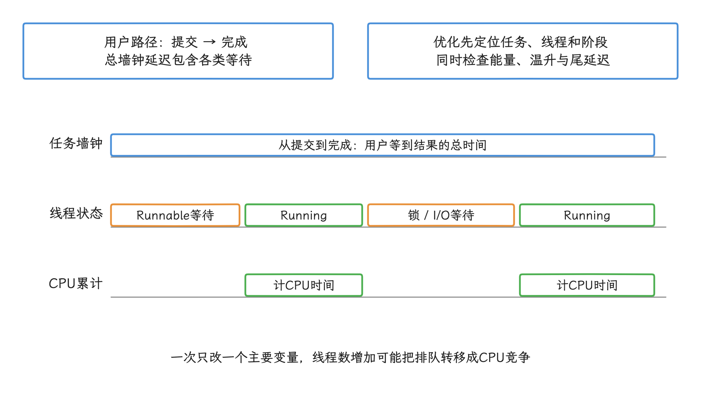
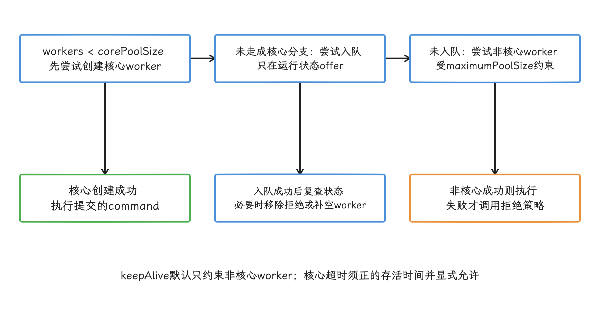
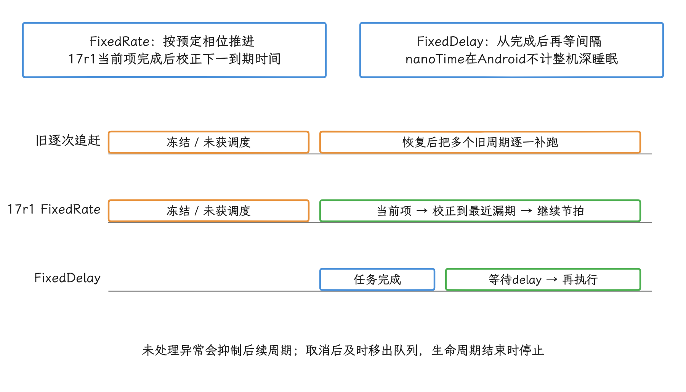
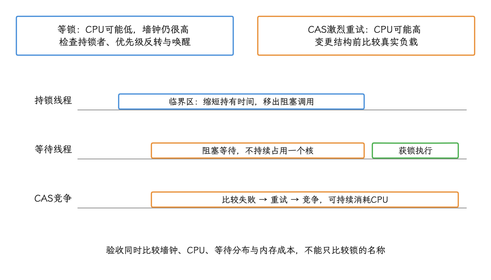
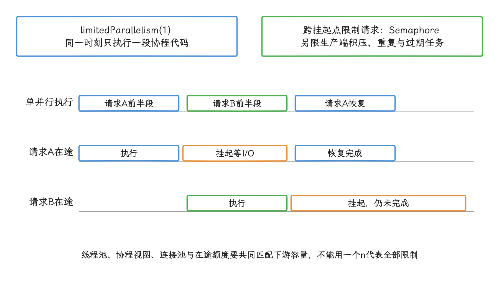

# 应用层 CPU 优化实战指南

应用 CPU 优化要先弄清楚 CPU 时间花在哪里、为什么花，以及这段开销是否落在用户关键路径上。线程池、预加载和周期任务都可能改善平均利用率，却把峰值推高、让调度变差，所以要结合调用栈、线程状态和设备约束复测。

> 源码基线：AOSP `android-17.0.0_r1`，内核 `android17-6.18-2026-06_r6`。本文示例只使用 public SDK/NDK；`/proc` 文件可能因设备策略不可读，采样方案都要允许失败。

## CPU 优化先回答三个问题

“CPU 高”只是对现象的描述，离改法还有距离。动手修改线程池或调度参数之前，我们先回答：

1. 哪一段用户路径受影响：启动、首帧、滚动、输入、后台同步，还是持续计算？
2. 损失表现在哪个维度：延迟、CPU 时间、能耗、温升，还是后台执行额度？
3. 证据能否归因到具体任务、线程和调用栈？

常见指标的含义并不相同：

| 指标 | 回答的问题 | 容易误读的地方 |
| --- | --- | --- |
| 墙钟时间（wall time） | 用户等了多久 | 包含运行、排队、锁等待、I/O 和抢占 |
| 进程/线程 CPU 时间 | 代码在 CPU 上运行了多久 | 不包含大多数睡眠与阻塞等待 |
| Runnable（可运行）等待 | 线程已经具备运行条件，但还未获得 CPU 的时间 | 可能来自并发过量、优先级或系统竞争 |
| Blocked/Sleeping（阻塞/休眠）时间 | 线程在等锁、I/O、定时器或条件 | CPU 低也可能有很差的响应 |
| 能耗与温度 | 这段工作付出了多少设备成本 | 同样的 CPU 时间在不同工作频率和 CPU 核上成本不同 |

回答完这三个问题，应用层 CPU 优化的改动通常落在四件事上：少做工作、减少同一时刻的并行工作、减少唤醒与切换、把非紧急工作安排到合适的系统调度时机。线程池参数只是其中一个控制点。

<!-- gracker-diagram: a280-01-wall-cpu-and-scheduler-time -->


图：墙钟高而CPU低时，先查Runnable、锁、I/O与调度；CPU高时再看调用栈和无效计算。

## ThreadPoolExecutor：先理解队列，再谈线程数

### `execute()` 的三段决策

系统的 `ThreadPoolExecutor` 取自 libcore 内置的 OpenJDK 并发实现。动手调参之前，我们先从 `execute()` 的决策顺序看起：

1. 当前 worker（实际执行任务的工作线程） 少于 `corePoolSize` 时，尝试创建核心 worker；
2. 否则尝试把任务放入 `workQueue`，入队后还会复查池状态；
3. 队列拒绝入队时，尝试创建非核心 worker；仍失败才调用拒绝策略。

这解释了一个常见疑问：使用容量很大的队列时，任务会长时间停在第 2 步，`maximumPoolSize` 很少参与调度；换成 `SynchronousQueue` 这种没有存储槽位的队列，提交方就更容易触发创建非核心 worker。两种队列没有固定优劣，差别在于系统选择“排队”还是“增加并发”。

<!-- gracker-diagram: a280-02-executor-three-step-decision -->


图：大队列优先积压，maximumPoolSize可能很少参与；SynchronousQueue没有可存储任务槽位。

默认配置下，核心线程不会因 `keepAliveTime` 到期而退出，`keepAliveTime` 只约束超出核心数量的 worker。要让核心线程也超时退出，先把 `keepAliveTime` 设为正值，再调用 `allowCoreThreadTimeOut(true)`；存活时间为零时这样调用会抛 `IllegalArgumentException`。本文的示例工厂把该值设为 `0L`，所以启用核心线程超时前要先给出正的存活时间。对应实现可在 [`ThreadPoolExecutor.java`](https://android.googlesource.com/platform/libcore/+/refs/tags/android-17.0.0_r1/ojluni/src/main/java/java/util/concurrent/ThreadPoolExecutor.java) 中核对。

### 线程数从任务模型来

`Runtime.availableProcessors()` 的 API 契约描述 JVM 可用的处理器数，但在此 Android 17 基线上，[`Runtime.java`](https://android.googlesource.com/platform/libcore/+/refs/tags/android-17.0.0_r1/ojluni/src/main/java/java/lang/Runtime.java#728) 实际读取 `_SC_NPROCESSORS_CONF`；bionic 的 [`get_nprocs_conf()`](https://android.googlesource.com/platform/bionic/+/refs/tags/android-17.0.0_r1/libc/bionic/sysinfo.cpp#62) 又从 `/sys/devices/system/cpu/possible` 取得数量。它不反映应用线程当前的亲和性或在线 CPU 数，也不能说明性能核有几个、应用能长期占满几个核、合适的 worker 数量是多少。任务内部还可能调用并行库，设备也会受前台状态、温度、功耗策略和其他进程影响。


线程数需要从任务模型出发：

- 纯计算任务先用较小的受控并行度做基线，再观察吞吐（单位时间完成的任务数）、P95、P99 尾延迟（P95、P99 等较慢请求的耗时）、Runnable 等待、温度和前台流畅度；
- 阻塞任务的并发上限取决于下游容量、连接池、内存、文件描述符和超时策略，要逐项分析后再定；
- 混合任务应拆开计算阶段与阻塞阶段，让两者分别受限；
- 同一个执行器承载不同优先级、不同服务目标的任务，会让长任务阻塞短任务。

队列容量的单位是“任务个数”，和内存大小、可接受等待时间是两回事。定容量时同时考虑：

- 峰值到达速率与任务服务时间；
- 允许的排队时延；
- 每个排队任务持有的对象、Bitmap、Buffer 或请求上下文；
- 任务过期后是否还有业务价值；
- 执行器满载时，任务可以合并、丢弃、返回简化结果，还是改期执行。

因此，`workers = availableProcessors()`、`queue = processors × 4` 之类的表达最多只能当实验起点；工程规则要从上面的分析里来。

### 一个可观测、可拒绝的计算执行器

下面的工厂刻意把决定权留给调用方：worker 数和队列容量都要根据压测结果传入参数，线程优先级也由场景明确给出。

```kotlin
import android.os.Process
import android.util.Log
import java.util.concurrent.ArrayBlockingQueue
import java.util.concurrent.ThreadFactory
import java.util.concurrent.ThreadPoolExecutor
import java.util.concurrent.TimeUnit
import java.util.concurrent.atomic.AtomicInteger

data class CpuExecutorConfig(
    val workers: Int,
    val queueCapacity: Int,
    val threadPriority: Int,
)

fun newBoundedCpuExecutor(
    name: String,
    config: CpuExecutorConfig,
): ThreadPoolExecutor {
    require(config.workers > 0)
    require(config.queueCapacity > 0)
    require(config.threadPriority in -20..19)

    val sequence = AtomicInteger()
    val factory = ThreadFactory { command ->
        Thread({
            try {
                Process.setThreadPriority(config.threadPriority)
            } catch (error: SecurityException) {
                Log.w("CpuExecutor", "Cannot set priority; keeping current priority", error)
            }
            command.run()
        }, "$name-${sequence.incrementAndGet()}")
    }

    return ThreadPoolExecutor(
        config.workers,
        config.workers,
        0L,
        TimeUnit.MILLISECONDS,
        ArrayBlockingQueue(config.queueCapacity),
        factory,
        ThreadPoolExecutor.AbortPolicy(),
    )
}
```

固定大小的有界池让并发量和积压量都可控。`AbortPolicy` 在任务被拒绝时抛出 `RejectedExecutionException`，原因可能是满载，也可能是执行器已经关闭，所以提交点要把这两种情况分开处理：满载时可以合并同类请求、取消已经过期的工作、返回功能较少但仍可用的结果，或交给能跨进程重启保存任务的持久化调度器；执行器关闭后，应按业务生命周期取消任务或明确转交，避免向同一个执行器反复重试。

`CallerRunsPolicy` 在执行器尚未关闭时，会在提交任务的线程里直接调用 `Runnable.run()`；执行器已经关闭时，它会静默丢弃任务。如果提交方恰好是主线程、Binder（Android 跨进程调用机制） 线程或持有锁的回调线程，计算或阻塞工作就会转移到那里。用它实现反压——让提交速度随执行能力自动放慢——前提是提交线程允许执行该任务，并且接受关闭后的丢弃行为。


线程工厂在新线程内部调用 `Process.setThreadPriority()`，修改当前 worker 的优先级。参数先限制在 `-20..19`，权限不足时记录警告并保留当前优先级，继续执行 `command.run()`。这里把优先级视为可失败的调度提示：传给工厂的 `command` 是线程池的 Worker 入口，若包装代码在进入它之前抛异常，Worker 的退出清理就不会执行，可能留下未运行的任务和错误的存活计数。参数与异常契约见 [`Process.java`](https://android.googlesource.com/platform/frameworks/base/+/refs/tags/android-17.0.0_r1/core/java/android/os/Process.java#1392)，Worker 登记与退出逻辑见 [`ThreadPoolExecutor.java`](https://android.googlesource.com/platform/libcore/+/refs/tags/android-17.0.0_r1/ojluni/src/main/java/java/util/concurrent/ThreadPoolExecutor.java#857)。

### 线程池至少记录哪些数据

只看 `activeCount` 说明不了池子的健康状况，定位问题还需要更多记录。建议为稳定的任务类型记录：

- 提交时间、开始时间和结束时间；
- 排队时长、墙钟执行时长、线程 CPU 时间；
- 已完成、取消、过期和拒绝次数；
- 采样时的活动 worker 数与队列深度；
- P50、P95、P99 等分位数，而不是只有平均值；
- 对应的版本、设备档位、前后台状态和热状态。

任务类型应是低基数标识，也就是可选值数量长期受控，例如 `image_decode`、`feed_diff`；URL、文件名或用户 ID 一旦进入指标维度，监控存储和查询成本会随取值数量增长。


对线程池调参时，一次只改一个主要变量，并同时检查吞吐、尾延迟、温升和界面帧表现。

## 进程 CPU 采样：把百分比说清楚

### 公开 SDK 的低成本窗口采样

要把进程 CPU 占用说成一个说得清楚的百分比，手边最便宜的两个 API 是 `Process.getElapsedCpuTime()` 和 `SystemClock.elapsedRealtime()`：前者返回进程从启动以来消耗的 CPU 毫秒数，后者返回包含深度睡眠在内的单调墙钟毫秒数。我们在窗口前后各采样一次，用两次采样的增量相除，就得到窗口内的“等效占用核数”。

```kotlin
import android.os.Process
import android.os.SystemClock

data class CpuSample(
    val processCpuMs: Long,
    val elapsedMs: Long,
    val availableProcessors: Int,
)

data class CpuWindow(
    val equivalentCores: Double,
    val logicalCapacityFractionHint: Double,
)

fun takeCpuSample(): CpuSample = CpuSample(
    processCpuMs = Process.getElapsedCpuTime(),
    elapsedMs = SystemClock.elapsedRealtime(),
    availableProcessors = Runtime.getRuntime().availableProcessors().coerceAtLeast(1),
)

fun calculateCpuWindow(
    before: CpuSample,
    after: CpuSample,
): CpuWindow? {
    val cpuDeltaMs = after.processCpuMs - before.processCpuMs
    val wallDeltaMs = after.elapsedMs - before.elapsedMs
    if (cpuDeltaMs < 0L || wallDeltaMs <= 0L) return null

    val equivalentCores = cpuDeltaMs.toDouble() / wallDeltaMs
    val capacity = minOf(before.availableProcessors, after.availableProcessors)

    return CpuWindow(
        equivalentCores = equivalentCores,
        logicalCapacityFractionHint = equivalentCores / capacity,
    )
}
```

`equivalentCores` 就是这个“等效占用核数”：1.0 表示窗口内累计使用了约一个核的 CPU 时间，多线程并行时可以大于 1.0。再除以 `availableProcessors()`，得到的值只能作为按配置处理器数归一化的粗略提示；它不反映线程当前可用的 CPU 集合，各核性能差异、频率、温控和调度限制也没有计入。


采样窗口太短会受毫秒精度影响，太长又会掩盖尖峰，所以窗口长度跟着要观察的用户路径走。告警线同理：来自场景基线、用户影响和设备分层；适用于所有设备的“高 CPU 阈值”，别写死在监控代码里。

### `/proc/stat` 的整机视角

Linux 6.18 的 `/proc/stat` 首行按 `USER_HZ` 输出累计时间；`USER_HZ` 是内核通过用户空间接口公开的计时单位频率，字段值表示这种单位的累计个数。常见字段顺序为：

```text
cpu  user nice system idle iowait irq softirq steal guest guest_nice
```

`user` 与 `nice` 是用户态时间；在此内核基线上，`nice` 只统计 `task_nice(p) > 0` 的任务，负 nice 值的任务仍计入 `user`，见 [`account_user_time()` 与 `account_guest_time()`](https://android.googlesource.com/kernel/common/+/refs/tags/android17-6.18-2026-06_r6/kernel/sched/cputime.c#132)。`system` 是内核态时间，`idle` 是空闲时间，`irq` / `softirq` 是硬中断与软中断处理时间，`steal` 是虚拟化环境中被宿主机占用的时间，`guest` / `guest_nice` 是运行虚拟 CPU 的时间。

其中 `guest` 已包含在 `user` 中，`guest_nice` 已包含在 `nice` 中，所以计算总时间时把十个字段全部相加，会重复计算虚拟 CPU 时间；常见做法是只累计 `user` 到 `steal` 的前八项，并明确忙碌时间里要不要排除 `iowait`（CPU 空闲且系统有未完成 I/O 的累计时间）。

`iowait` 这个值很难可靠计算，内核文档还说明它在某些条件下甚至可能下降；想拿它判断某个特定 CPU 是否一直在等 I/O，或者当成应用预加载的安全信号，都靠不住。字段语义见 [`Documentation/filesystems/proc.rst`](https://android.googlesource.com/kernel/common/+/refs/tags/android17-6.18-2026-06_r6/Documentation/filesystems/proc.rst)。

读 `/proc/self/stat` 时有个细节：进程名字段 `comm` 位于括号内且可能包含空格，直接对整行 `split(" ")` 取固定下标会取错字段，应先识别 `comm` 的结束括号，再解析其后的字段；`utime` 和 `stime` 分别记录用户态与内核态 CPU 时间，是文档中的第 14、15 字段。访问本身也可能因设备策略、SELinux（Linux 的强制访问控制机制） 或未来平台限制而失败，所以采样器要能返回“无数据”，别让业务跟着崩溃。

`/proc/stat` 是整机聚合数据。整机采样显示较多 idle，只说明此刻 CPU 有富余；用户是否即将触摸屏幕、前台应用是否临近帧期限、设备是否处于热约束、自己的任务会不会引起缓存和内存压力，它一个都回答不了。所以我们用它做诊断，单独拿它决定业务时机就走偏了。


### `times()` 的 USER_HZ 语义

NDK 侧对应的是 `times()`：Android 的 C 标准库 bionic 会把这个调用交给 Linux `do_sys_times()`。在 `android17-6.18-2026-06_r6` 中，内核通过 `thread_group_cputime_adjusted()` 取得当前线程组的用户态/内核态 CPU 时间，再用 `nsec_to_clock_t()` 转成 clock tick（接口定义的计时单位）；返回值来自 `jiffies_64_to_clock_t(get_jiffies_64())`，其中 jiffies 是内核启动后累计的定时节拍。源码可在 [`kernel/sys.c`](https://android.googlesource.com/kernel/common/+/refs/tags/android17-6.18-2026-06_r6/kernel/sys.c) 中核对。

四个输出字段里，`tms_utime` 与 `tms_stime` 是当前进程线程组的累计 CPU tick，我们要用的就是这两个；`tms_cutime` 与 `tms_cstime` 反映子进程时间，这些时间已纳入 `times()` 的子进程统计语义，普通 Android 应用通常用不上。`times()` 的返回值是从系统定义起点累计的 elapsed tick，绝对值没有业务含义，应只比较短时间窗口内的差值。

下面的 C++17 示例先校验计数范围，再计算窗口增量；遇到计数回绕或倒退时丢弃窗口：

```cpp
#include <sys/times.h>
#include <unistd.h>

#include <limits>
#include <optional>

struct TimesSample {
    clock_t elapsed_ticks;
    clock_t process_ticks;
    long ticks_per_second;
};

std::optional<TimesSample> TakeTimesSample() {
    const long ticks_per_second = sysconf(_SC_CLK_TCK);
    if (ticks_per_second <= 0) return std::nullopt;

    tms value{};
    const clock_t elapsed = times(&value);
    if (elapsed == static_cast<clock_t>(-1) || elapsed < 0 ||
        value.tms_utime < 0 || value.tms_stime < 0) return std::nullopt;
    if (value.tms_utime >
        std::numeric_limits<clock_t>::max() - value.tms_stime) return std::nullopt;

    return TimesSample{
        elapsed,
        value.tms_utime + value.tms_stime,
        ticks_per_second,
    };
}

std::optional<double> EquivalentCores(
        const TimesSample& before,
        const TimesSample& after) {
    if (before.ticks_per_second <= 0 ||
        before.ticks_per_second != after.ticks_per_second) return std::nullopt;
    if (before.elapsed_ticks < 0 || before.process_ticks < 0 ||
        after.elapsed_ticks <= before.elapsed_ticks ||
        after.process_ticks < before.process_ticks) return std::nullopt;

    const clock_t wall_ticks = after.elapsed_ticks - before.elapsed_ticks;
    const clock_t cpu_ticks = after.process_ticks - before.process_ticks;

    return static_cast<double>(cpu_ticks) /
           static_cast<double>(wall_ticks);
}
```

`sysconf(_SC_CLK_TCK)` 返回用户空间 ABI（应用与系统库之间的二进制接口） 使用的每秒 clock tick 数，正是这里需要的 USER_HZ 计算基准。它来自用户空间接口约定，和内核 `CONFIG_HZ` 是两回事：`CONFIG_HZ` 影响内核自身的定时 tick 配置，拿它推算每秒 tick 数会出错。


精度上，`times()` 较粗，适合低频累计采样；需要更细的进程 CPU 时间时，NDK 可评估 `clock_gettime(CLOCK_PROCESS_CPUTIME_ID, ...)`。只在 Kotlin/Java 层做应用监控时，前面的 `Process.getElapsedCpuTime()` 更直接。

## 预加载：由收益与生命周期决定，不由“空闲百分比”决定

预加载是把 CPU、I/O、内存和缓存成本提前支付；结果没有被使用，这些成本就全部成了浪费。设计之前先明确：

- 预加载命中率与节省的用户等待时间；
- 结果的有效期、取消点和去重键；
- 单次与累计 CPU/I/O 预算；
- 结果占用的 Java heap（Java 对象堆）、native heap（原生代码分配的堆）、GPU 资源和文件缓存；
- 前后台切换、低内存、温度升高时如何停止；
- 未命中或被回收后是否比按需加载更差。

`MessageQueue.IdleHandler` 告诉我们的，只是当前 Looper（线程消息循环） 的队列暂时没有到期消息；整机 CPU 是否空闲、到下一次输入或 vsync（屏幕垂直同步信号） 还剩多少时间，要另外找依据。所以 IdleHandler 里只适合放短小、可立即结束的操作；重计算仍应交给受控执行器，并能在页面状态改变时取消。

需要延后、可持久化、受网络或充电等条件约束的后台工作，用 WorkManager 或 JobScheduler 表达约束，由系统结合设备状态调度；精确执行时刻不在系统的承诺之内。想靠高频轮询 `/proc/stat` 自建“空闲探测器”补上这块，方向是反的——轮询本身就会增加唤醒。

评估预加载时，我们至少同时看命中率、废弃工作比例、CPU 时间、I/O、启动与帧性能变化，以及内存侧的 RSS（进程实际驻留在内存中的页面总量） 和 PSS（按共享比例分摊后的内存量）。只有用户收益覆盖设备成本，这项预加载才值得保留。


## 周期任务：避免固定频率补跑制造恢复尖峰

`scheduleAtFixedRate()` 按预定起点维持固定节拍，而 `scheduleWithFixedDelay()` 从上一次执行结束后再等待指定间隔。任务因进程冻结、长时间未获调度或单次执行过长而错过周期后，旧实现可能连续补跑；面向 Android 16、API 36 及以上版本的应用默认启用 `STPE_SKIP_MULTIPLE_MISSED_PERIODIC_TASKS`，回到可执行的进程生命周期后跳过中间漏期，官方概括为“最多立即补一次”，详见官方[行为变更说明](https://developer.android.com/about/versions/16/behavior-changes-16)。`android-17.0.0_r1` 的 [`ScheduledThreadPoolExecutor.java`](https://android.googlesource.com/platform/libcore/+/refs/tags/android-17.0.0_r1/ojluni/src/main/java/java/util/concurrent/ScheduledThreadPoolExecutor.java) 已直接采用这套时间校正逻辑，不再保留按 target SDK 分支选择旧行为的代码。 当前已到期的调用仍会执行；如果单次工作持续超过周期，后续项仍可能连续处于到期状态。跳过历史漏期不能保证恢复后只调用一次，也不能替代业务限流与取消。

进程冻结和整机深度睡眠要分开判断：此执行器用 `System.nanoTime()` 维护到期时间，Android 上这个时间基准不计深度睡眠，见 [`SystemClock.java`](https://android.googlesource.com/platform/frameworks/base/+/refs/tags/android-17.0.0_r1/core/java/android/os/SystemClock.java#58)。不能把设备睡眠的墙钟时长直接算成漏掉的周期数。

<!-- gracker-diagram: a280-09-fixed-rate-catchup-and-delay -->


图：恢复时当前到期项与最多一次紧接补跑要分开看；业务自写补发和多个定时器仍可能制造尖峰。

平台变化只限制 `ScheduledThreadPoolExecutor` 自己的追赶，业务手写补发循环、多个独立定时器或三方 SDK 队列都不在其管辖内。所以我们先把周期任务按语义分类：

| 需求 | 更合适的机制 |
| --- | --- |
| 前台、要求相位、允许进程退出后丢失 | `scheduleAtFixedRate()`，生命周期结束时取消 |
| 只要求每次完成后间隔一段时间 | `scheduleWithFixedDelay()` |
| 可延期、需跨进程/重启、带约束 | WorkManager / JobScheduler |
| 用户可感知的精确时刻 | 合适的 AlarmManager 接口 |

固定频率任务一旦抛出未处理异常，后续周期默认不会再执行；取消后还应启用 remove-on-cancel（取消时立即从队列移除） 或明确清理队列。

采集“进程冻结→恢复→首帧完成”的完整区间，检查后台 Runnable 是否与主线程、RenderThread（负责界面渲染的线程） 和网络重连同时争用 CPU。升级 target SDK 时还要检查广告、埋点、APM（应用性能监控）、IM 等 SDK 内部定时器，光测应用自有线程池是不够的。

## Android 17：CPU 使用过量终止与取证

这一节处理一类特殊事件：进程因 CPU 使用过量被系统终止之后，怎么留下证据。`ProfilingTrigger` 是应用预先登记“发生指定事件时采集性能资料”的配置；Android 17 新增的 `ProfilingTrigger.TRIGGER_TYPE_KILL_EXCESSIVE_CPU_USAGE` 把既有的资源使用过量终止路径接入事后性能分析，只负责采集，任务能否执行仍由原有路径决定。终止记录本身早就有：`ApplicationExitInfo` 是系统保存的应用进程退出记录，其中 `REASON_EXCESSIVE_RESOURCE_USAGE` 从 API 30 已公开。接口语义可在 [`ProfilingTrigger`](https://developer.android.com/reference/android/os/ProfilingTrigger) 与 [`ApplicationExitInfo`](https://developer.android.com/reference/android/app/ApplicationExitInfo) 中核对。

AOSP r1 用 `setProcState >= PROCESS_STATE_HOME` 筛选受检进程，Home（桌面进程） 及更低重要级的进程都在范围内。系统用检查窗口内的进程累计 CPU 时间除以 `SystemClock.uptimeMillis()` 的增量，再乘以 100 与上限比较，并在终止前再次确认进程仍处于该状态。注意这个分母：它不计深度睡眠，而前文的 `elapsedRealtime()` 采样计入深度睡眠，两边的百分比直接混用会出错；时钟语义见 [`SystemClock`](https://developer.android.com/reference/android/os/SystemClock)。

检查间隔和四档上限来自可配置常量，设备厂商可以修改。这个百分比还容易和性能面板混淆：多线程累计 CPU 时间可以超过单核窗口时长，所以源码中的百分比和性能面板显示的整机 CPU 占比是两回事。实现见 [`ActivityManagerService.java`](https://android.googlesource.com/platform/frameworks/base/+/refs/tags/android-17.0.0_r1/services/core/java/com/android/server/am/ActivityManagerService.java) 与 [`ActivityManagerConstants.java`](https://android.googlesource.com/platform/frameworks/base/+/refs/tags/android-17.0.0_r1/services/core/java/com/android/server/am/ActivityManagerConstants.java)。JobScheduler/WorkManager 的后台配额（系统允许后台任务使用的调度机会与运行额度）和这条 CPU 终止路径之间，则没有直接的调用关系。

后台任务的常见问题发生在 Worker 已结束或被停止之后：协程、独立线程、JNI（Java/Kotlin 与 C/C++ 互调接口）、子进程或 Binder 循环仍在工作，进程随后转为缓存状态。处理时避免重复任务，根据失败类型逐步延长重试间隔，让取消信号传到所有子任务，并用有界并发、可分批执行的工作单元和进度检查点控制成本；围着某个 AOSP 默认阈值持续轮询，没有意义。

在 Android 17（API 37）上，应用可预注册此触发器，并通过全局结果监听器接收系统触发的产物；系统会限频，不能保证每次事件都有结果。若进程死亡导致回调失败，后续进程启动时应重新注册监听器，系统可能重投结果，详见 [`ProfilingManager`](https://developer.android.com/reference/android/os/ProfilingManager)。先检查错误码；`getResultFilePath()` 在错误码不是 `ERROR_NONE` 时为 `null`，不能直接当作可读文件路径。

`ProfilingResult` 公开的业务信息只有触发类型、文件路径、应用 tag、错误码和错误信息，进程 ID、WorkManager 的 Work ID 都不在其中。保存结果时，把它与时间邻近的 `ApplicationExitInfo`、`processStateSummary`（退出前保存的自定义状态摘要）、任务起止时间、停止原因和线程名放在一起，标记为“可能关联”；这些字段不足以给出精确映射。字段定义见 [`ProfilingResult`](https://developer.android.com/reference/android/os/ProfilingResult)。

产物类型上，官方文档自己也不一致：`android-17.0.0_r1` 的 [`ProfilingTrigger.java`](https://android.googlesource.com/platform/packages/modules/Profiling/+/refs/tags/android-17.0.0_r1/framework/java/android/os/ProfilingTrigger.java) 和 API reference 写的是正在运行的 system trace（系统跟踪） 快照，Android 17 [功能页](https://developer.android.com/about/versions/17/features) 写的是调用栈采样。接入端应保存系统返回的原始文件，并根据实际文件类型和错误码选择解析器；只凭 trigger 名称写死产物格式，恰好会踩中这种不一致。


排查时我们逐层缩小范围：任务未启动，先查 pending reason（系统尚未调度的原因）；启动后被停止，查 Work/Job stop reason（运行中止原因）；进程死亡，查 `ApplicationExitInfo`；退出原因是资源使用过量时，再查 `ProfilingResult` 与 Perfetto（Android 系统级跟踪工具）；任务已经结束而 CPU 仍在持续，回查未取消的线程、协程、JNI 与子进程。

## 锁竞争：低 CPU 也可能让用户等很久

锁的问题常常和 CPU 指标脱节：等锁的线程通常不怎么耗 CPU，用户却在等。我们先看 `synchronized` 在 ART 里怎么实现，再谈处理顺序。

### synchronized 在 ART 中的实现

Java/Kotlin 的 `synchronized` 在 ART 中由 monitor（与对象关联的互斥锁及等待机制） 实现；无竞争时的处理、竞争处理和运行时策略会随实现与状态改变。应用代码要把“先忙等固定次数，再进入内核休眠”这类流程当成实现细节，别依赖它。

等锁的线程通常不会持续消耗一个核，但锁竞争会增加尾延迟、线程唤醒、上下文切换和优先级反转的风险——优先级反转指高优先级线程反过来等待低优先级持锁线程。CAS（Compare-And-Set，比较并设置）则相反，竞争激烈时可能反复失败并消耗 CPU。至于 `synchronized`、`ReentrantLock`（可重入的显式锁） 和原子变量之间谁更合适，要由实际负载回答。

### 优化顺序

锁问题应按证据处理：

1. 用 Perfetto 或应用自己添加的 trace 标记，找到等待时间长、调用频繁的临界区（同一时刻只允许一个线程进入的共享代码段）；
2. 缩短持锁范围，避免在锁内执行 I/O、Binder 调用、回调和重计算；
3. 检查是否可以用线程封闭（数据只由一个线程访问）、不可变快照或消息传递减少共享可变状态；
4. 只有在确认单锁竞争后，再评估分段锁或更复杂的数据结构；
5. 用相同负载比较修改前后的墙钟时间、CPU 时间、等待分布和内存成本。

把一把锁换成多把锁，可能增加一致性维护难度；把锁换成 CAS，也可能把阻塞等待变成忙碌重试。优化结果最终要由 trace 和基准测试确认。

<!-- gracker-diagram: a280-11-lock-wait-versus-cas-work -->


图：先移出锁内I/O、Binder、回调和重计算，再考虑不可变快照、线程封闭或分段。

## 协程：控制并发，不隐藏成本

协程把并发的表达变简单了，该付的成本并没有变少。`Dispatchers.Default` 面向 CPU 计算，`Dispatchers.IO` 面向阻塞 I/O，dispatcher（协程调度器） 决定协程在哪组线程资源上执行。两者在 JVM 上共享线程资源，切换 dispatcher 未必创建新线程。`Dispatchers.IO.limitedParallelism(n)` 创建的受限并行视图具有弹性扩容语义：每个视图有自己的并行上限，这个上限独立于 `Dispatchers.IO` 的常规上限，线程和资源仍然共享。具体语义见 kotlinx.coroutines 的 [`Dispatchers.IO` 文档](https://kotlinlang.org/api/kotlinx.coroutines/kotlinx-coroutines-core/kotlinx.coroutines/-dispatchers/-i-o.html)。

下面的封装同样要求调用方根据计算预算和下游容量显式给出并行度：

```kotlin
import kotlinx.coroutines.CoroutineDispatcher
import kotlinx.coroutines.Dispatchers

class WorkDispatchers(
    cpuParallelism: Int,
    blockingParallelism: Int,
) {
    init {
        require(cpuParallelism > 0)
        require(blockingParallelism > 0)
    }

    val cpu: CoroutineDispatcher =
        Dispatchers.Default.limitedParallelism(cpuParallelism)

    val blockingIo: CoroutineDispatcher =
        Dispatchers.IO.limitedParallelism(blockingParallelism)
}
```

`limitedParallelism()` 限制该视图同时执行代码的并行度，不承诺固定数量的物理线程，也不限制排队的协程数。协程挂起后，其他协程仍可进入该视图，所以 `limitedParallelism(1)` 也可能同时保留多个未完成的请求。跨挂起点限制在途请求时，可用 `Semaphore` 在请求开始前取得许可、结束时释放；生产端还要限制积压、合并重复工作或拒绝过期任务。这个边界见官方 [`limitedParallelism()` 文档的 “It is not a mutex!”](https://kotlinlang.org/api/kotlinx.coroutines/kotlinx-coroutines-core/kotlinx.coroutines/-coroutine-dispatcher/limited-parallelism.html)。

<!-- gracker-diagram: a280-12-coroutine-parallelism-versus-inflight -->


图：多个请求可同时未完成；suspend不会减少计算指令，IO视图也不是独占新线程池。

阻塞并行度和在途请求额度都应与数据库连接池、服务端限流、文件描述符和内存预算匹配。CPU 任务即使写成 `suspend`（可挂起而不阻塞当前线程）函数，所需指令和 CPU 时间也省不下来；仍要分批、取消过期任务并控制并发。

主线程上用 `runBlocking` 阻塞等待后台结果，是要避开的做法。结构化并发让父任务统一管理子任务的生命周期、取消与错误传播，但它补偿不了不受控的工作量。

## Android 17 上应用能控制什么

### 优先级与选核的关系

在内核基线 `android17-6.18-2026-06_r6` 上，公平调度类用 EEVDF（Earliest Eligible Virtual Deadline First，最早符合条件虚拟截止时间优先）选择下一个可运行线程或进程；线程最终在哪里运行、以什么资源水平运行，还要结合调度组（按进程角色应用资源策略）、cpuset（内核允许线程运行的一组 CPU）、uclamp（为调度器提供利用率上下限提示），以及功耗和温度策略。

普通应用调用 `Process.setThreadPriority()` 表达 nice 级别的相对优先级；下面这些能力它给不了：

- 指定线程必须运行在性能核或能效核；
- 把线程移入系统 cpuset；
- 直接设置 `uclamp`；
- 绕过后台、功耗或温控策略。

提高优先级也不会减少工作量，只会改变竞争时的相对机会；优先级设置不当，还可能挤压 UI、RenderThread、Binder 或其他关键工作。

### ADPF 是持续负载的协作接口

持续负载还有一条协作通道：ADPF（Android Dynamic Performance Framework，Android 动态性能框架），应用向系统反馈持续负载的性能目标就靠它。API 31 起，`PerformanceHintManager` 允许应用为一组工作线程创建 hint session（性能提示会话），持续报告目标工作时长和实际工作时长；设备不支持 hint session，或线程不属于本应用时，创建调用可以返回 `null`；线程列表为空或初始目标时长不为正则会抛 `IllegalArgumentException`，不能都按“不支持”处理。游戏、相机、音视频这类有重复工作周期且能反馈实际耗时的负载最适合它：系统据此调整资源策略，但它不是核心绑定或固定频率接口。接口语义见 [`PerformanceHintManager`](https://developer.android.com/reference/android/os/PerformanceHintManager)。

如果工作没有明确周期、线程集合不稳定，或应用难以可靠报告实际时长，先减少工作与并发通常更有效。使用 ADPF 后，仍要在多档设备、持续温升和前后台切换条件下测量。


## 一套可执行的检查流程

### 建立基线

我们先选一个可重复的用户场景，记录应用版本、构建类型、设备、刷新率、电量、温度起点和后台环境。性能测量使用接近发布配置的构建，因为调试器、日志和未优化代码都会改变调度与 CPU 成本。

### 用时间线归因

在 Perfetto 中同时观察：

- 主线程、RenderThread 和相关 worker 的 Running/Runnable/Sleeping 状态；
- 应用 trace section 对应的业务阶段；
- 频率、调度、帧时间与热状态；
- Binder、I/O、锁等待和 GC（垃圾回收） 是否占据关键路径。

“CPU 时间很高”时查看调用栈与任务来源；“墙钟时间高但 CPU 时间低”时优先检查排队、锁、I/O 和调度等待。定位到具体阶段，我们才知道该减少计算、降低并发、移除锁内工作，还是改变后台时机。

### 修改后同时检查收益与副作用

每轮只改变少量因素，并回答：

- 用户路径的中位数和尾延迟是否改善；
- 进程 CPU 时间和整机能耗是否下降；
- Runnable 等待、上下文切换或锁等待是否转移到别处；
- 队列是否积压，任务是否被拒绝或过期；
- 连续运行后是否因温度产生反向回归；
- 低端设备、后台状态和网络异常下是否仍成立。

CPU 优化的完成标准应落在明确场景中：以更少设备成本达到同等或更好的用户结果，同时不把延迟、内存和可靠性问题转移到其他阶段。某个瞬时百分比变小，说明不了优化完成。

## 全文小结

应用层 CPU 优化的主线，是先用线程状态、调用栈和业务阶段解释成本，再减少无效工作、限制并发与积压、修正周期任务和取消边界。线程数、优先级、协程调度器与 ADPF 都只是执行策略，代替不了归因；最终要在同一场景中同时验证用户延迟、CPU 时间、能耗、温度和后台可靠性。

## 源码与文档索引

- Android 17 [`ThreadPoolExecutor.java`](https://android.googlesource.com/platform/libcore/+/refs/tags/android-17.0.0_r1/ojluni/src/main/java/java/util/concurrent/ThreadPoolExecutor.java)
- Android 17 [`android.os.Process`](https://android.googlesource.com/platform/frameworks/base/+/refs/tags/android-17.0.0_r1/core/java/android/os/Process.java)
- Android 17 6.18 内核 [`kernel/sys.c`](https://android.googlesource.com/kernel/common/+/refs/tags/android17-6.18-2026-06_r6/kernel/sys.c)
- Android 17 6.18 内核 [`proc.rst`](https://android.googlesource.com/kernel/common/+/refs/tags/android17-6.18-2026-06_r6/Documentation/filesystems/proc.rst)
- Linux 6.18 [`EEVDF 调度文档`](https://android.googlesource.com/kernel/common/+/refs/tags/android17-6.18-2026-06_r6/Documentation/scheduler/sched-eevdf.rst)
- Android Developers [`优化后台任务`](https://developer.android.com/topic/performance/background-optimization)
- Android Developers [`PerformanceHintManager`](https://developer.android.com/reference/android/os/PerformanceHintManager)
- Kotlin [`Dispatchers.IO`](https://kotlinlang.org/api/kotlinx.coroutines/kotlinx-coroutines-core/kotlinx.coroutines/-dispatchers/-i-o.html)
- Android Developers [Android 16 固定频率任务行为变更](https://developer.android.com/about/versions/16/behavior-changes-16)
- Android 17 [`ScheduledThreadPoolExecutor.java`](https://android.googlesource.com/platform/libcore/+/refs/tags/android-17.0.0_r1/ojluni/src/main/java/java/util/concurrent/ScheduledThreadPoolExecutor.java)
- Android Developers [`ProfilingTrigger`](https://developer.android.com/reference/android/os/ProfilingTrigger)、[`ProfilingManager`](https://developer.android.com/reference/android/os/ProfilingManager)、[`ProfilingResult`](https://developer.android.com/reference/android/os/ProfilingResult) 与 [`ApplicationExitInfo`](https://developer.android.com/reference/android/app/ApplicationExitInfo)
- Android 17 [`ActivityManagerService.java`](https://android.googlesource.com/platform/frameworks/base/+/refs/tags/android-17.0.0_r1/services/core/java/com/android/server/am/ActivityManagerService.java) 与 [`ActivityManagerConstants.java`](https://android.googlesource.com/platform/frameworks/base/+/refs/tags/android-17.0.0_r1/services/core/java/com/android/server/am/ActivityManagerConstants.java)
- Android 17 Profiling [`ProfilingTrigger.java`](https://android.googlesource.com/platform/packages/modules/Profiling/+/refs/tags/android-17.0.0_r1/framework/java/android/os/ProfilingTrigger.java) 与 [Android 17 功能页](https://developer.android.com/about/versions/17/features)
