# PerformanceHintManager 与 ADPF 能效验证

`PerformanceHintManager` 属于 ADPF（Android Dynamic Performance Framework，Android 动态性能框架）。应用把一组周期性工作的线程、每周期目标耗时和实际耗时作为 performance hint（性能提示） 持续上报给系统，系统据此调整这些线程所在的 CPU 核与频率。这套接口是向系统描述负载的通道，应用侧没有“加速开关”可按。Android 17 延续现有公开 Java 接口。完整的验证链还要覆盖 NDK（Native Development Kit，原生开发工具包）、协程线程身份、能效模式和 `PowerMonitor` 读数，我们把这些环节依次走一遍。

## API 版本与调用路径

| API level | Java | NDK |
| ---: | --- | --- |
| 31 | 创建 Session、更新 target、上报单值 actual、关闭 | — |
| 33 | 延续基础能力 | 基础 manager/session API |
| 34 | `setThreads()` | `APerformanceHint_setThreads()` |
| 35 | `setPreferPowerEfficiency()`、`WorkDuration` | 能效模式与分项时长 |
| 36 | 无对应新增 Java Session 方法 | 创建配置、能力探测、图形管线、借用 Java Session、一次性负载通知 |
| 37 | 延续现有公开能力 | `android-17.0.0_r1` 未新增 API 37 函数 |

NDK 在 API 36 还加入了 `APerformanceHint_notifyWorkloadIncrease()`、`APerformanceHint_notifyWorkloadReset()` 和 `APerformanceHint_notifyWorkloadSpike()`，用于提示阶段性负载变化或一次高开销周期；固定周期的上报仍走 `reportActualWorkDuration()`。同一头文件把 `APerformanceHint_getPreferredUpdateRateNanos()` 标记为 API 36 起废弃，只想探测设备是否支持某类 hint 时，改用 `APerformanceHint_isFeatureSupported()` 就够了。

Java 侧的一次调用要穿过大半个系统：先经 Android framework（系统框架层） 的 JNI（Java Native Interface，Java 与原生代码的接口） 进入原生客户端，再到 `HintManagerService`，最后落到 Power HAL（电源硬件抽象层）。高频的目标耗时/实际耗时更新，设备支持时可走 FMQ（Fast Message Queue，共享内存消息队列），通道没建立或中途失败时回退到 Binder 跨进程调用，所以“每帧必定一次 Binder”要看设备与通道而定。系统还会按 UID（Linux 用户 ID，通常按应用分配） 的进程状态暂停或恢复 Session；应用调用成功之后，每条数据是否被 HAL 采用，决定权在系统。

<!-- gracker-diagram: a281-01-hint-client-fmq-binder-and-hal -->
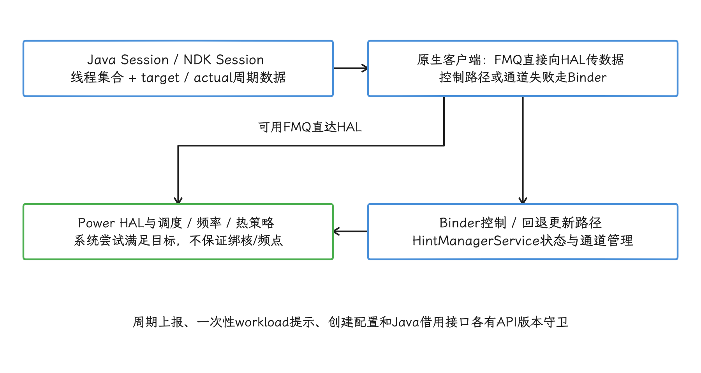

图：CPU/GPU headroom、能效模式与图形管线能力需分别探测；HAL版本高不等于业务必有节电收益。

## 适用场景：什么时候该把线程标成节能优先

Power Efficiency Mode（能效优先模式）成立的前提，是工作有稳定周期、业务结果也不要求最短延迟。线程只要在目标耗时内完成，系统就有机会选能耗更低的 CPU 核或频率。

文中的 P90、P95、P99 是耗时百分位：P90 表示 90% 的样本不超过该值，其余百分位同理。deadline 指任务必须完成的时限。

| 场景 | 是否适合 | 判断依据 |
| --- | --- | --- |
| 后台批量压缩、日志归档、离线索引 | 适合 | 任务持续时间和吞吐较稳定，目标耗时留有余量 |
| 本地模型批处理、照片批量转码、媒体库扫描 | 适合小流量验证 | 有固定处理批次，可用单位任务能耗和 P90 耗时同时验收 |
| 游戏主循环、相机预览滤镜、低延迟音频 | 谨慎 | 有周期性，但 deadline 较紧；默认应优先稳定帧耗时和低延迟 |
| 输入响应、点击后首屏展示、滚动帧提交 | 不适合 | 用户感知延迟优先级高，能效提示容易带来 P95 / P99 退化 |
| 一次性网络请求、偶发 JSON 解析 | 不适合 | 缺少稳定周期，无法持续提供有意义的目标耗时与实际耗时 |

我们把三件事依次过一遍：这段工作能否定义周期、周期是否留有余量、线程身份是否稳定。三项全部成立，再考虑 Power Efficiency Mode；缺任何一项，通常先别急着选它。

落到具体场景：游戏帧循环通常先保证帧 deadline，Power Efficiency Mode 只适合已经确认有稳定余量的子线程，例如资源准备、后台 AI、低优先级物理预计算。后台计算更关注吞吐与能耗的平衡，较长目标耗时、固定处理批次加上能效提示，是比较典型的配置。

<!-- gracker-diagram: a281-04-uid-state-pauses-session -->
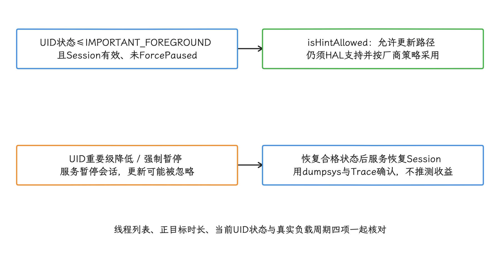

图：“后台批处理”描述业务性质；普通缓存进程不因创建Session就得到持续资源或保活资格。

## ADPF Session 的线程集合与生命周期

`PerformanceHintManager.Session` 把一组共同完成同类工作的 Linux 线程绑成一个性能提示会话。这组线程应长期存活，按周期反复使用；创建会话时传入初始目标耗时，之后每个周期用 `reportActualWorkDuration()` 上报实际耗时。

各 API 的职责如下：

- `createHintSession(int[] tids, long initialTargetWorkDurationNanos)`：创建会话，`tids` 是线程 ID 数组，必须属于当前进程；目标耗时必须为正，设备不支持时可能返回 `null`。
- `setThreads(int[] tids)`：替换会话的完整线程列表，不会在原列表上追加。`oneway` 指调用方发出请求后无需等待返回的单向 Binder 调用；AOSP 注释说明调用 `setThreads()` 要等返回，因此要避开高频关键路径。
- `updateTargetWorkDuration(long)`：只在目标周期改变时调用，例如刷新率、处理批次大小或业务 deadline 变化。
- `reportActualWorkDuration(long)` / `reportActualWorkDuration(WorkDuration)`：周期结束后上报实际耗时，时间基准按 `SystemClock.uptimeNanos()` 理解。
- `close()`：释放会话；不要把 `close()` 当暂停开关，下一轮长期工作需要重新创建会话。

Power Efficiency Mode 对应的公开方法是 `setPreferPowerEfficiency(boolean)`，API 参考文档标注该方法从 API 35 开始提供。AOSP `android-17.0.0_r1` 中的同名方法调用原生层 `nativeSetPreferPowerEfficiency()`，注释说明它表达“这些线程可以安全地偏向能效而不是性能”。

这段代码展示固定工作线程的组织方式：在线程自身采集 TID，串行访问 Session，并在周期结束后上报实际耗时。

```kotlin
@RequiresApi(Build.VERSION_CODES.VANILLA_ICE_CREAM)
class PowerEfficientBatchWorker(
    context: Context,
    private val targetDurationNanos: Long,
) {
    private val appContext = context.applicationContext
    private val executor = Executors.newSingleThreadExecutor { runnable ->
        Thread(runnable, "pe-batch-worker")
    }
    private val dispatcher = executor.asCoroutineDispatcher()
    private var session: PerformanceHintManager.Session? = null

    init {
        require(targetDurationNanos > 0L)
    }

    suspend fun start(): Boolean = withContext(dispatcher) {
        check(session == null) { "Session has already started" }
        val manager = appContext.getSystemService(PerformanceHintManager::class.java)
        val tid = Process.myTid()
        session = manager?.createHintSession(intArrayOf(tid), targetDurationNanos)
        session?.setPreferPowerEfficiency(true)
        session != null
    }

    suspend fun runCycle(block: suspend () -> Unit) = withContext(dispatcher) {
        checkNotNull(session) { "Call start() before runCycle()" }
        val start = SystemClock.uptimeNanos()
        try {
            block()
        } finally {
            val actual = SystemClock.uptimeNanos() - start
            session?.reportActualWorkDuration(actual)
        }
    }

    suspend fun close() {
        withContext(dispatcher) {
            session?.close()
            session = null
        }
        dispatcher.close()
        executor.shutdown()
    }
}
```

`PerformanceHintManager.Session` 不是线程安全对象，所以示例把创建、上报与关闭都收进同一个协程调度器；`finally` 保证失败周期也会上报已经消耗的时间，异常结果由业务另行记录。

多线程批处理可以登记多个 TID，前提是线程身份已经稳定。`Dispatchers.IO` 这类弹性线程池会在不同 TID 之间迁移协程，直接登记进 Session，系统收到的线程集合就会与真实负载脱节。协程迁移的细节展开在下一小节。

### 协程迁移与 TID 所有权

Session 绑定的是 Linux TID（Thread ID，线程 ID），也就是 `Process.myTid()`，与 `Thread.currentThread().id` 返回的 Java 线程逻辑 ID 是两回事。`Dispatchers.Default`、`Dispatchers.IO` 和 `limitedParallelism()` 都不承诺同一协程挂起恢复后仍在同一个 TID 上。我们在某个 `suspend` 函数开头登记当前线程，恢复后却换到另一工作线程执行时，系统收到的线程集合就和真实负载分开了。

适合 ADPF 的协程负载，由单线程或小规模固定 `Executor` 承载，线程启动后再采集 TID；一个周期的业务块中途不要切换协程调度器。Session 创建、`setThreads()`、目标耗时更新、实际耗时上报和 `close()`，都交给同一管理者串行执行。线程池重建时，API 31—33 的做法是关闭旧 Session 再重建；API 34+ 可以在生命周期边界完整替换线程数组，但不要每周期更新。

<!-- gracker-diagram: a281-03-coroutine-tid-migration-versus-fixed-worker -->
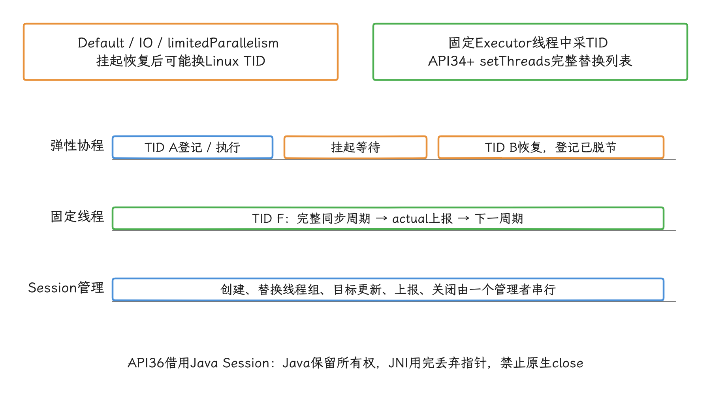

图：API31–33线程池重建要关闭旧Session重建；API34+可在边界替换，不要每周期更新。

API 36 的 `APerformanceHint_borrowSessionFromJava()` 让 JNI 代码借用 Java Session，省去重复创建。借用有规矩：关闭操作留在 Java 侧，Java 对象关闭后，这个指针也随之作废。稳定周期、稳定线程和可信的实际耗时测量，是套用 ADPF 的前置条件；这几样还没到位的时候，先处理并发、任务队列与生命周期。

<!-- gracker-diagram: a281-02-session-cycle-and-close-order -->
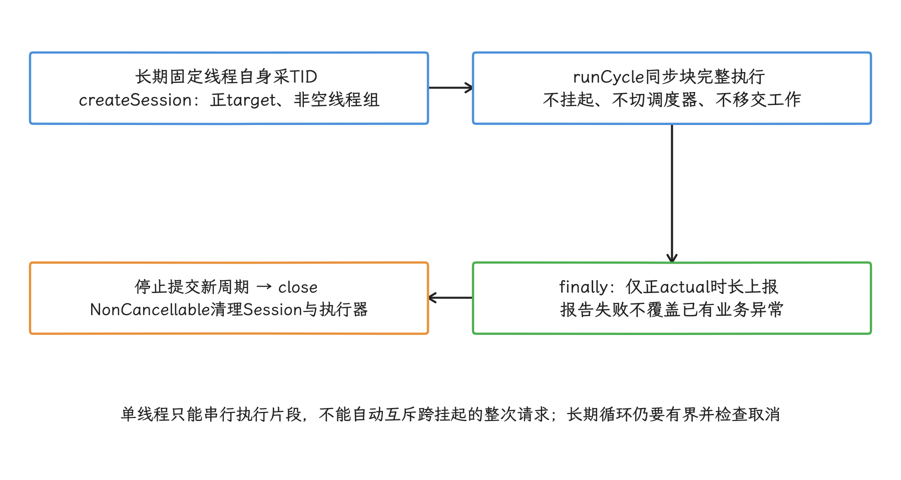

图：主机适配器已验证顺序与取消清理；真实SDK/NDK、HAL效果与设备功耗还需设备验证。

## Power Efficiency Mode 的系统语义

`setPreferPowerEfficiency(true)` 表达的是调度偏好，具体 CPU 频点、大小核选择、GPU 频率或能耗下降比例都不在承诺里；我们提供工作目标和实际耗时，系统结合 SoC（System on Chip，片上系统） 与设备热设计决定怎么用这些提示。

发布前，我们把三个层面的限制写清楚：

- API 层面：`PerformanceHintManager` 从 API 31 开始可用，`setThreads()` 的 API reference 标注 API 34，`setPreferPowerEfficiency()` 标注 API 35。编译期、运行期和小流量发布数据都要检查，单凭系统版本推断不出收益。
- 系统层面：提示进入系统的性能提示路径后，后续行为还受 Power HAL、调度器、CPUfreq（内核 CPU 调频机制）、thermal throttling（系统因温度过高而降频） 和设备厂商策略影响。
- 业务层面：节能 hint 可能拉长尾部耗时。验收时要同时看 P50 / P90 / P99 耗时、单位任务能耗和热状态。

回到余量这件事：Power Efficiency Mode 允许系统利用任务 deadline 前的余量；业务没有余量时，把线程标成节能优先，可能让平均耗时看着稳定，却让 P95、P99 等尾部耗时上升。

<!-- gracker-diagram: a281-05-deadline-slack-and-power-efficiency -->
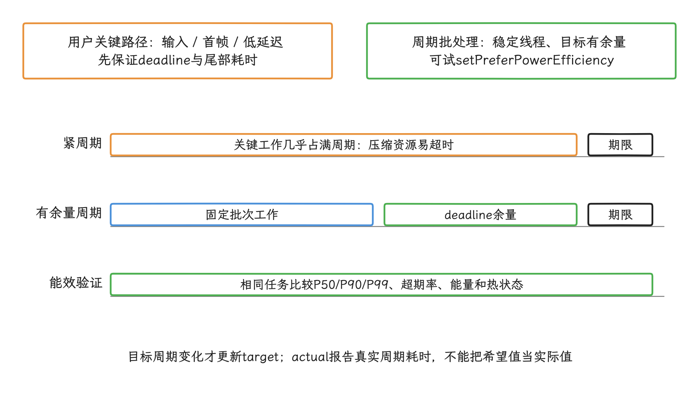

图：平均耗时稳定不保证P99稳定；持续温升、设备档位和前后台切换都纳入测量。

## PowerMonitor 与 SystemHealthManager 读数模型

Android 15（API 35）新增的 `PowerMonitor` / `PowerMonitorReadings`，让应用读到设备提供的累计能耗：一个 `PowerMonitor` 表示一个功耗监测项，可以是直接测量的电源轨，也可以是系统建模的能耗消费者。两个入口都是异步方法，`getSupportedPowerMonitors(executor, callback)` 返回支持列表，`getPowerMonitorReadings(monitors, executor, outcomeReceiver)` 返回指定监测项的读数。回调执行器可以传 `null`，但那样回调线程就由实现挑选，应用代码通常还是提供自己的执行器更稳。

AOSP `android-17.0.0_r1` 里，`SystemHealthManager.getSupportedPowerMonitors()` 的注释把监测项分成两类：一类是 ODPM（On-Device Power Rails Monitor，设备电源轨监测器）的原始电源轨，另一类是 modeled energy consumer（通过模型估算的子系统能耗消费者），即通过模型估算的子系统能耗。设备缺少 ODPM 支持时，公开 API 允许返回空列表；`getPowerMonitorReadings()` 经 `PowerStatsService` 取指定监测项的累计读数，监测项不受支持时由 `onError()` 送回 `IllegalArgumentException`。

`PowerMonitor` 的类型分两类：

- `POWER_MONITOR_TYPE_CONSUMER`：子系统或建模能耗消费者。它可能由多个电源轨组合而来，也可能代表共享电源轨的一部分，例如 Wi-Fi 与 Bluetooth 共用芯片供电时的模型拆分。
- `POWER_MONITOR_TYPE_MEASUREMENT`：直接测量的电源轨。名称和测量范围由设备厂商决定，同名电源轨的绝对值只在同一设备内有意义。

`PowerMonitorReadings.getConsumedEnergy(powerMonitor)` 返回本次开机以来的累计能耗，单位是微瓦秒（μWs，数值上等于微焦耳 μJ） μWs，数值上等于微焦耳 μJ；读数从开机重新累计，包含电池供电和插电状态下的总能耗。`getTimestampMillis(powerMonitor)` 返回快照时刻，时间基准采用包含深度睡眠时间的 `SystemClock.elapsedRealtime()`。找不到对应监测项时，AOSP `android-17.0.0_r1` 返回 `ENERGY_UNAVAILABLE = -1`。

Android 17 r1 的内部实现还给读数规定了新鲜度和精度上限。普通调用方拿到的是 `MAX_POWER_MONITOR_AGE_MILLIS = 20_000` 的缓存；持有隐藏系统权限 `ACCESS_FINE_POWER_MONITORS` 的调用方走另一组状态缓存，最大年龄 `250 ms`。这个权限只面向系统签名、特权或开发场景，普通第三方应用拿不到。20 秒和 250 ms 都是 r1 的实现细节，公开 API 对其他版本与设备没有这样的承诺。

<!-- gracker-diagram: a281-07-coarse-cache-versus-fine-cache -->
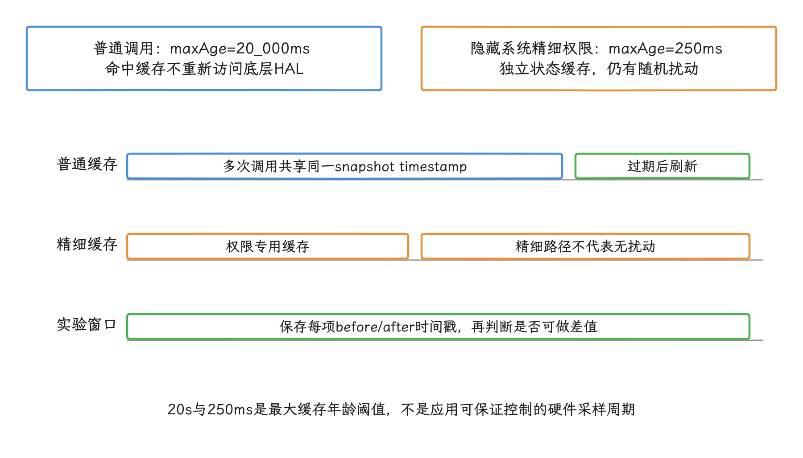

图：以返回时间戳判定是否新快照，首次/过期才刷新；不要靠高频轮询提高能量精度。

普通路径与精细路径在返回累计值前都会经过 `IntervalRandomNoiseGenerator`，以降低公开读数在时间和数值上的精度。在 r1 中，下界为 `max(上一次原始读数, 当前原始读数 - 10_000_000 μWs)`，系统在该下界与当前读数之间返回按 UID 稳定的随机值；`10_000_000 μWs` 等于 `10 J`。下一次底层刷新前，同一 UID 会得到同一个扰动样本。公开读数适合较长实验窗口和重复对照，一次短任务的前后差值达不到精密能量计的精度。

<!-- gracker-diagram: a281-08-uid-stable-energy-noise-interval -->
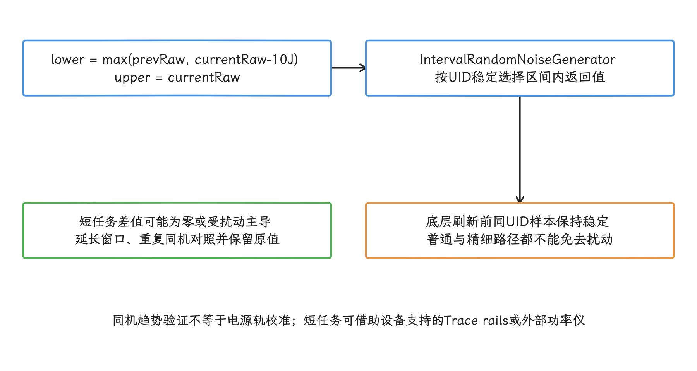

图：下一次实验不以零差值判定任务无耗电；有效差异必须超过缓存与扰动带来的误差。

这个纯函数先检查两次异步快照是否来自不同采样时刻，再计算累计值差；同一缓存快照、不可用读数或累计值回退都会返回空结果。

```kotlin
data class PowerWindowDelta(
    val monitorName: String,
    val energyUws: Long?,
    val startTimestampMillis: Long,
    val endTimestampMillis: Long,
)

@RequiresApi(Build.VERSION_CODES.VANILLA_ICE_CREAM)
fun calculatePowerWindowDeltas(
    monitors: List<PowerMonitor>,
    before: PowerMonitorReadings,
    after: PowerMonitorReadings,
): List<PowerWindowDelta> =
    monitors.map { monitor ->
        val startEnergy = before.getConsumedEnergy(monitor)
        val endEnergy = after.getConsumedEnergy(monitor)
        val startTime = before.getTimestampMillis(monitor)
        val endTime = after.getTimestampMillis(monitor)

        val delta = if (
            startEnergy != PowerMonitorReadings.ENERGY_UNAVAILABLE.toLong() &&
            endEnergy >= startEnergy &&
            endTime > startTime
        ) {
            endEnergy - startEnergy
        } else {
            null
        }

        PowerWindowDelta(
            monitorName = monitor.name,
            energyUws = delta,
            startTimestampMillis = startTime,
            endTimestampMillis = endTime,
        )
    }
```

使用时，先通过 `getPowerMonitorReadings()` 拿到 `before`，执行固定工作负载，再异步拿 `after`。`energyUws == null` 表示读数不可用、累计值回退，或两次调用命中了同一采样时刻。等待时间戳变化时别用高频轮询；实验窗口应覆盖缓存与扰动带来的误差，并把 `startTimestampMillis`、`endTimestampMillis` 一起保存。分析短任务时，优先用设备支持的 Perfetto 电源轨、系统功耗轨道或外部功耗仪。

<!-- gracker-diagram: a281-06-monitor-consumer-versus-measurement -->
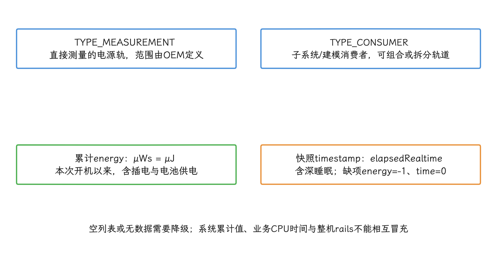

图：监测项覆盖可能重叠，要分列结果；名称相同不保证跨设备同一硬件范围。

<!-- gracker-diagram: a281-09-async-readings-delta-validation -->
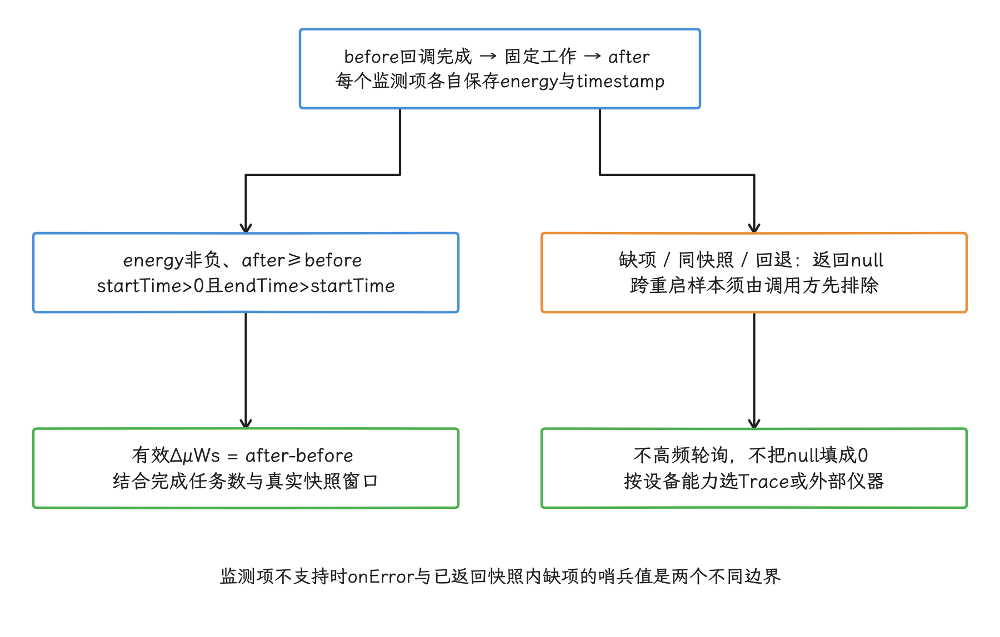

图：主机验证覆盖正向差值、相同时间戳、0时间戳、负能量、累计回退和缺失项，不含设备测量。

## 用 Perfetto 电源轨交叉验证

`PowerMonitor` 之外，Perfetto 的电源轨是另一条验证路径，两者都依赖设备提供的功耗统计能力。按 Perfetto 文档的说法，电源轨计数器（随时间记录累计能量的序列）——随时间记录累计能量的序列——是否存在、分辨率多高，都取决于设备厂商；平台通过 Android `IPowerStats` HAL 轮询数据。

最小采集配置用 Perfetto 的 `android.power` 数据源，并在 `android_power_config` 中打开 `collect_power_rails`；再配上 CPU 频率、`sched`（内核线程调度事件） 调度事件和自定义 trace marker（跟踪标记），我们才能把能效提示窗口、线程运行、频率变化和电源轨能耗放进同一条时间线。

```protobuf
buffers: {
  size_kb: 65536
  fill_policy: RING_BUFFER
}

data_sources: {
  config {
    name: "android.power"
    android_power_config {
      battery_poll_ms: 250
      collect_power_rails: true
    }
  }
}

data_sources: {
  config {
    name: "linux.ftrace"
    ftrace_config {
      ftrace_events: "sched/sched_switch"
      ftrace_events: "power/cpu_frequency"
      atrace_categories: "app"
      atrace_apps: "com.example.app"
    }
  }
}
```

这份配置保证的只是发起采集请求；设备是否真提供电源轨数据，要看厂商实现。拿到 trace 后，我们先确认电源轨轨道存在，再把 `Trace.beginSection("pe_batch_cycle")` 标记的工作窗口与 CPU 频率、线程状态和热状态对齐。只看电池百分比或单次电流值的话，充电状态、屏幕亮度、网络波动和后台任务的影响都混在里面。

开发阶段再执行 `adb shell dumpsys performance_hint`，核对 Session 的 PID（Process ID，进程 ID）、UID、TID、目标耗时、`AllowedByProcState`、`ForcePaused`、`PowerEfficient` 和设备能力。Perfetto 里的 `ADPF Session <id> target duration`、`actual duration`、TID 与 mode counter（模式计数轨道） 轨道，用来确认提示数据已经进入客户端路径，随后与调度事件、频率、超时和热状态对齐。

statsd 是 Android 的系统统计服务，atom 是其中一种结构化记录类型；ADPF atom 属于系统遥测，不是普通应用的实时查询接口。

`PowerMonitorReadings` 给每个监测项的累计 μWs，Perfetto 电源轨给跟踪时间线，Android Studio Power Profiler 更适合交互式分析应用行为、系统事件和功耗趋势。三者可以互相验证；采样频率、单位和归因范围各不相同，所以分开记录，合并成一个数字会把差异抹掉。

`PowerMonitorReadings` 和 Perfetto 电源轨可以在同一实验窗口内互相解释，跨设备就谈不上等价了。做交叉验证时，我们在同一设备、工作负载和温度起点下，同时记录两次 `PowerMonitorReadings` 的时间戳与差值、Perfetto 电源轨差值、CPU 频率、热状态和任务计数；普通应用还要把 r1 的 20 秒缓存与随机扰动计入误差。两类曲线同向变化时，结论写到“同一窗口内趋势一致”为止，电源轨级校准还谈不上完成。Pixel 或单一厂商设备上的结论，也只适用于对应设备组。

<!-- gracker-diagram: a281-10-perfetto-control-behavior-energy -->
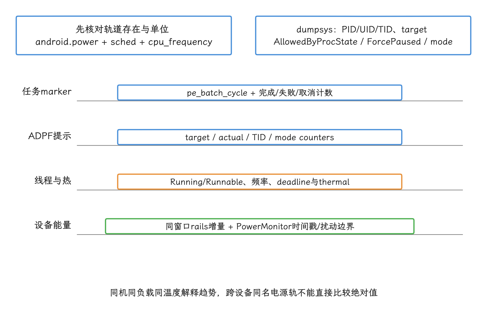

图：PowerMonitor差值、Perfetto rails和Power Profiler各保留时间与归因范围，不强合并成单个数字。

## 实验设计：同时看耗时和单位任务能耗

我们把变量先控制住：Power Efficiency Mode 按单位任务验收，固定设备、温度起点、输入数据和工作负载，再比较耗时与能耗。

实验分成 A/B 两组：

| 维度 | A 组 | B 组 |
| --- | --- | --- |
| ADPF Session | 固定工作线程 + 周期上报 | 固定工作线程 + 周期上报 + `setPreferPowerEfficiency(true)` |
| 工作负载 | 同一批任务、同一输入数据、同一批次大小 | 与 A 组一致 |
| 耗时指标 | P50 / P90 / P99 周期耗时、超过 deadline 的比例 | 与 A 组一致 |
| 能耗指标 | `ΔμWs / 完成任务数`，按监测项分列 | 与 A 组一致 |
| 温控指标 | 起始热状态、结束热状态、thermal throttling 次数 | 与 A 组一致 |

验收要同时过下面几条：

- P90 / P99 周期耗时保持在业务阈值内，超 deadline 比例持平或下降。
- 单位任务能耗的下降幅度要超过测量噪声；电源轨数据波动大时，延长测试窗口或增加重复次数。
- 热状态进入 thermal throttling 的时间点不早于对照组；长时任务至少运行到温度进入稳定区间后再判断。
- 按设备型号、SoC、系统版本、刷新率、充电状态和温度起点分别统计结果，不把 Pixel 上的电源轨名称或收益外推到其他厂商设备。

<!-- gracker-diagram: a281-11-ab-unit-energy-and-tail-latency -->
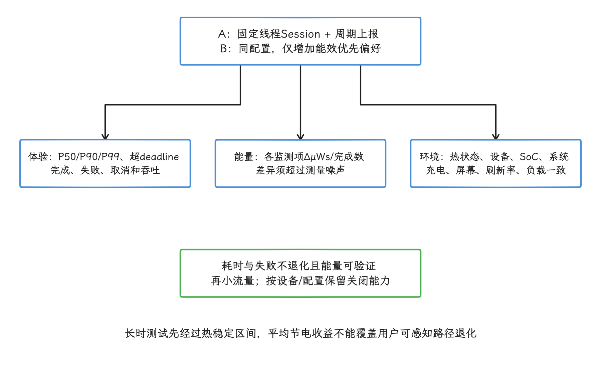

图：空列表与无电源轨时收窄结论；不能只凭CPU时间或电池百分比写精确单位任务能耗收益。

如果只能拿到 `PowerMonitor` 空列表，实验仍可继续，结论范围相应收窄：用 Perfetto 电源轨、Android Studio Power Profiler、系统电量统计 `BatteryStats`、CPU 时间和任务耗时互相验证，`PowerMonitor` 读数带来的收益就先不写。

## 小流量发布与指标设计

到了线上小流量阶段，`PowerMonitor` 的角色要降下来：它是异步读数 API，返回累计能耗，设备支持度也不一致，承担不了高频采样。线上只把能效提示作为实验变量，采集轻量业务指标，差异的解释工作交回实验室的电源轨数据。

每个实验样本至少记录这些字段：

- 提示配置：是否开启 Power Efficiency Mode、目标耗时、Session 线程数、任务类型。
- 工作结果：完成任务数、单任务耗时、P50 / P90 / P99、取消率、失败率。
- 设备环境：机型、SoC、系统版本、刷新率、充电状态、热状态、前后台状态。
- 资源指标：CPU 时间、线程运行时间、任务排队时间、后台执行约束命中情况。
- 实验标签：实验批次、配置版本、关闭原因、需要排除的设备型号列表。

发布策略按“耗时不退化，再看能耗收益”执行。尾部耗时或失败率一旦退化，先关闭能效提示；平均能耗的收益，排在用户可感知路径后面。

## OEM（Original Equipment Manufacturer，设备厂商） 差异与降级策略

`PowerMonitor` 与 Perfetto 电源轨的可用性都取决于设备厂商实现：设备可能返回空监测项列表，也可能只提供少量建模能耗消费者；同名电源轨在不同设备上对应的硬件范围也可能不同。`PowerMonitor` 源码还说明监测项索引跨重启未必稳定，这个索引别持久化。

降级策略按三档处理：

| 设备能力 | 可用验证方式 | 可得结论 |
| --- | --- | --- |
| `PowerMonitor` 列表完整，Perfetto 有电源轨轨道 | API 差值 + Perfetto 时间线交叉验证 | 可写单位任务能耗变化，但限定设备和场景 |
| `PowerMonitor` 为空，Perfetto 有部分电源轨 | Perfetto 电源轨 + CPU 频率 + 热状态 + 任务耗时 | 写实验室证据，不写 API 差值结论 |
| API 与 Perfetto 都缺电源轨 | `BatteryStats` / Power Profiler / CPU 时间 / 业务耗时 | 只写功耗趋势和风险，不能写电源轨级结论 |

Power Efficiency Mode 的开关同样要按设备型号来。小流量实验中发现某些型号的 P99 耗时变差、热状态更早升档或任务失败率上升时，只关这些型号就好，其余设备的能力照常保留。

## 配合 Thermal API 调整长期任务

长期任务还有热状态这条线。Power Efficiency Mode 和 Thermal API 处理同一类长期负载问题的两个阶段：前者在任务开始时表达能效偏好，后者在设备热状态变化时调整策略。`PowerManager.addThermalStatusListener()` 监听热状态变化，`getCurrentThermalStatus()` 读取当前状态；热管理机制详见 5.2 节与 11.2 节。

任务策略可以按热状态分层：

- 常温：按实验得到的目标耗时与批次大小执行，开启 `setPreferPowerEfficiency(true)`。
- 轻度升温：增大批次间隔或降低并发线程数，保留任务吞吐。
- 中度升温：暂停非必要批处理，降低后台同步频率，避免继续推高热状态。
- 严重升温：关闭非关键长时任务，只保留用户可感知路径和系统要求任务。

这些策略要满足业务 SLA（Service Level Agreement，可量化的服务质量约束）。照片备份、日志压缩、离线索引可以降频或暂停；实时通话、导航、录制不能只按能耗目标降级。

热状态进入高档位前主动降低批处理并发，通常比等系统开始 thermal throttling 后再恢复更可控。阈值和收益必须来自具体设备实验，固定温度不具备跨设备意义。

<!-- gracker-diagram: a281-12-thermal-feedback-and-rollout-control -->
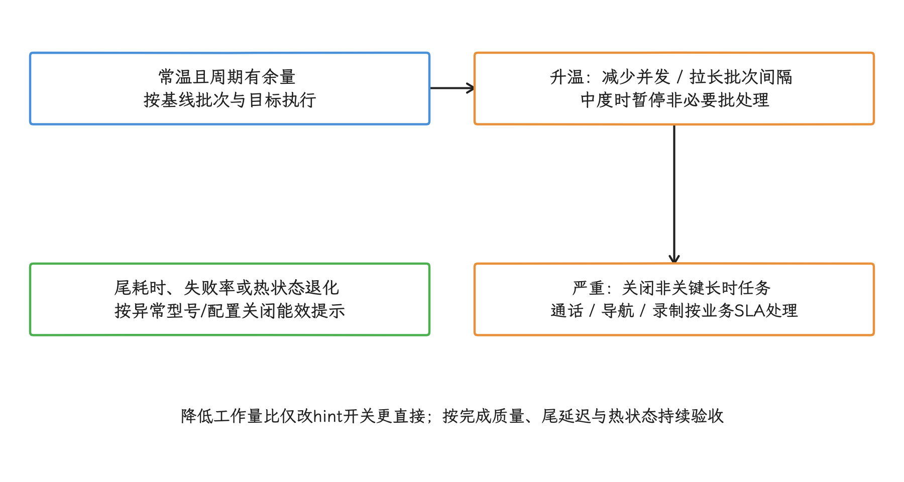

图：能效偏好不授予温控豁免；能力不支持、线程不稳定或数据不足时先回到普通受控工作。

## 常见误区

### 误区一：`setPreferPowerEfficiency(true)` 等于省电收益

它只表达调度偏好。只有 `PowerMonitor`、Perfetto、`BatteryStats` 或 Power Profiler 的数据能证明收益，而且结论必须限定为“启用后，在某设备、某场景、某测试窗口内，单位任务能耗下降”。

### 误区二：把输入和渲染线程也标成节能优先

输入线程、主线程、RenderThread、音视频低延迟线程一般不适合默认节能优先。它们对尾部延迟更敏感，误用这类提示会增加用户可感知的卡顿或响应延迟。图形、游戏和相机相关周期任务如果要接入，应先按 5.4 节和这里的 Session 规则验证线程身份。

### 误区三：PowerMonitor 的电源轨名称能跨设备对比

`POWER_MONITOR_TYPE_MEASUREMENT` 的电源轨由设备厂商定义，同名电源轨对应的硬件范围未必相同。跨设备比较只看同一业务指标，按同类设备分别统计；电源轨绝对值留在各自设备的语境里，放进同一份排名没有意义。

### 误区四：插电测试不影响结论

Perfetto 文档说明，电池计数器在 USB 插电时会反映充电电流，实验室功耗测试要隔离充电状态。电源轨计数器位于电池下游，不直接受充放电方向影响，但测试仍要记录 USB、电量、屏幕亮度和温度起点。

## 源码追踪：系统服务与 Power HAL 的协作

到这里，应用侧的接入与验证主线已经走完，我们再往系统内部看。公开 API 进入系统后的路径，决定了提示为何可能被暂停、读数为何会命中缓存，以及收益为何因设备而异；ADPF 的完整效果同时取决于应用上报、系统服务和 Power HAL。这条路径在 AOSP `android-17.0.0_r1` 里可以逐段对照。

> **版本限定**：源码锚点统一使用 `android-17.0.0_r1`；公开 API 只核对到 Android 17/API 37。后续主开发分支的变更不作为本文结论。

### HintManagerService：系统层会话调度中心

**源码位置**：`frameworks/base/services/core/java/com/android/server/power/hint/HintManagerService.java`（`android-17.0.0_r1`）

系统通过 `HintManagerService` 统一管理所有 ADPF 会话，职责有三：

- **会话生命周期管理**：维护 UID → Binder token（会话句柄） → Session 的映射，处理会话的创建、更新和清理。
- **CPU/GPU headroom 查询**：headroom 表示当前还可分配的计算能力余量。`SystemHealthManager` 通过 `IHintManager` 转发到 Power HAL 的 `getCpuHeadroom()` / `getGpuHeadroom()`；Java API 返回 0–100 或 `Float.NaN`，0 表示没有更多可分配资源。HAL 的 `CpuHeadroomResult` / `GpuHeadroomResult` 也只暴露 `globalHeadroom`，不提供负载、温度或频率明细。
- **按版本选择能力**：根据 Power HAL 版本调整可用提示和调度策略。

`HintManagerService` 的内部实现细节（如状态映射结构、清理间隔），比如状态映射结构、清理间隔，会随版本变化，应以对应源码版本标签为准；引用范围不包含主开发分支特有的内部代码。

**Power HAL 版本差异**：

- Power HAL V4：基础性能提示会话支持。
- Power HAL V5：`createHintSessionWithConfig()`、`SessionTag`、`SessionMode.POWER_EFFICIENCY` 与 `getSessionChannel()` 支持。
- Power HAL V6：CPU/GPU headroom 查询，以及 `GRAPHICS_PIPELINE`、`AUTO_CPU`、`AUTO_GPU` SessionMode 支持。
- Power HAL V7：加入 `AUDIO_PERFORMANCE` SessionMode；`android-17.0.0_r1` 的冻结 AIDL（Android Interface Definition Language，Android 接口定义语言） 已包含 V7。

### Power HAL `ML_ACC` Boost

**源码位置**：`hardware/interfaces/power/aidl/android/hardware/power/Boost.aidl`（`android-17.0.0_r1`）

`ML_ACC` 是 Power HAL 为机器学习加速器预留的 boost（短时性能提升请求）类型。`android-17.0.0_r1` 的注释把它和后续几种 boost 一起标记为“Android framework 当前不发送，OEM 可以选择实现”。这段摘录用于确认枚举名与版本范围：

```aidl
/** 
 * This boost indicates that the device is interacting 
 * with ML accelerator. 
 */
ML_ACC,
```

源文件没有给 `ML_ACC` 写显式整数。HAL 与系统代码引用生成的 `Boost.ML_ACC`，从排列位置推导数值是靠不住的。应用公开 API 也不直接发送这个 boost，把它当通用的应用侧 NPU（Neural Processing Unit，神经网络处理器） 加速开关来写会写错。

厂商可以在自己的受控路径中决定是否实现该类型以及如何映射到芯片策略，但 AOSP 枚举本身不承诺 CPU、GPU、NPU 频率或持续时间。

### SessionTag 与 SessionMode：两个不同的 HAL 内部枚举

AOSP 中 **SessionTag** 和 **SessionMode** 是两个独立的 AIDL 枚举，定义在不同文件里，回答的也是两个不同的问题：前者标记会话从哪来，后者表达会话要什么。

这段 `SessionTag` 摘录列出会话来源类别。r1 源文件没有显式整数赋值：

```aidl
@VintfStability
@Backing(type="int")
enum SessionTag {
    OTHER,
    SURFACEFLINGER,
    HWUI,
    GAME,
    APP,
    SYSUI,
}
```

`SessionTag` 描述会话由哪类组件创建或归属哪类应用；`HintManagerService` 还会把普通应用会话按应用类别映射为 `APP` 或 `GAME`。`@VintfStability` 表示该 AIDL 接口需要维持 framework 与 vendor 分区之间的版本兼容。

这段 `SessionMode` 摘录列出会话要求；它与来源标签是两套不同的枚举：

```aidl
@VintfStability
@Backing(type="int")
enum SessionMode {
    POWER_EFFICIENCY,
    GRAPHICS_PIPELINE,
    AUTO_CPU,
    AUTO_GPU,
    AUDIO_PERFORMANCE,
}
```

`GRAPHICS_PIPELINE` 属于 `SessionMode`，`SessionTag` 里找不到它。Java SDK 的 `PerformanceHintManager.createHintSession(int[], long)` 不接受 HAL tag 或 mode，`setPreferPowerEfficiency(true)` 由系统映射为能效模式。Android 16 起的 NDK `ASessionCreationConfig` 提供 `setGraphicsPipeline()`、`setUseAutoTiming()` 和 `setPreferPowerEfficiency()` 等高层开关；应用使用这些高层接口，HAL 枚举整数交给编译器处理，公开 NDK 接口里也没有任意挑选 `SessionTag` 或 `AUDIO_PERFORMANCE` 的入口。

<!-- gracker-diagram: a281-13-session-tag-mode-and-boost -->
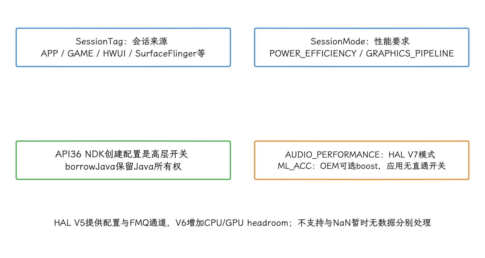

图：图形管线属于mode；Java createHintSession不接受任意HAL tag/mode，普通应用也不直接选音频模式。

### 电源状态跟踪与统计

`HintManagerService` 还注册了 `ADPF_SYSTEM_COMPONENT_INFO`、`ADPF_SESSION_SNAPSHOT` 和 `ADPF_SUPPORT_INFO` 等 statsd pull atom（由 statsd 主动拉取的结构化统计记录）——statsd 主动拉取的结构化统计记录。会话快照按 UID 与 `SessionTag` 记录最大并发会话数、最大线程数、能效会话数、目标耗时分布和图形管线会话数；支持信息还包含 Power HAL 版本，以及可用的 Session 提示、模式、FMQ、CPU/GPU headroom 能力。这些都是系统统计接口，不是应用的公开诊断 API。

### FMQ 与系统组件开关

`android-17.0.0_r1` 的 `HintManagerService` 会读取两个系统属性，并把状态写入 `ADPF_SYSTEM_COMPONENT_INFO`：

- `debug.sf.enable_adpf_cpu_hint`：SurfaceFlinger CPU hint 开关
- `debug.hwui.use_hint_manager`：HWUI hint manager 开关

Power HAL V5 开始提供 `getSessionChannel()`，服务端可以通过 FMQ 传递会话数据并记录是否使用。上述属性和 HAL 通道归系统组件与厂商适配管，普通应用拿它们当运行时开关是用错了方向。

### PowerStatsService 完整数据通路（系统服务 → IPowerStats HAL → statsd）

`SystemHealthManager.getPowerMonitorReadings()` 最终进入 `IPowerStatsService.Stub`。Binder 入口记下调用方 UID 后，把工作投递给 `PowerStatsService` 的 Handler（消息队列执行器），避免在 Binder 线程中直接访问 HAL。服务根据监测项类型分别调用：

- `IPowerStats.getEnergyConsumed()`：读取建模能耗消费者；
- `IPowerStats.readEnergyMeter()`：读取直接测量的 ODPM 通道。

读数从哪来？Android 17 r1 为普通读数和精细读数维护两组 `PowerMonitorState`：普通调用方的最大缓存年龄是 `20_000 ms`，持有隐藏系统权限 `ACCESS_FINE_POWER_MONITORS` 的调用方用 `250 ms`。当所选监测项中最早的时间戳为 0，或其年龄超过对应阈值，服务才更新能耗消费者与能量测量值；调用频率高于阈值，只会反复拿到缓存，底层采样频率不随之变化。

读数更新后，服务在上一次原始累计值与当前原始累计值之间生成按 UID 稳定的随机返回值。下界不会低于 `current - 10_000_000 μWs`，也不会低于 `prevEnergyUws`；上界是当前原始值。因为 `1 μWs = 1 μJ`，该常量对应 `10 J`，不是 `10 MJ`。这段逻辑降低了公开读数在时间与数值上的精度，也解释了相邻窗口为何可能出现零差值或波动。

`LocalService` 另有 `getEnergyConsumedAsync()`、`getStateResidencyAsync()` 和 `readEnergyMeterAsync()` 三个系统内部入口，返回 `CompletableFuture`（稍后完成的异步结果） 异步结果。`getEnergyConsumedAsync()` 发现 HAL 返回的消费者数量少于请求时，会记录严重级别日志 `Slog.wtf`，随后仍用已有数组完成异步结果。应用 `getPowerMonitorReadings()` 的错误语义要看 `IPowerStatsService` 的结果码和 `OutcomeReceiver` 约定，这条内部路径要分开读。

`StatsPullAtomCallbackImpl` 根据 HAL 提供的信息注册两个 statsd 拉取记录：

- `ON_DEVICE_POWER_MEASUREMENT` 对应 `IPowerStats.readEnergyMeter()`；
- `SUBSYSTEM_SLEEP_STATE` 对应 `IPowerStats.getStateResidency()`。

回调通过 `ConcurrentUtils.DIRECT_EXECUTOR` 执行，再等待 Handler 侧的异步结果，超时上限为 `2_000 ms`；异常、超时或空结果一律返回 `PULL_SKIP`。`ON_DEVICE_POWER_MEASUREMENT` 只接收 `durationMs == timestampMs` 的样本，表示能量累计区间从开机开始；缩写成“两个字段为 0”会丢掉“从开机开始”这层含义。

<!-- gracker-diagram: a281-14-powerstats-public-pull-and-local-paths -->
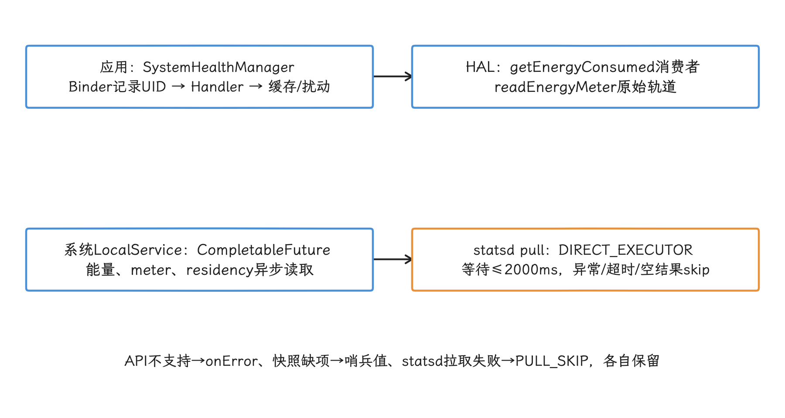

图：ON_DEVICE_POWER_MEASUREMENT只接durationMs==timestampMs的开机累计样本；不是要求两个字段为0。

`PowerStatsLogger` 使用三个 Handler 消息，分别采集 meter 直接测量值、model 建模值（model）和 residency 状态驻留时间，存入 `/data/system/powerstats/`；日志前缀是 `log.powerstats.meter.0`、`log.powerstats.model.0` 与 `log.powerstats.residency.0`。`PowerStatsDataStorage` 通过 `FileRotator` 每 4 小时轮转并保留 48 小时，并不固定写成六个 `.pb` 文件。

`meterCache`、`modelCache`、`residencyCache` 保存 HAL 元信息的序列化快照（例如 Channel、EnergyConsumer、PowerEntity 的 proto bytes）——`Channel`、EnergyConsumer、PowerEntity 的 proto bytes——用于识别元信息是否变化；元信息一变，对应旧日志随之删除。这些缓存经 `AtomicFile` 更新，临时文件名属于实现细节，别拿它当稳定存储格式。

写入前，`adjustTimeSinceBootToEpoch()` 用服务启动时记录的墙钟时间基准，把 HAL 的开机时间戳换算到墙钟时间线，方便事件报告排序。不过 HAL 的能量和状态驻留时间（residency）都以本次开机为起点，累计能量跨重启直接相减，得到的差值没有意义。

<!-- gracker-diagram: a281-15-powerstats-log-rotation-and-metadata -->
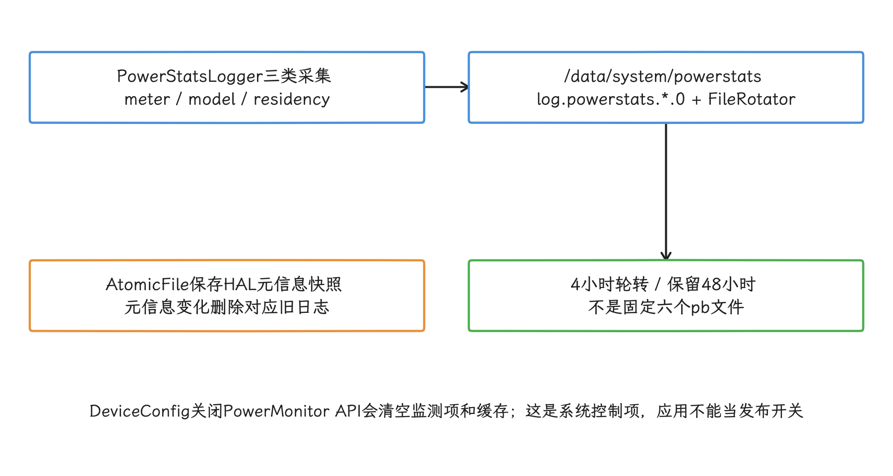

图：开机时间戳可换算墙钟方便排序，累计能量跨重启不能直接相减；公开监测项索引也不可跨重启持久化。

再往 HAL 看，`IPowerStats.aidl` 是带 `@VintfStability` 的接口，定义六个方法：`getPowerEntityInfo()`、`getStateResidency()`、`getEnergyConsumerInfo()`、`getEnergyConsumed()`、`getEnergyMeterInfo()` 与 `readEnergyMeter()`。`Channel` 包含 `id`、`name`、`subsystem`；framework 只透传后两个厂商自定义字符串，不解释其含义。`EnergyMeasurement` 包含 `id`、`timestampMs`、`durationMs`、`energyUWs`，其中时间使用 `CLOCK_BOOTTIME`，能量单位是 μWs。

系统动态配置 DeviceConfig（系统动态配置） 里的 `battery_stats/power_monitor_api_enabled` 由监听器动态刷新：值一变，服务清空监测项列表和两组状态缓存；关闭后返回空列表。它是系统侧控制项，不是应用可用的公开发布开关。

对应用和实验平台有四个直接影响：

- 不要假设每次 `getPowerMonitorReadings()` 都访问 HAL；普通应用在 r1 中可能复用 20 秒内的读数。
- 必须保存每个监测项的返回时间戳。两次时间戳相同时，这个差值覆盖的窗口和业务窗口对不上。
- μWs 与 μJ 数值相等，但 μWh 是另一种单位；换算报告时要保留原始单位。
- `@VintfStability` 约束接口兼容性，不统一厂商电源轨的覆盖范围、名称和测量质量。跨设备实验仍需先核对监测项语义。

> 源码锚点覆盖 `PowerStatsService.java`、`IntervalRandomNoiseGenerator.java`、`StatsPullAtomCallbackImpl.java`、`PowerStatsLogger.java`、`PowerStatsDataStorage.java`、`IPowerStatsService.aidl`、`PowerMonitor.java`、`PowerMonitorReadings.java`、`IPowerStats.aidl`、`Channel.aidl` 与 `EnergyMeasurement.aidl`，均以 `android-17.0.0_r1` 为准。

### 版本演进总结

| Android 版本 | 系统层能力 | 硬件协同增强 |
|-------------|----------|-------------|
| Android 12 | ADPF v1 `PerformanceHintManager` / `createHintSession()` | CPU 性能提示会话的基础支持 |
| Android 14 | `setThreads()` 等 Session 线程管理 API | 更完整的线程集合维护 |
| Android 15 | `setPreferPowerEfficiency()`、`PowerMonitor`、Power HAL `SessionTag` / `SessionConfig` 与 `getSessionChannel()` | 能效偏好和监测项读数进入公开验证路径 |
| Android 16 | `getCpuHeadroom()` / `getGpuHeadroom()`、`GRAPHICS_PIPELINE` / `AUTO_CPU` / `AUTO_GPU` SessionMode | CPU/GPU 可用能力余量查询与图形管线自动计时模式 |
| Android 17 | `AUDIO_PERFORMANCE` SessionMode 在 `android-17.0.0_r1` Power HAL AIDL 中可见 | 低延迟音频管线可请求稳定的最低性能；仍属于系统/HAL 范围，不是普通应用直接选择的公开枚举 |

**应用与硬件的分工**：

1. SessionTag 和 SessionMode 是 HAL 内部概念，应用通过公开 ADPF API（`createHintSession`、`reportActualWorkDuration`、`setPreferPowerEfficiency`）表达意图，不直接选择 tag/mode。
2. `ML_ACC` boost 的数值由 AIDL 编译器生成，适配代码引用枚举名而非硬编码常量。
3. 利用 Perfetto 验证系统收到 ADPF 提示后的调度行为，提示是否生效以 trace 为准。
4. 设备厂商可基于 Boost、SessionTag 和 SessionMode 实现芯片级优化，策略因设备而异。

## 全文小结

ADPF Power Efficiency Mode 做的事，是把长期周期任务的 deadline 余量告诉系统：`setPreferPowerEfficiency(true)` 表达偏好，`PowerMonitorReadings` 和 Perfetto 电源轨验证能耗，小流量实验盯着尾部耗时和失败率。稳定线程、稳定周期和能耗数据凑齐之前，把启用该模式写成优化结论为时过早。

## 参考资料

- [Android Developers: PerformanceHintManager.Session](https://developer.android.com/reference/android/os/PerformanceHintManager.Session)
- [Android Developers: ADPF overview](https://developer.android.com/games/optimize/adpf)
- [Android Developers: SystemHealthManager](https://developer.android.com/reference/android/os/health/SystemHealthManager)
- [Android Developers: PowerMonitor](https://developer.android.com/reference/android/os/PowerMonitor)
- [Android Developers: PowerMonitorReadings](https://developer.android.com/reference/android/os/PowerMonitorReadings)
- [Android NDK: Performance Hint Manager](https://developer.android.com/ndk/reference/group/a-performance-hint)
- [AOSP Android 17 r1: performance_hint.h](https://android.googlesource.com/platform/frameworks/native/+/refs/tags/android-17.0.0_r1/include/android/performance_hint.h)
- [Perfetto: Power data sources](https://perfetto.dev/docs/data-sources/battery-counters)
- [AOSP Android 17 r1: PerformanceHintManager.java](https://android.googlesource.com/platform/frameworks/base/+/refs/tags/android-17.0.0_r1/core/java/android/os/PerformanceHintManager.java)
- [AOSP Android 17 r1: HintManagerService.java](https://android.googlesource.com/platform/frameworks/base/+/refs/tags/android-17.0.0_r1/services/core/java/com/android/server/power/hint/HintManagerService.java)
- [AOSP Android 17 r1: PowerStatsService.java](https://android.googlesource.com/platform/frameworks/base/+/refs/tags/android-17.0.0_r1/services/core/java/com/android/server/powerstats/PowerStatsService.java)
- [AOSP Android 17 r1: IntervalRandomNoiseGenerator.java](https://android.googlesource.com/platform/frameworks/base/+/refs/tags/android-17.0.0_r1/services/core/java/com/android/server/powerstats/IntervalRandomNoiseGenerator.java)
- [AOSP Android 17 r1: PowerStatsDataStorage.java](https://android.googlesource.com/platform/frameworks/base/+/refs/tags/android-17.0.0_r1/services/core/java/com/android/server/powerstats/PowerStatsDataStorage.java)
- [AOSP Android 17 r1: IPowerStats.aidl](https://android.googlesource.com/platform/hardware/interfaces/+/refs/tags/android-17.0.0_r1/power/stats/aidl/android/hardware/power/stats/IPowerStats.aidl)
- [AOSP Android 17 r1: SessionMode.aidl](https://android.googlesource.com/platform/hardware/interfaces/+/refs/tags/android-17.0.0_r1/power/aidl/android/hardware/power/SessionMode.aidl)
