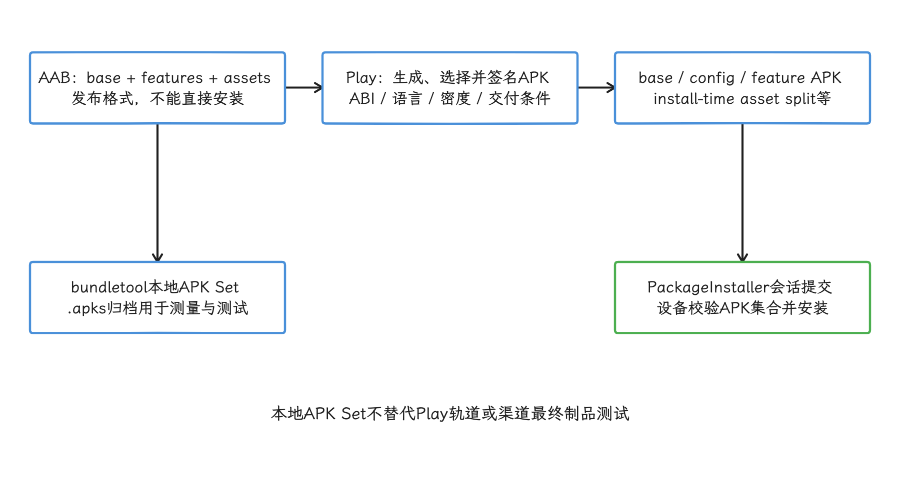
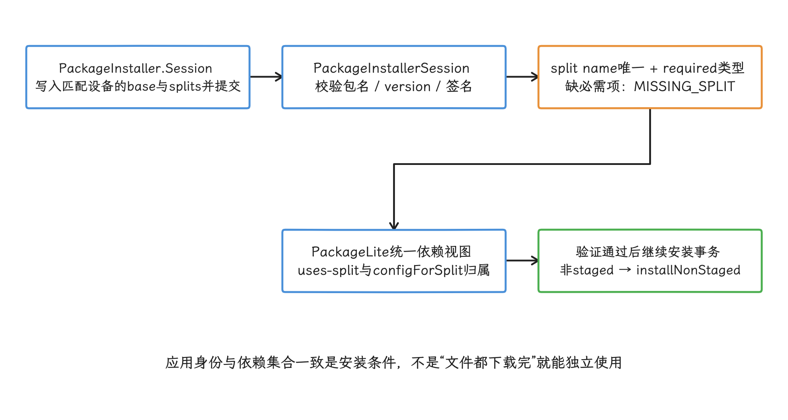
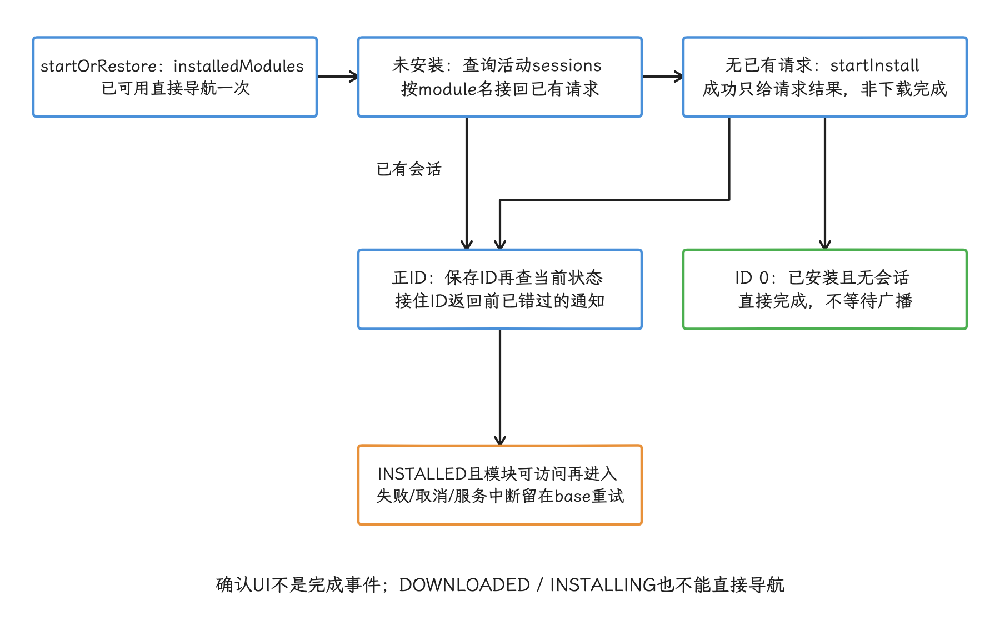
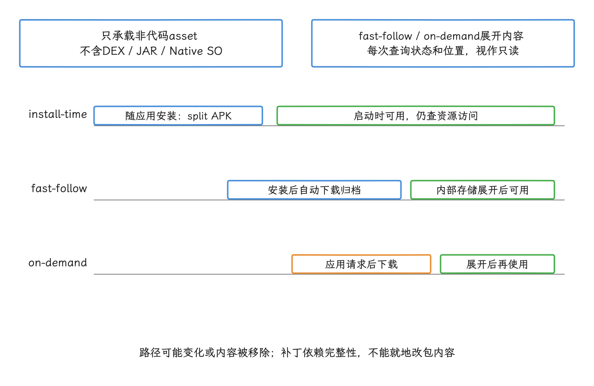

# App Bundle 与按需分发

按需分发把安装包体积问题转化为模块边界、下载时机和失败恢复问题。规划 AAB、Dynamic Feature 或资源包时，我们要同时考虑商店能力、首用路径、离线场景和版本兼容，基础 APK 大小只是其中一个维度。

> 平台锚点：Android 17（API 37）。AAB 拆分与 Play Feature/Asset Delivery 由构建工具、Google Play 服务端和 Play 商店实现，不涉及 kernel（内核）分包逻辑。

## 分发要解决的问题

25.10 处理产物中还能删除或缩小什么；这一篇换一个问题：哪些产物应在什么时间交给哪台设备。两件事分属不同环节：删除 base module（基础模块）中的无用代码靠 R8（代码缩减与优化器），低频功能要不要延后下载由模块交付决定，AAB 格式管的是发布形态这一层。

Android App Bundle（AAB）是提交给商店的发布格式，设备上安装的始终是 APK：Google Play 根据 AAB 生成并签名 APK；设备收到的是 base APK（基础包）、configuration APK（设备配置拆分包）、feature APK（功能拆分包），以及可能的 install-time asset split（随安装交付的资源拆分包）。`bundletool` 可以在本地生成同类 APK Set（包含多个 APK 的 `.apks` 归档），用于测量和测试。构建与分发关系可参照 [About Android App Bundles](https://developer.android.com/guide/app-bundle)。

<!-- gracker-diagram: a284-01-aab-publish-device-apks-and-platform -->


图：R8决定可删除什么，模块交付决定何时给谁；二者解决不同问题。

## AAB 格式与分包机制

我们先看 AAB 的内部组织：AAB 按 module（模块）组织代码和资源，base module 是所有安装必需的主体；feature module（功能模块）可以在安装时、满足条件时或用户请求时交付；asset pack（资源包）用于 Play Asset Delivery。Google Play 还可以按 ABI（应用二进制接口，对应处理器架构与调用约定）、语言和屏幕密度生成 configuration APK，让设备只下载匹配配置。

工程中要分开记录三种尺寸：

- **AAB 上传大小**：用于检查发布制品，任一设备的下载量都要另行测量；
- **设备交付大小**：由 SDK 版本（这里表示 Android API 级别）、ABI、语言、密度、module 集合和交付时机决定；
- **安装后占用**：还会受原生库提取、dexopt（安装后的 DEX 字节码优化）、asset pack 展开和应用数据影响。

这组命令依次做三件事：从已连接设备生成规格文件，构建完整 APK Set，再估算该设备首次下载的压缩大小。规格文件审核后应固定到体积基线中，后面的数字才有可比性。

```bash
bundletool get-device-spec --output=device-spec.json

bundletool build-apks \
  --bundle=app-release.aab \
  --output=app-release.apks

bundletool get-size total \
  --apks=app-release.apks \
  --device-spec=device-spec.json
```

`get-size total` 默认统计首次下载时安装的所有 module，base 也在其中；指定 `--modules` 时，工具会把所选 module 的依赖一并计入。要得到某台设备的基线，就要提供设备规格：缺省时结果可能是一组跨设备维度的最小值和最大值。命令语义见 [`bundletool` 文档](https://developer.android.com/tools/bundletool)。


本地 `build-apks` 使用与 Play 相关的拆包工具，但签名、Play 服务端处理和线上设备选择，仍要通过测试轨道验证。签名还有个细节：未显式传 keystore（签名密钥库）时，`bundletool` 会尝试使用 debug key（调试签名密钥），这样的 APK Set 留在本地测试就好。

### 平台如何接收 split APK

到了设备这一侧，`.aab` 与 Package Manager（Android 包管理器）之间还隔着商店和安装器：安装器通过 [`PackageInstaller`](https://android.googlesource.com/platform/frameworks/base/+/android-17.0.0_r1/core/java/android/content/pm/PackageInstaller.java) 建立安装会话，写入 base 与 split APK（拆分包）后提交。`android-17.0.0_r1` 的 [`PackageInstallerSession`](https://android.googlesource.com/platform/frameworks/base/+/android-17.0.0_r1/services/core/java/com/android/server/pm/PackageInstallerSession.java) 在 `streamValidateAndCommit()` 中调用 `validateApkInstallLocked()`，我们重点看这几项校验：

- 每个 split name（拆分包名称）唯一；
- package name（包名）、version code（版本号）和签名一致；
- base 声明需要 split 时，要求的 split type（拆分包类型）已提供；
- 完整安装缺少必需 split 时返回 `INSTALL_FAILED_MISSING_SPLIT`；
- 通过 [`ApkLiteParseUtils.composePackageLiteFromApks()`](https://android.googlesource.com/platform/frameworks/base/+/android-17.0.0_r1/core/java/android/content/pm/parsing/ApkLiteParseUtils.java) 形成 base、feature、`uses-split`（功能依赖）和 `configForSplit`（配置归属）的统一视图。

验证通过后，无需重启即可生效的安装会进入 `installNonStaged()` 等后续流程。这里要记住一致性要求：base、配置 split 和功能 split 必须作为同一个包的一致集合安装，从通用包里随意挑几个文件是拼不起来的。Android 官方还明确说明，缺少必需 split 的侧载安装会在 Android 10 及以上设备或 Google 认证设备失败。

<!-- gracker-diagram: a284-03-split-session-consistency-validation -->


图：AAB不进入PackageManager；从通用包中任挑几个split侧载，可能缺签名、配置或功能依赖。

## Dynamic Feature Module 实践

哪些功能值得拆出去？我们的判断标准：低频、体积较大、允许等待的完整功能适合 Dynamic Feature Module（动态功能模块），例如视频编辑、OCR（光学字符识别）、AR（增强现实）或额外关卡。反过来，登录恢复、崩溃提示、支付结果、通知入口等必须立即可用的路径要留在 base。拆分前我们逐项检查使用率、首次进入的等待是否可接受、离线需求和模块依赖。

### 交付方式

| 方式 | 行为 | 工程边界 |
| --- | --- | --- |
| install-time | 随应用安装，未声明其他方式时为默认 | 模块化清晰，但不减少首次下载 |
| conditional | 在安装时按设备特性、用户国家或最低 API 等条件交付 | 条件必须与业务可用性一致 |
| on-demand | 应用运行后由用户路径触发下载 | 要处理进度、确认、失败、取消和空间不足 |
| deferred install | 后台尽力预取 on-demand module | 无法跟踪进度，不保证立刻可用 |
| deferred uninstall | 请求延后移除已安装 module | 请求返回时不能假设文件已经消失 |

下例基于 AGP 9.x 默认内置 Kotlin 的工程。base module 用这段配置注册动态功能，并把编译平台统一到 Android 17/API 37；平台 API 与 AGP 版本分别固定。

```kotlin
android {
    compileSdk = 37
    dynamicFeatures += setOf(":feature:camera_editor")
}
```

这段配置只建立 base 到 feature 的构建关系，feature module 一侧还要应用动态功能插件并依赖 base：

```kotlin
plugins {
    id("com.android.dynamic-feature")
}

android {
    namespace = "com.example.app.feature.cameraeditor"
    compileSdk = 37
}

dependencies {
    implementation(project(":app"))
}
```

插件组合跟工程配置有关：AGP 9.x 默认内置 Kotlin，`org.jetbrains.kotlin.android` 省去了额外应用这一步；旧 AGP 或显式退出内置 Kotlin 的工程，按各自迁移文档配置。依赖方向是单向的：feature 可以访问 base 的公共 API，base 在编译期引用 feature 实现走不通。所以公共路由、错误类型和埋点协议放在 base 或独立 API module（接口模块），功能专用页面、资源和原生库放在 feature。

Feature 会继承 base 的部分配置，签名、`versionCode`、`versionName` 和 `minifyEnabled` 留给 base 声明就好，feature 里不要重复。各 feature 的附加 keep rules（代码保留规则）会在构建时与全应用规则合并。


再看 feature manifest（功能模块清单）：这个例子把模块配置为 on-demand。`dist:title` 引用的字符串要放在 base，这样模块下载前系统也能读取；`dist:fusing` 决定模块能否进入需要融合的 APK，包括 `bundletool --mode=universal` 生成的 universal APK（包含所有受支持设备配置的通用包）。

```xml
<manifest xmlns:dist="http://schemas.android.com/apk/distribution">
    <dist:module
        dist:instant="false"
        dist:title="@string/title_camera_editor">
        <dist:delivery>
            <dist:on-demand />
        </dist:delivery>
        <dist:fusing dist:include="true" />
    </dist:module>
</manifest>
```

`dist:instant="false"` 表示该模块不用于免安装体验；`dist:on-demand` 只声明按需交付方式，模块的请求与状态监听仍要由应用通过 Play Feature Delivery Library（Play 功能交付库）完成。


这个 Kotlin 骨架覆盖已安装检查、活动会话恢复和关键状态过滤。模块已安装时可以直接进入；`startInstall()` 返回 ID 0 同样表示拆分包已安装，只是没有会话生成，`INSTALLED` 广播等不来；其余路径确认安装完成并可访问后再进入。

```kotlin
// 在主线程创建、调用并关闭；Play Task默认监听器也在主线程执行。
// onState处理进度/确认UI；onError保留base并提供重试；onReady导航一次。
class FeatureInstallGate(
    private val manager: SplitInstallManager,
    private val module: String,
    private val onReady: () -> Unit,
    private val onState: (SplitInstallSessionState) -> Unit,
    private val onError: (String) -> Unit,
) : AutoCloseable {
    private var closed = false
    private var delivered = false
    private var pending = false
    private var generation = 0L
    private var activeSessionId: Int? = null
    private val listener = SplitInstallStateUpdatedListener { accept(it) }

    init { manager.registerListener(listener) }

    private fun installed() = module in manager.installedModules
    private fun current(token: Long) =
        !closed && !delivered && token == generation

    private fun ready() {
        if (closed || delivered) return
        delivered = true
        pending = false
        activeSessionId = null
        generation++
        onReady()
    }

    private fun fail(message: String) {
        pending = false
        activeSessionId = null
        generation++ // 使前一次请求尚未到达的Task回调失效。
        onError(message)
    }

    private fun accept(state: SplitInstallSessionState) {
        if (closed || delivered) return
        if (state.sessionId() == -1 &&
            state.errorCode() == SplitInstallErrorCode.SERVICE_DIED &&
            (pending || activeSessionId != null)) {
            fail("安装服务中断，请重试")
            return
        }
        if (state.sessionId() != activeSessionId) return
        when (state.status()) {
            SplitInstallSessionStatus.INSTALLED -> {
                if (installed()) ready() else fail("模块暂不可访问，请重试")
            }
            SplitInstallSessionStatus.FAILED,
            SplitInstallSessionStatus.CANCELED -> {
                val message = "安装终止：${state.errorCode()}"
                fail(message)
            }
            else -> onState(state) // 包括REQUIRES_USER_CONFIRMATION。
        }
    }

    fun startOrRestore() {
        check(!closed)
        if (delivered || pending || activeSessionId != null) return
        if (installed()) { ready(); return }
        pending = true
        val token = ++generation
        manager.sessionStates.addOnSuccessListener { states ->
            if (!current(token)) return@addOnSuccessListener
            val existing = states.firstOrNull { module in it.moduleNames() }
            if (existing != null) {
                pending = false
                activeSessionId = existing.sessionId()
                accept(existing)
            } else {
                val request = SplitInstallRequest.newBuilder()
                    .addModule(module).build()
                manager.startInstall(request).addOnSuccessListener { id ->
                    if (current(token)) {
                        pending = false
                        if (id == 0 || installed()) {
                            ready() // ID 0：模块已安装，没有后续安装会话。
                        } else {
                            activeSessionId = id
                            // 弥补会话ID返回前已到达而被过滤的状态通知。
                            manager.getSessionState(id).addOnSuccessListener { state ->
                                if (current(token)) accept(state)
                            }.addOnFailureListener { error ->
                                if (current(token)) {
                                    if (installed()) ready()
                                    else fail("状态查询失败：${error.message}")
                                }
                            }
                        }
                    }
                }.addOnFailureListener { error ->
                    if (current(token)) fail("请求失败：${error.message}")
                }
            }
        }.addOnFailureListener { error ->
            if (current(token)) fail("会话恢复失败：${error.message}")
        }
    }

    override fun close() {
        if (closed) return
        closed = true
        generation++
        manager.unregisterListener(listener)
    }
}
```

`startInstall()` 成功只表示请求结果：ID 为 0 时模块已安装、没有会话创建，正 ID 才用于后续跟踪。上面的 gate 在同一主线程使用，一次只管理一个模块请求。

使用时还有几处状态细节。`onState` 要把 `REQUIRES_USER_CONFIRMATION` 接到当前页面的确认 API，并处理取消结果；下载进度本身还触发不了导航，导航要等安装状态确认。页面释放时调用 `close()` 成对注销，已提交的安装会继续执行；新页面或新进程创建 gate 后调用 `startOrRestore()`，先检查 `installedModules`，再接回该模块的活动会话。`SERVICE_DIED` 可能以会话 ID -1 上报，要在普通 ID 过滤之前单独处理。

`deferredInstall()` 是后台尽力预取，进度跟踪和立即可用性都没有保证；需要立即使用时仍走 `startInstall()`。库依赖、imports、具体 UI/确认回调和生命周期接线由工程补齐。完整流程见 [Configure on-demand delivery](https://developer.android.com/guide/playcore/feature-delivery/on-demand) 与 [SplitInstallManager API](https://developer.android.com/reference/com/google/android/play/core/splitinstall/SplitInstallManager)。

<!-- gracker-diagram: a284-06-on-demand-state-recovery-and-zero-session -->


图：SERVICE_DIED可能携带ID -1，须在普通ID过滤前处理；close注销监听并让旧异步回调失效。

feature 下载完成后，访问层面还有配套要求：应用和 feature Activity（界面组件）要启用 SplitCompat（让应用访问新下载 split 代码与资源的兼容库）。系统入口同理：可选 feature 不应声明 exported（可被其他应用调用）组件；需要对外入口时，在 base 放代理组件，确认模块已安装后再转发。

刚下载完成的一段时间内，平台可能还应用不了 feature 新增的 manifest 组件，通知等系统界面也可能访问不到 feature 资源，所以通知图标、系统会拉起的组件和故障页面应放在 base。

Play 会让已安装 feature 随应用更新，版本更新这条链路 Play 已经接管；要操心的版本一致性问题主要出现在自建资源下载、非 Play 插件或绕过 Play 的分发方案中。


## Play Asset Delivery 与大资源管理

大体积素材走 Play Asset Delivery（PAD，Play 资源交付）。它的官方指南主要面向游戏资源交付，我们套用前先核对自身应用类型和 Play 支持范围，再设计 asset pack。PAD 面向 asset（原始素材），不允许包含可执行代码：纹理、音频、关卡、离线模型和媒体素材可以进入 asset pack；DEX（Android 字节码）、JAR（Java 归档）、`.so` 原生库和需要参与编译的功能，交给应用模块或 Dynamic Feature。

三种模式在磁盘形态上也有差异：

| 模式 | 下载时机 | 访问与更新边界 |
| --- | --- | --- |
| install-time | 随应用安装 | 以 split APK 交付，启动时可用 |
| fast-follow | 安装完成后自动下载，不要求先启动应用 | 以归档文件交付并展开到应用内部存储 |
| on-demand | 应用运行时请求 | 以归档文件交付并展开到应用内部存储 |

Fast-follow 和 on-demand pack 的路径可能跨会话变化，文件也可能被用户或 Play Asset Delivery Library（PAD 访问库）删除，所以应用每次使用前都要查询 pack 状态和位置，并把展开后的内容视为只读——资源补丁依赖文件完整性。

<!-- gracker-diagram: a284-08-asset-pack-three-delivery-timelines -->


图：install-time随安装可用；fast-follow安装后自动下载无需先启动；on-demand由应用请求后下载。

应用更新期间还可能出现一个短暂状态：新二进制已安装、资源补丁尚未应用完，这时页面要能显示 `资源更新中`。

资源在三种模式间怎么分？首屏必需的最小资源留在 base 或 install-time pack；可在安装后准备的内容用 fast-follow；低频内容用 on-demand。同时把空间账算清楚：推迟下载省的是下载时机，最终使用的资源一份不少，完整下载后磁盘占用也未必更小；空间检查、失败恢复和资源回收仍要设计，补丁及临时展开的空间峰值要单独测量。

图形密集应用还能用上 Texture Compression Format Targeting（纹理压缩格式定向）：允许 AAB 携带多种 GPU（图形处理器）纹理格式，由 Play 为设备选择受支持的格式，适合游戏或图形密集应用。普通 UI（用户界面）图片仍按 25.10 的 WebP、AVIF、VectorDrawable 与网络图片策略处理。

PAD 的模式、路径和更新语义以 [Play Asset Delivery](https://developer.android.com/guide/playcore/asset-delivery) 为准。


## 国内分发场景的 AAB 替代方案

国内渠道的分发能力因渠道而异，而且应用市场和企业分发服务的能力会变化。我们要为每个版本维护渠道能力表，至少确认：接收 AAB 还是 APK、是否生成 split、由谁签名、是否加固或重签、增量更新方式、是否支持动态功能和大资源服务。

常见方案包括：

- **渠道原生支持 AAB**：按渠道文档上传和验证；其分包、签名或动态交付与 Google Play 可能存在差异，具体行为以渠道文档为准。
- **渠道只接收单 APK**：构建专用 universal APK 或常规 APK 变体。`bundletool --mode=universal` 只融合 manifest 中 `dist:fusing=true` 的 feature module；Play Feature Delivery 和 PAD 依赖 Google Play 分发能力，非 Play 渠道要另做功能或资源方案。
- **受控安装器支持 split 安装会话**：安装器必须一次提交匹配设备的 base 与全部 required splits（必需拆分包），处理签名、版本、失败回滚和升级。
- **自建非代码资源下载**：适用于模型、地图、皮肤、模板和媒体。资源清单要包含版本、长度、哈希摘要、签名、最低应用版本和可选设备选择条件；先验证签名与哈希，再原子发布到版本目录。

本地验证组合的方法：生成面向连接设备的 APK Set 并安装到设备，检查 base、configuration 和 feature APK 是否匹配。若测试 on-demand feature，在 `build-apks` 中增加 `--local-testing`。

```bash
bundletool get-device-spec --output=device-spec.json

bundletool build-apks \
  --bundle=app-release.aab \
  --output=app-release.apks \
  --device-spec=device-spec.json

bundletool install-apks --apks=app-release.apks
```

本地验证的覆盖面到此为止：APK Set 之外，渠道的加固、重签、签名方案、升级、安装器和审核，仍要用渠道最终制品测试。Universal APK 还要单独记录体积，避免 Play 的设备裁剪结果掩盖单 APK 渠道成本。

动态 DEX、JAR 或 `.so` 下载要先过政策这一关，再谈体积收益。Google Play 的 [Device and Network Abuse policy](https://support.google.com/googleplay/android-developer/answer/16559646) 禁止应用从 Google Play 之外下载可执行代码；豁免范围是在虚拟机或解释器中运行、仅间接访问 Android API 的代码，例如 WebView（应用内网页容器）或浏览器中的 JavaScript；但运行时加载的解释型代码仍不得促成其他 Play 政策违规。

其他渠道同样要逐项核对政策、安全、兼容和更新责任；面向 Play 的自建分发，默认只交付非代码资源。


## 按需分发要进入体积门禁

AAB、Dynamic Feature 和 PAD 上线后，我们要把测量纳入 CI（持续集成），按设备、module 和下载时机保存结果：

- 首次下载：默认 install-time modules 与 configuration APK；
- on-demand feature：所选 module 及其依赖；
- asset pack：按 install-time、fast-follow、on-demand 分开记录下载与磁盘；
- universal APK：单 APK 渠道的完整下载量；
- 运行指标：feature/asset 下载耗时、失败码、取消、确认和首次使用等待。

两条命令分别测量同一设备的首次下载和 `camera_editor` module 集合。

```bash
bundletool get-size total \
  --apks=app-release.apks \
  --device-spec=device-spec.json

bundletool get-size total \
  --apks=app-release.apks \
  --device-spec=device-spec.json \
  --modules=camera_editor
```

第一条默认包含首次下载时安装的所有 module；第二条按显式 module 集合测量，并自动加入依赖。两条结果的统计范围不同，简单相减推不出 feature 自身大小。最终发布还应使用 Play 测试轨道或渠道测试环境校验。

门禁阈值取自项目基线和实际设备分布，通用百分位或固定数字仅作参考。归档要成套：制品、`bundletool` 版本、device spec（设备规格 JSON）、签名方式和 module 集合必须随结果一起保存。


## 全文小结

回到整体：AAB 决定设备获得哪些 APK，Dynamic Feature 决定功能 module 的交付条件和时机，PAD 决定非代码 asset pack 的交付方式。设备上安装的是 APK 或 split APK；Android 17 的 Package Manager 会校验 split 的包名、版本、签名和必需关系。

Play 与非 Play 渠道要分开设计：Play Feature Delivery/PAD 依赖 Play 服务的分发能力，不具备 Play 服务的渠道要另做方案；universal APK 也保留不了设备裁剪收益。无论使用哪种分发方式，都要把 release（发布）制品、设备规格、module 集合、下载状态、失败恢复和安全校验纳入发布检查。
