# App 可观测性架构与性能数据采集

新版本的崩溃（Crash）率异常时，我们要依次回答四个问题：影响了多少用户、现场留下了哪些证据、可能由哪个模块负责、修复上线后同口径指标是否恢复——先确认受影响的用户、机型和版本，再关联崩溃堆栈、发布记录与经过控制的用户操作摘要。回答靠三类信号：指标观察群体趋势，日志还原单次事件，追踪解释耗时路径。三者共享同一套事件模型，把性能、稳定性、资源和业务上下文关联到会话、设备和版本；客户端采集还要控制线程、序列化、存储、网络和隐私开销。全章先建立信号模型与端云职责，再展开端侧的采样、缓冲、序列化与上传，服务端处理与问题流转随相应环节一并交代。

可观测性协议大多由应用与服务端共同定义，第三方 SDK（Software Development Kit，软件开发工具包） 的字段不属于 Android 平台保证。时间基准和线上性能剖析资料的用法，分别以 `SystemClock` 与 `ProfilingManager` 的实现为准。

> 源码基线：Android 17 / API 37 / AOSP `android-17.0.0_r1`；涉及内核的专题以 `android17-6.18-2026-06_r6` 为准。

## 信号模型、上下文与端云职责

### 指标、日志与追踪分别回答什么问题

为什么要把指标、日志、追踪分开设计？因为三类证据的粒度和用途不同：指标看群体趋势，日志还原单次现场，追踪解释时间线中的慢点。混用同一套存储、标签和采样规则，成本和查询方式会一起失去控制。

| 类型 | 典型数据 | 适合回答的问题 | 不适合处理的问题 |
| --- | --- | --- | --- |
| 指标（Metrics） | Crash 率、ANR（Application Not Responding，应用无响应）率、启动 P95（第 95 百分位）、慢帧率、网络失败率、WakeLock（唤醒锁）异常率 | 这个版本是否变差、影响哪些机型、是否达到告警阈值 | 还原单个用户当时发生了什么 |
| 日志（Logs） | 业务日志、诊断日志、Crash 附加信息、用户反馈时间窗日志 | 这个用户的操作路径、请求参数摘要、错误码、降级原因 | 长期保存全部明细并做高频聚合 |
| 追踪（Traces） | Perfetto（Android 系统追踪工具）数据、方法耗时片段、网络阶段耗时、会话时间线 | 一次启动、卡顿或网络请求慢在哪个阶段 | 替代日常指标看板，或面向全部用户长期采集 |

先看指标这一侧。Android vitals 在用户允许采集的前提下，由 Google Play 汇总稳定性、性能、电量和权限等质量数据；当前核心指标包括用户感知崩溃率（user-perceived crash rate）、用户感知 ANR 率（user-perceived ANR rate）和部分唤醒锁使用过量（excessive partial wake locks）。评估窗口是最近 28 天，Play 每天检查一次 28 天平均值。我们把它当作 Play 分发侧的质量基线；页面、场景、构建版本与渠道这些内部维度，仍要团队自己补。[Android Vitals 官方说明](https://developer.android.com/topic/performance/vitals)

Firebase Performance Monitoring 更接近应用内部性能观测：自动采集启动、HTTP/S 请求和按屏幕统计的渲染数据，也允许添加自定义代码追踪（custom code trace）、自定义指标（custom metrics）与筛选属性（attributes）。注意它说的 trace 指两个时间点之间的任务记录及其指标，和 Perfetto 文件是两回事；attributes 可按国家、设备、应用版本和系统版本筛选数据。[Firebase Performance Monitoring 官方说明](https://firebase.google.com/docs/perf-mon)

所以应用自建体系通常组合两类数据：Android vitals 提供 Play 侧质量结果，自建指标补充内部维度，日志和追踪提供现场证据。只看 vitals，能发现质量变化；要解释变化出现在哪个业务场景、由什么触发，还得靠后者。

<!-- gracker-diagram: a286-01-metrics-logs-traces-and-play-baseline -->
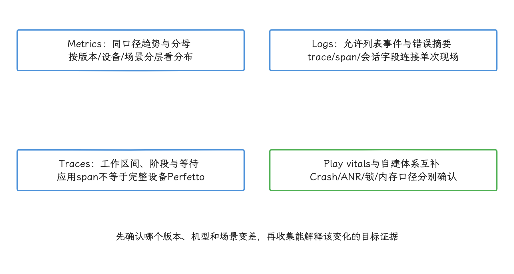

图：当前内存core vitals为Anonymous RSS+Swap与bitmap内存，不直接复用App PSS数值。

#### 事件数据模型设计示例

指标、日志和追踪在端侧的编码方式不同，但需要共享关联字段。我们先看一份最小公共信封，即包在各类事件外层、用于关联和解码的一组公共字段；字段名属于应用协议示例，和 Android 平台 API 无关。

```json
{
  "$common": {
    "schema_version": "obs.event.v3",
    "event_id": "0198f1a4-...",
    "event_type": "startup_metric",
    "wall_time_ms": 1785312000123,
    "elapsed_realtime_ns": 418273600012345,
    "session_id": "resettable-session-id",
    "trace_id": "9f0c...",
    "scene_id": "MainActivity_onResume",
    "scene_seq": 12,
    "app_version": "8.4.2",
    "build_number": 8420,
    "os_version": "Android 17",
    "api_level": 37,
    "device_model": "example-model",
    "device_brand": "Google",
    "network_type": "WIFI",
    "app_in_foreground": true,
    "inclusion_probability": 0.1,
    "sampling_rule_id": "baseline-startup-v3"
  }
}
```

我们给每条事件同时带两种时间。`wall_time_ms` 是现实时间（wall clock），用于和发布、告警对时，但用户或网络都可能调整它；会话内排序与耗时计算用单调递增的 `elapsed_realtime_ns`。`SystemClock.elapsedRealtimeNanos()` 包含深度睡眠时间，适合测量间隔，但设备重启后会归零——所以还要靠 `session_id`（会话标识）和 `scene_seq`（场景内顺序号）划定会话与场景的范围。剩下三个字段各管一件事：`event_id` 用于重试去重，`trace_id` 用于关联不同信号，`schema_version` 表示事件结构版本。

接着看启动事件的指标片段。为节省篇幅，`$common` 只保留 `event_type`；生产事件仍应携带完整公共信封。

```json
{
  "$common": { "event_type": "startup_metric" },
  "startup": {
    "type": "cold",
    "ttid_ms": 1820,
    "ttfd_ms": 2350,
    "attach_base_ms": 120,
    "oncreate_ms": 450,
    "first_screen_ms": 1250,
    "dag_critical_path_ms": 1400,
    "thread_pool_wait_max_ms": 80,
    "provider_init_count": 12,
    "provider_init_total_ms": 320,
    "sdk_init_count": 8,
    "blocked_by_network": true,
    "network_requests": [
      { "name": "config_fetch", "duration_ms": 520, "cached": false },
      { "name": "ab_test", "duration_ms": 180, "cached": true }
    ]
  }
}
```

启动的两个关键字段是 `ttid_ms`（首次显示时间，TTID）与 `ttfd_ms`（完全显示时间，TTFD）；其他阶段名属于应用自定义协议，必须给出统一的起止点。日常事件保存阶段耗时、计数和阻塞原因就够了，无需为每次启动保存系统追踪；指标出现回归后，再对受控样本采集性能剖析资料。

日志片段只携带允许上报的模板标识与分类字段，避免把自由文本当成默认协议。

```json
{
  "$common": { "event_type": "user_log" },
  "log": {
    "level": "ERROR",
    "tag": "PaymentFlow",
    "message_template_id": "payment_confirm_timeout",
    "message_fingerprint": "hmac-sha256:abc123...",
    "error_code": 504,
    "user_visible": true,
    "prev_scene_id": "PaymentConfirmActivity",
    "stack_trace_hash": "hmac-sha256:def456..."
  }
}
```

普通上报优先使用枚举模板和允许列表字段。对原始文本直接计算 SHA-256 摘要，得到的并不是匿名化结果：低熵内容的可能取值很少，错误消息、手机号或 URL 仍可能被枚举猜出。需要稳定聚合时，先移除敏感字段，再用受控密钥生成 HMAC（Hash-based Message Authentication Code，基于哈希的消息认证码）指纹。详细日志要按目标取回（回捞），前提是明确的数据政策、用户告知或同意、目标时间窗、配额和自动过期约束。

追踪片段来自应用埋点生成的 span 摘要。span 表示追踪中一个有起点和持续时间的工作区间；它可以与日志共享 `trace_id`，和系统追踪是两回事。

```json
{
  "$common": { "event_type": "method_trace" },
  "trace": {
    "span_id": "37ab...",
    "parent_span_id": "a011...",
    "span_name": "MainActivity.onCreate",
    "start_elapsed_realtime_ns": 418273600320000,
    "duration_ms": 145,
    "thread": "main",
    "sub_spans": [
      { "name": "setContentView", "duration_ms": 45 },
      { "name": "findViewById", "duration_ms": 12 },
      { "name": "ViewModel.init", "duration_ms": 68 }
    ]
  }
}
```

`trace_id`、`span_id` 和 `parent_span_id` 构成父子关联，单调时钟给出同设备会话内的起点与时长。

<!-- gracker-diagram: a286-02-event-identity-clocks-and-schema -->
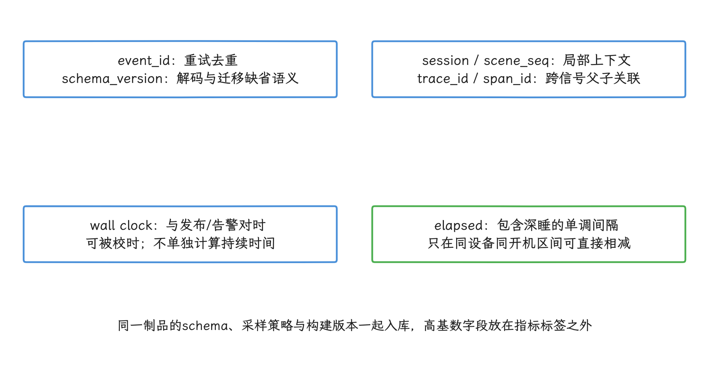

图：会话跨重启要开启新时钟区间；字段名是应用协议，不是Android统一事件格式。

Android 15 / API 35 起，普通应用可通过 `ProfilingManager` 请求系统追踪（system trace）、Java 堆转储（heap dump）、原生堆采样（heap profile）或调用栈采样（stack sampling）；请求受系统限流且不保证执行，结果会脱敏并只包含请求应用的相关信息。Android 16 / API 36 起可注册系统触发器；Android 17 / API 37 又增加冷启动（`TRIGGER_TYPE_COLD_START`）、异常行为（`TRIGGER_TYPE_ANOMALY`）等类型。异常发生后想拿完整设备 Perfetto 数据，这条能力给不了保证；回调失败、文件配额、用户数据政策与上传策略都要单独处理。

数据模型的兼容靠版本机制维持，而非“字段永不删除”的约定。每条事件都要携带数据结构（schema）版本；服务端至少兼容当前版本和迁移窗口内的旧版本。新增字段必须有缺省语义；废弃字段应先让服务端同时读取新旧格式，验证新格式数据后再停止发送旧字段。

<!-- gracker-diagram: a286-03-profiling-public-request-and-trigger-versions -->
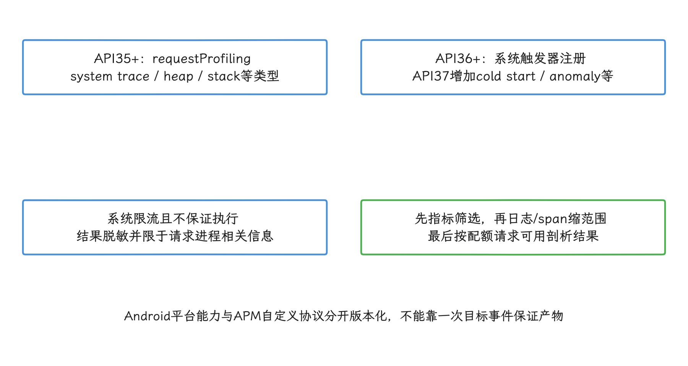

图：失败、无制品、文件配额与重启后监听恢复都要处理；不能承诺拿到完整设备Perfetto。

最小版本只需要事件类型、双时钟、构建版本、会话/场景 ID、采样纳入概率与业务核心字段；取值数量庞大的高基数字段，要放在指标标签集合之外。

### 应用侧监控体系分层设计

应用侧架构要同时满足四项约束：采集入口低开销、缓冲区有容量上限、证据按价值分级、上传受配额控制。这四项指向同一个原则：编码、写盘、网络请求都移出业务线程——故障期间，这些额外工作可能进一步增加延迟或资源压力。

下图展示采集、缓冲、存储、上传和远程控制之间的数据方向：

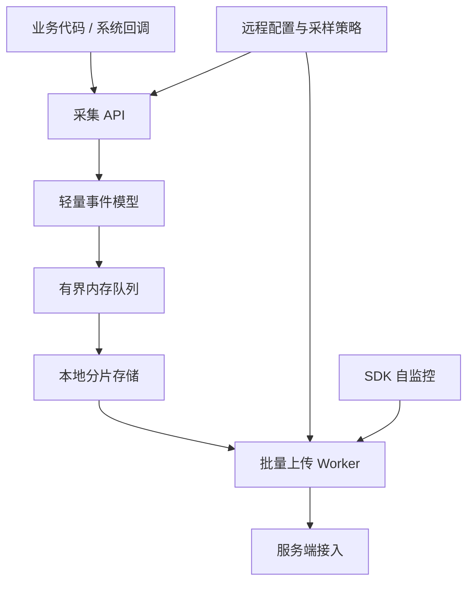

端侧至少分成五层：

- 采集层：接入 Crash、ANR、启动、卡顿、内存、网络、耗电、业务场景等信号。采集代码只记录时间戳、场景 ID、错误码和摘要字段，同步写文件或发网络请求都留给后面的层。
- 缓冲层：使用有界队列或 `RingBuffer`（环形缓冲区）处理高频事件。队列满时按事件等级丢弃，丢弃数进入 SDK 自监控字段。
- 存储层：普通性能样本进入小块分片文件；Crash、ANR、HPROF（Java 堆转储文件）、Perfetto trace 等大文件使用独立目录和配额。存储设计详见 17.12 节的端侧 APM（Application Performance Monitoring，应用性能监控）。
- 上传层：按事件优先级、网络类型、前后台状态和服务端限流批量上传。弱网下优先上传摘要，延后上传大文件；Worker 指负责这项后台工作的调度单元。
- 控制层：服务端下发采样率、事件开关、远程诊断命令和熔断规则。熔断是在异常或成本超限时自动关闭高成本采集；每条配置都要带签名、版本号、过期时间、作用范围和回滚策略。

执行上还有两条纪律。主线程只提交原始事件；分析和聚合通常放到服务端，端侧只做必要的聚合、压缩、脱敏和失败恢复。另外 `mmap`（内存映射）也会带来首次缺页、文件扩容、同步和存储压力，主线程写入的开销只是相对小，并不是零。17.12 节说明了 APM SDK 的持久化、编码协议、网络投递和自监控实现。

Crash 还要走一条独立于普通异步队列的最小保全路径：进程异常退出时，后台线程可能来不及消费队列，而 Java 未捕获异常（uncaught exception）与原生信号（native signal）能安全执行的操作也不同。实现上应预分配必要结构，避开原生信号处理器中不具备异步信号安全性（async-signal-safe）的调用，并在下次启动时校验和补传未完成记录。具体分工见 26.2。

<!-- gracker-diagram: a286-04-bounded-client-data-and-control-plane -->
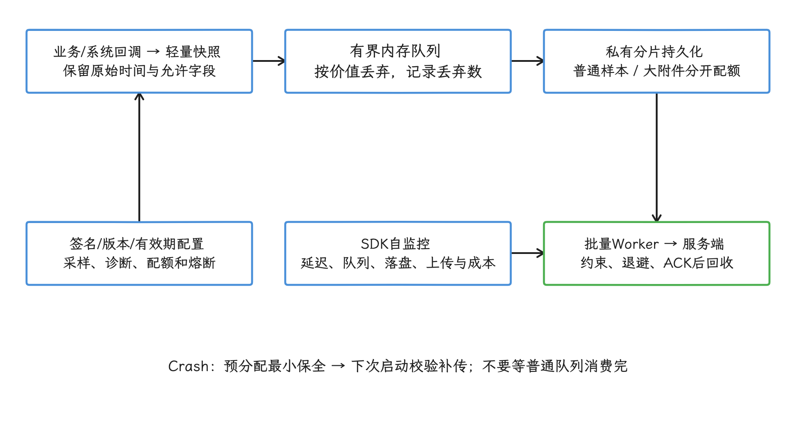

图：UI/回调线程只读最小安全快照；编码、压缩、写盘和网络转交后台，mmap也可能缺页或回写。

### 从采集到告警的完整数据路径

把视角从端侧拉远：一套可用的可观测性系统，数据通常经过端侧采集 → 本地暂存 → 批量上报 → 接入清洗与存储 → 实时聚合或离线聚合（分析）→ 告警 → 证据查询 → 修复验证。

| 阶段 | 主要任务 | 失败表现 |
| --- | --- | --- |
| 采集 | 定义事件结构，补齐版本、设备、页面、场景、网络、前后台等公共字段 | 指标无法按场景拆分，异常样本缺少现场信息 |
| 上报 | 合并小事件，优先发送高价值摘要，保留失败重试和服务端限流处理 | 崩溃后数据丢失，弱网下低价值事件挤占通道 |
| 存储 | 明细、聚合、索引分开；大文件单独配额和保留期 | 查询慢、成本高、敏感文件长期留存 |
| 分析 | 按版本、机型、Android 版本、渠道、页面、用户分群看分布和趋势 | 全局均值正常，重点机型已经恶化 |
| 告警 | 绑定可执行的处理条件，例如某版本用户感知 ANR 率、启动 TTFD P95、慢会话比例 | 告警噪声多，工程团队不再信任 |
| 证据查询 | 从指标进入样本，再关联日志、追踪、崩溃栈和发布记录 | 看得到异常，看不到现场 |
| 验证 | 修复版本上线后，对比线上指标和基准测试结果 | 修复效果只能靠主观判断 |

以启动为例，Android 官方优化文档区分 TTID 和 TTFD：TTID 表示首帧出现，TTFD 表示应用达到自行上报的完全绘制、可用状态。所以启动监控要拆阶段看，单个总耗时定位不到慢在哪个环节；`reportFullyDrawn()` 的调用位置必须对应产品定义的可用状态。线下基准用 Macrobenchmark（Jetpack 宏基准测试库）的 `StartupTimingMetric`，线上再用端侧指标观察真实分布。[App startup analysis and optimization](https://developer.android.com/topic/performance/appstartup/analysis-optimization)

渲染同样分两层看。Android 官方文档分别定义慢帧（slow frames）、冻帧（frozen frames）和 ANR；Perfetto FrameTimeline（帧时间线）可用于追踪慢帧或冻帧原因。线上指标指出哪些版本、页面和机型发生回归，设备实验或受控线上性能剖析再解释具体样本。[Slow rendering](https://developer.android.com/topic/performance/vitals/render)

服务端分析层要保留几类关联键：`event_id`、`session_id`、`trace_id`、`span_id`、`scene_id`、`build_version`、`device_model`、`android_version` 和 `network_type`。有了它们，Crash、ANR、性能指标、用户日志和发布记录才能互相查询。其中 `session_id` 应是短期、可重置且用途受限的标识，永久设备 ID 替代不了它。详见 16.1 节的采集到治理过程设计。

<!-- gracker-diagram: a286-05-server-query-alert-and-verification -->
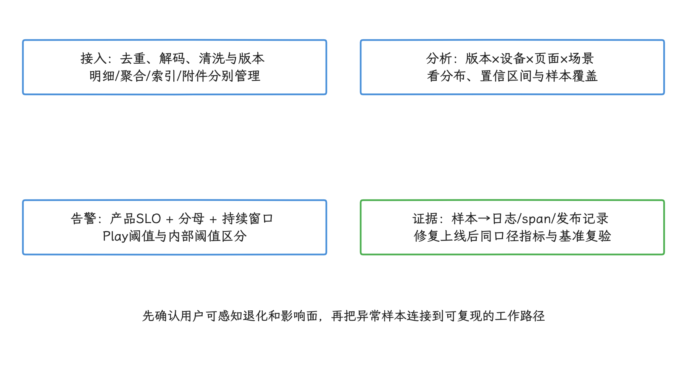

图：TTID看首帧，TTFD由产品可用定义与reportFullyDrawn落点约束；总耗时不能解释阶段。

### 采样策略与数据量控制

可观测性系统的成本来自端侧 CPU / I/O、用户流量和服务端存储与计算，采样策略要同时压住这三处。容量评估别只按 DAU（Daily Active Users，日活跃用户数）猜，我们用“活跃设备数 × 每设备事件频率 × 编码后字节 × 保留期 × 副本数”算出初值，再用灰度实测校正压缩率和一次查询实际读取的数据量。

常用策略可以分成四类：

- 高优先级基线：在用户数据政策允许的范围内，优先保留 Crash / ANR 摘要、构建版本、设备维度和关键页面启动指标；即便“全量”，也仍有单设备限额、去重和熔断兜底。
- 用户级采样：对高频性能事件按用户做确定性分桶，即用稳定规则把同一用户映射到同一采样组，避免逐事件随机采样造成会话时间线断裂。命中用户在一个时间窗内保持同一策略，便于还原连续会话。
- 异常补采：基线指标发现异常后，对目标版本、机型和渠道短期开启更高采样率；性能剖析采集还要满足平台限流、设备状态、隐私和文件配额。
- 大文件限额：HPROF、系统追踪和完整日志包必须限制单设备次数、文件大小、上传网络和保留时间。

采样配置要有版本号。客户端每次成功上报时带上本地配置版本，服务端可以随响应返回新配置；新配置走的是“下次上报才可能拿到”的路径，所以客户端还要为配置过期、长期离线和签名校验失败定义保守缺省值。配置应支持紧急关闭开关（kill switch），用于迅速停用异常或成本失控的采集能力；可关闭范围必须受限，保住 Crash / ANR 等最低诊断能力。

采样后的数据必须携带 `sampling_rule_id`、分层字段和该事件的 `inclusion_probability`（纳入样本的概率）。服务端要按权重估计总体，前提就是抽样设计与纳入概率已知；异常补采、失败全量和成功抽样混在一起时，必须按层分别计算，总体估计靠“所有样本除以一个采样率”是得不到的。单用户排查界面还要显示采样命中与丢弃原因，别把“没有采到”误判成“没有发生”。

<!-- gracker-diagram: a286-06-sampling-strata-and-inclusion-probability -->
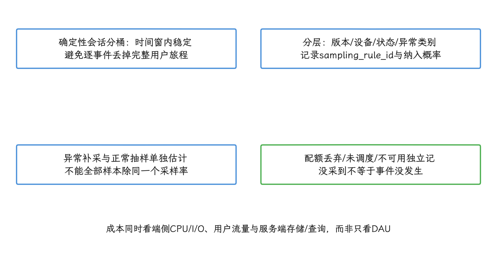

图：概率来自抽样设计；基线摘要、诊断附件和失败全量各有预算，服务端按已知层次重算。

### 可观测性建设的常见陷阱

从零建设可观测性系统时，最容易踩的是下面六类问题。

#### 陷阱 1：把所有东西都上报，然后「服务端再筛」

第一类陷阱是“先全量上报，服务端再过滤”。这样写入、索引和高基数聚合会随事件频率增长——高基数指字段有大量不同取值，例如完整 URL 或永久用户 ID，它会扩大索引和分组成本；等服务端账单出问题时，端侧早已把 CPU、I/O 与用户流量消耗掉了。

设计时先为每类事件估算频率、编码大小、基数和保留用途，再决定端侧聚合、确定性采样还是保留原始事件。分母与正常基线同样要留：只上报异常就拿不到它们；失败事件和成功样本可以采用不同层级，并在事件中记录各自的纳入概率。用户 ID、原始 URL、自由文本和堆栈全文这类高基数字段，都放在指标标签之外。

#### 陷阱 2：用指标替代日志和追踪

只看指标看板的团队，能看到 Crash 率上升，要定位页面、场景和操作摘要时没有日志，要解释耗时路径时也没有追踪。

三类信号各干一件事：指标指出版本回归，日志给出支付确认事件的错误分类，追踪显示等待发生在哪个 span。它们的存储和采样方式不同，但要共享统一的关联信息；OpenTelemetry（开放式可观测性规范与工具体系）同样用 trace 与 span 标识连接日志和追踪，相近时间戳只作辅助。

#### 陷阱 3：采样策略按事件随机，破坏了会话时间线

高频事件若逐条独立抽样，一个会话里只剩不连续片段：日志显示用户打开了支付页，前面的场景切换可能没被采到，排查时就还原不了路径。

需要连续会话时，用 `HMAC(sampling_key, resettable_id | sampling_rule_id)` 生成稳定分桶，并让命中结果在配置时间窗内保持一致。客户端不上传原始标识；`sampling_key` 是服务控制的密钥，密钥轮换与标识重置都会改变分桶。这里的 HMAC 只解决稳定分组，标识匿名化要另做处理。支付、地区或机型等分层若采用不同概率，估计总体时必须保留分层和纳入概率。

#### 陷阱 4：端侧采集在主线程做编码和落盘

采集 API 常从主线程调用。SDK 若在调用栈内完成 JSON 序列化、文件扩容、压缩或同步写入，存储抖动会直接进入页面耗时；`mmap` 写入也可能因缺页和回写产生长尾。

采集入口只读取必要的原始值并尝试写入有界队列，序列化和写盘放到专用线程。性能预算要在目标设备档位上测出来：入口的 P50、P95、P99（第 50、95、99 百分位）、分配次数、队列丢弃率和主线程长尾，再把 SDK 自身开销纳入发版门禁；照搬固定数字没有意义。

#### 陷阱 5：把诊断数据当成默认开启的能力

用户日志回捞、远程诊断命令和系统性能剖析都属于高敏感、高成本能力，默认关闭，命中明确策略并满足用户数据政策后才短期开启；基线能力里也不包含全量自由文本日志。

可以区分两类数据通道：基线通道发送经过最小化的 Crash / ANR 摘要、启动/帧指标和网络结果；诊断通道处理日志回捞、`ProfilingManager` 结果和远程只读检查。诊断策略必须限定目标、时间窗、单设备配额和保留期，并允许从客户端和服务端两侧关闭。

#### 陷阱 6：服务端告警阈值与用户感知脱节

同样的变化在不同页面含义可能完全不同，固定的绝对增量没有考虑基线、样本量、设备分布和产品场景。告警应绑定用户可感知的 SLO（Service Level Objective，服务等级目标），例如产品定义的 TTFD 慢会话比例、用户感知 ANR/Crash 率或冻帧会话比例，并同时检查置信区间、持续时间和版本/机型分层。Android vitals 的不良行为阈值（bad behavior threshold）采用 Play 分发统计方式；内部告警可以更早，前提是想清楚两者的分母差异。

### 用户日志与远程诊断：现场证据层

指标指出哪里异常，现场要靠日志和远程诊断还原。所以除了指标看板，架构还要能在必要时为特定用户、特定版本、特定机型补采现场证据。

可执行的设计通常包含三类能力：

- 用户日志回捞：只拉取目标用户、目标时间窗、目标 tag（日志分类标签）的日志。日志正文默认脱敏，URL 查询参数（query）、认证令牌（token）、手机号和定位字段默认不入库。
- 远程诊断命令：对网络、存储、权限、配置和缓存状态执行允许列表内的只读检查，结果以结构化字段上报。命令必须带过期时间、设备配额、重放保护和服务端签名；任意 shell 命令、任意文件读取和动态代码执行入口一概不提供。
- 异常触发补采：Crash、ANR、冻帧或启动超出产品阈值后，下一次启动优先上传摘要；命中灰度策略时，再请求受平台限制的性能剖析资料或目标日志。

隐私处理可以参考 Firebase Performance Monitoring 的做法：对 HTTP 请求使用不含查询参数的 URL 构造聚合模式，并声明不永久保存个人可识别信息。自建系统也应在采集前完成字段允许列表、脱敏与用途分级；个人信息的删除流程无法用哈希替代。[Firebase Performance Monitoring：User data](https://firebase.google.com/docs/perf-mon/#user_data)

<!-- gracker-diagram: a286-07-baseline-versus-authorized-diagnostics -->
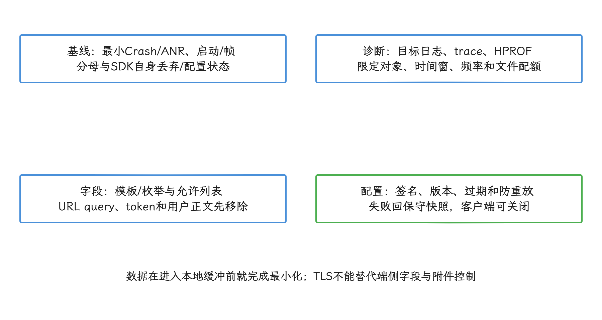

图：对原文做SHA不等于匿名化；HMAC聚合也要先最小化字段、控制密钥和保留用途。

### 平台源码基线

[`SystemClock.java`](https://android.googlesource.com/platform/frameworks/base/+/refs/tags/android-17.0.0_r1/core/java/android/os/SystemClock.java) 区分三种时间：可被调整的现实时间（wall clock）、深度睡眠期间暂停的运行时间（uptime clock），以及包含深度睡眠且单调递增的经过时间（elapsed realtime）。事件协议同时保留现实时间和单调时间，分别用于跨系统对时与本机会话排序；一次 `System.currentTimeMillis()` 只能满足前一种用途。

[`ProfilingManager.java`](https://android.googlesource.com/platform/packages/modules/Profiling/+/refs/tags/android-17.0.0_r1/framework/java/android/os/ProfilingManager.java) 写明请求受限流且不保证执行，返回结果经过脱敏并限定到请求进程。线上架构应把性能剖析资料视为稀缺的补充证据，按顺序花：先用指标确定目标群体，再用 span 和日志摘要缩小范围，最后在系统允许时采集。没有回调或没有制品都是正常分支，诊断流程要按“它可能失败”设计。

应用协议既不用 Linux 内核私有接口，也不从 eBPF（extended Berkeley Packet Filter，内核可编程追踪机制）、`/proc`（内核导出的进程与系统状态伪文件系统）或调度器实现推导，因此这里不引入内核源码标签；涉及内核采集路径的专题统一以 `android17-6.18-2026-06_r6` 为准。

### 最小可用架构

我们不必一开始就建完整平台，最小版本可以从下面几项开始：

1. Crash / ANR 摘要：进程、线程、堆栈、版本、设备、前后台状态、最近场景。
2. 启动与渲染指标：TTID、TTFD、慢帧 / 冻帧、关键页面场景 ID。
3. 网络指标：DNS（Domain Name System，域名解析）、连接、TLS（Transport Layer Security，传输层安全协议）、首包、总耗时、错误码、网络类型。
4. 受控日志：按分类标签和敏感级别区分、本地有界滚动、按目标会话与时间窗回捞。
5. 采样与配置：带签名和过期时间的配置、确定性会话采样、纳入概率、异常补采与紧急关闭开关。
6. 证据查询入口：从告警进入样本，再关联日志、span、性能剖析资料、发布版本和修复任务。

这些能力分别对应 26.2 的 Crash/ANR 上报、26.1 的性能指标采集和 26.3 的线上排查；各专题在同一事件标识、时钟和采样协议上继续扩展。


## 采样、缓冲、序列化与上传

数据模型确定后，我们回到客户端本身：按信号价值分配采样和缓冲预算，并在离线、弱网和进程退出时保证可控降级。

### 平台能力分层与采集边界

先明确一件事：Android 没有一个面向普通 App、涵盖所有性能问题的“统一性能指标 Atom”。StatsD 是 Android 的系统统计收集与聚合服务，atom 是它数据结构定义中字段固定的一类统计事件。我们实际能用到哪些能力，要看权限和用途：StatsD 面向系统和特权组件；AndroidX `JankStats` 在 App 进程内提供帧级卡顿数据；网络调用前后的计时插桩、`Debug.MemoryInfo` 与业务埋点补充 App 自身指标；上传与服务端统计由 APM（Application Performance Monitoring，应用性能监控）系统负责。

缓存进程内存整理（Compaction）和冻结缓存进程执行的 Freezer 机制在 Android 17 之前就已存在；Android 17 新增的 `MemoryLimiter` 还受功能开关（feature flag）、设备能力和厂商（vendor）配置控制。我们看到内存曲线变化时，要分清两件事：公开 App API 能确认的事实，和 Android 核心系统服务进程 system_server 的源码解释——单凭 PSS（Proportional Set Size，按共享页面比例分摊后的驻留内存）曲线，证明不了某项系统策略已经触发。

---

### 1. 系统级指标采集：StatsD 的能力与权限边界

StatsD 模块位于 `packages/modules/StatsD`。它的 statsd 后台守护进程（daemon）有两条输入：pushed atom 由事件发生方主动推送，结构来自 `atoms.proto`；pulled atom 由 statsd 按采集配置（config）向已注册的数据提供方发起拉取，数据在回调函数（callback）中返回。聚合结果由具备权限的客户端通过报告或受限查询 API 读取。

#### 1.1 StatsManager 客户端 API

Android 17 (`android-17.0.0_r1`) 中，与性能指标订阅、读取和 pull 数据提供相关的 `StatsManager` 公开 API 主要是三组方法：

```java
// packages/modules/StatsD/framework/java/android/app/StatsManager.java
// Android 17 公开 API 子集

// 注册 pull atom 数据提供方（客户端向 statsd 提供自定义 pulled atom）
public void setPullAtomCallback(int atomTag, @Nullable PullAtomMetadata metadata,
        @NonNull @CallbackExecutor Executor executor,
        @NonNull StatsPullAtomCallback callback)

// 注册 StatsdConfig 订阅（返回 void）
public void addConfig(long configId, byte[] config)
        throws StatsUnavailableException

// 读取已收集报告（主查询路径）
public byte[] getReports(long configId)
        throws StatsUnavailableException
```

写入方向走的是另一条路：`android.util.StatsLog.logStart/logStop/logEvent(int)` 是公开的 breadcrumb API，breadcrumb 在这里指用于标记操作起止或单次事件的轻量记录，它只能写入 `APP_BREADCRUMB_REPORTED`；写入任意 `StatsEvent` 的 `StatsLog.write(StatsEvent)` 属于受限的 `@SystemApi`，系统服务通常使用生成的 `FrameworkStatsLog` / `StatsdStatsLog`。`StatsManager` 面向 App 的入口都花在订阅、读取和数据提供上；写事件只有上面这条 breadcrumb 路径。

注意 `setPullAtomCallback()` 的方向：它注册的是数据提供方，即客户端向 statsd 提供自定义 pulled atom 数据；读取 statsd 聚合指标要走其他接口。

拉取的具体过程是：statsd 需要某个原子事件时，调用已注册的 `StatsPullAtomCallback.onPullAtom(int atomTag, List<StatsEvent> data)`，其中 atom tag 是原子事件编号；客户端把 `StatsEvent` 加入 `data` 列表并返回 `RESULT_SUCCESS` / `RESULT_SKIP` 等结果，`StatsManager` 内部的 `PullAtomCallbackInternal` 再调用 `resultReceiver.pullFinished()` 把结果交回 statsd。

`PullAtomMetadata` 的默认冷却间隔为 1000 ms、超时为 1500 ms，用来限制按需拉取频率；回调由 statsd 按需触发，周期性定时回调这一形态并不存在。

再看三个接口。`addConfig()` 返回 `void`（而非 boolean），用于向 statsd 注册 `StatsdConfig`，该配置描述要收集的原子事件与聚合方式；`getReports(long configId)` 读取 statsd 已收集的报告，是特权 App 获取聚合数据的主要接口；`query()` 需要 `READ_RESTRICTED_STATS` 权限，签名为 `query(long configKey, String configPackage, StatsQuery query, Executor executor, OutcomeReceiver<StatsCursor, StatsQueryException> outcomeReceiver)`。

**权限要求：**
- 注册 pull atom 数据提供方（`setPullAtomCallback`）需要 `REGISTER_STATS_PULL_ATOM` 权限（位于 `frameworks/base/core/res/AndroidManifest.xml`）
- 注册 config 和读取报告（`addConfig`、`getReports`）同时需要 `DUMP` 和 `PACKAGE_USAGE_STATS` 权限
- SQL 查询路径 `query()` 需要 `READ_RESTRICTED_STATS` 权限
- AndroidManifest 中不存在 `READ_PRECISE_STATS` 权限；当前 StatsD 权限模型以 `REGISTER_STATS_PULL_ATOM`、`DUMP`、`PACKAGE_USAGE_STATS`、`READ_RESTRICTED_STATS` 为主

#### 1.2 数据流路径

整体数据流有三条。先看 pushed atom 和公开 breadcrumb 如何进入 statsd。

**系统事件入站（系统服务 → statsd daemon）：**
```
App breadcrumb / system service → StatsLog / FrameworkStatsLog / StatsdStatsLog → libstatssocket → statsd daemon (本地 socket)
```

`StatsLog` 在 `packages/modules/StatsD/framework/java/android/util/StatsLog.java` 中定义。普通 App 可调用 `logStart/logStop/logEvent(int)` 写 breadcrumb；系统服务写入框架原子通常走生成的 `FrameworkStatsLog.write()` / `StatsdStatsLog.write()`，最终通过 `libstatssocket` 的本地 socket 写入 statsd daemon。对普通 App 来说，这条路径能写的就是 breadcrumb，任意系统 atom 写不了。

第二条路径用于特权客户端注册 config、读取聚合报告。

**Config 订阅与报告读取（statsd ⇄ 特权 App）：**
```
StatsManager.addConfig(configId, config) → statsd daemon 按 config 聚合
StatsManager.getReports(configId) ← statsd daemon 返回已收集报告
```

特权 App 用 `addConfig()` 注册的 `StatsdConfig` 决定收集哪些 atom、按什么方式聚合，statsd 按这份 config 持续收集；`getReports()` 取回聚合结果，是读取 statsd 系统健康指标的主路径。

第三条路径方向相反，由 statsd 向特权数据提供方发起 pull。

**Pull atom 数据提供（特权组件 → statsd）：**
```
StatsPullAtomCallback.onPullAtom(int atomTag, List<StatsEvent> data) → statsd 向客户端拉取自定义 pulled atom
```

回调只在 statsd 的 config 里包含 pulled atom 时发生，方向是客户端向 `List<StatsEvent>` 填充指标数据。要读 statsd 的系统聚合指标，用的是 `addConfig` + `getReports`，和这里的提供方角色正好相反。

<!-- gracker-diagram: a286-09-pull-provider-request-reply-and-cooldown -->
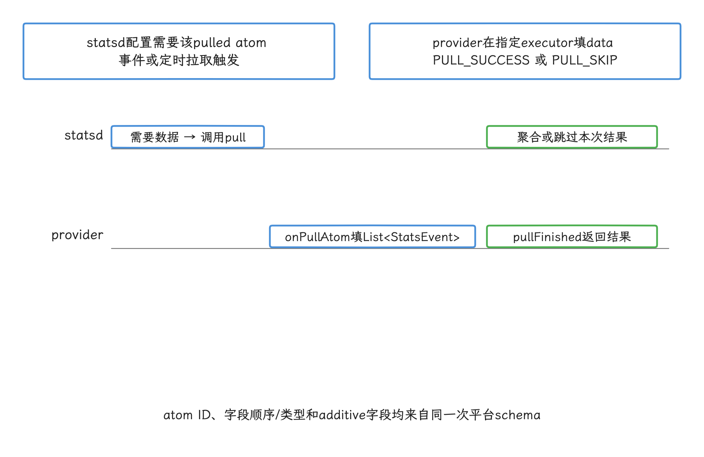

图：配置可周期性拉取；metadata只调节冷却/超时，不是App端“每秒采集器”。

特权系统组件提供 pulled atom，只能用 `setPullAtomCallback()` 注册已经定义并获准使用的 atom tag；statsd 调用 `StatsPullAtomCallback.onPullAtom()` 时，提供方把符合数据结构定义（schema）的 `StatsEvent` 加入列表并返回结果码。atom ID、字段顺序、字段类型和可累加字段（additive field）必须来自同一次平台发布的 schema，业务自定义常量替代不了平台定义。

回到开头的问题：当前 `atoms.proto`（android-17.0.0_r1）定义了大量系统健康原子（如 `AppStartOccurred`（ID 48）、`AnrOccurred`、`BatteryLevelChanged` 等），却始终没有那个覆盖全部性能问题的“统一性能指标 Atom”。我们收集系统级指标时，优先走 AndroidX API（如 `JankStats`）和 `Debug.MemoryInfo` 等公开接口，直接依赖 StatsD 这条路走不通。

<!-- gracker-diagram: a286-08-statsd-three-directions-and-permissions -->
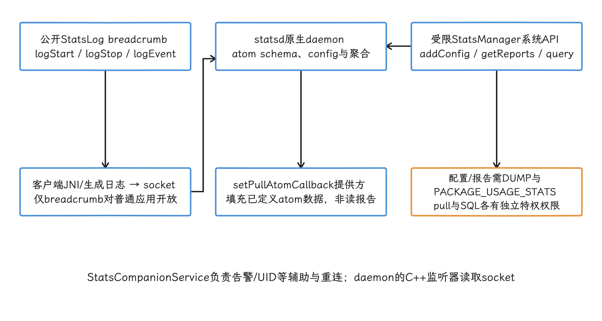

图：pull需要REGISTER_STATS_PULL_ATOM，SQL需要READ_RESTRICTED_STATS；普通应用自建指标不依赖该路径。

以 `AppStartOccurred`（`app_start_occurred`）为例，字段包含 `transition_delay_millis`、`starting_window_delay_millis`、`bind_application_delay_millis`、`windows_drawn_delay_millis` 等，没有 `latencyMillis` 字段。

**StatsCompanionService 的职责：**
`StatsCompanionService` 运行在 system_server 中，是通过 `IStatsd` 接口与 statsd 守护进程交互的辅助服务，主要处理配置管理和数据拉取方注册。事件写入与它无关：`StatsLog` 通过 `libstatssocket` 直接连 statsd 的本地套接字（socket）；从 `/dev/socket/statsdw` 读取事件流的 JNI（Java Native Interface，Java 原生接口）桥接层同样另有其人。

#### 1.3 系统指标采集边界与 App 侧替代方案

小结这一节：pull atom 数据提供、config 注册/报告读取、SQL query 都是特权路径，分别需要 `REGISTER_STATS_PULL_ATOM`、`DUMP` + `PACKAGE_USAGE_STATS`、`READ_RESTRICTED_STATS`，普通 App 拿不到。所以实际工程中，App 侧采集系统级指标走的是另外三条路：

**路径 1：AndroidX JankStats — 帧级实时诊断**

下面的最小示例读取帧时长、卡顿判定和 UI 状态。

```java
// AndroidX metrics-performance 库
JankStats jankStats = JankStats.createAndTrack(window, frameData -> {
    long frameDurationNs = frameData.getFrameDurationUiNanos();
    boolean isJank = frameData.isJank();
    // frameData.getStates() 返回 UI 状态列表
    for (int i = 0; i < frameData.getStates().size(); i++) {
        StateInfo state = frameData.getStates().get(i);
        String stateKey = state.getKey();
        String stateValue = state.getValue();
    }
});
```

回调会在每帧触发，业务不能在这里直接序列化或上传；对象复用与线程边界详见 §6。

**路径 2：Debug.MemoryInfo — 进程级内存采集**

下面的最小示例读取当前进程的总 PSS。

```java
ActivityManager am = (ActivityManager) getSystemService(Context.ACTIVITY_SERVICE);
Debug.MemoryInfo[] info = am.getProcessMemoryInfo(new int[]{Process.myPid()});
int totalPss = info[0].getTotalPss();
```

返回值的 UID（用户标识）与频率限制详见 §3；这段代码只能读到自己的进程，轮询其他应用是做不到的。

**路径 3：Firebase Performance / 自建 APM SDK**

网络耗时、启动耗时、自定义业务指标由 APM SDK 在 App 进程中直接采集，不经过 StatsD。详见 §5、§9。

---

### 2. 电池感知采样：App 层实现策略

StatsD 在 daemon 层并不随电池状态自动调节采样率；电池感知采样要 App 侧基于 `PowerManager` / `BatteryManager` 自己实现。

#### 2.1 电量状态作为策略输入

我们能读到的输入有 `PowerManager.isPowerSaveMode()`、`BatteryManager.isCharging()` 和电量信息；但采样率没有跨应用通用的固定值，它取决于单次采集成本、指标价值、产品流量、网络条件和服务端统计所需精度。把“低电量”写死成某个百分比，不同版本的样本分布会跟着悄悄变化。

更合适的做法是把策略输入和动作分开：

| 策略输入 | 可选动作 | 统计要求 |
| --- | --- | --- |
| 省电模式、未充电、计量网络 | 暂停高成本 trace，降低普通样本纳入率，延后大附件 | 记录策略版本和实际纳入概率 |
| 前台关键路径 | 保留低成本计数与时延摘要 | 不因电池状态丢失分母 |
| 充电且网络不计量 | 处理积压批次或执行已授权的高成本诊断 | 仍受温度、存储和用户设置约束 |
| 远程诊断命令 | 在有效期、配额和同意范围内临时调整 | 记录命令来源、有效期与审计 ID |

同一用户或会话是否被采样，用稳定哈希做确定性分配，让同一输入始终得到相同结果；若再按机型、版本或场景分层，服务端必须知道各层纳入概率，才能计算可比较的总体指标。

#### 2.2 配置快照与失效保护

采样配置属于 App/APM 的业务配置，别借用 StatsD 内部的 `DeviceConfig` 命名空间（namespace，即配置项的分组范围）。配置快照至少包含版本、签名或完整性校验、启用范围、过期时间、每类指标配额和回退值。配置拉取失败时沿用最近一份有效快照；快照过期后回到保守策略，采集范围不自动扩大。

电量 API 的返回还可能不可用，设备之间也有差异。策略层要把读取失败和“满电”区分开，也不要让电量信号改变 Crash、ANR 等事件的事实计数；它真正适合控制的是附件、trace 和上传时机。

---

### 3. 内存监控：公开 API 与 Android 17 系统策略

内存监控要分清两个观察层：App 可见的 PSS、Java/Native 堆和 GC（Garbage Collection，垃圾回收）统计，和 system_server 的 Compaction、Freezer、MemoryLimiter。前一层通过公开 API 采集；后一层通常只能靠系统 trace（按时间记录系统行为的追踪数据）、`dumpsys` 诊断输出或源码解释。两层可以做时间关联，但一次 PSS 变化直接标成某个系统事件，这个结论下不了。

#### 3.1 Debug.MemoryInfo 进程级采集

下面的示例读取当前进程的 PSS 与 private dirty 分类。private dirty 指进程私有且已被修改、无法直接与其他进程共享的内存页。

```java
ActivityManager activityManager =
    (ActivityManager) context.getSystemService(Context.ACTIVITY_SERVICE);
Debug.MemoryInfo[] memInfoArray =
    activityManager.getProcessMemoryInfo(new int[]{android.os.Process.myPid()});
Debug.MemoryInfo memInfo = memInfoArray[0];

// 分类内存统计（单位：KB）
int dalvikPss = memInfo.dalvikPss;
int nativePss  = memInfo.nativePss;
int totalPss   = memInfo.getTotalPss();
int dalvikPrivateDirty = memInfo.dalvikPrivateDirty;
```

`getProcessMemoryInfo()` 返回的 `Debug.MemoryInfo` 包含 `getMemoryStat(String)` 方法（API 23+），可按 `summary.java-heap`、`summary.native-heap`、`summary.code`、`summary.stack`、`summary.graphics` 等关键字查询子类明细。ART（Android Runtime，Android 运行时）的 GC 行为通过 `Debug.getRuntimeStat()` 查询（如 `art.gc.gc-count`、`art.gc.gc-time`），`getMemoryStat()` 只覆盖进程级分类，不含 ART 内部堆分区明细。

调用有两条限制：Android 10 起，普通 App 只能取得与调用者相同 UID 的进程数据；采样频率也受限，调用过快时可能返回与上次相同的数据。所以它适合低频诊断和趋势采样；想近似实时 RSS（Resident Set Size，进程当前驻留在物理内存中的页面总量，不按共享比例分摊），紧密轮询这个接口就选错了工具。

#### 3.2 Native 内存与运行时统计

下面的示例分别读取 Native heap 已分配字节数和 ART GC 累计统计。

```java
// Native 堆已分配（API 1）
long nativeAllocated = Debug.getNativeHeapAllocatedSize();

// ART 运行时 GC 统计
String gcCount = Debug.getRuntimeStat("art.gc.gc-count");
String gcTime  = Debug.getRuntimeStat("art.gc.gc-time");
```

两个返回值都有讲究：`getNativeHeapAllocatedSize()` 返回的是 Native heap allocator 统计，进程全部 Native 映射比它大；`getRuntimeStat()` 在键不受支持时可能返回 `null`。

<!-- gracker-diagram: a286-10-memory-metric-attribution-and-version -->
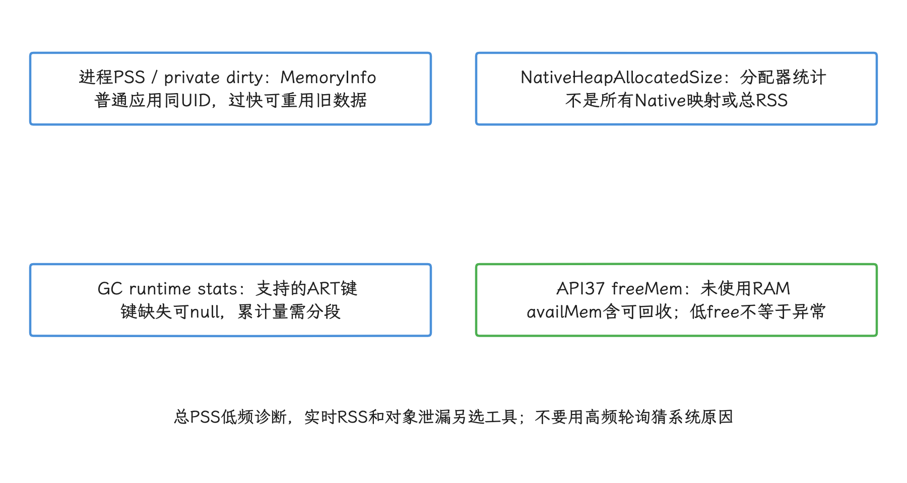

图：长期采样带时钟、进程序列、版本和状态；公开快照不能单独说明哪个系统策略触发。

#### 3.3 Compaction、Freezer 与 Android 17 MemoryLimiter

先把版本结论摆清楚：`CachedAppOptimizer` 仍把 Compaction 和 Freezer 的构建默认值设为开启，但这两项机制在更早版本就有，运行时状态也会受配置与设备条件影响；`MemoryLimiter` 是 Android 17 新出现的，有独立功能开关、`/vendor/etc/memory-limiter-config.xml` 厂商配置文件和设备内存条件。源码里存在，不代表所有 Android 17 设备都会启用。

##### Compaction 状态机与 RSS 节流

`CachedAppOptimizer` 默认同时开启 Compaction 和 Freezer：

```java
// CachedAppOptimizer.java: android-17.0.0_r1
@VisibleForTesting static final boolean DEFAULT_USE_COMPACTION = true;
@VisibleForTesting static final boolean DEFAULT_USE_FREEZER = true;

enum CompactProfile {
    NONE, SOME, ANON, FULL
}
```

源码中的四个默认节流值分别约束 Some→Some、Some→Full、Full→Some 和 Full→Full 请求，它们是最短间隔，并非固定调度周期。这也解释了为什么 PSS 轮询只能看到采样点之间的结果变化：变化发生时刻确认不了，单凭曲线也判断不出是不是 compaction 引起；系统级验证要结合对应 trace、dumpsys 或日志事件。

##### Freezer 冻结器子系统

`CachedAppOptimizer` 最终通过 cgroup freezer 冻结缓存进程。cgroup 是 Linux 按进程组控制资源的机制，freezer 是其中的冻结控制；源码状态记录为 `opt.setFrozen(true)`。它和 Linux 中表示不可中断睡眠的 `D` 状态是两回事。对采样的影响很直接：被冻结的进程没有机会运行自己的采样线程，冻结期间的自身 RSS 采不到。特权观察者或离线 trace 能看到冻结和解冻事件；普通 App 更适合在恢复后根据生命周期、采样时间间隔和 `ApplicationExitInfo` 退出记录判断数据是否中断。

##### MemoryLimiter：内存控制组的内核级节流

`MemoryLimiter` 由 system_server 的 Java 控制层与 JNI / Native 监控层组成。启用时，它为目标进程配置 cgroup v2 内存控制组（memcg）的 `memory.high`、`memory.swap.high` 等限制，并监听越界事件。启用条件有四项：功能开关开启、代码运行在系统用户标识（system UID）下、存在有效厂商配置、设备内存满足条件。

<!-- gracker-diagram: a286-11-compaction-freezer-and-visible-gaps -->
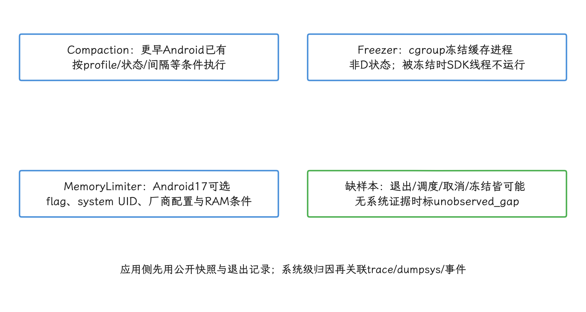

图：图中系统策略不保证所有设备开启；应用恢复后记真实缺口，不能补0或确定标成冻结。

内核语义以 `android17-6.18-2026-06_r6` 为准。该版本的 [cgroup v2 文档](https://android.googlesource.com/kernel/common/+/refs/tags/android17-6.18-2026-06_r6/Documentation/admin-guide/cgroup-v2.rst) 把 `memory.high` 定义为内存使用节流线：超过后进程承受回收压力，但内核不会仅因越过 `memory.high` 就调用 OOM killer（内存耗尽时选择进程终止的内核机制）。MemoryLimiter 在此基础上监控事件，并在匿名内存与交换空间总量（anon+swap）分支由 system_server 另行安排进程终止。所以这里的完整链条是“节流靠内核、终止由 system_server 安排”，合并描述成“内核越界后自动终止”就错了。

**对监控采集的三类影响：**

1. **指标含义不同**：PSS 按共享页面比例分摊；cgroup memory charge（记入该控制组的内存用量）、anon（匿名内存）与 swap（换出到交换空间的内存）采用另一套归属规则。PSS 未达到某个数值，进程也可能已经触及限制。
2. **越界后可能先采性能剖析数据再终止**：`LIMIT_TYPE_ANON_SWAP` 分支会触发异常性能剖析（anomaly profiling），并通过 `KILL_DELAY_MS` 延迟终止请求，为系统剖析器留出完成时间。这个延迟不属于 App 的轮询或上传时限。
3. **退出原因要读记录，不要预设**：进程恢复后查询 `ApplicationExitInfo`，记录实际 `reason`、`status`、描述和可用 trace，再与 SDK 样本关联；把所有 MemoryLimiter 终止预先写成 `REASON_LOW_MEMORY` 会掩盖真实原因。

<!-- gracker-diagram: a286-12-memory-limiter-kernel-throttle-system-kill -->
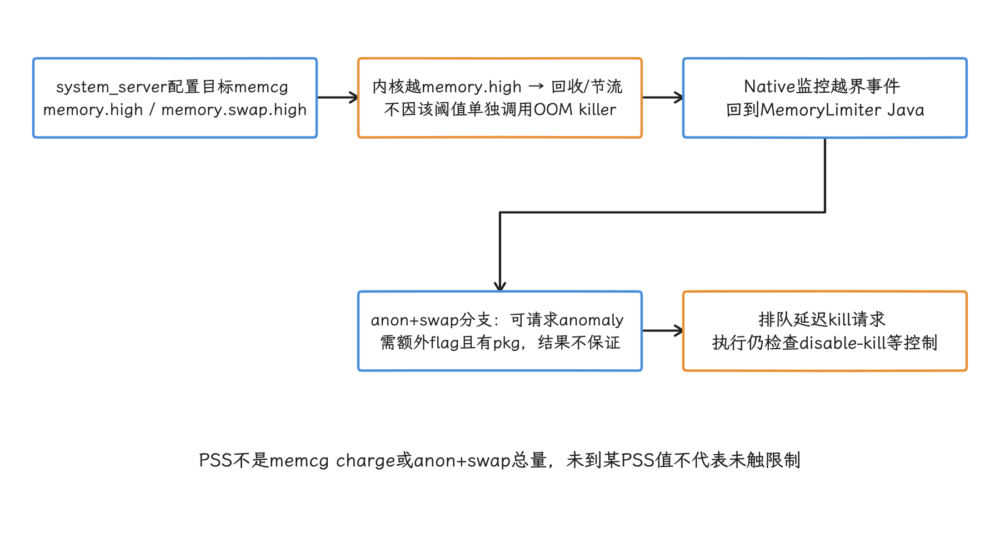

图：退出后读取ApplicationExitInfo的实际reason/status/描述，不预设所有此类终止都为LOW_MEMORY。

#### 3.4 原生内存跟踪架构

系统侧的内存跟踪分两条路径：图形内存由 memtrack HAL 汇总，进程内存来自内核导出的 smaps 统计；两边的统计方式不同。

下面的结构展示 framework 汇总 memtrack 图形内存时使用的三个分类。

```cpp
struct graphics_memory_pss {
    int graphics;    // 图形内存（SurfaceFlinger 等）
    int gl;          // GL 内存（OpenGL/Vulkan）
    int other;       // 其他内存（Ashmem 等）
};
```

这三个值来自 memtrack HAL 和驱动实现。HAL（Hardware Abstraction Layer，硬件抽象层）把设备相关实现接到 Android 框架，因此分类精度和可用性因设备而异，跨机型恒定的数值拿不到。

下面的片段展示 `ProcMemInfo` 优先读取 `smaps_rollup` 并在不可用时回退到 `smaps` 的意图。

```cpp
::android::meminfo::ProcMemInfo proc_mem(pid);
::android::meminfo::MemUsage stats;
if (proc_mem.SmapsOrRollup(&stats)) {
    pss += stats.pss;
    // 失败时自动回退到传统 smaps
}
```

回退让旧读取方式继续可用，但各厂商图形内存分类的精度未必相同。

| Android 版本 | 内存分类口径 | 说明 |
|-------------|--------------|------|
| Android 14–17 | graphics / gl / other 三类 memtrack PSS | `android_os_Debug.cpp` 中 `graphics_memory_pss` 与 `memtrack_proc_graphics_pss()` / `memtrack_proc_gl_pss()` / `memtrack_proc_other_pss()` 在这些版本均存在 |
| Android 17 | 同一分类口径，叠加 MemoryLimiter / Freezer 影响 | 三分类不是 Android 17 新增能力；精度取决于 HAL / 驱动实现，这些源码没有给出 ±5% 平台保证 |

#### 3.5 `libmeminfo` 与 `libmemevents` 的系统侧边界

`Debug.getMemoryInfo()` 的 JNI 最终用 `libmeminfo` 汇总进程内存。`ProcMemInfo::SmapsOrRollup()` 优先读取 `smaps_rollup`，不可用时退回逐 VMA 的 `smaps`；VMA（Virtual Memory Area，虚拟内存区域）是进程地址空间中属性连续的一段映射。平台组件还可以用 pagemap、kpageflags 与 kpagecount 做成本更高的 VMA 或 working set（近期活跃内存页集合）诊断。这些 Native 类服务的是平台代码、厂商组件与 APEX（可独立更新的系统组件包格式）模块集成，普通 App 的对象跟踪 API 里没有它们；应用侧继续以 `Debug.MemoryInfo`、`ActivityManager.MemoryInfo` 和调试工具为兼容范围。

Android 14 相关源码中的 `libmemevents` 用 eBPF 环形缓冲区接收 OOM killer 选中的进程、直接内存回收、内核回收线程 kswapd 与厂商低内存终止机制（LMK）等事件，Android 17 仍保留这条系统路径。eBPF 是在内核受控环境中运行观测程序的机制，环形缓冲区把事件按固定容量传给读取方。

这条路径依赖内核 tracepoint（事件观测点）、BPF 能力、受信任的加载器和 SELinux（Android 强制访问控制机制）策略。设备上有这份源码，普通 App 也订阅不了，各台 Android 14–17 设备暴露的事件也未必相同。所以线上 SDK 只保存自身公开指标，把这类事件与 App 快照放到同一时间线的，只能是平台或设备厂商（OEM）组件。

按成本分两层用：常态用聚合快照发现 PSS、nativePss、GC 或后台回落异常；命中诊断条件后，再在受控设备或受信系统组件中上 VMA 扫描、`libmemevents`、Perfetto、heap dump（堆转储）或 Perfetto 的 Native 堆分析器 heapprofd。聚合值负责发现趋势，深度工具负责解释来源，两者各干各的活。

<!-- gracker-diagram: a286-13-native-memory-two-sources-and-read-failure -->
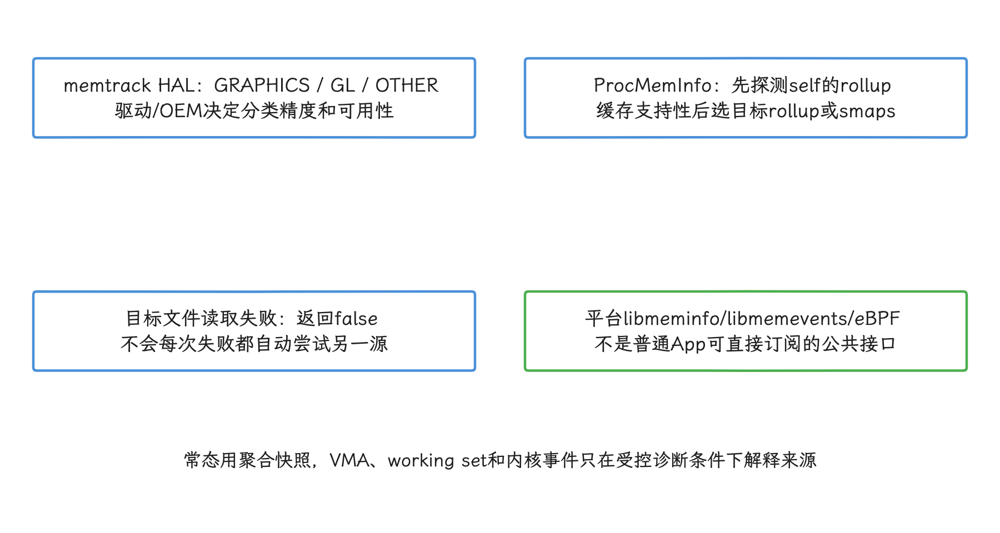

图：默认库在受信平台组件中使用；普通应用继续公开MemoryInfo和受支持的诊断工具。

---

### 4. Battery Historian 与性能指标整合

Battery Historian 是离线功耗分析工具，读取 Batterystats 记录的系统电量账目和 bugreport（系统诊断包），把设备的电池历史转换为 HTML 时间线。时间线适合关联唤醒锁（wakelock，阻止 CPU 进入休眠的持锁记录）、Android 后台任务调度器 JobScheduler 的任务、进程状态和网络活动。不过 Android 官方已注明它不再积极维护：新的分析优先考虑 Android Studio 功耗分析器 Power Profiler、AndroidX 宏基准测试 Macrobenchmark 的功耗指标或系统追踪，历史问题和已有流程继续用 Battery Historian。

#### 4.1 采集与分析边界

先分清它和线上 APM 的关系：Battery Historian 分析的是开发者从测试设备导出的系统级记录；想靠 `StatsManager` 让普通 App 持续拿到性能报告，这条路径并不存在。采集前应清理或标记历史窗口，复现场景后再生成 bugreport，免得把前一次测试的残留事件混进结论。

下面的命令通过 ADB（Android Debug Bridge，Android 调试桥）生成 Battery Historian 可读取的 bugreport。

```bash
adb bugreport bugreport.zip
```

命令完成后，在本地或受控环境运行官方 Battery Historian 镜像并上传该 zip。bugreport 可能包含设备和用户敏感信息，未审计的在线站点不要用。

#### 4.2 与 App 侧监控的配合

两者配合的节奏是：App APM 持续记录受控的低成本指标，Battery Historian、Power Profiler 和 Perfetto 做抽样复现与深入归因。线上告警先确定版本、设备和场景，再在可复现设备上采集系统级证据。另外别忘了 StatsD config/report 仍是特权路径——Battery Historian 能读 bugreport，推不出普通 App 能在线读取同一批系统数据。

<!-- gracker-diagram: a286-14-online-apm-versus-offline-power-evidence -->
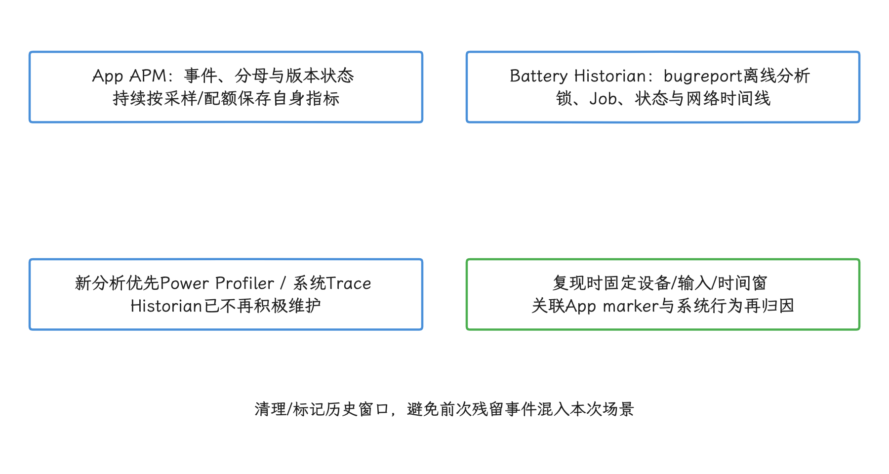

图：工具能读bugreport，不意味着普通应用有权限持续读取StatsD或全设备系统记录。

---

### 5. 网络性能指标：App 层自建策略

StatsD 的 `atoms.proto` 没有定义通用的 `url_pattern`、`request_bytes`、`response_bytes` 等 HTTP 性能字段，网络性能指标这一块就得靠 App 自建方案或第三方 SDK（如 Firebase Performance）自己补上。

#### 5.1 URL 模式归一化

App 侧对 URL 做模板归一化，按 endpoint（表示同一类业务接口的路径模板）聚合：

```
原始 URL: https://api.example.com/v2/user/12345/order/67890
归一化:   /v2/user/{id}/order/{id}
```

Firebase Performance Monitoring 会先匹配项目配置的 custom URL pattern，再回退到自动 pattern。其自定义语法使用单段通配符 `*` 和后缀通配符 `**`，并不是 `{id}`。自建系统也要让规则版本化；规则版本发生变化时，历史数据不会自动变成同一口径。

#### 5.2 HTTP 状态码分组

每个 endpoint pattern 要统计 DNS 域名解析、连接建立、TLS 加密握手、请求体发送、响应首字节、响应体读取、总耗时和状态码分布。成功率怎么算要看接口语义，统一写成“非 5xx”会出问题：登录接口的 401 可能是预期结果，也可能表示会话刷新故障；下单接口的 409 可能是业务冲突；429 则常常指向容量或客户端重试策略问题。

因此每个 endpoint 应维护版本化的成功码规则，并单独统计无 HTTP 状态码的 DNS、连接、TLS、取消和超时错误。Firebase Performance 也允许为 URL pattern 自定义哪些响应码算成功——成功与否由接口语义决定，HTTP 大类只是参考。

#### 5.3 传输体积（Payload Size）统计

记录网络层实际可观测的请求与响应字节数，按 endpoint 聚合后输出：

- **响应体大小分布**：识别 API 返回数据膨胀与偶发大包
- **总传输量**：按 endpoint × 时间段统计
- **缓存命中与重试放大**：区分一次逻辑请求对应的网络尝试次数
- **编码信息**：记录 `Content-Encoding`，仅在同时掌握编码前后字节数时计算压缩比

`Content-Length` 描述的是消息中的内容长度，含义还受编码、分块传输和客户端解码位置影响，拿它与接收字节数相除就宣称是压缩比，这个结论站不住。OkHttp 可通过 `EventListener` 的请求体和响应体事件取得相应字节数；自定义拦截器还要避免读取或复制流式传输的数据体。

<!-- gracker-diagram: a286-15-network-stage-route-and-bytes -->
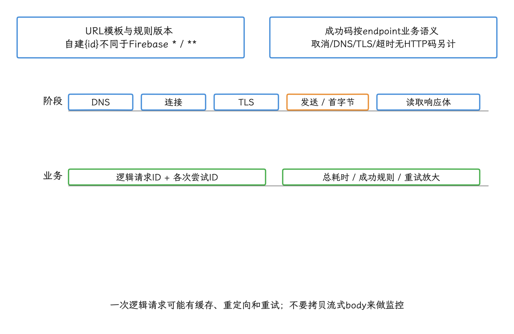

图：传输字节要标网络层与编码；只知道Content-Length不能直接与解码后大小相除声称压缩比。

---

### 6. JankStats 与系统级指标分界

`JankStats`（AndroidX `metrics-performance` 库）和 StatsD 各管一段：Jank 指未在目标时间内完成绘制、造成视觉卡顿的帧，JankStats 逐帧报告耗时、卡顿判定和当时的 UI 状态；StatsD 管系统级聚合。

#### 6.1 职责分工对比

| 维度 | JankStats（端侧） | StatsD（系统级） |
|------|-----------------|----------------|
| 采集粒度 | 每帧（`OnFrameListener` 回调） | 按 StatsdConfig 配置聚合周期 |
| 数据内容 | `frameDurationUiNanos`、`isJank`、UI 状态 | 订阅的 atom 字段（见 `atoms.proto`） |
| 运行位置 | App 进程内，AndroidX 库 | statsd daemon 进程 |
| 状态绑定 | 绑定 UI 状态（Activity/Fragment/滚动状态） | 不绑定 UI 状态 |
| 适用场景 | 端侧实时帧诊断，单用户问题复现 | 系统健康指标聚合，版本/设备维度对比 |
| 权限要求 | 无特殊权限 | 按操作分别需要 `REGISTER_STATS_PULL_ATOM`、`DUMP` + `PACKAGE_USAGE_STATS` 或 `READ_RESTRICTED_STATS` |

#### 6.2 需要自采补充的场景

**1. 帧数据与页面状态关联：**

页面级数据要 JankStats 按 `Window` 回调每帧，并通过 `PerformanceMetricsState` 附带页面、列表滚动或业务阶段等状态；StatsD 的系统 atom 不会替我们自动完成这一步。

下面的示例只在回调中读取必要字段，并在需要跨出回调保存时复制 `FrameData`。

```java
// AndroidX metrics-performance: 创建 JankStats 时传入 OnFrameListener
JankStats jankStats = JankStats.createAndTrack(window, frameData -> {
    // frameData.getFrameDurationUiNanos() — 帧耗时 (ns)
    // frameData.isJank() — 是否判定为卡顿
    // frameData.getStates() — UI 状态列表 (通过 PerformanceMetricsState 绑定)
    long frameDurationNs = frameData.getFrameDurationUiNanos();
    boolean isJank = frameData.isJank();
    if (isJank) {
        FrameData snapshot = frameData.copy();
        enqueueJankSnapshot(snapshot);
    }
});
```

这里有个容易踩的实现细节：JankStats 会复用传给回调监听器（listener）的 `FrameData`，以减少每帧创建对象的开销，回调返回后原对象就失效了。我们跨回调保存时要复制；即使复制了，回调里也只做入队，聚合、序列化和网络上报放到其他执行窗口。

**2. 帧耗时组成：**

读数时注意字段含义：`FrameData.frameDurationUiNanos` 主要描述 UI 部分，渲染线程 RenderThread 的全部耗时不在其中。API 31 及以上的回调对象可能是 `FrameDataApi31`，做 `instanceof` 检查后可读取 `frameOverrunNanos`，观察超过帧完成期限（frame deadline）的时间；分析时记录具体字段，别把所有值都标成“整帧耗时”。

**3. 优化前后验证：**

验证优化要用相同设备层、刷新率、页面状态和采样规则，对比卡顿帧比例与超时（overrun）分布。`isJank` 是 JankStats 基于平台信息和内部启发式规则给出的判定；阈值策略升级时记录库版本，免得把统计方式变化误认为优化结果。

#### 6.3 实际接入建议

接入时每个需要观察的 `Window` 建一个 `JankStats` 实例，在 Activity 可交互期间启用，进入后台时停用。`createAndTrack()` 要求 Window 已有非空 DecorView，过早调用会抛 `IllegalStateException`。

listener 每帧都会收到回调。API 24 及以上通常由 FrameMetrics 使用的线程交付，更早版本可能在主线程交付；两种情况下都要快速返回。采样作用在“是否保留或上传完整 frame 明细”这一层，页面级总帧数、jank 数等分母的统计方式保持一致。电池或网络策略变化时，记录策略版本和纳入概率，全项目通用阈值不要写死。

<!-- gracker-diagram: a286-16-jankstats-frame-data-ownership -->
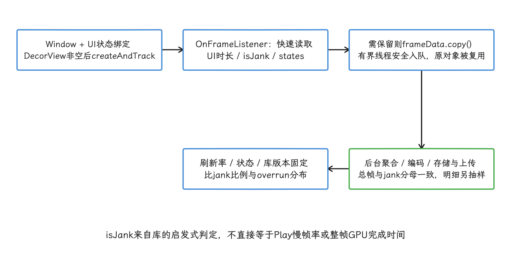

图：前台可交互时观察，后台停用；不要在回调里读跨线程View、序列化、写盘或发网络。

---

### 7. 内存泄漏检测

标准 Android SDK 不会直接告诉我们“哪个对象泄漏”，这个答案要靠 LeakCanary 找：它适合在开发和测试构建中检测 retained object（生命周期已经结束、却仍被强引用而无法回收的对象），并执行堆转储与引用链分析；低开销的线上内存趋势监控是另一种用途。

#### 7.1 LeakCanary 2.x 工作流程

LeakCanary 官方建议通过 `debugImplementation` 引入完整的 `leakcanary-android`，标准 Activity、Fragment、Fragment view、ViewModel 和 Service 的观察无需业务初始化代码。对自定义生命周期对象，可以在对象不再使用时调用 `AppWatcher.objectWatcher.watch()`。

工作链分为四步：

1. `ObjectWatcher` 用弱引用观察已结束生命周期的对象；观察本身不会阻止对象被垃圾回收。
2. 默认等待一段时间并触发 GC；对象仍存在就标为 retained 候选，泄漏根因此时还没定论。
3. retained 数量达到配置阈值后生成 HPROF（Java 堆快照文件）；生成堆转储会暂停应用。
4. LeakCanary 的 Shark 分析器检查引用图，并给出从 GC root（垃圾回收器视为始终可达的根对象）到 retained object 的引用路径。

#### 7.2 架构特点

- **自动安装**：库通过 AndroidX Startup 和应用清单（manifest）组件完成默认观察器安装，正常接入不要求在 `Application.onCreate()` 前手动调用配置。
- **分析与停顿分开看**：Shark 可以在后台执行分析，但生成堆转储时会暂停虚拟机（VM），全程“非阻塞”的说法不成立。
- **结果需要人工解释**：retained object 是候选证据；已知库泄漏（library leak）、测试框架持有和应用自身泄漏需要结合引用链分类。

#### 7.3 线上边界

LeakCanary 官方不建议把完整 `leakcanary-android` 放入发布构建（release build），库还会阻止误装到不可调试 APK。生产环境若只需要 retained object 计数，可单独评估 `leakcanary-object-watcher-android`，并用远程开关、设备条件和隐私规则限制范围。生产环境生成堆转储会造成明显停顿，也可能包含敏感数据，所以要配专门的授权诊断方案；照搬调试构建的默认配置，等于把停顿和敏感数据这两类风险直接带上线。

<!-- gracker-diagram: a286-17-leakcanary-retained-dump-and-reference-path -->
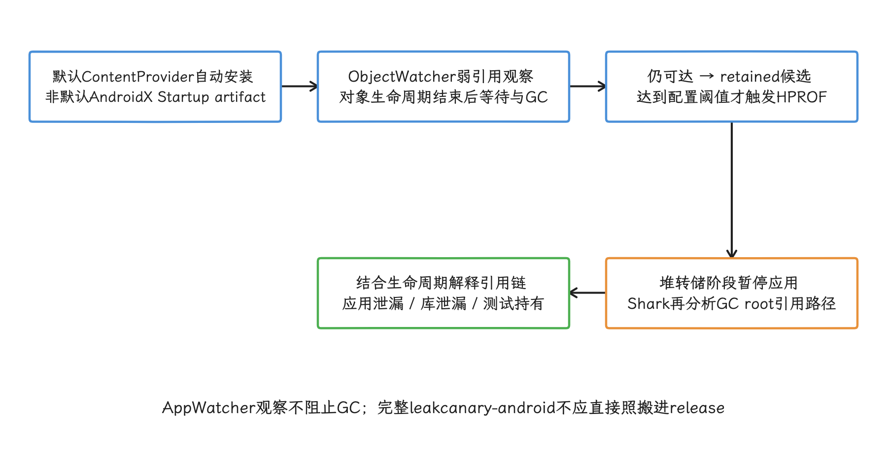

图：后台分析不等于全程无停顿；堆内容和详细引用链也须配独立的数据使用与保留规则。

---

### 8. 线上采集的边界条件

#### 8.1 性能开销

性能监控的开销集中在三处：回调线程里的同步工作、后台的序列化与写盘、以及上传流量。我们给三处都设预算，也都配测量方法。

**异步采集：**
把所有采集都机械地切到后台线程也不对：UI 状态和帧回调有明确的线程语义，跨线程读取 View 反而会出错。正确做法是在回调线程读取最小且线程安全的快照，把聚合、压缩、写入存储和上传交给后台执行器。`StatsManager.setPullAtomCallback()` 使用调用方指定的 executor（任务执行器）；`JankStats.OnFrameListener` 的交付线程随平台机制变化，两者都需要快速返回。

**批量处理：**
StatsD 的 config 订阅机制按 `StatsdConfig` 定义的周期聚合原子事件，`getReports()` 返回的是聚合后的报告。App 自建的指标缓冲也应该按周期批量写入上报通道，而不是每采集一点就发一次网络请求。

**分配与所有权：**
高频路径使用有界缓冲区和紧凑事件结构，避免无上限字符串、堆栈和标签。对象池通过重复使用预先创建的对象省分配，但同步、生命周期和旧数据残留的风险也随之而来，默认不启用。JankStats 已复用回调对象，跨回调保存时按文档复制；其他对象是否复用，以基准测试为准。

**开销门禁：**
固定 CPU 或内存比例当不了所有设备的安全线。我们对关闭与开启监控的两组构建执行 Macrobenchmark 或可重复的内部基准，比较 CPU 时间、内存分配、启动、帧超时、耗电和上传字节，再按设备层与场景设定预算。SDK 版本或采样策略改变后重新测量，超出预算就减字段、减附件或降样本纳入率。

#### 8.2 权限边界

性能监控的权限分层很清楚：

**StatsD config/report/query 路径（需要特权权限）：**
- `REGISTER_STATS_PULL_ATOM`：注册 pull 回调
- `DUMP` + `PACKAGE_USAGE_STATS`：注册 config、读取 `getReports()`
- `READ_RESTRICTED_STATS`：使用 `query()` 查询 SQL 结果

**App 自建指标路径（无需特殊权限）：**
- `Debug.MemoryInfo`：无需额外权限
- `ActivityManager.getProcessMemoryInfo()`：普通 App 仅能读取同 UID 进程，且调用频率受限
- `Debug.getRuntimeStat()`
- `PowerManager.isPowerSaveMode()`

**网络上报权限：**
- `INTERNET`（清单声明即可）

后台持续上传要用与任务语义匹配的 API。需要在进程重启后继续、且允许延后的批量上传可以交给 WorkManager（Jetpack 持久化后台任务调度器），并通过网络、电量和存储约束（constraint）声明执行条件；前台页面内的短时采样随页面生命周期停止。具体 API 和约束要写明，只说一句“Android 17 限制更严格”没有信息量。

#### 8.3 约束驱动的采集降级状态机

监控 SDK 还要把后台定时器从“持续时钟”的假设里摘出来：缓存进程（cached app）可能被冻结，WorkManager 只保证约束允许时获得执行机会，内存压力下继续申请大附件还会放大故障。实现时可以把生命周期、任务回调和系统结果转换成下面的状态机：

| 状态 | 采集 | 本地处理 | 上报 |
| --- | --- | --- | --- |
| Foreground（前台） | 用户旅程、帧、网络、低频内存与业务指标 | 有界聚合、采样和脱敏 | 批量发送或入队 |
| UI hidden / Background（界面不可见 / 后台） | 停止周期轮询，只保留必要业务事件 | 释放可重建缓存，写小型状态摘要 | 交给受约束的持久化任务 |
| Cached / Frozen（缓存 / 冻结） | 不假设存在用户态执行机会 | 不补造冻结期间样本 | 等待系统解冻 |
| Restart / Resume（重启 / 恢复） | 查询退出记录、注册性能剖析结果监听、读取待传队列 | 标记不可观测区间，去重并恢复 | 先传关键摘要，再按预算传附件 |
| Memory pressure observed（观察到内存压力） | 停止高成本性能剖析与大对象采集 | 缩小缓冲区、拒绝新批次、保存丢弃计数 | 不因压力立即制造额外网络工作 |

状态转换只由实际生命周期、任务开始/停止和公开系统结果驱动。App 查询“当前是否被冻结”没有可靠途径——被冻结时本身就没有执行代码的机会；恢复后我们只能承认这段数据缺失，记录 `unsupported`、`not_scheduled`、`frozen_gap`、`budget_exhausted` 等原因，拿零填充只会骗过看板。

---

<!-- gracker-diagram: a286-18-lifecycle-constraint-and-unobserved-intervals -->
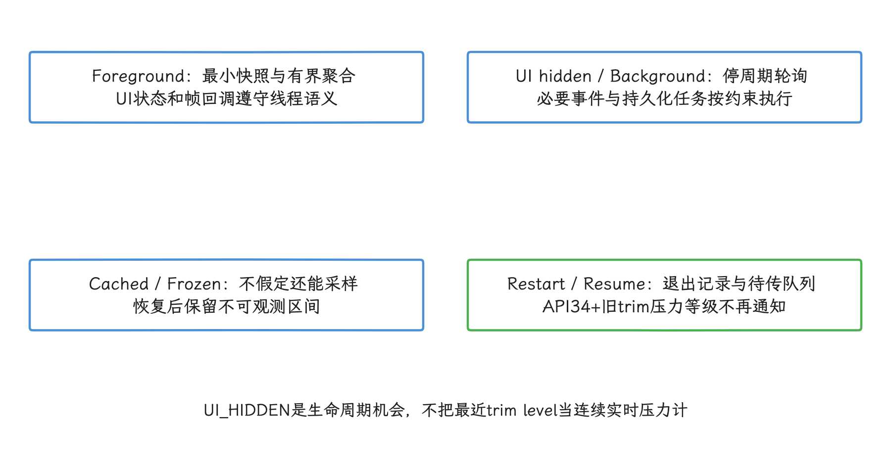

图：内存压力时拒绝大附件并缩缓冲；不能为了诊断压力马上制造大量分配和网络。

### 9. 数据处理与上报策略

以下策略基于工程实践总结，不绑定 Android 17 StatsD 平台的特定配置项。

#### 9.1 本地缓存机制

**有界缓冲：**
内存缓冲按字节数与事件数设双重上限，进程恢复后仍有价值的数据写入应用私有目录。配额根据设备存储、事件价值和平均上传能力校准，不用固定时间窗口替代容量管理。

**中断后续传：**
每个批次带稳定 ID、schema 版本、序列范围和内容摘要；内容摘要用于判断数据是否一致。服务端按批次或事件 ID 幂等确认——重复提交同一数据只确认一次；客户端收到确认后才回收已持久化数据。损坏批次进隔离区，别让一个坏文件永久堵住队列。

#### 9.2 上报策略

- 普通性能批次使用持久化调度，并按产品策略选择 `CONNECTED`（已有网络连接）或 `UNMETERED`（非计量网络）等 WorkManager 网络约束；大附件还可要求充电和存储空间充足。
- Crash、ANR 摘要与性能批次使用不同优先级；但“高优先级”依旧不要求崩溃进程现场发网，也不绕过用户的数据设置。
- 失败重试采用带随机扰动的退避：连续失败时逐步延长等待时间，并加入随机偏移，免得大量客户端同时重试。客户端还要尊重服务端 `Retry-After` 指定的再次请求等待时间和自身后台配额；认证失败、schema 不兼容这类永久错误进入隔离或升级流程，无限重试没有意义。
- 使用 WorkManager 的命名唯一任务（unique work）或等价队列键，网络恢复时就不会重复创建同一上传任务。网络约束失效时让调度器停止并稍后重试；在网络状态回调 `NetworkCallback` 里直接发起整批上传是反模式。

<!-- gracker-diagram: a286-19-durable-batches-ack-retry-and-isolation -->
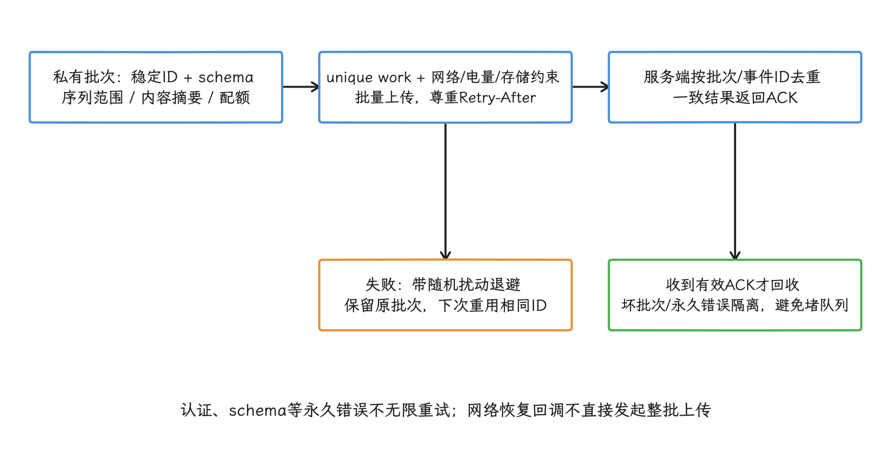

图：SDK业务优先级不意味着崩溃现场发网；约束失效后允许任务停止并在系统许可时恢复。

---

### 10. 性能监控最佳实践

#### 10.1 监控范围控制

性能监控可以按信息价值和采集成本分级。下面是职责示例，具体纳入率由测量预算和统计目标决定。

**事实计数与分母：**
- Crash、ANR 与进程退出记录；
- 启动、会话、页面访问等统计分母；
- 监控 SDK 自身的丢弃、上传和配置状态。

这类数据优先保证统计方式连续，但仍要受用户同意、隐私规则和技术可用性约束——优先级高，未必就要全量上传。

**持续性能摘要：**
- 帧率 / 卡顿帧（JankStats）
- 内存使用率和 GC 频率
- 网络时延与错误率

摘要按设备层、版本和场景确定性采样，服务端保留纳入概率。启动“慢”的阈值要有出处：Android Vitals 定义、产品 SLO（Service Level Objective，服务等级目标）和分位数基线，无来源的固定秒数不写。

**按需诊断附件：**
- Perfetto trace、heap dump、详细行为窗口；
- 高频逐帧明细、完整网络阶段数据；
- 设备与进程快照。

这类数据只在预设配额、远程诊断或代表样本中获取。

#### 10.2 隐私保护

1. 敏感数据在写入本地缓冲前完成最小化与脱敏。
2. 网络上报使用 TLS；服务端身份、证书策略和失败模式都要测试。
3. 日志、URL、UI 状态标签（如页面或交互阶段）和业务标签不嵌入原始用户标识或用户内容。
4. 跨事件关联用有明确保留期的假名标识；哈希算过也不等于匿名化。
5. heap dump、trace 和原始日志采用更严格的授权、访问审计与删除策略。

#### 10.3 数据生命周期

- App 侧原始事件按字节配额、事件价值和已确认状态回收。
- 服务端原始样本只保留完成定位和重算所需的最短周期，访问必须可审计。
- 聚合数据按趋势比较和合规需求设周期，并记录聚合口径版本。
- 删除流程覆盖主存储、索引、缓存和备份到期策略；用户请求删除时能定位关联数据。

保留时长由数据分类、业务 SLO、地区法规和成本共同确定；所有项目通用的固定天数并不存在。

<!-- gracker-diagram: a286-20-monitor-the-monitor-and-release-budgets -->
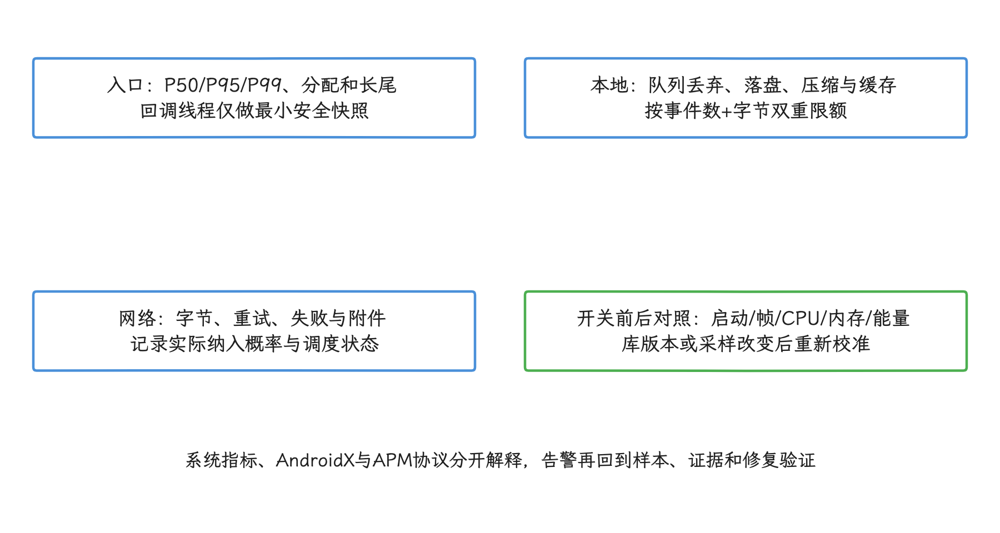

图：对象池默认不启用；复用降低分配也引入所有权、同步和旧字段残留，需要实测取舍。

---

### 11. Android 17 内存监控适配建议

#### 11.1 普通 App 的连续监控

Android 14–17 都可以用 `Debug.MemoryInfo` 采集同 UID 进程的低频内存快照，这条路径跨版本一致，没必要为 Android 17 单写一条内容相同的版本分支。采样记录至少包含系统日期时间（wall clock）、不受系统校时影响的单调时间 `elapsedRealtime`、进程启动序列、前后台状态和最近一次内存压力等级（trim level）。长时间没有样本，说明的只是进程没执行采样，原因可能是冻结、调度延迟、进程退出或任务被取消。

`ComponentCallbacks2.onTrimMemory()` 是内存压力提示，每次回收或每次 compaction 都收到通知可指望不上。收到回调时记录 level 和业务状态，减少可回收缓存；运行时核心逻辑的决定权，留给明确的运行时状态而非高频 PSS 轮询。

#### 11.2 Android 17 新字段与退出补偿

API 37 在 `ActivityManager.MemoryInfo` 新增 `freeMem`，表示未使用 RAM；`availMem` 还考虑可回收内存，两者含义不同。应用判断系统是否接近低内存时，优先使用 `lowMemory`、`threshold`、`availMem` 和 trim callback，不要把 `freeMem` 越低直接解释成异常。

进程重启后，用 `ApplicationExitInfo` 核对近期退出原因和时间，再与最近一份内存快照关联。这层关联只能说明“退出前观察到什么”；没有系统 trace 时，MemoryLimiter、LMKD（Low Memory Killer Daemon，Android 低内存终止守护进程）或某次 Compaction 谁是根因，证明不了。

#### 11.3 系统组件与实验室诊断

特权组件可以结合 StatsD、`dumpsys`、Perfetto、cgroup 文件和 `MemoryLimiter` 事件分析系统策略；普通 App 把读取 `FREEZER_EVENT`、其他进程 `/proc` 或 cgroup 控制文件用于生产环境采集，这条路走不通。要验证 Android 17 内存策略，我们在可控设备上同时采集 App 快照与系统 trace，再以 `android-17.0.0_r1` 的 `CachedAppOptimizer.java`、`MemoryLimiter.java` 和 JNI 实现解释事件。

---

### 性能采集部分的延伸阅读

- [Android Performance Vitals](https://developer.android.com/topic/performance/vitals) — Google 官方性能指标定义与最佳实践
- [ActivityManager](https://developer.android.com/reference/android/app/ActivityManager) — `getProcessMemoryInfo()` 的 UID 与频率限制
- [ActivityManager.MemoryInfo](https://developer.android.com/reference/android/app/ActivityManager.MemoryInfo) — API 37 `freeMem` 与 `availMem` 的口径
- [android.os.Debug](https://developer.android.com/reference/android/os/Debug) — Native heap、PSS、RSS 与运行时统计
- [Firebase Performance Monitoring](https://firebase.google.com/docs/perf-mon) — Firebase 性能监控接入指南，含采样率配置与 URL pattern 归一化
- [Firebase custom URL patterns](https://firebase.google.com/docs/perf-mon/custom-url-patterns) — URL pattern 与成功码配置
- [ApplicationExitInfo API](https://developer.android.com/reference/android/app/ApplicationExitInfo) — Android 11+ 退出原因归因 API
- [JankStats — AndroidX metrics-performance](https://developer.android.com/reference/androidx/metrics/performance/JankStats) — 帧级卡顿检测库官方文档
- [JankStats 使用指南](https://developer.android.com/topic/performance/jankstats) — 回调线程、对象复用和 UI 状态
- [Battery Historian 设置](https://developer.android.com/topic/performance/power/setup-battery-historian) — 维护状态、bugreport 与本地分析
- [WorkManager constraints](https://developer.android.com/develop/background-work/background-tasks/persistent/getting-started/define-work#work-constraints) — 持久化上传的网络、电量与存储条件
- [LeakCanary Getting Started](https://square.github.io/leakcanary/getting_started/) — Debug 构建接入边界
- [Debug.MemoryInfo](https://developer.android.com/reference/android/os/Debug.MemoryInfo) — 进程内存使用明细 API
- [AOSP Android 17：StatsManager.java](https://android.googlesource.com/platform/packages/modules/StatsD/+/refs/tags/android-17.0.0_r1/framework/java/android/app/StatsManager.java)
- [AOSP Android 17：CachedAppOptimizer.java](https://android.googlesource.com/platform/frameworks/base/+/refs/tags/android-17.0.0_r1/services/core/java/com/android/server/am/CachedAppOptimizer.java)
- [AOSP Android 17：MemoryLimiter.java](https://android.googlesource.com/platform/frameworks/base/+/refs/tags/android-17.0.0_r1/services/core/java/com/android/server/am/MemoryLimiter.java)
- [AOSP Android 17：MemoryLimiter JNI](https://android.googlesource.com/platform/frameworks/base/+/refs/tags/android-17.0.0_r1/services/core/jni/com_android_server_am_MemoryLimiter.cpp)
- [Android common kernel：android17-6.18-2026-06_r6 cgroup v2](https://android.googlesource.com/kernel/common/+/refs/tags/android17-6.18-2026-06_r6/Documentation/admin-guide/cgroup-v2.rst)
- [Android common kernel：android17-6.18-2026-06_r6 memcontrol.c](https://android.googlesource.com/kernel/common/+/refs/tags/android17-6.18-2026-06_r6/mm/memcontrol.c)
- [StatsD atoms.proto](https://cs.android.com/android/platform/superproject/+/android-17.0.0_r1:frameworks/proto_logging/stats/atoms.proto) — android-17.0.0_r1 中完整原子定义


## 全文小结

最后我们把全篇收拢：App 可观测性的核心是让指标、日志与追踪共享可解释的事件模型、时钟、采样概率和版本上下文。端侧以低开销入口、有界缓冲、分级存储和受约束上传保存证据，服务端完成聚合、告警、样本查询与修复验证；具体采集能力仍按权限和用途分层。

Android 14–17 的性能监控由多组权限和用途不同的 API 组成，可以按三层理解：

1. **系统层**：StatsD 通过 `StatsManager.addConfig()` + `getReports()` 向特权 App 提供 `atoms.proto` 中系统 atom（如 `AppStartOccurred`（ID 48）、`AnrOccurred`）的聚合报告；`setPullAtomCallback()` 是特权组件向 statsd 提供 pulled atom 数据的入口。`ApplicationExitInfo` 属于 ActivityManager 的独立公开查询模型，位于 StatsD atom 体系之外。权限边界为：`setPullAtomCallback()` 需要 `REGISTER_STATS_PULL_ATOM`，`addConfig()` / `getReports()` 同时需要 `DUMP` 和 `PACKAGE_USAGE_STATS`，`query()` 需要 `READ_RESTRICTED_STATS`。
2. **框架层**：AndroidX `JankStats` 负责帧级实时诊断，`Debug.MemoryInfo` 负责进程级内存采集——两者都不需要特殊权限。
3. **App 层**：电池感知采样率、网络指标聚合、上报策略和缓存管理由 App 自行实现或通过 Firebase Performance 等 SDK 接入。

平台能力方面，Android 17 增加了 MemoryLimiter 的设备可选能力和 `ActivityManager.MemoryInfo.freeMem` 字段；Compaction 与 Freezer 在更早版本已经存在；`libmeminfo` / `libmemevents` 仍是系统侧能力，普通 App 的对象跟踪接口并没有变多。线上系统应保存一致分母、策略版本、纳入概率和缺失原因，并按前台、后台、冻结、恢复与内存压力状态降级；详细 trace、heap dump 与逐帧数据，只在成本和授权条件允许时采集。

## 参考资料

- [Android Vitals](https://developer.android.com/topic/performance/vitals)：Play 质量指标、核心指标与 28 天评估窗口。
- [App startup analysis and optimization](https://developer.android.com/topic/performance/appstartup/analysis-optimization)：TTID、TTFD 与启动追踪。
- [Slow rendering](https://developer.android.com/topic/performance/vitals/render)：慢帧、冻帧、ANR 与 FrameTimeline。
- [Firebase Performance Monitoring](https://firebase.google.com/docs/perf-mon)：自动追踪、自定义指标、筛选属性与用户数据说明。
- [SystemClock API](https://developer.android.com/reference/android/os/SystemClock)：现实时间、运行时间与经过时间的语义。
- [ProfilingManager API](https://developer.android.com/reference/android/os/ProfilingManager)：性能剖析类型、限流、回调与结果边界。
- [ProfilingTrigger API](https://developer.android.com/reference/android/os/ProfilingTrigger)：Android 16—17 的系统触发类型。
- [Android privacy checklist](https://developer.android.com/privacy-and-security/about)：数据访问审计、可重置标识、告知与敏感日志要求。
- [OpenTelemetry logs](https://opentelemetry.io/docs/specs/otel/logs/)：使用 trace/span 关联信息连接日志与追踪。
- [AOSP `SystemClock.java` @ Android 17](https://android.googlesource.com/platform/frameworks/base/+/refs/tags/android-17.0.0_r1/core/java/android/os/SystemClock.java)：平台时钟实现边界。
- [AOSP `ProfilingManager.java` @ Android 17](https://android.googlesource.com/platform/packages/modules/Profiling/+/refs/tags/android-17.0.0_r1/framework/java/android/os/ProfilingManager.java)：线上性能剖析请求、触发器与限流边界。
