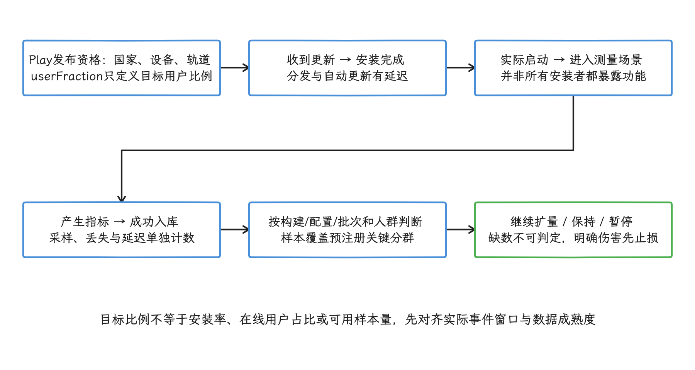

# 性能评分与发版质量门禁

发版门禁用少量稳定指标，把明确的回归挡在发布之前；性能评分汇总若干评估维度，便于查看改进空间；团队若采用加权总分，应另行公布权重和规则版本。官方App Performance Score的静态、动态评估仍需分别保留。两件事共享同一组前提：评分之前，我们要先固定场景、人群、设备层级和缺失数据处理，这些没定下来，总分会把局部恶化盖住。

> 源码基线：AOSP `android-17.0.0_r1`，覆盖 Android 10 到 Android 17（API 29–37）；本文讨论应用与交付平台设计，不绑定特定内核版本，设备也可能使用厂商自己的内核分支。

## 基线、阈值、置信度与阻断规则

### 门禁如何衔接发布阶段

发版质量门禁用一组可验证条件决定版本能否进入下一发布阶段。到这里，26.1 节已经解决了性能指标怎么采，26.4 节已经解决了实验设计和回归检测；本节我们把这些证据接到发版流程上，对应到发版前检查、候选包测试、灰度扩量、暂停和恢复动作。

实验室之外，实际发布还要覆盖目标设备厂商（OEM）、系统构建指纹（build fingerprint，用于唯一标识设备上的系统构建）和季度更新。源码标签只说明核对代码时用的版本；发布结论要来自真实设备上的验证。

### 发版前性能检查清单

发版前的检查清单要能直接执行：每一项至少写清被测产物、场景与设备、指标定义、比较基线、判定方法、失败动作和负责人。这七项凑齐，指标数字才能落成明确的发布决定；缺任何一项，数字就只是数字。

发布单要先冻结产物身份：`versionCode`（Android 用来判断版本新旧的整数）、Git 提交、AAB/APK 文件摘要、签名证书摘要、`compileSdk`、`targetSdk`、构建变体、R8（代码压缩与混淆工具）映射文件、原生代码符号文件、Baseline Profile（预先提供给 ART 的热点代码配置） 版本、动态特性模块版本和远程配置快照。测试报告与生产事件都引用同一个构建 ID，这样实验室和生产环境观察的才是同一份代码与配置。

| 检查域 | 证据与口径 | 不通过动作 | 关联章节 |
| --- | --- | --- | --- |
| 启动 | 按启动类型、入口和设备群比较首次显示时间（TTID）；仅在正确调用 `reportFullyDrawn()` 的场景使用完全显示时间（TTFD） | 阻断候选包，结合 Perfetto Trace（系统跟踪文件）检查启动路径 | 21.1、26.1 |
| 渲染 | 核心交互的 `FrameTimingMetric` 分布、生产环境慢帧或冻帧指标，并按刷新率和页面分组（分群） | 阻断或缩小发布范围 | 22.10、26.1 |
| 内存 | Java 堆、原生堆、PSS（按比例分摊共享页后的物理内存）、RSS（包含共享页的驻留物理内存）、内存不足（OOM）与低内存退出；同时记录进程状态和设备内存档位 | 阻断高风险设备群，补充堆转储、Perfetto 或退出记录 | 23.7、26.2、26.6 |
| 稳定性 | 崩溃、应用无响应（ANR）、原生崩溃、启动失败和 `ApplicationExitInfo` 退出原因，按受影响用户数与事件数分别呈现 | 停止扩量，进入回滚评估 | 20.1–20.4、26.2、26.6 |
| 功耗 | 固定场景的实验室能耗与生产环境异常唤醒、后台任务证据；声明测量是否覆盖整台设备 | 对耗电路径限流或关闭配置 | 25.1–25.3、26.11 |
| 数据健康度 | 实验分组（assignment）、采样配置、事件生成、落盘、上传和查询延迟 | 将业务指标标为不可判定，暂停扩量 | 26.1、26.4 |
| 包体与配置 | AAB/APK 与动态特性大小、资源变化、远程参数和实验快照 | 回退配置或重新生成候选包 | 25.5–25.11、26.4 |

每个检查域都要在发布单里留下证据链接和判定结果；哪一项失败，就直接执行表中对应的动作，并记下审批人。

#### Android 17 要做两轮兼容性验证

Android 官方迁移指南把升级验证分成两条可以并行推进的路径：

- **运行兼容性**：把当前生产版本安装到 Android 17 设备，保持原有 `targetSdk`，验证对全部应用生效的行为变化。这一轮发现的问题同样影响已经发布的包，通常优先处理。
- **目标版本兼容性**：用 API 37 SDK 构建并把 `targetSdk` 升到 37，验证只对目标 API 37 及以上生效的变化。兼容性开关允许在可调试包上单独启用某项变化，方便隔离原因；发布结论仍要来自按目标 SDK 构建、配置接近生产版本的候选包。

测试清单从官方“影响所有应用”和“以 Android 17 为目标版本”两份行为变化文档生成，每轮验证时更新。

对目标 API 37 及以上的应用，新的无锁`MessageQueue`实现可能破坏依赖其私有字段或方法的反射代码。另一个独立变化是`static final`字段不可修改：通过反射修改会抛出 `IllegalAccessException`，通过 JNI 修改则直接崩溃。证书透明度（Certificate Transparency）默认启用；通过 `System.load()` 动态加载的原生库文件必须为只读。后台音频限制和大屏方向、宽高比、可调整大小规则，也可能影响媒体或布局。

应用可以只挑与自身代码路径相关的条目，但每个排除项都要留下理由。

兼容性开关适合逐项定位问题，而用户设备上跑的是多项行为变化同时生效的系统。所以正式候选包还要在 Android 17 的完整行为组合下运行主流程、后台流程、升级安装、数据迁移、权限拒绝、进程重建和大屏场景，并检查受限非 SDK 接口告警与第三方 SDK 的兼容性。

#### 门禁阈值的来源

门禁阈值要绑定指标版本、设备群、场景和发布阶段，推导关系是固定的：相对退化阈值来自历史噪声和业务可接受的最小变化，绝对阈值来自服务等级目标（SLO）或稳定性预算，最小样本量取决于历史方差和希望识别出的变化幅度。要引用其他项目的百分比、毫秒数或样本量，先把这层推导在自己的数据上补齐，再写进配置。

Android vitals 是 Google Play 汇总的外部质量信号，Play每天用最近28天窗口检查关键指标。ANR Reporting API中的28天率按每日`distinctUsers`加权滚动，不是简单平均每日百分比；其他指标按各自聚合规则解释。

当前Core vitals按适用应用类型分列：稳定性包括用户感知崩溃率与ANR率；电池包括过度partial wake lock及表盘应用的过度耗电；移动应用还包括Memory usage（Anonymous RSS + Swap）与Bitmap memory usage。官方标明内存、位图内存或代码优化阈值的商店可见性影响可能从2027年2月开始；不要把内存指标读成PSS或只列旧版三项。

做发布报告时，我们要把自建应用性能监控（APM）与 vitals 的分子、分母、统计窗口和设备范围分别保存：内部会话数与 Play 的用户、会话统计方式不同，分母要各算各的。

### 自动化性能测试集成

自动化测试覆盖不了全部真实设备，它的职责是让候选包带着可复现的证据进入灰度。风险较高的候选包若没有实验室性能报告，就停在发布候选阶段。

Android 官方建议在物理设备上运行 Benchmark，模拟器结果会受宿主机和虚拟化环境影响，不宜拿来代表用户体验。目标 APK 要尽量接近生产构建：不可调试、允许性能剖析（profiling），R8（Android 的代码压缩、优化与混淆工具）、资源压缩、签名后处理和 Baseline Profile 与生产保持一致。测试 APK 与目标 APK 分开构建，免得把 Benchmark 专用配置带进生产包。

Macrobenchmark 指标进门禁之前，我们要逐项核对 API 可用范围和测量语义：

- `StartupTimingMetric.timeToInitialDisplayMs` 测量首帧出现所需时间。`timeToFullDisplayMs` 依赖 `reportFullyDrawn()`，在Android 10 / API29之前可能不可用；场景里没有明确的完整绘制点时，TTFD（完整内容可用所需时间） 也不适合拿来卡门禁。
- `FrameTimingMetric.frameDurationCpuMs` 是 UI 线程与 RenderThread 生成一帧所用的 CPU 时间；`frameOverrunMs` 只在 Android 12 / API 31 及以上可用，表示相对帧截止时间的提前或超时量。这两项指标要分别设阈值。
- `TraceSectionMetric` 仍标记为实验性 API，用来统计 Trace 中带名称的代码区段（section）。AndroidX Benchmark 1.3.0 及以上默认只统计目标包（`targetPackageOnly = true`），并以 `Mode.Sum` 汇总一次测量中所有同名 section 的耗时；要看第一次或最长一次，必须显式选择 `Mode.First` 或 `Mode.Max`。业务阶段可能重复出现时，先确定需要的聚合方式。
- `PowerMetric` 仍标记为实验性 API，测量的是系统级功率或能量，没法直接归因到单个应用头上；官方支持 Pixel 6、Pixel 6 Pro 及后续设备，测试时还要压低其他进程的干扰。

门禁配置里可移植的是下面这些字段和它们的约束，示例数字要换成项目自己的数据：

| 字段 | 要回答的问题 |
| --- | --- |
| `artifact_id` / `commit` | 测的是哪一份目标包与测试包 |
| `scenario_id` / `setup_version` | 用户路径、账号和测试数据是否一致 |
| `metric_name` / `metric_version` | 指标怎样计算，当前 API 是否可用 |
| `device_id` / `build_fingerprint` | 设备、系统镜像和刷新率是否可比较 |
| `compilation_mode` / `profile_version` | 编译状态和 Baseline Profile 是否一致 |
| `baseline_id` | 比较对象是已知质量合格的固定版本、近期滚动趋势，还是人工固定基线 |
| `sample_count` / `effect_interval` | 测量次数、效应值和不确定区间分别是什么 |
| `decision` / `owner` / `waiver_expiry` | 失败后做什么，由谁处理，豁免何时失效 |

`baseline_id` 永久指向前一轮构建并不稳妥：该构建可能已经退化，连续的小变化也可能被滚动比较漏掉。已知质量合格的固定版本适合判断累计漂移，近期稳定趋势适合发现设备环境变化，人工固定基线适合重大重构。报告里必须写出实际使用的基线和它的更新时间。

Benchmark 库输出测量 JSON 和性能剖析 Trace，Macrobenchmark 还会为每次测量迭代生成一份 Perfetto Trace。持续集成（CI）系统要按构建、设备、场景和测试名归档这些 JSON 与 Trace。失败报告除了给出通过与不通过，还要附上新包值、基线值、效应区间、测试轮数、热降频（设备过热后主动降速）等环境标记、失败迭代的 Trace 和候选提交。

拉取请求（PR）阶段适合跑编译校验和试运行（dry run），确认测试能执行起来；固定物理设备上的重复测量，放在主干定时任务和候选包门禁更合适。噪声大的单次 Benchmark 不足以自动判定业务回归——门禁还要区分测试基础设施失败、环境漂移和可重复的应用退化，并给每类失败定义不同的动作。

### 灰度发布与性能监控联动

灰度发布（staged rollout）先把候选包提供给一部分符合条件的用户，再分阶段提高比例。走到每一步，做决定的证据来源都不一样：实验室测试决定能否开始灰度，生产数据决定能否扩大覆盖，数据健康度决定当前窗口能否支持发布判断。

Google Play staged rollout 只适用于应用更新，首次发布用不上它。Play按发布协议从符合条件的用户中选择群组；同一发布暂停后恢复仍是同一组。若前一版分阶段发布尚未完成就开始新版，新版会按扩量比例沿用前一版用户群，不能默认每版都独立重新随机。暂停只是让更多用户拿不到该版本，已经装上的用户会停留在原地。

staged rollout 也撑不起严格 A/B Test 的设计条件：严格实验需要一个由实验协议定义、可以稳定复现的旧版本对照组，而 Play 那里拿不到；版本覆盖还会受国家、设备资格、自动更新、安装时间和渠道影响。所以版本间的差异可以触发风险处置；要断定“灰度用户比旧版用户差”就是代码变化造成的，还得回到 26.4 节的受控实验或可复现的回退证据上。

灰度监控要按版本对象（release）和每次扩量批次记录，只按 `versionName` 聚合会丢掉关键信息。门禁系统至少记录：

- `track`（生产、开放测试等发布轨道）、版本名称（release name）、`versionCode` 与发布事务的 edit ID。
- `rollout_id`、目标 `userFraction`、国家范围，以及开始、暂停、恢复和完成时间。
- build ID、产物摘要、签名和符号文件版本。
- Remote Config（远程配置）、实验、服务端开关和后端依赖版本快照。
- 指标窗口的事件时间、入库时间、数据已完整到达的最晚事件时间，以及查询时间。
- 发布前登记的设备、Android 版本、国家、渠道、刷新率、入口和新老用户类别。

`userFraction` 表示有资格接收该 staged release 的用户比例，和安装完成率、实时在线用户占比是两回事。发布平台要同时观察符合资格、已更新、已启动、产生指标和上传成功的数量；有效暴露要从这条链路里数，只拿目标比例估算样本量会把它估高。

发布门禁可以采用以下状态机；具体比例和观察时间由流量周期、事件发生率、审核时延与风险预算决定，每个项目要自己定。

<!-- gracker-diagram: a290-05-rollout-target-versus-effective-exposure -->

图：Play rollout不是受控旧版A/B对照：同发布恢复复用群组，新版也可能沿用尚未完成的前版群组。

| 状态 | 进入条件 | 继续条件 | 异常动作 |
| --- | --- | --- | --- |
| 内部验证 | 候选包与配置冻结，自动化门禁通过 | 安装、升级、主流程和诊断上报可用 | 重新构建，不进入生产 |
| 初始生产灰度 | 内部证据齐全，发布审批完成 | 快速稳定性指标与数据健康度可以判断，未发现高风险分群 | 暂停版本，保存诊断证据 |
| 扩量观察 | 前一阶段通过，样本覆盖预先登记的分群 | 指标区间在预算内，服务端与客户端依赖稳定 | 保持当前比例或限制国家、设备 |
| 完成发布 | 风险负责人接受剩余不确定性 | 全量后继续观察版本队列、vitals 与反馈 | 暂停已全量版本、降低配置风险或发布修复包 |

灰度决策要区分快速信号和慢速信号。自建 APM、崩溃与 ANR 事件流、启动与帧指标能较早暴露风险，前提是数据延迟和样本覆盖达标。Android vitals每日更新，使用最近28天窗口及各指标规定的聚合规则，适合观察长期质量与 Play 警告；刚起步的小流量灰度，扩量判断要靠前面这些快速信号。

客服反馈和商店评论到得慢，还带选择偏差。它们能帮我们发现未知症状；已经观测到的崩溃、ANR 或数据管道异常，不会因为“暂时没有投诉”而消失。

APM 与发布平台需要双向核对：发布平台向监控侧提供版本、目标比例、国家、配置和实验快照，监控侧把指标区间、异常分群、数据完整性和证据链接写回发布单。一旦上报成功率、事件丢弃、配置命中率或上报延迟出现异常，我们就把当前结论标成“不可判定”，维持或暂停当前比例——缺失数据只说明“还不知道”，说明不了“质量正常”。

### 版本回滚决策流程

Android 应用所说的“回滚”至少包含三种操作：暂停发布、回退服务端配置，以及发布更高 `versionCode` 的修复包。选哪种，取决于问题出在哪一层：配置错误靠关闭开关处理，未完成的 staged rollout 靠暂停；已经装到设备上的问题版本，Play 不会自动降级，要靠配置降级、服务端兼容或修复包把功能恢复回来。

Google Play Developer API 的版本状态包括 `draft`（草稿）、`inProgress`（分阶段发布中）、`halted`（已暂停）和 `completed`（发布完成）。`userFraction` 只允许用于 `inProgress` 或 `halted`，取值必须严格大于 0 且小于 1。暂停进行中的版本时，把状态更新为 `halted` 并提交 edit（一次待提交的发布事务）；该版本随后不再提供给更多用户，已安装用户不受影响。

Google Play 也允许暂停已全量发布的版本，内部测试轨道除外；当前版本还必须不是该轨道的首个版本，且前一个已全量发布的版本没有会阻止重新提供的政策违规。暂停成功后，前一个版本会重新提供给新用户和其他符合条件、尚未安装问题版本的用户，已经装上问题版本的用户仍留在原地。执行前，发布平台应先读取轨道当前状态，显示将恢复提供的版本号；执行后再读一次状态确认结果。

按可逆性和剩余影响面选择动作：

| 信号 | 判断 | 推荐动作 |
| --- | --- | --- |
| 配置导致启动请求增加、日志量激增、图片预加载范围扩大 | 可通过服务端配置恢复 | 立即回退配置，保留版本灰度 |
| 初始灰度出现崩溃、ANR 或启动失败异常 | 影响范围仍受控，包体风险高 | 暂停 staged rollout，冻结证据并复现 |
| 特定设备群出现稳定退化 | 可通过发布资格或功能开关缩小范围 | 保持当前比例，限制受影响范围并准备修复 |
| 已全量版本出现严重稳定性问题 | 仍有用户可能更新到问题版本 | 核对可恢复提供的旧版本后暂停，同时降低配置风险并提交修复包 |
| 已安装用户持续受影响 | 暂停发布无法降级现有安装 | 保持服务端兼容、关闭高风险功能、提供应用内提示，并发布更高 `versionCode` |
| 数据完整性失败 | 当前质量结论不可用 | 暂停扩量，修复监控数据通路；已有明确安全信号仍按该信号处理 |

自动化可以生成建议、检查权限、准备 Play edit；但暂停、恢复、完成发布这些动作会改变用户能拿到的版本，要保留明确的审批、操作者、请求内容和 Play 返回结果。重试前先读取当前轨道，避免网络超时后对着未知状态重复修改。

回滚证据包至少包含：轨道、版本、`versionCode`、构建 ID、目标覆盖率与有效覆盖率、异常指标定义、基线与效应区间、数据完整性、受影响分群、按堆栈指纹归组的崩溃或 ANR 问题、Trace 或日志样本、配置快照、可恢复提供的旧版本、已执行动作和负责人。对于动态配置，还要保存旧值、新值、作用条件、配置版本和客户端生效时机。

处置之后要验证恢复是否与动作时间对得上：配置回退要检查配置拉取、激活与功能实际使用的转化步骤；修复包要检查新 `versionCode` 的有效覆盖和关键指标；Play 侧的长期质量继续看 vitals 的滚动窗口。恢复可以证明处置有效，根因仍要靠代码、Trace 或受控实验确认。我们在事故中发现的设备群、场景或数据缺口，应加入下一版门禁。

### 发布单的证据留存

发布单既是审批记录，也是事故复盘和下一轮门禁的输入。每个发布单至少保存四类附件：CI Benchmark 报告、灰度监控快照、配置或实验快照、人工审批与豁免记录。豁免要写明规则、原因、证据、责任人、适用版本和失效时间，新版本不得自动继承。

发布单还要保存每一次状态转换，只保留当前状态是不够的：谁在什么时间依据哪一版数据把版本从候选包转为灰度、扩大到哪个比例，以及何时暂停、恢复或完成。这些不可变的事件记录，能帮我们复原退化出现的时间窗口、当时生效的开关和继续发布的依据。

## Performance Score：分项、证据与工程归因

单指标门禁明确之后，综合评分用来做排序和趋势观察。总分一旦变化，必须能展开到原始指标、设备和版本上——这一节我们讲的就是这条展开路径。

团队拿到一个 0～100 的性能分数后，接下来要判断它能否落成可复测的工程任务。[App Performance Score](https://developer.android.com/topic/performance/app-score) 是 Google 在 2026 年仍标为 Preview 的评估框架，包含静态与动态两类评分：静态评分检查源码配置和工具采用情况，动态评分测量指定物理设备上的运行表现。

分数反映的是评估表里还剩多少改进空间，线上用户体验要由团队自己的 KPI（关键绩效指标）来盯。评分项可以落成配置修正、自动化路径、trace 分析和发布验证四类任务；平台指标可以当作环境旁证来用。

26.1 介绍端侧性能采集，26.4 介绍实验统计，26.8 说明 Android Vitals 与 Play 的线上统计口径；这里只讨论评分怎么变成行动，不重复这些章节的采集实现。

### App Performance Score 的定位

App Performance Score 适合研发阶段的快速评估。官方页面给出 0～100 分，分数低说明改进空间大；静态分和动态分可以分别使用。Play Console 用线上数据判断发布质量和商店可见性，App Performance Score 用在研发评估上，两者各管一段。

它和常见工具各自回答什么问题，我们用一张表来划分：

| 工具或系统 | 回答的问题 | 适合阶段 | 不适合做的事 |
|---|---|---|---|
| App Performance Score | 工程配置和受测路径是否存在评分表覆盖的缺口 | 研发评估、专项立项、版本验收前 | 不能直接给出根因，也不能替代线上监控 |
| Android Vitals / Play Console | Play 用户最近窗口内是否出现坏行为，是否影响商店可见性 | 线上质量裁决、版本趋势复核 | 数据有窗口延迟，不能替代实时报警；详见 26.8 节 |
| Macrobenchmark | 某条启动、滚动或页面路径在受控设备上的耗时与 trace 证据 | CI、专项回归、性能预算 | 不能覆盖所有真实用户路径；脚本质量决定结论质量 |
| Perfetto / Android Studio Profiler | 某次慢启动、慢帧或线程调度异常的时间线证据 | 根因定位、案例复盘、前后 trace 对比 | 单次 trace 不能代表用户总体分布 |
| 自建应用性能监控（APM） | 版本、设备、渠道、用户路径上的长期指标和报警 | 灰度、发布、线上治理 | 指标口径容易漂移，需要记录定义和版本 |

评分项命中后，我们要带着它回到受测场景：启动问题结合 TTID（首次画面显示所需时间）、TTFD、主线程和进程状态；渲染问题结合 FrameTimeline（每帧预期与实际时间线记录）、UI thread、RenderThread、SurfaceFlinger 与 GPU；设备差异结合 SoC（系统级芯片）、内存、存储、温度和后台负载。分数用来选调查方向，根因还是要靠可复现路径与 trace。

### 静态评分的检查项

静态评分读的是项目源码，App 本身不用跑起来。官方当前列出的项目包括：使用最新 Android Gradle Plugin、以 full mode（完整优化模式）启用 R8 并把 keep 例外限制在必要范围、正确应用 Baseline Profiles 且覆盖至少一条用户路径、用 Startup Profiles 优化 DEX 布局、采用最新稳定版 Compose，以及在内容可用时调用 `FullyDrawnReporter` 或 `reportFullyDrawn()`。

这几个名字容易混，我们分开说：keep 规则会阻止指定代码被裁剪、优化或改名；Baseline Profiles是随应用发布、供ART进行配置引导AOT编译的热点规则集；Startup Profiles 则指导 R8/D8 调整启动代码在 DEX 文件中的排列。

这些项的价值在于成本低、失败信号清楚、适合接进 CI。

| 静态项 | 检查方式 | 改进收益 | 推荐归属 |
|---|---|---|---|
| Android Gradle Plugin 版本 | CI 读取插件解析后的 AGP 版本，不只搜索根工程文本 | 获取当前 R8 与 profile 工具链能力 | 构建负责人 |
| R8 full mode 与例外控制 | 检查 release variant 的 minify 配置、优化模式与 keep 规则范围 | 降低代码体积并启用优化 | 架构 / 构建负责人 |
| Baseline Profile | 验证生成任务、产物内 profile 与关键路径覆盖 | 让所含路径具备配置引导AOT优化条件；首次运行是否已编译须核对分发、安装/编译状态 | 性能专项负责人 |
| Startup Profile | 检查 `startup-prof.txt` 是否生成并被 release 构建消费 | 改善启动期 DEX 布局 | 启动专项负责人 |
| Compose 稳定版本 | 解析 version catalog、BOM 与直接依赖后的版本 | 获取当前稳定版本的性能与修复 | UI 基建负责人 |
| `reportFullyDrawn()` | 检查各启动入口是否在内容可交互时报告 | 为 TTFD 提供业务完成点 | 业务页面负责人 |

[Baseline Profiles 官方说明](https://developer.android.com/topic/performance/baselineprofiles/overview)给出的总体经验是：纳入 profile 的路径从首次运行起就能避开解释执行和部分 JIT（即时编译） 成本，许多应用测得约 30% 的代码执行性能改善。这个数字来自多款应用的测量经验，具体收益取决于路径覆盖、设备、构建配置和测量方式。

Startup Profiles 在构建时影响 DEX 布局，官方建议与 Baseline Profiles 同时使用。

profile 生成构建与发布构建的配置不同：生成 profile 的 variant（构建变体）要关闭 R8 混淆和优化，保持规则与方法签名可匹配；最终 release 则启用 R8，由构建工具把规则重写到优化后的代码上。CI 只检查仓库里有没有 `baseline-prof.txt`，证明不了 release 产物已经包含并在使用 profile。

静态检查应当成为版本基线：新用户路径没有 profile 覆盖、keep 规则范围扩大、release 关闭 R8、关键启动入口缺少 TTFD 报告，都要生成带模块、产物和负责人信息的诊断结果。

### 动态评分的运行条件

动态评分依赖应用运行期间的测量数据，运行条件由官方划定：必须使用物理设备，并建议覆盖能代表用户群体的多台设备——低端设备可能把性能差异放大。分数绑定在特定设备、特定构建和特定观察条件上，横向排名要等这些条件对齐之后才有意义。

当前动态评分有启动和渲染两类评估：启动用TTFD；渲染统计滚动、动画和全屏路径的slow/frozen frames比例。后两个是渲染分项，不能当作动态评分仅有的两大类别；具体评分阈值以所保存规则版本为准。

| 动态类别 | 官方评估口径 | 工程侧补充字段 | 关联章节 |
|---|---|---|---|
| Application startup | 从启动到 App 可交互的持续时间，口径指向 TTFD | 启动模式、入口来源、首屏 Activity、进程与编译状态、设备档位 | 21.1、26.1 |
| Rendering performance | 滚动、动画和全屏渲染中的 slow frames / frozen frames 占比 | 页面、刷新率、列表数据量、图片数量、是否 Compose、是否 SurfaceView / TextureView | 22.10、26.1 |

动态评分要分三档投入。

| 档位 | 做法 | 适用场景 | 主要风险 |
|---|---|---|---|
| 手动评估 | 固定构建、设备和前置状态，人工执行路径，记录分数与现象 | 新项目初筛、专项启动前 | 操作差异大，难以稳定复测 |
| Macrobenchmark | 建独立 `com.android.test` benchmark module，用脚本驱动启动、滚动、动画路径，输出 JSON 和 trace | CI 回归、版本对比、性能预算 | 脚本覆盖的只是选定路径 |
| 设备池自动化 | 在低端、主流、高刷、低存储和不同温度状态下运行同一组本地可重复路径 | 发版门禁、灰度前验收 | 设备维护成本高，环境漂移会污染结果 |

[Macrobenchmark 官方文档](https://developer.android.com/topic/performance/benchmarking/macrobenchmark-overview)要求测试位于独立 `com.android.test` 模块；Macrobenchmark 本身就是从应用外部驱动完整用户路径的宏基准测试。

被测 App 需要开启 `profileable`，让 shell 工具能在非调试构建上读取详细 trace 信息；构建应接近生产，关闭 debuggable 标志，并启用 minification（代码压缩与优化）。Macrobenchmark 库会输出控制台结果、JSON 和 trace，用来建立可重复指标；覆盖范围仍由测试脚本决定。

TTFD 依赖 App 在合适的时机调用 `reportFullyDrawn()`。首页首帧已经显示、核心内容尚未加载或输入仍被阻塞时，报告点就不该停在 Activity 第一次 draw。通知、深链、支付、扫码和搜索等入口的内容可用点各不相同，路径要分别定义；少了这次调用，动态启动评估就缺一个可信的业务完成边界。

### 从 0-100 分到工程优先级

分数本身没法直接排期。可执行的转换方式，是把评分项分成配置、测试、trace 和平台四类队列，每类各有进入条件和交付物：

| 队列 | 进入条件 | 处理顺序 | 交付物 |
|---|---|---|---|
| 配置项 | 静态评分缺失或 CI 可自动识别 | AGP / R8 → Baseline Profile → Startup Profile → Compose / `reportFullyDrawn()` | 合并请求（MR）、构建报告、profile 覆盖清单 |
| 测试项 | 动态评分没有稳定脚本或路径覆盖不足 | 冷启动 → 通知启动 → 首页滚动 → 核心交易路径 → 动画 / 全屏路径 | Macrobenchmark 用例、设备列表、结果 JSON、trace 文件 |
| trace 项 | 动态分数低且单靠指标无法归因 | 固定场景 → 采 trace → 标注时间区间 → SQL 量化 → 归因到线程、I/O、Binder、GPU 或资源 | Perfetto 证据、SQL、截图或时间戳 |
| 平台项 | 分数反复波动或线上指标无法解释 | 端侧采集 → 上报 → 聚合 → 版本 / 设备 / 场景分组 → 告警 | APM 字段、看板、报警、灰度规则 |

静态分和动态分都偏低时，官方建议先改善静态项，因为配置修正也可能把动态表现带起来。之后用 Macrobenchmark 固定启动和渲染路径；复现稳定而数据仍偏离预算时，再进入 trace 定位。动态问题会阻断核心业务的话，静态项没改完也要先处理它。

高分仍可能带着评分表没覆盖的风险。当前页面明确说明这是 App Performance Score 的第一版，评分、评估与建议以后都可能变化。版本报告应保存评分日期、页面版本或规则快照，避免把不同规则生成的分数画在同一条趋势线上。

### 和 Android Vitals / Play Console 的关系

Android Vitals 反映 Play 用户的线上质量，App Performance Score 反映研发评估表覆盖的改进空间。两者之间可以建立指标映射，但字段、样本和时间窗口要保留各自的定义，更不要把它们合成一个总分。

| 维度 | App Performance Score | Android Vitals / Play Console |
|---|---|---|
| 时间位置 | 发版前、专项中、回归测试中 | 发版后，Play 用户窗口内 |
| 数据来源 | 源码配置检查 + 物理设备动态测量 | 用户同意后由 Android 设备采集，Play Console / Reporting API 展示 |
| 主要指标 | 静态配置、启动到可交互、渲染 slow / frozen frames | crash、ANR、partial wake lock、启动、慢渲染、LMK、Slow Sessions 等 |
| 决策用途 | 找改进队列、评估专项收益、设置 CI 预算 | 判断线上坏行为、发版暂停、商店可见性风险 |
| 盲区 | 覆盖路径有限，设备组合有限 | 有窗口延迟，国内渠道和非 Play 分发覆盖不足 |

[Android Vitals 官方说明](https://developer.android.com/topic/performance/vitals)覆盖稳定性、性能、电池和权限等问题。

partial wake lock 会让 CPU 在屏幕关闭后继续运行，持续时间过长会造成额外耗电。部分阈值会影响 Google Play 可见性，具体阈值、设备类型和执行日期见 26.8；App Performance Score 不提供这些线上阈值。

发版前用 App Performance Score 与 benchmark 查出可预防的问题，例如 release 未启用 R8、profile 未进入产物、受控设备上的启动或渲染回归；上线后用 Vitals 与自建 APM 判断用户是否受影响。实验室结果良好而线上指标恶化时，我们按版本、设备、入口和用户路径比较 Play 分组、内部 APM、benchmark trace 与变更记录——这时实验室分数否定不了线上数据。

### 质量门禁与回归防护

App Performance Score 接入门禁时，总分只是入口，门禁要保存的是评分规则版本、分项、构建产物、设备、路径、前置状态、原始结果、trace、负责人和处置动作。

| 门禁层级 | 检查项 | 失败处理 | 记录字段 |
|---|---|---|---|
| 合并前 | R8、AGP、profile 文件、Compose 版本、`reportFullyDrawn()` 标记 | 阻断或要求性能负责人批准 | commit、模块、失败项、豁免原因 |
| 周期性 CI | 冷启动、通知启动、首页滚动、核心页面动画 | 标记回归，生成统计与 trace 对比 | 设备、系统版本、应用版本、样本数、分布、trace 路径 |
| 发版前 | App Performance Score 静态 + 动态项、低端机组合 | 暂停发布或缩小灰度 | 分数、路径覆盖、低端机结果、未解决项 |
| 灰度中 | 自建 APM 指标、Vitals 早期信号、用户日志 | 控量、回滚、补丁或下架灰度 | 版本、渠道、设备、实验组、报警时间 |
| 发布后 | Vitals 当前窗口、趋势和设备分布 | 建专项或回退策略 | Play 指标定义、内部指标、责任模块 |

门禁可以允许豁免，但豁免需要负责人、依据、影响路径、用户占比、替代防护和到期时间；缺了这些字段，分数就只能停在一次性报告上。

回归防护适合用团队自己的性能预算，无须追求 App Performance Score 满分。启动预算可以包含 TTFD 分布与超预算比例，渲染预算可以包含 jank、slow/frozen frame 分布和连续卡顿。门禁同时检查样本量、设备状态和统计不确定性；调整预算时，应提供同一构建产物的 trace、实验记录或明确的业务取舍。

### 常见误用

业务指标仍要单独监控——一个应用分数高，但支付页点击后要等很久、搜索首屏空白、消息通知进会话慢，用户照样觉得差。业务路径的可用时间、成功率和取消率，交给 APM 与业务埋点记录。

动态评分只能指出受测路径偏慢，根因仍要靠 trace 验证。Perfetto 或 Android Studio Profiler 可以检查线程运行、Runnable 排队、I/O、Binder、锁等待、GPU、SurfaceFlinger 和资源加载。长 slice（trace 时间线中带起止时间的任务片段） 里可能混着睡眠或等待，要结合 `thread_state` 判断 CPU 是否持续执行；详见 14.1、16.3 和 26.1。

设备分层也要单独设计：只用一台旗舰机测量，会漏掉低速存储、低内存、高温和 OEM 调度差异。弱网属于业务路径的额外测试条件，当前 App Performance Score 动态评分没有把它列为独立类别。

专项判断需要更细的证据。R8、Baseline Profile、Startup Profile、Compose 版本这类静态项适合快速修正；数据库膨胀、图片解码、页面预加载、SurfaceView 合成、GPU 带宽和后台任务唤醒，则要另外测量。分数能提示调查方向，列举不了全部根因。

### App Performance Score 与 Android Performance Analyzer 联动

动态评分发现问题后，我们按工作负载选工具。[Android Performance Analyzer](https://developer.android.com/android-performance-analyzer) 当前官方定位面向游戏性能分析，重点能力包括 Vulkan render pass（组织一组渲染操作的 Vulkan 单元）的调试标注，以及基于项目的多 trace 比较。

普通 Android App 的启动、UI 线程和 FrameTimeline（记录每帧预期与实际时间线的平台数据） 分析以 Perfetto 或 Android Studio 为主；包含 Vulkan 游戏渲染时，再使用 APA 的专用视图。

不同评分异常对应的工具与后续动作：

| 评分异常 | 主要工具与观察点 | 后续动作 |
|---|---|---|
| TTFD 变慢 | Perfetto：app launch、main thread、Binder、I/O、CPU frequency、`thread_state` | 标注进程启动、首帧、内容可用与可交互点 |
| 滚动 slow frames 上升 | Perfetto：FrameTimeline、UI thread、RenderThread、SurfaceFlinger | 按帧区间判断 App、合成或 GPU deadline miss |
| Vulkan 游戏动画异常 | APA：Vulkan debug markers、render pass、多 trace 项目 | 固定场景并比较相同设备上的前后 trace |
| 低端机波动大 | Perfetto 与设备状态：频率、thermal、内存、I/O、后台负载 | 同一设备重复采样，量化环境差异 |

不论使用哪种查看器，报告都要保留原始 trace、关键时间戳、设备与构建信息、采集配置、查询语句和工具版本。截图只能辅助说明，替代不了可复查的 trace。

### 分数口径的团队协作模板

一次评分报告要让研发、测试、产品都读得懂，字段又不至于变成宣传稿。推荐模板如下：

| 字段 | 写法 |
|---|---|
| 测试对象 | 应用版本、commit（源码修订标识）、构建类型、是否启用代码压缩与优化（minify）、是否带 profile |
| 设备组合 | 设备型号、SoC、Android 版本、刷新率、存储剩余、温度起点 |
| 静态项 | AGP、R8、Baseline Profile、Startup Profile、Compose、TTFD 标记 |
| 动态路径 | 冷启动、通知启动、首页滚动、核心页面、动画或全屏路径 |
| 分数变化 | 总分、静态分、动态分、变化项，不只写总分 |
| 证据 | Macrobenchmark JSON、Perfetto 或 APA trace、截图、SQL、APM 链接 |
| 决策 | 立即处理、进入下个版本、限期豁免、无需处理 |
| 责任人 | 模块、负责人、截止日期、复测时间 |

报告应写清已完成项、仍超预算的路径、证据和后续动作。例如：“release 已启用 R8，产物已验证包含 Baseline Profile；低端设备 A 的冷启动分布仍超团队预算，trace 显示首页数据预加载占用主线程，进入 21.1 启动专项。”这样的结论可以直接分派和复测。

### 低端机样本池建设

动态评分离不开设备池。官方提醒低端设备能放大性能问题，也要求选择接近用户群体的设备。我们的样本池不必很大，但要覆盖会改变结论的主要维度。

| 设备类型 | 覆盖目的 | 最小要求 |
|---|---|---|
| 低端机 | 放大启动、I/O、内存、线程调度问题 | 低内存、低存储、eMMC 或低速 UFS 存储、60Hz |
| 主流机 | 覆盖主要用户群体体验 | 当前线上占比最高的 SoC / OEM 组合 |
| 高刷机 | 检查刷新率变化下的帧表现 | 记录运行时刷新率与标称垂直同步（nominal VSync）间隔，不把固定 16.6ms 套给所有设备 |
| 低存储设备 | 复现安装、数据库、缓存、dexopt（DEX 安装后编译）和 I/O 波动 | 使用团队定义的低存储分组，并记录实际可用空间和清理策略 |
| 弱网场景 | 区分业务可用时间中的网络与本地执行 | 固定网络整形参数，即人为设定带宽、延迟和丢包；与 App Performance Score 分项报告 |
| 高温前后 | 检查热状态（thermal）对 CPU / GPU 频率和动态分的影响 | 同场景冷机、热机各跑多轮 |

每台设备都要绑定维护规则：系统版本、刷新率、供电、后台状态、编译模式、缓存和数据处理、可用存储、温度起点，一样样记录。官方也提醒动态分数可能在代码未变时波动，所以要连续运行多轮，报告常见表现与分布。环境字段缺失时，评分只能当线索用。

### Android 17 的 CPU/GPU headroom 边界

CPU/GPU headroom 是处理器与图形处理器的剩余容量估计，独立于 App Performance Score、Play 和自建 APM 的指标。这项能力在 Android 16（API 36）加入，适合在重复、持续且负载较高的场景中，作为 trace 与 benchmark 的环境旁证。

Android 17 通过 [`SystemHealthManager`](https://developer.android.com/reference/android/os/health/SystemHealthManager) 提供公开查询入口；`PerformanceHintManager` 用于另一类运行时协作。

`android-17.0.0_r1` 的 [`SystemHealthManager.java`](https://android.googlesource.com/platform/frameworks/base/+/android-17.0.0_r1/core/java/android/os/health/SystemHealthManager.java) 暴露`getCpuHeadroom(params)`与`getGpuHeadroom(params)`（参数可为null使用默认值）。有效结果为 0～100，0 表示当前估算没有更多容量；估算暂不可用时可能返回 `Float.NaN`，设备不支持时抛出 `UnsupportedOperationException`。

调用方还要读取设备支持的计算窗口、CPU TID（线程 ID）数量上限与最小轮询间隔；把一套参数固定到所有设备上是行不通的。

headroom 侧重近期历史负载，预测不了未来性能。AOSP 注释里所说的 TOCTOU，指查询与采取动作之间系统状态已经变化：快速调度和动态调频可能让刚读到的余量迅速失效，所以每次轮询都激进调整工作负载并不合适。热限制或电源控制降低频率时，相同工作量的容量占比也会变化。headroom 适合在同一设备、同一路径、相近温度和供电状态下做辅助比较；单次读数定义不了“低端机”，CPU 或 GPU 的单项值也定不了根因。

每次有效查询至少包含一次同步 Binder 调用，也就是调用线程要停下来等系统服务返回的跨进程请求。源码说明这一步可能超过 1ms，首次查询或参数变化后还可能更慢，所以别在 UI、RenderThread 或受测关键区间里同步等待。采集器需保留 `unsupported`、`NaN` 与参数信息，禁止把缺失值记成 0。

[`PerformanceHintManager`](https://developer.android.com/reference/android/os/PerformanceHintManager) 提供性能提示 API。它从 Android 12（API 31）开始允许 App 为周期性工作创建 hint session；这种会话把执行同一周期任务的一组长期线程视为整体，App 每轮报告目标与实际工作时长，系统据此在期限和功耗之间调节资源。

Android 17 实现见 [`PerformanceHintManager.java`](https://android.googlesource.com/platform/frameworks/base/+/android-17.0.0_r1/core/java/android/os/PerformanceHintManager.java)。CPU/GPU headroom 查询属于 `SystemHealthManager`。

隐藏的 AIDL（Android 接口定义语言，用于声明跨进程接口）、测试专用 hint 常量和 HAL（硬件抽象层） 内部方法，都不是普通 App 可以依赖的稳定接口。

把这两套 API 放进性能报告时，我们要分清“测量”和“调节”：`SystemHealthManager` 的 headroom 是可选的环境样本，`PerformanceHintManager` 是运行时协作机制。二者都不会自动抬高 App Performance Score；评分改善仍要由同一构建产物、同一设备和同一路径上的动态结果来验证。

## 全文小结

发版质量门禁把候选包、测试环境、指标定义、发布状态和处置动作绑定到同一份证据记录。候选包阶段用接近生产配置的构建和物理设备找出可重复的退化；Android 17 兼容性按“保留原 `targetSdk` 运行”和“目标 API 37”两轮验证；灰度阶段同时观察质量指标和数据健康度；异常发生后根据适用范围选择配置回退、暂停版本或发布修复包。

Performance Score 可以把静态配置和受测路径汇总成工程检查入口，但必须能展开到具体分项、设备、路径、原始结果和 trace；总分盖不住局部退化，也顶替不了线上指标。

门禁消不掉发布风险。它要做的是让剩余风险、数据不确定性、审批责任和停止条件都可复核，并把每次事故暴露的场景与设备群加入下一次发布验证。

## 参考资料

- [AOSP Android 17：`android-17.0.0_r1` source manifest](https://android.googlesource.com/platform/manifest/+/refs/tags/android-17.0.0_r1/default.xml)
- [迁移应用到 Android 17](https://developer.android.com/about/versions/17/migration)
- [Android 17：影响所有应用的行为变化](https://developer.android.com/about/versions/17/behavior-changes-all)
- [Android 17：target API 37+ 的行为变化](https://developer.android.com/about/versions/17/behavior-changes-17)
- [Android 应用兼容性框架](https://developer.android.com/guide/app-compatibility)
- [在 CI 中运行 Android Benchmark](https://developer.android.com/topic/performance/benchmarking/benchmarking-in-ci)
- [Macrobenchmark 指标](https://developer.android.com/topic/performance/benchmarking/macrobenchmark-metrics)
- [Android vitals](https://developer.android.com/topic/performance/vitals)
- [Google Play staged rollout](https://support.google.com/googleplay/android-developer/answer/6346149)
- [Google Play Developer API：APKs 与 Tracks](https://developers.google.com/android-publisher/tracks)
- [Google Play Developer API：`edits.tracks`](https://developers.google.com/android-publisher/api-ref/rest/v3/edits.tracks)
- [Google Play：暂停已全量发布的版本](https://support.google.com/googleplay/android-developer/answer/16285429)
- [AndroidX `TraceSectionMetric` API 参考](https://developer.android.com/reference/kotlin/androidx/benchmark/macro/TraceSectionMetric)
