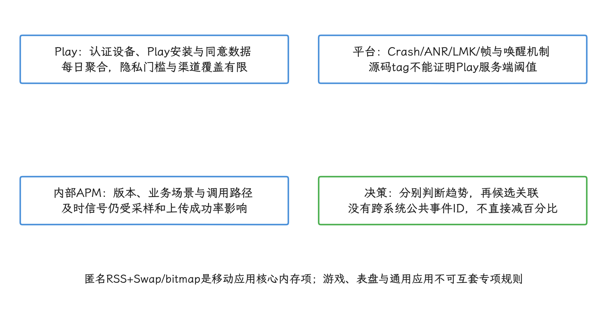
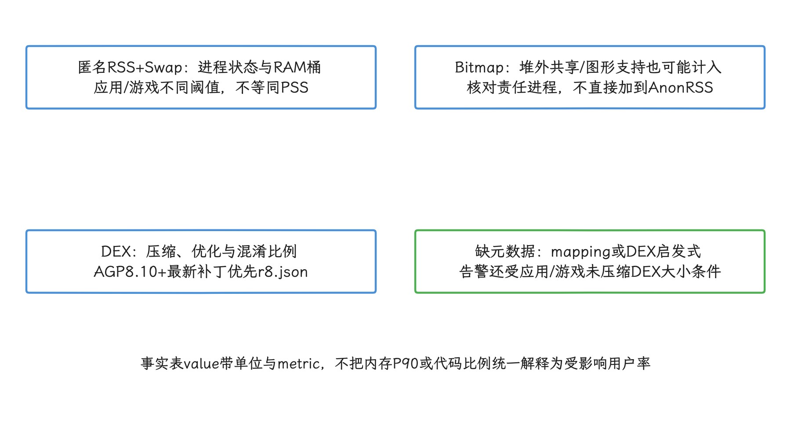
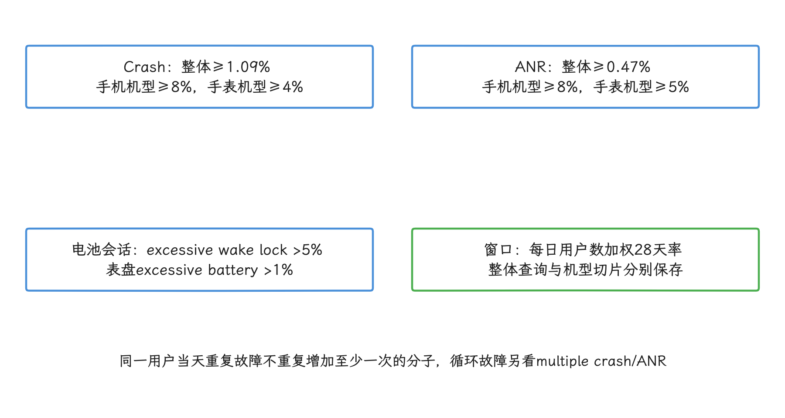
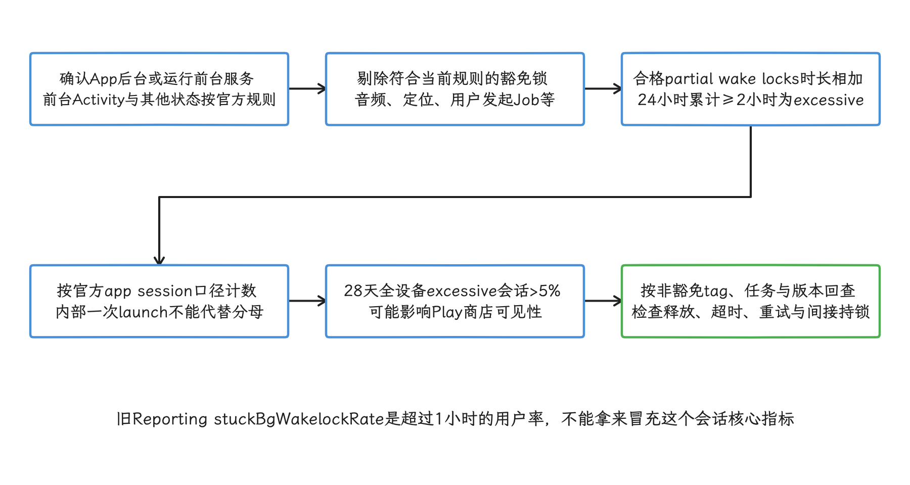
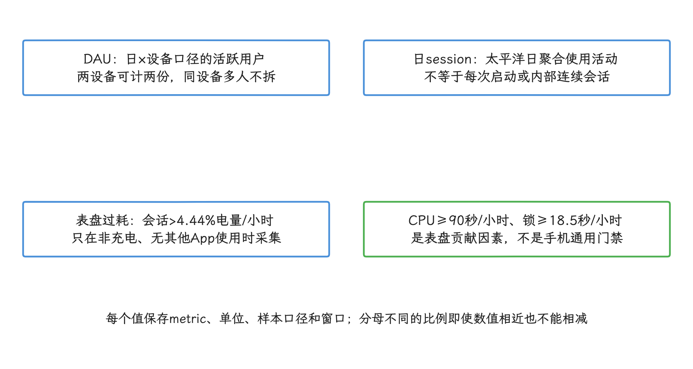
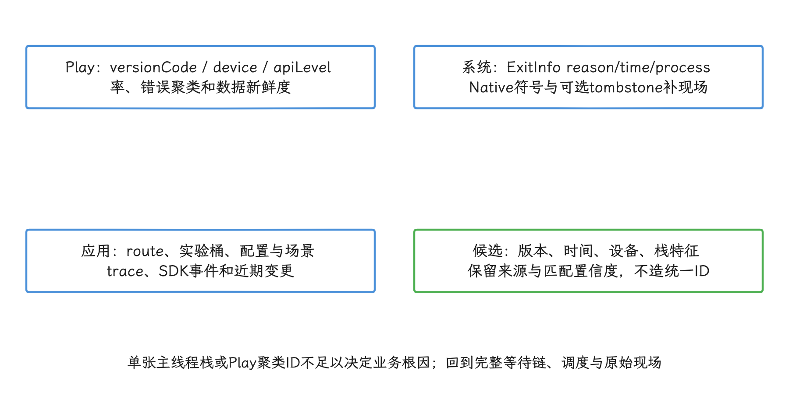
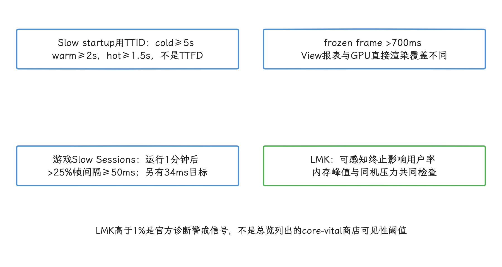
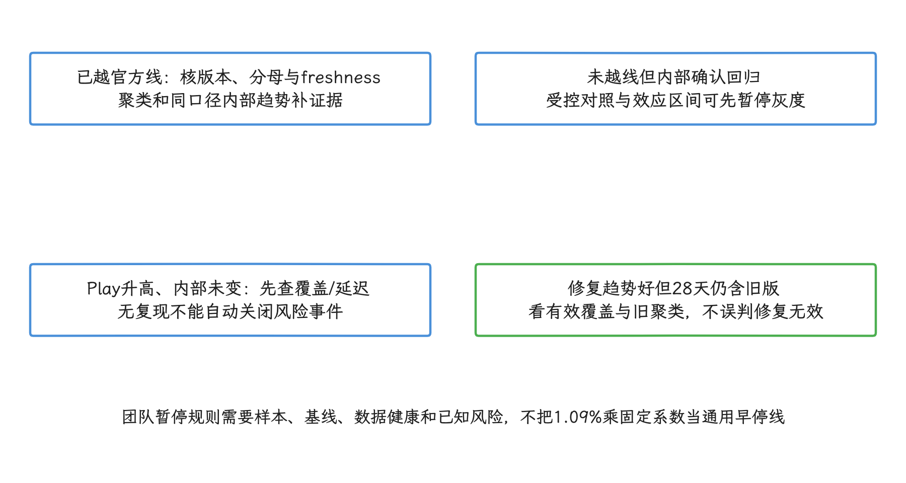
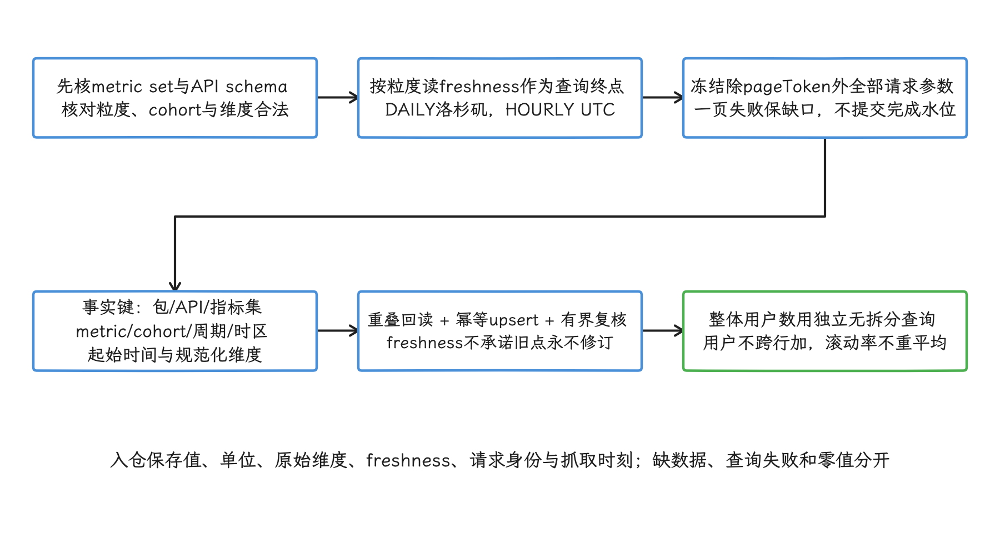
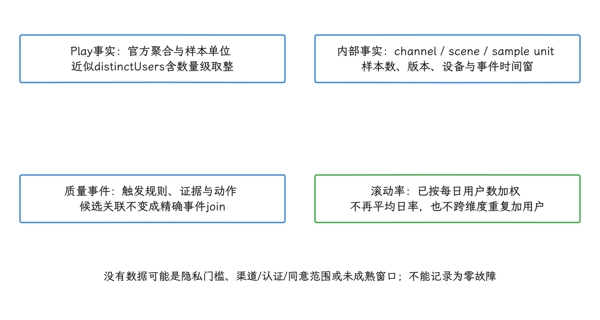

# Android Vitals 与 Play Console 质量指标归因

Android Vitals 是 Google Play 对线上技术质量的外部观测。它统计的用户都从 Google Play 安装应用、并允许共享使用情况与诊断数据，衡量的是这些用户经历的稳定性、性能和功耗问题。内部应用性能监控（application performance monitoring，APM）负责定位问题所在的版本、场景和调用路径，帮助团队在只向部分用户逐步发布的灰度阶段暂停异常版本。两套数据的采集范围、分母和时效都不同，我们先分别判断各自的趋势，再按版本、设备和错误类型相互校验；直接比较两个百分比的大小，得不出有效结论。

指标口径以2026年10月25日本轮可见的公开文档为准，平台版本上界为 Android 17 / API 37。Vitals 的指标定义、阈值和 Play 可见性策略都由 Google Play 服务端制定，`android-17.0.0_r1` 的 Android 开源项目（Android Open Source Project，AOSP）API 契约里查不到它们；Android 17 源码能解释的，是应用无响应（ANR）、低内存终止守护进程（low memory killer daemon，LMKD）、帧时间或唤醒机制这些平台侧机制，要证明 Play 的服务端阈值，只能回到 Play 文档本身。所以升级平台源码锚点时，这些阈值保持原样；Play 文档变更，也推不出 Android 框架同时发生了对应改动。

## Android Vitals 的指标层级

做发布评审时，我们先把三层数据分开：核心指标（core vitals）、其他 Vitals 和内部 APM。Play 为 core vitals 规定不良行为阈值（bad behavior threshold），指标达到相应条件后，应用在 Google Play 的可见性可能受影响。一项指标是否属于 core vital、可见性约束何时生效，要分别确认；其他 Vitals 中的 DEX code optimization（DEX 代码优化）也有已公布的可见性规则。

| 层级 | 2026 年代表指标 | 它能回答什么 | 仍需内部补充什么 |
|---|---|---|---|
| Core vitals：稳定性与电量 | user-perceived（用户可感知）crash rate、user-perceived ANR rate、excessive partial wake locks；表盘应用另有 excessive battery usage | Play 用户是否达到官方不良行为阈值 | 版本变更、调用栈、系统跟踪文件（trace）、业务场景和发布动作 |
| Core vitals：内存 | 移动应用的 memory usage（anonymous RSS + swap，匿名驻留内存与交换空间占用之和）、bitmap memory usage（位图内存占用） | 内存占用是否达到对应进程状态、设备内存档和应用/游戏类别的阈值 | 进程名、内存分位数、堆转储、图片资源和前后台切换时的释放行为 |
| 其他 Android Vitals | crash / ANR rate、multiple crash / ANR rate、user-perceived LMK、slow startup、slow/frozen frames、excessive wakeups、stuck background wakelocks、DEX code optimization、权限拒绝等 | 某类线上体验是否恶化，问题集中在哪些版本、设备或地区 | 实时告警、细粒度场景和可复现证据 |
| 游戏专项 | Slow Sessions 的 20 FPS、30 FPS 观察口径；FPS 表示 frames per second（每秒帧数） | 游戏会话是否长期处于低帧率 | 场景、画质档、SoC（片上系统）/GPU（图形处理器）、温控、Swappy 帧节奏库、ADPF（Android 动态性能框架）会话 |
| 表盘专项 | watch face excessive battery usage 及 CPU、partial wakelock 贡献因素 | 表盘在非充电、没有其他应用使用设备时的耗电情况 | AoD（常亮显示）配置、刷新频率、Complication（表盘信息组件）更新、资源与动画成本 |
| 内部 APM | crash-free users（无崩溃用户率）、启动分位数、页面卡顿、内存水位、业务错误率 | 当前版本是否回归，问题发生在什么路径 | 与 Play 维度一致的版本、设备、系统和渠道标识 |

[Android Vitals 总览](https://developer.android.com/google/play/vitals)已把匿名 RSS + swap 和位图内存列为移动应用的 core vitals，并注明：内存、位图内存和代码优化超出相应阈值，可能从 2027 年 2 月起影响商店可见性。引用前先看时间：截至2026年10月25日，这一天还没到，这几条可见性约束按“尚未生效”记录。该日期属于 Play 政策，与 Android 平台版本升级分开判断。

[匿名 RSS + swap](https://developer.android.com/google/play/vitals/memory-usage)按进程状态和 RAM 桶展示，前台、用户可感知服务、后台和缓存状态要分别分析；内存阈值还区分应用与游戏，我们查数时按进程状态、RAM 桶和应用/游戏类别取对应阈值，套用单一全局数值会出错。进程名拆分可能包含应用使用的 SDK 或系统服务，先核对责任进程，再定位资源占用。[位图内存](https://developer.android.com/google/play/vitals/bitmap-memory-usage)的范围比堆分配宽，还可能包含共享内存或图形缓冲区支持的位图，和匿名 RSS + swap 是两个口径。

[DEX code optimization](https://developer.android.com/google/play/vitals/code-optimization)检查代码压缩、优化和混淆，与启动表中的运行时 dexopt 分开计量。这些比例的数据来源按构建条件分级：使用 AGP 8.10 或更高版本的最新补丁构建时，Vitals 从随包提供的 `r8.json` 读取这些比例；较低版本或缺少该文件时，会使用可用的 `mapping.txt`，再退到 DEX 启发式分析。对照本地工具时注意：本地 R8 Configuration Analyzer 的优化前得分只是参考，与 Vitals 的读数可能对不上。指标本身可为所有应用和游戏计算，告警和阈值约束则受未压缩 DEX 总大小条件限制；应用与游戏的适用条件不同，以官方页面为准。

引用数据时带上“表盘应用”这个限定：`excessive battery usage` 目前只为具备足够数据的表盘应用提供，其余 Wear OS 应用不在覆盖范围内。Slow Sessions 也只适用于游戏，普通应用应使用 UI 渲染指标和端侧帧证据。其[官方页面](https://developer.android.com/google/play/vitals/slow-session)提到未来将引导用户避开无法达到 20 FPS 的游戏；具体的生效日期和可直接套用的整体不良行为阈值，该页尚未给出，我们引用到“已宣布的方向”为止，按固定比例降权之类的说法超出了页面内容。

Play 阈值只是发版暂停规则之一。一个版本可能尚未达到该阈值，却已经相对上个版本明显恶化，这时应先由内部灰度指标阻止继续放量。反过来，Play 上的存量问题也可能在 28 天窗口中继续出现；宣布问题结束的依据是整个窗口的数据，当天内部指标恢复还不够。

<!-- gracker-diagram: a293-01-vitals-apm-and-platform-contracts -->

图：核心指标是否列入、何种应用适用、可见性何时生效是三个检查项；内存/代码优化关注2027年2月。

<!-- gracker-diagram: a293-07-memory-and-code-optimization-metric-scope -->

图：内存与代码优化的2027年2月可见性时间单独保存；本地Analyzer优化前分数不保证与Vitals一致。

## 28 天窗口、整体阈值与机型阈值

进入具体数字前，先看 Play 的统计节奏：Google Play 每天检查 core vitals，通常依据最近 28 天的数据评估质量，Crash 和 ANR 的滚动比例按每日用户数加权。我们还要分清两种约束范围：整体越线可能影响所有设备上的可见性，机型越线主要影响对应设备。下表列出已生效的稳定性与电量阈值；内存指标按设备内存档、进程状态和应用/游戏类别另设阈值，其可见性生效时间见前述政策边界。

| Core vital | 整体不良行为阈值 | 机型阈值 | 统计对象 |
|---|---:|---:|---|
| User-perceived crash rate | ≥ 1.09% | 手机机型 ≥ 8%；手表机型 ≥ 4% | 每日经历至少一次用户可感知崩溃的 DAU 比例，按每日用户数加权形成 28 天值 |
| User-perceived ANR rate | ≥ 0.47% | 手机机型 ≥ 8%；手表机型 ≥ 5% | 每日经历至少一次用户可感知 ANR 的 DAU 比例，按每日用户数加权形成 28 天值 |
| Excessive partial wake locks | > 5% | 无机型阈值 | 发生 excessive partial wake lock 的 app sessions |
| Excessive battery usage（表盘） | > 1% | 手表机型 > 1% | 电量消耗超过 4.44%/hour 的 watch face sessions |

DAU 是 daily active user（每日活跃用户）的缩写，统计单位是“某一天、某台设备上使用应用的一名用户”，与安装数和启动次数分开计算。同一用户当天使用两台设备会贡献两个 DAU；多人当天共用一台设备只计一个。同一用户多次发生 Crash、ANR 或 LMK，不会让“至少一次”的 rate（受影响比例）分子重复增加。若要观察循环失败，应同时查看 multiple crash rate 和 multiple ANR rate。

Vitals 的 user session（用户会话）按日聚合，与一次 launch（启动）分别计量。官方将其定义为太平洋时间午夜起 24 小时内应用全部使用活动的总和；当天没有记录到使用活动时，不产生 session。涉及 partial wake lock、表盘耗电或其他 session rate 时，我们沿用这一日会话口径；内部的一次启动会话直接拿来当分母，算出来的就是另一个指标了。

阈值附近还要注意比较符号：Crash 和 ANR 文档使用 “at least”，达到阈值即属于 bad behavior；partial wake lock 与表盘耗电文档使用 “more than”，要严格超过才算。内部暂停阈值可以比官方阈值更严格，字段名上写明它属于团队规则，与 Play 官方阈值分开存放。

<!-- gracker-diagram: a293-02-threshold-operators-device-scopes -->

图：Crash/ANR使用at least，电池规则使用more than；团队更早暂停线单独命名，不能改写官方门槛。

### Partial wake lock 的当前规则

Partial wake lock（局部唤醒锁）在设备屏幕关闭后仍让 CPU 继续运行，因此持有过久会阻止设备进入低功耗状态。Android Vitals 将所有符合统计条件的 partial wake lock 时长相加：若它们在 24 小时内累计达到 2 小时或以上，这个会话被判为 excessive。统计时只计算应用处于后台、或正在运行前台服务期间持有锁的时间；现行文档列出的豁免包括音频、定位和由用户发起的 JobScheduler API 等具有明确用户收益的场景。28 天内 excessive 会话超过 5%，可能影响 Play 可见性。

这一政策从 2026 年 3 月 1 日起逐步实施可见性约束。旧资料中的“3 小时”或“仍处于不影响可见性的 beta”已不适合作为当前结论；我们诊断时，以 2026-09-21 更新的 [Excessive partial wake locks](https://developer.android.com/topic/performance/vitals/excessive-wakelock) 页面和 [Android Vitals 总览](https://developer.android.com/topic/performance/vitals) 为准。

<!-- gracker-diagram: a293-03-partial-wake-lock-session-classification -->

图：2026年3月1日起逐步执行可见性约束；统计豁免不意味着资源生命周期可以不受控。

### 表盘耗电的当前规则

表盘会话的电量消耗超过 4.44%/hour 时，计入 excessive battery usage；官方给出的优化目标是 80% 会话低于 3.2%/hour。控制台还为表盘提供两个贡献因素：CPU 使用达到 90 秒/小时、partial wakelock 达到 18.5 秒/小时。这两个数值的适用范围止步于表盘专项：Play 并未把它们设为所有 Android 应用的独立阈值，它们也顶替不了手机应用的 wakelock 或 CPU 暂停阈值。

<!-- gracker-diagram: a293-04-denominators-dau-session-and-watch-factors -->

图：表盘优化目标为80%会话低于3.2%/小时；该专项不能推广所有Wear OS应用或手机应用。

## User-perceived Crash / ANR 与自建 Crash 上报的差异

把两边的数据放到一起之前，我们先确认分母：Vitals 的 rate 以受影响用户为中心，自建 Crash SDK（崩溃采集软件开发工具包）常以事件、会话或启动为中心；同一版本在两边呈现不同趋势，往往来自统计单位和覆盖范围的差异。

| 对比项 | Android Vitals | 自建 APM / Crash SDK |
|---|---|---|
| 覆盖范围 | 通过 Google Play 安装、设备通过认证、用户允许共享数据且达到隐私展示门槛的数据 | 所有接入并成功上报的渠道、测试包或企业分发包 |
| 分母 | DAU 或 Reporting API 聚合周期内的 `distinctUsers` | user、device、session、launch 等团队自定义口径 |
| User-perceived crash | 用户主动使用应用时至少发生一次崩溃；活动使用包括显示 Activity 或执行 foreground service | 是否标为前台取决于 SDK 的进程状态和生命周期实现 |
| User-perceived ANR | 当前只计 `Input dispatching timed out` 类型 | SDK 可能通过 watchdog（周期性检查主线程是否响应的监测器）、主线程消息耗时或系统 trace 识别更多卡死 |
| 多次问题 | multiple crash / ANR rate 统计一天内至少两次的受影响用户 | 事件表通常保留每次发生记录 |
| 时效 | 每日更新并受聚合与隐私门槛影响 | 可做到分钟级，但受采样、进程死亡和上传成功率影响 |

Wear OS 的 user-perceived crash 有一项单独规则：官方 crash 文档将前台和后台崩溃都纳入手表的 user-perceived 口径。若把这条手表规则直接套用到手机应用，会高估 Play 在后台崩溃上的统计范围。

### 三层证据如何配合

- Play 层用于确定影响面：`versionCode`（应用版本号）、`deviceModel`（设备型号）、`apiLevel`（Android API 级别）、`deviceType`（设备形态）、地区、rate 和错误聚类。
- 系统层用于确认退出原因：Android 11 及以上可查询 `ApplicationExitInfo` 的 reason、timestamp、process name 和可用 trace；native crash（原生代码崩溃）还要保留符号化 tombstone（系统崩溃转储）或 minidump（精简崩溃转储）。
- 应用层补充用户路径、页面、实验桶、feature flag（远程功能开关）、网络状态和最近变更。

三层数据之间通常没有可跨系统使用的事件 ID，我们能建立的是弱关联：按版本、时间桶、设备维度、进程名和 top frame（最靠近故障点的关键栈帧）筛出候选事件，再打开少量原始证据验证——这就是“弱”的含义。两个聚合数字相近，只值得放在一起查证，说明不了它们来自同一批事件；Play 聚类 ID 同样停留在候选关联这一层，内部事件主键保持独立。

看 ANR，我们从一张堆栈往外走。`Input dispatching timed out` 说明用户输入没有在系统规定时间内得到处理，根因可能在输入回调之外——主线程或许正卡在同步 Binder、磁盘 I/O、锁竞争、类初始化或 CPU 密集计算中；判断时回到 ANR trace、Perfetto 和相邻线程状态上。详细的稳定性归因见 20.1 节。

<!-- gracker-diagram: a293-05-crash-anr-source-association -->

图：手机user-perceived crash包含Activity或FGS活跃使用；手表另有后台崩溃计入口径。当前user-perceived ANR只计输入分发超时。

## 启动、渲染、LMK 与 Slow Sessions 的归因路径

这些指标给出的只是症状和影响面。回查时我们按固定顺序走：先锁定版本与设备分组，再确认内部指标是否同向变化，然后查找可复现的内部 session（连续使用记录）或 trace，据此决定继续放量、设备降级还是回滚。

| Vitals 入口 | 官方统计边界 | 内部证据 | 归因重点 |
|---|---|---|---|
| Slow startup | TTID（time to initial display，首帧显示耗时）；cold ≥ 5s、warm ≥ 2s、hot ≥ 1.5s 计为 excessive | 启动类型、TTID/TTFD（time to full display，达到可交互状态的耗时）、`ApplicationStartInfo`、Macrobenchmark、Perfetto、I/O 与 dexopt（DEX 字节码优化） | 区分进程创建、Activity 创建、首帧和可交互，不用 `reportFullyDrawn()` 代替 TTID |
| Slow / frozen rendering | View/UI Toolkit 路径；frozen frame > 700ms，直接使用 Vulkan/OpenGL/Unity/Unreal 的渲染时间可能不在该报表中 | FrameTimeline、FrameMetrics、JankStats 状态标签、主线程、RenderThread、GPU 和刷新率 | 确认慢帧来自 UI thread（界面线程）、RenderThread、GPU、BufferQueue 或调度延迟 |
| User-perceived LMK | DAU 中至少经历一次可感知 LMK（low memory kill，低内存终止）；例如 Activity 正在显示或 foreground service 正在运行 | `ApplicationExitInfo.REASON_LOW_MEMORY`、PSS/RSS、native heap、bitmap、WebView、设备 RAM 桶 | 同时判断版本内存增长与设备整体压力，不能把每个 `REASON_LOW_MEMORY` 都归咎于单一对象泄漏 |
| Slow Sessions | 仅游戏；运行满一分钟后统计；超过 25% 帧的 present-to-present 间隔不低于 50ms 即为 20 FPS slow session，另有 34ms/30 FPS 指标 | Swappy、SurfaceFlinger（系统显示合成服务）timestats、ADPF、thermal status、场景、画质档、SoC/GPU | 统计相邻画面呈现间隔，覆盖 OpenGL、Vulkan 和 UI Toolkit surface（应用提交画面的缓冲区载体），不等同于应用 CPU frame time |

做渲染归因时，这几样证据各管一段路径：FrameTimeline 记录一帧从应用到系统合成的时间线，FrameMetrics 提供应用窗口的帧耗时，JankStats 状态标签给慢帧附加页面或交互信息；再往下是执行部分渲染工作的 RenderThread，和在生产者与显示消费者之间传递图形缓冲区的 BufferQueue。对着上表的归因重点，我们就能判断慢帧落在哪一段。

内存项的几个词各有指向：PSS 是按共享比例折算后的进程内存，RSS 是进程当前驻留在物理内存中的总量，native heap 是 C/C++ 等原生代码使用的堆，设备 RAM 桶则按物理内存容量给设备分组。解释一次 LMK，我们要把这些数值放回设备内存分组和同机内存压力里看，单独一个数值撑不起结论。

Slow Sessions 的 present-to-present，是按 SurfaceFlinger 采集的应用 surface 相邻帧呈现时间估计出的帧间隔，与应用提交 BufferQueue 的时刻差是两回事。thermal status 表示系统报告的热压力等级，要断言 CPU/GPU 已降到某个频率，还需要频率侧的证据。所以 Slow Sessions 统计的是用户看到的出帧节奏，CPU 或 GPU 的单阶段耗时要另找对应的测量。

Slow startup 的固定秒数适合抓住严重慢开，冷启动从 1.8 秒退化到 2.4 秒这类未达 Play 门槛的回归，它就无能为力了；同样的耗时若出现在温启动中，2.4 秒已经超过其 2 秒门槛。所以灰度暂停规则要比较相同启动类型、相同设备档和相同安装状态下的分布；第 21.1 节给出了启动数据的详细边界。

Frozen frame 与 ANR 的判定条件是两条线：超过 700ms 的一帧会产生明显停顿，要形成 ANR，还得满足相应系统超时条件。渲染归因我们以 FrameTimeline 和线程调度证据为准，“超过 700ms”本身推不出 ANR。

User-perceived LMK 常呈现为界面消失或进度丢失，Java crash handler 收不到异常，Android 11 及以上的 `ApplicationExitInfo` 能补上历史退出原因。不过查询到 `REASON_LOW_MEMORY` 只是诊断起点：设备上同时运行的进程、交换空间（swap）、内核回收压力和应用自身内存峰值都可能参与决策，详见 23.7 节。

现行 LMK 页面把高于 1% 称为需要立即处理的警戒信号。这个数字定的是诊断优先级：Android Vitals 总览既未把 user-perceived LMK 列为 core vital，也未为它声明商店可见性阈值。写进发版规则时，我们把它标成内部警戒线，与 Play 政策门槛分开。

<!-- gracker-diagram: a293-06-startup-rendering-slow-session-and-lmk -->

图：Slow Sessions根据SurfaceFlinger呈现间隔估计出帧节奏，不能用CPU frame time代替；700ms一帧也不是ANR判定。

## 功耗类 vitals 与后台任务治理

功耗问题经常跨越一次应用会话：Alarm 唤醒进程，任务获取 wakelock，网络失败触发重试，下一次调度又重复这组操作。Play 指标能显示影响比例；要把这条链还原出来，端侧采集必须保留“由谁申请、持有多久、为何结束”。

| 资源 | Play / Reporting API 观察项 | 端侧建议字段 | 修复方向 |
|---|---|---|---|
| Partial wakelock | 现行 excessive partial wake locks；Reporting API 另有旧指标 `stuckBgWakelockRate`，定义为后台持有超过 1 小时的 `distinctUsers` 占比 | 锁 tag（系统记录的锁名称）、责任组件、调用栈、获取/释放时间、超时、前后台、屏幕状态、任务来源 | 为直接获取的锁设置超时并保证异常路径释放；审查间接获取 wakelock 的 API |
| AlarmManager | `excessiveWakeupRate`，定义为每小时 wakeup 超过 10 次的 `distinctUsers` 占比 | alarm 类型、PendingIntent 标识、窗口、周期、业务来源、触发与取消时间 | 合并任务、减少精确和 wakeup alarm、取消失效任务、优先使用受约束调度 |
| WorkManager / JobScheduler | 可能间接贡献 wakelock、网络和唤醒 | work/job ID、约束、重试次数、停止原因、实际运行时间、网络量 | 设置正确约束和退避；检查无界重试、链式任务和重复入队 |
| 后台网络、Wi-Fi 与定位 | Console 中可能提供相应功耗观察项；2026 core vital 阈值不包含这些项目 | 请求域名、字节数、重试、网络类型、扫描/定位频率、前后台 | 批量传输、退避重试并加入随机延迟、按需注册、离开场景后注销 |
| 表盘 | excessive battery usage 以及 CPU、wakelock 贡献因素 | AoD、刷新频率、绘制耗时、Complication、资源大小、充电状态 | 优先使用 Watch Face Format；降低 AoD 更新、动画和高频数据源 |

`stuckBgWakelockRate` 与 2026 年 `excessive partial wake locks` 使用不同定义。前者属于 Reporting API 指标集（metric set），表示后台持有超过 1 小时的用户率；后者属于 Play core vital，规则是“24 小时累计至少 2 小时且 28 天影响超过 5% 会话”。仓库中可以同时保存两者，但告警标题和字段必须带上具体定义。

音频、定位等豁免也不表示锁可以无限持有：Play 是否豁免取决于其当前分类和用户收益判断，内部这边，我们仍要检查资源生命周期、设备发热和电量。后台调度的 API 选择与系统限制见 25.2 节。

## Play 指标与发版暂停规则

官方阈值表示政策边界，团队还需要更早的内部暂停线。我们把发布动作分成“已越过官方阈值”“内部确认新版本回归”“证据不足”三类来讨论；“接近阈值”要写成结论，得先有样本和基线依据。

| 观察结果 | 需要确认的证据 | 建议动作 |
|---|---|---|
| 新版本分组已越过 crash / ANR 整体阈值 | Reporting API 的 freshness（数据新鲜度，即最新可用数据点）、28 天用户加权指标、版本流量、内部同口径趋势、主要错误聚类（top clusters） | 停止放量；若发布时间和聚类均指向新版本，回滚或发布紧急修复版本（hotfix） |
| 某手机或手表机型越过对应阈值 | `deviceModel`、系统版本、ABI（应用二进制接口）、SoC/GPU、WebView、ROM（设备系统构建）、该分组 `distinctUsers` | 暂停该设备组；可安全降级时使用远程配置，否则回滚 |
| Partial wake lock core vital 越线 | 非豁免 tag、24 小时累计时长、受影响会话、任务来源、版本变化 | 停止相关后台功能放量，修复资源生命周期和调度策略 |
| 表盘耗电越线 | 充电状态、会话耗电、CPU/wakelock 贡献、AoD 与表盘版本 | 暂停表盘版本；优先降低刷新和动态资源成本 |
| Play 未越线，但内部指标相对对照版本显著恶化 | 实验分组是否随机、样本量、置信区间（按预设方法刻画效应估计不确定性的区间）、设备与版本构成、数据漏报 | 按内部灰度暂停规则处理；不要等待 28 天窗口 |
| Play 指标升高，内部没有对应变化 | 分母、渠道、用户同意范围、时区、版本过滤、内部上报成功率 | 保持灰度或降低放量速度，补齐证据后再决定，不能按“无复现”关闭问题 |
| 存量窗口仍越线，但修复版本趋势持续改善 | 修复版本覆盖率、旧版本占比、错误聚类是否消退、freshness | 控制放量并继续观察；不要把窗口残留误判为修复无效 |

每个团队都可以设置比 Play 更早的趋势预警，但预警值应由历史基线、当前样本量和可接受风险推导，并保留变更记录。把 1.09% 或 0.47% 直接乘一个固定系数固然省事，低流量版本、设备集中度和指标季节性都会让这样的预警失真。

A/B 实验同样受质量暂停规则约束。内部 crash、ANR、启动、帧耗时和功耗数据用于实验期间早停；Android Vitals 用于外部复核和较长窗口的风险观察。实验统计与多重检验见 26.4 节。

<!-- gracker-diagram: a293-08-release-harm-versus-data-insufficiency -->

图：官方may影响可见性不是每次立即降权；7天新出现问题标记与最长21天处理也不是继续放量保证。

## 数据延迟、采样盲区与误判边界

Vitals 覆盖到的只是部分线上用户，范围由一组前置条件决定；读数之前，我们先把这些边界过一遍。

- 数据来自允许自动共享使用情况与诊断数据的用户，仅覆盖部分设备与系统版本。
- Vitals 排除未认证设备和通过 Google Play 以外渠道安装的应用版本。国内渠道、企业分发、预装和旁加载必须由其他观测系统覆盖。
- 指标需要达到隐私展示门槛。低流量应用、小版本或小设备分组可能没有可见数据；“没有数据”不能解释为零问题。
- 数据每日更新，不同系统版本的到达时间可能不同。查询或评审前先读取 freshness，未完成的一天与完整历史日分开比较。
- Play 的 DAU、daily session、app session 和 watch face session 各有独立分母。跨指标做比例比较前必须记录单位。
- Play Console 的时间窗口、Reporting API 的聚合周期和内部看板时区可能不同。Reporting API 的 DAILY 数据固定使用 `America/Los_Angeles`，HOURLY 使用 UTC。
- `deviceModel` 能定位影响集中度；要指认设备厂商（OEM）是原因，还需对照应用版本、WebView、驱动、SoC、地区和服务器配置——它们可能共同变化。
- User-perceived 会排除一部分后台事件；内部仍需观察后台进程退出、后台任务失败、native tombstone、业务错误和短时卡死。

内部 crash-free sessions 与 Play user-perceived crash rate 分属两套口径：前者分母可能是会话，后者分母是 DAU，重复崩溃、后台崩溃和渠道范围也不同。我们先分别判断各自趋势，再用版本、设备和错误聚类验证两边是否指向同一变更；把两个数字放上同一张图直接相减，差值没有对应的意义。

Vitals 未越线，只说明没碰到 Play 的政策边界：固定启动或 frozen frame 边界识别的是明显问题，业务关键路径的分位数和用户完成率，要由内部数据回答。内部指标有可靠对照且确认回归时，我们先按灰度策略处理。

## Play Developer Reporting API 与内部数据仓库对接

把 Play 的数据接进内部仓库，入口是 Play Developer Reporting API。它用 metric set（指标集）组织指标，同一个 metric set 内的指标共享数据新鲜度、聚合粒度和可用维度。2026 年稳定性和性能 rate（比例指标）的主要入口为 `v1beta1`，包括 `vitals.anrrate`、`vitals.crashrate`、`vitals.lmkrate`、`vitals.excessivewakeuprate`、`vitals.stuckbackgroundwakelockrate`、`vitals.slowstartrate` 和 `vitals.slowrenderingrate`；内存另有 `vitals.anonrssandswapmemoryusage` 和 `vitals.bitmapmemoryusage`，提供内存占用分位数与 `distinctUsers`，读数时按占用量理解，受影响用户率是另一类指标。错误报告计数仍有 `v1alpha1` 资源。落库时，我们按官方 schema（字段、类型和约束定义）保存 API 版本、metric set 名称和指标名，字段名的出处是 endpoint 文档，Console 文案只用来辅助阅读。

一次 `query` 请求包含四类核心信息：

- `timelineSpec`：聚合粒度和时间范围。Crash/ANR 支持 DAILY 与 HOURLY，分别固定使用 `America/Los_Angeles` 和 UTC；`slowstartrate`、`slowrenderingrate` 只支持 DAILY。部分 rolling metric（滚动窗口指标）也只提供 DAILY 数据，小时级请求要先确认目标 metric set 的支持情况。
- `metrics`：例如 `userPerceivedCrashRate`、`userPerceivedCrashRate28dUserWeighted`、`distinctUsers`。
- `dimensions`：用于切片的维度，例如版本、机型和地区。每个 metric set 支持的集合可能不同，提交请求前应读取对应 endpoint（具体 API 接口资源）文档。
- `filter`、分页和 `userCohort`：过滤分组、读取完整结果，并用 user cohort（用户群组）选择数据范围。Crash/ANR 支持公开系统版本、应用测试用户和系统 beta 用户；其中 `OS_BETA` 仅支持 `versionCode` 与 `osBuild` 维度。`slowstartrate`、`slowrenderingrate` 的 `userCohort` 只支持 `OS_PUBLIC`，Crash/ANR 的测试群组查询不能照搬到这里。

鉴权使用 `https://www.googleapis.com/auth/playdeveloperreporting` OAuth scope（OAuth 授权范围，用来声明访问权限）。每个 metric set 资源还提供 freshness 查询，可得到各粒度最新可用数据点。入仓任务先按粒度读取 freshness，以最新可用点限制查询终点，并保存抓取时刻、API 版本、cohort 及完整维度。freshness 只说明“这是当前可见的最新点”，历史点仍可能被修订，所以增量回读允许重叠：按事实键 upsert，再配置一段有界历史复核。分页未完整或 API 失败时，完成水位停在原地，失败批次记为缺口等待重试。

<!-- gracker-diagram: a293-09-reporting-query-completeness-and-upsert -->

图：Crash/ANR可DAILY/HOURLY，slow startup/rendering只DAILY；OS_BETA仅支持其规定维度，不共用万能请求。

### 仓库模型与候选关联键

Play 与内部系统之间没有共享的事件标识，数据仓库因此把 Play 聚合事实、内部聚合事实和质量事件分开存储。`join key`（关联键）指两张表用于确认同一条记录的共同字段；在这个场景里，我们构造得出的是候选关联条件，事件级精确键两边的数据都给不出来。

| 数据集 | 最小关键字段 | 用途 |
|---|---|---|
| Play metric fact（Play指标事实表） | package、API版本、metric set、metric、cohort、聚合粒度、时区、start time、维度集合、value与单位、distinctUsers、freshness | 保留官方值及完整查询身份；value可为率、计数或内存分位数，不一律命名rate |
| Internal quality fact（内部质量事实表） | app、version、channel、time bucket（时间分桶）、device/OS、metric、value、sample unit（样本单位）、sample size（样本量） | 保存内部 APM、实验和灰度指标 |
| Quality incident（质量事件表） | incident id（事件编号）、触发规则、受影响版本/设备、证据链接、动作、状态 | 记录调查和发布决策 |

维度集合适合按固定顺序和格式保存为键值对，避免为某个 endpoint 预建一组假定永远存在的列。若团队经常按 `versionCode`、`apiLevel` 和 `deviceModel` 查询，可以在仓库侧提取这些常用列，同时保留原始维度对象。

`distinctUsers` 是近似值，并会按数量级取整；官方明确警告，跨维度行继续相加，同一用户可能被重复计数。需要整体值时，另发起一次不带 breakdown（拆分维度）的独立查询。

7 天和 28 天字段是按每日 `distinctUsers` 加权的 rolling rate（滚动比例），服务端已经让用户量较大的日期占更高权重；在仓库侧对日值再求一次简单平均，会把这份加权抹平。

候选关联仍需 trace 或堆栈确认。`errorReportCount` 记录错误报告数量，crash rate 则用受影响用户数除以用户总数；计数和比例是两种量，套同一条聚合公式会算错。

查询规模也需要控制。官方建议应用越大、breakdown 越多，单次时间范围越短，以免读取过多数据而超时。

分页时除 `pageToken` 外必须保持原查询参数不变；任务还应保存失败重试和缺口检查，避免一页失败后留下看似完整的曲线。

<!-- gracker-diagram: a293-10-aggregation-rounded-users-and-quality-incidents -->

图：每次分页保留原查询参数；查整体用户数使用独立不拆分查询，计数与率不能套同一聚合公式。

## 技术质量政策与商店可见性风险

越过已生效的稳定性或电量 core vital 阈值后，Google Play 可能降低应用或游戏的可见性；机型维度存在 bad behavior 时，Play 可能让对应设备用户更少看到该应用，并可能在商店详情页显示警告。引用这些规则时保留原文的 “may” 和 “likely”：它们描述的是可能性，每次越线立即降权属于加重后的说法。内存和代码优化按已公布的未来生效时间安排整改，与当前已生效的规则分开排期。

Crash 和 ANR 的新出现问题（emerging issues）还有一条独立时效：问题在设备上持续超过 7 天，Android Vitals 会将其标记出来，并给开发者最长 21 天处理。这个窗口服务于标记和处理，28 天 core vital 的统计定义照旧，是否继续放量也照旧另行评估。

工程侧至少要准备三类能力：

- 版本动作：灰度平台能暂停放量、回滚，并能查询仍在贡献 28 天窗口的旧版本。
- 设备动作：远程配置或发布策略能够按 `deviceModel`、API level、ABI 等可靠条件关闭高风险功能；条件表达式必须在目标设备上验证。
- 证据入口：Play 指标和错误聚类应链接到内部趋势、堆栈、trace、实验与变更记录，并明确标注关联是精确还是推测。

Android Vitals 提供一套由 Play 定义、会影响分发结果的外部证据；版本质量的结论要落在内部系统上，内部系统越早发现同一趋势，团队越有机会在 28 天窗口和商店风险扩大前完成修复。

## 全文小结

Android Vitals 适合判断 Play 覆盖用户的影响面和商店政策风险，内部 APM 则负责更快地定位版本、设备、场景和调用路径。两者没有共同的事件级主键，指标分母、时间窗口、渠道范围也不同；我们分别保留原始口径，再按版本、时间、设备和错误特征建立候选关联。

发布门禁应早于官方阈值响应内部回归，同时把 Play 的 core vital 阈值、机型风险和数据 freshness 作为外部约束。Reporting API 数据入仓时要保存 metric set、维度、时区、样本单位与查询条件；缺数按缺数处理，对已经聚合、加权的数据，要避免再次错误汇总。

## 参考资料

- [Android Vitals 总览、core vital 阈值与生效时间](https://developer.android.com/topic/performance/vitals)
- [Crash rate 的 DAU 与 user-perceived 定义](https://developer.android.com/google/play/vitals/crash)
- [ANR rate 与当前 user-perceived ANR 定义](https://developer.android.com/google/play/vitals/anr)
- [Excessive partial wake locks 当前规则](https://developer.android.com/topic/performance/vitals/excessive-wakelock)
- [表盘 Excessive battery usage](https://developer.android.com/google/play/vitals/excessive-battery-usage)
- [启动时间与 excessive startup 边界](https://developer.android.com/google/play/vitals/launch-time)
- [Slow rendering 与 frozen frame](https://developer.android.com/topic/performance/vitals/render)
- [游戏 Slow Sessions](https://developer.android.com/google/play/vitals/slow-session)
- [User-perceived LMK](https://developer.android.com/topic/performance/vitals/lmk)
- [匿名 RSS + swap 内存指标与进程状态](https://developer.android.com/google/play/vitals/memory-usage)
- [位图内存指标与统计范围](https://developer.android.com/google/play/vitals/bitmap-memory-usage)
- [DEX code optimization 适用条件与元数据来源](https://developer.android.com/google/play/vitals/code-optimization)
- [Play Developer Reporting API metric sets](https://developers.google.com/play/developer/reporting/metricset-intro)
- [Crash rate `v1beta1` query schema](https://developers.google.com/play/developer/reporting/reference/rest/v1beta1/vitals.crashrate/query)
- [ANR rate `v1beta1` query schema](https://developers.google.com/play/developer/reporting/reference/rest/v1beta1/vitals.anrrate/query)
- [Slow startup rate `v1beta1` query schema](https://developers.google.com/play/developer/reporting/reference/rest/v1beta1/vitals.slowstartrate/query)
- [Slow rendering rate `v1beta1` query schema](https://developers.google.com/play/developer/reporting/reference/rest/v1beta1/vitals.slowrenderingrate/query)
- [2026 电池技术质量执行说明](https://developer.android.com/blog/posts/battery-technical-quality-enforcement-is-here-how-to-optimize-common-wake-lock-use-cases)
