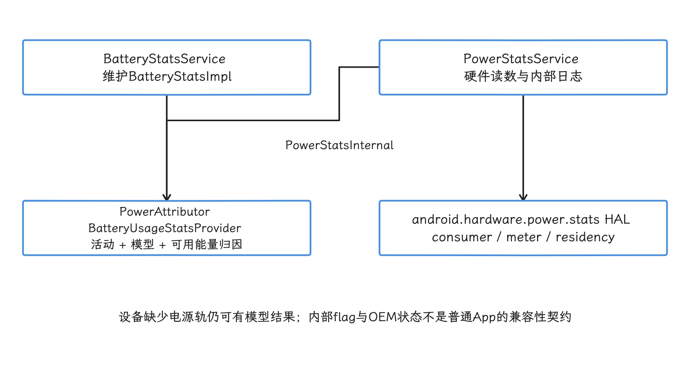
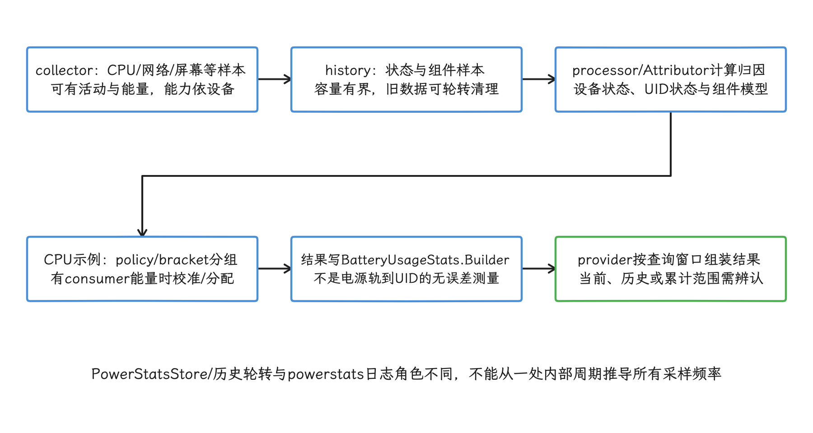
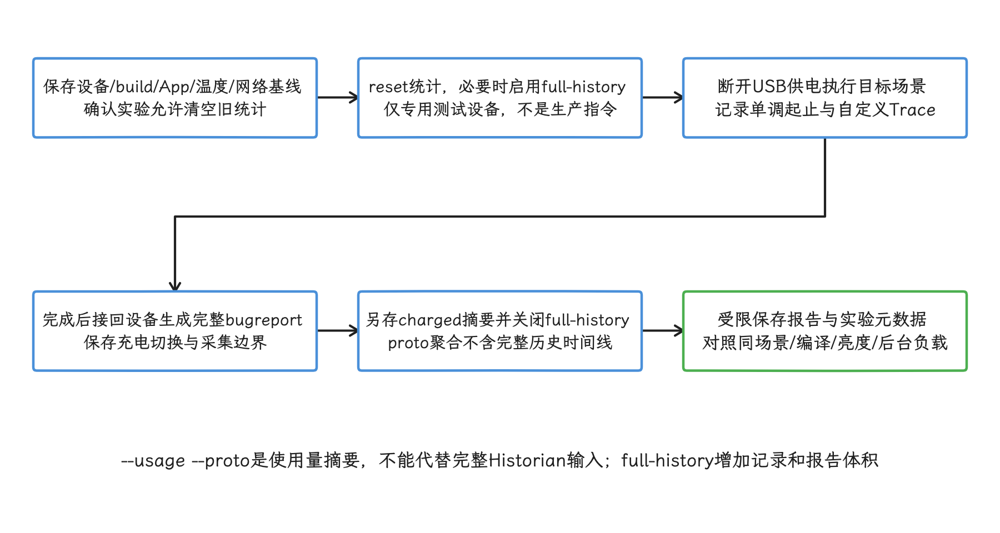
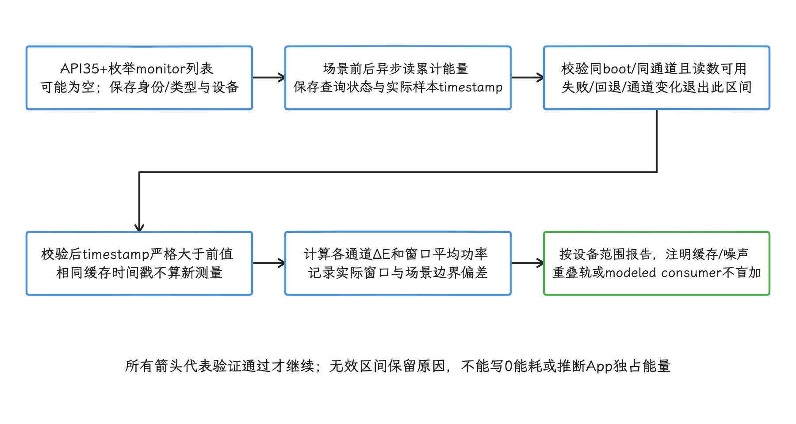
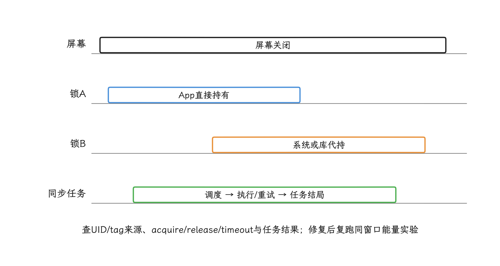

# Battery Historian 与功耗指标集成

排查耗电问题时，我们手里往往只有一份 bugreport（Android 系统诊断包）。Battery Historian 是把 bugreport 中的 Batterystats 等电源记录转换成可交互时间线的离线工具，适合分析一次受控实验：电量下降的那段时间里，屏幕、CPU、Job（系统调度任务）、网络、定位和 WakeLock（请求系统暂时保持硬件工作的唤醒锁） 各处于什么状态、哪些行为在重叠，它都能摊开在同一条时间线上看。至于“某个事件到底消耗了多少能量”，它给不出直接的答案。

还要注意它的维护状态：Android 官方已标注 Battery Historian [不再积极维护](https://developer.android.com/topic/performance/power/battery-historian)，建议优先考虑 system trace（按时间记录系统调度和设备事件的跟踪文件）、Macrobenchmark `PowerMetric`（在实体设备上重复执行用户场景的功耗基准指标） 或 Android Studio Power Profiler。因此历史报告仍可以继续用 Battery Historian 解读，新的自动化测量则应建立在可重复实验、公开 API 与平台原始证据上。

> 源码基线：AOSP `android-17.0.0_r1`；内核 `android17-6.18`；平台 Android 17 / API 37。

## 先分清四种数据

拿到一份功耗数据，我们先要弄清它属于哪一类：状态时间线、本 UID 的资源计数、系统的归因估算，还是设备级能量测量。功耗分析里常见的误判，就是把这几类数据当成同一类混着比。这一节先交代三个概念，再对照四类数据各自的来路。

三个概念里最先要用到的是 UID：Android 用这个用户标识归属应用进程和资源用量，同一个 UID 也可能由多个共享 UID 的包共同使用。设备那一侧的测量靠 ODPM（On-Device Power Rails Monitor，板载电源轨（rail）监视器）——它只在部分设备上提供，计量的电源轨是设备级通道，一条轨对应 CPU、显示或蜂窝网络这样的硬件子系统。

把两头连起来的是归因：系统按活动记录和功耗模型，把估算能耗分配到 UID 或硬件组件；`BatteryUsageStats` 就是承载这类结果的查询对象，数值仍受设备模型与测量能力限制。

| 数据 | 典型来源 | 能回答什么 | 不能直接回答什么 |
|---|---|---|---|
| 状态与事件时间线 | Batterystats 历史、system trace、应用 Trace | 某段时间发生了什么，哪些行为重叠 | 每个行为消耗了多少能量 |
| 本 UID 资源计数 | `SystemHealthManager.takeMyUidSnapshot()`、应用埋点 | CPU 时间、网络字节、WakeLock 与 Job 时长怎样变化 | 精确的整机或单功能能耗 |
| 系统归因估算 | `BatteryUsageStats`、设置页、bugreport | 系统怎样把组件能耗估算到 UID | 物理仪器级精度与跨设备可比性 |
| 设备级能量 | ODPM 电源轨、设备用能组件、外置功耗仪 | 实验窗口内整机或子系统能量差 | 普通场景下某个 App 的独占能量 |

能量与功率也要分开：能量描述一个窗口内的累计消耗，功率描述消耗速率，平均功率等于能量增量除以时间增量：ΔE以微瓦秒、Δt以毫秒记录时，P[mW]=ΔE[μWs]/Δt[ms]；必须先确认Δt>0且读数有效，不能用请求回调耗时替代硬件样本时间。电池百分比经过量化和系统估算，短窗口内读数没有下降，推不出这段窗口就是零消耗。


## 功耗数据的平台结构

四类数据在平台上各有明确的产地。这一节我们沿采集链路走一遍：谁在记录、谁在归因、结果从哪里查出来。

### BatteryStatsService 与 PowerStatsService 的分工

电池统计与硬件功耗数据仍由两个分工不同的系统服务处理，这一分工在 Android 15 之前就已形成。

- [`BatteryStatsService`](https://android.googlesource.com/platform/frameworks/base/+/refs/tags/android-17.0.0_r1/services/core/java/com/android/server/am/BatteryStatsService.java) 维护 `BatteryStatsImpl`，接收系统组件上报的状态与活动数据，触发外部统计同步，并通过 `BatteryUsageStatsProvider` 生成 UID 和功耗组件归因。
- [`PowerStatsService`](https://android.googlesource.com/platform/frameworks/base/+/refs/tags/android-17.0.0_r1/services/core/java/com/android/server/powerstats/PowerStatsService.java) 访问 `android.hardware.power.stats` HAL。HAL 是系统与厂商硬件实现之间的标准接口；这里可读取 `energy consumer`（HAL 归类的用能组件）、`energy meter`（计量通道）和 `state residency`（硬件处于各功耗状态的累计时长），再把内部接口 `PowerStatsInternal` 发布给系统服务进程 `system_server`，供系统服务之间调用。
- 两者通过 `PowerStatsInternal` 协作。
- BatteryStats 还能使用控制器活动、内核时间、网络统计和设备 `power_profile.xml`；该 XML 保存设备厂商提供的功耗估算系数。设备缺少 HAL 电源轨时，系统仍可能给出模型估算。

“Streamlined Battery Stats”的 CPU、misc、connectivity 等 `flag` 则要分开看：它们只是平台迁移期间的实现开关，公开 API 层面并没有与之对应的“三层架构”承诺；设备构建、季度版本和 OEM（设备厂商） 各自可以采用不同的开关状态。所以监控协议要依赖公开输出语义，把内部开关当作随时可能变化的实现细节。

<!-- gracker-diagram: a296-02-battery-services-and-hardware -->


图：HAL能量、活动记录与power_profile模型共同支持UID估算；公开API没有承诺内部固定三层结构。

### 从采集到 BatteryUsageStats

`com.android.server.power.stats` 包内按五种角色分工：`collector`（采集器）、`history`（历史记录）、`processor`（归因计算器）、`store`（达到容量后覆盖旧记录的轮转存储）、`provider`（查询结果组装器），采集、留存、计算、轮转、组装各管一段。

1. `PowerStatsCollector` 的组件实现采集 CPU、Wi-Fi、移动网络、蓝牙、GNSS（卫星定位）、屏幕、传感器、WakeLock 等活动或能量样本。
2. `BatteryStatsHistory` 保存带单调时间的状态变化和 `PowerStats` 样本。历史有容量上限，旧数据会被清理，只适合当作近期窗口的记录。
3. `PowerAttributor` 根据设备状态、UID 状态和各组件的 `processor` 计算归因，[`PowerAttributor`](https://android.googlesource.com/platform/frameworks/base/+/refs/tags/android-17.0.0_r1/services/core/java/com/android/server/power/stats/PowerAttributor.java) 把估算结果写入 `BatteryUsageStats.Builder`。
4. [`BatteryUsageStatsProvider`](https://android.googlesource.com/platform/frameworks/base/+/refs/tags/android-17.0.0_r1/services/core/java/com/android/server/power/stats/BatteryUsageStatsProvider.java) 根据查询窗口组装当前会话、历史会话或累计统计。

以 CPU 为例，我们可以看到测量值怎样进入归因：`scaling policy`（共享调频策略的一组 CPU）和 `power bracket`（合并相近功耗档位的分组）先做两级分组，[`CpuPowerStatsProcessor`](https://android.googlesource.com/platform/frameworks/base/+/refs/tags/android-17.0.0_r1/services/core/java/com/android/server/power/stats/processor/CpuPowerStatsProcessor.java) 按分组估算各档活动成本；设备提供 CPU `energy consumer` 时，再用测得的总能量校准或分配估算。

Wi-Fi 与移动网络的归因同样结合控制器活动、网络字节、进程状态和可用的用能组件，最终数值仍是系统模型下的归因结果，宜按估算表述，避免写成电源轨到 UID 的无误差测量。

<!-- gracker-diagram: a296-03-activity-samples-to-uid-attribution -->


图：CPU分组与能量校准是归因处理示例；数据不足时仍可能依赖设备模型。

### PowerStatsLogger 的内部周期

`com.android.server.powerstats.TimerTrigger` 保留高频与低频触发器，默认周期可由资源配置覆盖；`BatteryTrigger` 在观察到电池整数电量下降时记录状态驻留时间。数据由 `PowerStatsLogger` 分别写入计量、模型与状态驻留三类轮转文件，达到容量上限后覆盖旧记录，供系统诊断或 incident 报告（系统故障事件包）使用。

这些触发器属于 `PowerStatsService` 的内部日志策略。Battery Historian 展示的是 bugreport 中可解析的 Batterystats 与系统材料，我们据此能看历史，却定不下它的采集节奏，也就谈不上它按某个周期“实时采集”；App 的监控协议要落在公开输出语义上，内部周期、保留量与文件格式都留在公开承诺之外。


## 正确采集 Battery Historian 证据

我们给 Battery Historian 的输入，首选完整 bugreport。官方 [采集流程](https://developer.android.com/topic/performance/power/setup-battery-historian) 的动作序列是：在开启 USB 调试的设备上重置统计、断开供电、执行目标场景，再生成 bugreport。`dumpsys batterystats --proto` 只输出 Protocol Buffers 二进制格式的当前聚合统计且不带历史记录，代替不了完整的 Historian 时间线。

下面的命令用于一台专门的测试设备。`--reset` 会清除该设备当前的 Batterystats 数据；`full-history` 会额外记录 WakeLock、Alarm 和进程事件，官方最小采集流程无需此开关。该开关也会增加报告体积，所以只开在随时可以清空现场的测试设备上。

```bash
adb shell dumpsys batterystats --reset
adb shell dumpsys batterystats --enable full-history

# 断开 USB 供电后执行待测场景；完成后重新连接设备。
adb bugreport power-test.zip

# 额外保存文本摘要，便于版本控制和自动提取。
adb shell dumpsys batterystats --charged > batterystats-charged.txt

adb shell dumpsys batterystats --disable full-history
```

这组命令与 `BatteryStatsService.dumpHelp()` 的参数一致；在 `android-17.0.0_r1` 上，`dumpsys batterystats` 没有 `--csv`、`--watch` 和 `--stats` 参数。需要 proto 形式的使用量摘要时，可用 `dumpsys batterystats --usage --proto`，但它仍不代替 bugreport 时间线。

分析前还要保存以下实验元数据：

- build fingerprint（系统构建的唯一标识字符串）、App 版本、ABI（应用二进制接口）、设备型号与开机时长；
- 充电状态、起止电量、温度、是否进入省电模式和热状态；
- 屏幕亮度、刷新率、音量、网络制式、信号条件与外设状态；
- 编译状态、账号同步、系统更新和其他后台活动；
- 场景开始与结束的单调时间（只随设备运行推进，不受手动改时钟影响），以及 App 自定义 Trace 标记。

bugreport 可能包含账号、网络、日志和设备标识等敏感信息。它的合适场景是实验室和用户明确参与的诊断会话；普通 App 要静默采集上传，得走后面本 UID 指标那条路。

<!-- gracker-diagram: a296-05-controlled-bugreport-capture -->


图：该协议用于专用测试设备；执行前确认统计可清空，并保留采集和供电切换边界。

## 如何把性能指标与能量证据关联

性能指标要和能量证据互相对得上，前提是两者出自同一段实验窗口。下面先看窗口怎么设计，再看 Power Profiler 与 Macrobenchmark 各自放在哪一层。

### 用同一实验窗口对齐

功耗优化要同时回答两个问题：完成了多少工作，付出了多少能量。只压低功率，任务可能拖得更久，总能量反而增加；只压缩耗时，峰值功率和温度又可能上去。

我们建议每次实验至少保留：

- 场景产出：完成的请求、帧、音视频时长、处理的数据量或用户任务数；
- 性能：场景耗时、帧时间、CPU 时间、I/O、网络字节和内存压力；
- 能量：整机或所选 `PowerMonitor`（可读取的硬件计量通道或模型用能组件）的能量增量；
- 环境：温度、亮度、网络、充电状态、设备与系统版本；
- 正确性：失败率、画质、音质、数据完整性与功能结果。

报告同时给出每任务能量、耗时分布和失败率。A/B 实验在等价条件下交替运行基准实现与候选实现：两组使用同一设备、同一场景与相近初始状态，并保留空闲基线，即不执行待测场景时的对照测量。跨设备汇总时按机型与系统版本分层。


### Power Profiler 与 Macrobenchmark

[Android Studio Power Profiler](https://developer.android.com/studio/profile/power-profiler) 可把 system trace 与 ODPM（On-Device Power Rails Monitor） 电源轨放在同一时间轴上。官方当前将 ODPM 支持范围写为 Android 10 及以上的 Pixel 6 和更新机型，具体电源轨仍依设备而变。数据覆盖整台设备，读数里混着前后台其他进程的噪声。

[Macrobenchmark `PowerMetric`](https://developer.android.com/topic/performance/benchmarking/macrobenchmark-metrics#power-metric) 是实验性指标，适合把固定用户场景放入可重复测试；它报告系统范围的功率与能量变化，官方当前限定在 Pixel 6、Pixel 6 Pro 和更新的实体设备。把它接进 CI 发布门禁——用阈值拦住性能回退的版本——时，阈值应按固定测试设备建立；一台设备的绝对值推广到所有 Android 设备，并不可靠。

## 普通 App 能读取什么

落到自己的 App，我们手里有三条公开读取路径：API 35 的 `PowerMonitor` 读设备级能量通道，API 24 的本 UID `HealthStats` 读自家资源计数，`BatteryManager` 读电池与燃料计状态；系统级的全量归因数据则被 `@hide` 接口和 `BATTERY_STATS` 权限挡在普通 App 之外。

### API 35：PowerMonitor

`SystemHealthManager.getSupportedPowerMonitors()` 与 `getPowerMonitorReadings()` 从 API 35 起公开，[`SystemHealthManager` 源码](https://android.googlesource.com/platform/frameworks/base/+/refs/tags/android-17.0.0_r1/core/java/android/os/health/SystemHealthManager.java) 通过 `IPowerStatsService` 异步返回电源轨或 `modeled consumer`（用功耗模型估算的用能组件）。

我们用它之前，先记牢几条语义：

- 支持列表可能为空，电源监视器的名称与含义依设备而变；即使名称相同，不同 OEM 的计量范围也未必等价。
- [`PowerMonitorReadings`](https://developer.android.com/reference/android/os/PowerMonitorReadings) 返回自开机以来的累计能量，单位是微瓦秒，包含电池供电与插电阶段；重启后不连续。
- 单次累计值需在场景前后配对：同一开机周期、同一monitor身份/类型各读一次，用其getTimestampMillis（elapsedRealtime时基）验证后样本时间严格大于前样本时间，再算非负能量增量。相同timestamp可能是缓存命中，不能算0ms窗口或除出功率；记录实际样本窗口与场景边界偏差。跨重启、回退、ENERGY_UNAVAILABLE、查询失败或通道变化的区间不参与有效增量，分别保留原因。
- 普通 App 读数可能被缓存并加入与调用 UID 相关的随机噪声；想靠连续高频读取逼近实验室仪器精度，或者反推出干净数据，都不现实。
- 电源轨是设备级数据：App 只能在受控实验中用 Trace 时间窗做相关分析，台账里把增量记成设备级观测，当前 App 的能耗要到本 UID 指标那一层回答。

`PowerMonitor` 适合在内部测试版中输出结构化实验记录：类型、原始名称、起止累计值、起止 `timestamp`、增量、设备与 build fingerprint。通道集合需按硬件定义核对是否互斥：电源轨、总量与modeled consumer可能覆盖相同组件，不能把所有monitor无条件求和为整机总能量。硬件通道名称可能暴露机型或硬件组合，生产上报前先评估这种设备指纹风险，并对采样频率和保留期设限。

<!-- gracker-diagram: a296-07-power-monitor-valid-window -->


图：PowerMonitor能量含电池和插电阶段，自开机累计；名称相同也不保证OEM范围相同。

### API 24：本 UID HealthStats

`SystemHealthManager.takeMyUidSnapshot()` 返回本 UID 的 `HealthStats`，即一组按键查询的累计计数器和计时器。[`UidHealthStats`](https://developer.android.com/reference/android/os/health/UidHealthStats) 提供用户态/内核态 CPU 时间、Wi-Fi 与移动网络字节、部分控制器活动、WakeLock、Job、Sync、传感器和前后台状态等键。

这些值适合作为资源代理，不是本App焦耳数。固定17r1的HealthStatsBatteryStatsWriter有多项按STATS_SINCE_CHARGED读取，不能假设所有键都是永不重置的开机计数。前后差值须核同UID/键/单位、统计周期与reset状态；出现计数回退或周期不明时使该差值失效。资源差值与能量仍需在受控窗口关联。读取时必须先用对应的 `has…()` 方法检查键是否存在，因为设备与版本都可能缺少部分数据。共享 UID 会把多个包的统计记到同一身份下，系统代持的 WakeLock 和库内部调度也会影响解释，读数要放在这两层背景下看。

### BatteryManager：电池状态与燃料计

[`BatteryManager`](https://developer.android.com/reference/android/os/BatteryManager) 公开电量、充电状态、瞬时/平均电流、`charge counter`（剩余电荷，单位微安时） 和 `energy counter`（剩余能量，单位纳瓦时） 等属性。设备可以不支持某个属性：`getIntProperty()` 对 `targetSdkVersion` 为 Android 9 及以上的应用返回 `Integer.MIN_VALUE`，更旧目标返回 0；`getLongProperty()` 返回 `Long.MIN_VALUE`；API 35 新增的 `getStringProperty()` 返回 `null`。

这些属性描述的都是整块电池或燃料计的状态；燃料计指根据电压、电流、温度等信号估算剩余电量的硬件与算法组合。我们用的时候记住三点：瞬时电流噪声较大，平均电流的时间窗由硬件决定，剩余能量还会受充电状态、温度和估算法影响。它们适合记录实验环境或长窗口变化；到 App 归因这一层，它们帮不上忙。

Android 14 / API 34 的 `EXTRA_CYCLE_COUNT` 可提供充电循环计数，`EXTRA_HEALTH` 给出类别状态。普通 App 靠这些字段仍拿不到一致的设计容量、实时内阻或精确衰减曲线；缺失值与 OEM 差异必须保留。

### 隐藏接口与受限权限

下列路径在源码中带 `@hide`，表示它们不属于第三方应用 SDK：

- [`BatteryStatsManager#getBatteryUsageStats()`](https://android.googlesource.com/platform/frameworks/base/+/refs/tags/android-17.0.0_r1/core/java/android/os/BatteryStatsManager.java)；
- [`BatteryUsageStatsQuery`](https://android.googlesource.com/platform/frameworks/base/+/refs/tags/android-17.0.0_r1/core/java/android/os/BatteryUsageStatsQuery.java)；
- 按 UID 获取 `BatteryConsumer` 的路径。

这些路径还受 `BATTERY_STATS` 权限保护，清单把它声明为 `signature|privileged|development`，普通第三方应用拿不到这个权限；平台签名应用、特权系统应用或开发调试环境要按各自授权条件判断。

`SystemHealthManager` 也没有 `getBatteryUsageStats()`、`registerBatteryStateCallback()` 或 `getCurrentPowerStats()`。

所以系统设置或 `system_server` 拿全设备 `BatteryUsageStats` 的那条路，普通 App 走不通——这类信息应通过 adb、bugreport、平台测试组件或 OEM 授权的系统应用获取。


## WakeLock：从时间线定位持有者

WakeLock（唤醒锁）用于请求系统暂时保持某类硬件工作。排查“屏幕关闭后 CPU 仍在运行”这类电量问题，重点通常在它身上，最常见的是 `PARTIAL_WAKE_LOCK`：屏幕关闭后它仍可让 CPU 保持运行。旧的 `FULL_WAKE_LOCK` 等屏幕级别早已废弃，窗口保持亮屏应使用 `FLAG_KEEP_SCREEN_ON`；“Alarm Wakelock”更多表示系统因 Alarm 代持或归因的唤醒活动，算不上业务可以统一管理的一种 WakeLock 级别。

我们分析一段可疑窗口时，按下面的顺序检查：

1. 在 Historian 或 system trace 中定位屏幕关闭、CPU running（CPU 活动）与 userspace WakeLock（用户空间持有的唤醒锁）的重叠区间。
2. 按 UID 与 tag（调用方设置的识别标签）查看持有次数和总时长，再回到代码、库或系统 API 的调用来源。
3. 对照 Job、Alarm、FCM（Firebase Cloud Messaging）推送、位置、音频、传感器和网络活动，确认是谁请求工作、谁代持 WakeLock。
4. 检查 `acquire()`/`release()` 是否成对、异常路径是否释放、是否设置合理的 `timeout`（超时），以及重复任务是否并发。
5. 修改后复跑同一场景，并同时比较任务结果、WakeLock 时长、CPU 时间和能量增量。

多个 WakeLock 的时长直接加总成 CPU awake 时间并不可靠，因为持有区间可能重叠；平台或库代持的锁也可能归因给应用。Android 官方的 [WakeLock 来源指南](https://developer.android.com/develop/background-work/background-tasks/awake/wakelock/identify-wls) 列出了 AlarmManager、JobScheduler、WorkManager、FCM、位置与媒体等常见 tag 和修复方向。

<!-- gracker-diagram: a296-09-wakelock-overlap-and-task-tracks -->


图：两个锁的区间可重叠；还需区分CPU运行、可挂起状态、直接持锁与系统/库代持。

常见修复是减少不必要的唤醒、合并可延期工作、缩短回调、让 JobScheduler/WorkManager/媒体 API 管理其需要的唤醒状态；手动 WakeLock 只留给合适 API 处理不了的短临界区，参见 [WakeLock 使用建议](https://developer.android.com/develop/background-work/background-tasks/awake/wakelock)。

线上还应结合 Play Console 的 [Android vitals 的 excessive partial WakeLock 指标](https://developer.android.com/topic/performance/vitals/excessive-wakelock) 观察真实用户影响，不把单台实验设备的结果直接外推到全量用户。

排查再往下走，还可能碰上内核 wakeup source（可阻止系统挂起的内核唤醒源）、驱动中断，或者 suspend（系统挂起）失败。到这一层，用户态 WakeLock tag 与内核 wakeup source 按名称做不到一一对应。Android 17 通用内核源码以持续滚动的 `android17-6.18` 分支为基线，具体设备还要核对其内核构建号、驱动配置和厂商改动；分析时结合 Perfetto/ftrace 跟踪，Battery Historian 只提供时间关联线索。

## 网络活动的电池成本

“Wi-Fi 低、4G 中、5G 高、蓝牙极低”这种固定排序，在网络耗电排查里站不住。信号质量、频段、基带状态机、扫描、连接建立、传输时长、数据量、硬件代际与共享芯片都会改变结果；5G 未必总是高功耗，Wi-Fi 在弱信号或频繁扫描时同样可能很昂贵。

我们要收齐的网络数据至少包含：

- 逻辑请求数、重试数、成功率、上下行字节与活跃时长；
- `transport`（Wi-Fi、蜂窝网络等承载类型）、`metered`（是否按计量网络处理）、`validated`（系统是否验证可访问互联网）、漫游、VPN 和信号强度分桶；
- DNS 解析、连接、TLS 握手、首字节和传输耗时；
- Wi-Fi/移动网络 `PowerMonitor` 是否可用及设备型号；
- 场景期间的后台流量与 radio 活动（蜂窝基带处于发送、接收或高功耗保持状态的时间）。

优化假设需要逐项验证：

- 合并可延期的小请求可减少调度和 radio 活跃次数，但会增加等待时间与单次失败影响。
- 连接复用可减少 DNS/TCP/TLS 成本；主动频繁断开可能增加握手与 radio 状态切换。
- 预取可能降低用户等待，也可能下载用户永远不会使用的数据。
- WorkManager 的网络约束适合可延期任务；交互请求仍按用户时效执行，不要为了省电让它们任意等待 Wi-Fi。

`TrafficStats` 或 `HealthStats` 的字节数只能表示活动量，能量还取决于传输时间和无线状态。移动网络与 Wi-Fi 的系统归因处理器还会使用控制器活动和设备模型，所以“每 MB 固定耗电”换个网络或设备就对不上。

## 应用级实战：验证一个后台同步假设

线上指标显示后台同步频繁时，我们怎样验证“后台同步在耗电”这个假设？排查可以按下面的顺序组织：

1. 从 Android vitals、APM（Application Performance Monitoring，应用性能监控）与任务日志确认问题集中在哪些版本、设备、网络和后台状态。
2. 在测试设备构造旧实现与候选实现，固定账号数据、同步结果和网络条件。
3. 用自定义 Trace 标记每次调度、实际执行、请求尝试与结束原因。
4. 同时采集 bugreport、Macrobenchmark/Power Profiler、PowerMonitor 增量和本 UID HealthStats。
5. 检查 Alarm/Job/WakeLock、radio 活跃、CPU 时间、字节、失败与重试是否在同一窗口变化。
6. 按同一完整实验窗口的总观测能量/成功同步数报告每成功任务能量，失败与重试的消耗不能从分子删掉；成功数为0则该比值未定义。另报尝试数、失败率、成功耗时与数据时效，避免只挑成功样本。

若候选实现减少了唤醒、却让同步大量超时，“更省电”这三个字就落不到它头上。同样，某次 Historian 时间线看起来更安静，也还要多轮实验和能量增量来支持。优化收益只填写测量得到的分布、样本条件和不确定性，固定百分比或“续航增加几小时”这类数字，要等测完才有。


## 设备级实战：解释电源轨峰值

Power Profiler或PowerMonitor的CPU/display/cellular等轨都先按系统范围解释。两次累计读数只能给该有效窗口的能量与平均功率，不能据此重建窗口内瞬时峰值；峰值还受实际采样分辨率限制。接着检查：

- 用 App Trace 标记目标操作，检查峰值是否与窗口重叠；
- 查看同一窗口是否有系统更新、媒体播放、其他 App、屏幕或温控变化；
- 对照空闲基线和不启动目标 App 的对照组；
- 将设备温度与 `thermal status`（系统热状态等级）纳入报告，避免把降频后的低功率误判为效率提升；
- 分别报告总能量、任务数、耗时和失败，不按假设把电源轨强制分配到进程。

内核调度、驱动、显示与基带（modem）可能共同影响电源轨。需要精确到硬件组件时，优先使用设备厂商的电源轨定义、外置功耗仪和受控 system trace；Battery Historian 的柱状状态只能协助缩小时间窗。


## APM 集成与指标留存

线上数据这一层由 APM 承担：它汇集线上场景、性能和结果指标。Battery Historian 在这条链路里只承担离线分析界面，做不了嵌入 App 的实时采集 SDK。

APM 应保存各层数据原本的含义：

| 层级 | 可采指标 | 使用方式 |
|---|---|---|
| 生产 App | 场景、耗时、请求、字节、任务结果、WakeLock 自埋点、电池/热状态 | 发现集中在特定版本或设备群的性能回退 |
| 本 UID 系统快照 | CPU 时间、网络、Job、Sync、WakeLock 与传感器计数 | 低频采样前后差值，验证资源代理 |
| 支持设备的 PowerMonitor | monitor 名称、类型、累计能量与 timestamp | 内测或严格采样的设备级窗口差分；同timestamp不算新窗口，通道重叠不重复求和 |
| 实验室 | Macrobenchmark、Power Profiler、bugreport、外置功耗仪 | 复现、归因和发布门禁 |
| Play Console | excessive partial WakeLock 等 Android vitals | 观察真实用户分布与受影响会话 |

平台记录 `source`、`unit`、`scope`、`timebase`、`supported`、`model/device` 和 `collection_version`。其中 `scope` 表明数值覆盖整机、子系统还是本 UID，`timebase` 表明时间戳使用单调时钟还是可被校时的日历时间；`power_monitor_energy_uws`、`battery_energy_remaining_nwh`、`uid_cpu_time_ms` 等字段各管各的含义，合并到一个含义模糊的 `battery_cost` 里会丢掉这些区分。

我们给告警选基线时，用同设备族、同 App 版本和相近场景，同时检查覆盖率。只有支持 PowerMonitor 的设备会产生电源轨指标，只有仍活跃并能上报的 App 会进入 APM；这种由样本进入条件造成的系统性差异叫选择偏差，两类偏差都要在看板中展示。

## 低功耗模式、电池健康与设备差异

前几节解决的是怎么测；这一节我们补两件事：系统策略变化时 App 该怎么响应，以及电池老化、机型差异怎样进入分析。

### App 应响应系统策略

普通 App 的角色是响应系统策略：CPU 频率、全局屏幕亮度这类决定由系统做出，App 侧做的是配合。可执行的策略包括：

- 通过 `PowerManager.isPowerSaveMode()`、充电状态与 WorkManager 约束调整可延期工作；
- 在后台减少非必要刷新、扫描和预取，保留用户明确发起的任务；
- 游戏或媒体应用在可接受范围内调整帧率、分辨率、码率或效果，并监控质量与延迟；
- 使用系统提供的调度、媒体、位置和传输 API，减少手动 WakeLock。

策略必须记录触发条件与结果。省电模式用户本来就可能处于低电量或重负载状态，直接比较开启和关闭人群会混入明显的选择偏差。

### 电池老化作为分层变量

循环次数、温度与健康类别可以帮助解释同型号设备的差异。内阻与容量衰减则要另说：内阻描述电池内部对电流表现出的等效电阻，想为这两者建立可靠模型，Battery Historian 手里的材料撑不起来——设备使用史、充电策略、环境温度、燃料计算法与换电池记录通常都拿不到。

如果业务需要研究老化对性能的影响：

- 明确使用公开字段还是受控实验室测量，并保留 `unsupported`（设备不支持）状态；
- 在同型号、同系统、同温度区间内比较；
- 将热节流、剩余电量、充电状态和电源模式作为混杂变量（同时影响分组和结果、可能制造虚假关联的条件）；
- 只输出统计关联，不把单次卡顿或耗电归因给电池老化。

### 跨设备比较以任务为单位

跨设备的差异由一整串硬件因素共同决定：SoC（片上系统）的制程、核心数量、DVFS、显示面板、radio、散热、固件和电池容量。DVFS 指按负载动态调整处理器电压与频率的机制；“制程更小”“OLED”“电池更大”这类单点标签，直接拿来推导效率会走偏。

跨设备报告以每个成功任务的能量、性能和质量为主，并保留绝对能量。电源轨名称与组件集合按设备维护映射；语义确认不了的电源轨归入设备专有项，不按名称猜测为 CPU、GPU 或内存。


## 验收清单

- Battery Historian 只用于离线受控分析，并在文档中注明维护状态。
- `dumpsys batterystats` 命令与 Android 17 `dumpHelp()` 对齐，不使用不存在的参数。
- 平台说明区分 `BatteryStatsService`、`PowerStatsService`、HAL 能量和 UID 模型归因。
- 不把内部功能开关、采集周期或文件保留量当成公开兼容性承诺。
- 普通 App 不调用隐藏的 `BatteryStatsManager`、`BatteryUsageStatsQuery` 或受限权限接口。
- PowerMonitor 处理 `unsupported`、累计值、时间戳、重启、回退、噪声和设备级 `scope`。
- HealthStats 读取前检查键是否存在，并把共享 UID 与系统代持计入解释。
- BatteryManager 属性处理 `unsupported`，电流、剩余能量与电量百分比不用于单 App 精确归因。
- WakeLock 分析区分直接持有、系统或库代持、重叠时长与任务结果。
- 网络优化保留 `transport`、信号、重试、字节、时延与 radio 证据，不采用固定网络功耗排名。
- A/B 实验控制设备、温度、亮度、网络、编译状态、后台负载与功能输出。
- APM 字段保留来源、单位、`scope`、`timebase`、支持状态和采集版本。
- bugreport、电源轨名称与设备健康数据经过隐私评估、访问控制和保留期管理。

## 全文小结

这套集成把线上信号、可重复实验和平台证据放进同一个框架：Battery Historian 继续解释历史时间线，新的功耗结论则由受控场景、公开 API、system trace 和设备级能量测量共同支持。
